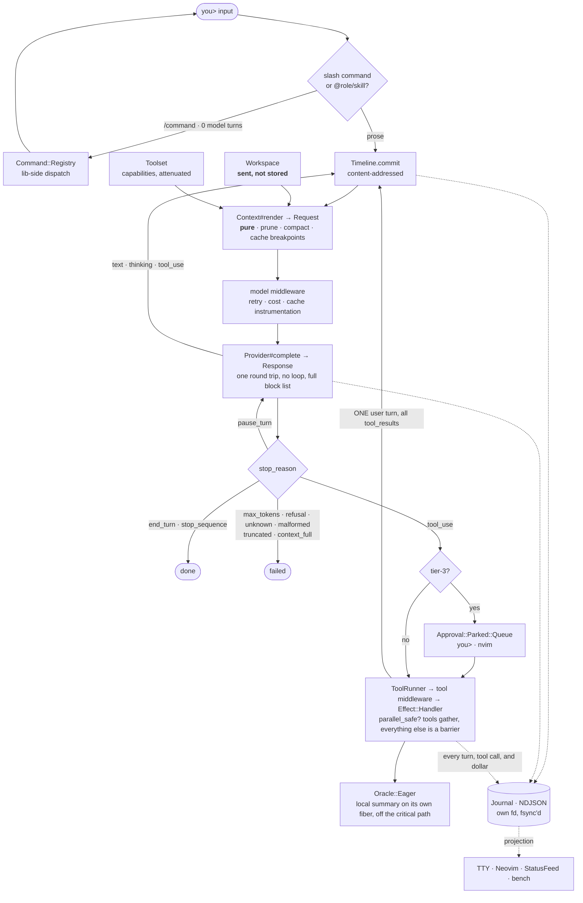

# Design

The ideas behind lain's structure, for someone about to change it. [architecture.md](architecture.md)
maps each subsystem to its files and wins where the 2 disagree. [glossary.md](glossary.md)
defines the math and CS vocabulary.

## The study bench

lain started as a bench for experiments on LLM orchestration, tool design and the agent life cycle,
and the bench is still how its own developers check that a design choice pays off. The parts of
the loop an agent would normally hard-code sit behind seams.

- **Swappable.** An orchestration topology, a provider, a context strategy, an isolation backend, an
  oracle, and a grader are each one interface with several shipped implementations. Substituting one
  is a constructor argument.
- **Observable.** Every turn, tool call, degradation, and dollar lands in an
  [NDJSON](glossary.md#ndjson) journal on its own fd. Both frontends and the bench are
  projections of that one stream, and the agent knows about none of them.
- **Comparable.** `Compare` folds n runs into a per-metric
  [distribution](glossary.md#distribution-variance) and refuses to run on fewer than 2, because
  one run of each cannot show whether a difference is the tactic or the variance.

lain makes the strategies behind a task into first-class objects you can substitute,
journal, replay, and diff. If the agent itself is only mediocre, but you can
demonstrate which tool description raised the correct-call rate, or which context strategy
survived a provider swap, the project has done its job.

Feature parity with Claude Code is not a goal. lain also skips both provider SDKs' built-in
agentic loops (`tool_runner`, `Chat#complete`). Those loops work, and they own the loop. The
loop is the object of study, so lain owns its own and every turn passes through seams it can
measure.

Ruby development is the target domain because I can already judge correctness in it by eye, which
makes the mechanical numbers beside that judgement trustworthy. The intent is that the intuition
transfers to a domain where correctness cannot be eyeballed: LLM tool-call systems that synthesize
medical literature.

## The turn lifecycle

One turn, end to end. `Context#render` is pure, the Provider is a single round trip, and the loop
lives in `Agent`.



Tool results come back as 1 user turn carrying every `tool_result`, then the loop returns to
`Context#render`. The agent is an explicit `state_machines` machine, so every `stop_reason` is a
transition and no branch can be forgotten. The full state diagram is in
[`docs/devs/agent-state-machine.md`](agent-state-machine.md).

## Components

Each row is one interface with several implementations behind it. [`docs/devs/architecture.md`](architecture.md)
maps every one of them to the files that implement it, and it wins wherever this prose disagrees
with it. [`docs/devs/glossary.md`](glossary.md) defines the math and CS vocabulary.

| Component | What it is | Why it exists |
|---|---|---|
| `Canonical` | Deterministic bytes, [BLAKE3](glossary.md#blake3) over a sorted-key serialization. | Event hashing and prompt-cache stability are the same problem. One function, 2 invariants. |
| `Event` / `Store` / `Timeline` | A lossless [content-addressed](glossary.md#content-addressable-storage) [Merkle DAG](glossary.md#merkle-tree) of the conversation. | `fork` is O(1), `diverge_at` localizes a cache break, and usage aggregates over unique reachable digests instead of double-counting a shared prefix. |
| `Request` / `Response` / `Usage` | Provider-neutral value objects. `Usage` is a property-tested commutative [monoid](glossary.md#monoid). | The [anti-corruption layer](glossary.md#anti-corruption-layer) that makes dry replay and cross-provider comparison honest. |
| `Provider` / `Capability` | One HTTP round trip, no loop. `Anthropic` (default), `AnthropicReference` (SDK oracle), `Ollama`, `Mock`. | lain owns the loop, because the loop is the object of study. `Capability::Policy` resolves a combinator/provider mismatch loudly. |
| `Context` / `Workspace` | A composable pipeline of message transformations. `#render` is pure. | Purity and cache-hit are the same constraint. `Workspace` is sent, never stored. |
| `Tool` / `Toolset` / `Tool::Input` | 23 tool classes, 20 of them in the live chat toolset. `Tool::Input` (ActiveModel) declares the JSON Schema and the local validation once. | A subagent holds what it was handed, and the schema cannot drift from the validation. |
| `Effect` / `Effect::Handler` / `Gate` / `Middleware` | An ordered `Middleware::Stack` of guards and the approval gate, ending in one interpreter. | `Live` runs a tool, `Mock` answers canned results; `Gate` is where tier-3 approval lives, and it must be the last layer before the interpreter. |
| `Agent` / `Budget` / `ToolRunner` / `Supervisor` | An explicit `state_machines` machine plus its collaborators. | Every `stop_reason` is a transition, so refusals and ceilings cannot be forgotten. Cancellation is structured and never `Thread#kill`. |
| `Arm` / `Compare` / `Ledger` / `PriceBook` | Four orchestration topologies on one seam, scored by distribution and priced from the Journal. | Comparing topologies should not mean editing the loop. |
| `Grader` | `Fixture` (deterministic assertions) and `Rubric` (LLM judge in a separate window) behind one `Grade`. | Mechanical metrics say nothing about whether the agent was right. |
| `Memory` / `Embedder` | Content-addressed index with a manifest, a graph, and BM25 retrieval. | Recall is a retrieval problem with a measurable recall@k, so it gets swept like any other axis. |
| `Journal` / `Channel` / `StatusFeed` / `SessionRecord` | One NDJSON file per session on its own fd, crash-resumable via a `.wal`. | The experiment record. Everything a frontend shows is a projection of it. |
| `Skill` / `Role` / `Plan` / `Gherkin` / `Oracle` | Config values with no behavior of their own. | A role is an attenuation plus a prompt slot; `Gherkin` is a content-addressed IR a grader can attest against. |
| `Frontend::TTY` / `Frontend::Neovim` | Two subscribers to the same stream. | Editor code never reaches into the agent. |
| `ext/lain` | In-process Rust (`lain.so`): Canonical/digest, the persistent DAG, in-memory BM25, AST search. | Data-structure work Ruby's object model makes asymptotically worse. Pure, synchronous, no tokio. |
| `crates/lain-daemon` | Out-of-process [msgpack-RPC](glossary.md#messagepack-rpc) per-user daemon: the chat registry, the phone relay worker, ntfy, headless runs and the review poll. Builds only under `rake daemon:build`. See [docs/users/remote.md](../users/remote.md). | Async and isolation-relevant work belongs out of process. An in-process sandbox is not a sandbox. |

## Design ideas

Tool design, context management, and orchestration interlock. A tool's result shape is context,
because the result lands in the message log and is then cached, pruned, and compacted. A context
strategy decides which tool results survive, which changes what the model believes it has already
done. A subagent is a tool whose result is a compressed context, so orchestration is a form
of context management.

lain treats these as 3 views of one [pure function](glossary.md#pure-function) that renders a
`Context`, a `Timeline`, and a toolset into a provider request. Making that function a first-class
object lets a recorded session replay under a different strategy and be diffed.

### History

Each turn is a frozen node naming its parent by digest, and its own name is BLAKE3 over its
content. Nothing is ever discarded or overwritten.

That is why [`/fork`](../users/commands.md#fork) and [`/rewind`](../users/commands.md#rewind) are instant
and safe: a fork copies a `(head_digest, store)` pair, and a rewind moves a pointer. The old head
stays reachable, branches share one copy of their common prefix, and a prompt-cache break is
located by walking 2 chains to the first differing digest.

It also makes cost reporting correct on a branched session. Summing usage along the branches
double-counts the shared prefix; aggregating over unique reachable digests collapses the
duplicates before the sum runs.

### Middleware stacks

A tool call is an `Effect`, interpreted by an `Effect::Handler`: `Live`, or `Mock` in specs. The
public API in front of that is the Rack idiom, `#call(env) { |env| ... }`, and every refusal, mask
and approval is a layer of the stack and no handler.

There are 4 stacks and 1 protocol:

- **model**, wrapping each provider completion: retry, cost accounting, cache instrumentation,
  request logging,
- **tool**, wrapping each tool call: approval gate, timeout, contract checking, result truncation,
  journaling,
- **turn**, wrapping each agent turn: budget, iteration ceiling, interrupt, speculative fork,
- **repl**, wrapping each REPL command.

Layer order matters, as it does in Rack, so the stacks are inspectable and mutable Sidekiq-style with
`to_a`, `insert_before`, and `insert_after`. What you may safely put inside one is bounded by the
fiber model: see [Slow middleware blocks the reactor](../users/configuration.md#slow-middleware).

Your own middleware goes in a `middleware` block in `config.rb`, per area, and runs outermost in its
phase. See [middleware](../users/configuration.md#middleware).

### Context strategies

Pruning, compaction, cache-breakpoint placement, and reminder injection are each a transformation
of the message list, and they compose:

```ruby
Context.new(
  system: prelude,
  pipeline: Context::Prune.new(keep_last: 3) >>
            Context::Compact.new(threshold: 150_000, keep_last: 6, summarizer:) >>
            Context::CacheBreakpoints.new
)
```

Composition is associative and property-tested, so a strategy is determined by the sequence of
combinators and no bracketing changes it. The search space is every sequence over the
combinator set, which the bench can enumerate, where a fixed menu would hold only hand-written
strategies. A combinator that broke associativity would silently produce different prompts depending
on composition order, which is the class of bug ordinary unit tests miss.

`Context::Compact` appears above as a combinator, which it is, but no chat composes it any
more. A compacting `lain chat` substitutes the derived chain's projection, and `Compact`
survives as a bench arm to compare that against. See
[2 lineages, one render path](compaction.md#two-lineages).

### Tool capabilities

A subagent holds the tools it was handed, attenuated at construction, for example
`toolset.only(:read_file, :grep)`. The answer to "what can this subagent do" is one line of code
you can read. There is no permission layer to consult, and possession of the tool is the
authorization. A `Role` packages that attenuation with a prompt slot and a spawn posture.

### Worker isolation

Isolation is one seam, `acquire(worker_id) -> Lease`, and a `Lease` carries the `WorkerEnv` a
worker resolves its paths against. `--isolation worktree` resolves an `Isolation::Clone` behind it,
decorated by whatever `.lain/services.rb` declares, so a worker can get its own checkout and its own
`postgres` without the topology knowing that happened.

Each checkout is a `git clone --shared` of the repository: a repository of its own that reads
upstream's objects through alternates. Its whole git dir is under the lease, so the sandbox lets a
worker commit, delete branches and finish merges there, while no upstream byte is writable.

The clone is cut detached at the working branch's tip, as a SHA, and keeps no branch or remote ref,
so a re-acquire after a crash is always a clean checkout of the base and never a dead worker's
tip. Upstream pins the base under `refs/lain/lease/` while the clone exists, so an upstream prune
cannot take history the clone reads. The clone runs upstream's hooks, from a config the sandbox
seals.

A worker's commits live in its clone's own store, and they reach upstream only at the fold-back
fetch: before any ref names one, lain fetches it from the clone by SHA, fsck'd. Then
`Worktree::Handback` writes the worker's `HEAD` to `refs/lain/worker/<id>` (outside `refs/heads/`,
so it is not a branch) and queues that ref for the merge coordinator. The parent checkout is never
merged into.

The coordinator builds each batch as a candidate commit no checkout holds, runs the
project's verify command on it in a scratch worktree, and moves the branch only on green, by
fast-forward where a worktree holds it. A conflict is reported with its paths, and the work stays
on its ref. The worker's tool result names the entry, and `lain land wait <id>` says whether it
landed ([`docs/users/commands.md`](../users/commands.md#lain-land)). Handback never raises past its
caller and never removes a checkout.

A worker brings itself current before it hands back. It runs its fast checks, then anchors its
`HEAD` and rebases onto the working branch it was cut from, and verifies with `git cherry` that
every patch survived, so a sibling that landed first cannot silently swallow this worker's
commits. The checks are its changed specs and the mirror specs of its changed sources, then the
lint.

One drainer per branch lands the queue, and `lain epic land` takes turns with it on the same
lock, so the full suite runs once per batch. The retry count, the merge
strategy, the verify and check commands and the batch size are the `isolation` verb of
`.lain/config.rb`.

Nothing is destroyed while it might still hold work. A dirty clone is kept, and `lain worktrees gc`
reaps clones as it reaps worktrees: it fetches and anchors a committed
`HEAD` (plus a snapshot of any dirty state) under `refs/lain/worker/*` before it removes a clone
and its pin. A clone whose git dir holds a name that redirects git (`commondir`, `config.worktree`,
`worktrees`, `modules`), which a sandboxed call may have planted, gets no git run in it at all: it
is kept for a human, and `lain worktrees gc` says why.

One limit stands: the worktree root is keyed on the repository, so 1 concurrent isolated run per
project is a precondition.

### Orchestration arms

The way an agent decomposes work is usually structural: the orchestrator-worker shape is written
into the loop, and comparing it against a flat run means editing the loop. `Lain::Arm` makes the
topology a value, returning a graded trajectory: the recorded Timeline, the
`Grader::Grade`, wall-clock seconds, and the journal-priced `Ledger`.

Four arms ship:

- **Single-thread** is the control every richer topology has to beat.
- **Orchestrator-worker** adds a synthesis pass over its workers' results.
- **Dual-ledger** carries a Task and a Progress ledger.
- **Adaptive-router** chooses at spawn time.

### The Journal

One NDJSON file per session, one event per line, on its own fd, fsync'd, crash-resumable through a
`.wal`. Nothing else in `lib/` may write to `$stdout` or `$stderr`, and a spec parses the AST of
every file to enforce it, because one stray warning interleaved into the stream makes `JSON.parse`
fail on that line.

The record is typed: `Telemetry` declares roughly 20 event kinds (`TurnUsage`, `RequestSent`,
`Compaction`, `ContextDerived`, `IsolationLease`, `OracleAnswer`, `GradeRecord`, `SeamDecision`, and
so on), so a reader matches on a kind and never pattern-matches loose hashes.

Cost reporting reads back out of this file and never out of the turns themselves. `Ledger` aggregates
usage over the turns reachable from a set of heads and `PriceBook` prices the 4 token classes in
`BigDecimal`, never Float, because a cost metric that drifts is worse than none.

## Provider capabilities

Providers do not offer the same capabilities. If you A/B a prompt across 2 providers and half your
context tactics silently became no-ops on one of them, the comparison would be a lie.

Capabilities are therefore machine-checked. `Provider::CAPABILITIES` is a closed list of 9 (`streaming`,
`prompt_caching`, `strict_tools`, `thinking`, `parallel_tool_use`, `server_compaction`,
`server_context_editing`, `server_tools`, `structured_output`). A context combinator declares what
it requires, a provider declares what it has, and `Capability::Policy` resolves a mismatch under
one of 2 policies you set per run:

- `:strict` raises. Anything real defaults to this.
- `:degrade` no-ops the tactic, records the degradation in the Journal, and reports what the run
  lost. Bench runs default to this, so a sweep never dies mid-flight.

`Capability::Guard` then refuses to compare 2 runs whose degraded sets differ unless you opt in.
"Which of my context tactics survive a provider swap" becomes a question the bench answers,
which is why the provider is a swept axis alongside context.

## Replay and grading

The bench replays your own recorded sessions under different strategies and reports distributions.
Every chat you have is a recording, because a bench session and a live chat
are byte-compatible on purpose.

There are 2 replay modes:

- **Dry replay** re-renders requests under a different context strategy or provider encoding from a
  recorded timeline. Free, instant, deterministic, byte-diffable. This is the unit test for context
  strategies.
- **Live replay** re-runs against the API. It costs money and is nondeterministic. This is the
  experiment, and [`qa-lain bench variance`](qa-lain.md#qa-lain-bench-variance) tells a
  real difference from noise.

Five sweeps ship: retrieval (recall@k over a gold corpus), arm, decider, disclosure, and plan.

Tokens, cache-hit ratio, turn count, wall time, and cost say nothing about whether the agent was
right, so the grader carries the verdict. Two graders ship behind one `Grade` of `score`,
`pass`, and `why`: `Fixture` is deterministic assertions with no model in the loop, and `Rubric` is
an LLM judge in a separate context window against explicit criteria. A `Grade` with a blank `why`
raises at construction, because a judgment you cannot read the reason for is unusable.
