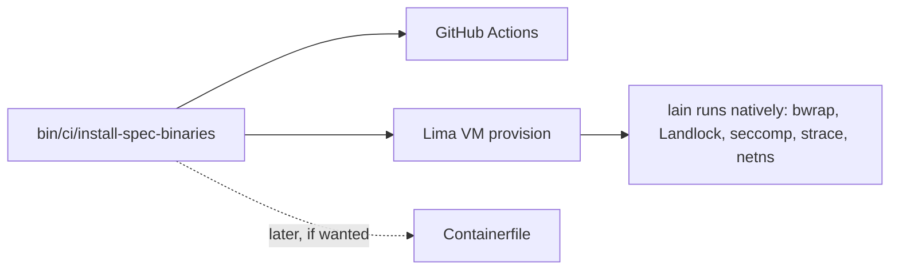

# Repo scaffolding cleanup: research

| | |
|---|---|
| Date | 2026-11-18 |
| Git SHA | 943103f1 |
| Branch | main (current with origin/main) |
| Prior research | Included: `planning/simplification-impact-research-2026-10.md`, `planning/spec-suite-solutions-research-2026-10.md`, `planning/spec-suite-profiling-research-2026-09.md` |

## Executive summary

Clean up in 5 small waves, using the repo's own tools and upstream hooks. Add no new task runner.

The tree carries 5 tracked junk files, 3 leak directories, a gemspec that ships `planning/` and `references/`, about 80 lines of inline CI bash, 7 finished profiling scripts, and 106G under `tmp/`. All of it is cheap to remove.

For the Mac, run lain natively in a Lima VM, with no container. A container keeps every isolation layer only after it is granted `SYS_ADMIN` and `NET_ADMIN`.

The main risk is the in-flight docs work: wave 1 must land after it, or the 2 sessions will collide on `.gitignore`, the gemspec and `.pre-commit-config.yaml`.

## Context

You asked for an audit of everything around the app and test code: `bin/`, pre-commit, `.github/`, the Rakefile, top-level files, and spec files that act as lint. Earlier cleanups covered `lib/` and `spec/` behaviour only.

Constraints from the prior reports and CLAUDE.md that this report keeps:

- `rake pspec` stays the single suite command, and the commit hook keeps running it (`.pre-commit-config.yaml`, hook `ruby-checks`).
- The census scripts (`comment-census`, `spec-census`, `zeitwerk-census`, `runtime-census`, `hot-path-bench`) are deliberately ungated. Nothing here wires them into CI or the hook.
- Never shard a spec to game the packer, and check the example count after every step.
- Delete replaced code outright, with no aliases.

Another session is reorganising docs right now (moves into `docs/devs/` and `docs/users/`, new `.vale.ini`, `lychee.toml`, `styles/`, and edits to `.pre-commit-config.yaml`, `.gitmodules` and `lain.gemspec`). This report treats that work as in flight, and none of it counts as clutter.

## Findings

### Top-level clutter

| Entry | State | What it is | Action |
|---|---|---|---|
| `.red.txt` | tracked, 2026-10-28 | 3 lines of grep output from `lib/lain/middleware/` | `git rm` |
| `gc_per_file.bak`, `worker_suffix.bak` | tracked, 2026-10-22 | byte-identical copies of `spec/support/suite_profile/*.rb` | `git rm` |
| `TERM` | tracked, commit 83637769 | the text `M1 KILL-`, committed with `tmux_plugin_spec.rb` | `git rm` |
| `sites` | tracked, commit 241d0e4e (a cargo update) | the text `---Combinator` | `git rm` |
| `.review2-T14.md` | already staged for deletion | review notes | done |
| `sig/lain.rbs` | tracked, 103 bytes | the `bundle gem` stub; no steep or rbs use anywhere | `git rm -r sig` |
| `old.err` | untracked, 0 bytes | empty | delete |
| `not/`, `.local/` | untracked | nvim state written relative to cwd by `spec/plugin/nvim_plugin_spec.rb:259,351,375`, which passes `xdg:`/`home: "not/absolute"` while nvim runs in the repo root | delete, and start `boot_nvim` in the example's tmpdir |
| `sock-sai7ftim/` | untracked, 2026-10-23 | a dead unix socket; no writer found | delete |
| `notes.md`, `nyotes-*.md`, `frugirl-trial.md` | untracked, unignored | your trial notes | your call: move to `planning/` or ignore |
| `nyotes-approvals.log`, `.ruby-lsp/` | hidden only by your global git ignore | trial log, editor cache | add to the repo `.gitignore` so a fresh clone (the Mac) agrees |
| `spike/` | ignored, 120K | July probes (`astgrep-probe`, `scip-probe`, `survey-seam`) | delete locally |
| `CHANGELOG.md` | tracked, 60 bytes, never updated since `bundle gem` | template | open question below |

`.gitignore` gains `/not/`, `/.local/`, `/sock-*/`, `/*.bak`, `/*.err`, `/.ruby-lsp/`, `/nyotes-approvals.log`.

### The gemspec ships the repo

`lain.gemspec:34-38` takes `git ls-files` and rejects only `bin/`, `spec/`, `.github/` and a few dotfiles. A built gem therefore carries `planning/` (372 files), `references/`, `apps/`, `docs/`, `.claude/`, and every junk file above. Switch to an allowlist: `lib/`, `exe/`, `ext/`, the `crates/` the extension build needs, `plugin/`, `LICENSE.txt`, `README.md`, `Cargo.*`. Prove it with `gem build` and an install into a scratch `GEM_HOME`. The gemspec has in-flight edits from the docs session, so this waits for them.

### `bin/` (32 scripts)

Shellcheck reports 0 findings on all 11 shell scripts, and the existing `shellcheck` hook already covers them by shebang.

| Group | Scripts | Action |
|---|---|---|
| Finished profiling chain (Sep/Oct) | `trace-pspec`, `trace-summary`, `trace-memleak`, `memleak-summary`, `strace-children`, `setup-profiling` | move to `planning/archive/tools/`, update the table at `docs/devs/spec-suite-performance.md:388-396` |
| Superseded | `chat` (no referrers; `lain up` does this, `exe/lain:476`) | delete |
| Demos of shipped chunks | `demo-fanout`, `demo-skills` | archive; keep `demo-supervision` (2026-11-03) |
| Stale benchmark | `bench-ollama-gpu` (no code caller; has a 1-line in-flight edit) | archive after the docs session lands |
| Recent measuring tools | `suite-load`, `suite-profile`, `suite-redrate`, `box-state` | keep until `planning/hot-path-profiling-2026-11/` closes |
| Guards and daily tools | the 5 census/bench scripts, `qa-lain`, `verify`, `with-ruby`, `setup`, `install-shim`, `dogfood-setup`, `workspace-run`, `regenerate-session-fixtures`, `console`, the 3 `lint-*` hooks | keep |

No off-the-shelf tool replaces the census scripts. `zeitwerk:check`-style eager loading only proves names map to files, which `spec/zeitwerk_spec.rb` already asserts. `comment-census` (843 lines) and `spec-census` (1,110 lines) both walk Prism trees with no shared code, which is a later simplification.

`lint-commit-msg` stays local: gitlint or commitlint would cover subject length, but its rules (no dashes, no generated-by markers) are house rules, and either tool adds a Python or Node dependency for little gain.

### CI YAML

The workflows hold about 80 lines of multi-line `run:` bash in 11 blocks. The largest are `changes` (`main.yml:198-209`, 12 lines), `assert spec binaries` (`action.yml:160-171`, 12 lines), and the bench workflow's run step (`spec-workers-bench.yml:53-79`, 27 lines).

Inline bash already gets shellchecked: the `actionlint` hook runs shellcheck over `run:` blocks whenever shellcheck is on PATH, which holds on this box and on `ubuntu-latest`. Extraction buys 2 other things. A developer can run the step locally (on the Mac, in Lima), and one script can provision CI, Lima and any future container image (see Containers). Proposed home: `bin/ci/`, so the existing shellcheck hook and the `bin/` convention cover it.

| Block | Proposed |
|---|---|
| `action.yml:134-171` (bwrap enable, nvim install, binary asserts) | `bin/ci/install-spec-binaries`, shared with Lima provisioning |
| `main.yml:198-209` (`changes` job) | replace with `dorny/paths-filter` (upstream action), deleting the hand-written regex match |
| `main.yml:248-251`, `:277-287` (remote hooks, dioxus version, APK build) | `bin/ci/remote-app` |
| `spec-workers-bench.yml` (40 lines) | delete the workflow; it decided `LAIN_SPEC_WORKERS`, which is now `$(nproc)`, and it has not run since 2026-10-02. Git history keeps it |

Other CI drift:

- Ruby `4.0.9` is hardcoded 4 times (`main.yml:39,142,226,307`) beside a comment asking to keep it in step with `.ruby-version`. The bench workflow already reads `.ruby-version`; do the same in `main.yml`. `rubygems: '4.0.3'` (4 times) and `cargo-deny@0.21.0` (2 times) repeat too.
- `daemon-tier` runs twice per push: once through the pre-commit action in the lint job, and again directly at `main.yml:111`. Add it to the lint job's `SKIP` list.
- `yard-lint --staged` sees no staged files in CI, so its CI run checks nothing.
- `lint-price-freshness` fails on the calendar, so CI can go red with no code change. Move it to a weekly `schedule:` workflow, or accept that.
- The 21-line comment at `main.yml:75-95` explains a 1-line `nproc` step; it belongs in `docs/devs/spec-suite-performance.md`.

### Pre-commit hooks

Upstream today: 6 hooks from `pre-commit-hooks` v6.0.0 and `actionlint` v1.7.12, plus `lychee` and `vale` in the working tree. Local: 15 hooks. Every cargo, rake and repo-specific local hook should stay local; no maintained upstream hook does their job.

Swaps and cheap additions:

| Hook | Why |
|---|---|
| `shellcheck` local (system binary) to `shellcheck-py` | removes a system dependency; the Mac and CI get the same pinned version |
| add `check-added-large-files` | `apps/lain-remote/target` is 9G beside tracked code; one bad `git add` away |
| add `detect-private-key` and `gitleaks` | `.envrc` holds a live API key; it is safe only because your global ignore hides it, and a fresh Mac clone has no such rule |
| add `check-toml`, `check-json` | `Cargo.toml`, `deny.toml`, `lychee.toml`, fixture JSON |
| add a `pygrep` hook for `mixlib` and for the deleted names in `docs_naming_spec` | replaces 2 specs (next section) |

The 2 new lychee/vale blocks in the working tree end with a whitespace-only line, which the `trailing-whitespace` hook will flag on their first commit.

### Specs that work as lint

About 20 spec files scan source instead of driving a subject. Moving them is a question of where each rule belongs, and the speed gain is small. The mechanical scanners cost about 70s of CPU out of about 780s, which is roughly 6s of wall at 12 workers. `bin/spec-census` replacing `spec_discipline_spec.rb` is the precedent.

| Home | Specs |
|---|---|
| pre-commit `pygrep` (plain text) | `mixlib_free_lib_spec`, `docs_naming_spec`, `fixture_discipline_spec` |
| custom RuboCop cops (Ruby AST; rubocop already runs in the hook and CI, and ruby-lsp shows offenses in the editor) | `output_discipline_spec` (2.8s), `provider_construction_discipline_spec` (5.7s), `approval_consumer_discipline_spec` (5.0s), `gate_decision_fold_discipline_spec` (4.1s), `git_fixture_scrub_discipline_spec` (2.9s), `lib_null_defaults_spec`, `sdk_require_discipline_spec`, `declarative_inclusion_discipline_spec`, `memory_compaction_separation_discipline_spec`, `refusal_delivery_discipline_spec`, `repo_as_fixture_spec` (8.0s) |
| keep as a spec (needs a loaded object model or drives real code) | `journal_routing_discipline_spec`, `error_taxonomy_discipline_spec`, `git_lazy_fetch_discipline_spec`, `tool_bounds_discipline_spec`, `value_object_shareability_spec`, `journalable_surface_spec`, `network_posture_spec`, `zeitwerk_spec`, the census-script specs |
| undecided | `refusal_width_discipline_spec` (13.1s; scans Ruby and Lua, so a cop covers only half) |

The repo has no custom cops today, so the first one also sets the layout (`lib/rubocop/cop/lain/`, loaded through `.rubocop.yml` `require:`). I'd move 1 spec first, `output_discipline_spec`, and judge the shape before doing the rest.

### Mutants

"mutants" is `cargo-mutants`, a Rust mutation tester; the Ruby `mutant` gem is not in the Gemfile. `rake rust:mutants` (`Rakefile:133-172`) mutates 8 files in `ext/lain/src` (canonical, event, digest, dag, graph, nogvl, bm25, toml_table) and fails unless each file's killed, unviable and missed counts equal `ext/lain/mutants-baseline.txt`. CI runs it only when `ext/lain/` or the Rakefile changes, in about 13 minutes.

It is the only check that the Rust core's tests can fail, and `docs/devs/rust-bindings.md:53` makes it rule 5 for a new binding. Keep it. Two fixes:

- `ext/lain/mutants-survivors.md` lists 5 files, and the baseline lists 8.
- The 40 lines of tally code in the Rakefile could become `bin/rust-mutants` so the Rakefile holds tasks only. That one is optional.

The CLAUDE.md trap "Mutation harnesses lie by default here" is about ad-hoc Ruby mutation by agents, and it stays either way.

### Gemfile and Rakefile

- `benchmark-ips` (`Gemfile:12`) and `simplecov` (`Gemfile:70`) have no user in `bin/`, `lib/`, `spec/` or the Rakefile. Remove both.
- The `bundler/gem_tasks` tasks (`build`, `install`, `release`) only matter if the gem is built; keep them if the gemspec fix lands.
- The stock `spec` task survives next to `pspec`. Check that `bin/verify` does not need it, then delete it.

### `tmp/` is 106G

- `tmp/cache/bootsnap/compile-cache-iseq` is 83G, holding 9.2 million files, and 1.8 million of them were written in the last 7 days. Bootsnap never evicts, and `spec/support/child_boot.rb:27-49` points every child Ruby at this one cache. My guess is that each spec that boots Ruby from a fresh tmpdir path adds entries keyed to that path. That guess is unverified. Short term, delete the directory (it rebuilds, slower once and never wrong, per `spec/bootsnap_setup.rb`). Long term, find the writer and cap it.
- `tmp/worktrees/` holds 82 card worktrees (21G), and `git branch --merged main` lists all 82 branches. Removing them is your call; this report removes nothing.
- `tmp/profiling-2026-09-30` (961M) and `tmp/suite-profile` (818M) are finished profiling output.

### Confinement probe bug (found by the container spike)

`lib/lain/confine/probe.rb:102` checks `bwrap --unshare-user --ro-bind / / true`, and `:93` adds `--unshare-net`. The real argv at `lib/lain/confine/bwrap.rb:59-61` also uses `--proc /proc --unshare-pid`. In a default rootless podman container the probe passes and the real argv fails with "Creating new namespace failed: Operation not permitted". So the probe reports bwrap as working while every confined command aborts. This is a lain defect, outside scaffolding; it needs a card regardless of the container decision. The fix is to probe with the argv `Bwrap` really builds.

## Options

These are the overall approaches. The per-area choices are in Findings.

### 1. Targeted cleanup in waves, upstream hooks where they fit

The cleanup lands in 5 waves, each small and independently landable:

1. **Junk and ignores**: the `git rm` list, `.gitignore` patterns, the nvim leak fix, the gemspec allowlist, the 2 unused gems.
2. **bin/**: archive the profiling chain, delete `bin/chat`, archive 2 demos, update the doc table.
3. **CI**: `bin/ci/` scripts, `dorny/paths-filter`, Ruby from `.ruby-version`, skip the duplicate `daemon-tier`, delete `spec-workers-bench.yml`.
4. **Hooks**: `shellcheck-py`, `check-added-large-files`, `detect-private-key`, `gitleaks`, `check-toml`/`check-json`, 2 `pygrep` hooks replacing 3 specs.
5. **Policy specs to cops**: 1 cop first, then the rest if the shape holds.

The Mac work and the probe fix go in their own plans.

### 2. Use an existing tool stack: mise tasks, a dev container, ast-grep

Move `bin/verify`, `bin/with-ruby` and `bin/setup` into `mise.toml` tasks (mise already pins Ruby here), ship a `.devcontainer/` plus `compose.yaml` for the Mac, and express the policy rules as ast-grep YAML rules.

It is more uniform, and it adds 3 new surfaces. The container needs extra capabilities to keep confinement (see Spike findings), compose has only 1 service to run, and ast-grep is not installed here. Its fit for the Ruby rules went unmeasured, because installing it was denied in this session.

### 3. Do nothing

The junk files and the gemspec are cheap to fix and wrong today. The 83G cache keeps growing, and the API key in `.envrc` stays one global-ignore rule away from a commit on the Mac.

## Containers on the Mac

You said the goal that matters is running lain itself on the MacBook with the Linux isolation layers working. Running the suite and CI parity are nice to have.

| | Lima VM, lain native | Container (podman or Docker) | macOS native |
|---|---|---|---|
| bwrap with lain's real argv | expected to work (full kernel); untested on a Mac | needs `--cap-add=SYS_ADMIN,NET_ADMIN` | none |
| Landlock and seccomp via `lain-fence` | expected to work if the guest kernel has Landlock | works with no flags | none |
| strace | works | works with no flags | none |
| What it adds | 1 VM, your files mounted | a VM plus an image; isolation loosened to keep the layers | the thinner sandbox already planned |
| New files in repo | `lima/lain.yaml` plus the shared provisioning script | `Containerfile`, maybe `compose.yaml` | none |

Recommendation: a Lima VM with lain running inside it, provisioned by the same script CI uses. Defer the Containerfile until you want suite parity; when you do, 1 `Containerfile` run by podman (which works on both boxes) is enough, and compose adds nothing for a single service. Lima can also run containerd for that later, so the choice does not lock anything out.

This fits the existing `planning/specs/lain-macos-bringup.md` direction (a thinner native sandbox first). The Lima route is a second way to run lain on the Mac, and it needs a decision on where it goes in that plan.

## Comparison

| | 1. Waves, upstream hooks | 2. mise + container + ast-grep | 3. Do nothing |
|---|---|---|---|
| Files removed | about 20 tracked, 9 scripts archived | similar, plus 3 scripts moved into mise | 0 |
| New tools | gitleaks, shellcheck-py, paths-filter (all pinned upstream) | mise tasks, compose, ast-grep, container runtime | none |
| Keeps `pspec` as the one suite command | yes | yes | yes |
| Gate strength for moved specs | same (rubocop and the hook run where rspec ran) | same, if ast-grep runs in the hook | n/a |
| Mac isolation | Lima, all layers | container with `SYS_ADMIN` | thin native sandbox only |
| Risk | collision with the docs session on 3 files | larger change, 1 unmeasured tool | 83G and growing; key leak path on the Mac |

## Spike findings

| Question | Result | Evidence |
|---|---|---|
| Which confinement layers work inside rootless podman on Linux? | `lain-fence` (Landlock ABI 9, reaper) and strace work with no flags. lain's real bwrap argv fails until the container gets `--cap-add=SYS_ADMIN,NET_ADMIN`. `seccomp=unconfined`, `label=disable` and `--userns=keep-id` do not help; keep-id breaks `--proc`. | podman 6.1, ubuntu:24.04, the Arch-built `lain-fence` (needs GLIBC 2.39, which Ubuntu 24.04 has). Scripts saved at `/home/tara/tmp/lain/claude-1000/-home-tara-dev-lain/3b13ffd9-4e28-4fa2-9fcc-e232b2aee368/scratchpad/spike/layers.sh` and `real.sh` |
| Does the probe agree with the real argv? | No. The probe passes in a default container where every real call fails. | `probe.rb:93,102` against `bwrap.rb:59-61` |
| Does Docker's default seccomp allow Landlock? | Yes, since 2022. | moby `profiles/seccomp/default.json` (source below) |
| Does a Lima guest on macOS have Landlock and user namespaces? | Not tested; no Mac here. | Run `lain-fence --status` and the probe in the guest during Mac bring-up |

## Recommendation

Option 1, in the 5 waves above, with Lima for the Mac. I'm confident about waves 1 to 3, because each item has file and line evidence and removes something. Wave 4 is low risk. Wave 5 is a moderate bet, and it hinges on whether a custom cop reads as clearly as the spec it replaces, so it starts with 1 cop.

What would change it: if the Lima guest kernel lacks Landlock, the Mac route goes back to the thin native sandbox. If you want an image you can pin and throw away, add the Containerfile, accepting the 2 extra capabilities.

Order: wave 1 waits for the docs session to land, because it touches `.gitignore`, `lain.gemspec` and `.pre-commit-config.yaml`. The probe fix and the bootsnap cap are separate cards.

## Discarded options

- **`compose.yaml`**: lain runs as 1 process; compose adds a file and no behaviour.
- **gitlint or commitlint for `lint-commit-msg`**: the house rules need custom plugins in another language.
- **Wiring the census scripts into CI**: CLAUDE.md keeps them ungated on purpose.
- **Replacing `zeitwerk-census` with eager loading**: eager loading proves only what `spec/zeitwerk_spec.rb` already proves.
- **Deleting the mutation sweep**: it is the only check on the Rust core's test strength, and it costs CI time only when `ext/lain/` changes.
- **Docker Desktop**: podman covers both boxes without a licence question.

## Open questions

1. Your trial notes at the root (`notes.md`, `nyotes-*.md`, `frugirl-trial.md`): move to `planning/`, or keep them local and ignored?
2. Remove the 82 merged card worktrees (21G)?
3. `CHANGELOG.md` and `CODE_OF_CONDUCT.md` are `bundle gem` stubs. Is the gem published, or meant to be? The answer decides whether the gemspec fix matters beyond tidiness, and whether the stubs stay.
4. Lima goes into `lain-macos-bringup.md`, or into a plan of its own?
5. Unmeasured: can ast-grep express the Ruby scan rules as well as a cop? Installing it was denied in this session. It matters only if you prefer YAML rules to Ruby cops.
6. Which spec writes the bootsnap entries? Watching `find -newer` on the cache during a single `rake pspec` would answer it.

## Sources

- Code: `.github/workflows/main.yml`, `.github/workflows/spec-workers-bench.yml`, `.github/actions/spec-binaries/action.yml`, `.pre-commit-config.yaml` (HEAD and working tree), `Rakefile`, `Gemfile`, `lain.gemspec`, `bin/*`, `spec/*_discipline_spec.rb`, `spec/bootsnap_setup.rb`, `spec/support/child_boot.rb`, `lib/lain/confine/probe.rb`, `lib/lain/confine/bwrap.rb`, `crates/lain-fence/Cargo.toml`, `tmp/parallel_runtime_rspec.log` for per-file times.
- Prior research: the 3 reports in the header table.
- Moby default seccomp profile, Landlock syscalls allowed: https://git.causa-arcana.com/kotovalexarian-likes-github/moby--moby/commit/af819bf623a8d414289b24f9817c6317cf3f96d5 (read 2026-11-18)
- containerd default seccomp: https://cos.googlesource.com/third_party/containerd/+/refs/heads/release-R129/contrib/seccomp/seccomp_default.go (read 2026-11-18)
- Lima VM types (vz is the macOS default since Lima 1.0): https://lima-vm.io/_print/docs/config/vmtype/ (read 2026-11-18)
- Lima 2.0 default Ubuntu template: https://newreleases.io/project/github/lima-vm/lima/release/v2.0.0 (read 2026-11-18)
- bubblewrap in unprivileged Docker needs a privileged container: https://lists.freedesktop.org/archives/flatpak/2019-December/001840.html (read 2026-11-18)
- Podman machine defaults: https://podman.io/docs/installation (read 2026-11-18)
- mempalace: `repo scaffolding cleanup bin scripts pre-commit CI docker` (wing lain); hits were source files already read directly.
