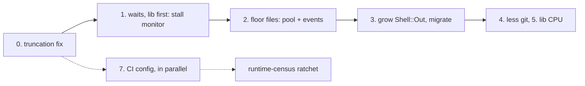

# Spec suite solutions: research

| | |
|---|---|
| Date | 2026-10-01 |
| Git SHA | d374aac8 (main); prototypes on `spike/combined` (fdaeaa16) |
| Branch | main |
| Prior research | `planning/spec-suite-profiling-research-2026-09.md` (the problem statement, included); other `planning/*research*` files are unrelated and excluded. mempalace was unreachable this session. |
| Data | `tmp/profiling-2026-09-30/pass5/` on the measuring box only (gitignored): every agent's findings and patches under `findings/`, the A/B runs under `runs/`, `variants.jsonl`, `ab_combined.*`, `ab_ci.*` |

## Executive summary

**Update after rounds 2 and 3 (same day):** a second branch, `spike/combined2`, adds 10 more changes. Measured over 4 interleaved rounds:

| | `main` | `combined` | `combined2` |
|---|---|---|---|
| dev-box wall | 111s | 84s | **56s** |
| total work | 1,165 worker-seconds | 853 | **548 (−53%)** |

At first, 15 of its 25 runs at 12 workers had a failure, against 0 of 4 on `main`.

**The overnight bisection resolved that.** Every flake that surfaced was already on `main`: the denser run only lost its races more often. Event waits now replace the fixed windows in 6 spec files (commit `b2533138` on `spike/combined2`). Then, 10 interleaved rounds of full suites:

| | median wall | runs with a failure |
|---|---|---|
| fixed tree | 54s | 1 of 10 |
| `main` | 112s | 3 of 10 |

`supervisor_spec:665` failed on `main` too.

**Rounds 2 and 3, the gains:**
- **`Shell::Out` in the spec git helpers:** the largest gain, now confirmed in 4 places.
- **Skipping the mise nvim shim:** about 54 worker-seconds.
- **Cheaper child boots:** about 36, or 65 with bootsnap.
- **A shared pool of pre-booted children:** applied to 7 more seam files.

**Rounds 2 and 3, little or nothing:**
- the tmux isolation wrapper, git config isolation and the CPU governor
- tmux control mode and the boot diet, which give little

**What changes in the plan:** land the 6 flake fixes with, or before, the speed changes. 2 races remain, both on `main` too, and both look like `lib/` ordering races: the approval-window decision line and a 30s repl hang in `62_approval`. See "Bisecting the flakes".

**Round 1 summary (kept as written):**

**Measured:** 12 Sonnet agents prototyped changes in `spec/` and `lib/`. Merged as 22 commits on 1 branch, they take total work from 1,171 to 866 worker-seconds (−26%), and the dev-box `pspec` wall from 111s to 89s (median 111s to 86s), 5 interleaved runs each. The example count rose from 21,508 to 21,520 (12 new examples). Each variant had 1 red run. `main`'s red is a flake recorded in `docs/toolchain-traps.md`; the combined branch's is not recorded anywhere, and neither are 2 more from the CI-shaped runs. Looped 30 times on each tree under load, those 3 examples and the `tty_spec` one passed every time on both (see Flakes). In a CI-shaped run (4 workers on 2 cores, packed by file size), the wall fell from 341s to 270s (−21%, 3 runs each).

**Recommendation:** land the truncation fix first. Then land the wait fixes and the 2 floor-file reworks, which are most of the gain. After that, grow `Shell::Out` and migrate every remaining Mixlib site. Land the CI configuration items (rubocop off the build job, a real cargo cache, a persisted runtime log) in parallel; they are independent.

**Main risks:**
- 14 spec files change how they wait, and 4 of those waits are quiet windows (a beat of no change) rather than events, 1 of them weaker than the sleep it replaced.
- The branch is research code: rubocop reports 24 offenses, every commit skipped the hook, 4 `lib/` changes have no spec, and 1 adds a receiver type check to `Up`. "State of the spike" lists what landing must fix.

## Context

The profiling report measured where about 1,100 worker-seconds go and proposed 11 options. This research asked what to change, with freedom to change `lib/` and the architecture.

**Priorities set by the user:**
- the dev-box wall first: `rake pspec` at 12 workers
- CI wins that don't depend on the dev box must not be dropped
- anything may change, judged on merit

**The bound:** wall ≈ max(slowest file, total work / 12) plus about 5 to 10s of startup and packing tail. On `main` the slowest file (`plain_chat_prompt_guards_spec`, 98s) and total work / 12 (98s) both bind.

**Method:**
- 12 Sonnet agents worked in parallel, 8 of them in their own git worktrees. Each wrote a findings file with counts (sleeps, forks, execs, boots, allocations, example counts), because wall times on a shared box can't be trusted.
- A 13th agent merged the compatible patches onto `spike/combined`, 1 commit per idea. It ran all 36 touched spec files on both trees: example counts match, except 12 added examples.
- Timed runs used the same interleaved A/B method as the profiling report: a fresh seed (439481), random `AB_PAD` environment padding, and `bin/box-state --guard` before every run, with the mempalace timer paused.
- **Example count:** `main`'s 21,508 is real growth since CLAUDE.md's 20,511 of 2026-09-20 (net +912 `it` lines), so the higher figure doesn't mean a lost worker.
- **Co-tenant:** a user process (`python main.py --enable-manager`) held 1 core throughout. Both variants ran under it, interleaved. That is why `main` read 111s here against 103 to 104s in the profiling report.

## Rounds 2 and 3: the middle band and the remaining ideas

A review found 65 files over 2s that round 1 never named, holding 367 of the combined branch's 866 worker-seconds. Its other points were the nvim shim and a stale worker count. A second look at the profiling report added 7 more ideas.
- **Agents:** 11 Sonnet agents worked on them, each in a worktree based on `spike/combined`, under stricter rules: specs first for `lib/`, rubocop-clean, and every wait classified.
- **Branch:** a 12th agent merged 10 of the patches onto `spike/combined2`. The child boot, tmux, nvim shim and git settings are switches set by environment variable, so 1 tree could be A/B'd.

### Measured (pass 6, `tmp/profiling-2026-09-30/pass6/`)

**Code, 4 interleaved rounds** (seed 30395; `main` and `combined` keep the nvim shim, as they always did):

| | main | combined | combined2 |
|---|---|---|---|
| wall, mean [95% CI] | 110.7s [106.2, 115.1] | 84.4s [80.3, 88.5] | **55.8s [49.9, 61.7]** |
| total work, mean | 1,165s | 853s | **548s** (10 runs at 12 workers across the 3 experiments) |
| user / system CPU | 418s / 367s | 367s / 300s | 302s / 133s |
| examples | 21,508 | 21,520 | 21,545 (+37, all new examples) |
| runs with a failure | 0 of 4 | 1 of 4 | 15 of 25 at 12 workers (all experiments) |

**What binds on `combined2`:** total work / 12 = 46s, and workers finish at 42 to 47s. The slowest file, `input_pane_socket_spec` at 33s, no longer binds. The remaining 7 to 10s of wall sits outside the workers: rake and Bundler startup, launching 12 workers, and each worker loading `lain` and its spec files. That overhead is now about 15% of the wall, and nothing in this research addresses it.

**Switches on `combined2`, 3 interleaved rounds each** (seed 507512):

| variant | wall | total work | read |
|---|---|---|---|
| defaults | 56.0s | 548s | |
| nvim through the mise shim | 64.6s [58.2, 71.1] | 602s | the shim costs about 54 worker-seconds and 9s of wall |
| child boot off | 58.9s | 584s | child boot saves about 36 worker-seconds |
| child boot plus bootsnap | 52.7s | 519s | bootsnap saves about 29 more |
| tmux isolation on | 56.3s | 540s | no measurable change (the agent's 39 worker-seconds didn't appear) |
| git isolation off | 54.2s | 551s | no change, as predicted; it is a hermeticity fix |

**Worker count on `combined2`, 3 interleaved rounds each** (seed 50069):

| workers | wall | total work | failures in 3 runs |
|---|---|---|---|
| 10 | 64.0s | 519s | 1 |
| 12 | 59.3s (one 70s run) | about 548s | several |
| 14 | **51.7s [48.4, 55.1]** | 591s | 2 |
| 16 | 53.1s | 641s | 7 |
| 20 | 53.1s | 773s | 7 |

14 workers looks about 4s faster than 12, with total work rising (CPU contention). 16 and 20 add failures. CLAUDE.md's 12 was measured under the old floor. Re-measure it once the flakes are fixed: failures cost more than 4s.

**CPU governor and energy preference**, 3 runs each, in blocks (not interleaved, so weak evidence):

| setting | wall (3 runs) | total work |
|---|---|---|
| `performance` / `performance` | 53.4, 53.4, 67.8s (the 67.8s run had a failure) | about 540s |
| `powersave` / `performance` | 53.3, 56.6, 51.8s | about 535s |

The earlier interleaved runs used `powersave` / `balance_performance` and averaged about 56s. So the governor doesn't matter, and the energy preference may be worth 2 to 3s. That is box configuration, unconfirmed.

### Bisecting the flakes (overnight, `tmp/profiling-2026-09-30/bisect/`)

**Method:**
- `hunt.sh` ran full suites on `spike/combined2` with each worker's file list printed, until a target flake appeared: the 5th run, `input_pane_spec:376`.
- Replaying that worker's 73 files in 1 process with each of the run's 12 seeds passed every time (1,613 examples). So the cause is load, not a file earlier in the same worker.
- Under 16 busy loops, neither target failed on either tree. Under real load (full `main` suites running behind, `suiteload.sh`), the `input_pane_spec` group failed on `main` too (`:353`). So it was there before.
- Under load, `main` failed `input_pane_spec:451` and `:473` in 6 of 15 runs. Those are the 2 self-signal examples option 0 rewrites, and the branch passed them every time.

**Causes and fixes** (`findings/round3/flake-fixes.md`, 6 spec files, no `lib/` change, rubocop clean, example counts unchanged):

| flake | cause | fix | proof |
|---|---|---|---|
| `input_pane_spec` "when the chat says nothing is published" | `unpublished` slept a fixed 0.2s; the generation-3 prompt's draw can start between the "prompt" and "unpublished" frames, and the stubbed Reline answered at once. A second race: a legitimate "touch" frame can wait on the socket | a later `context` frame proves "unpublished" took effect; a spy on `Typeahead#finished` proves the partial was taken; the stub sleeps until the partial is typed back; assert "no line frame" in place of "empty socket" | 0 failures in 30 rounds under suite load |
| `supervisor_spec:665` | the failing task's Async warning gives up the fiber before the task finishes, so the untrack fiber needs more turns than the example's single `task.yield`. A scratch spec where the task yields 0, 1 or 2 extra times passes, passes, then fails | `with_timeout(5) { task.yield until supervisor.to_a.empty? }` | mechanism shown; the original red never reproduced in isolation, and it failed once on `main` in the final rounds |
| `child_boot_spec` | never reproduced (192 children, all 1 GC) | bound loosened to 8 (unsized is 17), plus a check that the heap sizing reached the child | |
| `tty_spec` `submitted` (`:1496`, `:1565`) | waited for the file to exist, but `File.write(mode: "a")` creates it before writing | wait on `File.size?` | |
| `62_approval_spec` `:131`, `:158` | polls ran before the buffer existed ("Invalid buffer id: -1") | guarded in the helper | |
| nvim `ECONNREFUSED` (`51_thread`, `diff_mode`) | the socket file appears at bind, before listen, and the shim-skipping `binary` makes nvim fast enough to hit that gap | `HeadlessEditor.connect` retries `ECONNREFUSED` | |

**Not fixed, both also on `main`:**
- **`plain_chat_prompt_guards_spec` "ends its line with who decided it and how":** `:551` on the branch, `:527` on `main`. The screen settles at `you>` with no "decided by timeout: denied" line. That looks like an ordering race in `lib/` between the window closing and the decision printing. It needs a `lib/` read.
- **`62_approval_spec:208`, the repl-wiring example:** a 30s hang in `Repl#run`.

**Final check, 10 interleaved rounds of full `rake pspec`** (`redrate.log`):
- **fixed tree:** 9 clean; 1 failure, the ledger's `tty_spec` "loses and repeats nothing typed while notes keep arriving". Median 54s, all 21,545 examples.
- **`main`:** 7 clean; 3 failures: `tty_spec:1552`, `plain_chat_prompt_guards_spec:527`, `supervisor_spec:665`. Median 112s, all 21,508 examples.

### What each idea gave

| idea | evidence | size | verdict |
|---|---|---|---|
| `Shell::Out` in the isolation spec helpers and the 9 `real = Mixlib…` wrappers (spec only, 11 files) | forks: `worktree_handback` 536 to 0, `worker_handoff` 241 to 1, `working_branch` 313 to 16, `gc` 232 to 0, and so on; the 8 files' summed wall went from 63s to 31s | about 30 worker-seconds | pursue |
| `Shell::Out` defaults in `ShadowGit`, `Repository`, `GithubPr`, `Promotion`, specs first; `SeedRepo.derived` | 2,400+ forks to 14 across 12 files; `github_pr_spec` 13.0s to 4.8s, `undo_spec` 6.7s to 2.8s | about 40 worker-seconds, more at 12 workers | pursue |
| the CPU profile, independently | Mixlib costs 34ms per call against 0.49ms for `Process.spawn` at 413MB; in 1 slice, system CPU was 30s against 21s of user CPU, and `copy_page_range` plus `__zap_vma_range` were 41% of samples; the profiling report's unattributed 84s is mostly this kernel time | confirms the above | |
| skip the mise nvim shim (`HeadlessEditor.binary` drops PATH entries named `shims`), and a 2ms socket poll | 516 editor boots per run at about 135ms through the shim against 4 to 5ms | **54 worker-seconds measured** | pursue, but see the decision below |
| shared pre-booted child pool `spec/support/warm_pool.rb`, applied to 7 seam files and the floor file | `input_pane_socket` 43.6s to about 33.5s; blocking boots 12 to 1 (`input_pane`), 5 to 1 (`crash_mid_tool`), 7 to 2 (`stdin_pump`); child CPU unchanged | about 24 worker-seconds | pursue, after the flakes are settled |
| child boot: static load paths in place of `bundler/setup`, a pre-sized GC heap, optional bootsnap (`spec/support/child_boot.rb`) | child `require "lain"` CPU from 1.19s to 0.85s, or 0.52s with bootsnap; deletes `BUNDLER_SETUP`, which otherwise loads all of Bundler | **36 measured, 65 with bootsnap** | pursue; bootsnap opt-in until checked cold in CI |
| the remaining middle-band files (spec only, 10 files) | `streaming_spec` 3.1s to 0.1s, `exec/local` 1 grown-pipe run in place of 3, `guard_spec` judges each case once, `deletability` 1 `git ls-files` in place of 50 globs | about 21 worker-seconds | pursue |
| `Promise#await` traced | parked time is about 22s, not 47s, because fiber time overlaps: 11.4s timeouts elapsing, 5s cancels, 5.4s answers, all from `Approval::Queue::Pending#decide` or a prompt, with no polls | about 4 worker-seconds from 3 shortened windows | closed |
| git config isolation (`GIT_CONFIG_GLOBAL` to a spec-owned file, `gc.auto=0`, `maintenance.auto=false`, `GIT_CONFIG_NOSYSTEM=1`) | git execs 7,757 to 7,604; maintenance runs 155 to 1; no pager, hook or credential processes; 0 fsync | 0 measured | pursue for hermeticity: fixtures stop reading the user's `rerere` config and one maintenance race goes away |
| boot diet: lazy `nokogiri` and `irb` | boot CPU 975ms to 920ms; `exe/lain help` 1.17s to 1.13s; the 5 new fresh-Ruby specs cost back most of it; ActiveModel's 154ms is mostly shared dependencies; faraday's middleware runs at eager load | about 3 worker-seconds net | maybe; a small win for users |
| tmux control mode or `\;` chains in `Up::Tmux` | `lain up` sends 15 commands, 55ms; control mode is 70 times cheaper per command, but `lain up` start is about 1s of nvim check and preflight; it would need a second, duplex seam | about 40ms per `lain up` | discard |
| tmux isolation wrapper | 6,888 tmux execs to 1,254 in 4 files; plugins cost 716ms per server start against 24ms | 0 measured in the A/B | keep for correctness only: no user plugins or resurrect state in spec sessions |
| 14 workers in place of 12 | the worker table above | about 4s of wall | re-measure after the flakes |

**A decision for you: the nvim shim.**
- **The patch** makes the spec helper skip any PATH directory named `shims`, so it works on any box.
- **The profiling report's recommendation** was the opposite: fix the box's PATH, never a path rule in `spec/support`. CI has no shim either way.

The patch is measured at 54 worker-seconds. It's a heuristic about how mise names its directories, kept behind `LAIN_SPEC_NVIM_SHIM=keep`.

### Flakes on `combined2`

Pass 6 recorded failures only from the `rspec ./…` rerun lines, which list real failures and not pending examples.

**12 workers, 25 runs** (failures by example):
- `supervisor_spec` "drops the row when the task is stopped, and when it fails" (`:665`), 8 across all variants. 0 on `main` and `combined`, and 40 of 40 green alone on both trees, 15 of 15 for the whole file in random order. The example stops 1 task, yields to the scheduler once and expects both rows gone. A neighbouring file in the same worker, or the denser load, upsets that one-turn window. **Bisect before landing.**
- `62_approval_spec` (`:158` and `:131`), in the ledger.
- `input_pane_spec` "when the chat says nothing is published" group (`:363`, `:376`), 7 across `combined` and `combined2`, 0 on `main`. Its `after` hook now joins the pane thread (option 0), so the truncation fix or its timing is the first suspect.
- `spec/child_boot_spec`, new, 2: it asserts at most 3 GC runs in a child, which load can break.
- `plain_chat_prompt_guards_spec` (`:551`, `:625`, `:649`), `tty_spec`, `subagent_concurrency`, `vsock_availability`, `human_replies`: 1 or 2 each.

**More workers, more failures:** 7 in 3 runs at 16 workers and at 20.

Done overnight; see the next section, "Bisecting the flakes".

## Measured: the combined branch (round 1)

| | main | combined | change |
|---|---|---|---|
| `pspec` wall, mean [95% CI] | 111.0s [105.7, 116.2] | 89.2s [74.9, 103.4] | −22s |
| `pspec` wall, median | 111.2s | 85.6s | −26s |
| total work (sum of workers) | 1,171s [1,142, 1,201] | 866s [813, 919] | **−305s, −26%** |
| user CPU | 415s | 370s | −45s |
| system CPU | 378s | 301s | −78s |
| examples | 21,508 | 21,520 | +12, all new examples |
| failed runs (of 5) | 1: `tty_spec` "holds the note while the prompt is drawn" (recorded in the ledger, 2026-09-20) | 1: `62_approval_spec` "the repl's own wiring ... renders it in lain://approval and answers it with y" (not recorded; a 30s timeout inside the repl) | |

The combined mean has a wide interval because of that one run: the example waited out its 30s timeout, which set the run to 109s. The other 4 combined runs took 80 to 88s.

**Where the 305s came from** (mean per-file runtime from each run's runtime log; rows overlap and do not add exactly):

| file | main | combined | what changed |
|---|---|---|---|
| `seams/plain_chat_prompt_guards_spec` | 98.0 | 33.2 | pre-booted child pool; settle sleeps became waits on events |
| `cli/up_spec` | 52.5 | 30.5 | layout settle poll; `Shell::Out` for tmux |
| `seams/child_worktree_approval_spec` | 22.3 | 1.8 | "parked" read from the approval queue in place of a 2s timeout |
| `seams/input_pane_socket_spec` | 66.3 | 47.7 | chat child forked from the worker; pane spawned while the chat boots |
| `seams/recorded_run_spec` | 16.9 | 0.4 | replay once per file; stall monitor wake |
| `cli/epic_driver/factory_spec`, `issue_actor_spec`, `issue_tests_spec` | 49.8 | 18.1 | `Shell::Out` git helpers, seeded template, `Run::POLL` stub |
| `cli/wiring_spec` | 24.9 | 10.6 | throwaway `project:` in place of the real checkout |
| `review/source/local_branch_spec` | 20.8 | 6.5 | `Shell::Out` default; 1 fewer git call per construction |
| `provider/ollama_streaming_spec`, `anthropic_streaming_spec` | 19.4 | 0.2 | stall monitor wakes on stop |
| `review/deletability_spec` | 26.4 | 16.1 | not patched; indirect, through `Shell::Out` in `LocalBranch` and lower load (unconfirmed) |
| `cli/repl_spec` | 15.7 | 8.0 | PTY children forked from the worker |
| `project/root_defaults_spec`, `status_feed_spec` | 19.6 | 4.8 | shared parse memo; `Fleet#tree` grouped once |
| 16 smaller files | about 60 | about 25 | stubbed graces, shorter queue timeouts, overlapped pane spawns |

**What binds now:** total work / 12 = 72s, and the slowest file is `input_pane_socket_spec` at 48s. The slowest worker finished at 76 to 84s, and the wall adds about 5s of startup on top. So the dev-box wall is now bound by total work and packing, and the floor file no longer sets it. Every further worker-second counts, and `--group-by runtime` packing already hits its lower bound (simulated, `runner-arch.md` §0).

## Measured: a CI-shaped run

4 workers pinned to 2 SMT cores (`taskset -c 0,1,8,9`), packed by file size as CI is today, 3 interleaved runs each (seed 736043):

| | main | combined | change |
|---|---|---|---|
| wall, mean [95% CI] | 340.8s [315.5, 366.2] | 270.3s [269.7, 271.0] | **−71s, −21%** |
| total work | 1,269s | 980s | −289s, −23% |
| system CPU | 448s | 398s | −50s |
| examples per run | 21,508 | 21,520 | |
| failures | 4 in 2 runs, all recorded in the ledger: `62_approval_spec` "carries the wrapped command unwrapped" (2) and "resolves one unwrapped call per answerable row", and `input_pane_spec` "a pane with no chat to talk to ... leaves when told to", the TERM self-signal example option 0 rewrites | 2 in 1 run, neither recorded: `51_thread_spec` "restores a live diff with the folds the human was reading" and `supervisor_spec` "drops the row when the task is stopped, and when it fails" (seen red on `main` under load in the profiling report, not in the ledger) | |

Scaled by the profiling report's 1.38 (the runner against 2 of this box's cores), that is about 95s off CI's 459s suite step. The CI configuration items (option 7) save about 140s more: rubocop's 58s, 50 to 60s of compile from the cargo cache, and 23 to 45s from the runtime log. Together, the build job could fall from about 590s to about 350s. That is an estimate until 1 real CI run.

## Flakes seen, by name (round 1)

Every failing example in the 16 timed runs, checked by name against `docs/toolchain-traps.md`:

| run | tree | example | in the ledger? |
|---|---|---|---|
| A/B, 12 workers | main | `tty_spec` "holds the note while the prompt is drawn, keeps the typed words, and prints the note as the prompt closes" | yes (2026-09-20) |
| A/B, 12 workers | combined | `62_approval_spec` "the repl's own wiring puts a parked approval in front of the human renders it in lain://approval and answers it with y, with nobody having wired the view by hand" (30s timeout in `Repl#run`) | **no**; the ledger names 2 other examples in that file |
| CI-shaped | main | `62_approval_spec` "carries the wrapped command unwrapped, with the rendered lines unchanged" (twice) and "resolves one unwrapped call per answerable row, in queue order, for two parked approvals" | yes (2026-08-28) |
| CI-shaped | main | `input_pane_spec` "a pane with no chat to talk to says what it is waiting for without claiming the screen, and leaves when told to" | yes; option 0 rewrites it |
| CI-shaped | combined | `51_thread_spec` "restores a live diff with the folds the human was reading" | **no** |
| CI-shaped | combined | `supervisor_spec` "drops the row when the task is stopped, and when it fails" | **no**; the profiling report saw it red on `main` under load |

The combined branch changes `lib` code the repl runs (`Frontend::Neovim`, `Canonical`, the stall monitor), so its 3 unrecorded reds needed a check. **Loop:** the repl example, the `tty_spec` example (whose wait this branch makes weaker), and the `supervisor` and `51_thread` examples, run as 1 command on each tree. Main and combined alternated in random order, in 3 concurrent streams for load, 10 rounds each.

**Result:** 30 of 30 green on `main` and 30 of 30 green on the combined branch, 4 examples every run (`pass5/loops/results.txt`). That puts each tree's failure rate for these 4 examples under about 10% per run at 95% confidence (the rule of 3). It doesn't show the branch is flake-free; it shows these reds aren't frequent on either tree.

**Still to loop before landing:** the reworked floor file (1 uncaptured failure in about 19 loaded runs), `stdin_pump_spec` (1 uncaptured failure, which fits its 150ms quiet window), and `hangup_spec` at a 0.5s grace. Loop each 20 times, at 12-worker load.

## State of the spike

**`spike/combined2`** (rounds 2 and 3) is cleaner. All 10 steps applied, specs for `lib/` were written first, and rubocop flags only 3 offenses, all carried over from `spike/combined` (a class ivar in `github_pr_spec`, 2 `NoExpectationExample` in the floor file). It is also hook-skipped, it fails a run 60% of the time at 12 workers (see "Rounds 2 and 3"), and `qa_sandbox_pane_resolution_spec` hard-codes `-f /dev/null` in its own tmux helper, so that file ignores the tmux switch.

**`spike/combined`** (round 1):

`spike/combined` is research code. It measured what the ideas are worth; it is not a branch to merge.
- **Hooks skipped.** All 22 commits used `--no-verify`, because the hook runs the whole suite.
- **rubocop red.** `bundle exec rubocop` on the 48 changed Ruby files reports 24 offenses in 6 spec files:
  - 6 `ThreadSafety/ClassInstanceVariable`, 5 of them in the floor file's pool
  - 4 `LineLength`, 2 `NoExpectationExample`, 2 `InterpolationCheck`, `RemoveConst`, `FileOpen`, `BeforeAfterAll`, `MethodLength` and others
  - 3 inline `rubocop:disable` comments (`Security/Eval` in the `repl_spec` fork, 2 `ThreadSafety`); CLAUDE.md's RuboCop section puts exceptions in `.rubocop.yml`, never inline
  - 2 `break`s inside `loop do`, in `up_spec#laid_out` and `stdin_pump_spec#quiet`; the code style allows `break` only when unavoidable
- **`lib/` changes with a spec written first** (red, then green, on the branch): the stall monitor, the `Canonical` fast path (5 examples), compaction `Resume` (2), `Shell::Out` `cwd:` and `error!` (4).
- **`lib/` changes with no spec:**
  - the `Fleet#tree` grouping and its per-depth row memo
  - `LocalBranch#merge_base!`
  - the tree-sitter query cache: hit, miss and the 64-entry cap
  - `Up.preflight_factory`, which shouldn't land at all (option 3)
- **Stale comment:** `recorded_run_spec`'s header claims independent replays the memo removed.

So option 2's landing cost includes rewriting the pool helper without class instance variables, and every row above needs its spec written first, as `~/.claude/CLAUDE.md` requires.

## Landing: order, rollback, verification, next pass

| step | depends on | reverts alone? | examples after (from 21,508 today) |
|---|---|---|---|
| 0. truncation fix | nothing | yes | 21,508 |
| 1a. stall monitor, `teardown_grace:` (lib) | nothing | yes | 21,509 |
| 1b. spec waits (event rows, then quiet windows) | 1a for the streaming files | yes, file by file | 21,509 |
| 1c. Mixlib reap prepend | nothing; retired by step 3 | yes | 21,509 |
| 2. floor files | the pool's child protocol (`go` file, `parked` marker) lives in the spec's own `CHILD` script | yes, per file | 21,509 |
| 3. `Shell::Out` growth, then migration | `cwd:`, `error!`, `input:` first; the epic-driver helpers, `SeedRepo` and `up`'s tmux depend on them, so **reverting the growth means reverting those too** | growth: no, once callers move | 21,513 |
| 4. less git | `LocalBranch` alone; the epic-driver template depends on step 3's `cwd:` | partly | 21,513 |
| 5. lib CPU | nothing; `Resume` waits for a ruling | yes | 21,520 with `Canonical` and `Resume` |
| 7. CI config | nothing | yes | 21,508 plus the above |

**Each step's check:**
- `bin/box-state --guard`, then `rake pspec`, reading the example COUNT.
- `bundle exec rubocop` with no new offenses and no inline disables.
- `bin/comment-census --check-tickets` over the 2 new support files (`spec/support/parsed_source.rb`, `spec/support/prompt_mixlib_reap.rb`) and the rewritten specs.
- `bin/spec-census --check`, since the waits change assertion shapes.

**Next profiling pass:**
- Rerun `bin/trace-pspec` and the A/B on `main` after steps 0 to 2.
- The pool overlaps child boots, and it doesn't remove them: child CPU is unchanged (about 38s in the floor file). The next pass should show total CPU flat and wall down.
- After step 3, fork count and clone seconds should fall toward the vfork floor, with `bin/strace-children` showing the forks that remain.
- Rerun the CI-shaped pair to confirm the 4-worker gain.

## Options

Sizes are worker-seconds at 12 workers unless stated. "Counted" is a count of sleeps, forks or execs from a single-file run. "Measured" is the A/B above. "Read" is arithmetic from code.

### 0. Fix the silent truncation (correctness)

**Root cause** (reproduced): a trap restore that arrives late. `input_pane_spec`'s `after` hook kills the pane thread (`@running&.kill`, line 65) without joining it. The thread's `ensure` (`CLI::Signals#uninstall`, `lib/lain/cli/signals.rb:99-104`) can then run during a later example and put RSpec's own SIGINT handler back. The next `Process.kill("INT", Process.pid)` runs `RSpec::Core::Runner#handle_interrupt`: the worker stops after its file, prints a normal summary, and exits 0.
- **Model reproduction:** a 5-example file with an unjoined slow `ensure` prints "RSpec is shutting down" and "2 examples, 0 failures". With a join, it runs all 5.
- **Real file:** with a 0.15s delay injected into `uninstall`, the old spec failed in 3 of 12 seeds and the fixed spec in 0 of 12. Both ran all 30 examples.

**Fix** (13 lines, `floor-socket.patch`):
1. `@running&.kill&.join` in `after`.
2. The 2 self-signals become a direct call of the installed trap proc.

**Same pattern elsewhere, not changed.** `git grep -nE 'Process\.kill\([^)]*(Process\.pid|\$\$)' -- spec` on `main` finds 22 lines. 2 are the `input_pane_spec` sites the fix rewrites, and 19 signal the worker itself:
- `conductor_spec` (11: lines 136, 199, 437, 456, 480, 587, 637, 914, 1001, 1121, 1155)
- `signals_spec` (4: 49, 90, 132, 144)
- `supervisor_spec:414`, `repl_spec:1646`, `shutdown_spec:627` (USR2, which RSpec doesn't trap), `critique_over_held_review_spec:405`

The 22nd, `crash_mid_tool_spec:31`, sends KILL from inside the `CHILD` script the spec spawns, so it kills the child and never the worker. Each of the 19 needs the same check: is every thread that installed a trap joined before the example ends?

### 1. Waits: events in place of fixed windows

**Changes in `lib/`:**
- **Stall monitor wakes on stop.** A `ConditionVariable` in `FaradayHandlers` `sweep`, signalled by `stop`; 13 lines. It removes up to 1s of latency after every healthy streamed response, for users too.
  - The new test failed first ("Expected 1.0004 to be < 0.5"), then passed.
  - **2 sizes, 2 sources.** par_all's `bgsleep` at `faraday_handlers.rb:363` sums to 88s across 8 files: the monitor thread's own sleep calls, which mostly overlap a stream still running. The profiling report's 38s (22 on the main thread) comes from its blocking probe: the time examples spent blocked on the join, which is what wall time pays. The A/B agrees with the smaller figure: the 3 streaming and replay files lost about 36s, part of it from the replay memo.
- **`teardown_grace:` keyword on `Frontend::Neovim`**, 4 lines. The default stays 5s, so users see no change. It exists so `neovim_request_spec` can pass 0.2s.

**Changes in specs.** These split into 3 kinds, and only the first is immune to load. 14 spec files and 1 support file.

Waits on an event:

| site | before | after | size |
|---|---|---|---|
| `child_worktree_approval_spec` `outcome` | a 2s timeout means "parked" | race the call against `board.approvals.dequeue`; stricter, since a call that neither finishes nor parks now fails | 20.5s measured |
| `stdin_pump_spec` race | `sleep(0.2)` | wait for an `armed` file the child writes | part of 5s measured |
| `approval_view_spec` | awaits the fail-closed clock | no await when the verdict is unread | 3.4s measured |
| Mixlib `reap_errant_child` | TERM, `sleep 3`, KILL | polls `attempt_reap` every 0.01s up to the same 3s, then KILL | 6 to 9s counted |

The Mixlib change is a `spec/support` prepend on a private gem method, and it applies to **every** Mixlib call in the suite, `lib/` callers included. A spec that asserted Mixlib's 3s floor would now pass for a different reason (none does today; `grader/test_harness_spec`'s hung child is the nearest). Landing needs a guard that fails loudly if mixlib-shellout moves off 3.4.10. Option 3 retires the prepend.

Quiet windows (done when nothing changes for a beat):

| site | before | after | beat | note |
|---|---|---|---|---|
| `up_spec#laid_out` | 13 fixed sleeps of 1 to 1.5s | wait for the client height (an event), then for `window_layout` to stay unchanged | 250ms | the layout hook measured 5 to 9ms; disabling it still fails "never falls under" |
| `stdin_pump_spec#quiet` | 2 `sleep(1.0)` | the lines file and the screen unchanged | 150ms | the uncaptured combined-tree failure fits this |
| `tty_spec#settled` | `sleep` of 0.2 to 0.5s | 2 screen captures 30ms apart agree | 30ms | **weaker than the sleeps it replaced**, on the example that is the ledger's `tty_spec` flake; a draw that lands after a 30ms gap is missed |
| `qa_sandbox_pane_resolution_spec` | `drive.sh` quiet window | quiet window `0` | 0 | the window becomes no window |

`up_spec`'s quiet window, plus `Shell::Out` for its tmux calls (option 3), measured 22s.

Shortened windows and graces:

| site | before | after | note |
|---|---|---|---|
| `hangup_spec` | `grace: 5` | `grace: 0.5` | the subject's own grace, and the example asserts a graceful release: under load 0.5s may not be enough |
| Docker `Cleanup::DEADLINE`, `neovim_request` `teardown_grace:` | 5s and more | stubbed or passed short | the assertion is about what happens at the deadline |
| `approval_surfaces_spec` queue timeout | 0.5s | 0.1s | 8 examples wait it out |
| `human_replies_spec` | real ticks, negative windows of 0.5s | ticks stubbed, windows cut 5 times to 0.1s | negative windows: shorter means a weaker "nothing happened" |

Together: about 25s measured.

Not a wait: `recorded_run_spec` now replays once per file (16.5s measured). Its header comment says each example drives the whole replay again, "which is also what makes each of them a genuinely independent replay". The memo contradicts that. Landing must rewrite the comment and state the claim it gives up.

**Discarded:** making the `TICK` constants injectable for speed. With an injected tick, sleep calls rose from 76 to 770 and the file's wall stayed at 4.43s: those polls run on a sibling fiber alongside the real wait.

**Not resolved:** `Promise#await`'s 47s is fibers parked waiting for a real answer. No fixed window was found behind it.

### 2. The floor files: overlap or remove child boots

**`plain_chat_prompt_guards_spec`, 98s to 33s measured.** Kept at 31 examples (`floor-guards.patch`).
- **Pre-booted child pool, keyed by `TERM`:** the next child boots while the current example runs. Reline reads only `TERM` at load. Boots that block an example fell from 30 to 2 (counted).
- **74 settle sleeps (51.7s) became 8 (1.85s):** waits on echo, on "held as your next prompt" notes, on journal and dispatch state, and on a `parked` marker the child writes. The 6s sleep became a wait for the PTY to close, which is stronger: any late draw is on the screen.
- **5 negative windows of 0.3s stay:** nothing signals that something didn't draw.

**`input_pane_socket_spec`, 66s to 48s measured.**
- **The chat child is forked from the worker** (15 of 27 boots). Its eval runs the same CHILD source.
- **The pane is spawned while the chat boots.** The 12 `exe/lain input` panes still boot fresh: the pane is the subject.

**Hazards of forking the worker.** `input_pane_socket_spec`'s chat and `repl_spec`'s PTY children are `fork`s of a threaded rspec worker:
- **Mutexes.** Only the forking thread survives, and every mutex another thread held is copied locked into the child. A child that touches one (the logger, a `Channel`, the nvim RPC client, Timeout's thread queue) can hang.
- **Descriptors.** Every open fd is inherited, so a child can hold a socket or pipe open after the worker closes its end, and a reader waiting for EOF then waits for the child.
- **Reline.** `Reline::IOGate` is chosen at load, and the `repl_spec` fork resets that private constant with `remove_const`. That is a dependency on Reline 0.7.0 internals, and a silent wrong path (ANSI under `term: dumb`) if it drifts.

The pre-booted pool avoids all 3, because each child still `exec`s a fresh Ruby; it only starts the exec earlier.

**The alternative, a fork server (zygote)** (`child-ruby.md` §3): 1 preloaded process per file forks per request and passes the PTY over `SCM_RIGHTS`.
- **Counted:** boots fell from 30 to 2 and from 27 to 1. Fork to first byte takes 5ms against about 1,190ms for a fresh boot.
- **The cost of reaching past the pool:** about 110 support lines, and a `wait` relay for specs that need the exit status.
- **What it would add over the pool:** it would also cover the 12 panes, plus `stop_ask`, `typed_during_ask`, `crash_mid_tool` and `hangup`, about 75 to 80 boots per run.
- **The catch:** a forked pane loses `exe/lain`'s own boot and controlling terminal, which is what `input_pane_socket_spec` tests. So for that file the zygote must exec the pane, which brings it back to the pool.

**Lazy children for sites neither can serve** (tmux panes): a 2-line `eager_load` no-op in the child cut CPU per boot from 1.3s to 0.49s, with 31 of 31 passing. Never use it for boot-subject specs (`deletability`, `prelude_invariant`, `cli_spec`, `lain_spec`).

**Recommendation for this option:** keep the pool, and extend it to the seam files that boot a fresh chat. Build the zygote only if the panes become the floor.

### 3. Grow `Shell::Out` and finish the migration

**Verified:** read in Ruby 4.0.5's `process.c` and confirmed by strace on the 4.0.6 in use: `Process.spawn` uses `vfork` for every option: `chdir`, `env`, `pgroup`, `umask`, `rlimit`, redirects, `close_others`, `uid`. So do `Open3.capture3`, `popen3`, `system`, backticks and array-form `IO.popen`. The exception is a setuid Ruby (`process.c` `retry_fork_async_signal_safe`). Mixlib always forks, `cwd:` and `input:` included.
- **Counted on 2 files:** forks fell from 683 to 222, and vforks rose from 17 to 478. The 222 forks left are other Mixlib fixtures in those files.

**Grow `Shell::Out`:**
- **Added in the prototype:** `cwd:` (1 line) and `error!` with `Shell::Out::Failed`. `out_spec` went from 21 to 25 examples.
- **Still to add:** `input:`, about 15 lines with a stdin writer that can't deadlock. 3 `lib` sites need it.
- **The migration:**
  - 18 constructor defaults
  - 6 `CommandTimeout` rescues, which move to `Shell::Out::Timeout`
  - 81 spec `Mixlib::ShellOut.new` sites (`git grep -c 'Mixlib::ShellOut.new' -- spec`), most of them `git -C`, which become 1 helper
  - 9 `real = Mixlib::ShellOut.public_method(:new)` wrappers, plus 2 `real = Mixlib::ShellOut.new(*args)` in `up_spec`
  - the `up_spec:2262` stub

**The first thing the migration removes: `Up.preflight_factory`.** The spike added it to `lib/lain/cli/up.rb`. It checks whether the injected factory's receiver is `Shell::Out` and, if so, swaps Mixlib back in for `ChatPreflight`. That is a type check on a collaborator, which the repo's rules ("depend on messages, not on types") forbid, and its comment is already stale on the same branch: `Shell::Out` now takes `cwd:` and `timeout:`. The only remaining gap is that the preflight passes `env:`, which Mixlib accepts as an alias of `environment:`. Rename that keyword and move the `CommandTimeout` rescue, and the method goes. Do not land it.

**Size:** a counted ceiling of 101 worker-seconds over 9,615 forks. The combined branch moved `LocalBranch`, `SeedRepo`, the epic-driver helpers and `up`'s tmux, which is part of that. More at 4 workers, where forks cost 14.8ms.

**Existing libraries checked:**
- **`childprocess` 5.1.0:** spawn-based, but has no capture or timeout.
- **`tty-command` 0.10.1 (2021):** joins argv into a shell string, which breaks the repo's no-shell rule.
- **`posix-spawn` (2020):** obsolete.

None fits better than extending `Shell::Out`.

**Container caveat** (measured): `Process.spawn` took 30ms inside a rootless podman container against 0.7ms on the host, with the same binary. CI runs on the `ubuntu-latest` VM with no `container:`, so this does not apply there today.

### 4. Less git work

**`LocalBranch` construction, 3 git calls to 2** (`lib`, 7 lines): it runs `merge-base` on `BASE^{commit}` and resolves the base only on failure, so both error messages are unchanged. `rev-parse A B` can't be joined: without `--verify`, git 2.55 echoes `--end-of-options`.

**Counted git execs:**

| spec | before | after | change |
|---|---|---|---|
| `github_pr_spec` | 1,471 | 869 | the "without head" repo templated, plus the `LocalBranch` change |
| `local_branch_spec` | 611 | 514 | the `LocalBranch` change |
| `wiring_spec` | | | 40 `git add --all` runs of the real checkout fall to 0 |

The epic-driver specs moved to a seeded template, which removes 243 git calls across 3 files.

**Next pool, not changed:** the isolation specs. `worktree_handback_spec` runs 2,290 execs, with about 3 `rev-parse HEAD` per example. Caching `HEAD` is unsafe, because it moves inside one operation. Folding the reads into `status --porcelain=v2 --branch` needs an audit of each call sequence.

**Discarded:**
- **Rugged or gix in process:** fails the binding tests on value, and diverges on hooks, includes and worktrees.
- **fast-import:** fixtures are already built once.
- **General result caching:** few repeats are immutable facts.

### 5. CPU in `lib/`

| change | evidence | suite | users |
|---|---|---|---|
| TreeSitter query cache (40 lines of Rust; a `Mutex<HashMap>` capped at 64 entries) | `Query::new` costs 2.6ms per call in the profiling report's quiet-box probe, and 3.8ms in this spike's microbenchmark on a loaded box; a cached classification takes 0.016ms. clippy, fmt and `cargo test` are clean, but **no test covers a hit, a miss or the cap** | 3 to 5s | yes |
| `Fleet#tree` groups children by owner once, memoises rows per depth | `owner` calls at 500 spawns from 41.8M to 125k; identical tree on a random nested test (a script, not a spec); **no spec for the grouping or the memo's invalidation** | 7.3s measured (`status_feed_spec`) | yes |
| shared parse memo `spec/support/parsed_source.rb` | `root_defaults_spec` from 5,895 `Ripper.sexp` calls to 886 | 7.5s measured | no |
| `Canonical.normalize` fast path: `PRODUCED`, a process-wide `ObjectSpace::WeakMap` of returned Arrays | re-normalizing canonical data from 12,801 allocations to 0; marking Hashes cost 30% on fresh data, so only Arrays; 5 new examples, red first. **It adds process-wide mutable state to the module the architecture treats as pure**, and it is main-Ractor only | small | long sessions |
| compaction `Resume`: extend the previous derived chain when the held seam and source prefix match by digest | allocations per ask at ask 450 from 257,955 to 108,224, same final store | none | long sessions; **contradicts the "no `#extend`" stance in the `Derivation` class doc, needs a ruling** |
| lazy `require "irb"` and `nokogiri` | 77ms and 30ms of a 1.3s boot | about 11 CPU-s | faster `lain` start |

### 6. Memory: `malloc_trim(0)` at each file boundary

Via Fiddle in `after(:context)`; `fiddle` joins the Gemfile test group.
- **116 files in 1 process:** mean RSS fell from 230MB to about 205MB.
- **399 files** (the 4-worker scale): from 427MB to 358MB, −16%. 129 trims cost 0.04s.
- **Speed:** worth 1 to 2s of wall today, and about 0 once forks become vforks. The memory gain stays, which matters for CI's 16GB runners and this 15GB box.

**What the 74MB that Ruby can't see is:** `T_IMEMO` (iseqs, method entries), which `memsize_of_all` doesn't count: 134MB by `count_objects_size` against 43MB. Plus 49MB of glibc free chunks. No file retains live objects: about 6MB survives across 116 files.

**Discarded:**
- **`MALLOC_ARENA_MAX`, trim and mmap thresholds, `RUBY_GC_HEAP_*`:** all within noise.
- **`Process.warmup`:** 0.3s per call.
- **`GC.start` plus trim per file:** 19s.
- **Worker recycling:** the growth is allocator slack, which `malloc_trim` returns without a restart.
- **A musl Ruby:** no toolchain here, and fork cost is the same on musl.

### 7. CI configuration (independent of the dev box)

From `ci.md`, with draft YAML for each item. Estimates come from the run logs unless marked.

| item | saves on the build job | cost |
|---|---|---|
| Move rubocop off the build job (`rake default` runs compile, pspec, rubocop in series; rubocop took 58s in the 08-25 log) to the lint job | about 58s (measured in the log) | 6 lines |
| Real cargo cache. `setup-ruby-and-rust` v1.5.0 defaults `cache-save-always: true` and saves right after restore, so only `~/.cargo/bin` (7MB) is cached. Set `cargo-cache: false`, use `actions/cache/restore` before the build and `actions/cache/save` with `if: always()` after it, on main only. `Swatinem/rust-cache` is an equal alternative. | about 50 to 60s build, 60 to 70s lint (estimate) | 25 lines |
| Persist `tmp/parallel_runtime_rspec.log` with `actions/cache` and restore-keys, saving on green main runs. Add `--allowed-missing 100`, because parallel_tests raises `RuntimeLogTooSmallError` when more than 50% of files are missing. | 23 to 45s | 15 lines |
| Drop the `apt-get` tmux install (already on the image; keep the assert) | about 5s | −4 lines |
| `timeout-minutes` (build 25, lint 15) and `concurrency` (cancel in progress for PRs only) | 0 on a good run; bounds a hang at 360 min | 8 lines |
| Worker-count experiment: a `workflow_dispatch` matrix of 4, 6, 8 and 12 workers, 3 runs each, recording example counts | unknown, 0 to about 60s | 1 workflow |
| 2 shards, after the 3 items above | about 200s more | matrix plus a merge job that saves the combined log and checks the total count |

2 findings that aren't speed:
- `yard-lint --staged` checks nothing in CI, because nothing is staged.
- The lint job compiles only for `bin/lint-gherkin-docs`.

### 8. Runner architecture and existing libraries

- **Packing is already optimal.** Simulated from the runtime log, `--group-by runtime` hits the lower bound at 12 and at 4 workers. A dynamic queue recovers 9 to 16s only when estimates are 30% wrong, and is 30 to 50s worse if not fed longest-first.
- **Queue runners:**
  - **test-queue 0.12.0:** loads every spec file in its master, so workers start large.
  - **knapsack_pro:** needs its SaaS.
  - **ci-queue:** needs Redis.
  - **turbo_tests:** the same static packing.
  - **flatware:** its repository returned 404.
- **2 worker pools (seams apart):** 109.9s against 102.9s simulated. Worse.
- **A preloaded parent forking 1 child per file:** 2 to 3% by estimate, and `Shell::Out` removes the same cost more cheaply.
- **crystalball impact analysis:** coverage in the worker can't see the 320 child Rubies.
- **Worth having:**
  - a `--tag '~seam'` inner loop: 75.5s against 102.9s simulated on `main`, not a gate
  - a `bin/runtime-census --check` ratchet, designed in `runner-arch.md` §6: hard ceilings on counted metrics (sleep seconds, child Rubies, forks, an example-count floor), and soft ceilings on a named allowlist of files over 10s

### 9. Do nothing

111s on the dev box today (with 1 core lost to a co-tenant) and about 590s per CI build job, growing with every seam spec. The silent truncation stays live.

## Comparison

| | size (worker-s) | evidence | dev-box wall | CI | helps users | cost | risk |
|---|---|---|---|---|---|---|---|
| 0. truncation | 0; restores about 1,000 examples in affected runs | reproduced | none | none | no | 13 lines | none |
| 1. waits | about 120 | measured per file | yes | yes | stall monitor | 14 spec files, 1 support file, 2 lib files | 4 quiet windows and 4 shortened graces can flake under load |
| 2. floor files | about 83 | measured | **yes; it was the floor** | yes | no | 2 files; the pool helper needs rubocop work (6 class-ivar offenses) | pool lifecycle; fork hazards where it forks |
| 3. `Shell::Out` | up to 101, part already in combined | counted | yes | more at 4 workers | git and tmux calls | about 20 lib lines, 81 spec sites, 11 wrappers | Timeout class and message format |
| 4. less git | about 45 | measured | yes | yes | `LocalBranch` | 3 spec files, 7 lib lines | fixture drift |
| 5. lib CPU | about 15 suite; latency for long sessions | counted and measured | small | small | yes | 1 Rust, 3 Ruby files | `Resume` needs a ruling |
| 6. `malloc_trim` | about 0 after option 3 | counted RSS | no | memory | no | 17 lines plus Fiddle | a new test gem |
| 7. CI config | about 140s per build job | logs and estimates | no | **yes** | no | YAML | cache staleness |
| 8. runner | 0 | simulated | no | via runtime log | no | | |
| 9. nothing | 0 | | 111s | about 590s | no | | grows |

## Spike findings

| question | result | evidence |
|---|---|---|
| Can the floor file shrink without losing what it proves? | 98s to 33s, 31 examples, 5 negative windows kept | A/B, `floor-guards.md` |
| Why did workers stop early with success? | an unjoined thread restores RSpec's SIGINT handler late | model reproduction, 3 of 12 seeds against 0 of 12 |
| Does `Process.spawn` with options stay on vfork in 4.0.6? | yes for every option; not under setuid | `process.c`, strace |
| Does a fork server work for PTY children? | yes: 30 boots to 2, 27 to 1, 5ms per child; 1 uncaptured failure under strace | `child-ruby.md` §3 |
| Does skipping `eager_load` in children break specs? | 31 of 31 pass; boot CPU 1.3s to 0.49s; not for boot-subject specs | `child-ruby.md` §1b |
| What is Ruby's unseen 74MB? | `T_IMEMO`, plus 49MB of glibc free chunks | `count_objects_size`, `malloc_info` |
| Does a better runner help? | no: packing is at the lower bound | simulation, `runner-arch.md` §0 |
| Why is CI's target cache empty? | the action saves right after restore by default | action source v1.5.0 |
| Does the combined set hold together? | counts yes: 36 files match, 21,520 examples per run. Style no: 24 rubocop offenses | `combined.md`, A/B, rubocop |
| Are the combined branch's unrecorded reds caused by it? | not shown: 4 named examples 30 of 30 green on each tree | `pass5/loops/` |
| Does vfork survive a container? | no under rootless podman (30ms); CI uses no container | `worker-memory.md` Q4 |

## Corrections to the profiling report

- **`bundle exec` re-execs:** only 2 spec sites spawn `bundle exec` (`gate_spec.rb:330`, `epic_submit_spec.rb:1090`), so removing it is worth about 0.3s. The profiling report said 10s. The other re-execs are wrappers: `setsid`, mise's nvim shim, `env`, and each worker's own chain.
- **Child CPU in `cli/wiring_spec` and `cli/epic_driver`** is git: 289 execs, 2 of them Ruby.
- **The leaked nvim embed servers:** round 1 found 0 leaks in about 80 kill-servers of `qa_sandbox_pane_resolution_spec`'s teardown and called them rare. Today's timed runs leaked 1 more: an `nvim --embed` with a `qa2026…/editor.txt` path under the A/B's `TMPDIR`, reparented to pid 1. A second came from an agent's strace session. Both ignored TERM and needed KILL. So the leak is rare and real, and a teardown that sends TERM won't stop it.
- **`tty_spec`'s held-notes flake** is load-driven and happens without bootsnap: 3 of 12 failed without it, 0 of 12 with it. It stops at `shows(/note 14 of the fleet/)` after the typed line was submitted intact. The cause is unresolved.
- **The truncation** is a late trap restore by an unjoined thread.
- **"20 specs each parse all of lib"** is mostly 1 pass per file. Only `root_defaults`, `run_clock` and `provider_construction` scan twice or more.
- **`Promise#await`'s 47s** is fibers parked waiting for a real answer. No fixed window was found behind it.

## New application findings

- **A Ctrl-C within about 30ms after `you>` draws is lost:** neither the countdown nor an exit. It failed 3 of 3 at 0s, 1 of 3 at 0.03s, and 0 of 3 at 0.1s. A readiness signal from the intake would fix it and remove the last 0.3s sleep in that example.
- **Reline fixes its IO gate at load from `TERM`.** A forked child must reset `Reline::IOGate`; otherwise a `term: dumb` example silently runs the ANSI path.
- **The stall monitor's join** (option 1) adds up to 1s to every streamed response today.

## Recommendation

**Updated after rounds 2 and 3:** the order below holds, with these changes:
- **The 6 flake fixes land first,** with the truncation fix. They are spec-only, and they make `main` itself more reliable: `main` was red in 3 of 10 runs, the fixed tree in 1 of 10.
- **The 2 remaining races are `lib/` questions:** the approval-window decision line, and the `62_approval` repl hang. Read them before touching their specs.
- **`Shell::Out` moves up to second**, right after the truncation fix. 4 independent agents found it the largest remaining cost. Most of it is spec-only: the git helpers and the `real = Mixlib…` wrappers, 20+ files. The `lib` defaults have specs written first.
- **Child boot (static load paths plus GC heap)** joins step 2, the floor files, with the shared warm pool. Bootsnap in children stays opt-in until a cold-cache CI run.
- **The nvim shim:** your decision between the spec-side skip and box PATH order. Either way it's worth about 54 worker-seconds here.
- **Git and tmux isolation** land with option 5 (isolation from the box), for correctness, not speed.
- **The worker count:** re-measure after the flakes; 14 looked about 4s better.
- **The next target** is the 7 to 10s outside the workers: rake, Bundler and worker startup.

Land in this order. Each step is a separate commit series with tests first, and each keeps the example count.

1. **Option 0, the truncation fix.** It is 13 lines, and until it lands any run can pass having skipped about 1,000 examples. Audit the 19 other sites that signal the worker in the same pass.
2. **Option 1, `lib` first.** The stall monitor changes user-visible latency; `teardown_grace:` keeps its 5s default and only lets specs pass a shorter grace. Then the spec waits, event rows before quiet windows.
3. **Option 2.** The pool and event waits for `plain_chat_prompt_guards_spec`; the fork and overlap for `input_pane_socket_spec`. Together with option 1 these are about 200 of the 305 worker-seconds measured.
4. **Option 3.** Grow `Shell::Out` (`cwd:`, `error!`, `input:`) and migrate every Mixlib site, `lib` first. This is the one design change, and it pays most in CI.
5. **Options 4 and 5** as they come. Make the `Resume` ruling separately.
6. **Option 7, in parallel from day 1:** rubocop off the build job, the cargo cache, the runtime log, `timeout-minutes` and `concurrency`. Then run the worker-count experiment. Shard only after it.
7. **The `bin/runtime-census` ratchet** once the numbers settle, so the suite can't drift back.

**How sure:** high that options 0 to 2 are worth what was measured, since the counts held on every touched file and the A/B took 26% off total work. Fair on their flake risk until the loops in Flakes run. Fair on the exact wall, because the interval is wide (n=5, 1 flaky run) and a co-tenant held 1 core. Fair on CI: the CI-shaped run is measured, but the runner scaling and the configuration savings are estimates.

**What would change it:**
- if the pool or the event waits raise the flake rate on a quiet box (20-run loops are the check)
- if `Shell::Out`'s migration needs more than `cwd:`, `error!` and `input:`

## Discarded options

- **Injectable `TICK` constants for speed:** the polls overlap the real wait (76 to 770 sleeps, same wall).
- **Queue runners** (test-queue, knapsack_pro, ci-queue, turbo_tests): packing is already at its bound.
- **2 worker pools:** 7s worse, simulated.
- **A preloaded parent per file:** `Shell::Out` removes the same fork cost more cheaply.
- **crystalball:** blind to child processes.
- **Fakes for the PTY seams:** they share the blind spot of the double they replace.
- **Rugged or gix:** diverges from git, and fails the binding tests on value.
- **fast-import fixtures:** already built once.
- **`tty-command`, `posix-spawn`, `childprocess`:** none fits better than `Shell::Out`.
- **Allocator and GC environment knobs, `Process.warmup`, worker recycling, a musl Ruby:** see option 6.
- **Removing `bundle exec` from spec children:** 2 sites, 0.3s.
- **Running `meta_spec`'s `ruby -c` in process:** under 1 CPU-second.
- **Caching `lain.so` itself in CI:** a stale binary risk. **sccache:** not worth it. **A committed runtime-log snapshot:** a cache restore is fresher.
- **Splitting the floor file:** needless now that total work binds.
- **Sharing one cockpit across `input_pane_socket`'s 8 "lines" examples:** state coupling.

## Open questions

- **The approval-window decision race** (`plain_chat_prompt_guards_spec` "ends its line with who decided it and how") and the **`62_approval` repl hang**: both reproduce on `main`, and both look like `lib/` ordering races.
- **The nvim shim:** a skip rule in the spec helper, or the box's PATH order?
- **14 workers:** re-measure once the flakes are gone.
- **Bootsnap in spec children:** needs a cold-cache CI measurement.
- **Startup overhead:** the 7 to 10s between `rake pspec` starting and the workers' own clocks.
- **The energy preference** (`balance_performance` against `performance`): 2 to 3s, from blocked runs only.
- **An unreproduced 200-failure run** of `spec/lain/cli` plus `spec/lain/tools` in the boot-diet worktree, likely contention; noted, not explained.

- **Flake rates still unmeasured** for the reworked floor file, `stdin_pump_spec` and `hangup_spec` (see Flakes).
- **`tty_spec#settled`'s 30ms beat** is weaker than the sleeps it replaced. Keep it, lengthen it, or find an event: the screen dump the open `tty_spec` question asks for would show which draw it races.
- **The compaction `Resume` change** contradicts `Derivation`'s documented "no `#extend`" stance. That is your call.
- **The tmux isolation wrapper** (`frontend-audit/isolated_tmux.rb`) is a correctness fix: no plugin execs, no resurrect state. It wasn't in the combined branch. Land it with option 1?
- **Pool against zygote:** the pool won for the floor file. The zygote is only worth building if the 12 `exe/lain input` pane boots become the floor.
- **The `tty_spec` held-notes flake:** make `shows` dump the screen before the watchdog fires, then loop it under load.
- **CI's absolute numbers** remain estimates until 1 run of the new workflow.

## Sources

- **Rounds 2 and 3:** `tmp/profiling-2026-09-30/pass5/findings/round2/` and `round3/` (each agent's findings and patch, plus `combined2.md`), full worktree diffs in `worktree-diffs2/`; timed runs in `tmp/profiling-2026-09-30/pass6/` (`ab_code.*`, `ab_toggles.*`, `ab_workers.*`, `variants.jsonl`, `runs/`). Branch `spike/combined2` holds 1 commit per step.
- **Findings** (on the measuring box, `tmp/profiling-2026-09-30/pass5/findings/`): `floor-guards.md`, `floor-socket.md`, `lib-waits.md`, `shellout.md`, `git-fixtures.md`, `child-ruby.md`, `worker-memory.md`, `lib-cpu.md`, `ci.md`, `cli-audit.md`, `frontend-audit.md`, `runner-arch.md`, `combined.md`, each with timing recipes and patches. Branch `spike/combined` holds 1 commit per idea.
- **A/B:** `pass5/ab_combined.summary.txt`, `pass5/variants.jsonl`, `pass5/runs/*/runtime.log`; seed 439481. CI-shaped: `pass5/ab_ci.summary.txt`.
- **Code read:** `lib/lain/provider/http/streaming/faraday_handlers.rb`, `lib/lain/cli/signals.rb`, `lib/lain/shell/out.rb`, `lib/lain/review/source/local_branch.rb`, `lib/lain/status_feed/fleet.rb`, `ext/lain/src/treesitter.rs`, `Rakefile`, `.github/workflows/main.yml`; Ruby 4.0.5 `process.c`; mixlib-shellout 3.4.10 `unix.rb:379-391`; parallel_tests 5.8.0; reline 0.7.0 `io.rb:6`; rspec-core `runner.rb:175`.
- **Web, read 2026-10-01:**
  - oxidize-rb `setup-ruby-and-rust` action.yml v1.5.0 (via `gh api`)
  - https://github.com/actions/cache
  - https://github.com/orgs/community/discussions/165508
  - https://github.com/swatinem/rust-cache
  - the test-queue, knapsack_pro, ci-queue and turbo_tests repositories, as cited in `runner-arch.md`
- **CI logs:** runs 32839603698 and 36746030574.
