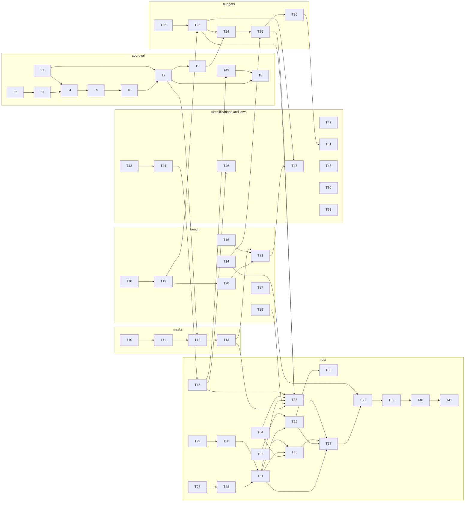

# Laws as interfaces: the approval ladder, the mask spans, the bench folds, the budget lattice and the Rust flip

status: in-progress
commit-mode: orchestrator-commits
language: ruby (Rust cards: T27 to T33, T35, T41)
panel: Ruby (Linus Torvalds, Jeremy Evans, Sandi Metz, Richard Schneeman, Aaron Patterson); the algebra seats (Edward Kmett, Philip Wadler, Conal Elliott) join for T1, T4, T10, T11, T14, T15, T20, T22, T52, T53; Rust (Raph Levien, Andrew Gallant, Frank McSherry, Ashley Williams) for T27 to T33, T35, T41

## Intent

The 2026-10-19 review of QA round 26 found 3 defects and 2 families of duplication, and the user ruled
(memory `simplify-round26-rulings-2026-10-19.md`) to take 4 streams in one plan: the Rust flip, the algebra
improvements, the approval split, and the round-26 simplifications, with no back-compat owed anywhere.
This plan delivers them as 53 cards in 6 streams. The bench thesis is "swap a strategy, run both, compare",
and swapping is only honest where the composition is lawful, so each stream names the structure its
operations have, holds it to a law in the subject's own spec, and lets the interface fall out of the law:
anything held to the same group with the same carrier is substitutable. Roadmap: `ROADMAP.md` item 66.

What lands, in one line each:

- **Approval** (T1 to T9): a `Sensitivity::Verdict` total order whose join replaces 4 hand-rolled rankers
  and closes the confined-child relabel; one escalation record with its rescue; authority as a field on a
  parked decision; `Approval::Ladder`, one value behind 5 first-decisive folds, with poisoning as an edge
  decorator and the `RuleChain` bracketing defect as its first failing test; `Requester` carried as a value;
  one parse per bash effect; the directory split; path containment held to its meet.
- **Masks** (T10 to T13): `Sensitivity::Spans` as a commutative monoid so `render` cannot be handed disorder;
  masking as a closure operator in which a placeholder is a redacted slot; the display mask moved into the
  boundary and skipped for a Null channel; one withheld-sources ledger on `Session`.
- **Bench** (T14 to T21): one usage fold held to the homomorphism and its fork negative; compaction cost as an
  inductive value whose base constructor is the unit; `Recording#comparability`; one arm stamper; one model
  table matcher; a `Room` value and one reply reserve; `RoundBudget` laws; dedup as its own arm.
- **Budgets** (T22 to T26): `Budget::Ceilings` (a meet semilattice a spawn attenuates with the refused join) and
  `Budget::Spent` (a commutative monoid), so a child never outranks its spawner, child spend rolls up, width
  is capped, and `--max-cost` exists.
- **Rust** (T27 to T41): `simplify-13` re-cut against HEAD plus the batch render crossing the benchmark showed
  was missing, ending with the Ruby `Timeline`, `Store` and `Event` deleted.
- **Simplifications and laws** (T42 to T53): the round-26 copies replaced by their owners, `Intake#interrupt`,
  the `(text, status)` return, `Epic::Remedy`, 2 memos, and 2 laws the architecture relies on but never held.

## Grounding

2026-10-19, `main` at `9eaff2a8` (QA round 26 closed). 6 read-only explorations re-anchored every file this
plan names; their findings are the line numbers below and the "wrong against HEAD" lists in each stream's
preamble. The 2 draft plans this one re-cuts are `planning/specs/simplify-12-ask.md` (T1 to T5, grounded
`d2bb133c`, not an ancestor) and `planning/specs/simplify-13-rust-port.md` (grounded the same, last edited
`607debd0`). Both stay in the tree with a `superseded-by` line; this plan does not repeat their prose.

Files checked, by stream (every path exists at `9eaff2a8` unless marked new):

- Approval: `lib/lain/sensitivity.rb`, `lib/lain/sensitivity/policy.rb`, `lib/lain/sensitivity/filter.rb`,
  `lib/lain/survey/walk.rb`, `lib/lain/cli/wiring/board_build.rb`, `lib/lain/approval/*.rb`,
  `lib/lain/middleware/{gate,remembered_denials,sensitivity}.rb`, `lib/lain/requester.rb`,
  `lib/lain/cli/{switchboard,tool_guard,fleet_windows}.rb`, `lib/lain/status_feed/fleet.rb`,
  `lib/lain/telemetry/child_progress.rb`, `lib/lain/shell/named.rb`, `lib/lain/landing.rb`.
- Masks: `lib/lain/sensitivity/{regions,masking,text_mask,literals}.rb`,
  `lib/lain/middleware/{redact_secret_reads,refuse_secret_writes}.rb`, `lib/lain/credential_patterns.rb`,
  `lib/lain/tools/bash.rb`, `lib/lain/exec/{local,docker,sandboxed}.rb`, `lib/lain/effect/handler/live.rb`,
  `lib/lain/tool/invocation.rb`, `lib/lain/channel.rb`, `lib/lain/session.rb`, `lib/lain/session_record/replay.rb`,
  `lib/lain/telemetry/{read_redacted,memory_masked,command_redacted}.rb`, `lib/lain/tools/{write_file,edit_file}.rb`.
- Bench: `lib/lain/ledger.rb`, `lib/lain/event/projection.rb`, `lib/lain/compare.rb`,
  `lib/lain/compare/compaction_tally.rb`, `lib/lain/friction/cache_waste.rb`, `lib/lain/bench/{variance,session,live_arms,cli}.rb`,
  `lib/lain/bench/session/loader.rb`, `lib/lain/arm/{driver,dual_ledger}.rb`, `lib/lain/channel/tee.rb`,
  `lib/lain/telemetry/sandbox.rb`, `lib/lain/{output_ceiling,context_window,price_book,reply_reserve}.rb`,
  `lib/lain/compaction/need.rb`, `lib/lain/agent.rb`, `lib/lain/agent/tool_runner.rb`, `lib/lain/tool/round_budget.rb`,
  `lib/lain/cli/arms.rb`, `lib/lain/review/critique.rb`.
- Budgets: `lib/lain/agent/budget.rb`, `lib/lain/agent/accounting.rb`, `lib/lain/usage.rb`, `lib/lain/role.rb`,
  `lib/lain/skill/role_spawn.rb`, `lib/lain/tools/subagent.rb`, `lib/lain/tools/subagent/{actor,wrap_up,lineage}.rb`,
  `lib/lain/tool/spawn_policy.rb`, `lib/lain/cli/wiring/toolset_build.rb`, `lib/lain/cli/{goal_driver,conductor,shutdown}.rb`.
- Rust: `ext/lain/src/{lib,algebra,dag,graph,event,canonical,digest}.rs`, `ext/lain/Cargo.toml`, `deny.toml`,
  `Rakefile`, `lib/lain/{timeline,store,event,canonical}.rb`, `lib/lain/event/{payload,chain_writer,projection}.rb`,
  `lib/lain/dag.rb`, `lib/lain/dag/render_ancestry.rb`, `lib/lain/context.rb`, `lib/lain/compaction/{head,derivation,held_cut,derived}.rb`,
  `lib/lain/content_addressed/blob.rb`, `spec/lain/rust/*.rb`, `spec/support/shared_examples/*.rb`.
- CLI and frontend: `lib/lain/cli/{conductor,wiring,epic_finish,epic_submit,epic_land,epic}.rb`,
  `lib/lain/cli/epic_driver/factory.rb`, `exe/lain`, `lib/lain/frontend/{intake,line_editor,input_pane,stdin_pump,tty}.rb`,
  `lib/lain/cli/input_socket.rb`, `lib/lain/{file_lock,paths}.rb`, `lib/lain/isolation/{scratch,checkout}.rb`,
  `lib/lain/epic/{red_commit,stage}.rb`, `lib/lain/forge/local_landing.rb`, `lib/lain/isolation/merge_coordinator/drain.rb`,
  `lib/lain/isolation/verifier/stale_group.rb`, `lib/lain/shell/out.rb`, `lib/lain/liveness.rb`, `lib/lain/config/builder.rb`.

Where docs and code disagree, the code won and the doc is listed for the card that touches it:

| Claim | Where | Truth at HEAD | Card |
|---|---|---|---|
| masked memory is "Not journaled, so a resumed session may rewrite it" | `lib/lain/session.rb:283-285` | `Telemetry::MemoryMasked` is journaled and `replay.rb:125` folds it back | T13 |
| "Informational until a reader exists: nothing yet compares it" | `lib/lain/bench/cli.rb:50` | `Variance#guard_opaque!` compares it and refuses | T16 |
| "TWO arms withhold regions" | `lib/lain/sensitivity/masking.rb:6-12`, `regions.rb:27-31` | 5 callers render masks | T10 |
| `render` is handed ascending, non-overlapping spans by `detect` | `masking.rb:30-33` | `Rows` and `Stream#sink` hand it spans `detect` never saw, unchecked | T10 |
| "a Ctrl-C at `you>` itself still ends the chat" | `docs/commands.md:52` | cleared over a typed line since round 26 | T47 |
| `render`'s Ctrl-C is "the SAME precedent `exit_status` sets" | `exe/lain:90-92` | `exit_status` exits 0 on Interrupt, `render` exits 130 | T44 |
| the policy answer "is a Boolean, which is approvable by construction" | `ARCHITECTURE.md:556-563` | the seam is `rule -> Ruling` | T4 |
| `Compare` has 4 metrics | `lib/lain/compare.rb:5-10` | `METRICS` has 8 | T15 |
| "All three close with an exact-model key" | `lib/lain/price_book.rb:40` | `DEFAULTS` holds no exact-model key | T18 |
| "a consumer that sums these gets a loud TypeError" | `lib/lain/telemetry/compaction.rb:143-146` | the only consumer re-derives from the Hash and never calls it | T15 |
| `basis` is "the provenance of the window" | `lib/lain/reply_reserve.rb:12-13` | no caller passes it, nothing reads it | T19 |
| a descended copy takes "min(its own, this one - 1)" | `lib/lain/tools/subagent.rb:479-481` | the decrement is in `build_child`, not `descend` | T24 |
| "the Ruby version is not deleted when the Rust one lands" | `ext/lain/CLAUDE.md:105` | reversed by this plan | T41 |
| 16 construction sites in 12 files | `ROADMAP.md` item 23 | 23 `Timeline` sites in 19 files, 18 `Store.new` | T36 |
| `ContextWindow#matched` | `lib/lain/cli/backend/window_book.rb:48` | the method is the private `matched_key`; `matched` is `PriceBook`'s | T18 |
| `render`/`exit_status` live in `cli/command.rb` | `lib/lain/declarative/types.rb:54` | they are in `exe/lain:94` and `:117` | T44 |

Premises probed rather than read (the attached spike scripts, recorded in Spike findings):
the `RuleChain` bracketing witness, the verdict relabel's reach, the mask's idempotence, the span union's
non-commutativity, `Masking.render` on disorder, `RoundBudget`'s prefix and monotonicity, the stream's
chunk invariance, and the Ruby versus Ext benchmark.

## Compatibility

Nothing is in production and the user ruled no back-compat is owed (memory `harness-vs-own-dev`,
`simplify-round26-rulings-2026-10-19`). Evidence: `lain.gemspec` is at `0.1.0` with no release tag
(`git tag` lists only a backup tag), `CHANGELOG.md` has one entry, all 3 crates carry `publish = false`,
and the only `~/dev` checkouts requiring `lain` are stale worktree copies of this repo (`lain-t31b`,
`lain-t32a`). Every surface below is therefore **free to break**, and the plan breaks them where that
removes a layer. No trade report was needed.

| Surface | Verdict | What changes |
|---|---|---|
| chat header `arms` hash and `--round-budget` | free to break | T21 adds `round_dedup`; 12 spec files pinning header hashes move with it |
| session file record kinds `read_redacted`, `memory_masked`, `escalation`, `child_progress` | free to break | T13 replaces the first 2 with `source_masked`; T2 gives `escalation` one writer; T6 adds `label`, `role`, `skill` to `child_progress`; old session files are refused by format, per the 2026-10-17 ruling that QA state is purgeable |
| `CLI::Arms` positional constructor | free to break | T21 adds a keyword |
| `Agent::Budget` constructor and `Role#budget` | free to break | T22 to T24 replace them with `Budget::Ceilings` |
| `Ext::Turn`, `Ext::Store`, `Ext::Timeline` FFI surface | free to break | T29 to T31, T35 widen it; T39 drops the `Ext::Turn` alias |
| `lib/lain/approval/` constant paths | free to break | T8 relocates the epic slice |
| `Sensitivity::Verdict` equality and `ORACLE_APPROVABLE` | free to break | T1 adds an order; the approvable set is unchanged |
| `Compare::CompactionTally#cost_delta` (nil for none) | free to break | T15 makes it an inductive value |
| `Telemetry::Sandbox#arm`/`#task` | free to break | T17 removes the fields; the stamp becomes a wrapper |

## Spike findings

Run on 2026-10-19 in the session scratchpad (no worktree was cut; every script is throwaway and none touched
the repo), and attached under `planning/specs/algebra-and-flip/`: `spike-ladder.rb`, `spike-ladder_spec.rb`,
`spike-verdict_e2e_spec.rb`, `spike-rust-bench.rb`, `probe-confined.rb`, `probe-strictest.rb`, `probe-mask.rb`,
`probe-round-budget.rb`, `probe-span.rb`.

| Question | Result | Evidence |
|---|---|---|
| Is there one ladder value behind `RuleChain`, `Escalation#rule`, the oracle fallthrough, `Filter#verdict_for` and `OutputCeiling.for`? | One first-decisive fold, a monoid under nesting with the empty ladder as unit, provided poisoning runs once at the edge; poisoning inside every chain is not associative. Only the 2 approval sites share a carrier, so only they become the value (T4); `Filter` is a join (T1). | 26 examples, 1 expected failure; the 4 `RuleChain` nesting examples, 5 poisoning examples and 6 `Escalation` composition examples all pass on the value |
| Does `RuleChain`'s inner poisoning change an outcome by bracketing? | Yes. `((Raiser Allower) Denier)` gives a final deny; `(Raiser Allower Denier)` and `(Raiser (Allower Denier))` give `Poisoned(nil)`, an escalation | smallest witness found by the spike's generator |
| Is `Policy#strictest` a ladder? | No. It is a join: leftmost max over level, and its left bias is the relabel. Associative over all 1,728 triples | `strictest([gated, denied])` is `denied`; the ladder form answers `gated` |
| Does the `Confined#judge` relabel reach an approval end to end? | Unreachable in the shipped wiring. `Judged` and `SecretSurface` re-derive the verdict from the board's unconfined policy, so they see `credential`. Live the moment a confined policy is handed to a judge. `Confined` also lacks `in_related_tree?`, so `Judged` would raise before approving | seam spec, 2 examples, scripted judge answering approve: plain policy parks, hypothetical confined policy approves |
| Does masking its own output again report new regions? | Yes. `API_KEY=<redacted:1>` re-masks to 1 fresh region, renumbered. The write side already excludes a leading `<` | `TextMask.new(secrets: []).call("API_KEY=<redacted:1>\ntoken = \"<redacted:3>\")` answers count 2 |
| Is `Rows::Span#|` commutative, and what does `render` do with disorder? | Not commutative: `Span(5,3) | Span(2,10)` drops bytes 2..4. `render` on `[(10,6),(2,3)]` re-emits masked bytes raw. Every caller sorts first | 2,000 random draws of `coalesced` hold every law; the constructed disorder leaks |
| Do `RoundBudget`'s prefix and monotonicity laws hold? | Prefix holds (3,000 draws). Monotonicity fails 1 in 3,000 because dedup compares the reference string's length, which depends on the referent's id. A budget is not an attenuation of bytes (a 2-byte `ok` becomes a 123-byte refusal). `NONE` is not the top of the budget order because it also disables dedup | witness: budget 306 deduplicates `toolu_3`; budget 377 withholds it |
| Is `TextMask::Stream` invariant under chunking? | Yes, over 200 random splits, including a secret across the 4 KiB cut | `algebra_probe_mask.rb` |
| What does the Rust flip buy, measured? | Ext append 4x faster, 9x fewer allocations, 0 GC runs, 6 live GC objects where Ruby holds 100k at 10k turns, RSS equal. Walks that materialise turns are 2.5x to 3.5x slower (replay-render 146 vs 42 ips at 10k) because content is copied per read and never enters `Canonical`'s `PRODUCED` memo | quiet box, loadavg about 1, Ruby 4.0.6, benchmark-ips with error bars |

## Shared files

Only the main session edits these; a card hands back a 1-line diff under Shared-file wiring:
`exe/lain`, `lib/lain/cli/wiring.rb`, `lib/lain/cli/wiring/toolset_build.rb`, `ARCHITECTURE.md`,
`docs/commands.md`, `docs/GLOSSARY.md`, `planning/qa/scenarios/*.md`, `Rakefile`, `ext/lain/Cargo.toml`,
`Cargo.lock`, `deny.toml`, `.rubocop.yml`, `ROADMAP.md`, `ext/lain/CLAUDE.md`, `docs/rust-bindings.md`,
`spec/support/shared_examples/*.rb` (T14, T22, T52 and T53 each hand back one group change).

`lib/lain/cli/tool_guard.rb` is not shared, and 3 cards edit it (T6, T7, T12); they are chained by
`Depends on` so no 2 run at once. `lib/lain/sensitivity/policy.rb` is edited by T1, T7 and T9, `lib/lain/agent.rb`
by T19, T23 and T36, `lib/lain/tools/subagent.rb` by T6, T9, T24, T25 and T36, and the epic command files by T43 to
T46, T49 and T8, each chained the same way.

## Rejected options

- A `Lain::Algebra` registry or any declaration in `lib/`: deleted 2026-09-14 on purpose; the inclusion is the claim.
- Teaching `"an attenuation"` a `dual:` default so `Ceilings` can include it: 3 of its 7 laws need the dual, and a ceiling has no `except`. T22 includes the meet group and the monoid group instead, and writes the refused join as plain examples.
- Making the ladder a stack of rung middlewares (simplify-12 T5 as drafted): a rung consults and edits a nested rung's answer (`Judged`, `Unconfinable`), which a middleware chain cannot express; the ladder is a value that runs inside one middleware ahead of `Gate`.
- Keeping `Compare::CompactionTally#cost_delta` as `nil` for "never compacted": it withholds the column from any A/B against a never-compacting control, which the 5-arm compaction sweep needs.
- One carrier for run budgets and window room: window room is a function of the child's own model and is never granted by a spawner (budget survey, 2026-10-19).
- `Dollars.unknown` as the tally's absorbing case: `Dollars#+` keeps the known amount and only drops completeness ("at least $x"), which is the right reading for friction and the wrong one for a comparison column.
- A memoizing cache inside `Shell::Named.of`: hidden process state in a pure function; the parse travels in the middleware env instead (T7).
- Holding `Channel::Tee`, `OutputCeiling`, `Requester`, `Toolset::Unheld`, `Compaction::Need` or `Isolation::Verifier::StaleGroup` to a law: assessed 2026-10-19 as not instances.
- Keeping `RuleChain`'s inner poisoning because it "errs toward deny": the error is a final deny where the same rungs, bracketed differently, escalate to a human; a human answering is the safer outcome and the associative one.
- Fixing the family rows of `PriceBook`, `ContextWindow` and `OutputCeiling` for the 5.5 models in T18: that is data, planned by the HN landscape doc's tier 1; T18 gives it one place to land.
- A `Source.result` kind in the withheld ledger now: the round 27 stub arm is its first producer (YAGNI; T13 leaves the key a value so adding a kind is one constructor).
- A generic `Fold` value for Compare metrics: median and percentiles are projections of the list monoid, not metrics; the comparability hash (T16) and the inductive cost (T15) are the 2 folds with a consumer today.

## Open decisions

- **The 5.5-family table rows** (`PriceBook::DEFAULTS`, `ContextWindow::ANTHROPIC_WINDOWS`, `OutputCeiling::TABLE`): data owed by the HN landscape plan, landing through T18's one matcher. No card here depends on it.
- **A `Spans` adjacency rule**: T10 merges touching spans (the `Rows` rule, `<=`), because a placeholder pair with no byte between them is one slot; `masking_spec.rb:83-88` moves with it. This coarsens the release ledger: 2 adjacent secrets become 1 question and 1 placeholder, and `released <= regions` counts the slot once. If a reviewer wants 2 placeholders for 2 adjacent secrets, that is the only line to revisit.
- **An incomplete dollar total at a ceiling check** (T26): the check enforces on the known part and journals the incompleteness; it never refuses to enforce. Stated here so T26 does not re-ask.
- **The reply reserve constant** (T19): the floor scales as the smaller of 4096 and a quarter of the window; T19 measures it against the local-model e2e journeys and may move the constant in its own commit.
- **Round 27's stub arm** consumes T13's withheld ledger (a `Source.result` kind) and T12's display mask; neither is built here.
- **Landlock profiles** (binary-identity research, reopened 2026-10-16) consume T9's one containment order; not built here.
- **`Ext::Dag::RenderAncestry#diverge_at`** and `Ext::Timeline#diverge_at` calling `dag::meet` directly: T39 decides delete-or-repoint for `Dag::RenderAncestry`; if repoint, the Rust singleton gains `diverge_at` in T39.
- **The suite wall under proptest** (T27): if `cargo test` grows past 10 s, the default profile caps cases and the full count runs at the chunk gate; measured in-card.

## Dependency graph



## Tasks

### Stream A: approval

What simplify-12's T1 to T5 said that is false at HEAD: `auto_surface.rb` and `risk.rb` are gone;
`judge.rb`, `judge/facts.rb`, `judged.rb`, `path_gate.rb` and `root.rb` exist; the epic slice has not moved;
`Gate.from_journal` is built only at `cli/epic_submit.rb:676`; `Queue::Outstanding` is built at
`redact_secret_reads.rb:419`; the queue and the ladder reference each other (`queue.rb:346,365,504` and
`escalation.rb:818`); the ladder is `Escalation`'s own Enumerable of rungs, not a `Middleware::Stack`; `Judged`
and `Unconfinable` consult a nested rung and edit its answer; there are 4 hand-built `escalation` record
writers, 2 of them without the rescue; `Ruling` already carries `authority` but `Pending#decide` does not,
and `Surfaces#call` (`escalation.rb:842`) still infers it from the surface name. `Lain::QA::Ladder` and
`Lain::Arm::Ladder` exist, so the new value is `Lain::Approval::Ladder`.

### T1: Give Sensitivity::Verdict a total order and a join          [risk: high]

**Depends on:** none
**Files:** `lib/lain/sensitivity.rb`, `lib/lain/sensitivity/policy.rb`, `lib/lain/sensitivity/filter.rb`,
`lib/lain/survey/walk.rb`, `lib/lain/cli/wiring/board_build.rb`, `spec/lain/sensitivity_spec.rb`,
`spec/lain/sensitivity/policy_spec.rb`, `spec/lain/sensitivity/filter_spec.rb`, `spec/lain/survey/walk_spec.rb`,
`spec/lain/cli/wiring/board_build_spec.rb`, `spec/lain/cli/switchboard_spec.rb`
**Reuse:** `Verdict` (`sensitivity.rb:48-113`), `LEVELS` (`:58`), `ORACLE_APPROVABLE` (`:81`); the 4 rankers
this card replaces: `Policy#strictest` (`policy.rb:545`), `Filter#verdict_for` (`filter.rb:94`),
`Survey::Walk#verdict_for` (`survey/walk.rb:229-231`), `BoardBuild::Strictest#classify` (`board_build.rb:462-470`);
`spec/support/shared_examples/meet_semilattice.rb` with `meet:`/`ancestor_of:` injected, as
`spec/lain/interval_partition_spec.rb:317-352` does
**Shared-file wiring:** none
**Reachable from:** `Policy#judge` (`policy.rb:380-386`) folds written and landed verdicts through
`strictest` on every gated read; `Confined#judge` (`:233-236`) is built by `CLI::ToolGuard#confined`
(`tool_guard.rb:404`) for every child stack

A verdict is ordered by level, then by reason within the level, so that "the stricter of 2 verdicts" is
one function. Within `gated`, `credential`, `named`, `configured`, `protected`, `malformed` and `system`
sit above `out_of_scope` and `outside_project`; within `ordinary`, `exempt` sits above `none` (what
`BoardBuild::Strictest` already requires); `account_database` is `denied` and ranks by level. The rank is
this table, stricter first, and it is injective so that `|` is commutative (a `Comparable` tie between 2
unequal `Data` values would break it): denied: `account_database`, `protected`, `system`, `configured`;
gated: `credential`, `named`, `configured`, `protected`, `malformed`, `out_of_scope`, `outside_project`;
ordinary: `exempt`, `none`. The join `a | b` is the max. The 4 rankers disagree today (`Walk` puts `named`
over everything in a level, `BoardBuild` puts `exempt` over `none`, `Policy` is left-biased, `Filter` answers
the first found), so each gets a differential example on the verdicts `classify` emits. `Policy#judge`'s
`written.find(&:denied?)` early-out (`policy.rb:~237`) is kept, because `denied` is the top of the order and
the early-out agrees with the join. `Policy#strictest` becomes `verdicts.inject(:|)`. `Confined#judge` joins with
`OUTSIDE_PROJECT` instead of replacing, so a credential-named file outside the roots keeps `credential`,
which is not oracle-approvable. `Confined` gains `in_related_tree?` by delegation. The 3 other rankers
call the same join (`Filter#verdict_for` may still stop early, but only at the top element).

**Interface**

```ruby
module Lain::Sensitivity
  Verdict = Data.define(:level, :reason) do
    include Comparable
    REASON_RANK = { ... }.freeze     # per level, stricter first
    def <=>(other)
    def |(other) = self >= other ? self : other
  end
end
```

**Acceptance criteria**

```gherkin
Scenario: a confined policy keeps a credential reason outside its roots
  Given a confined policy whose roots exclude a directory holding .npmrc
  When the policy judges that .npmrc
  Then the verdict's reason is credential
  And the verdict is not oracle approvable

Scenario: a confined policy still names a plain file outside its roots as outside the project
  Given the same confined policy
  When it judges a notes.txt outside its roots
  Then the verdict's reason is outside_project

Scenario: a symlink's landing wins over its out-of-scope name whichever side is read first
  Given a path whose written name is out of scope and whose landing is a credential file
  When the policy judges it with the written verdict first and again with the landed verdict first
  Then both answers name credential

Scenario: the join is a meet semilattice under the reversed order
  Given every verdict the classifier emits as the population
  When the shared semilattice laws run with the join as the meet and "at least as strict" as the order
  Then idempotence, commutativity, associativity and "the join sits above both operands" hold

Scenario: an exemption outranks an ordinary match at the board
  Given a board whose rules classify one path as ordinary none and exempt
  When the strictest verdict is taken
  Then it is exempt
```
Spec file: `spec/lain/sensitivity_spec.rb` (laws, exhaustive over every emitted pair and triple as well as the
group's 10 samples, plus an injectivity example over the rank table), `spec/lain/sensitivity/policy_spec.rb` (AC 1 to AC 3,
through the production `Confined` built by `Policy#confined`), `spec/lain/cli/wiring/board_build_spec.rb` (AC 5), and one
differential example in each of `spec/lain/sensitivity/filter_spec.rb` and `spec/lain/survey/walk_spec.rb`

**Stop and report if:**
- `spec/lain/sensitivity/policy_spec.rb:951,975-976,999` pin `outside_project` for a file the new join would
  classify otherwise; each must be a plain file, or the card has changed a classification nobody asked for.
- `Confined#shell_denial` (`policy.rb:262`) filters `reason != :configured`; if the order ever reorders a
  `configured` verdict past a `credential` one at the same level, say so rather than changing the filter.
- `Triage#outside?` (`escalation.rb:724-727`) compares `reason == OUTSIDE_PROJECT.reason`; a join that keeps
  `credential` for an outside path means Triage no longer calls it "outside". That is intended; the
  switchboard spec at `spec/lain/cli/switchboard_spec.rb:1367-1650` says whether plan scope still parks it.

### T2: One escalation record, written with its rescue          [risk: medium]

**Depends on:** none
**Files:** `lib/lain/telemetry/escalation.rb` (new), `spec/lain/telemetry/escalation_spec.rb` (new),
`lib/lain/approval/escalation.rb`, `lib/lain/approval/judged.rb`, `lib/lain/middleware/gate.rb`,
`lib/lain/middleware/remembered_denials.rb`, `spec/lain/approval/escalation_spec.rb`,
`spec/lain/approval/judged_spec.rb`, `spec/lain/middleware/gate_spec.rb`,
`spec/lain/middleware/remembered_denials_spec.rb`
**Reuse:** `Escalation#record` (`escalation.rb:367-373`), the one copy that rescues and explains why
(`:360-366`); `Telemetry::Journalable`'s `journal_type`; `Approval::Queue.requester_for`
**Shared-file wiring:** none
**Reachable from:** `Middleware::Gate#refused_by_config` (`gate.rb:163`) on a configured `deny_tool`;
`RememberedDenials#record` on a remembered deny; `Judged#record`; `Escalation#record`, all in the chat's
tool stack built by `CLI::ToolGuard#layered`

The 4 writers of the `escalation` journal record become one `Telemetry::Escalation` record with one
`write(journal, ...)` that rescues, because evidence about a call must never cost the call, and 2 of the 4
copies today do not rescue. The 5 copies of `requester_of` become one call on the record builder.

**Interface**

```ruby
module Lain::Telemetry
  Escalation = Data.define(:tool, :tool_use_id, :requester, :rule, :ruling) do
    include Journalable
    # Never raises: a closed journal is an unrecorded ruling, not a dead turn.
    def self.write(journal, ruling, effect, context, requester: nil, **extra)
  end
end
```

**Acceptance criteria**

```gherkin
Scenario: a configured deny_tool refuses even when the journal is closed
  Given a gate whose config denies a tool
  And a journal that raises on write
  When the tool is called
  Then the call is refused with the configured reason
  And no exception reaches the caller

Scenario: every escalation record has one shape
  Given a ruling from the gate, from a remembered denial, from the judge and from the ladder
  When each is journaled
  Then each record carries type, tool, tool_use_id, requester and the ruling's fields

Scenario: the requester on the record is the one the context names
  Given a child context whose requester is a named role
  When the gate refuses a call from it
  Then the record's requester is that name
```
Spec file: `spec/lain/telemetry/escalation_spec.rb` (AC 2), `spec/lain/middleware/gate_spec.rb` (AC 1,
AC 3, through `CLI::ToolGuard#layered` with a real `Middleware::Gate`)

**Stop and report if:**
- `Judged#record` adds `error` and `bar` (`judged.rb:355-361`); if the one record cannot carry them as
  `extra` without a type change downstream, report which reader breaks.
- `RememberedDenials#record` builds `Ruling.deny(authority: :human)` (`remembered_denials.rb:119`); keep
  that authority on the record, since T3 reads it back.
- `Lain::Telemetry::Escalation` sits beside `Lain::Approval::Escalation`; call sites inside `Approval` root-qualify it (the CLAUDE.md shadowing trap).

### T3: Authority is a field on a parked decision, never inferred from a surface name          [risk: high]

**Depends on:** T2
**Files:** `lib/lain/approval/queue.rb`, `lib/lain/approval/escalation.rb`, `lib/lain/approval/secret_surface.rb`,
`lib/lain/approval/queue_surface.rb`, `lib/lain/frontend/approval_policy.rb`, `lib/lain/cli/repl/approval_surfaces.rb`,
`lib/lain/frontend/neovim/approval_view.rb`, `spec/lain/approval/queue_spec.rb`, `spec/lain/approval/escalation_spec.rb`,
`spec/lain/approval/secret_surface_spec.rb`, `spec/lain/frontend/approval_policy_spec.rb`, `lib/lain/session_record/replay.rb`, `spec/lain/session_record_spec.rb`
**Reuse:** `Escalation::Ruling#authority` (`escalation.rb:90-107`, `AUTHORITIES = %i[automatic human]`);
`Queue::Pending#decide(verdict, surface:, reason:)` (`queue.rb:202-210`); the pinning spec
`spec/lain/approval/escalation_spec.rb:723-745`
**Shared-file wiring:** none
**Reachable from:** every surface's answer goes through `Pending#decide`; `Escalation::Surfaces#call`
(`escalation.rb:840-845`) turns it into a Ruling for the chat ladder built by `CLI::Switchboard#judged`

`Pending#decide` takes `authority:` from the surface that answers, so `Surfaces#call` stops reading
`Surfaces::AUTOMATIC` to decide whether a human spoke. The `AUTOMATIC` list goes, and with it the
class-body constant at `escalation.rb:818` that makes the queue and the ladder reference each other. The
human-over-fault exemption (`:331-337`) reads `decided.human?` as before. `Queue#rule` no longer builds
an `Escalation::Surfaces` (`queue.rb:365`); the switchboard hands the queue to the rung.

**Interface**

```ruby
class Lain::Approval::Queue::Pending
  def decide(verdict, surface:, authority:, reason: nil)   # authority in Ruling::AUTHORITIES
end
```

**Acceptance criteria**

```gherkin
Scenario: a surface's authority travels with its answer
  Given a pending decided by a machine surface and one decided by a human surface
  When each ruling is read
  Then each names its own authority
  And neither was derived from the surface's name

Scenario: a new machine surface cannot count as human by omission
  Given a surface class the ladder has never heard of answering approve as automatic
  When an earlier rung has faulted
  Then the approve is suppressed as any automatic approve is

Scenario: a human's approve after a fault still stands
  Given a rung that faulted and a human surface approving
  When the ladder answers
  Then the call is allowed
  And the record carries fault true

Scenario: the queue no longer names the ladder
  When the approval queue's source is read
  Then it references no Escalation constant
```
Spec file: `spec/lain/approval/queue_spec.rb` (AC 1, AC 4 by grep over the file), `spec/lain/approval/escalation_spec.rb`
(AC 2, AC 3, replacing `:723-745`)

**Stop and report if:**
- `Queue#admit` reads `Escalation.barred?(context)` (`queue.rb:504-507`); if removing that reference needs
  the barred flag to move onto the context duck rather than a class method, say where it lands before T4 builds on it.
- `Pending#to_journal` (`queue.rb:301-306`) writes `approval_decision`; its readers in `spec/lain/session_record_spec.rb`
  and the replay fold must accept the new `authority` field, or the resume path loses parked state.

### T4: Approval::Ladder, one value behind the approval folds, with poisoning at the edge          [risk: high]

**Depends on:** T3, T1
**Files:** `lib/lain/approval/ladder.rb` (new), `lib/lain/approval/ladder/poisoning.rb` (new),
`spec/lain/approval/ladder_spec.rb` (new), `lib/lain/approval/escalation.rb`, `lib/lain/approval/judged.rb`,
`lib/lain/cli/switchboard.rb`, `spec/lain/approval/escalation_spec.rb`, `spec/lain/approval/judged_spec.rb`,
`spec/lain/cli/switchboard_spec.rb`, `spec/approval_consumer_discipline_spec.rb`;
delete `lib/lain/approval/rule_chain.rb` and `spec/lain/approval/rule_chain_spec.rb` (its poisoning and
nesting examples move into `ladder_spec.rb`)
**Reuse:** the spike's `Ladder` and `Poisoning` (`planning/specs/algebra-and-flip/spike-ladder.rb` and `spike-ladder_spec.rb`, 26 examples);
`Escalation#rule` (`escalation.rb:265-286`), `Rules` (`:400-483`), `RuleChain#why_not` (`escalation.rb:430`), `Judged#ruled` (`judged.rb:200-244`),
`Unconfinable` (`switchboard.rb:796-830`), `spec/support/shared_examples/monoid.rb`
**Shared-file wiring:** `ARCHITECTURE.md:556-563` and `:678-695`: the policy answer is a `Ruling` and the ladder is a value
**Reachable from:** `CLI::Switchboard#ladders` (`switchboard.rb:439-445`) builds the ask, auto and bypass
ladders; `Escalation#rule` is the `rule` the `Middleware::Gate` calls at the tail of every tool stack

A rung answers a decision or `ABSTAIN`. `Ladder[*rungs].call(input)` returns `Outcome(decision, by, faults,
why_not)`: the first decision wins, a nested `Outcome` is unwrapped and its faults concatenated, `why_not` is the
first refusing rung's reason (what `RuleChain#why_not` answers today), and faults travel in the value so no rung
needs a recorder. `Poisoning.new(ladder, exempt:)` is the one place a fault suppresses a later automatic allow,
applied at the edge; the human exemption is its `exempt:`. `RuleChain`'s inner poisoning goes: in production
`RuleChain` is built flat, once (`escalation.rb:429`), so the bracketing witness is latent today, and the card is
worth its risk because `Escalation` already poisons one level up, which means 2 poisoning mechanisms exist for one
rule and only the edge one is associative. `Judged` and `Unconfinable` consult a nested rung and edit its answer;
they are rung transformers outside the monoid population, no law is claimed for them, and the ladder only
requires that what they return is an `Outcome`. The carrier is rulings over `(effect, context)`; other
first-decisive folds in `lib/` (the summarizer's catalog fallthrough, `Filter#verdict_for`) have other carriers
and are not made ladders (T1 owns `Filter`, as a join).

**Interface**

```ruby
module Lain::Approval
  class Ladder
    ABSTAIN = Object.new.freeze
    Outcome = Data.define(:decision, :by, :faults, :why_not)
    def self.[](*rungs)
    def call(*input) = Outcome   # decision nil when every rung abstained
    def +(other) = Ladder[self, other]   # nesting is the monoid; [] is the unit
    class Poisoning
      def initialize(ladder, exempt:)   # exempt: an authority whose allow a fault never suppresses
      def call(*input)
    end
  end
end
```

**Acceptance criteria**

```gherkin
Scenario: bracketing cannot turn an escalation into a final deny
  Given a raising rung, an allowing rung and a denying rung
  When they are run flat, nested left and nested right under edge poisoning
  Then all 3 answer the same outcome
  And that outcome is a suppressed allow, not a deny

Scenario: nesting is a monoid
  Given rungs drawn from silent, allowing, denying and raising
  When the shared monoid laws run with nesting as the operation, the empty ladder as the identity and outcomes compared observationally
  Then associativity and both identity laws hold

Scenario: a fault inside a nested ladder is reported once at the edge
  Given an inner ladder holding a raising rung and an outer ladder holding it
  When the outer ladder runs
  Then the outcome lists that fault exactly once

Scenario: a human's allow survives a fault
  Given a faulting rung followed by a human allow
  When the poisoned ladder runs
  Then the allow stands with fault recorded

Scenario: why_not names the first refusing rung's reason
  Given an abstaining rung and then a denying rung with a reason
  When the ladder runs
  Then why_not is that reason

Scenario: the chat ladder decides at the first rung that answers
  Given a switchboard in ask mode whose triage abstains and whose rules deny
  When a tool call is judged
  Then it is denied by the rules rung
```
Spec file: `spec/lain/approval/ladder_spec.rb` (AC 1 to AC 5), `spec/lain/cli/switchboard_spec.rb` (AC 6, real `Switchboard`)

**Stop and report if:**
- `Rules` requires a faults recorder with no Null default (`escalation.rb:411-413`); if `Faults` must survive as a journal sink for fault records, it becomes a reader of `Outcome#faults` at the edge, never a rung collaborator.
- `spec/approval_consumer_discipline_spec.rb` enumerates who may build a ladder; the new builder is `Switchboard` only, and the spec is updated here.
- `Judged#faulted` returns the asking rung's Ruling `.with(fault: true)` (`judged.rb:240-244`); under the value that is `Outcome#faults`, and if any surface reads `ruling.fault?` directly, name it.

### T5: Pending#reasons replaces the judge_deferred flag          [risk: low]

**Depends on:** T4
**Files:** `lib/lain/approval/queue.rb`, `lib/lain/approval/judged.rb`, `lib/lain/frontend/approval_policy.rb`,
`lib/lain/cli/repl/approval_surfaces.rb`, `lib/lain/frontend/neovim/approval_view.rb`, `spec/lain/approval/queue_spec.rb`,
`spec/lain/approval/judged_spec.rb`, `spec/lain/frontend/approval_policy_spec.rb`,
`spec/lain/cli/repl/approval_surfaces_spec.rb`, `spec/lain/frontend/neovim/approval_view_spec.rb`, `lib/lain/telemetry/approval_pending.rb`
**Reuse:** `Escalation::Noted` (`escalation.rb:187-197`), `Pending#notes` (`queue.rb:215`), `Judged::Deferred`
(`judged.rb:150-152`), the 3 surface readers (`approval_policy.rb:298`, `approval_surfaces.rb:173-176`, `approval_view.rb:577`)
**Shared-file wiring:** none
**Reachable from:** `Queue#admit` (`queue.rb:503-510`) builds every `Pending` from the context the ladder parked

The judge's deferral becomes one more note, marked as lain's own words, and `Pending#reasons` answers the
notes with the judge's quoted apart from lain's; one formatter renders it on the 3 surfaces, so a fourth
reason for parking is a note and no surface edit.

**Acceptance criteria**

```gherkin
Scenario: a deferred judge shows as a reason on every surface
  Given a pending the judge deferred with a note
  When the TTY prompt, the REPL arrival line and the editor view render it
  Then each shows the deferral and the judge's note
  And the judge's words are quoted while lain's are not

Scenario: a pending parked for 2 reasons shows both in order
  Given a pending parked by a path reason and then deferred by the judge
  When it renders
  Then both reasons appear, path first
```
Spec file: `spec/lain/approval/queue_spec.rb` (the reasons value), the 3 surface specs (AC 1, AC 2)

**Stop and report if:**
- `Telemetry::ApprovalPending` records `notes` (`approval_pending.rb:56`); the deferral must appear there too or
  `lain watch` loses it.

### T6: Requester is carried as a value from spawn to every surface          [risk: medium]

**Depends on:** T5
**Files:** `lib/lain/requester.rb`, `lib/lain/approval/queue.rb`, `lib/lain/approval/policy_switch.rb`,
`lib/lain/cli/tool_guard.rb`, `lib/lain/tools/subagent.rb`, `lib/lain/skill/role_spawn.rb`, `lib/lain/telemetry/child_progress.rb`,
`lib/lain/status_feed/fleet.rb`, `lib/lain/cli/fleet_windows.rb`, `lib/lain/approval/judge.rb`,
`spec/lain/requester_spec.rb`, `spec/lain/approval/queue_spec.rb`, `spec/lain/approval/policy_switch_spec.rb`,
`spec/lain/cli/tool_guard_spec.rb`, `spec/lain/tools/subagent_spec.rb`, `spec/lain/tools/subagent_gate_spec.rb`,
`spec/lain/telemetry/child_progress_spec.rb`, `spec/lain/status_feed/fleet_spec.rb`, `spec/lain/cli/fleet_windows_spec.rb`
**Reuse:** `Requester` (`requester.rb`, already a value), `PolicySwitch::Requested#identity`,
`Queue.requester_for`/`label_for` (`queue.rb:396-407`), `ToolGuard.layered`'s `Requester.of(requester).key` (`tool_guard.rb:415`),
`ChildProgress` (`child_progress.rb:31`), `fleet.rb:241` (`judge?`), `fleet_windows.rb:470` (`split(" (")`)
**Shared-file wiring:** `lib/lain/cli/wiring/toolset_build.rb:515-517` (`announcing`) and `:33,411` (`SPAWN_REQUESTER` becomes `Requester`)
**Reachable from:** `Tools::Subagent#builder_for` (`subagent.rb:310`) and `Skill::RoleSpawn#named_for` (`role_spawn.rb:162`)
build the requester every child runs under; `Queue#admit` parks with it

`Pending` holds `identity` (a `Requester`) and derives `requester` from it; `ToolGuard.layered` stops
turning the value into a String, so `Gate`, `Sensitivity`, `RememberedDenials` and `RedactSecretReads`
take the value; `Queue.requester_for` and `label_for` become one `Queue.identity_for`. `ChildProgress`
carries `label`, `role` and `skill` as fields, so `fleet.rb:241` compares the role and `fleet_windows.rb:470`
stops parsing a rendered string. `Requester#key` goes (it is `name`); `role` stays, because `to_s`'s
qualifier reads it.

**Acceptance criteria**

```gherkin
Scenario: a child's requester reaches the parked call as a value
  Given a skill child spawned under a role with a skill
  When one of its calls parks
  Then the pending's identity names the child, its role and its skill
  And the journaled requester is the child's name

Scenario: the fleet recognises a judge by its role
  Given a judge child whose label carries a skill qualifier
  When the fleet row is built
  Then it is shown as a judge

Scenario: a fleet window is named from the label, never from a rendered string
  Given a child whose label contains " ("
  When its window is named
  Then the window name is the whole label
```
Spec file: `spec/lain/tools/subagent_gate_spec.rb` (AC 1, real `ToolGuard.child_stack`), `spec/lain/status_feed/fleet_spec.rb` (AC 2),
`spec/lain/cli/fleet_windows_spec.rb` (AC 3)

**Stop and report if:**
- `Telemetry::ApprovalPending`, `ReadReleased`, `ReadRefused` and `Tripwire` store `requester` as a String; keep the
  journaled field a String (the name) and say so, since a value in a record is a schema change nothing reads back.
- `spec/lain/approval/queue_spec.rb:1296` pins the `Pending` constructor signature; it moves with the card.

### T7: Parse a bash command once per effect          [risk: medium]

**Depends on:** T1, T6
**Files:** `lib/lain/middleware/parsed_command.rb` (new), `spec/lain/middleware/parsed_command_spec.rb` (new),
`lib/lain/shell/named.rb`, `lib/lain/approval/queue.rb`, `lib/lain/approval/judged.rb`, `lib/lain/approval/escalation.rb`,
`lib/lain/sensitivity/policy.rb`, `lib/lain/cli/tool_guard.rb`, `lib/lain/middleware/confine_to_scope.rb`,
`lib/lain/middleware/remembered_denials.rb`, `lib/lain/middleware/sensitivity.rb`, `lib/lain/tools/bash.rb`,
`spec/lain/shell/named_spec.rb`, `spec/lain/approval/queue_spec.rb`, `spec/lain/approval/judged_spec.rb`,
`spec/lain/cli/tool_guard_spec.rb`, `spec/lain/middleware/remembered_denials_spec.rb`
**Reuse:** `Shell::Named.of`/`.from` (`named.rb:44,54`, `from` already takes a `Parse::Result`); the 7 call sites and
their 4 cwd spellings (`confine_to_scope.rb:64`, `judged.rb:332`, `policy.rb:270`, `escalation.rb:671`,
`queue.rb:441` with `directory_of` at `:451`, `bash.rb:376`, `tool_guard.rb:288`); `Middleware::Env#merge`
**Shared-file wiring:** none
**Reachable from:** `CLI::ToolGuard#layered` (`tool_guard.rb:413-427`) puts `Middleware::ParsedCommand` first in
every gated stack, so every downstream middleware and the ladder's rungs read `env[:named]`

One resolver, `Shell::Named.for_call(effect, context, home:)`, owns the cwd and home spelling that 4 sites
each do differently today (`expand_path`, `Queue.resolved`, `worker_env.resolve`, Escalation's own). One
middleware at the head of the gated stack parses a bash effect once and merges the `Named` into the env;
every reader downstream (`RememberedDenials`, `Middleware::Sensitivity` through `Confined#denial`, `Judged#named_in`,
`Escalation#refused`, `LeasedPolicy#unreadable?`, `ConfineToScope`) takes it from the env and parses only when
absent. `tools/bash.rb:376` passes `home:`, since a `~` word with no home is opaque today.

**Interface**

```ruby
module Lain::Shell
  class Named
    def self.for_call(effect, context, home:)   # one cwd rule; UNREADABLE when the call names none
  end
end
class Lain::Middleware::ParsedCommand < Base
  def call(env) = downstream.call(bash?(env) ? env.merge(named: Named.for_call(...)) : env)
end
```

**Acceptance criteria**

```gherkin
Scenario: a confined child's bash call is parsed once in the middleware stack
  Given a child stack with remembered denials, sensitivity and the gate
  And a parser that counts its calls
  When one bash call goes through the stack
  Then the command was parsed exactly once inside the stack

Scenario: every rung sees the same cwd for one call
  Given a bash call with a relative cwd under a lease
  When the remembered-denials rung, the sensitivity rung and the judge each read its paths
  Then all 3 resolve the same absolute directory

Scenario: a call that names no command still reaches the ladder
  Given a bash effect with no command
  When the stack runs
  Then the env carries an unreadable parse
  And the ladder refuses it in words
```
Spec file: `spec/lain/cli/tool_guard_spec.rb` (AC 1 to AC 3, real `child_stack` with a counting `Shell::Parse` injected
at the one place it is built), `spec/lain/shell/named_spec.rb` (`for_call`'s cwd rule)

**Stop and report if:**
- `RememberedDenials` calls `denial` twice for a non-bash read (`remembered_denials.rb:71,106`); the card removes the
  second call only if `asked?` can be answered from the first, otherwise it reports the shape.
- A reader that must parse without a context (`tools/bash.rb:376`, journalling writes after the call) cannot be
  handed the env; it keeps its own parse and the card says so.

### T8: Split approval/ into its 3 parts          [risk: medium]

**Depends on:** T7, T49
**Files:** move `lib/lain/approval/{gate.rb,gate/,signoff_queue.rb}` to `lib/lain/epic/gate.rb`, `lib/lain/epic/gate/`,
`lib/lain/epic/signoff_queue.rb` and their specs to `spec/lain/epic/`; move `lib/lain/approval/{queue.rb,queue_surface.rb,queue_surface/,secret_surface.rb,path_gate.rb,policy_switch.rb}`
to `lib/lain/approval/parked/` with their specs; modify every caller named in the exploration (`cli/epic_submit.rb:522,530,676,691,743`,
`cli/epic_queue.rb:147,148,283,359`, `cli/epic.rb:370,576,580,690`, `cli/epic_land.rb:172`, `cli/session_journals.rb:105,137,146`,
`forge/local_landing.rb:168-184,325-341`, `config/epics/gates.rb:66,86,108`, `tools/epic_submit.rb:14,50`, `epic/submission.rb:138-146`,
`frontend/neovim/status_view.rb:184`, `provider/admission.rb:101`, `cli/switchboard.rb:244,432`, `cli/wiring.rb:218-219`,
`middleware/redact_secret_reads.rb:419,435`, `status_feed.rb:537,552`)
**Reuse:** Zeitwerk: a file's path names its constant, so a move is a rename with no index edit; `bin/zeitwerk-census`
**Shared-file wiring:** `lib/lain/cli/wiring.rb:218-219` (`PathGate`/`SecretSurface` constant paths); `ARCHITECTURE.md:2051,2064-2065`
**Reachable from:** all 3 slices stay reachable as they are; the secret-boundary check is a masked read parking
through `Queue::Outstanding` from `RedactSecretReads#settle`

The epic slice moves cleanly (no `Escalation`, `Queue` or `Judge` reference). The parked-queue slice moves
after T3 removed the queue's references to the ladder. The permission engine stays. No behaviour changes.

**Acceptance criteria**

```gherkin
Scenario: an epic gate still adjudicates
  Given an epic issue whose gate policy is adjudicated
  When the gate is asked
  Then it answers as before

Scenario: a masked read still parks through the queue
  Given a chat guard stack built by the tool guard
  And a file whose contents match a secret pattern
  When it is read
  Then the read is parked for a decision
  And the content reaching the model is masked

Scenario: the loader finds every moved constant from every load order
  When the zeitwerk census runs
  Then every tier reports 0
```
Spec file: the relocated specs (AC 1), `spec/lain/middleware/redact_secret_reads_spec.rb` (AC 2, unchanged assertions),
`bin/zeitwerk-census --check` (AC 3)

**Stop and report if:**
- `provider/admission.rb:101` reads `QueueSurface::DEFAULT_POLL_INTERVAL`; a provider depending on the approval slice
  is a coupling to name, not to silently rename.
- `Queue#admit` still references `Escalation.barred?` after T3; then the parked slice is not independent and the card
  reports the shape instead of forcing the move.

### T9: Path containment is one public order          [risk: medium]

**Depends on:** T7
**Files:** `lib/lain/landing.rb`, `lib/lain/sensitivity/policy.rb`, `lib/lain/approval/root.rb`, `lib/lain/approval/judged.rb`, `lib/lain/tools/subagent.rb`,
`lib/lain/isolation/gc.rb`, `lib/lain/sensitivity.rb`, `spec/lain/landing_spec.rb`, `spec/lain/isolation/gc_spec.rb`, `spec/lain/approval/root_spec.rb`
**Reuse:** `Landing.under?` (`landing.rb:104`, `private_class_method` at `:105`, made public here); the copies over absolute paths (`policy.rb:296`, `root.rb:41-45`,
`judged.rb:318`, `subagent.rb:1075`, `gc.rb:268-271`, `sensitivity.rb:413`)
**Shared-file wiring:** none
**Reachable from:** `Isolation::Gc` and `Approval::Root` decide what a lease owns and what a root admits on every run

"At or below" over absolute normalised paths is one partial order with `/` as the bottom. The 6 copies
disagree at the edges (`"#{root}/"` makes `/` contain nothing and a trailing-slash root contain nothing), all
failing closed. They collapse onto a public `Landing.under?`, held to reflexivity, antisymmetry and transitivity
over a population that includes `/` and trailing-slash spellings. No meet is built: nothing calls one today
(the Landlock profiles will, and get this one order). `QA::ClaimCheck` (relative git pathspecs) and
`Survey::Walk.contains?` (resolves relative paths) are different domains and stay as they are.

**Acceptance criteria**

```gherkin
Scenario: the root directory contains every absolute path
  Given the root /
  When a path is tested against it
  Then it is under the root

Scenario: a root with a trailing slash contains what the same root without one contains
  Given a root spelled with and without a trailing slash
  When a path below it is tested against both
  Then both answer under

Scenario: a sibling with a shared prefix is not under
  Given a root lib and a path library/x.rb
  When tested
  Then it is not under the root

Scenario: containment is a partial order
  Given a population of absolute paths including / and trailing-slash spellings
  When reflexivity, antisymmetry and transitivity are checked over every pair and triple
  Then all 3 hold
```
Spec file: `spec/lain/landing_spec.rb` (AC 1 to AC 4), `spec/lain/isolation/gc_spec.rb` and `spec/lain/approval/root_spec.rb` (one example each that the boundary decision goes through `Landing`)

**Stop and report if:**
- A copy was deliberately irreflexive or deliberately strict about a trailing slash for a boundary reason; keep it and say why rather than widening it.

### Stream B: masks

What the exploration settled: there is no span type, only a `#start`/`#length` duck satisfied by 3 classes;
`Regions.coalesce` keeps touching candidates apart (strict `<`) while `Rows::Span#reaches?` merges them
(`<=`); `Masking.render` has no runtime check and silently drops a negative `byteslice` on disorder;
`Regions` has no placeholder awareness and `CONTENT`'s `credential assignment` shape (`\S+`) matches a
placeholder; the bash live mask builds its own `Literals` beside `RedactSecretReads#session_secrets`
(`bash.rb:482` and `redact_secret_reads.rb:346`) and runs for children whose channel is `Channel::Null`;
`Session` holds 2 masked sets with 2 key spaces and 2 replay folds (`replay.rb:124-125`).

### T10: Sensitivity::Spans, a commutative monoid every mask walks          [risk: medium]

**Depends on:** none
**Files:** `lib/lain/sensitivity/spans.rb` (new), `spec/lain/sensitivity/spans_spec.rb` (new),
`lib/lain/sensitivity/regions.rb`, `lib/lain/sensitivity/masking.rb`, `lib/lain/sensitivity/text_mask.rb`,
`lib/lain/middleware/redact_secret_reads.rb`, `spec/lain/sensitivity/regions_spec.rb`, `spec/lain/sensitivity/masking_spec.rb`,
`spec/lain/sensitivity/text_mask_spec.rb`, `spec/lain/middleware/redact_secret_reads_spec.rb`
**Reuse:** `Rows::Span` and `Row#coalesced` (`redact_secret_reads.rb:678-731`), `Regions.coalesce` (`regions.rb:166-183`),
`Masking.render` (`masking.rb:35-56`), `IntervalPartition`'s refusal style (`lib/lain/interval_partition.rb`),
`spec/support/shared_examples/monoid.rb`
**Shared-file wiring:** `ARCHITECTURE.md:1034-1037` (the content-mask table names `Spans`)
**Reachable from:** `Regions.detect` on every `read_file`, `grep`, `bash` and `memory_read` result through `RedactSecretReads`;
`Masking.render` from `Scan#redact`, `Row#masked`, `Stream#sink`, `Survey::Projection` and `Consolidation`

`Spans` is an ascending list of separated byte spans, built only through `Spans.of`, which sorts and merges
(an overlap or a touch always merges) and refuses only a span with a negative start or length. `Spans.union(a, b)`
is an idempotent commutative monoid with the empty `Spans` as unit, so it is also held to the semilattice group
with union as the meet and "covers" as the order. Region metadata (`reason`, `detector`, the left-biased
`min_by(rank)`) stays outside `Spans`, in `Regions.coalesce`, because it is not commutative. `Regions.coalesce`, `Row#coalesced` and `Stream#sink`
all build a `Spans`, and `Masking.render` takes one, so a span list `detect` never saw cannot reach it
unchecked. `Span#|` goes with the class that held it.

**Interface**

```ruby
module Lain::Sensitivity
  class Spans
    include Enumerable
    Span = Data.define(:start, :length)
    EMPTY = ...
    def self.of(spans)          # sorts and merges; refuses a negative start or length by name
    def self.union(a, b)        # the monoid; EMPTY is the unit
    def each(&)
  end
end
```

**Acceptance criteria**

```gherkin
Scenario: union is an idempotent commutative monoid
  Given spans drawn ascending and separated from cumulative offsets, never through union
  When the shared commutative monoid laws and the semilattice laws run with the empty spans as identity
  Then associativity, commutativity, idempotence and both identity laws hold

Scenario: a later span merged first loses no bytes
  Given a span at 5 of length 3 and a span at 2 of length 10
  When they are united in either order
  Then the result covers bytes 2 through 11

Scenario: render refuses disorder instead of leaking
  Given regions at offsets 10 and 2 handed to render in that order
  When render is called
  Then it is refused naming the out-of-order span
  And no masked byte is emitted raw

Scenario: 2 touching secrets are one slot
  Given a line holding 2 secrets with no byte between them
  When it is masked
  Then one placeholder covers both
```
Spec file: `spec/lain/sensitivity/spans_spec.rb` (AC 1, AC 2), `spec/lain/sensitivity/masking_spec.rb` (AC 3, AC 4 replacing `:83-88`)

**Stop and report if:**
- `spec/lain/middleware/redact_secret_reads_spec.rb:1046-1303` pins span counts for grep rows under the `<=` rule; any count
  that moves means `Regions` and `Rows` disagreed on that input, and the card records which.
- `Stream#sink` reaches into `Middleware` for `Rows::Span` (`text_mask.rb:124`); after this card nothing under `sensitivity/` names `Middleware`.

### T11: Masking is idempotent and extensive: a placeholder is a redacted slot          [risk: medium]

**Depends on:** T10
**Files:** `lib/lain/sensitivity/regions.rb`, `lib/lain/sensitivity/text_mask.rb`, `lib/lain/sensitivity/masked.rb` (new),
`lib/lain/middleware/redact_secret_reads.rb`, `lib/lain/middleware/refuse_secret_writes.rb`, `lib/lain/telemetry/command_redacted.rb`,
`lib/lain/telemetry/memory_masked.rb`, `spec/lain/sensitivity/regions_spec.rb`, `spec/lain/sensitivity/text_mask_spec.rb`,
`spec/lain/sensitivity/masked_spec.rb` (new), `spec/lain/middleware/redact_secret_reads_spec.rb`, `spec/lain/middleware/refuse_secret_writes_spec.rb`,
`spec/lain/telemetry/command_redacted_spec.rb`, `spec/lain/telemetry/memory_masked_spec.rb`
**Reuse:** `Regions::PLACEHOLDER` (`regions.rb:36`), `CredentialPatterns::BARE_LITERAL`'s `<` exclusion (`credential_patterns.rb:72-76`),
`TextMask#call` (`text_mask.rb:27-41`), `Stream#sink`'s count (`:125,131`), `RefuseSecretWrites#masked_write_back?` (`refuse_secret_writes.rb:78,127-133`),
the trailers (`redact_secret_reads.rb:90,98,341-344`)
**Shared-file wiring:** `ARCHITECTURE.md:1050-1070` (the trailer wording and what a placeholder is); `docs/commands.md:1117`
**Reachable from:** every masked result through `RedactSecretReads#printed`, `#recalled`, `Scan#redact`; the memory write guard
through `CLI::ToolGuard#layered`

A `<redacted:N>` placeholder is a slot whose bytes are gone. Masking it again is the identity: same text,
same number, and it counts as already redacted rather than newly masked. `Regions.detect` never flags a
value that is exactly a placeholder; `TextMask#call` answers a `Masked` value with `fresh` and `prior`
counts; the trailers say "N regions masked" and, when non-zero, "M already redacted"; `CommandRedacted`
and `MemoryMasked` carry both. `RefuseSecretWrites#masked_write_back?` goes: writing a placeholder is
lossless. `masked_rewrite?` stays, narrowed to its purpose: a write over a source whose live bytes the
model only ever saw masked. The laws, as plain properties: idempotence (`mask(mask(t).text) == Masked(mask(t).text, fresh: 0, prior: n)`),
extensiveness (a placeholder never disappears), and chunk invariance of the stream (the output does not
depend on how the input was split). Monotonicity is not claimed: detection is context-sensitive, so a longer
text can mask less. A fresh region takes the number after the highest placeholder present (max plus 1), which
is defined when a placeholder repeats. `RedactSecretReads#recalled` records a masked memory item and journals
only when `fresh` is positive, since `masked_memory?` is the one guard left on a rewrite.

**Interface**

```ruby
module Lain::Sensitivity
  Masked = Data.define(:text, :fresh, :prior)   # fresh: newly masked; prior: placeholders already present
  class TextMask
    def call(text) = Masked
  end
end
```

**Acceptance criteria**

```gherkin
Scenario: masking is idempotent on its own output
  Given texts drawn with secrets, placeholders and both
  When each is masked twice
  Then the second pass changes no byte and reports 0 fresh regions
  And its prior count equals the placeholders present

Scenario: a placeholder is never renumbered
  Given a text holding <redacted:3> and a live secret
  When it is masked
  Then <redacted:3> is unchanged
  And the live secret takes the next free number

Scenario: a memory item quoting a masked read reads back honestly
  Given a memory item whose body holds one placeholder and no secret
  When memory_read returns it
  Then the trailer says 0 regions masked and 1 already redacted
  And no memory_masked record is journaled

Scenario: a write that merely contains a placeholder is allowed
  Given memory_write with a body holding <redacted:1>
  When the write guard runs
  Then the write proceeds

Scenario: the stream masks the same bytes whatever the chunking
  Given a text with a secret and random split points
  When each split is streamed and the pieces concatenated
  Then every result equals the whole masked at once
```
Spec file: `spec/lain/sensitivity/text_mask_spec.rb` (AC 1, AC 2, AC 5 as properties over PropCheck draws),
`spec/lain/middleware/redact_secret_reads_spec.rb` (AC 3, through a chat guard stack as `:1512` does),
`spec/lain/middleware/refuse_secret_writes_spec.rb` (AC 4, replacing `:186-214`)

**Stop and report if:**
- The read-side `CONTENT` shape `credential assignment` (`credential_patterns.rb:150-153`) cannot exclude a placeholder
  without excluding a real value starting with `<`; then the exclusion lives in `Regions.detect` and the card says why.
- `refuse_secret_writes_spec.rb:216-232` (the masked-memory rewrite) must stay red for a rewrite of an item whose bytes
  were masked on read; if narrowing `masked_rewrite?` turns it green, the narrowing went too far.

### T12: The display mask lives at the boundary, and a Null channel is never masked          [risk: high]

**Depends on:** T11, T7
**Files:** `lib/lain/sensitivity/display.rb` (new), `spec/lain/sensitivity/display_spec.rb` (new), `lib/lain/sensitivity/secrets.rb` (new),
`spec/lain/sensitivity/secrets_spec.rb` (new), `lib/lain/middleware/redact_secret_reads.rb`, `lib/lain/tools/bash.rb`, `lib/lain/effect/handler/live.rb`,
`lib/lain/tool/invocation.rb`, `lib/lain/cli/switchboard.rb`, `lib/lain/middleware/withhold_automatic_output.rb`, `spec/lain/tools/bash_spec.rb`,
`spec/lain/effect/handler_spec.rb`, `spec/lain/cli/switchboard_spec.rb`, `spec/lain/cli/wiring_spec.rb`, `spec/lain/middleware/redact_secret_reads_spec.rb`,
`spec/lain/tools/subagent_spec.rb`
**Reuse:** `Bash#output_sinks` and `MaskedSink` (`bash.rb:481-536`), `RedactSecretReads#session_secrets` (`redact_secret_reads.rb:346-349`),
`Sensitivity::Literals`, `Effect::Handler::Live#interpret` (`live.rb:40-43`, built once at `wiring.rb:620` in `Wiring#agent_over`),
`Tool::Invocation` (`invocation.rb:16-21`, every keyword already defaulted), `ToolGuard::Inputs#child_env` (`switchboard.rb:249`), `Channel::Null::INSTANCE`, `Sink::IOAdapter`
**Shared-file wiring:** `lib/lain/cli/wiring.rb:620`: `Live.new(channel: ..., display: Sensitivity::Display.new(child_env: board.guard_inputs.child_env))`;
`ARCHITECTURE.md:1071-1073`; `planning/qa/scenarios/secret-boundary.md:602,1097-1100` ("by Bash itself" becomes "by the boundary")
**Reachable from:** `Wiring#agent_over` (`wiring.rb:619-624`) builds the chat's `Live` and holds `board`, whose `guard_inputs` carries the
`child_env` the stack's `RedactSecretReads` is built from; a child's bare `Live.new` (`subagent.rb:1653`, `consolidation.rb:149`, `improve.rb:270`)
keeps the default `Display::NULL`

2 defects, one owner. The defect with the 1-line fix: `Bash#output_sinks` masks into a `Channel::Null` for
every child, which is up to 1 MiB of detection per call that nothing displays. The defect the 1 line does
not fix: the live mask and the result mask build their secret sets separately (`bash.rb:482`, `redact_secret_reads.rb:346`),
so the 2 copies of one output can disagree, and a tool holds content-masking code the architecture places
in `RedactSecretReads`. So the secret set becomes one builder, `Sensitivity::Secrets.for(child_env:, context:)`,
read per call (the lent values come from the call's context) by both the result masker and a new
`Sensitivity::Display`. `Display#sinks(invocation)` answers masked `IOAdapter`s over `invocation.channel`, or
`Sink::Null` for both streams when that channel is `Channel::Null`; it holds no channel of its own, so the
2 cannot disagree. `Live` takes `display:` (default `Display::NULL`) and puts it on the `Invocation`; `Bash`
asks `invocation.display.sinks(invocation)` and knows nothing of masks. The `Exec#child_env` readers stay
(`wiring.rb:951` reads one). Each live stream numbers its placeholders consecutively from 1; the model's copy
numbers by position in the result text, and the 2 are stated as 2 numberings.

**Interface**

```ruby
module Lain::Sensitivity
  module Secrets
    def self.for(child_env:, context:) = Literals.new(child_env:, lent: context.worker_env.env).to_a
  end
  class Display
    def initialize(child_env:)
    def sinks(invocation) = { stdout_sink:, stderr_sink: }   # Sink::Null pair when invocation.channel is Null
    NULL = ...                                               # always the Null pair
  end
end
Lain::Effect::Handler::Live.new(channel: Channel::Null.instance, display: Sensitivity::Display::NULL)
Lain::Tool::Invocation = Data.define(:tool_use_id, :context, :channel, :display)
```

**Acceptance criteria**

```gherkin
Scenario: the live pane and the record mask the same bytes
  Given a chat whose bash prints a session secret
  When the command runs
  Then the channel receives the line with the secret masked
  And the model's copy has the same bytes masked

Scenario: a child with a Null channel runs no detection
  Given a subagent built through the production child path
  And a detector that counts its calls
  When its bash prints a secret
  Then the detector was never called for the live copy
  And no Display was built for the child

Scenario: the 2 masks read one secret source
  Given a chat guard stack and its display
  When a value is lent to the call's context
  Then the live mask and the result mask both mask it

Scenario: bash knows no mask
  When the bash tool's source is read
  Then it references no Sensitivity constant
```
Spec file: `spec/lain/cli/wiring_spec.rb` (AC 1, through `agent_over`), `spec/lain/tools/subagent_spec.rb` (AC 2, a real child `Live`),
`spec/lain/sensitivity/display_spec.rb` and `spec/lain/middleware/redact_secret_reads_spec.rb` (AC 3), `spec/lain/tools/bash_spec.rb` (AC 4 by grep; the `:133-235` describe moves to `display_spec.rb`)

**Stop and report if:**
- `Switchboard`'s `guard_inputs` is not reachable from `agent_over` with the `child_env` the stack was built from; then the `Display` is built where `ToolGuard.stack` is called (`wiring.rb:684`) and handed up, and the card says so.
- A consumer relies on the live copy and the model's copy carrying the same placeholder numbers; the 2 numberings are deliberate and the consumer is named.

### T13: One withheld-sources ledger on Session          [risk: medium]

**Depends on:** T12
**Files:** `lib/lain/session/withheld.rb` (new), `spec/lain/session/withheld_spec.rb` (new), `lib/lain/session.rb`,
`lib/lain/session_record/replay.rb`, `lib/lain/telemetry/source_masked.rb` (new), `spec/lain/telemetry/source_masked_spec.rb` (new),
`lib/lain/middleware/redact_secret_reads.rb`, `lib/lain/middleware/refuse_secret_writes.rb`, `lib/lain/tools/write_file.rb`,
`lib/lain/tools/edit_file.rb`, `spec/lain/session_spec.rb`, `spec/lain/session_record/replay_spec.rb`, `spec/lain/session_record_spec.rb`,
`spec/lain/tools/write_file_spec.rb`, `spec/lain/tools/edit_file_spec.rb`, `spec/lain/middleware/refuse_secret_writes_spec.rb`;
delete `lib/lain/telemetry/read_redacted.rb`, `lib/lain/telemetry/memory_masked.rb` and their specs
**Reuse:** `Session#record_masked_read`/`masked_read?` (`session.rb:264-281`), `record_masked_memory`/`masked_memory?` (`:289-296`),
`ReadSet#mask` (`:970`), `Replay#restore_reads` (`replay.rb:114-126`), `Telemetry::ReadRedacted`'s `released <= regions` validation,
`Telemetry::SearchRedacted` (shares the carrier, deliberately not folded)
**Shared-file wiring:** `ARCHITECTURE.md:1050-1060,1193` (one record, one fold)
**Reachable from:** `RedactSecretReads#mask` and `#recalled` write the record; `SessionRecord::Replay#restore_reads` folds it on resume;
`write_file`/`edit_file`'s `requires` predicates and `RefuseSecretWrites#masked_rewrite?` read it

A source the model saw masked is one kind of fact with 2 keys today (a path, a memory id) and a third
coming (a stubbed result). `Session::Withheld` holds `Source` values (`Source.file(path)`, `Source.memory(id)`),
one record `source_masked(kind, key, tool_use_id, regions, released)` replaces `read_redacted` and
`memory_masked`, and one replay fold restores it. The `session.rb:283-285` docstring that says masked memory
is not journaled goes with the code it described.

**Interface**

```ruby
class Lain::Session
  class Withheld
    Source = Data.define(:kind, :key)   # kind in %i[file memory]
    def record(source); def withheld?(source)
  end
end
```

**Acceptance criteria**

```gherkin
Scenario: a masked file and a masked memory item resume as withheld
  Given a session that masked one read and one memory item and was interrupted
  When it is resumed
  Then write_file over that path is refused as masked
  And memory_write over that id is refused as a masked rewrite

Scenario: one record kind carries both
  Given the same session's file
  When its records are listed
  Then masked reads and masked memory items share one type
  And each names its kind and key

Scenario: a released read is no longer withheld
  Given a masked read later released by a human
  When the session is resumed
  Then write_file over that path proceeds
```
Spec file: `spec/lain/session_record/replay_spec.rb` (AC 1, AC 3, through a real `Scribe` and `Replay`), `spec/lain/telemetry/source_masked_spec.rb` (AC 2)

**Stop and report if:**
- `RedactSecretReads#settle`'s `ensure` (`redact_secret_reads.rb:429-431`) records the mask when no decision was reached, the
  fail-closed path; the new API must be called from the same `ensure` or the boundary opens on an unwound park.
- `SearchRedacted` shares `ReadRedacted`'s carrier (`search_redacted.rb:15-20`); it is deliberately not folded, so it needs its own carrier after the delete.

### Stream C: bench

What the exploration settled: the shared homomorphism group pairs every span with itself
(`monoid_homomorphism.rb:73`), which a deduplicating fold fails by construction; `Event::Projection#usage`
has no production caller; `CompactionTally`'s `nil` for "never compacted" was deliberate (`compaction_tally.rb:7-11`)
and is what hides the column; the 6 variance guards compare their display strings; the 2 stampers disagree
on `task` (digest at `driver.rb:265`, raw prompt at `live_arms.rb:212`) and `LedgerTransition` has no `arm`/`task` fields;
`ReplyReserve` has 3 consumers that already disagree; `bench arms` already forces `round_budget: "off"` (`exe/lain:929`).

### T14: One usage fold, held to the homomorphism and its fork negative          [risk: medium]

**Depends on:** none
**Files:** `lib/lain/ledger.rb`, `lib/lain/event/projection.rb`, `spec/lain/ledger_spec.rb`, `spec/lain/event/projection_spec.rb`
**Reuse:** `Ledger#usage` (`ledger.rb:51-53`, `unique_turns` `:105-109`), `Projection#usage` (`projection.rb:88-90`),
`Dag::RenderAncestry.meet`, `spec/support/shared_examples/monoid_homomorphism.rb` (`collapse:`, `combine:`, `unit:`, `spans:`, `equal:`)
**Shared-file wiring:** `spec/support/shared_examples/monoid_homomorphism.rb:73`: an opt-in `distinct: true` draws ordered pairs of
distinct spans (a deduplicating fold is not a homomorphism on a self-pair by construction); the 4 existing includers keep the
self-pairs they have today
**Reachable from:** `Compare::Run.from_timeline` (`compare.rb:96`), `Arm::Run#usage` (`arm.rb:69`), `Arm::Driver` (`driver.rb:45`) all read `Ledger#usage`

`Projection#usage` goes (no production caller; `ledger.rb` is the fold). `Ledger#usage` is held to
`"a monoid homomorphism"` over timelines with disjoint roots whose root turns differ in content (content
addressing makes equal prompts share a digest across stores, which would reintroduce dedup silently), with
`combine: +` and `unit: Usage.zero`, and to `"not a monoid homomorphism"` over a fork, with the exact negative
stated as inclusion-exclusion over the render meet already held: `usage(a, b) + usage(meet(a, b)) == usage(a) + usage(b)`.
That identity holds on render chains, which are linear; a general DAG would need the maximal lower bounds. The 2 hand examples
(`ledger_spec.rb:70`, `projection_spec.rb:207`) become the group's witness.

**Acceptance criteria**

```gherkin
Scenario: the fold is a homomorphism over disjoint roots
  Given timelines built on distinct stores with no shared digest
  When the shared homomorphism laws run with usage as the collapse and plus as the combine
  Then the unit law and the concatenation law hold

Scenario: the fold is not a homomorphism over a fork
  Given a base timeline and 2 branches extended from it
  When the negative group runs
  Then the concatenation law fails on the branch pair
  And nothing raised

Scenario: inclusion-exclusion over the meet holds
  Given 2 branches of one base
  When usage of both plus usage of their meet is compared with the sum of each alone
  Then the 2 totals are equal

Scenario: the projection no longer sums usage
  When the event projection is asked for usage
  Then it does not respond
```
Spec file: `spec/lain/ledger_spec.rb` (AC 1 to AC 3), `spec/lain/event/projection_spec.rb` (AC 4)

**Stop and report if:**
- `Event::Projection.new` at `supervisor/restart.rb:170` or `context/mailbox.rb:49` passes `usage:`; the exploration says neither does, and a third caller means the fold has a consumer after all.
- The shared-group change moves any example in the 4 compaction includers (`elide_spec.rb:219`, `summarizing_spec.rb:280`, `strategy_spec.rb:357,367`); it must not.

### T15: Compaction cost is an inductive value whose base constructor is the unit          [risk: medium]

**Depends on:** none
**Files:** `lib/lain/compare/cost.rb` (new, holding `Priced`, `Unpriced` and `NONE`), `spec/lain/compare/cost_spec.rb` (new), `lib/lain/compare/compaction_tally.rb`,
`lib/lain/compare.rb`, `lib/lain/bench/session/loader.rb`, `spec/lain/compare/compaction_tally_spec.rb`, `spec/lain/compare_spec.rb`
**Reuse:** `Compare::Priced`/`Unpriced` (`compare.rb:38-60`, already the amount and the absorbing shape whose `amount` raises), `CompactionTally.cost_delta_of` (`compaction_tally.rb:26-32`),
`Compare#distribution` (`:207-210`), `unquoted_compaction_reason` (`:281-283`), `spec/support/shared_examples/monoid.rb`; the stale class comment at `compare.rb:5-10` (4 metrics) is corrected here
**Shared-file wiring:** `ARCHITECTURE.md` cache-economics paragraph naming the column; `planning/qa/scenarios/bench-arms.md:206`
**Reachable from:** `Bench::Session::Loader#recording` (`loader.rb:76-86`) builds the tally; `Compare#report` from `lain bench variance` renders it

The cost column is one type with 3 constructors, 2 of which exist: `Priced(amount)` and `Unpriced` move
from `compare.rb` into `Compare::Cost` and gain `+`, and `Cost::NONE` is added as the base constructor, the
monoid unit and the Null Object ("no compactions", rendered `none`). `NONE` is structurally distinct from
`Priced(0)`, a measured zero, so a never-compacting control reads as `none` and pools as the unit; `Unpriced`
absorbs and is the only case that withholds the column. `Distribution` takes `Priced` amounts.
`Friction::CacheWaste::Dollars` stays where it is (different semantics: it keeps the known amount).

**Interface**

```ruby
class Lain::Compare
  module Cost
    NONE = ...                  # unit; renders "none"
    Priced = Data.define(:amount)   # BigDecimal
    Unpriced = ...              # absorbing; amount raises
    def self.sum(costs) = costs.inject(NONE, :+)
  end
end
```

**Acceptance criteria**

```gherkin
Scenario: the cost is a monoid with none as its unit
  Given costs drawn from none, priced amounts and unpriced
  When the shared monoid laws run with plus as the operation and none as the identity
  Then associativity and both identity laws hold

Scenario: unpriced absorbs
  Given a priced cost and unpriced
  When they are added in either order
  Then the result is unpriced

Scenario: a never-compacting control no longer hides the column
  Given 2 runs of which one never compacted and one compacted at a priced delta
  When they are compared
  Then the compaction cost column shows
  And the control's cell reads none

Scenario: an unpriced compaction still withholds the column
  Given a run whose compaction record quotes no figures
  When it is compared with a priced run
  Then the column is withheld with the reason that a run's compaction could not be priced
```
Spec file: `spec/lain/compare/cost_spec.rb` (AC 1, AC 2), `spec/lain/compare_spec.rb` (AC 3 replacing `:325-333`, AC 4 keeping `:205-209`)

**Stop and report if:**
- `spec/lain/compare_spec.rb:124-131,305,448` pin deep freezing; the moved values must stay `Ractor.shareable?`.
- `Telemetry::Compaction#priced?` can be true for a zero-fallback price (`compaction.rb:128-136`); a `Priced(0)` from that source is a measured zero in name only, and the card notes it rather than solving it.

### T16: Recording#comparability replaces 6 guards          [risk: low]

**Depends on:** none
**Files:** `lib/lain/bench/session.rb`, `lib/lain/bench/variance.rb`, `lib/lain/bench/cli.rb`, `spec/lain/bench/session_spec.rb`, `spec/lain/bench/variance_spec.rb`
**Reuse:** the 6 `guard_*!` methods (`variance.rb:144-200`), `Recording` (`session.rb:221-240`), `Bench::CLI#build_variance`'s refusal wrapping (`cli.rb:699-705`)
**Shared-file wiring:** `planning/qa/scenarios/session-and-window.md:343-344,578-584,602` (one refusal wording)
**Reachable from:** `Bench::Variance.new` from `lain bench variance`

`Recording#comparability` answers `{axis => label}` for pipeline, compaction arm, schedule, bench arms,
compaction on/off and opaque policy; `Variance` has one loop that refuses the first axis on which 2 runs
differ, naming the axis and both labels. Pooling 2 recordings is defined only where every label agrees,
which is the partial monoid `Strategy::Composed` already uses. The `OPAQUE_REFUSED` comment at `cli.rb:50`
is corrected (the opaque axis is compared).

**Acceptance criteria**

```gherkin
Scenario: runs that differ on any axis are refused by that axis
  Given 2 recordings differing only in compaction schedule
  When variance is built
  Then it refuses naming the schedule axis and both values

Scenario: a new axis is one entry
  Given a recording type with one more comparability entry
  When 2 recordings differ only there
  Then variance refuses it with no other change

Scenario: runs that agree on every axis pool
  Given 3 recordings with identical comparability
  When variance is built
  Then it reports
```
Spec file: `spec/lain/bench/variance_spec.rb` (AC 1, AC 3, replacing `:267-384`), `spec/lain/bench/session_spec.rb` (AC 2)

**Stop and report if:**
- The pipeline guard compares stages while displaying names (`variance.rb:144-153`); the hash entry must carry the comparison key, with the label derived, or 2 differently named identical pipelines start refusing.

### T17: One arm stamper          [risk: medium]

**Depends on:** none
**Files:** `lib/lain/arm/driver.rb`, `lib/lain/bench/live_arms.rb`, `lib/lain/arm/dual_ledger.rb`, `lib/lain/telemetry/sandbox.rb`, `lib/lain/telemetry/stamped.rb` (new),
`spec/lain/arm/driver_spec.rb`, `spec/lain/bench/live_arms_spec.rb`, `spec/lain/telemetry/sandbox_spec.rb`, `spec/lain/telemetry/stamped_spec.rb` (new)
**Reuse:** `SandboxCopy`/`CopyingSeam` (`driver.rb:110-133`), `StampedTransition`/`TransitionSink`/`JournaledDualLedger` (`live_arms.rb:192-223`),
`Channel::Tee` with `only:` (`channel/tee.rb:6-22`), `ArmJournal` (`driver.rb:104-106`)
**Shared-file wiring:** `planning/qa/scenarios/bench-arms.md:245,247` (both say the task digest)
**Reachable from:** `Arm::Driver#run_task` (`driver.rb:264-275`) wraps the arm's journal for every task of every arm in `lain bench arms`

`Telemetry::Stamped(record, arm:, task:)` is one wrapper whose `to_journal` merges the 2 keys, so no
record type grows fields it has no use for (`Telemetry::Sandbox` loses `arm` and `task`). The Driver
wraps the arm's journal once, copying every record that answers `run_journaled?` (`Sandbox`, `LedgerTransition`,
`GradeRecord`) to the run journal stamped with the arm and the task digest. `JournaledDualLedger`, its
mutable `@task` and the 2 sink classes go; `DualLedger` calls `@journal_factory.call` as before.

**Acceptance criteria**

```gherkin
Scenario: every run-journaled record carries one stamp
  Given an arm run that produced a sandbox record, a ledger transition and a grade
  When the run journal is read
  Then each copy names the arm and the task digest

Scenario: the task key is the digest everywhere
  Given a dual-ledger arm run
  When its transition copies are read
  Then task is the canonical digest of the prompt

Scenario: the arm's own journal is unchanged
  Given the same run
  When the arm's journal is read
  Then its records carry no stamp
```
Spec file: `spec/lain/arm/driver_spec.rb` (AC 1, AC 3, replacing `:680-704`), `spec/lain/bench/live_arms_spec.rb` (AC 2, replacing `:375-382`)

**Stop and report if:**
- `SingleThread` hardcodes `Channel.new` (`single_thread.rb:43`) and the Driver can only wrap at `seam.call(journal:)`; if a record is produced before the seam hands the journal over, name it.

### T18: One model table matcher          [risk: low]

**Depends on:** none
**Files:** `lib/lain/model_table.rb` (new), `spec/lain/model_table_spec.rb` (new), `lib/lain/output_ceiling.rb`, `lib/lain/context_window.rb`, `lib/lain/price_book.rb`,
`lib/lain/cli/backend/window_book.rb`, `spec/lain/output_ceiling_spec.rb`, `spec/lain/context_window_spec.rb`, `spec/lain/price_book_spec.rb`
**Reuse:** `OutputCeiling.table_tokens` (`output_ceiling.rb:86-90`), `ContextWindow#matched_key` (`context_window.rb:464-466`), `PriceBook#matched` (`price_book.rb:86-89`)
**Shared-file wiring:** none
**Reachable from:** `Context#max_tokens` per render, `ContextWindow#resolve` per window read, `PriceBook#price` per priced turn

"The exact key, else the longest key the name contains" is one lookup, `ModelTable#key_for(name)`, so the
3 tables answer the same key for the same name and a family fix lands once. A name that 2 equal-length keys
both match is refused at lookup as ambiguous, naming both keys, rather than decided by Hash order (the shipped
`OutputCeiling::TABLE` holds 3 keys of 15 characters, so a construction-time refusal would reject it).

**Acceptance criteria**

```gherkin
Scenario: the 3 tables match one name the same way
  Given a model name matching a family token in each table
  When each is resolved
  Then all 3 chose the longest contained key

Scenario: an exact key wins over a longer family token
  Given a table with an exact key and a longer family token that also matches
  When resolved
  Then the exact key wins

Scenario: a name 2 equal-length keys both match is refused as ambiguous
  Given a table with 2 keys of one length
  When a name containing both is resolved
  Then it is refused naming both keys
```
Spec file: `spec/lain/model_table_spec.rb` (AC 2, AC 3), the 3 table specs (AC 1, one example each)

**Stop and report if:**
- `ContextWindow#resolve` adds `cloud_key` after the substring match (`:471-473`); it stays a `ContextWindow` step after the shared lookup, not a `ModelTable` feature.

### T19: A Room value and one reply reserve every planner reads          [risk: medium]

**Depends on:** T18
**Files:** `lib/lain/reply_reserve.rb`, `lib/lain/tool/round_budget.rb`, `lib/lain/tool/room.rb` (new), `lib/lain/agent.rb`, `lib/lain/agent/tool_runner.rb`,
`lib/lain/compaction/need.rb`, `lib/lain/review/critique.rb`, `lib/lain/output_ceiling.rb`, `spec/lain/reply_reserve_spec.rb`, `spec/lain/tool/round_budget_spec.rb`,
`spec/lain/tool/room_spec.rb` (new), `spec/lain/agent_spec.rb`, `spec/lain/agent/tool_runner_spec.rb`, `spec/lain/compaction/need_spec.rb`, `spec/lain/output_ceiling_spec.rb`
**Reuse:** `ReplyReserve.for` (`reply_reserve.rb:14-22`), `Agent#round_room` (`agent.rb:541-546`), `ToolRunner::ROOMLESS` (`tool_runner.rb:186`),
`RoundBudget.window` (`round_budget.rb:46-53`), `Need::ApproachingWindow#reserve_eaten?` (`need.rb:106-111`), `Oracle::Handoff::BYTES_PER_TOKEN` (`handoff.rb:72`, a Rational)
**Shared-file wiring:** `ARCHITECTURE.md` max_tokens paragraph (one reserve)
**Reachable from:** `Agent#round_room` per tool round; `Compaction::Source#need_for` (`source.rb:828-831`) per compaction check; `Review::Critique::Budget`

`Room = Data(window, usage, ceiling, head)` replaces the untyped Hash. `ReplyReserve.for(window:, ceiling:)`
is the one reserve, with a floor that scales (the smaller of 4096 and a quarter of the window), and
`RoundBudget.window`, `Need` and `Critique` all read it unclamped, so the trigger's promise and the round's
room agree on every window. Below a 32768-token window the floor term decides and the eighth never binds; the
card says so beside the constant. `BYTES_PER_TOKEN` becomes the one `Rational`. `ReplyReserve#basis` and
`OutputCeiling.for(typed:)` go (dead). The constant is measured against `spec/e2e/` on the local models and may
move in its own commit.

**Interface**

```ruby
Lain::Tool::Room = Data.define(:window, :usage, :ceiling, :head)   # ROOMLESS = Room.new(window: 0, ...)
module Lain::ReplyReserve
  def self.tokens(window:, ceiling:)   # min(ceiling, max(floor(window), window / 8), window / 2)
end
```

**Acceptance criteria**

```gherkin
Scenario: the trigger and the round keep the same reserve
  Given an 8192-token window
  When the compaction trigger's reserve and the round budget's reserve are read
  Then they are equal

Scenario: the reserve is monotone in the window and in the ceiling
  Given windows and ceilings drawn in pairs
  When the reserve is computed for each ordered pair
  Then a larger window or ceiling never yields a smaller reserve

Scenario: a round on a small window still delivers results
  Given an 8192-token window with a 2000-token last turn
  When the round room is computed
  Then it is greater than 0

Scenario: the room reaches the budget as a value
  Given an agent built with the window budget
  When a tool round runs
  Then the budget was handed a Room with window, usage, ceiling and head
```
Spec file: `spec/lain/reply_reserve_spec.rb` (AC 2), `spec/lain/tool/round_budget_spec.rb` (AC 1, AC 3), `spec/lain/agent_spec.rb` (AC 4, replacing the `27352-byte` pin with the measured figure)

**Stop and report if:**
- `spec/lain/agent_spec.rb:~2775` pins `27352-byte budget`; the new figure is computed, not guessed, and written in the commit message.
- The e2e journeys under `qwen3:4b` or `lfm2.5` withhold every result at the new floor; then the floor divisor moves and the card says to what.

### T20: RoundBudget's laws, and dedup that depends on content alone          [risk: medium]

**Depends on:** T19
**Files:** `lib/lain/tool/round_budget.rb`, `spec/lain/tool/round_budget_spec.rb`
**Reuse:** `Pass#answer` (`round_budget.rb:125-134`), `reference` (`:148`), the spike's property script (`planning/specs/algebra-and-flip/probe-round-budget.rb`)
**Shared-file wiring:** none
**Reachable from:** `Agent::ToolRunner#bounded` (`tool_runner.rb:310-313`) on every round under the default `window` policy

2 properties: the prefix law (a call's fate never depends on later calls) and budget monotonicity (a
larger budget withholds a subset of what a smaller one withholds). Monotonicity fails today only because
dedup compares the reference text's length, which depends on the referent's id; dedup now depends on
content alone (an identical result after the first is always referenced, whatever the reference's length),
which makes the law unconditional. The negatives are exhibited: a budget is not an attenuation of bytes
(a 2-byte result becomes a 123-byte refusal), and `NONE` differs from an unbounded round because it also
skips dedup (which T21 separates).

**Acceptance criteria**

```gherkin
Scenario: a call's fate does not depend on later calls
  Given rounds drawn with random results and a budget
  When a round and the same round with calls appended are both answered
  Then the first round's answers are a prefix of the second's

Scenario: a larger budget withholds no more
  Given the same round under 2 budgets, the second larger
  When both are answered
  Then every id withheld under the larger budget is withheld under the smaller

Scenario: an identical result is referenced whatever its size
  Given 2 calls with identical 3-byte results
  When the round is answered
  Then the second reads as the same result as the first

Scenario: a refusal can be larger than the result it replaces
  Given a 2-byte result past the budget
  When it is withheld
  Then the delivered round is larger than the input
```
Spec file: `spec/lain/tool/round_budget_spec.rb` (AC 1, AC 2 as PropCheck properties whose draws include error blocks, non-rerunnable calls and duplicate digests; AC 3, AC 4 as examples)

**Stop and report if:**
- Referencing a 3-byte duplicate with a longer reference changes `spec/lain/agent/tool_runner_spec.rb:729-792`; those move with the rule.

### T21: Dedup is its own arm, so off is the top of the budget order          [risk: medium]

**Depends on:** T20, T16, T13
**Files:** `lib/lain/cli/arms.rb`, `lib/lain/tool/round_budget.rb`, `lib/lain/cli/resume/mismatch_notices.rb`, `lib/lain/cli/chat_launch.rb`, `spec/lain/cli/arms_spec.rb`,
`spec/lain/cli/wiring_spec.rb`, `spec/lain/cli/resume/mismatch_notices_spec.rb`, `spec/lain/cli/chat_launch_spec.rb`, `spec/lain/cli/command/fork_spec.rb`,
`spec/lain/cli/chronicle_spec.rb`, `spec/lain/bench/session/loader_spec.rb`, `spec/lain/bench/variance_spec.rb`, `spec/lain/cli/resume_spec.rb`,
`spec/lain/cli/wiring/observers_spec.rb`, `spec/lain/session_record_spec.rb`, `spec/lain/telemetry/run_arms_spec.rb`, `spec/lain/bench/arms_command_spec.rb`
**Reuse:** `Arms` (`arms.rb:5,22-24,70-92`), `round_budget_policy` (`:75-81`), `weaker_than` (`:85-87`), `Recording#comparability` (T16)
**Shared-file wiring:** `exe/lain:779-791` (`--round-dedup on|off`, default on) and `:929` (`bench arms` forces both off); `docs/commands.md` arms table
**Reachable from:** `CLI::Wiring` (`wiring.rb:624`) builds the agent's round budget from `Arms`

`round_dedup: on|off` is a fifth arm, `RoundBudget` composes a dedup pass and a budget pass, and
`round_budget: off` is then honestly the top of the budget order. `weaker_than` becomes
`differs_from_default` where the list is not a chain (`static` and `window` are incomparable). The 12 spec
files pinning header hashes move with it.

**Acceptance criteria**

```gherkin
Scenario: a budget of off still deduplicates when dedup is on
  Given round_budget off and round_dedup on
  When a round holds 2 identical results
  Then the second is referenced and nothing is withheld

Scenario: the header records the fifth arm
  Given a chat launched with both arms at their defaults
  When the session header is read
  Then it names round_budget and round_dedup

Scenario: the resume notice names an arm that changed
  Given a session recorded with dedup on and resumed with it off
  When the mismatch notices are built
  Then one names round_dedup
```
Spec file: `spec/lain/cli/arms_spec.rb`, `spec/lain/tool/round_budget_spec.rb` (AC 1), `spec/lain/session_record_spec.rb` (AC 2), `spec/lain/cli/resume/mismatch_notices_spec.rb` (AC 3)

**Stop and report if:**
- `Arms::SETS` is "weakest first" and `mismatch_notices.rb:114-130` iterates it to say "weaker"; if that wording cannot survive an incomparable pair, the notice says "different", and the card changes the QA line at `session-and-window.md:602`.

### Stream Bu: budgets

What the exploration settled: `Agent::Budget` is 2 constants and a cooperative `interrupt`; iterations are
per ask, tokens cumulative per Agent; `ChildBuilder#config` hands the SAME frozen Budget to every child and
grandchild (`subagent.rb:1507-1509`), so a child's ceiling is never derived from the parent's remaining room;
the depth cap is the one attenuated kind (`descend` takes the min, `build_child` decrements); there is no
width cap; a child's usage reaches the parent nowhere (`Tool::Result` has no usage, the completion `:message`
has no usage, the child's `TurnUsage` goes to `Channel::Null`); no `--max-cost` flag exists; `"an attenuation"`
requires a `dual:` (3 of its 7 laws read it), so `Ceilings` includes the meet group and the monoid group instead.

### T22: Budget::Ceilings and Budget::Spent, with their laws          [risk: medium]

**Depends on:** none
**Files:** `lib/lain/budget.rb` (new), `lib/lain/budget/ceilings.rb` (new), `lib/lain/budget/spent.rb` (new), `spec/lain/budget/ceilings_spec.rb` (new),
`spec/lain/budget/spent_spec.rb` (new)
**Reuse:** `Usage` (the commutative monoid, `usage.rb:31-69`), `Friction::CacheWaste::Dollars` (`cache_waste.rb:113-124`),
`spec/support/shared_examples/{monoid,meet_semilattice}.rb`, `spec/lain/interval_partition_spec.rb:317-352`'s exhaustive pair and triple reads
**Shared-file wiring:** `spec/support/shared_examples/meet_semilattice.rb`: the group gains the name `"a meet semilattice"` beside
`"a meet semilattice under ancestry"` (an alias; the 4 includers and the `cargo test` law names keep the old name)
**Reachable from:** `Agent.new(budget:)` at `cli/wiring.rb:622`, through T23, which constructs the first `Budget` there

`Ceilings = Data(iterations, tokens, dollars, width, depth)`, each an Integer, BigDecimal or nil (unlimited).
`meet` is per-field min with nil as the top, a meet semilattice whose all-nil element is the top.
`attenuate(requested)` is how a spawn derives a child's ceilings from the holder's **remaining** room: a nil
in the request means "inherit the holder's", a finite request is met with the remaining room (so a request
above it is **clamped**, never granted), and depth is the holder's `descend` (a decrement) before the meet.
It **refuses**, naming the kind, only when the result leaves `iterations` or `depth` at 0, because a child
with no iterations or no depth cannot run. That is the one way to write "a child never outranks its spawner"
that a default role (iterations 60, tokens nil) can satisfy under any parent. `Spent = Data(usage, dollars)` is a
commutative monoid (fieldwise `+`, `Usage.zero`, `Dollars.zero`); iterations are NOT in it, because the
iteration count is per ask and reset, which is outside the monoid and stays a counter on the Agent.
`Budget = (ceilings, spent)` answers `remaining` per kind and `exceeded?(kind)`.

**Interface**

```ruby
module Lain::Budget
  Ceilings = Data.define(:iterations, :tokens, :dollars, :width, :depth) do
    UNLIMITED = new(iterations: nil, tokens: nil, dollars: nil, width: nil, depth: nil)
    def meet(other)
    def descend                   # depth - 1 where finite
    def attenuate(requested)      # nil inherits; finite is met with self; raises Unrunnable when iterations or depth reach 0
    class Unrunnable < Error; end
  end
  Spent = Data.define(:usage, :dollars) do
    def self.zero; def +(other)
  end
end
```

**Acceptance criteria**

```gherkin
Scenario: ceilings form a meet semilattice with unlimited as the top
  Given ceilings drawn with nil and finite fields in every mix
  When the shared semilattice laws run with meet as the meet and "at least as tight" as the order
  Then all 4 laws hold over the samples and over every pair and triple of the population

Scenario: a nil request inherits the holder's remaining room
  Given a holder with 1000 tokens remaining and a request of nil tokens
  When the holder attenuates the request
  Then the child's token ceiling is 1000

Scenario: a request above the remaining room is clamped
  Given a holder with 5 iterations remaining and a request of 25
  When attenuated
  Then the child's iteration ceiling is 5

Scenario: a child that could not run is refused by kind
  Given a holder with 0 iterations remaining
  When a request is attenuated
  Then it is refused naming iterations

Scenario: spent is a commutative monoid
  Given spent values drawn from usage and dollars
  When the shared commutative monoid laws run with zero as the identity
  Then all laws hold
```
Spec file: `spec/lain/budget/ceilings_spec.rb` (AC 1 to AC 4), `spec/lain/budget/spent_spec.rb` (AC 5)

**Stop and report if:**
- The semilattice alias breaks the `cargo test` law names that mirror the Ruby group (`ext/lain/src/algebra.rs:177`); the old name stays for them.
- Inside `Agent`, `Budget` must be root-qualified (`::Lain::Budget`) while `Agent::Budget` still exists in T23's window (the CLAUDE.md shadowing trap).

### T23: The Agent runs under Ceilings and Spent          [risk: medium]

**Depends on:** T22, T19
**Files:** `lib/lain/agent.rb`, `lib/lain/agent/budget.rb`, `lib/lain/agent/accounting.rb`, `lib/lain/cli/goal_driver.rb`, `lib/lain/cli/conductor.rb`, `lib/lain/cli/shutdown.rb`,
`lib/lain/cli/wiring/toolset_build.rb`, `lib/lain/role.rb`, `spec/lain/agent_spec.rb`, `spec/lain/agent/budget_spec.rb`, `spec/lain/agent/accounting_spec.rb`,
`spec/lain/role_spec.rb`, `spec/lain/cli/goal_driver_spec.rb`
**Reuse:** `Agent::Budget` (`budget.rb:11-57`: `check_iterations!` `:26`, `check_tokens!` `:33`, `interrupt` `:55`), its readers (`agent.rb:589,663,816-821`,
`goal_driver.rb:256,324`, `shutdown.rb:204,225`, `toolset_build.rb:50,289`, `conductor.rb:157`), `Role#budget` (`role.rb:27`), `Accounting#observe` (`accounting.rb:50-60`)
**Shared-file wiring:** `lib/lain/cli/wiring/toolset_build.rb:50` (`ORCHESTRATOR_BUDGET` becomes a `Ceilings`)
**Reachable from:** `Agent.new(budget:)` at `cli/wiring.rb:622` (the chat), `tools/subagent.rb:1656` (every child), `consolidation.rb:147`, `cli/improve.rb:267`, `bench/spawn_seam.rb:146`

`Agent::Budget` becomes `::Lain::Budget` over `Ceilings` and `Spent` (root-qualified inside `Agent` while the old
constant exists): `account` adds to `Spent` and reads `remaining`, `step` keeps the per-ask iteration counter on
the Agent against `ceilings.iterations` (the reset is outside the monoid), `Exceeded` names the kind, and `interrupt`
moves off the budget onto `Agent#interrupt`, since a cooperative halt is not a ceiling. `Role#budget` returns a
`Ceilings` request. The stale comment at `accounting.rb:7` is corrected here.

**Acceptance criteria**

```gherkin
Scenario: the iteration ceiling still bounds one ask
  Given an agent with 3 iterations of ceiling
  When an ask runs 3 tool rounds
  Then the fourth step is refused naming iterations

Scenario: the token ceiling still bounds the session
  Given an agent with a 50-token ceiling that has spent 40 across 2 asks
  When a reply of 20 tokens is accounted
  Then it is refused naming tokens

Scenario: shutdown still interrupts the task
  Given a running agent and a shutdown
  When the shutdown signals
  Then the agent's task is stopped with the shutdown's cause

Scenario: a role's budget is a request
  Given a role with 60 iterations
  When its budget is read
  Then it is a ceilings value of 60 iterations and unlimited tokens
```
Spec file: `spec/lain/agent_spec.rb` (AC 1, AC 2, replacing `:656-1035`'s budget examples), `spec/lain/cli/shutdown_spec.rb` (AC 3), `spec/lain/role_spec.rb` (AC 4, replacing `:103-108`)

**Stop and report if:**
- `Agent#budget_spent?` (`agent.rb:816-821`) turns `Exceeded` into a Boolean for the idle prepare; the idle-compaction follow-up asked for a non-raising `exceeded?`, which this card supplies, and the prepare must read it.
- `spec/lain/tools/subagent_spec.rb:582-658` pins the message "loop ran 2 iterations, ceiling is 2"; the wording stays byte-identical.

### T24: A spawn attenuates the child's ceilings, so a child never outranks its spawner          [risk: high]

**Depends on:** T23, T9
**Files:** `lib/lain/tools/subagent.rb`, `lib/lain/tools/subagent/wrap_up.rb`, `lib/lain/skill/role_spawn.rb`, `spec/lain/tools/subagent_spec.rb`,
`spec/lain/tools/subagent/wrap_up_spec.rb`, `spec/lain/skill/role_spawn_spec.rb`, `spec/lain/tools/subagent_gate_spec.rb`
**Reuse:** `ChildBuilder#config` (`subagent.rb:1507-1509`), `descend` (`:231-235`), `build_child` (`:412-415`, the `- 1`), `max_depth` (`:82,163,233,414`),
`WrapUp.new(ceiling:)` (`:1733`, `wrap_up.rb:18,26`), `RoleSpawn#max_depth` (`role_spawn.rb:68-156`), `Ceilings#attenuate` and `#descend` (T22);
the stale comment at `wrap_up.rb:6` ("a one-shot child") is corrected here
**Shared-file wiring:** `lib/lain/cli/wiring/toolset_build.rb:53,290,455,490` (`EPIC_DEPTH` and the `max_depth:` wiring become a `depth` kind on the ceilings)
**Reachable from:** `Tools::Subagent#spawn_one_shot` (`subagent.rb:295-303`) and `launch_actor` (`:208`) build every child through `ChildBuilder#build`

The child's ceilings are `parent.remaining.descend.attenuate(role.budget)`: iterations, tokens, dollars and
width clamped to what the parent has left, depth decremented, a nil in the role's request inheriting the
parent's. A spawn whose child could not run (0 iterations or 0 depth left) is refused by kind, in words the
model can act on, and no spawn event is recorded. `max_depth` plumbing goes. `WrapUp` reads the child's own ceiling.

**Acceptance criteria**

```gherkin
Scenario: a child's ceiling is what the parent has left
  Given a parent with 25 iterations of ceiling that has used 20
  When it spawns a role asking 25 iterations
  Then the child's ceiling is 5 iterations

Scenario: a role's nil token request inherits the parent's remaining tokens
  Given a parent with a 1000-token ceiling that has spent 400
  When a default role is spawned
  Then the child's token ceiling is 600

Scenario: a parent with no depth left refuses the spawn in words
  Given a parent at depth 0
  When it spawns
  Then the spawn is refused naming depth
  And no spawn event is recorded

Scenario: depth is one of the kinds
  Given a parent at depth 2
  When a child and then a grandchild are built
  Then their depth ceilings are 1 and 0

Scenario: wrap-up warns against the child's own ceiling
  Given a child attenuated to 5 iterations
  When it reaches its fourth
  Then the wrap-up note fires
```
Spec file: `spec/lain/tools/subagent_spec.rb` (AC 1 to AC 4, replacing the depth examples at `:1732-1780`), `spec/lain/tools/subagent/wrap_up_spec.rb` (AC 5)

**Stop and report if:**
- `spec/lain/skill/role_spawn_spec.rb:196-216` pins a researcher stopping at "ceiling is 25" under a default parent; under attenuation the parent's remaining room decides, so the example states the parent's room explicitly.
- `Choice#descend` (`subagent.rb:881`) maps `descend` over spawners; if a choice's arms need different ceilings, the ceilings ride the arm, not the choice.

### T25: Child spend rolls up, and fan-out is capped by width          [risk: high]

**Depends on:** T24, T14
**Files:** `lib/lain/tools/subagent.rb`, `lib/lain/tools/subagent/actor.rb`, `lib/lain/budget/shared.rb` (new), `spec/lain/budget/shared_spec.rb` (new),
`spec/lain/tools/subagent_spec.rb`, `spec/lain/tools/subagent/actor_spec.rb`, `spec/lain/ledger_spec.rb`
**Reuse:** `Child#answered` (`subagent.rb:1391-1397`, the last place the child agent is in scope), the `rescue` at `:397-398`, `spawn_agent`'s `journal: Channel::Null.instance` (`:1656`),
`Actor#process` (`actor.rb:200-206`), `fan_out` (`subagent.rb:193-196`), `Spent#+` (T22), `Ledger#usage(*timelines)` (T14's fold over the lineage)
**Shared-file wiring:** none
**Reachable from:** `spawn_one_shot` (`subagent.rb:303`, before `.text` discards the response) and `Actor#reply`

A `Budget::Shared` (monitor-guarded, threaded through `ChildBuilder#config` the way `budget` already is) holds the
subtree's `Spent`: a child's token ceiling is **reserved** from the parent's remaining room at spawn and the unspent
part released on completion, so N siblings spawned from one remaining room cannot collectively overspend it; each
child's `agent.usage` is added at `Child#answered` and at the ceiling-stopped rescue. No new record kind: the child's
`TurnUsage` records go to the parent's journal instead of `Channel::Null`, attributed by digest, so `Ledger#usage(parent, *child_heads)`
prices the lineage through T14's one fold and the parent's HUD sees it. `fan_out` refuses units past the `width` kind, in words.

**Acceptance criteria**

```gherkin
Scenario: a child's tokens count against the parent's ceiling
  Given a parent with a 1000-token ceiling
  When a child spends 800 and the parent's next reply would spend 300
  Then the parent's reply is refused naming tokens

Scenario: siblings cannot collectively overspend the parent's room
  Given a parent with 1000 tokens remaining
  When 3 siblings are spawned together and each runs to its ceiling
  Then their total spend is at most 1000

Scenario: a ceiling-stopped child still reports its spend
  Given a child stopped by its iteration ceiling
  When the parent's spent is read
  Then it includes the child's usage

Scenario: fan-out past the width ceiling is refused
  Given a width ceiling of 3
  When a fan-out of 5 prompts is requested
  Then it is refused naming width and the 2 prompts not started

Scenario: the ledger prices child spend from the one journal
  Given a session whose child spent tokens on a priced model
  When the ledger costs the parent and the child's head
  Then the total includes the child's cost
```
Spec file: `spec/lain/tools/subagent_spec.rb` (AC 1 to AC 4, real `ChildBuilder`, `Provider::Mock`), `spec/lain/ledger_spec.rb` (AC 5)

**Stop and report if:**
- Fan-out siblings run concurrently over one builder (`subagent.rb:1562` comment); if `Shared`'s monitor is taken inside a fiber that yields, say so before choosing the lock.
- Routing a child's `TurnUsage` to the parent's journal changes what `lain watch` and the status feed count (`status_feed.rb:94` says usage equals `Accounting#usage`); name the surface and what it now shows.

### T26: A dollar ceiling: --max-cost          [risk: medium]

**Depends on:** T25
**Files:** `lib/lain/agent.rb`, `lib/lain/agent/accounting.rb`, `lib/lain/cli/backend.rb`, `lib/lain/budget/ceilings.rb`, `spec/lain/agent_spec.rb`, `spec/lain/agent/accounting_spec.rb`,
`spec/lain/cli/backend_spec.rb`
**Reuse:** `PriceBook#cost` (`price_book.rb:25`), `PriceBook::DEFAULT`, `Dollars` (incomplete when a model is unpriced), `Accounting#observe` (`accounting.rb:50-60`), `CLI::Backend#max_tokens`'s flag pattern (`backend.rb:789-795`)
**Shared-file wiring:** `exe/lain`: `--max-cost DOLLARS` on `chat` and `up`; `docs/commands.md` flags table
**Reachable from:** `CLI::Backend` builds the chat's `Ceilings` with `dollars:` from the flag; `Agent#account` prices each response through the book it holds

`Accounting` prices each observed response with the book and adds `Dollars` to `Spent`; an unknown model
adds `Dollars.unknown`, so the total is known to be incomplete. The check enforces on the known amount and
journals the incompleteness (Open decisions). `--max-cost` sets the root's `dollars` ceiling, which children
inherit through T24's attenuation. A launch with `--max-cost` on a model the price book has no row for prints
1 notice saying the ceiling will count only priced turns.

**Acceptance criteria**

```gherkin
Scenario: a dollar ceiling stops the run
  Given a chat launched with --max-cost 0.01 on a priced model
  When replies spend past it
  Then the next reply is refused naming dollars and the amount spent

Scenario: an unpriced model never makes the total look complete
  Given a run mixing a priced and an unpriced model
  When the spent dollars are read
  Then the amount is the priced part
  And the total is marked incomplete

Scenario: the ceiling reaches a child
  Given a parent with a dollar ceiling that has spent most of it
  When a child is spawned
  Then the child's dollar ceiling is the remainder
```
Spec file: `spec/lain/agent_spec.rb` (AC 1, AC 2), `spec/lain/tools/subagent_spec.rb` (AC 3), `spec/lain/cli/backend_spec.rb` (the flag)

**Stop and report if:**
- `PriceBook#price` raises `UnknownModel` (`price_book.rb:92`); `Accounting` must catch it per response and never let a pricing gap fail a turn.

### Stream D: Rust

`planning/specs/simplify-13-rust-port.md` is re-cut here against HEAD; its prose and its 14 cards'
reasoning are not repeated, only what changed. What is already done: the sealed trait and
`declare_meet_semilattice!` (`algebra.rs:50-65,177`), `MaximalLowerBounds` for `CausalAncestry` with its
witness test (`:82,156,283`), `commit` taking `causal_parents` (`lib.rs:1146-1180`), the block-form
`ancestors` with its ledger canary (`spec/lain/seams/ledger_rust_timeline_spec.rb`). What is untouched:
proptest, the corpus, `Dag::Factory`, `Ext::Event`, a polymorphic `Store#put`, the `from`/`to`/`body`/`carried_payload`
readers, `Ext::Timeline.new(head_digest:, store:)` and `#correlation`. What the draft got wrong: the counts
(23 `Timeline` sites in 19 files, 18 `Store.new`), the manifest premise (Zeitwerk; no `lib/lain.rb` edit, no
`require_relative`), the 4-vs-8 pin (`spec/lain/rust/timeline_spec.rb:210`), `share_probe_spec.rb` (deleted),
the Blob digest's home (`lib/lain/content_addressed/blob.rb:21-46`), and 5 `Event` class helpers with about
13 callers (`stands_on`, `pending_tool_use?`, `stranded_prompt?`, `normalize_kind`, `normalize_role`) the draft
never rehomed. The benchmark adds one card the draft lacked (T35) and one prerequisite (T34).

### T27: proptest generators, and the semilattice laws as native properties          [risk: medium]

**Depends on:** none
**Files:** `ext/lain/src/algebra/strategy.rs` (new), `ext/lain/src/dag.rs`, `ext/lain/src/graph.rs`, `ext/lain/src/algebra.rs`
**Reuse:** the hand fixtures `dag.rs:308` and `graph.rs:419` (`law_population`, 17 heads, already holding `None` and a disjoint pair);
`declare_meet_semilattice!`'s 4 exhaustive tests (`algebra.rs:177`); `spec/support/shared_examples/meet_semilattice.rb`'s `union_graph` shape
**Shared-file wiring:** `ext/lain/Cargo.toml`: a `[dev-dependencies]` section with `proptest` pinned, `default-features = false, features = ["std"]` (the runner needs `std`), verified to compile before `Cargo.lock` is committed; `deny.toml`: the transitive set inside the allow list; `Cargo.lock`
**Reachable from:** `cargo test` over `dag` and `graph`, which are in the test build (`lib.rs:35-49`); `pre-commit` runs it on every Rust commit

`DagPlan` yields `Vec<(Op, Canon)>` with every index a raw `u16` read modulo the population length at
apply time, so no `prop_filter` and every shrink is valid. The macro's 4 tests run over the strategy as well
as the fixture. The fixture's `None` and disjoint pair come by construction.

**Acceptance criteria**

```gherkin
Scenario: a generated program always yields a well-formed graph
  Given 10000 generated programs
  When each is applied
  Then every one produced a valid store

Scenario: the 4 semilattice laws hold over generated graphs
  Given generated graphs and head pairs
  When the render meet and the dominance meet are taken
  Then idempotence, commutativity, associativity and below-both hold

Scenario: a violated law shrinks to a minimal counterexample
  Given a deliberately broken meet
  When the property runs
  Then the reported counterexample has the fewest operations that still fails

Scenario: the test wall stays inside the hook's budget
  When cargo test runs with the default profile
  Then it finishes within 10 seconds on the development box
```
Spec file: none; `#[cfg(test)]` properties under `cargo test`. AC 4 is measured and written in the commit message.

**Stop and report if:**
- Any generator needs `prop_filter`; redesign rather than accept unshrinkable failures.
- `default-features = false` does not drop `rusty-fork` and `wait-timeout` from the transitive set; report the real set before committing `Cargo.lock`.

### T28: The 8 order laws nothing asserts          [risk: medium]

**Depends on:** T27
**Files:** `ext/lain/src/algebra.rs`, `ext/lain/src/dag.rs`, `ext/lain/src/graph.rs`
**Reuse:** T27's strategies; `ancestor_of_is_a_prefix_relation` (`dag.rs:400`), `empty_is_below_everything` (`:407`), `bottom_absorbs` (`algebra.rs:339`)
**Shared-file wiring:** none
**Reachable from:** `cargo test`

`declare_partial_order!` emits reflexivity, antisymmetry, transitivity and bottom-below-everything for the
ancestry order and the dominance order: net-new verification. The refutation macro is not needed
(`CausalAncestry` is refuted by type).

**Acceptance criteria**

```gherkin
Scenario: both orders are reflexive, antisymmetric and transitive
  Given generated graphs and head triples
  When each order is tested
  Then all 3 laws hold

Scenario: the bottom is below everything in both orders
  Given any generated graph
  When the empty head is compared with every head
  Then it is below each

Scenario: an order cannot be declared without its laws
  Given a type implementing the order trait without the macro
  When the crate compiles
  Then compilation fails
```
Spec file: none; `cargo test`, plus one compile-fail case as a `compile_fail` doctest first, and `trybuild` only if the crate type cannot run doctests (then through the same `deny.toml` check as T27)

**Stop and report if:**
- Antisymmetry is trivially true over a content-addressed DAG (2 heads below each other are one digest); say so and keep the law only if a generated input can fail it.

### T29: The missing Ext::Turn readers, Ext::Timeline.new and #correlation          [risk: medium]

**Depends on:** none
**Files:** `ext/lain/src/lib.rs`, `spec/lain/rust/turn_spec.rb`, `spec/lain/rust/timeline_spec.rb`
**Reuse:** `EventData` fields (`event.rs:180-240`), `Turn::new` (`lib.rs:804`), `Timeline.empty`'s hand-parsed args (`lib.rs:~1090`, kept for the `ArgumentError` text),
the Ruby `Timeline#initialize(head_digest:, store:)` (`timeline.rb:32`) and `#correlation`, `Event#fetch_body`'s raise for a digests-only envelope (`event.rb:184-193`)
**Shared-file wiring:** none
**Reachable from:** these are what `Event::Projection`, the Scribe and 6 `Timeline.new` sites need before T36 can route them through the factory

`from`, `to`, `body`, `carried_payload` and an `Ext::Payload` wrapper on `Turn`; a digests-only envelope
raises on `role`, `content` and `meta` (never nil); `Timeline.new(head_digest:, store:)` and `#correlation`
on `Ext::Timeline`.

**Acceptance criteria**

```gherkin
Scenario: a turn reports its envelope and payload
  Given a Rust-backed turn with a sender, a recipient and a payload
  When each is asked
  Then it names both and hands the payload back

Scenario: a detached envelope refuses its body
  Given a digests-only envelope
  When its content is asked for
  Then it raises

Scenario: a timeline is built at a head
  Given a store holding a 3-turn chain
  When a timeline is built at the middle digest
  Then its head is that turn and its length is 2

Scenario: a projection folds a Rust-backed log
  Given a log of Rust-backed turns
  When it is projected
  Then it matches the Ruby projection over the same log
```
Spec file: `spec/lain/rust/turn_spec.rb` (AC 1, AC 2), `spec/lain/rust/timeline_spec.rb` (AC 3), `spec/lain/event/projection_spec.rb` (AC 4)

**Stop and report if:**
- `mod ffi` is `#[cfg(not(test))]` (`lib.rs:295-296`); these ACs need `rake compile`, and passing without a rebuild means a stale `.so`.
- `Ext::Payload` is a new TypedData; the crate holds no Ruby reference and needs no `mark`, and the card confirms that stays true.

### T30: The other 3 event kinds over FFI          [risk: medium]

**Depends on:** T29
**Files:** `ext/lain/src/lib.rs`, `ext/lain/src/event.rs`, `spec/lain/rust/event_spec.rb` (new)
**Reuse:** the closed `Kind` enum (`event.rs:~114`, `Spawn`/`Message`/`Snapshot` still `#[allow(dead_code)]`), `EventData::new` (`:240`), the per-kind digest vectors (`:602,620`)
**Shared-file wiring:** none
**Reachable from:** `Event::ChainWriter#put` (`event/chain_writer.rb:59`) writes these kinds for the mailbox (`ask_human.rb:1030`, `mailbox/live.rb:93`), subagent lineage (`lineage.rb:213`) and Workspace snapshots (`snapshot.rb:110`)

`Ext::Event.new(kind:, from:, to:, payload_digest:, body:, carried_payload:, render_parent:, causal_parents:, correlation:)`;
`Ext::Turn` stays as an alias until T39.

**Acceptance criteria**

```gherkin
Scenario: every kind can be built and digests to its Ruby vector
  Given each of the 4 kinds with a fixed payload
  When an event of that kind is built
  Then its digest equals the recorded Ruby vector

Scenario: an unknown kind is refused listing the kinds
  When an event is built naming a kind that does not exist
  Then it is refused, listing the 4 kinds

Scenario: a mailbox message round-trips through the chain writer
  Given a mailbox write through the chain writer over Rust events
  When the log is read
  Then the message is present with its recipient
```
Spec file: `spec/lain/rust/event_spec.rb` (AC 1, AC 2), `spec/lain/tools/ask_human_spec.rb` (AC 3)

**Stop and report if:**
- A kind's Ruby constructor applies a default the FFI does not; compare `Event.turn` (`event.rb:61`) field by field.

### T31: Polymorphic store puts, the payload's home, and what fetch gives back          [risk: high]

**Depends on:** T30, T28
**Files:** `ext/lain/src/lib.rs`, `ext/lain/src/event.rs`, `ext/lain/src/dag.rs`, `lib/lain/memory/index.rb`, `lib/lain/memory/item.rb`, `lib/lain/content_addressed/blob.rb`,
`spec/lain/rust/store_spec.rb`, `spec/lain/rust/timeline_spec.rb`, `spec/lain/memory/index_spec.rb`, `spec/lain/memory/item_spec.rb`
**Reuse:** `StoreMap` (`dag.rs:~56`, monomorphic over `EventData`), `validate_put`/`put_into` (`lib.rs:195,228`), `ContentAddressed::Blob`'s header digest (`content_addressed/blob.rb:21-46`),
the 6 non-Event members and their put sites (`chain_writer.rb:64-65`, `snapshot.rb:172`, `restart.rb:141`, `plan/closure.rb:155`, `fork_per_step.rb:76`, `memory/index.rb:78,80`, `message_replay.rb:239,244`),
the fetch readers (`memory/index.rb:95,106,115` read `.item_digest` and `.id` off fetched nodes and items)
**Shared-file wiring:** none
**Reachable from:** `Store#put` on every commit path; `Store#fetch` from `Memory::Index` on every recall

`NodeData` gains `Payload`, `Blob` and `Canon` arms beside `Event`. The 8 kinds map onto them: `Event`
(turn, spawn, message, snapshot envelopes); `Payload` (`Event::Payload`); `Blob` (`Workspace::Snapshot::Blob`);
`Canon` (`Plan::Closure`, `Plan::Supersession`, `Memory::Item`, `Memory::Index::Node`). `commit` puts the payload then
the envelope (2 objects, so `spec/lain/rust/timeline_spec.rb:210`'s `eq(4)` becomes `eq(8)`, agreeing with
`spec/lain/timeline_spec.rb:150`). **What `fetch` answers**, since the crate holds no Ruby reference and cannot give the
original object back: an `Event` arm answers an `Ext::Event`; a `Payload` arm an `Ext::Payload`; a `Blob` arm the bytes as a
frozen binary String; a `Canon` arm a deep-frozen canonical tree, and the 2 members that are ever fetched (`Memory::Item`,
`Memory::Index::Node`) gain a `from_canon` reader (about 7 lines each) that `Memory::Index` calls at `:95,106,115`. `Plan::Closure`
and `Plan::Supersession` are put and never fetched. The `Canon` arm recomputes the digest Rust-side and refuses a mismatch
on everything but the float text, which Rust stores as Ruby rendered it (`canonical.rs:16-27`), so that check is circular
for floats and the corpus (T32) is what pins them. Doubling the puts costs against the 4x append win; the benchmark reruns here.

**Acceptance criteria**

```gherkin
Scenario: every store member kind can be put and fetched back equal
  Given one of each of the 8 kinds that enter a store
  When each is put and fetched
  Then each fetched value equals what was put, by its own reader

Scenario: raw binary is addressed by its own scheme
  Given a blob of bytes that are not valid UTF-8
  When it is put and fetched
  Then it is addressed
  And its digest differs from the canonical digest of the same bytes
  And the fetched bytes are identical

Scenario: a payload and its envelope are 2 objects
  Given 4 turns each carrying a payload
  When the store's size is read
  Then it is 8

Scenario: a memory index survives a round trip through the store
  Given a memory index with 3 items
  When it is written and read back
  Then every item's id and digest are recovered

Scenario: a digest disagreement on a float-free object is refused
  Given a float-free object whose own digest does not match its content
  When it is put
  Then it is refused
```
Spec file: `spec/lain/rust/store_spec.rb` (AC 1, AC 2, AC 5), `spec/lain/rust/timeline_spec.rb` (AC 3), `spec/lain/memory/index_spec.rb` (AC 4)

**Stop and report if:**
- A generic arm would need to read edges back over FFI per object; that fails `docs/rust-bindings.md` rule 4 and the 4-arm enum exists to avoid it.
- AC 5 fires on an existing object whose digest is stale; that is a finding about Ruby's digest, reported, never suppressed.
- The append benchmark after the doubled put is under 2x Ruby; the number goes in the Execution log and T37 weighs it.

### T32: Freeze the corpus; nothing is deleted before this is green          [risk: high]

**Depends on:** T31, T52
**Files:** `ext/lain/corpus/{canonical,event_digest,dag,store,errors}.ndjson` (new), `ext/lain/corpus/MANIFEST.json` (new), `spec/conformance_corpus_spec.rb` (new),
the 5 Rust readers in `ext/lain/src/corpus.rs` (new)
**Reuse:** the hand-transcribed vectors (`event.rs:602,620`), `prop_check` (already used by `canonical_laws.rb:43,61`), `canonical.rs`'s note that Ruby's float text is not re-derivable
**Shared-file wiring:** `Rakefile`: a `conformance:corpus` task
**Reachable from:** the readers run under `cargo test` with no Ruby VM; the Ruby half re-derives every vector while Ruby exists

Generated from the current Ruby while it exists, checked in, read by `include_str!`. Inputs are a tagged
tree so Symbols, invalid UTF-8, NaN and mixed-spelling Hashes survive NDJSON. The float vectors are the
strongest reason the card exists. The manifest carries the seed, a blake3 per file, the SHA, the Ruby and
`json` gem versions (the SHA is the parent commit, since the corpus commit cannot name itself), and the sentence
that the corpus is a regression oracle, not a discovery one.

**Acceptance criteria**

```gherkin
Scenario: every vector matches on the Rust side
  Given the 5 corpus files
  When each input is answered in Rust
  Then each matches its recorded bytes, digest or message

Scenario: a corpus file edited by hand is refused
  Given a corpus file with one byte changed
  When the corpus spec runs
  Then it fails naming the file and its expected digest

Scenario: regenerating with the recorded seed is reproducible
  Given the manifest's seed
  When the corpus is regenerated
  Then every file is byte-identical

Scenario: every vector is re-derivable from Ruby
  Given the corpus and the Ruby implementation
  When each vector is re-derived
  Then each matches
```
Spec file: `spec/conformance_corpus_spec.rb` (AC 2 to AC 4); AC 1 is `cargo test`

**Stop and report if:**
- The tagged encoding is lossy for any of Symbols, invalid UTF-8, NaN, `-0.0` or mixed-spelling Hashes; test the encoder on each before generating 4,000 vectors.
- AC 4 cannot pass; then the deletion sequence (T39, T40) must not start.

### T33: Mutants as the quantitative gate          [risk: medium]

**Depends on:** T32
**Files:** `ext/lain/mutants-baseline.txt` (new), `ext/lain/mutants-survivors.md` (new)
**Reuse:** CLAUDE.md's scoring rule (score on the count EQUALLING the baseline; an unviable mutant is an unrun one)
**Shared-file wiring:** `Rakefile`: a `rust:mutants` task, chunk-boundary only
**Reachable from:** the chunk gate in Integration checks

Zero survivors in `canonical.rs`, `event.rs`, `digest.rs`; at least 95% killed in `dag.rs` and `graph.rs`
with every survivor named with a reason.

**Acceptance criteria**

```gherkin
Scenario: the mutant count matches the baseline
  When the sweep runs
  Then caught plus unviable plus missed equals the recorded baseline

Scenario: no mutant survives in the address-computing modules
  When the sweep runs
  Then canonical, event and digest report no survivors

Scenario: a weakened property lets a mutant through
  Given one law property removed
  When the sweep runs
  Then at least one mutant survives that did not before
```
Spec file: none; a cargo tool and a rake task. AC 3 is run once by hand and recorded in the survivors file.

**Stop and report if:**
- `cargo-mutants` is not installed; adding a developer tool is a toolchain change named in the commit, and CI needs it or the gate is local-only.

### T34: One message projection          [risk: low]

**Depends on:** none
**Files:** `lib/lain/timeline.rb`, `lib/lain/context.rb`, `lib/lain/compaction/head.rb`, `lib/lain/compaction/derivation.rb`, `lib/lain/bench/plan_sweep/driver.rb`,
`spec/lain/timeline_spec.rb`, `spec/lain/compaction/derivation_spec.rb`
**Reuse:** the 4 copies of `to_a.map { |turn| { "role" => turn.role, "content" => turn.content } }` (`context.rb:210`, `head.rb:51`, `derivation.rb:182`, `plan_sweep/driver.rb:208`)
**Shared-file wiring:** none
**Reachable from:** `Context#render` (`context.rb:123-135`) on every request

`Timeline#messages` is the one projection, so T35 has one caller to batch behind.

**Acceptance criteria**

```gherkin
Scenario: the 4 walkers render the same messages
  Given a timeline
  When the context, the compaction head, the derivation and the plan sweep project it
  Then all 4 answer the one projection

Scenario: the projection is deep frozen
  When messages are projected
  Then the result is Ractor shareable
```
Spec file: `spec/lain/timeline_spec.rb` (AC 1, AC 2, and byte identity of a rendered request before and after through a real `Context`)

**Stop and report if:**
- `Derivation::Walk.of` needs the turns beside the messages (`derivation.rb:198-201`); it keeps both and takes the messages from the one projection.

### T35: One FFI crossing per render          [risk: high]

**Depends on:** T34, T31, T52
**Files:** `ext/lain/src/lib.rs`, `lib/lain/canonical.rb`, `lib/lain/timeline.rb`, `lib/lain/agent.rb`, `spec/lain/rust/timeline_spec.rb`, `spec/lain/canonical_spec.rb`, `spec/lain/agent_spec.rb`
**Reuse:** `canon_to_ruby` (`lib.rs:628-660`, already builds deep-frozen trees), the eager block-form `ancestors` pattern (materialise under the lock, drop it, then touch Ruby; `lib.rs:1272-1285`),
`Canonical`'s `PRODUCED` WeakMap (`canonical.rb:36,92`), the benchmark script (`planning/specs/algebra-and-flip/spike-rust-bench.rb`)
**Shared-file wiring:** none
**Reachable from:** `Timeline#messages` (T34) on an `Ext::Timeline` after the flip (T37); the prefix memo lives on the `Agent`, which already holds the last rendered head

`Ext::Timeline#messages(after: nil)` walks the chain Rust-side once, under one lock, and answers a deep-frozen
Array of `{"role", "content"}` Hashes with no `Turn` wrapper allocation. `after:` must name an ancestor of the
head; a digest that is not one (after a rewind, checkout or fork) answers the full walk, never a splice. The memo
is a `RenderedPrefix(head_digest, messages)` the `Agent` holds beside its timeline, so a render extends a
frozen prefix and materialises only the new turns (the Array join is still a pointer copy of the prefix).
`Canonical.adopt(array)` registers a Rust-built array in `PRODUCED` on provenance: it is callable only from the
FFI path, `canon_to_ruby`'s output is verified against `Canonical.normalize` by T32's corpus, and the deep-frozen
check is a debug assertion, because an O(n) check would cancel the O(1) hit it buys. The benchmark reruns before and after.

**Interface**

```ruby
class Lain::Ext::Timeline
  def messages(after: nil) = Array   # root first, deep frozen, one FFI crossing; a non-ancestor after: answers the full walk
end
module Lain::Canonical
  def self.adopt(normalized_array)   # FFI path only; marks a tree canon_to_ruby built as produced
end
```

**Acceptance criteria**

```gherkin
Scenario: a render over a Rust timeline crosses the boundary once
  Given a 1000-turn Rust-backed timeline and a counting FFI shim
  When the context renders it
  Then messages was called once and no per-turn reader was called

Scenario: the rendered bytes are identical to the Ruby render
  Given the same chain in both implementations
  When each is rendered through a real context
  Then the request digests are equal

Scenario: an extended render materialises the new turns only
  Given a rendered 1000-turn chain and 1 appended turn
  When it is rendered again
  Then only 1 message was materialised

Scenario: a rewound head never splices onto a stale prefix
  Given a rendered chain, then a rewind by 2 and 1 new turn
  When it is rendered again
  Then the messages equal a full walk of the new head

Scenario: an adopted tree is a normalize hit
  Given an array adopted from the FFI path
  When it is normalised
  Then the same object is returned
```
Spec file: `spec/lain/rust/timeline_spec.rb` (AC 1 to AC 4, AC 2 through a real `Context` over both implementations), `spec/lain/canonical_spec.rb` (AC 5)

**Stop and report if:**
- The benchmark after this card shows replay-render on Ext still slower than Ruby at 10k turns; then T37 does not flip until it is not, and the numbers go in the plan's Execution log.
- `adopt` gains a caller outside the FFI path; that is the provenance argument breaking, and the card reports it.

### T36: Dag::Factory, the seam without switching          [risk: medium]

**Depends on:** T13, T15, T23, T25, T31, T34, T45 (every card that edits a construction-site file lands first)
**Files:** `lib/lain/dag/factory.rb` (new), `spec/lain/dag/factory_spec.rb` (new), the 23 `Timeline` sites in 19 files and the 18 `Store.new` sites named in the exploration
(`agent.rb:198`, `session.rb:920`, `status_feed.rb:206,488`, `status_feed/inbox.rb:58,129`, `arm/epic.rb:147`, `arm/orchestrator_worker.rb:57,134`, `arm/plan_only.rb:105`,
`tools/subagent/lineage.rb:224`, `plan/seam_policy.rb:37`, `tool/spawn_policy.rb:87,168`, `cli/epic_submit.rb:879`, `frontend/neovim/buffers.rb:112`, `frontend/neovim/inbox_view.rb:371`,
`compaction/derivation.rb:260`, `bench/live_replay.rb:82`, `bench/decider_sweep/arms.rb:134`, `bench/plan_sweep/driver.rb:115,117,127,149`, `bench/session/loader.rb:292`,
`bench/session/lineages.rb:123,190`, `bench/session/resume_chain.rb:93`, `bench/session/memory_replay.rb:86`, `bench/sweep.rb:209`, `consolidation.rb:165`, `cli/improve.rb:285`,
`memory/index.rb:59`, `memory/project_store.rb:105`, `timeline.rb:24`)
**Reuse:** Zeitwerk (a new file at its mirrored path, no index edit)
**Shared-file wiring:** none
**Reachable from:** every construction of a timeline or a store

`Dag::Factory.timeline(head_digest: nil, store:)` and `.store` route every site, with no switch;
`Lain::Timeline` stays the implementation. The factory answers which implementation it built.

**Acceptance criteria**

```gherkin
Scenario: only the factory constructs a timeline or a store
  When lib is searched for direct construction
  Then only the factory constructs either

Scenario: behaviour is unchanged
  When the suite runs
  Then it passes with the same example count

Scenario: the factory names its implementation
  When asked
  Then it names the Ruby implementation
```
Spec file: `spec/lain/dag/factory_spec.rb` (AC 1 as an enumeration over `lib/`, AC 3); AC 2 is the suite

**Stop and report if:**
- A site constructs inside a class body or a constant (`memory/index.rb:59`, `status_feed.rb:206` are default arguments); a load-order `NameError` at boot means the default must become lazy.
- `Timeline#==` is `other.is_a?(Timeline)` (`timeline.rb:147`) and `Ext::Timeline::CrossStore` is a separate class from `Dag::CrossStore`; both are T37's parity list, named here so it does not find them late.

### T37: Flip the factory          [risk: high]

**Depends on:** T36, T31, T32, T35
**Files:** `lib/lain/dag/factory.rb`, and whatever the flip reveals, each in its own commit
**Reuse:** the whole suite as the differential run in reverse; `spec/lain/seams/ledger_rust_timeline_spec.rb` (the zero-pricing canary, already present)
**Shared-file wiring:** none
**Reachable from:** everything

Flip to `Ext`, with `LAIN_DAG=ruby` keeping the Ruby path green for exactly one chunk so the flip is one
revertible commit. Record the parity list; fix each item in its own commit.

**Acceptance criteria**

```gherkin
Scenario: the suite passes against the Rust implementation
  Given the factory flipped to Rust
  When the suite runs
  Then it passes

Scenario: the suite still passes against the Ruby implementation
  Given the environment selecting Ruby
  When the suite runs
  Then it passes

Scenario: a ledger prices a timeline above zero
  Given a run with token usage
  When it is priced
  Then the total is greater than zero

Scenario: both implementations agree on every corpus vector
  Given the conformance corpus
  When each implementation answers
  Then both match
```
Spec file: the suite (AC 1, AC 2), `spec/lain/seams/ledger_rust_timeline_spec.rb` (AC 3), `spec/conformance_corpus_spec.rb` (AC 4)

**Stop and report if:**
- `LAIN_DAG=ruby` cannot stay green because T31's store size is not conditional; the flip is then not revertible and the gate is not met.
- The render benchmark after the flip is slower than before T35 on the chat path; the numbers go in the Execution log and the flip waits.

### T38: Rehome Event's class helpers and the 2 Ruby units that outlive the port          [risk: medium]

**Depends on:** T37, T14
**Files:** move `lib/lain/event/projection.rb` and `lib/lain/event/chain_writer.rb` to `lib/lain/event_log/` with their specs; `lib/lain/event_log/guards.rb` (new) for
`stands_on`, `pending_tool_use?`, `stranded_prompt?`; `lib/lain/event_log/kinds.rb` (new) for `KINDS`, `ROLES`, `normalize_kind`, `normalize_role`; modify the about 13 callers
(rewind, pin, resume, goal driver)
**Reuse:** `Event.stands_on` (`event.rb:81`), `pending_tool_use?` (`:103`), `stranded_prompt?` (`:110`), `KINDS` (`:27`)
**Shared-file wiring:** none
**Reachable from:** `ChainWriter#put` from the mailbox, lineage and snapshots; `Projection` from the supervisor and the mailbox; the guards from `/rewind`, `/pin` and resume

A move, so `git log --follow` works. The 5 class helpers are pure Ruby over any event's envelope and
would otherwise die with `event.rb` in T39.

**Acceptance criteria**

```gherkin
Scenario: a projection and a chain writer still work over Rust events
  Given a log with spawns and messages written through the chain writer
  When it is projected
  Then the projection names both

Scenario: rewind still finds where a turn stands
  Given a chain with a pending tool use
  When rewind asks where the prompt stands
  Then it answers as before
```
Spec file: the moved specs (AC 1), `spec/lain/cli/command/rewind_spec.rb` (AC 2)

**Stop and report if:**
- `Projection` needs something `Ext::Event` does not expose; add it in T29's shape rather than keeping the Ruby `Event` alive for one reader.

### T39: Delete the Ruby implementation          [risk: high]

**Depends on:** T38
**Files:** delete `lib/lain/timeline.rb`, `lib/lain/store.rb`, `lib/lain/event.rb`, `lib/lain/event/payload.rb`, `spec/lain/timeline_spec.rb`, `spec/lain/store_spec.rb`, `spec/lain/event_spec.rb`;
modify `lib/lain/dag.rb`, `lib/lain/dag/factory.rb`, `lib/lain/dag/render_ancestry.rb` (delete or repoint, Open decisions); rewrite `spec/lain/rust/dominator_meet_spec.rb` and
`causal_meets_spec.rb` against the corpus; `spec/lain/rust/binding_coverage_spec.rb` (new)
**Reuse:** the corpus (T32); the law groups (`meet_semilattice.rb`, `store_laws.rb`, `regular.rb`, `canonical_laws.rb`) reclassified from differential to single-implementation conformance
**Shared-file wiring:** none
**Reachable from:** everything the factory builds

`spec/lain/rust/binding_coverage_spec.rb` enumerates `Lain::Ext::Timeline.instance_methods(false)` and
fails on any method with no example, the fix for the arity bug class `mod ffi` hides from `cargo test`.
The `Ext::Turn` alias and the `LAIN_DAG=ruby` switch go. `Canonical` stays (Open decisions in simplify-13).

**Acceptance criteria**

```gherkin
Scenario: the suite passes with no Ruby data model present
  Given the Ruby timeline, store and event deleted
  When the suite runs
  Then it passes

Scenario: every binding has at least one example
  When the Rust timeline's own methods are enumerated
  Then each is exercised by at least one example

Scenario: the law groups still run against the surviving implementation
  When the law groups run
  Then each law is exercised

Scenario: the loader resolves every constant from every order
  When the zeitwerk census runs
  Then every tier reports 0
```
Spec file: `spec/lain/rust/binding_coverage_spec.rb` (AC 2), the relocated law groups (AC 3), `bin/zeitwerk-census --check` (AC 4)

**Stop and report if:**
- Anything still references `Lain::Timeline` after T36 and T37; the factory did not cover it, and deleting the constant is a production `NameError`.
- Deleting `lib/lain/event.rb` while `lib/lain/event/` remains makes `Lain::Event` an implicit namespace; T38 must have emptied the directory or the census says so.

### T40: Retire the last oracle          [risk: low]

**Depends on:** T39
**Files:** `spec/conformance_corpus_spec.rb`, `ext/lain/corpus/MANIFEST.json`
**Reuse:** the manifest-digest half of the spec
**Shared-file wiring:** none
**Reachable from:** the corpus spec in the suite

Delete the Ruby re-derivation of the dag, store, event and errors vectors (their Ruby is gone); keep it for the
canonical vectors, because `Canonical` stays in Ruby; keep the manifest-digest half; record in the manifest the
commit at which re-derivation of the 4 stopped being possible. Its own commit.

**Acceptance criteria**

```gherkin
Scenario: a tampered corpus file is still refused
  Given a corpus file with one byte changed
  When the corpus spec runs
  Then it fails naming the file

Scenario: the manifest records that the Ruby oracle is retired
  When the manifest is read
  Then it names the commit at which re-derivation of the dag, store, event and errors vectors stopped
```
Spec file: `spec/conformance_corpus_spec.rb`

**Stop and report if:**
- T32's AC 4 was never fully green for the float vectors; then this card must not land.

### T41: Edit the rules the flip reverses          [risk: high]

**Depends on:** T40
**Files:** delete `planning/rust-parity-gap.md`; `ext/lain/corpus/MANIFEST.json` (the divergences list)
**Reuse:** each rule's own justification, quoted and dated
**Shared-file wiring:** `ext/lain/CLAUDE.md:105,141`, `docs/rust-bindings.md:30`, `ROADMAP.md` item 23 and the M4-1 row; this card hands back its diffs and the main session applies them in one commit
**Reachable from:** every agent session working on `ext/lain`

`ext/lain/CLAUDE.md:105` ("the Ruby version is not deleted") and the `:141` table row invert because the
premise changed; `docs/rust-bindings.md:30` rule 5's "where both implementations exist" becomes the corpus
rule plus the mutation gate; `ROADMAP.md` item 23 and the M4-1 row close; `planning/rust-parity-gap.md`
goes, its live measurements moved first.

**Acceptance criteria**

```gherkin
Scenario: the binding rules name the corpus as the oracle
  When the binding rules are read
  Then rule 5 names a frozen conformance corpus and a mutation gate
  And it does not require 2 implementations

Scenario: no document describes a parity gap as outstanding work
  When the planning documents are listed
  Then none is titled as a parity gap
```
Spec file: none; prose, verified by reading, and deliberately not a spec.

**Stop and report if:**
- `planning/rust-parity-gap.md` holds a measurement recorded nowhere else; move it before deleting.

### Stream E: simplifications

The round-26 review's remaining findings, each with its owner named. Reuse is the rule: a copy is replaced by
a call to the thing that already does the job.

### T42: Stray files and stale comments          [risk: low]

**Depends on:** none
**Files:** delete `cmd_typed.lock`, `multi.lock`, `parked_typed.lock`, `run_cmd.lock`, `you_empty.lock`, `you_twice.lock`, `you_typed.lock` (7 empty files committed by `2cec1f25`, referenced by nothing);
`lib/lain/declarative/types.rb:54`, `planning/qa/README.md:727` (the `exe/lain:90-92` sentence is T44's). Comments in a file another card owns are corrected by that card: `accounting.rb:7` (T23), `wrap_up.rb:6` (T24), `ledger.rb:21-23` (T14), `compare.rb:5-10` (T15), `price_book.rb:40` and `window_book.rb:48` (T18), `bench/cli.rb:690-697` (T16)
**Reuse:** none
**Shared-file wiring:** `docs/commands.md:52` (a Ctrl-C over a typed line clears it)
**Reachable from:** deletions and comment corrections; `git ls-files '*.lock'` and `git grep -F <name>` prove the files are referenced by nothing

**Acceptance criteria**

```gherkin
Scenario: no stray lock file is tracked
  When tracked files ending in .lock are listed
  Then only Gemfile.lock and Cargo.lock remain

Scenario: every corrected comment states what the code does
  When each listed comment is read beside its code
  Then no claim contradicts the code
```
Spec file: none; `git ls-files '*.lock'` and a reading pass.

**Stop and report if:**
- A lock file turns out to be written by a spec at the repo root; then the spec writes under `TMPDIR` and the card says which.

### T43: Small owners: the errno message, the human-prompt predicate, the NUL check, refusal_of, HomedGuard          [risk: low]

**Depends on:** none
**Files:** `lib/lain/error.rb`, `lib/lain/file_lock.rb`, `lib/lain/paths.rb`, `lib/lain/isolation/scratch.rb`, `lib/lain/compaction/strategy/summarize_conversation.rb`,
`lib/lain/middleware/withhold_secret_paths.rb`, `lib/lain/config/builder.rb`, `lib/lain/cli/epic_submit.rb`, `spec/lain/file_lock_spec.rb`,
`spec/lain/isolation/scratch_spec.rb`, `spec/lain/compaction/strategy/summarize_conversation_spec.rb`, `spec/lain/config/builder_spec.rb`, `spec/lain/cli/epic_submit_spec.rb`
**Reuse:** `SystemCallError.new(nil, errno).message` (3 copies: `file_lock.rb:17`, `paths.rb:32`, `scratch.rb:51`), `Oracle::Handoff.human?` (`handoff.rb:217-219`) for `human_prompt?` (`summarize_conversation.rb:77`),
`Sensitivity.readable?`'s NUL check and `Policy.path_in` for `withhold_secret_paths.rb:236-246`, `Refusal.new` for `refusal_of`'s raise-to-return (`builder.rb:260-282`), `SimpleDelegator` for `HomedGuard` (`epic_submit.rb:591`)
**Shared-file wiring:** none
**Reachable from:** each owner's existing production path

**Acceptance criteria**

```gherkin
Scenario: an unwritable path is explained by its errno reason without the path repeated
  Given a lock file in an unwritable directory
  When the lock is taken
  Then the refusal names the directory once and the reason in words

Scenario: a summary keeps a trailing human prompt out of its span by the same rule the handoff uses
  Given a span ending in a summary-marked user message
  When the summarizer chooses its span
  Then the marked message is excluded, as the handoff excludes it

Scenario: duplicate gate declarations are refused together with a bad policy
  Given a config naming one stage twice with an invalid policy
  When it is built
  Then both the duplicate and the policy error are reported
```
Spec file: the 6 spec files above, one example each where the owner is now called

**Stop and report if:**
- `Handoff.human?` excludes summary-marked messages and `human_prompt?` did not; if a `summarize_conversation_spec` example depends on including one, the difference was deliberate and the card keeps the local predicate with a comment saying why.

### T44: Epic commands return what they said and how it went          [risk: low]

**Depends on:** T43
**Files:** `lib/lain/cli/said.rb` (new), `spec/lain/cli/said_spec.rb` (new), `lib/lain/cli/epic_finish.rb`, `lib/lain/cli/epic_submit.rb`, `spec/lain/cli/epic_finish_spec.rb`, `spec/lain/cli/epic_submit_spec.rb`, `spec/lain/cli_spec.rb`
**Reuse:** `Repl#exit_status = outcome.exit_status` (`repl.rb:60`) as the precedent; the `@exit_status` ivars (`epic_finish.rb:68,89,154`; `epic_submit.rb:343,353,399,427,475,629,685`); `render_failing` (`exe/lain:107-111`)
**Shared-file wiring:** `exe/lain:107-111`: `render_failing` prints `said.text` and exits `said.status` when non-zero; `:90-92` (one precedent sentence, with T42)
**Reachable from:** `exe/lain:595` (`epic submit`) and `:616` (`epic finish`)

`CLI::Said = Data(text, status)`; the 2 commands return it, and the 3 mutable status ivars across 3 objects go.

**Acceptance criteria**

```gherkin
Scenario: a refused finish exits non-zero with its words
  Given an epic with no remote and no --local
  When epic finish runs
  Then the words are printed and the exit status is 1

Scenario: a second finish in one process does not inherit the first's status
  Given one command object asked to finish twice, the first refused and the second accepted
  When each answer is read
  Then the first is status 1 and the second is status 0
```
Spec file: `spec/lain/cli/epic_finish_spec.rb` (AC 1, AC 2), `spec/lain/cli_spec.rb` (one example driving `render_failing` with a `Said`)

**Stop and report if:**
- `standing(...)` in `EpicSubmit` returns without a `Verdict`; it must return a `Said` too, or `render_failing` has nothing to read.

### T45: Epic::Remedy, so a remedy cannot be spelled without its slug          [risk: low]

**Depends on:** T44
**Files:** `lib/lain/epic/remedy.rb` (new), `spec/lain/epic/remedy_spec.rb` (new), `lib/lain/cli/epic_finish.rb`, `lib/lain/cli/epic_land.rb`, `lib/lain/cli/epic_submit.rb`, `lib/lain/cli/epic.rb`,
`lib/lain/cli/epic_driver/factory.rb`, `lib/lain/forge/local_landing.rb`, `lib/lain/tools/epic_submit.rb`, `spec/lain/cli/epic_finish_spec.rb`, `spec/lain/cli/epic_land_spec.rb`,
`spec/lain/cli/epic_submit_spec.rb`, `spec/lain/forge/local_landing_spec.rb`
**Reuse:** the format strings enumerated by the exploration (`epic_finish.rb:120,195,207,253`, `epic_land.rb:20,85`, `epic_submit.rb:244,268,408,732-733`, `tools/epic_submit.rb:65-66`,
`local_landing.rb:224,278`, `factory.rb:782-783` `STRANDED`, `epic.rb:84` `REMEDY`)
**Shared-file wiring:** none
**Reachable from:** every refusal and notice the epic commands print

`Epic::Remedy.land(issue, slug, resume: false)`, `.submit(stage, slug, issue: nil, digest: nil)`, `.finish(slug, local: false)`,
`.queue(slug)` and `.chat(slug)` are the only spellings, with one placeholder vocabulary.

**Acceptance criteria**

```gherkin
Scenario: every remedy a command prints names the epic slug
  Given each epic refusal the specs drive
  When its remedy is read
  Then it contains the slug and parses as a lain command line

Scenario: one vocabulary of placeholders
  When the remedies for an unknown slug are rendered
  Then they use ISSUE_ID and SLUG, never ID or <slug>
```
Spec file: `spec/lain/epic/remedy_spec.rb` (AC 2), the 4 command specs (AC 1, existing examples asserting through the builder)

**Stop and report if:**
- The skill templates under `prompt/templates/skill/` carry their own copies; they are prompt text, not code, and stay out unless a reader can render a `Remedy` there.

### T46: Epic reuse: Checkout#run, a non-raising Stage query, camelize          [risk: low]

**Depends on:** T45
**Files:** `lib/lain/cli/epic_finish.rb`, `lib/lain/cli/epic.rb`, `lib/lain/epic/stage.rb`, `lib/lain/cli/epic_driver/factory.rb`, `spec/lain/cli/epic_finish_spec.rb`, `spec/lain/cli/epic_spec.rb`, `spec/lain/epic/stage_spec.rb`
**Reuse:** `Isolation::Checkout#run` (`checkout.rb:34`) for `remote?` (`epic_finish.rb:201-205`); `Stage#ensure_open!` (`stage.rb:104`) split into `open?`/`blocked_by` that both `ensure_open!` and `closed_stage_note` (`epic.rb:368-372`) read;
`String#camelize` for `factory.rb:1475`
**Shared-file wiring:** none
**Reachable from:** `epic finish`, `epic status`, the epic driver's subject check

**Acceptance criteria**

```gherkin
Scenario: epic status and the gate agree on whether a stage is open
  Given a stage whose preceding stage is parked
  When epic status describes it and the gate is asked to open it
  Then both say it is blocked by the parked stage

Scenario: remote detection runs git through the scrubbed checkout
  Given a repository with one remote and a GIT_INDEX_FILE in the environment
  When epic finish checks for a remote
  Then it sees the remote and the index is untouched
```
Spec file: `spec/lain/epic/stage_spec.rb` and `spec/lain/cli/epic_spec.rb` (AC 1), `spec/lain/cli/epic_finish_spec.rb` (AC 2)

**Stop and report if:**
- `closed_stage_note` deliberately skipped issue-scoped stages; if `epic status` must list them differently from the gate, the query takes an `issue_id:` and the card says so.

### T47: Intake owns Ctrl-C over a typed line          [risk: medium]

**Depends on:** T21, T23
**Files:** `lib/lain/frontend/intake.rb`, `lib/lain/frontend/stdin_pump.rb`, `lib/lain/cli/input_socket.rb`, `lib/lain/cli/conductor.rb`, `lib/lain/frontend/input_pane.rb`,
`spec/lain/frontend/intake_spec.rb`, `spec/lain/frontend/stdin_pump_spec.rb`, `spec/lain/cli/conductor_spec.rb`, `spec/lain/cli/input_socket_spec.rb`, `spec/lain/frontend/input_pane_spec.rb`, `spec/lain/cli/wiring_spec.rb`
**Reuse:** `Intake#untouched?` (`intake.rb:405-408`) and its producer protocol; `Conductor#clears_line?`/`UNTYPED`/`@typed`/`@you_read` (`conductor.rb:51,138-172,403-410,507-525`); `StdinPump#untouched?` (`stdin_pump.rb:176`);
`InputSocket#untouched?` (`input_socket.rb:212`); `InputPane#typing?` (`input_pane.rb:166`); `LineEditor.typed?` (`line_editor.rb:111`)
**Shared-file wiring:** `lib/lain/cli/wiring.rb:306-310`: the `typed:` injection goes
**Reachable from:** `Conductor#deliver_idle` (`conductor.rb:507-515`) on every signal at an idle prompt

Producers answer `typed?(prompt)` beside `untouched?(prompt)` (`StdinPump` as `@editing.prompt == prompt && LineEditor.typed?`,
`InputSocket` and `Idle` as false, since the pane clears itself). `Intake#interrupt(arrived)` owns the rule "a SIGINT at a drawn
line prompt with typed words withdraws and republishes the prompt", reusing the withdraw and republish machinery, so the Conductor's
process-wide Reline read, its `typed:` seam and its task handle go. The pane keeps its own clear (a separate process) but gates it on the same
`you`/`command` kinds the Intake names.

**Interface**

```ruby
class Lain::Frontend::Intake
  def interrupt(arrived)   # :cleared when a producer had typed at the published line prompt, else :passed
end
```

**Acceptance criteria**

```gherkin
Scenario: a Ctrl-C over a typed line clears it and the chat lives
  Given a plain chat with words typed at you>
  When SIGINT arrives
  Then the line is cleared and you> is drawn again
  And no countdown starts

Scenario: a Ctrl-C over an empty line still reaches the chat
  Given a plain chat with nothing typed at you>
  When SIGINT arrives
  Then the countdown starts

Scenario: the chat and the pane agree on which prompts clear
  Given the pane's kinds and the intake's kinds
  When compared
  Then both are you and command
```
Spec file: `spec/lain/cli/conductor_spec.rb` (AC 1, AC 2, replacing `:1085-1117` with a real `Intake` and a `StdinPump` double that answers `typed?`), `spec/lain/frontend/intake_spec.rb` (the rule), `spec/lain/frontend/input_pane_spec.rb` (AC 3)

**Stop and report if:**
- `TTY#drawing` reads `LineEditor.typed?` for row placement (`tty.rb:1061`); that is unrelated and stays.
- A SIGINT generation does not match the published prompt (`conductor.rb:522-525`); the Intake's rule keeps the generation check, or a late Ctrl-C clears a prompt the human never saw.

### T48: The drain remembers which entries continue which          [risk: low]

**Depends on:** none
**Files:** `lib/lain/isolation/merge_coordinator/drain.rb`, `spec/lain/isolation/merge_coordinator/drain_spec.rb`
**Reuse:** `superseded_by` (`drain.rb:123-128`), `continues?` (`:132-139`)
**Shared-file wiring:** none
**Reachable from:** `Drain#next_batch` on every batch of `lain land drain`

Ancestry between 2 fixed shas never changes, so `continues?` is memoized per pair on the drain, and entries are grouped by worker once rather than scanned by a reversed tail per entry.

**Acceptance criteria**

```gherkin
Scenario: an ancestry question is asked once per pair
  Given a spool of 4 entries from one worker across 3 batches
  And a git that counts its merge-base calls
  When the batches are built
  Then each pair was asked at most once
```
Spec file: `spec/lain/isolation/merge_coordinator/drain_spec.rb`

**Stop and report if:**
- An entry's sha can change while queued (a re-anchor); then the memo key includes both shas as of the batch and the card says so.

### T49: RedCommit reads base..sha and is asked once per sha          [risk: low]

**Depends on:** T45
**Files:** `lib/lain/epic/red_commit.rb`, `lib/lain/forge/local_landing.rb`, `spec/lain/epic/red_commit_spec.rb`, `spec/lain/forge/local_landing_spec.rb`
**Reuse:** `RedCommit#only?` and `subjects_past_base` (`red_commit.rb:28`), the 3 call sites in `local_landing.rb:161,167,236`
**Shared-file wiring:** none
**Reachable from:** `LocalLanding#approved_commit` and `admissible?` on every landing, `EpicSubmit` at `:232-233`

`base..sha` is the set difference and right on criss-cross history where `merge-base BASE SHA..SHA` can pull main's commits
through the other base and turn `only?` false; `merge-base` is kept only to detect unrelated histories. `only?` is memoized per sha for the life of the instance, and `approved!` reuses `approved?`.

**Acceptance criteria**

```gherkin
Scenario: a red-only commit on criss-cross history is still red-only
  Given a base and a sha with 2 merge bases
  When only? is asked
  Then it answers true

Scenario: one sha is inspected once per landing
  Given a landing that checks a candidate, then approves it
  And a git that counts its log calls
  When the landing runs
  Then the sha's subjects were listed once
```
Spec file: `spec/lain/epic/red_commit_spec.rb` (AC 1, a criss-cross fixture), `spec/lain/forge/local_landing_spec.rb` (AC 2)

**Stop and report if:**
- `base..sha` on unrelated histories lists every commit; the unrelated case must keep refusing by name.

### T50: StaleGroup reuses the group kill and the stat parse          [risk: low]

**Depends on:** none
**Files:** `lib/lain/isolation/verifier/stale_group.rb`, `lib/lain/shell/out.rb`, `lib/lain/liveness.rb`, `spec/lain/isolation/verifier/stale_group_spec.rb`, `spec/lain/liveness_spec.rb`
**Reuse:** `Shell::Out#terminate`/`group_alive?`/`signal` (`out.rb:263-296`), `Liveness::Probe#start_of` (`liveness.rb:63-67`)
**Shared-file wiring:** none
**Reachable from:** `Verifier::Command` before each verify run (`lain land drain`)

A `Shell::ProcessGroup` (TERM, poll, KILL) extracted from `Shell::Out` and called by `StaleGroup`; `Probe#group_of(pid)` beside `start_of`, so the `/proc/<pid>/stat` parse lives once.

**Acceptance criteria**

```gherkin
Scenario: an orphaned verify group is stopped the way a shell child is
  Given a process group left by a killed drainer
  When the next verifier runs
  Then the group is sent TERM, then KILL if it lives past the deadline

Scenario: the group of a pid is read by the one parser
  Given a pid in a known group
  When the probe is asked for its group
  Then it answers that group
```
Spec file: `spec/lain/isolation/verifier/stale_group_spec.rb` (AC 1), `spec/lain/liveness_spec.rb` (AC 2)

**Stop and report if:**
- `Shell::Out#terminate` reaps as it polls and `StaleGroup` cannot (not its child); the shared helper takes a reaper, `Null` for a stranger's group.

### T51: Collaborators that capture only what they read          [risk: low]

**Depends on:** T26
**Files:** `lib/lain/cli/backend.rb`, `lib/lain/output_ceiling.rb`, `lib/lain/skill/role_spawn.rb`, `lib/lain/cli/human_replies.rb`, `spec/lain/cli/backend_spec.rb`, `spec/lain/output_ceiling_spec.rb`, `spec/lain/skill/role_spawn_spec.rb`
**Reuse:** `PerModel.new(window: ->(name) { context_window.resolve(name) })` (`backend.rb:794`), `worker_env: -> { @session.worker_env }` (`toolset_build.rb:422`, handed back as a diff), `editor: -> { @editor }` in `HumanReplies`
**Shared-file wiring:** `lib/lain/cli/wiring/toolset_build.rb:422` (pass `session.method(:worker_env)`)
**Reachable from:** every `Context` holds the `PerModel`; every `RoleSpawn` copy holds the lambda

A lambda over `self` keeps the whole `Backend` or `ToolsetBuild` alive for the session; passing the window book itself (anything answering `resolve`) and a bound method of the session copies only the fields read.

**Acceptance criteria**

```gherkin
Scenario: a per-model ceiling holds no backend
  Given a context built by the backend
  When the objects reachable from its ceiling are listed
  Then the backend is not among them
```
Spec file: `spec/lain/cli/backend_spec.rb` (via `ObjectSpace.reachable_objects_from` on the ceiling)

**Stop and report if:**
- `PerModel` needs the switched-book lookup the lambda hid (`backend.rb` `switched_book`); then it takes the book object that answers it, never the backend.

### Stream F: 2 laws the architecture relies on

### T52: Canonical normalisation is idempotent, in the shared group, against both implementations          [risk: low]

**Depends on:** none
**Files:** `spec/lain/canonical_spec.rb`, `spec/lain/rust/canonical_spec.rb`
**Reuse:** the group's `json_value_generator`; `Canonical.normalize` (`canonical.rb:42-52`) and its `PRODUCED` memo, whose soundness is idempotence
**Shared-file wiring:** `spec/support/shared_examples/canonical_laws.rb`: `normalize(deep_copy(normalize(x))) == normalize(x)` (the copy defeats the `PRODUCED` identity hit, which would make the law vacuous for Arrays) and `dump(JSON.parse(dump(x))) == dump(x)` over the generator
**Reachable from:** both includers (`canonical_spec.rb:5`, `rust/canonical_spec.rb:11`)

**Acceptance criteria**

```gherkin
Scenario: normalising twice is normalising once
  Given JSON values drawn by the group's generator
  When the normalised value is deep-copied and normalised again
  Then the second pass returns an equal value

Scenario: a dump survives a parse and a dump
  Given the same values
  When each is dumped, parsed and dumped again
  Then the bytes are identical
```
Spec file: `spec/lain/canonical_spec.rb` and `spec/lain/rust/canonical_spec.rb` through the group

**Stop and report if:**
- The Rust side fails the round-trip law on a float; that is the float-text finding `canonical.rs` records, and it goes to T32's corpus rather than being special-cased here.

### T53: Context#render under the purity battery, with its live negative          [risk: low]

**Depends on:** none
**Files:** `spec/lain/context_spec.rb`
**Reuse:** `AlgebraLaws::Pure#answer` (`pure.rb:92`, positional input), `AlgebraLaws.outcomes`, `Context#render` (`context.rb:123-135`, keyword-only), the `ModelSwitch` slot (`context.rb:89`), the single-example byte pins (`context_spec.rb:231,519`)
**Shared-file wiring:** `spec/support/shared_examples/pure.rb`: an `input_keyword:` option so a keyword-only operation can be held
**Reachable from:** `Context#render` on every request

The headline claim "purity and cache-hit are the same constraint" becomes an executable law over a
population of timelines, and the one deliberate impurity (a live `ModelSwitch` slot) is exhibited through
`AlgebraLaws.outcomes` with the witness of switching the model between 2 renders.

**Acceptance criteria**

```gherkin
Scenario: a default context renders purely
  Given a default context and a population of timeline, toolset and workspace triples
  When the pure-operation laws run with the triple as the input
  Then determinism and non-mutation hold

Scenario: a context with a live model switch is shown impure
  Given a context whose model slot is switched between 2 renders
  When the battery runs
  Then the determinism law fails
  And nothing raised
```
Spec file: `spec/lain/context_spec.rb`

**Stop and report if:**
- `Pure#answer`'s positional shape is relied on by the 2 compaction includers in a way the option breaks; the option defaults to positional.

## Integration checks

After the last card lands, on a quiet box (`pgrep -cf 'mise/installs/ruby/[0-9.]*/bin/parallel_rspec'` and `pgrep -cf '[p]re-commit (hook-impl|run)'` both 0):

- `bundle exec rake pspec` green, with the example count recorded and the arithmetic written out against the base count
  (`LAIN_SLOW=1 bundle exec rspec --dry-run` at `9eaff2a8`): this plan deletes `rule_chain_spec.rb`, `timeline_spec.rb`,
  `store_spec.rb`, `event_spec.rb`, `read_redacted_spec.rb`, `memory_masked_spec.rb` and the `Projection#usage` examples, moves the
  epic and parked-queue specs, and adds about 20 spec files.
- `cargo test && cargo clippy --all-targets -- -D warnings && cargo fmt -- --check && cargo deny check`, and `cargo test --release` once.
- `bundle exec rake rust:mutants` against the recorded baseline, with the survivors file read.
- `bin/zeitwerk-census --check`, `bin/comment-census --check-tickets`, `bin/comment-census --check-load-order`, `bin/spec-census --check`
  (186 over the 184 ceiling is pre-existing; this plan may not raise it), `bin/runtime-census --check`.
- `bundle exec rspec spec/lain/seams/ledger_rust_timeline_spec.rb` and read the number: a ledger pricing at zero is the flip's signature failure.
- `LAIN_DAG=ruby bundle exec rake pspec` green after T37 lands and again after T38, so the revert path is tested while it exists; the flip commit itself is 1 commit, and T36's sweep stays either way.
- The benchmark script rerun at T35 and after T37, both tables in the Execution log; replay-render on Ext must not be slower than the Ruby figure at `9eaff2a8`.
- `pre-commit run --all-files`.
- The QA scenarios touched (`secret-boundary.md`, `bench-arms.md`, `session-and-window.md`, `cockpit-surfaces.md`, `shell-term-approval.md`) state the landed behaviour; a stale enumeration is worse than a missing one (memory `qa-scenarios-track-features`).
- **Manual, human:** one `lain chat` on a local model that commits several turns, types at `you>` and presses Ctrl-C (the line clears), runs a `bash` that prints a fake token (masked on the pane and in the record with the same numbers), then `/rewind` and `/undo`.
- **Manual, human:** `lain bench variance` over 2 journals of which one never compacted, reading `none` in the cost column.
- **Manual, human:** a confined child reading a credential-named file outside its roots under `/mode auto`, parked and not approved.
- **Manual, human:** read T41's 3 doc edits end to end, and one `cargo expand` of `declare_meet_semilattice!`.

## Execution log

(Written by /execute-plan.)

- 2026-10-19 20:40 start. Base `main` at `afd5116f` (only this plan's own commit past the grounding `9eaff2a8`, so every
  cited line still holds). `git worktree list`: `/home/tara/dev/lain afd5116f [main]` only. Branches: `flake/review`,
  `main`, `spike/combined`, `spike/combined2`.
- Hooks (`.pre-commit-config.yaml`): pre-commit runs whitespace and yaml checks, shellcheck; on Rust files `cargo fmt -- --check`,
  `cargo clippy --all-targets -- -D warnings`, `cargo test`; on `Cargo.toml`/`Cargo.lock`/`deny.toml` `cargo deny check`;
  on Ruby or Rust files `bundle exec rake compile check` (pspec plus whole-repo rubocop, about 2 min); on staged Ruby
  `bundle exec yard-lint --staged`; on `planning/specs/*.md` `bin/lint-gherkin-docs`; every commit `bin/lint-price-freshness`;
  commit-msg `bin/lint-commit-msg` (subject at most 72, no trailing period, blank line 2, no em or en dashes, no trailers).
  An agent's checks on its own paths: `bundle exec rspec <files>`, `bundle exec rubocop <files>`, `bundle exec yard-lint <files>`,
  and for Rust `cargo fmt -- --check && cargo clippy --all-targets -- -D warnings && cargo test`.
- The suite cannot run beside other tests (shared `TMPDIR`, contention flakes): every landing runs alone. Each worktree gets its
  own `TMPDIR` under `~/tmp/lain/` and a copy of the main checkout's `lib/lain/lain.so` (Ruby cards need no rebuild).
- Paths needing user approval: none known. `cargo-mutants` is not installed (T33 stop condition).
