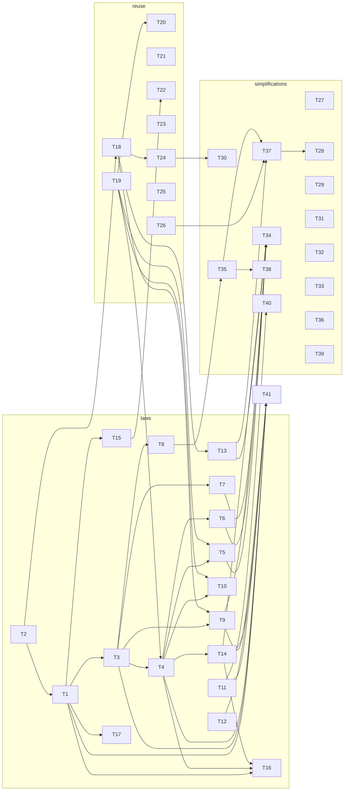

# Laws applied: journal projections, round trips, the root join and the one walk, with the October cleanups

status: in-progress
commit-mode: orchestrator-commits
language: ruby (binding-facing card: T17)
panel: Ruby (Linus Torvalds, Jeremy Evans, Sandi Metz, Richard Schneeman, Aaron Patterson); the algebra seats (Edward Kmett, Philip Wadler, Conal Elliott) join for T1, T3, T4, T11, T12, T14, T15, T16, T17

## Intent

The 2026-10-29 review of the ux-first dogfood plan (81 commits, 196 files under `lib/`) found that its 6,500 new lines
wrote by hand the shapes the algebra plan had just given laws to: 10 readers fold session records by `"type"` string,
7 parse-and-render pairs have no round trip, 3 symlink walks carry 3 copies of the hop limit, a child's sensitivity
roots are appended with nothing stating the rule, and the reuse findings (a 7th control-character escaper, a 4th PATH
walk, a hand-rolled TERM-then-KILL beside `Shell::ProcessGroup`, a hand-rolled temp-and-rename beside `AtomicFile`,
pluralisation the previous simplify plan had already moved to ActiveSupport) sit beside them. The user ruled
2026-10-29: no compatibility is owed anywhere, session files included, and the 4 redesigns go in with the licence to
unwind any that fights back. This plan delivers them as 41 cards in 3 streams: the laws (T1 to T17), the reuse of what
`lib/` already has (T18 to T26), and the simplifications (T27 to T41). Roadmap: `ROADMAP.md` item 71.

What lands, in one line each:

- **Laws** (T1 to T17): `"a round trip"` and `"an incremental fold"` as shared example groups; every journal record read
  back as a typed value through 1 reader, with a type nobody claims carried as `Untyped` and never dropped;
  `Journal::Projection`, 1 fold per reader, held to the chunked-equals-whole property `lain watch` needs, replacing
  `Replay`'s 7 passes, `EpicQueue`'s 4 memos, `Export`'s 2 copies of `masked`, the sessions row's 3 finds and the 2
  lineage readers; session format 4; `Sensitivity::Roots` as the join the confined policy already computes by hand;
  `Landing.walk` as the 1 component walk behind the sandbox seal, the executable resolver and the landing itself, with
  1 hop constant; `Paths.resolved` for the 4 realpath-or-expand copies; the request digest as the last state of the
  prefix chain it already rolls, 6 to 7 times cheaper per chat turn by the spike's measurement; the round trips of the
  4 line grammars, the header sections and the stored event held.
- **Reuse** (T18 to T26): 1 control-character escaper, `pluralize` at the 7 hand-rolled sites and 1 settled sentence,
  the chores runner stopping through `Shell::ProcessGroup`, the chores queue writing through `AtomicFile`, 1 PATH
  search, `TextMask.text`, the residency wait through `FileLock`, and `Checkout#fold_in!`.
- **Simplifications** (T27 to T41): 1 `preview` and 1 `NEWLINES` in the nvim views, the duplicated isolation constants
  and refusals, 1 window-room formula and the dead detector list, `Announcer` in its own file, the memoised decorator
  table and the once-parsed reply, the egress memo, `Paths#filing_dir` in place of a 1-element array, the 2 roots taken
  at construction and the 1 membership test, `Checkout.of` as the only constructor at 55 sites, the review queue's
  counts, 1 config-table preamble, the sensitivity policy contract, and the architecture docs.

## Coverage

Of the 2026-10-29 review's findings, this plan takes every reuse and simplification item and the 4 redesigns the user
chose. What it leaves, with the reason, is under Rejected options: the ladder generalisation (the 5 first-decisive
folds answer plain values and a flat list has no bracketing to rule out), a fence grants order (no fence ever runs
inside another), a Rust round-trip macro (no `Canon` generator exists and the 2 enums it would cover are tested),
a Rust-side projection memo (the chat path already has one in Ruby, and a per-session fold fails binding tests 3 and
4), and the Merkle digest itself (measured slower).

## Grounding

2026-10-29, `main` at `6040f4ab` (the ux-first dogfood plan closed). 6 read-only explorations, 1 spike and a panel
review with 3 probe scripts re-anchored every file this plan names; their findings are the line numbers below. The
algebra plan (`planning/specs/algebra-and-flip.md`) is fully landed, so every law group and the `PrefixChain` memo it
cites exist at this SHA. Compatibility evidence was re-gathered by lookup (next section).

Files checked, by stream (every path exists at `6040f4ab` unless marked new):

- Laws: `lib/lain/telemetry.rb`, `lib/lain/telemetry/*.rb` (88 files, 12 without a carrier), `lib/lain/declarative/{carrier,types}.rb`,
  `lib/lain/journal.rb`, `lib/lain/session_record.rb`, `lib/lain/session_record/{replay,sections,scribe}.rb`,
  `lib/lain/cli/{export,sessions,chronicle}.rb`, `lib/lain/cli/export/html.rb`, `lib/lain/cli/sessions/forks.rb`,
  `lib/lain/cli/epic_queue.rb`, `lib/lain/cli/watch.rb`, `lib/lain/cli/watch/lineage_filter.rb`,
  `lib/lain/bench/session.rb`, `lib/lain/bench/session/{lineages,loader,chain_fold,memory_replay}.rb`,
  `lib/lain/cli/resume.rb`, `lib/lain/cli/resume/selector.rb`, `lib/lain/ledger.rb`, `lib/lain/sensitivity/policy.rb`,
  `lib/lain/cli/tool_guard.rb`, `lib/lain/landing.rb`, `lib/lain/confine/profile.rb`,
  `lib/lain/shell/executable/{realpath_walk,resolver,listed_stat,mounted_stat}.rb`, `lib/lain/exec/docker/export.rb`,
  `lib/lain/paths.rb`, `lib/lain/project/{trust,resolver}.rb`, `lib/lain/isolation/clone/guard.rb`,
  `lib/lain/request.rb`, `lib/lain/request/prefix_chain.rb`, `lib/lain/agent/rendered_prefix.rb`, `lib/lain/agent/model_caller.rb`,
  `lib/lain/context.rb`, `lib/lain/middleware/journal_requests.rb`, `lib/lain/telemetry/request_sent.rb`,
  `lib/lain/bench/session/request_replay.rb`, `lib/lain/bench/hot_paths.rb`, `lib/lain/chores/item.rb`,
  `lib/lain/isolation/lease_lock.rb`, `lib/lain/liveness.rb`, `lib/lain/memory/writes.rb`, `ext/lain/src/{event,canonical,algebra}.rs`.
- Reuse: `lib/lain/utf8.rb`, `lib/lain/frontend/decorators/{edit_diff,ask_settled}.rb`, `lib/lain/frontend/{markdown,tty}.rb`,
  `lib/lain/frontend/tty/notifier.rb`, `lib/lain/exec/sandboxed.rb`, `lib/lain/frontend/neovim/surfaces.rb`,
  `lib/lain/cli/command/{rewind,share,release}.rb`, `lib/lain/chores/{runner,queue}.rb`,
  `lib/lain/shell/process_group.rb`, `lib/lain/atomic_file.rb`, `lib/lain/notices.rb`, `lib/lain/confine/sandbox.rb`,
  `lib/lain/cli/exec_backend.rb`, `lib/lain/shell/pipeline.rb`, `lib/lain/sensitivity/text_mask.rb`,
  `lib/lain/tools/edit_file.rb`, `lib/lain/tools/subagent/lineage.rb`, `lib/lain/agent/tool_runner.rb`,
  `lib/lain/provider/residency.rb`, `lib/lain/file_lock.rb`, `lib/lain/isolation/checkout.rb`,
  `lib/lain/isolation/worktree/{anchorage,handback}.rb`, `lib/lain/isolation/worktree/handback/retirement.rb`,
  `lib/lain/isolation/gc.rb`, `lib/lain/cli/land.rb`.
- Simplifications: `lib/lain/frontend/neovim/{tree_view,todo_view,status_view,buffers}.rb`, `lib/lain/file_walk.rb`,
  `lib/lain/isolation/clone/{guarded,registry,tampered}.rb`, `lib/lain/isolation/worktree/leftover.rb`,
  `lib/lain/compaction/{source,need}.rb`, `lib/lain/tool/round_budget.rb`, `lib/lain/reply_reserve.rb`,
  `lib/lain/frontend/decorators.rb`, `lib/lain/frontend/decorators/assistant_text.rb`, `lib/lain/cli/review.rb`,
  `lib/lain/cli/backend.rb`, `lib/lain/sensitivity/secrets/egress.rb`, `lib/lain/config/{keys,todos,theme}.rb`,
  the 55 `Checkout.new` sites in 35 files (listed in T37).

Where docs and code disagree, the code won and the doc is listed for the card that touches it:

| Claim | Where | Truth at HEAD | Card |
|---|---|---|---|
| "four detectors" | `lib/lain/compaction/source.rb:262` | `Need` builds 5; `Need::DETECTORS` (`need.rb:166`) names them and nothing reads it | T29 |
| the T9 containment card of the algebra plan "holds path containment to its meet" | this plan's own first draft | `Landing.under?` is a partial order held in `landing_spec.rb:166-196`; no meet exists and the algebra plan said none was built (`algebra-and-flip.md:774`) | T11, T12 |
| a child's roots lie within its parent's | the review's altitude finding | `Confined#confined` appends (`policy.rb:213`), and what is appended is the lease checkout the parent cut plus the worker env's read roots (`tool_guard.rb:583-584`), outside the parent's roots by design | T11 |
| "Lineages ... `lain watch`'s `LineageFilter` follows the same records" | `CLAUDE.md` architecture breath | they follow the same records through 2 unrelated walks (`lineages.rb:44`, `lineage_filter.rb:41`) with no shared code | T9 |
| `WIDTH = 80` on the edit decorator | `lib/lain/frontend/decorators/edit_diff.rb:11` | read only by `tools/edit_file.rb:154`, a tool reading a frontend constant | T18 |
| the residency wait "as FileLock does" | `lib/lain/provider/residency.rb:30` | its own clock loop (`residency.rb:106`); FileLock counts tries (`file_lock.rb:99`) | T25 |
| `Replay#memory` "reads events, not records" | this plan's own first draft | it hands raw records to `Bench::Session::MemoryReplay`, which reads them by `"type"` (`replay.rb:96`, `memory_replay.rb:50`) | T4, T10 |
| 22 `Checkout.new` sites | this plan's own first draft | 55 sites in 35 files; 33 lie outside `lib/lain/isolation/` | T37 |

Premises probed rather than read (recorded in Spike findings and the panel's probes): the Merkle digest's cost and
variance on the 10k chat row, the rolling chain's, and the Rust hash's; the generic reader against every committed
fixture session (every journal line carries `ts`, and `request_sent` writes a `digest` its carrier does not declare);
the card file overlaps against the dependency graph; a `PrefixChain`'s `inspect` changing after a walk, so it cannot
sit in the purity battery's population; a cold roll costing 55 ms over today's 38 ms `Request.new` at 2,000 messages
rebuilt from JSON; a BINARY chunk appended to a UTF-8 fragment raising `Encoding::CompatibilityError`; `Watch::Tail`
and a newline split agreeing on a NUL and on CR LF. Everything else above is a read of the current tree,
cross-checked by grep.

## Compatibility

Nothing is in production and the user ruled 2026-10-29 that no compatibility is owed, session files included.
Evidence by lookup: `lib/lain/version.rb` is `0.1.0`, `git tag` lists only `backup/main-pre-msg-rewrite-tag`,
`CHANGELOG.md` has the 1 initial entry, all 3 crates carry `publish = false`, and every `Gemfile` under `~/dev`
requiring `lain` is a stale worktree copy of this repo (`lain-t16`, `lain-t18*`, `lain-t23`, `lain-t24-jeremy`,
`lain-spike-*`). Every surface below is therefore **free to break**, and the plan breaks them where that removes a layer.

| Surface | Verdict | What changes |
|---|---|---|
| session file format (`SessionRecord::FORMAT = 3`) | free to break | T4 bumps to 4: every record is read back through `Telemetry.read`, so a claimed type whose reader cannot rebuild it is refused; committed fixtures under `spec/fixtures/sessions/` are regenerated or deleted (memory `old-sessions-disposable`) |
| `Request#digest` value | free to break | T14 redefines the digest as the chain's last state combined with `max_tokens`, `reasoning`, `effort` and the stripped markers; every recorded `request_sent` digest changes, covered by T4's regeneration; `PREFIX_CHAIN_VERSION` is unchanged because the seed and the entries are |
| `Context#render` and `Request.new` signatures | free to break | T14 adds `chain:` to both, the memo of a pure function, defaulting to `PrefixChain::NONE`; the 4 bench replays take a by-value chain |
| `Paths#session_dirs` (always 1 element) | free to break | T34 replaces it with `filing_dir`; 7 callers and 5 spec stubs move |
| `Isolation::Checkout.new` as a public constructor | free to break | T37 makes `Checkout.of` the only entry at 55 sites; a ratchet spec forbids `new` outside 2 files |
| `Sensitivity::Policy::Confined#confined(roots:)` taking an Array | free to break | T11 takes and holds a `Roots` value |
| `Chores::Item#render(mark, note)` | free to break | T15 derives mark and note from the item; the file bytes are unchanged, which the round trip pins |
| the hand-frozen telemetry records' constructors, `ToolCalled#phase` as a Symbol | free to break | T2 settles them through carriers; `phase` journals and reads as the String it already is on disk |
| the chores file, lease lock reason and liveness header grammars | kept as bytes | T15 and T16 add readers and laws without changing a byte, pinned by the round trips |

No trade report was needed: no must-keep surface exists.

## Spike findings

Run on 2026-10-29 in `tmp/worktrees/spike-merkle-digest` (branch `spike/merkle-digest`, removed after), on the
10,000-turn corpus the render profiling report built (`planning/render-profiling-2026-10/bench/setup.rb`).

| Question | Result | Evidence |
|---|---|---|
| Does a Merkle `Request#digest` (a digest over memoised per-message digests) beat today's whole-payload digest on the chat path? | No. Today's digest is 5.1 to 5.8 ms median per new turn at 10,000 messages, because normalised messages are already `PRODUCED` and the JSON dump is about 5 ms; the Merkle shape is 7.6 to 8.3 ms in Ruby and 8.4 to 9.1 ms with `Lain::Ext.canonical_digest` per new message, since the top-level digest over 10,000 digest strings is still O(n) | 3 interleaved runs of 30 turns, load 1.5, order rotated per turn; the harness is `planning/specs/algebra-applications-and-cleanup/spike-merkle-run.rb` |
| Does a rolling-chain digest (the last state of `state = H(prev, stripped message)`, rehashing only past the longest identical-object prefix) beat it? | Yes, 6 to 7 times: 0.95 to 1.07 ms median in Ruby (sd 0.37 to 0.59), 0.76 to 0.81 ms with the Rust hash (sd 0.23 to 0.27). The digest is the same chain `prefix_digests` already walks, so `digest` plus `prefix_digests` falls from 13.6 ms to 8.7 ms, and `prefix_digests` alone (7.5 ms median, sd 4.5 to 7.6, spikes to 34 ms) is the remaining cost and the whole of the variance | same runs; GC per turn 0.00 against 0.03 for today's; memo bounded by conversation length (10k message references plus 10k states); 2 processes printed identical digests |
| Does a Rust per-message hash cut the variance? | Only mildly, and not through Rust: the Merkle arms show sd 0.3 to 0.8 against 0.8 to 1.4 because they never hit the occasional GC, and the Rust arm did not beat the Ruby arm warm (the FFI copy is paid per new message). Rust wins only cold, 1.6 to 1.9 times (57 to 73 ms against 108 to 115 ms) | cold column, 5 runs each; binding test 2 (`docs/rust-bindings.md`) is not met warm, so T14 stays in Ruby |
| Which specs pin the digest's definition? | `spec/lain/request_spec.rb:371` asserts `Canonical.digest(req.cache_payload) == req.digest`; `:229-235` pins the chain seed and entries by hand; `request_replay.rb:30` requires a rebuilt digest to equal the recorded one, so old sessions raise `Corrupt` (covered by T4's format 4) | grep of `spec/` for `prefix_digests`, `request_digest`, `PREFIX_CHAIN_VERSION`: about 30 files, listed in T14 |
| Can the T1 reader as first drafted read a committed session line? | No. Every line carries the Journal's `ts`, and a chained one `prev` or `entry_prev`, which `settle!` refuses as undeclared; with the envelope stripped, 5 types settle and `request_sent` fails on `digest`; `turn`, `session`, `rewound`, `approval_decision` and `escalation` have no carrier | the panel's `probe-telemetry-read-probe.rb` and `probe-telemetry-read-probe-no-envelope.rb` (attached under `planning/specs/algebra-applications-and-cleanup/`) over `spec/fixtures/sessions/**`; T1 strips the envelope, declares `digest`, and carries an unclaimed type as `Untyped` |

## Shared files

Only the main session edits these; a card hands back a 1-line diff under Shared-file wiring:
`exe/lain`, `lib/lain/cli/wiring.rb`, `lib/lain/cli/wiring/toolset_build.rb`, `bin/hot-path-bench`, `.rubocop.yml`,
`spec/support/slow_files.rb`, `ROADMAP.md`, `planning/qa/scenarios/*.md`, and the EXISTING files under
`spec/support/shared_examples/` (a new group file is its card's own). `ARCHITECTURE.md`, `docs/GLOSSARY.md` and
`CLAUDE.md` are edited by T41 alone, in its tree, as the algebra plan's T41 did.

Every 2 cards that touch 1 file are chained by `Depends on`, and the dependency graph carries each chain; the panel's
overlap probe (`planning/specs/algebra-applications-and-cleanup/probe-r2-overlap-probe.rb`) is the check, and the lint
reran it after the renumbering.
The chains, by file: `lib/lain/cli/tool_guard.rb` T11 only; `lib/lain/isolation/checkout.rb` T26 then T37 then T28;
`lib/lain/isolation/clone/guard.rb` T13 then T37 then T28; `lib/lain/frontend/tty.rb` T18 only; `lib/lain/cli/epic_queue.rb`
T8 then T35 then T38; `lib/lain/cli/export/html.rb` T19 then T5; `lib/lain/cli/watch.rb` T18 then T9 then T34;
`lib/lain/project/trust.rb` T18 then T13; `lib/lain/paths.rb` T13 then T34; `lib/lain/agent/tool_runner.rb` T24 then T30;
`lib/lain/cli/sessions/forks.rb` T7 then T34; `lib/lain/cli/sessions.rb` T6 then T34; `lib/lain/session_record/replay.rb`
T4 then T10; `lib/lain/chores/queue.rb` T15 then T22; `lib/lain/tools/edit_file.rb` T18 then T24; `lib/lain/telemetry/edit_applied.rb`
T2 then T18; `lib/lain/cli/command/rewind.rb` T19 then T10; `lib/lain/cli/review.rb` T35 then T37; `lib/lain/cli/land.rb`
T26 then T37; the resume, sessions, export and share specs T19 then T4 then T5 then T34; `lib/lain/frontend/decorators/ask_settled.rb`
T19 then T20; `spec/lain/bench/session/loader_spec.rb` T4 then T14 then T16.

## Rejected options

- Generalising `Approval::Ladder` to host `Decorators.for`, `Tool::FileTarget#problem_with`, `Sensitivity#verdict_for`,
  `Agent::StopReason.for` and `Exec::Sandboxed#unbuilt`: each is a flat `find` over a list with a default, answering a
  plain value, and the ladder's `Outcome` and `Poisoning` are allow-and-deny shaped (`ladder.rb:81-82`, `:159`). A flat
  list has no bracketing for a monoid law to rule out, so the layer would buy nothing.
- A containment order in `crates/lain-fence` (`Grants` meet under proptest): no fence runs inside another and nothing
  compares an inner ruleset with an outer one (`rules.rs:73-113`, `bwrap.rb:133`). A law with no consumer is the
  registry the algebra plan deleted. It returns with the Landlock profiles.
- `declare_round_trip!` in `ext/lain/src/algebra.rs`: `strategy.rs` builds only DAG plans, `canonical.rs` has no
  parser by design (`:24-26`), and the 2 enums with a parse pair (`Role`, `Kind`) are tested at `event.rs:817` and
  `:837`. The binding-facing round trip is held from the Ruby side instead (T17).
- A Rust-side digest-keyed projection memo: the chat path already holds one in Ruby (`Agent::RenderedPrefix`, keyed by
  head digest, and `Request::PrefixChain`, keyed by message identity), and the file-side projections are per-session
  or per-command work, which fails binding tests 3 and 4 (`docs/rust-bindings.md`).
- The Merkle digest itself (a digest over per-message digests): measured 1.3 to 1.5 times SLOWER than today's whole
  payload digest at 10,000 messages (Spike findings), because the fold over 10,000 digest strings is still O(n).
- A Rust per-message hash under T14: no warm gain over Ruby (the FFI copy is paid per new message) and only a cold
  gain of 1.6 to 1.9 times; binding test 2 (`docs/rust-bindings.md`) asks for an asymptotic gap, and there is none.
- `"a monoid action"` as a law group (`act([], s) == s`, `act(L + R, s) == act(R, act(L, s))`): the panel showed it is
  a theorem of `inject` over any step, mutating ones included, so no negative exists and the battery could never read
  `:fails`. T3 holds persistence, the homomorphism for value projections, and chunked-equals-whole instead.
- A path meet (`Landing.meet`, the common ancestor directory): nothing in production calls one. The algebra plan's T9
  said so and this plan's grounding confirmed it. T11 here builds the join the code already computes.
- Holding a child's sensitivity roots BELOW its parent's: false by design. `ToolGuard.child_stack` (`tool_guard.rb:583-584`)
  adds the lease checkout the parent cut and the worker env's read roots, which lie under the lease root and not under
  the project root.
- Memoising `Clone::Guard.cut?` across git calls: it reads the filesystem, and a memo trades a syscall for staleness.
- YJIT: the profiling report measured it (chat 37 to 24 ms); it is a whole-app experiment with its own card elsewhere.
- Moving the 2 private `counted` helpers (`epic_queue.rb:260`, `altitude.rb:206`) into a shared one: the standing
  idiom from commit 027fda4d is inline `"word".pluralize(n)`, and T19 uses it.
- One `Fresh.none(clock:)` for the 2 `Fresh.for_lineage([])` sites: 2 bench call sites, 1 argument, no bug class.
- Giving `turn`, `session`, `rewound`, `approval_decision` and `escalation` record classes in this plan: they are the
  session's own grammars (`SessionRecord`, `Approval::Parked`), and T1's `Untyped` carries them whole, so nothing is
  dropped. A class each is a later card once a reader needs more than their keys.
- Converting `Bench::Session::Loader`'s raw `of_type` reads (`loader.rb:66`) and `Bench::Session`'s cut restore
  (`bench/session.rb:203`) to typed values: bench-side readers of their own fixtures; this plan converts the resume
  path and the 5 readers the review named, and says so in T4.

## Open decisions

- **Walking the free monoid as bench arms** (ladder rung orderings, combinator words): the structure now exists and no
  command walks it (`ARCHITECTURE.md` "The payoff is the free monoid"). A bench feature with its own plan.
- **Landlock profiles** consume T12's walk and the fence order this plan rejected; not built here.
- **`Journal::Projection` in Rust**: only if a projection becomes per-turn work; binding tests 3 and 4 decide.
- **Fixture sessions that cannot be regenerated by script** (`spec/fixtures/sessions/approval_replay`,
  `rewrites_v1`): T4 deletes any such fixture with the specs that read it, per memory `old-sessions-disposable`,
  unless its spec's subject has no other fixture; then the card grows by a generator script. Decided in-card.
- **Record classes for the session's own grammars** (`turn`, `rewound`, `session`, `approval_decision`,
  `escalation`): see Rejected options; a later card.

## Dependency graph



## Tasks

### Wave A: the laws

### T1: Read every journal record back as the value it was written from          [risk: medium]

**Depends on:** T2
**Files:** `lib/lain/telemetry.rb`, `lib/lain/telemetry/untyped.rb` (new), `lib/lain/telemetry/request_sent.rb`,
`lib/lain/journal.rb`, `spec/support/shared_examples/round_trip.rb` (new), `spec/lain/telemetry_spec.rb`,
`spec/lain/telemetry/untyped_spec.rb` (new), `spec/lain/telemetry/round_trip_spec.rb` (new), `spec/lain/telemetry/request_sent_spec.rb`,
`spec/lain/journal_spec.rb`
**Reuse:** `Journalable#to_journal` and `#journal_type` (`telemetry.rb:28-57`); `Declarative::Carrier.settle!` and
`declared_defaults` (`declarative/carrier.rb:53`, `:149`); `Journal.parse` (`journal.rb:173`) and the envelope the
Journal adds (`"ts"` at `journal.rb:375`, `LINK` and `ENTRY_LINK` at `:387-391`); the `"canonical determinism"` group
(`spec/support/shared_examples/canonical_laws.rb:31`) for the generator-and-equal config shape; `AlgebraLaws.outcomes`
(`law_outcomes.rb`) for the battery reading
**Shared-file wiring:** none
**Reachable from:** T4's `SessionRecord::Replay#initialize` (`replay.rb:58-60`) reads entries through `Telemetry.read`;
until T4 lands the reader is reached by the card's own spec and by `Journal.records(entries, typed: true)`, which no
production caller passes yet

A record that journals must read back, and from the bytes the Journal wrote, not from `to_journal`. `Journal.payload_of(hash)`
is the inverse of `Journal#record_hash` (`journal.rb:382`): it strips the `ts` and the Journal's own `LINK`, then renames
`ENTRY_LINK` back to `LINK`, since `unforged` (`:388-391`) renamed an entry's own link to make room. `Telemetry.read(hash)`
takes a parsed line, strips the envelope, and dispatches on `"type"`: a type a `Journalable` class under `Telemetry`
claims (the inverse of `journal_type`'s `underscore`, through `String#camelize`) is rebuilt through the class's carrier,
`Carriers::X.settle!(**attrs)` with the keys symbolised and the defaults `omitting_defaults` dropped restored; a type
no class claims answers `Telemetry::Untyped`, a frozen Data over the whole hash with `type` and `[]`, so the session's
own grammars (`turn`, `session`, `rewound`, `approval_decision`, `escalation`) travel whole and nothing is dropped; a
claimed type whose attributes do not settle raises `Telemetry::Unreadable` naming the type and the carrier's error,
because a torn record of our own is corruption. `RequestSent`'s carrier declares `digest` (`:lain_interned`), which
`to_journal` already writes and the panel's probe found undeclared; that is a decision of this card, not a stop
condition. `"a round trip"` is the shared group: `render:`, `parse:`, a `generator:` or `population:`, and `equal:`; its
1 law is `parse(render(x)) == x`, and its battery `AlgebraLaws::RoundTrip` lets a spec show a pair that is NOT one.
The round-trip spec's `render` writes the record through a real `Journal` onto a `StringIO` and takes the line; its
`parse` is `Journal.parse` then `Telemetry.read`, so the envelope, the JSON and every String-versus-Symbol field are
under the law, over 1 generated instance of every `Journalable` class under `Telemetry` with a `Carriers` class.

**Interface**

```ruby
module Lain
  class Journal
    def self.payload_of(hash)    # => Hash without ts and the Journal's LINK, an ENTRY_LINK renamed back to LINK
  end
  module Telemetry
    class Unreadable < Error; end
    Untyped = Data.define(:hash) do
      def type = hash.fetch("type")
      def [](key) = hash[key]
    end
    # @param strict [Boolean] a claimed type that will not settle raises Unreadable when true, and
    #   answers Untyped when false, the lenient reading lain watch owes foreign or torn bytes
    # @return [Journalable, Untyped] never nil: a type nobody claims comes back whole
    def self.read(hash, strict: true)
  end
end

RSpec.shared_examples "a round trip" do |config|   # render:, parse:, generator: | population:, equal: (default ==)
module AlgebraLaws; class RoundTrip; def self.from(config); def to_h; end; end   # the battery, 1 law
```

**Acceptance criteria**

```gherkin
Scenario: a journaled line reads back equal
  Given an AskSettled record written by a Journal onto a StringIO
  When the line is parsed and read
  Then it answers a record == to the one written

Scenario: a field dropped as a default comes back
  Given a SessionClosed record whose error is nil, so to_journal omits it
  When its line is read back
  Then the record's error is nil and the record == the one written

Scenario: the session's own records travel whole
  Given a line typed turn as the Scribe writes it
  When it is read
  Then the answer is an Untyped whose type is turn and whose keys are the line's, ts excluded

Scenario: a torn record of our own is refused
  Given a line typed ask_settled with its head missing
  When it is read strictly
  Then Unreadable is raised naming ask_settled, and read leniently it answers an Untyped

Scenario: a chained line's own link comes back under its name
  Given a record carrying a link field, written through a chained Journal
  When the line is read
  Then the record's link equals what it carried and the Journal's own link is gone

Scenario: every carried record round-trips through the bytes
  Given one generated instance of each Journalable class under Telemetry with a Carriers class
  When the shared round-trip law runs with a Journal write as render and parse-then-read as parse
  Then parse(render(x)) == x for every draw, request_sent included

Scenario: the battery shows a lossy pair
  Given a render that drops a field and the matching parse
  When AlgebraLaws::RoundTrip runs over it
  Then the equality law reads :fails and nothing raised
```
Spec file: `spec/lain/telemetry_spec.rb`, `spec/lain/telemetry/round_trip_spec.rb`, `spec/lain/telemetry/untyped_spec.rb`, `spec/lain/journal_spec.rb`

**Stop and report if:**
- a `Journalable` class under `Telemetry` other than `RequestSent` journals a field its carrier does not declare (grep
  each `to_journal` override against its `Carriers` class, and run the round-trip spec): list them, declare each in
  this card, and say which
- `TurnUsage#to_journal` writes a `:lain_fixed_point` or `:lain_canonical` value the type cannot cast back from JSON
  (`declarative/types.rb:134`, `:156`); then the type gains a cast and `spec/lain/declarative_spec.rb` joins Files

### T2: Settle the 6 hand-frozen records through declared carriers          [risk: low]

**Depends on:** none
**Files:** `lib/lain/telemetry/{tool_called,edit_applied,files_written,child_turn,observer_failed,round_bounded}.rb`,
`lib/lain/agent/tool_runner.rb`, `spec/lain/telemetry/{tool_called,edit_applied,files_written,child_turn,observer_failed,round_bounded}_spec.rb`
**Reuse:** `Telemetry::AskSettled` (`telemetry/ask_settled.rb`) is the exemplar shape; the `:lain_interned` type
(`declarative/types.rb:147`); `Telemetry::SessionShared`'s `validates ... presence:` for a required string
**Shared-file wiring:** none
**Reachable from:** each record's existing production writer (`Agent::ToolRunner::Announcer#emit`, `Tools::EditFile#call`,
`Agent#files_written`, `SessionRecord::Scribe#child_turn`, `Journal#notify`, `Tool::RoundBudget`)

The previous simplify plan settled 67 records through carriers; these 6 were written after it and freeze by hand
(`tool_called.rb:12-14`, `edit_applied.rb:11-13`, `files_written.rb:12-13`, `child_turn.rb:26-37`,
`observer_failed.rb:15`, `round_bounded.rb:26-28`). Each gets a `Carriers::X < Declarative::Carrier` and a constructor
that is 1 `settle!` call, with the frozen-and-interned guarantees the carrier types give. `ToolCalled#phase` is declared
`:lain_interned` with `inclusion: { in: %w[start end] }`, the String it already is on disk, and the announcer passes
`"start"` and `"end"`, so T1's reader needs no Symbol cast. The remaining 6 non-carrier files (`escalation`,
`questions_consumed`, `slot_fills`, `stamped`, `request_resent`, `released_within_regions`) are not plain records and stay.

**Acceptance criteria**

```gherkin
Scenario: a settled record is deeply frozen and shareable
  Given a ToolCalled built from mutable strings
  When it is built
  Then Ractor.shareable? is true and the strings are not the caller's objects

Scenario: a phase outside the set is refused
  Given a ToolCalled whose phase is "middle"
  When it is built
  Then a validation error names phase

Scenario: the journal bytes are unchanged
  Given each of the 6 records built with the same attributes as before
  When to_journal runs
  Then the hash equals the one the hand-frozen version wrote (pinned per record from the current spec's fixtures)
```
Spec file: the 6 record specs

**Stop and report if:**
- `ChildTurn` (`child_turn.rb:26-37`) carries a nested Hash a carrier type cannot declare; then it keeps its hand
  constructor and T1's reader rebuilds it by a `from_journal` the class defines, and the card says so
- `spec/lain/frontend/decorators/tool_called_spec.rb` or `spec/lain/agent/tool_runner_spec.rb:197-218` compares `phase`
  against a Symbol

### T3: Fold a session once, through projections held to the incremental law          [risk: medium]

**Depends on:** T1
**Files:** `lib/lain/journal/projection.rb` (new), `lib/lain/journal/projections.rb` (new), `lib/lain/journal/tail.rb` (new),
`spec/support/shared_examples/incremental_fold.rb` (new), `spec/lain/journal/projection_spec.rb` (new),
`spec/lain/journal/projections_spec.rb` (new), `spec/lain/journal/tail_spec.rb` (new)
**Reuse:** `Journal.records` (`journal.rb:202`) as the entry walk; `Watch::Tail` (`watch.rb:196-240`), read only, as
the shape of a fragment buffer that survives a torn last line, which T9 makes delegate to `Journal::Tail`;
`Ledger::Index.from_journal` (`ledger/index.rb:44`) as the shape of a frozen fold; the `"a monoid homomorphism"` group
(`spec/support/shared_examples/monoid_homomorphism.rb:85`) and its battery; `Ractor.shareable?` as the frozen test
(`spec/support/shared_examples/regular.rb`)
**Shared-file wiring:** none
**Reachable from:** none until T4; T4's `SessionRecord::Replay#initialize` (`replay.rb:58-60`) is the first production
construction, and T5 to T9 follow

A projection is a frozen value with `self.unit`, `#step(record)` answering a new projection, and `.over(records)` as
the inject; `#value` is what a reader wants; records reach `step` as the typed values T1 reads, so a projection
dispatches on class and the same projection folds a live Channel. `Journal::Projections` is a composite stepping
several in 1 pass, so a reader that wants 4 projections parses the file once. `Journal::Tail` is the byte-stepping
front: it takes chunks cut anywhere, buffers them as binary, keeps the torn fragment, and hands each newline-terminated
line, forced to UTF-8, to `Journal.parse`; it answers HASHES, and reading them is the caller's own step, strict for
`Replay` and lenient for `lain watch`, so the Tail never raises on foreign or torn bytes. The law is `"an incremental
fold"`, 3 properties that can each fail: persistence (`s.step(r)` leaves `s` equal to before and the result is
`Ractor.shareable?`), chunked equals whole (the projection over the file's newline-terminated lines equals the
projection stepped through a `Tail` fed the file's bytes split at every byte boundary, a multibyte character and an
unterminated last line included, which `File.foreach` would have yielded and the Tail, like `lain watch` today, holds
back), and, for a projection that declares `combine`, `"a monoid homomorphism"` from the record list, whose negative
is the reads projection: a `session_read` binds to the turn that lands after it, so folding the halves apart changes
the answer, and the battery shows it.

**Interface**

```ruby
module Lain
  class Journal
    class Projection
      def self.unit                       # => Projection
      def self.over(records)              # => Projection, records.inject(unit) { |p, r| p.step(r) }
      def step(record)                    # => Projection, a new frozen value; record is a Journalable or Untyped
      def value
    end
    class Projections                     # a composite: step every member, read any by key
      def self.of(**projections)
      def step(record)
      def [](key)
    end
    class Tail                            # bytes in, parsed Hashes out, the torn fragment kept as binary
      def <<(chunk)                       # => the Hashes of the newline-terminated lines the chunk completed
    end
  end
end

RSpec.shared_examples "an incremental fold" do |config|   # projection:, generator: (lists of records), equal:
```

**Acceptance criteria**

```gherkin
Scenario: stepping leaves the receiver as it was
  Given a projection over 30 typed records
  When a 31st is stepped
  Then the 30-record projection still answers its old value and both are Ractor shareable

Scenario: chunked equals whole
  Given a generator of record lists written through a Journal onto a StringIO, some holding multibyte text, some with the last newline cut off
  When the shared incremental-fold law feeds the bytes through a Tail split at every byte boundary, as BINARY chunks
  Then the projection's value equals the one over the newline-terminated lines, on every draw, and an unterminated last line is held back

Scenario: the reads projection is not a homomorphism, and says so
  Given a record list holding a session_read followed by the turn it binds to
  When the homomorphism battery runs over the reads projection
  Then the concatenation law reads :fails and nothing raised, with the split that lost the binding as the witness

Scenario: a composite parses once
  Given 3 projections over 1 record list through Projections.of
  When the composite is stepped
  Then each member's value equals the member built alone and the record list was walked once (an Enumerator counting its yields)
```
Spec file: `spec/lain/journal/projection_spec.rb`, `spec/lain/journal/projections_spec.rb`, `spec/lain/journal/tail_spec.rb`

**Stop and report if:**
- a frozen `Data`-shaped projection allocates per step enough to show on `bin/hot-path-bench`'s `journal_*` rows (run it
  after the card); then `step` returns self on a record it ignores, and the card says what the rows read
- `Ractor.shareable?` fails on a projection holding a `Set`, since `Set` is not shareable frozen; use a frozen Hash
- a NUL inside a line, a lone CR or a CR LF makes the Tail and `Watch::Tail` disagree (the panel's probe says they
  agree: a NUL fails `JSON.parse` both ways and `"\r\n"` parses): then T9, which owns `watch_spec.rb`, pins the case,
  not this card

### T4: Restore a session through projections, as format 4          [risk: high]

**Depends on:** T3, T19
**Files:** `lib/lain/session_record/replay.rb`, `lib/lain/session_record.rb`, `lib/lain/bench/session/loader.rb`,
`bin/regenerate-session-fixtures`, `spec/fixtures/sessions/**`, `spec/lain/session_record/replay_spec.rb`,
`spec/lain/session_record_spec.rb`, `spec/lain/cli/resume/selector_spec.rb`, `spec/lain/bench/session/loader_spec.rb`,
`spec/lain/bench/variance_fixture_spec.rb`, `spec/lain/cli/{resume,sessions,export}_spec.rb`, `spec/lain/cli/command/share_spec.rb`,
`spec/lain/bench/session/memory_replay_spec.rb`
**Reuse:** `Replay#restore_reads`, `restore_pins`, `restore_labels`, `restore_todos`, `restore_cuts`, `withheld_sources`
(`replay.rb:126-287`) are the 6 passes that become 6 projections in 1 `Projections`; `Replay#memory` (`replay.rb:95`)
hands raw records to `Bench::Session::MemoryReplay` (`memory_replay.rb:50`) and keeps doing so; `Journal::Projection`
(T3); `Telemetry.read` and `Untyped` (T1); `SessionRecord.current_format?` (`session_record.rb:115`);
`Resume::Selector::OTHER_FORMAT` interpolates `FORMAT` (`selector.rb:19`) and needs no edit; `Bench::VarianceFixtures.write`
**Shared-file wiring:** none
**Reachable from:** `CLI::Resume#replay` builds `Replay` (`cli/resume.rb:268`) and calls `#session` and `#memory` at
`:303`; the projections are constructed in `Replay#initialize` (`replay.rb:58-60`); `Bench::Session::Loader#load`
(`loader.rb:60`) builds the same `Replay` after its own raw `of_type` reads, which stay raw (Rejected options)

`Replay#initialize` parses its entries once through `Journal.parse` and `Telemetry.read`, keeps the raw entries for
`MemoryReplay`, and folds the typed records once through a `Projections` of reads, pins, labels, todos, cuts and withheld
sources; `session(on:)` applies the 6 values and `memory` stays the memo it is. The reads and cuts projections read
`turn` and `session` as `Untyped` by the keys `restore_read` reads today (`replay.rb:137-141`). `FORMAT` becomes 4,
because a file is now read as typed records and a claimed type the reader cannot rebuild is refused rather than skipped;
the loader's refusal says "format 4" through the constant. Every committed session fixture is regenerated by
`bin/regenerate-session-fixtures` (the variance set) or deleted with the specs that read it (Open decisions), so no
format 3 bytes remain under `spec/`.

**Acceptance criteria**

```gherkin
Scenario: a format 4 session resumes to the same state as before
  Given a session with 2 reads, 1 pin, 1 label, 1 todo snapshot, 1 compaction cut and 1 memory_write, written by the Scribe
  When it is resumed through CLI::Resume
  Then the restored session's reads, pins, labels, todos, cut and memory manifest equal what the live session held

Scenario: the file is parsed once for the projections
  Given the same session file
  When Replay restores it
  Then the entries Enumerator was walked once by the projections, and the memory replay read the raw records

Scenario: a format 3 file is refused by name
  Given a session file whose header says format 3
  When it is selected for resume
  Then the refusal says it records another session format, not 4

Scenario: a record of our own that cannot be rebuilt is corruption
  Given a format 4 file holding an ask_settled record with no head
  When it is resumed
  Then Corrupt is raised naming the record type and index

Scenario: an approval record survives the resume
  Given a format 4 file holding an approval_decision and an escalation record
  When it is resumed
  Then both reach the reads projection as Untyped and the resumed session's approvals equal the live session's
```
Spec file: `spec/lain/session_record/replay_spec.rb`, `spec/lain/cli/resume/selector_spec.rb`, `spec/lain/bench/session/loader_spec.rb`, `spec/lain/bench/session/memory_replay_spec.rb`

**Stop and report if:**
- `spec/fixtures/sessions/approval_replay` or `rewrites_v1` has no generator and its spec's subject has no other fixture:
  see Open decisions, decide in-card and say which
- `Bench::Session`'s cut restore (`bench/session.rb:203`) reads a key the format 4 bytes no longer carry (it reads raw
  hashes and the bytes are unchanged, so it should not); then `lib/lain/bench/session.rb` joins Files
- the loader's `REQUIRED_SECTIONS` read (`loader.rb:50`) and `Telemetry.read` disagree on the header, which is not a
  `Journalable`: the header keeps its own reader (`SessionRecord.current_format?`) and the card documents the 2 readers

### T5: Count an export through one projection          [risk: low]

**Depends on:** T4, T19
**Files:** `lib/lain/cli/export.rb`, `lib/lain/cli/export/html.rb`, `lib/lain/journal/projection/redactions.rb` (new),
`spec/lain/cli/export_spec.rb`, `spec/lain/cli/export/html_spec.rb`, `spec/lain/journal/projection/redactions_spec.rb` (new)
**Reuse:** `Export#released` and `#masked` (`export.rb:41`, `:46`), `Html#masked` (`html.rb:58`) and `REDACTIONS`
(`html.rb:14`); `Journal::Projection` (T3)
**Shared-file wiring:** none
**Reachable from:** `CLI::Export#call` (reached by `exe/lain export` and `/share`), which builds the projection and hands
it to `Html`

`Projection::Redactions` answers released and masked, is built once in `Export`, and is handed to `Html`, which stops
summing; `REDACTIONS` lives on the projection. It declares `combine` (`+` on both counts) and is held to the
homomorphism as a value projection.

**Acceptance criteria**

```gherkin
Scenario: the HTML footer and the command agree on the masked count
  Given a session with 3 masked reads of 1, 2 and 4 regions
  When it is exported as HTML
  Then the footer says 7 regions and Export#masked answers 7, from 1 projection

Scenario: the counts are a homomorphism
  Given a generator of record lists with masked and released reads
  When the monoid-homomorphism law runs over Redactions with + as combine
  Then both laws hold on every draw
```
Spec file: `spec/lain/cli/export_spec.rb`, `spec/lain/cli/export/html_spec.rb`, `spec/lain/journal/projection/redactions_spec.rb`

**Stop and report if:**
- `Html` reads records for anything but counts and the turn chain (`html.rb:41-46`), so the counts projection would
  leave a second walk in place: then the chain becomes a projection too, in this card

### T6: Build a sessions row from one fold          [risk: low]

**Depends on:** T4
**Files:** `lib/lain/cli/sessions.rb`, `lib/lain/journal/projection/session_row.rb` (new), `spec/lain/cli/sessions_spec.rb`,
`spec/lain/journal/projection/session_row_spec.rb` (new)
**Reuse:** `Sessions::Listing#folded` and `#chain` (`sessions.rb:160-175`), the 3 finds; `Journal::Projection` (T3)
**Shared-file wiring:** none
**Reachable from:** `CLI::Sessions#rows` -> `Listing.new`

The sessions row is 1 projection over header, close and chain, so the listing walks a file once instead of 3 finds.

**Acceptance criteria**

```gherkin
Scenario: a listing row folds the file once
  Given a closed session file with 4 turns and 1 rewind
  When the sessions listing builds its row
  Then the row's head, status and reason equal today's and the file was walked once
```
Spec file: `spec/lain/cli/sessions_spec.rb`, `spec/lain/journal/projection/session_row_spec.rb`

**Stop and report if:**
- `Listing#chain` (`sessions.rb:175`) and `ChainFold` (`chain_fold.rb:21`) are the same fold and the card can make the
  row use `ChainFold`: then it does, and says so, since 1 chain fold beats 2

### T7: Find a session's forks without rescanning every file          [risk: low]

**Depends on:** T3
**Files:** `lib/lain/cli/sessions/forks.rb`, `spec/lain/cli/sessions/forks_spec.rb`
**Reuse:** `Forks.of` and `.source` (`forks.rb:13`, `:29`); `Journal::Projection` (T3)
**Shared-file wiring:** none
**Reachable from:** `Sessions::Forks.source` built in `CLI::Wiring` and handed to `Neovim::TreeView` (`editor_seams.rb:33`,
`tree_view.rb:74`)

`Forks` is a projection over headers that steps per file, and `Forks.source` keeps the projection and steps only files
it has not seen, keyed by path, size and mtime (a salvage rewrite can keep the size), so the tree's refresh stops
rescanning every session on every call.

**Acceptance criteria**

```gherkin
Scenario: a fork is found once
  Given 2 session files resumed from the same head and a Forks source over their directory
  When the source is called twice with no new file
  Then the second call steps no file (a counting facts double) and answers the same grouping

Scenario: a rewritten file is read again
  Given the same source and 1 file rewritten to the same size with a newer mtime
  When the source is called
  Then that file is stepped again
```
Spec file: `spec/lain/cli/sessions/forks_spec.rb`

**Stop and report if:**
- `TreeView` (`tree_view.rb:74`, `:98`) depends on `@forks.call` answering a fresh Hash each time (it compares by identity)

### T8: Build the review queue's 4 record maps in 1 pass          [risk: low]

**Depends on:** T3
**Files:** `lib/lain/cli/epic_queue.rb`, `spec/lain/cli/epic_queue_spec.rb`
**Reuse:** `Review#deferrals`, `#parks`, `#test_runs`, `#evidence` (`epic_queue.rb:446-458`) and `of_type` (`:461`);
`Journal::Projections` (T3)
**Shared-file wiring:** none
**Reachable from:** `CLI::EpicQueue#call` -> `Review.new(records)` (`epic_queue.rb:364`)

The 4 memos become 4 projections in 1 composite built in `Review#initialize`, each keyed by the address the memo keyed
on today; the row builders read the composite. `question_of`, `tests_of` and `tests_said` read the same values.

**Acceptance criteria**

```gherkin
Scenario: a parked row shows its question and test result
  Given a journal with a gate_parked record and a tests_ran record for issue 7 at sha abc
  When the queue renders
  Then the row for issue 7 shows the question and the tests' words, as today

Scenario: the records are walked once
  Given the same journal as a counting Enumerator
  When Review is built and every row rendered
  Then the Enumerator was walked once
```
Spec file: `spec/lain/cli/epic_queue_spec.rb`

**Stop and report if:**
- a row builder reads a record type none of the 4 memos holds (grep `of_type(` in the file): it joins the composite

### T9: Follow a lineage with the projection that reads one back          [risk: medium]

**Depends on:** T3, T18
**Files:** `lib/lain/bench/session/lineages.rb`, `lib/lain/cli/watch/lineage_filter.rb`, `lib/lain/cli/watch.rb`,
`lib/lain/journal/projection/lineage.rb` (new), `spec/lain/bench/session/lineages_spec.rb`, `spec/lain/cli/watch/lineage_filter_spec.rb` (new),
`spec/lain/cli/watch_spec.rb`, `spec/lain/journal/projection/lineage_spec.rb` (new)
**Reuse:** `Lineages` (`lineages.rb:44`) walks child turns to `spawn.body["spawned_from"]`; `LineageFilter#admit?`,
`#anchors?`, `#chains?` (`lineage_filter.rb:46-83`), which read `record["type"]`; `Watch::Tail` (`watch.rb:196-240`),
the pull Enumerable owning `wait`, `writing` and the dead writer's 1 more read, whose `@fragment` and `take` are the
only parts that move; `Watch#closed_by?` (`watch.rb:112`) and `Watch::View#lines` (`watch.rb:255`), which read
`record["digest"]`, `["kind"]`, `["payload"]`; `Journal::Projection`, `Tail` and `Telemetry.read(strict: false)` (T1, T3)
**Shared-file wiring:** none
**Reachable from:** `CLI::Watch#follow` (`watch.rb:93`) steps the filter per record through `Watch::Tail`; `Bench::Session::Lineages.of(store)`
from the loader's recording

1 `Projection::Lineage` answers "which message records belong to spawn S, and is it complete": `Lineages` is its value
over a whole file and `LineageFilter` is its live stepping, so the 2 agree by the incremental law and the duplicated
chain walk goes. `Watch::Tail` keeps its pull loop and delegates its fragment buffer to `Journal::Tail`; the hashes it
yields are read with `Telemetry.read(strict: false)`, so a torn or foreign line is still skipped, and `closed_by?`,
`View#lines` and `LineageFilter` dispatch on the typed record's class, with `Untyped#[]` for the session's own grammars.
`LineageFilter` gets the spec file its mirror path owes it, and `watch_spec.rb` pins the torn last line, the NUL, a
lone CR and CR LF behaving as today.

**Acceptance criteria**

```gherkin
Scenario: a lineage followed live equals the lineage read back
  Given a parent that spawns a child which completes, journaled through the Scribe
  When lain watch follows the spawn from the file's first byte, and Lineages reads the closed file
  Then the records the filter admitted equal the lineage's records

Scenario: the tail continues the prefix
  Given the same journal's bytes split at an arbitrary byte
  When the projection folds the prefix, then the tail, through a Tail
  Then its value equals the fold over the whole, for every split the incremental law draws

Scenario: watch still skips what it skipped
  Given a session file whose last line is torn, a line holding a NUL, a line holding a lone CR and a line ending in CR LF
  When lain watch follows it
  Then the torn line is held until its newline, the NUL line is skipped, the lone CR line and the CR LF line are read as today, and a writer gone with a torn session_closed still reads as ended without closing
```
Spec file: `spec/lain/journal/projection/lineage_spec.rb`, `spec/lain/cli/watch/lineage_filter_spec.rb`, `spec/lain/bench/session/lineages_spec.rb`, `spec/lain/cli/watch_spec.rb`

**Stop and report if:**
- `Lineages` needs the Store's `Ext::Event` bodies and not the `message` record alone (`lineages.rb:44-70`); then the
  projection folds records and the Store lookup stays in `Lineages#value`, and the card says which fields it reads
- `spec/lain/tools/subagent_spec.rb:813` pins the filter's admit order byte for byte

### T10: Walk the chain once in /rewind          [risk: low]

**Depends on:** T4, T19
**Files:** `lib/lain/cli/command/rewind.rb`, `lib/lain/session_record/replay.rb`, `spec/lain/cli/command/rewind_spec.rb`
**Reuse:** `Rewind`'s 4 `ancestors.to_a` walks (`rewind.rb:39`, `:71`, `:79`, `:190`); `/pin`'s lazy `ancestors.find`
(`pin.rb`) as the shape; `Agent::Progress`'s bounded walk (`progress.rb:29`)
**Shared-file wiring:** none
**Reachable from:** `/rewind` through `Command::Surface`

`/rewind` materialises the whole chain 4 times per command; it walks once, lazily, stopping at the count it needs, as
`/pin` and `Progress` do. `Replay#memory`'s comment states the real reason it is a memo and not a projection: it hands
the raw records to a bench reader (`MemoryReplay`) that reads them by `"type"`, and a docstring on `Projection` names
it as the read that is not a fold.

**Acceptance criteria**

```gherkin
Scenario: a rewind walks the chain once
  Given a 200-turn session and /rewind 3
  When the command runs
  Then the timeline's ancestors Enumerator was opened once and stopped before turn 10 (a counting store double)
```
Spec file: `spec/lain/cli/command/rewind_spec.rb`

**Stop and report if:**
- `Rewind#past_stranded` or `settled_count` needs the whole chain to decide (`rewind.rb:36-39`): then 1 full walk,
  never 4, and the card says why 1 is the floor

### T11: Sensitivity::Roots, the join a confined policy computes by hand          [risk: medium]

**Depends on:** none
**Files:** `lib/lain/sensitivity/roots.rb` (new), `lib/lain/sensitivity/policy.rb`, `lib/lain/cli/tool_guard.rb`,
`spec/lain/sensitivity/roots_spec.rb` (new), `spec/lain/sensitivity/policy_spec.rb`, `spec/lain/cli/tool_guard_spec.rb`
**Reuse:** `Confined#initialize`, `#confined`, `#held?`, `#under_root?`, `#spellings` (`policy.rb:205-325`);
`Landing.under?` (`landing.rb:127`) and `Landing.of`; the `"a commutative monoid"` group (`monoid.rb:108`); the
`"a meet semilattice"` group (`meet_semilattice.rb:73`) for the order check, with the join as the meet under `>=`, the
duality `spec/lain/sensitivity_spec.rb:1937` already uses for the verdict join
**Shared-file wiring:** none
**Reachable from:** `CLI::ToolGuard.child_stack` -> `confined(inputs, worker_env)` -> `Policy#confined(roots:)`
(`tool_guard.rb:584`, `policy.rb:467`); `Confined#judge` (`policy.rb:258`) on every gated child read

A confined policy holds a set of absolute directories and answers whether a landing is under one. That set is a
value, `Sensitivity::Roots`: `of(*dirs, facts:)` spells each as expanded and real, `held?(path)`, and `|` is the join,
a commutative, idempotent, associative union whose unit is `Roots.none`. The order `a <= b` is "every root of a lies
under a root of b", a preorder (`{/a}` and `{/a, /a/b}` sit on each side of it), so equality for the laws is equality
of the held set, and the group is given `equal:` accordingly. Beyond the semilattice group the spec holds leastness
("for every c above a and b, `a | b <= c`") and the homomorphism `held?(a | b, p) == held?(a, p) || held?(b, p)`, which
is where a real-versus-expanded spelling can break. `confined(roots:)` is `@roots | Roots.of(roots)`; `Confined#held?`
stays the disjunction of `Roots#held?` and `in_related_tree?`, which is design (`policy.rb:317`). The hand-written
`under_root?`, `spellings` and the `uniq.freeze` go. The attenuation that is real is pinned as an example: a child's
roots are the parent's joined with the lease checkout and read roots the worker env names (`tool_guard.rb:583-584`)
and nothing else.

**Interface**

```ruby
module Lain::Sensitivity
  class Roots
    def self.none
    def self.of(*dirs, facts: FileFacts::LIVE)   # expanded and real spellings, as Confined#spellings does
    def held?(path)                                # path is a landing, absolute
    def |(other)                                   # the join
    def <=(other)                                  # a preorder; equal: for the laws is the held set
  end
end
```

**Acceptance criteria**

```gherkin
Scenario: the join is a commutative monoid with none as unit
  Given a generator of Roots over 6 directories under a tmp tree, some nested, some linked
  When the shared commutative-monoid law runs with | and Roots.none
  Then unit and associativity and commutativity hold on every draw

Scenario: the join is the least upper bound under containment
  Given every Roots over 4 fixed directories as the population
  When the semilattice group runs with | as the meet and "b <= a" as ancestor_of, and the leastness check runs over every triple
  Then idempotence, commutativity, associativity, "the join sits above both operands" and leastness hold

Scenario: holding distributes over the join
  Given a generator of Roots pairs and paths, some reached through a link
  When held? is asked of the join and of each operand
  Then held?(a | b, p) == held?(a, p) || held?(b, p) on every draw

Scenario: a child's policy holds the parent's roots plus what the worker env names
  Given a parent policy rooted at the project and a worker env whose checkout is a lease outside it with 1 read root
  When ToolGuard builds the child stack
  Then the child's roots hold the project root, the lease checkout and the read root and nothing else, and a read of the lease is not outside the project

Scenario: a confined read outside every root keeps its credential reason
  Given a confined policy whose roots exclude ~/.npmrc's directory
  When it judges ~/.npmrc
  Then the verdict's reason is credential, as today
```
Spec file: `spec/lain/sensitivity/roots_spec.rb`, `spec/lain/sensitivity/policy_spec.rb`, `spec/lain/cli/tool_guard_spec.rb`

**Stop and report if:**
- `policy_spec.rb:1091-1321` pins `confined(roots:)` taking an Array and reading `@roots` as one in a way the value
  cannot satisfy through `to_a`
- the held-set equality cannot be computed without the filesystem (2 spellings of 1 directory): then `equal:` compares
  the real spellings only, and the card says so

### T12: One component walk behind the landing, the seal and the resolver          [risk: high]

**Depends on:** none
**Files:** `lib/lain/landing.rb`, `lib/lain/landing/walk.rb` (new), `lib/lain/confine/profile.rb`,
`lib/lain/shell/executable/realpath_walk.rb`, `lib/lain/shell/executable/resolver.rb`,
`lib/lain/shell/executable/{listed_stat,mounted_stat}.rb`, `lib/lain/exec/docker/export.rb`,
`spec/lain/landing_spec.rb`, `spec/lain/landing/walk_spec.rb` (new), `spec/lain/confine/profile_spec.rb`,
`spec/lain/shell/executable/{listed_stat,mounted_stat}_spec.rb`, `spec/lain/exec/docker/{resolver,export}_spec.rb`
**Reuse:** `Confine::Profile::Seal.at/walk/follow/missing/parts` (`profile.rb:777-810`) is the walk that already records
hops and the absent tail; `RealpathWalk#realpath` and `located` (`realpath_walk.rb:12-34`); `Landing.resolve` and
`through` (`landing.rb:87-108`); `FileFacts::Live` and `Recorded` (`file_facts/recorded.rb:36-65`) for `symlink?`,
`exist?`, `readlink`
**Shared-file wiring:** none
**Reachable from:** `Confine::Profiles#reader` -> `Profile.reader` -> `Seal.of` (`profile.rb:346`) on every sandboxed
call; `Shell::Executable::Resolver` -> `ListedStat#realpath` on every bash parse; `Sensitivity::Policy#landings` -> `Landing.of`

`Landing.walk(path, facts:)` answers `Landing::Walk(landing, absent, hops)`: component by component, each link read
through `facts.readlink` and followed from its own directory, `..` climbing from the link's landing, a missing
component sealed as `Seal.missing` does, and `Landing::HOPS` links before answering absent, the kernel's ELOOP. It is
`Seal.at` moved to lib level and given a facts seam. `Seal` keeps its name as the sandbox's value and is built from a
walk. `RealpathWalk#realpath` is a walk over a facts duck the 3 including stats provide (`lstat` and `readlink` they
already have), answering the landing or raising ENOENT and ELOOP as today; `Resolver::Bound::MAX_LINKS` and
`Seal::LINK_HOPS` go, `Landing::HOPS` stays. `Landing.resolve` takes the absent tail from the walk. The walk is a
closure operator on the landed path: walking a landing again lands where it is, pinned as the idempotence example.

**Interface**

```ruby
module Lain::Landing
  Walk = Data.define(:path, :absent, :hops)     # hops: every link crossed, at its real place, in order
  def self.walk(path, facts: FileFacts::LIVE)    # path absolute
end
```

**Acceptance criteria**

```gherkin
Scenario: the seal's hops are the walk's hops
  Given a tree where /t/a is a link to /t/real/a and /t/real/a/b is a link to ../c
  When the profile seals /t/a/b/x
  Then the seal's landing, absent flag and hops equal what they are today (the 3 profile_spec examples at 356, 407 and 593 stay green)

Scenario: the resolver's realpath is the walk's landing
  Given a listed executable reached through 2 links
  When ListedStat resolves it
  Then the answer equals File.realpath's, and a chain of 41 links raises ELOOP as today (listed_stat_spec 142-147)

Scenario: walking a landing lands where it is
  Given a generator of paths over a tmp tree with links, dangling links and missing tails
  When each path is walked and its landing walked again
  Then the second landing equals the first, on every draw

Scenario: 1 hop constant
  Given lib/
  When grepped for a symlink limit
  Then Landing::HOPS is the only 40 (a spec reading the 3 files)
```
Spec file: `spec/lain/landing/walk_spec.rb`, `spec/lain/landing_spec.rb`, `spec/lain/confine/profile_spec.rb`, `spec/lain/shell/executable/listed_stat_spec.rb`

**Stop and report if:**
- `FileFacts::Recorded` (`file_facts/recorded.rb:36-65`) cannot answer `readlink` for a recorded path, so a replayed
  `Landing.of` cannot go through the walk: `resolve` keeps `facts.realpath` as its primitive and only the absent tail
  moves, and the card says so
- `spec/lain/landing_calls_spec.rb:13-17` counts the walk as a `Landing` call needing `facts:` and a stat's duck has none
- `Seal`'s `missing` rule and `Landing.resolve`'s `lexical` fold disagree on a `..` after a missing component
  (`profile.rb:801` against `landing.rb:94`): the walk returns the uncleaned tail and each caller keeps its own fold

### T13: Paths.resolved, the one realpath-or-expand          [risk: low]

**Depends on:** T18
**Files:** `lib/lain/paths.rb`, `lib/lain/project/trust.rb`, `lib/lain/project/resolver.rb`, `lib/lain/isolation/clone/guard.rb`,
`spec/lain/paths_spec.rb`, `spec/lain/project/trust_spec.rb`, `spec/lain/project/resolver_spec.rb`, `spec/lain/isolation/clone/guard_spec.rb`
**Reuse:** the 4 copies: `Paths#resolved` (`paths.rb:373`, expands first), `Trust.resolved` (`trust.rb:109`),
`Guard.resolved` (`guard.rb:105`), `Resolver.resolved(path, filesystem)` (`project/resolver.rb:145`, injects the filesystem)
**Shared-file wiring:** none
**Reachable from:** `Paths#project_hash` (`paths.rb:259`), `Trust.for` (`trust.rb:106`), `Guard.enclosing` (`guard.rb:98`),
`Resolver#spellings` and its 4 callers (`resolver.rb:139`, `isolation/null.rb:61`, `cli/isolation_backend.rb:139`,
`cli/worktrees.rb:40`, `cli/exec_backend.rb:98`)

`Paths.resolved(path, facts: FileFacts::LIVE)` expands, then asks `facts.realpath`, and answers the expanded path when
the filesystem refuses; the 4 copies call it, the 2 that realpath'd the raw path first agreeing on every absolute input
and on every relative non-existent one.

**Interface**

```ruby
module Lain
  class Paths
    def self.resolved(path, facts: FileFacts::LIVE)   # realpath of the expanded path, or the expanded path
  end
end
```

**Acceptance criteria**

```gherkin
Scenario: a missing path resolves to its expanded spelling
  Given a relative path that does not exist
  When Paths.resolved runs
  Then it answers File.expand_path of it and asks the filesystem once

Scenario: the 4 callers agree
  Given a project directory reached through a link
  When Trust.for, Guard.enclosing, Paths#project_hash and Resolver#spellings resolve it
  Then all 4 see the same real spelling
```
Spec file: `spec/lain/paths_spec.rb` plus the 3 site specs

**Stop and report if:**
- a caller relied on realpath of the RAW path differing from realpath of the expanded one (a relative path with a cwd
  that is itself a link): name the caller and keep its order under its own test

### T14: Digest a request as the last state of its prefix chain          [risk: high]

**Depends on:** T4
**Files:** `lib/lain/request.rb`, `lib/lain/request/prefix_chain.rb`, `lib/lain/context.rb`, `lib/lain/agent.rb`,
`lib/lain/agent/model_caller.rb`, `lib/lain/middleware/journal_requests.rb`, `lib/lain/bench/session/request_replay.rb`,
`lib/lain/bench/dry_replay.rb`, `lib/lain/bench/compaction_sweep.rb`, `lib/lain/bench/plan_sweep/driver.rb`,
`lib/lain/bench/hot_paths.rb`, `spec/lain/request_spec.rb`, `spec/lain/request/prefix_chain_spec.rb`, `spec/lain/context_spec.rb`,
`spec/lain/agent_spec.rb`, `spec/lain/agent/model_caller_spec.rb`, `spec/lain/middleware/journal_requests_spec.rb`,
`spec/lain/bench/session/request_replay_spec.rb` (new; the replay is pinned only through `spec/lain/cli/chronicle_spec.rb` today),
`spec/lain/bench/session/loader_spec.rb`, `spec/lain/bench/hot_paths_spec.rb`, `spec/lain/bench/rewrites_spec.rb`,
`spec/lain/telemetry/request_resent_spec.rb`, `spec/lain/friction/cache_waste_spec.rb`, `spec/lain/cli/resume_spec.rb`,
`spec/lain/cli/chronicle_spec.rb`
**Reuse:** `Request#initialize` computes `@digest` at `request.rb:43` inside the frozen value; `prefix_digests`,
`rolled_states`, `fixed_prefix_digest` (recomputed on every walk today, `request.rb:236`), `strip_cache_markers`
(`request.rb:158`, which strips `"cache"` and the workspace flag at every depth of tools, system and messages);
`PrefixChain#state` and its identity memo (`prefix_chain.rb:34-50`), owned by `Agent::ModelCaller` today
(`model_caller.rb:19`, built once at `agent.rb:575`) and reaching only the middleware env (`journal_requests.rb:32`);
`Context#render` (`context.rb:125`, keywords only) called by `Agent#render_request` (`agent.rb:857`); `@rendered_prefix`
seeded in `Agent#seed_run_state` (`agent.rb:627`) and advanced through `PrefixedTimeline` (`agent.rb:61`, `:863`); the
`**turn` the agent puts on the env (`agent.rb:811`); `RequestReplay` on the resume path (`resume.rb:227` ->
`Loader#recording` -> `loader.rb:85`, `:340`); the spike's rolling arm (Spike findings, `spike-merkle-run.rb`'s `rolling_ruby`)
**Shared-file wiring:** `bin/hot-path-bench:36` lowers the `render_chat_10k` ceiling by the measured saving once 3 logs
at load under 2 confirm it
**Reachable from:** `Agent#render_request` passes the agent's chain into `Context#render(chain:)`, which passes it to
`Request.new(chain:)`; the same chain goes onto the env through `**turn` (`agent.rb:811`) for `Middleware::JournalRequests`
(`journal_requests.rb:19`); `Telemetry::RequestSent.from` (`request_sent.rb:63`) on every model call; `Agent#send_request`
(`agent.rb:808-810`); both providers' retry frames (`anthropic.rb:160`, `ollama.rb:614`); `Bench::Session::RequestReplay`
on every resume

The spike settled the shape: the Merkle digest loses and the rolling chain wins. The seed and the entries do not
change, which is what keeps `PREFIX_CHAIN_VERSION` at 2 and `Bench::Rewrites` honest: `state_0 = fixed_prefix_digest`
(model, tools, system, as today), `state_k = Canonical.digest([state_{k-1}, strip_cache_markers(message_k)])` rolled to
the LAST message whether or not any message carries a marker, and `prefix_digests` reads its entries off those states.
What today's digest told apart and the states do not goes into the final combine, not the seed:
`digest = Canonical.digest([state_n, max_tokens, reasoning, effort, markers])`, where `markers` is every
`(path, key, value)` `strip_cache_markers` removed across tools, system and messages, the workspace flag included, so a
request differing only in `max_tokens` or in a marker on a system block still differs (the refusal-retry equality at
`agent.rb:808` and the retry frames depend on that). The chain reaches the value where it is built:
`Context#render(..., chain:)` and `Request.new(..., chain:)`, both defaulting to `PrefixChain::NONE`; the agent owns
1 chain, an ivar seeded beside `@rendered_prefix` in `seed_run_state`, handed to `render_request` and put on the env
through `**turn`, and `ModelCaller` stops owning its own. `PrefixChain` memoises `state_0` against the seed's inputs,
so a chat turn pays 1 `Canonical.digest` per new message plus 1 for the combine; a changed seed (new tools, a new
system prompt) rolls the whole chain cold, the 108 to 115 ms the spike measured at 10,000 messages. A request built
from JSON-parsed payloads can never hit an identity memo, so `RequestReplay`, `DryReplay`, `CompactionSweep` and
`PlanSweep::Driver` get `PrefixChain.by_value`, 1 chain per replay or per arm, whose hit is position, message `==`
AND previous state `==`, exactly as `Entry#hit?` compares today with `==` in place of `equal?`: the panel's probe showed
that a hit on message alone returns a stale state after a seed change (a tool granted mid-session, 2 arms with
different system prompts), since index 0 would match and no `slice!` would fire. The panel's probe put a cold roll at
55 ms per 2,000-message rebuild on top of today's 38 ms `Request.new`, and the card measures `Loader#recording` on the
largest committed fixture before and after and records both. The markers a message gave up are memoised on its chain
entry beside its state, so the combine collects them without a deep walk of 10,000 messages per turn: `strip_cache_markers`
runs only for a miss, as today (`request.rb:213-215`). `request_spec.rb:371`'s
`cache_payload` equality becomes an example of the chain's last state. Ruby only: the Rust hash did not beat it warm,
and binding test 2 is not met.

**Interface**

```ruby
class Lain::Context
  def render(timeline:, toolset:, workspace: Workspace.empty, chain: Request::PrefixChain::NONE)   # keywords, as today, plus chain
end
class Lain::Request
  def initialize(model:, messages:, max_tokens:, system: nil, tools: [], stream: true, reasoning: nil, extra: {},
                 chain: PrefixChain::NONE, ...)
  def digest                                  # the chain's last state combined with max_tokens, reasoning, effort, markers
  def prefix_digests                          # entries read off the same states
  class PrefixChain
    def seed(model, tools, system)            # state_0, memoised against its 3 inputs
    Entry = Data.define(:message, :state, :markers)   # the markers the message gave up, beside its state
    def self.by_value                         # a hit is position, message == and previous state ==, for requests rebuilt from bytes
  end
end
```

**Acceptance criteria**

```gherkin
Scenario: the digest is a function of the request alone
  Given the same Request built in 2 processes, one through a warm chain and one with none
  When each digests it
  Then the digests are equal

Scenario: a render is the same request whatever chain it was given
  Given a timeline, and 4 chains: NONE, a cold one, one warmed on this timeline, one warmed on a diverged branch
  When Context#render runs with each
  Then the 4 requests are == as whole objects, and the purity battery runs with the chain in keywords: and stays green

Scenario: a chat turn hashes only its new messages
  Given a 10,000-message request whose prefix the agent's chain has seen
  When the request with 2 new messages is built through Context#render with that chain
  Then Canonical.digest was called 3 times (a counting double): 2 messages and the final combine, and strip_cache_markers ran only for the 2 new messages

Scenario: a by-value replay survives a tool grant
  Given a format 4 session whose second request_sent grants 1 more tool than its first
  When RequestReplay rebuilds both through 1 by-value chain
  Then both rebuilt digests equal their recorded ones

Scenario: what the states do not carry still tells requests apart
  Given 2 requests equal but for max_tokens, 2 equal but for a cache marker on a system block, and 2 equal but for the workspace flag
  When each pair is digested
  Then every pair's digests differ, and the pairs' prefix_digests entries are equal

Scenario: a recorded request rebuilds to its recorded digest
  Given a format 4 session with request_sent records
  When RequestReplay rebuilds each request through a by-value chain
  Then every rebuilt digest equals the recorded one, and the second rebuilt request hashed only the messages past the first's

Scenario: the chat row keeps its saving
  Given bin/hot-path-bench --record run 3 times at load under 2
  When --check runs against the lowered ceiling
  Then render_chat_10k sits under it in all 3
```
Spec file: `spec/lain/request_spec.rb`, `spec/lain/request/prefix_chain_spec.rb`, `spec/lain/context_spec.rb`, `spec/lain/bench/session/request_replay_spec.rb`, `spec/lain/bench/session/loader_spec.rb`

**Stop and report if:**
- `Loader#recording` on the largest committed fixture is slower after the card by more than the by-value chain's
  own cost (1 `==` per message): report both numbers; the resume path is not allowed to pay a cold roll per request
- the chat row's saving on `bin/hot-path-bench` is under 3 ms of the 13.6 ms the spike measured for `digest` plus
  `prefix_digests` (the row renders and digests; a smaller share means the digest was not on the row): report the
  numbers and lower no ceiling
- `Friction::CacheWaste` or `Compare` reads `request_sent.digest` for equality across sessions recorded before T4
  (grep `digest` in `lib/lain/friction/cache_waste.rb` and `lib/lain/compare*`): they read format 4 only after T4,
  so a reader of old digests is an error, not a compatibility case
- `Bench::Rewrites` (`spec/lain/bench/rewrites_spec.rb`) reads a changed `max_tokens` as a rewrite at every position:
  it should not, since the entries exclude it; if it does, the entries leaked the combine and the card is wrong

### T15: Hold the 4 line grammars to a round trip          [risk: medium]

**Depends on:** T1
**Files:** `lib/lain/chores/item.rb`, `lib/lain/chores/queue.rb`, `lib/lain/isolation/lease_lock.rb`, `lib/lain/liveness.rb`,
`lib/lain/memory/writes.rb`, `spec/lain/chores/item_spec.rb`, `spec/lain/chores/queue_spec.rb`, `spec/lain/isolation/lease_lock_spec.rb`,
`spec/lain/liveness_spec.rb`, `spec/lain/memory/writes_spec.rb`
**Reuse:** `Item.parse` and `#render(mark, note)` (`item.rb:25-47`), `Claim#comment` and `CLAIM` (`item.rb:11`, `:20`);
`LeaseLock.parse`, `Held#reason` and `LEASE` (`lease_lock.rb:98`, `:29`, `:19`); `Liveness::Writer#to_header`,
`.from_header` and the anchored `Writer::START` (`liveness.rb:131-167`); `Writes.recorded` and `recorded_line`
(`writes.rb:34`, `:122`); the `"a round trip"` group and `AlgebraLaws::RoundTrip` (T1)
**Shared-file wiring:** none
**Reachable from:** `Chores::Queue#read` and `#append` (`queue.rb:85`, `:104`); `Worktree::Registry#entry` -> `LeaseLock.parse`;
`SessionRecord.header` -> `Writer#to_header` and `Liveness::Probe` -> `Writer.from_header`; `Tools::MemoryWrite#call`
-> `Writes.recorded` and `Writes#items_at` -> `recorded_line`

`Item#line` renders the item from its own state and claim, so `parse(line(item))` equals the item on every field but
`id`, which `parse` derives from the text and ordinal (`item.rb:36-38`) and the law's `equal:` therefore ignores, a
decision of this card; the queue stops passing mark and note; `Claim` round-trips through its comment. `LeaseLock` and
`Liveness::Writer` are held as they are. The start grammar is written once: a new, unanchored `Liveness::START_TOKEN`
(`\d+|u\d+|-`) that the anchored `Writer::START`, `LeaseLock::LEASE` and `Item::CLAIM`'s `start=` all interpolate; the
third copy is the one the review missed. `Writes.recorded` is shown NOT to be a round trip: the battery runs over
`recorded` and a reader that rebuilds the triple from the line, the equality compares the item's fields, and the law
reads `:fails` on the body, with the digest-only record as the witness.

**Acceptance criteria**

```gherkin
Scenario: a chore line round-trips
  Given a generator of items over open, claimed and done states with and without a claim
  When the round-trip law runs with line as render and parse as parse, equal ignoring id
  Then every draw returns equal, and the bytes a claimed item renders equal today's

Scenario: a lease reason round-trips
  Given a generator of Held locks with tick, epoch and unknown starts
  When the law runs with reason and parse
  Then every draw returns equal

Scenario: the start grammar is written once
  Given lib/lain/isolation/lease_lock.rb, lib/lain/liveness.rb and lib/lain/chores/item.rb
  When read
  Then each start pattern interpolates Liveness::START_TOKEN and none spells u\d+ of its own

Scenario: a recorded memory line is a verification, not a round trip
  Given the round-trip battery over Writes.recorded and the line reader, comparing item fields
  When it runs
  Then the equality law reads :fails on the body and nothing raised, and the witness shows the digest-only record
```
Spec file: `spec/lain/chores/item_spec.rb`, `spec/lain/isolation/lease_lock_spec.rb`, `spec/lain/liveness_spec.rb`, `spec/lain/memory/writes_spec.rb`

**Stop and report if:**
- `queue_spec.rb:139` or `:216` pins the exact temp or mode behaviour the render change would move (it should not)
- `Item::CLAIM`'s `start=(\S+)` (`item.rb:20`) accepts a start the token grammar refuses and a committed chore file
  relies on it: then the claim keeps `\S+` and the card says why

### T16: Hold the header sections to a round trip          [risk: medium]

**Depends on:** T1, T4, T14
**Files:** `lib/lain/session_record/sections.rb`, `lib/lain/bench/session/loader.rb`, `lib/lain/cli/run_profile.rb`,
`spec/lain/session_record/sections_spec.rb`, `spec/lain/bench/session/loader_spec.rb`, `spec/lain/cli/run_profile_spec.rb`
**Reuse:** `Sections.of` and each section's `to_header` (`sections.rb:28-31`); the loader's `REQUIRED_SECTIONS` and
`RequiredKeys.read` (`loader.rb:50`); `RunProfile.from_header`; the `"a round trip"` group (T1)
**Shared-file wiring:** none
**Reachable from:** `SessionRecord.header` writes sections (`session_record.rb:89`); `Bench::Session::Loader#stamped` and
`CLI::RunProfile.from_header` read them

`Sections.from_header(header)` is the 1 reader of what `Sections#to_header` writes, and the loader and `RunProfile`
read through it instead of fetching keys by hand; the pair is held to the round trip.

**Acceptance criteria**

```gherkin
Scenario: header sections round-trip
  Given a generator of Sections over profiles, arms, middleware lists, provenance and summarizer values
  When the law runs with to_header and from_header
  Then every draw returns equal

Scenario: the loader reads sections through the 1 reader
  Given a format 4 file
  When the loader stamps it
  Then its recording's profile and provenance equal Sections.from_header(header)'s
```
Spec file: `spec/lain/session_record/sections_spec.rb`, `spec/lain/bench/session/loader_spec.rb`, `spec/lain/cli/run_profile_spec.rb`

**Stop and report if:**
- a section's `to_header` drops a field it cannot read back (grep each section class for `to_header`); then the
  field is written or the section's reader defaults it, and the card says which

### T17: Hold a stored event to a round trip through its canon          [risk: low]

**Depends on:** T1
**Files:** `spec/lain/rust/event_round_trip_spec.rb` (new), `spec/lain/rust/turn_spec.rb`
**Reuse:** `Dag::Factory.event` and `Ext::Event#canonical`; the `"a Regular value"` inclusion in `spec/lain/rust/turn_spec.rb`;
the `"a round trip"` group (T1); the conformance corpus generator (`spec/conformance/corpus_generator.rb`) for an event
generator
**Shared-file wiring:** none
**Reachable from:** `Dag::Factory` on every committed turn; the card adds no lib code

An `Ext::Event` built by the factory from the canon of another `Ext::Event` is that event, held by the group in
`spec/lain/rust/`, the same place the semilattice group meets the binding.

**Acceptance criteria**

```gherkin
Scenario: a stored event survives its own canon
  Given a generator of Ext::Event over the 4 kinds with parents and payloads, over a store the generator fills
  When the law runs with canonical as render and the factory as parse
  Then every draw returns an event == the original with the same digest
```
Spec file: `spec/lain/rust/event_round_trip_spec.rb`

**Stop and report if:**
- `Dag::Factory` cannot rebuild an event from its canon without the Store holding its parents: then the generator
  fills the store first (the card's `Given` says so) and the law is held over it

### Wave B: reuse

### T18: One control-character escaper          [risk: medium]

**Depends on:** T2
**Files:** `lib/lain/utf8.rb`, `lib/lain/frontend/decorators/edit_diff.rb`, `lib/lain/frontend/markdown.rb`,
`lib/lain/frontend/tty.rb`, `lib/lain/cli/watch.rb`, `lib/lain/exec/sandboxed.rb`, `lib/lain/project/trust.rb`,
`lib/lain/tools/edit_file.rb`, `lib/lain/telemetry/edit_applied.rb`, `spec/lain/utf8_spec.rb`, `spec/lain/frontend/decorators/edit_diff_spec.rb`,
`spec/lain/frontend/markdown_spec.rb`, `spec/lain/frontend/tty_spec.rb`, `spec/lain/cli/watch_spec.rb`,
`spec/lain/exec/sandboxed_spec.rb`, `spec/lain/project/trust_spec.rb`
**Reuse:** `Utf8.legible` (`utf8.rb:27`); the 7 copies: `edit_diff.rb:32`, `markdown.rb:54` (keeps newline and tab),
`tty.rb:487` and `:1040`, `watch.rb:298`, `sandboxed.rb:231` (`inspect` for `dump`), `trust.rb:53` (`\p{Cc}\p{Cf}`, keeps newline)
**Shared-file wiring:** none
**Reachable from:** every site's existing caller; `TTY#legible` on each rendered line

`Utf8.escaped(text, keep: "")` scrubs, then dumps every C0 and C1 control and the bidi controls (U+202A to U+202E,
U+2066 to U+2069) except those in `keep`. Not the whole of `\p{Cf}`: the panel's probe showed U+200D is a format
character, and dumping it would turn every joined emoji in a model reply into its parts, so the set is the controls that
move a cursor or reorder text, and `Trust.legible` narrows from `\p{Cf}` to it. The 7 sites call it with their `keep`
(`"\n\t"` for markdown, `"\n"` for trust and tty's multi-line echo, `""` elsewhere). `markdown.rb:29`'s `next if` goes
in the same edit (a `reject` then `map`). `EditDiff::WIDTH` (`edit_diff.rb:11`), read only by `tools/edit_file.rb:154`,
moves to `Telemetry::EditApplied` so a tool stops reading a frontend constant.

**Acceptance criteria**

```gherkin
Scenario: an escape and a bidi override are made visible
  Given "\e[2J‮evil"
  When escaped with no keep
  Then the result is \e[2J‮evil as 14 printable characters

Scenario: a joined emoji is left whole
  Given a family emoji joined with U+200D and a flag built from regional indicators
  When a reply holding them is rendered by the TTY
  Then both reach the terminal unchanged

Scenario: markdown keeps its layout bytes
  Given a code line holding a tab and a newline
  When Markdown renders it
  Then tab and newline survive and an embedded ESC is dumped

Scenario: one escaper in lib
  Given lib/
  When grepped for dump[1..-2] and inspect[1..-2]
  Then the only match is in utf8.rb (a spec reading the tree)
```
Spec file: `spec/lain/utf8_spec.rb` plus the 6 site specs

**Stop and report if:**
- `tty_spec.rb:717-741` or `watch_spec.rb:204` pins a C1 character passing through unescaped; then that site keeps the
  narrower set by an explicit `keep:` and the card says which bytes and why
- `trust_spec.rb:265-270` pins a format character outside the bidi set being dumped: then the spec moves to the bidi
  witness it names, U+202E

### T19: Pluralise the 7 hand-rolled counts          [risk: low]

**Depends on:** none
**Files:** `lib/lain/frontend/decorators/ask_settled.rb`, `lib/lain/frontend/neovim/surfaces.rb`, `lib/lain/cli/command/rewind.rb`,
`lib/lain/cli/resume.rb`, `lib/lain/cli/export/html.rb`, `lib/lain/cli/command/share.rb`, `lib/lain/cli/command/release.rb`,
`spec/lain/frontend/decorators/ask_settled_spec.rb`, `spec/lain/frontend/neovim/surfaces_spec.rb`, `spec/lain/cli/command/rewind_spec.rb`,
`spec/lain/cli/resume_spec.rb`, `spec/lain/cli/export/html_spec.rb`, `spec/lain/cli/command/share_spec.rb`, `spec/lain/cli/command/release_spec.rb`
**Reuse:** `"word".pluralize(n)` as commit 027fda4d wrote it (`tools/subagent.rb:1431`)
**Shared-file wiring:** none
**Reachable from:** each site's command or decorator

The 7 sites call `pluralize`; `release.rb:43`'s "region(s)" gets a real count, and its spec pins the sentence it never
pinned.

**Acceptance criteria**

```gherkin
Scenario: one turn, one region
  Given an ask that settled after 1 turn and a release that forgot 1 region
  When each renders
  Then the sentences say "1 turn" and "1 region"
```
Spec file: the 7 site specs

**Stop and report if:**
- `html_spec.rb:108-127` or `share_spec.rb:43-72` pins "regions" for a count of 1

### T20: Say "ask settled" once          [risk: low]

**Depends on:** T19
**Files:** `lib/lain/frontend/decorators/ask_settled.rb`, `lib/lain/frontend/neovim/surfaces.rb`,
`spec/lain/frontend/decorators/ask_settled_spec.rb`, `spec/lain/frontend/neovim/surfaces_spec.rb`
**Reuse:** `AskSettled#note` (`ask_settled.rb:14`); `Surfaces#settled_sentence` (`surfaces.rb:131`)
**Shared-file wiring:** none
**Reachable from:** `TTY#render` on an `AskSettled`; `Neovim::Surfaces#post_notice`

`Surfaces#settled_sentence` goes and the surface posts the decorator's `note`, so an ask settles in 1 sentence on both
frontends, with 1 rounding.

**Acceptance criteria**

```gherkin
Scenario: the editor and the terminal say the same settled sentence
  Given an AskSettled event
  When the TTY decorator and the nvim surface each render it
  Then the 2 strings are equal
```
Spec file: `spec/lain/frontend/neovim/surfaces_spec.rb`, `spec/lain/frontend/decorators/ask_settled_spec.rb`

**Stop and report if:**
- `surfaces_spec.rb:311-317` pins the nvim wording ("done in") as a user-facing contract rather than a shape

### T21: Stop a chore's chat through Shell::ProcessGroup          [risk: medium]

**Depends on:** none
**Files:** `lib/lain/chores/runner.rb`, `spec/lain/chores/runner_spec.rb`
**Reuse:** `Shell::ProcessGroup#terminate(pgid, reaper:)` (`process_group.rb:31`); `Shell::Out`'s reaper lambda
(`out.rb:262-265`); the runner's `pgroup: true` spawn (`runner.rb:132`)
**Shared-file wiring:** none
**Reachable from:** `CLI::Todos#drain` -> `Chores::Runner#call` -> `stopped` on a timed-out chat

The runner spawns its chat as a group leader already, so the single-pid fallback (`runner.rb:168-178`) guards a case
that cannot happen; `stopped` becomes 1 `ProcessGroup#terminate` with a reaper that `waitpid`s the leader, built with
the runner's `KILL_AFTER` as grace and `POLL`, and the 6 private methods go with the fallback example.

**Acceptance criteria**

```gherkin
Scenario: a chat that ignores TERM is killed as a group
  Given a chore whose chat forks a grandchild that traps TERM
  When the wait timeout passes
  Then TERM reaches the group, then KILL, and no process of the group survives (the existing examples at 232 and 244 stay green)

Scenario: the leader is reaped
  Given a chat stopped by timeout
  When the runner returns
  Then no zombie remains (Process.wait2 of the pid raises ECHILD)
```
Spec file: `spec/lain/chores/runner_spec.rb`

**Stop and report if:**
- `runner_spec.rb:256`'s ungrouped case reproduces against a real `Process.spawn(pgroup: true)` (it should not); then the
  fallback stays and the card reports the host where a leader is not a leader

### T22: Write the chore file through AtomicFile          [risk: low]

**Depends on:** T15
**Files:** `lib/lain/chores/queue.rb`, `spec/lain/chores/queue_spec.rb`
**Reuse:** `AtomicFile.write(path, bytes, mode:)` (`atomic_file.rb:19`); `Queue#save` and `#append` (`queue.rb:82-152`)
**Shared-file wiring:** none
**Reachable from:** `CLI::Todos#add` -> `Queue#append`; `Runner` -> `Queue#claim` and `#finish` -> `rewrite`

`save` is `AtomicFile.write(File.realpath(@path), lines.join, mode: File.stat(target).mode & 0o777)`, which keeps the
2 behaviours its spec pins (a symlinked file's target is rewritten, the mode survives) and drops the pid-only temp
name. `append` goes through the same rewrite path, so the class has 1 write mechanism. `read` parses each line once:
`ordinal_of` takes the parsed item.

**Acceptance criteria**

```gherkin
Scenario: a rewrite keeps the mode and the link
  Given a 0o640 chore file reached through a symlink
  When an item is claimed
  Then the target holds the claim, the link is a link and the mode is 0o640

Scenario: an append is atomic
  Given a chore file and a reader opening it mid-append (a facts double that fails the first rename)
  When add runs
  Then the file is either the old bytes or the new bytes, never a torn line, and no .partial remains

Scenario: each line is parsed once
  Given a 50-line chore file
  When it is read
  Then Item.parse was called 50 times
```
Spec file: `spec/lain/chores/queue_spec.rb`

**Stop and report if:**
- `AtomicFile.write`'s `mkdir_p` creates a directory the queue's `Unwritable` refusal (`queue.rb:36-44`) expects to be
  missing; then the queue checks first and the card says so

### T23: One PATH search          [risk: low]

**Depends on:** none
**Files:** `lib/lain/shell/path.rb` (new), `lib/lain/notices.rb`, `lib/lain/confine/sandbox.rb`, `lib/lain/cli/exec_backend.rb`,
`lib/lain/shell/pipeline.rb`, `spec/lain/shell/path_spec.rb` (new), `spec/lain/notices_spec.rb`, `spec/lain/confine/sandbox_spec.rb`,
`spec/lain/cli/exec_backend_spec.rb`, `spec/lain/shell/pipeline_spec.rb`
**Reuse:** `Notices.on_path` (`notices.rb:16`), `Sandbox#on_path` (`sandbox.rb:92`), `ExecBackend#on_path?` with its
filesystem seam (`exec_backend.rb:155`), `Pipeline#search_path` (`pipeline.rb:372`); `Shell::Executable::Resolver#path_entries`
(`resolver.rb:154`) stays, being a different grammar
**Shared-file wiring:** none
**Reachable from:** `Notices.for` at chat start; `Confine::Sandbox#initialize`; `CLI::ExecBackend.resolve`; `Shell::Pipeline#launcher`

`Shell::Path.find(program, path:, filesystem: File)` and `Shell::Path.entries(path)` are the 2 functions the 4 sites
wrote; empty entries are dropped at every site, which 1 of them did not do.

**Acceptance criteria**

```gherkin
Scenario: the first executable wins
  Given PATH naming 2 directories that both hold notify-feed, the first not executable
  When Shell::Path.find runs
  Then it answers the second

Scenario: an empty entry is not the cwd
  Given PATH "/usr/bin::/bin" and a program in the cwd
  When find runs
  Then the cwd copy is not found
```
Spec file: `spec/lain/shell/path_spec.rb` plus the 4 site specs

**Stop and report if:**
- `pipeline_spec.rb` pins `search_path` honouring an env override that `find` would not see (`pipeline.rb:372-374`)

### T24: TextMask.text, the one masking line          [risk: low]

**Depends on:** T18
**Files:** `lib/lain/sensitivity/text_mask.rb`, `lib/lain/tools/edit_file.rb`, `lib/lain/tools/subagent/lineage.rb`,
`lib/lain/frontend/tty/notifier.rb`, `lib/lain/agent/tool_runner.rb`, `spec/lain/sensitivity/text_mask_spec.rb`
**Reuse:** `TextMask#call(text).text` at `edit_file.rb:156`, `lineage.rb:305`, `notifier.rb:47`, `tool_runner.rb:276`
**Shared-file wiring:** none
**Reachable from:** each site's existing caller

`TextMask.text(text, secrets:)` is the class method the 4 sites wrote inline; `display.rb` and `redact_secret_reads.rb`
keep their stream and region forms.

**Acceptance criteria**

```gherkin
Scenario: the class method masks as the instance does
  Given a text holding a known secret
  When TextMask.text runs
  Then the result equals TextMask.new(secrets:).call(text).text
```
Spec file: `spec/lain/sensitivity/text_mask_spec.rb`

**Stop and report if:**
- a site passes `secrets` as a Set and `TextMask.new` expects an Array (`notifier.rb:47` calls `to_a`)

### T25: Wait for a resident model through FileLock          [risk: high]

**Depends on:** none
**Files:** `lib/lain/file_lock.rb`, `lib/lain/provider/residency.rb`, `spec/lain/file_lock_spec.rb`, `spec/lain/provider/residency_spec.rb`
**Reuse:** `FileLock#hold`, `#try`, `#waited` and its `patience` (`file_lock.rb:27-99`); `Residency#waited?`, `told?`,
`attempt`, `claimed?` (`residency.rb:106-143`)
**Shared-file wiring:** none
**Reachable from:** `Provider::Ollama#complete` -> `resident(model)` -> `Residency#holding`

`FileLock` gains `deadline:` on `hold` (answers false when the lock is not held by then, instead of waiting forever)
and a `convert(mode)` for the EX-then-SH step `claimed?` does. `Residency` keeps its 3 files and its meaning, and its
wait is `FileLock`'s: 1 patience notice, 1 sleeper seam, 1 clock, so the 2 wait loops become 1.

**Acceptance criteria**

```gherkin
Scenario: a waiter past the deadline is told and proceeds as skipped
  Given a residency held by another process on model A and a request for model B with a 1s deadline
  When holding runs with a fake clock
  Then the notice is told once after the patience, holding answers SKIPPED at the deadline, and no flock is held

Scenario: a shared holder joins without waiting
  Given 2 requests for the same resident model
  When both hold
  Then both proceed, each under LOCK_SH, and the .meta lock was held only around the resident read (residency_spec 48-75 stay green)
```
Spec file: `spec/lain/file_lock_spec.rb`, `spec/lain/provider/residency_spec.rb`

**Stop and report if:**
- the EX-then-SH conversion cannot be expressed under 1 `FileLock` without a second descriptor, since `hold` opens its
  own file (`file_lock.rb:44`): then only the wait moves (a `FileLock::Wait` value both use) and the flock stays in
  Residency, which the card states

### T26: Checkout#fold_in!, the fetch that raises the caller's error          [risk: low]

**Depends on:** none
**Files:** `lib/lain/isolation/checkout.rb`, `lib/lain/isolation/worktree/anchorage.rb`, `lib/lain/isolation/worktree/handback/retirement.rb`,
`lib/lain/isolation/gc.rb`, `lib/lain/cli/land.rb`, `spec/lain/isolation/checkout_spec.rb`, `spec/lain/isolation/gc_spec.rb`,
`spec/lain/isolation/worktree_handback_retirement_spec.rb`, `spec/lain/isolation/worktree_spec.rb`, `spec/lain/cli/land_spec.rb`
**Reuse:** `Checkout#fold_in` (`checkout.rb:160`); the 4 raising sites (`anchorage.rb:31` `Unwritten`, `retirement.rb:112`
`SelfSync::Failed`, `gc.rb:365` `Unanchored`, `land.rb:195` `CLI::Error`); `handback.rb:480` keeps its outcome form
**Shared-file wiring:** none
**Reachable from:** `Worktree::Anchorage#keep`, `Retirement#head_of`, `Gc#anchor`, `CLI::Land#folded!`

`fold_in!(source, commit, error:)` fetches and raises `error` with the one sentence the 4 sites wrote 4 ways.

**Acceptance criteria**

```gherkin
Scenario: a failed fetch raises the caller's error with the commit named
  Given a clone whose commit upstream cannot fetch
  When Gc anchors it
  Then Unanchored is raised naming the commit and the source, as today's message does
```
Spec file: the 5 site specs

**Stop and report if:**
- `gc_spec.rb` or `worktree_spec.rb` pins a message byte for byte that differs between the 4 sites in more than the error name

### Wave C: simplifications

### T27: One preview and one NEWLINES in the nvim views          [risk: low]

**Depends on:** none
**Files:** `lib/lain/frontend/neovim/text.rb` (new), `lib/lain/frontend/neovim/{tree_view,todo_view,status_view,buffers}.rb`,
`spec/lain/frontend/neovim/text_spec.rb` (new), `spec/lain/frontend/neovim/{tree_view,todo_view,status_view,buffers}_spec.rb`
**Reuse:** `TimelineView#preview` (`buffers.rb:185`) and `TreeView#preview` (`tree_view.rb:177`); `NEWLINES` at
`status_view.rb:27`, `buffers.rb:79`, `todo_view.rb:21`
**Shared-file wiring:** none
**Reachable from:** each view's `initial` and `update` through `Neovim::Buffers`

`Neovim::Text.preview(content)` and `Neovim::Text::NEWLINES` are the 1 home; the 4 views call them.

**Acceptance criteria**

```gherkin
Scenario: a multi-line preview stays one line in both views
  Given a turn whose text holds 2 newlines
  When the timeline view and the tree view render it
  Then each shows 1 line with the newlines as spaces (tree_view_spec 77 stays green)
```
Spec file: `spec/lain/frontend/neovim/text_spec.rb` plus the 4 view specs

**Stop and report if:**
- the 2 `preview` copies have drifted (diff them first; the grounding found them byte-identical at `6040f4ab`), or
  `status_view.rb:165-174` uses `NEWLINES` to split where the 2 others use it to join

### T28: The isolation constants and refusals, spelled once          [risk: low]

**Depends on:** T37
**Files:** `lib/lain/isolation/checkout.rb`, `lib/lain/file_walk.rb`, `lib/lain/isolation/clone/{guard,guarded,registry,tampered}.rb`,
`lib/lain/isolation/worktree/leftover.rb`, `spec/lain/file_walk_spec.rb`, `spec/lain/isolation/clone/{guard,registry}_spec.rb`,
`spec/lain/isolation/gc_spec.rb`
**Reuse:** `FileWalk::FSMONITOR_OFF` (`file_walk.rb:26`) against the literal at `guarded.rb:16`; `Tampered.new(found:).why(nil)`
at `guard.rb:79`, `guarded.rb:23`, `registry.rb:96`; the 6 `"#{@registry.label} at #{entry.path}"` in `leftover.rb`
**Shared-file wiring:** none
**Reachable from:** every clone git call (`Guarded#run`), every leftover message (`Leftover#call`)

`Checkout::FSMONITOR_OFF` is the pin both `FileWalk` and `Guarded` spell. `Tampered.refusal(found)` answers the sentence
the 3 sites build, and `Leftover#named(entry)` the phrase the 6 messages open with.

**Acceptance criteria**

```gherkin
Scenario: a tampered clone is refused with one sentence
  Given a clone with a planted hook
  When a guarded checkout runs git, the registry lists it, and the guard is asked for its refusal
  Then the 3 sentences are equal
```
Spec file: `spec/lain/isolation/clone/guard_spec.rb`, `spec/lain/isolation/clone/registry_spec.rb`, `spec/lain/file_walk_spec.rb`

**Stop and report if:**
- `registry.rb:153` builds `Tampered.new(found:)` as a LOCK rather than for its sentence: that site stays, and the
  refusal helper serves the other 3 only

### T29: One window-room formula, and the dead detector list          [risk: low]

**Depends on:** none
**Files:** `lib/lain/reply_reserve.rb`, `lib/lain/compaction/source.rb`, `lib/lain/compaction/need.rb`, `lib/lain/tool/round_budget.rb`,
`spec/lain/reply_reserve_spec.rb`, `spec/lain/compaction/source_spec.rb`, `spec/lain/compaction/need_spec.rb`, `spec/lain/tool/round_budget_spec.rb`
**Reuse:** `ReplyReserve.tokens` (`reply_reserve.rb`); the 3 subtractions (`source.rb:991`, `need.rb:115-138`, `round_budget.rb:75`);
`Need::DETECTORS` (`need.rb:166`, unread) and the "four detectors" comment (`source.rb:262`)
**Shared-file wiring:** none
**Reachable from:** `Compaction::Need#check` per turn, `Source#weigh`, `RoundBudget.window`

`ReplyReserve.room(window:, used:, ceiling:)` is the subtraction, called at the 3 sites; `DETECTORS` goes and the
comment counts 5.

**Acceptance criteria**

```gherkin
Scenario: the 3 readers agree on the room
  Given a window of 200000, 150000 used and a ceiling of 8192
  When Need, Source and RoundBudget each compute the room left
  Then the 3 numbers are equal and equal ReplyReserve.room
```
Spec file: `spec/lain/reply_reserve_spec.rb` plus the 3 site specs

**Stop and report if:**
- `round_budget.rb:75` subtracting input plus output while the 2 others subtract 1 `used` is a real difference (check
  what `room.usage` carries): then `room` takes `used:` as the caller's sum and the card names the 2 meanings

### T30: Announcer in its own file          [risk: low]

**Depends on:** T24
**Files:** `lib/lain/agent/tool_runner/announcer.rb` (new), `lib/lain/agent/tool_runner.rb`, `spec/lain/agent/tool_runner/announcer_spec.rb` (new),
`spec/lain/agent/tool_runner_spec.rb`
**Reuse:** `ToolRunner::Announcer`, `Call`, `Silent`, `Announcer.for` (`tool_runner.rb:190-234`); `StatusFeed::Fleet.clamped`
and its ellipsis (`status_feed/fleet.rb:302`, `:371`) for the width clamp the announcer copied
**Shared-file wiring:** none
**Reachable from:** `ToolRunner#initialize` -> `Announcer.for` (`tool_runner.rb:318`)

The nested classes move to the mirrored path, the clamp calls `Fleet.clamped`, and the announcer gets the spec its path
owes it (today it is pinned only through `tool_runner_spec.rb:197-218`).

**Acceptance criteria**

```gherkin
Scenario: a call announces its start and its end
  Given an announcer over a display channel and a 0.4s clock
  When a bash call begins and finishes
  Then 2 ToolCalled events reach the channel, phases start and end, the summary masked and clipped with the fleet's ellipsis
```
Spec file: `spec/lain/agent/tool_runner/announcer_spec.rb`

**Stop and report if:**
- `Fleet.clamped` clamps by grapheme while the announcer's spec pins a byte count

### T31: Build the decorator table once          [risk: low]

**Depends on:** none
**Files:** `lib/lain/frontend/decorators.rb`, `spec/lain/frontend/decorators_spec.rb`
**Reuse:** `Decorators.for` and `by_type` (`decorators.rb:31-54`)
**Shared-file wiring:** none
**Reachable from:** `TTY#render` on every event

`by_type` is built once (a memoised class ivar, keeping the define-after-classes reason) with `PriceTierCarried`'s
guard as its first entry, so `for` is 1 lookup.

**Acceptance criteria**

```gherkin
Scenario: the table is built once
  Given 100 events
  When each is decorated
  Then the table Hash is the same object every time, and a carried price tier still gets PriceTierCarried
```
Spec file: `spec/lain/frontend/decorators_spec.rb`

**Stop and report if:**
- a decorator class is defined after the first `for` call at boot (Zeitwerk eager load should settle this; prove it with
  a fresh-boot example)

### T32: Parse a reply's markdown once          [risk: low]

**Depends on:** none
**Files:** `lib/lain/frontend/decorators/assistant_text.rb`, `spec/lain/frontend/decorators/assistant_text_spec.rb`
**Reuse:** `AssistantText#segments` (`assistant_text.rb:24`), called by `render` and `verbatim_rows`
**Shared-file wiring:** none
**Reachable from:** `AssistantText#render` and `#verbatim_rows` per reply (`tty.rb:540`)

`segments` is memoised on the decorator, so a reply is parsed once.

**Acceptance criteria**

```gherkin
Scenario: a reply is parsed once
  Given an assistant text decorator
  When render and verbatim_rows both run
  Then Markdown.segments was called once
```
Spec file: `spec/lain/frontend/decorators/assistant_text_spec.rb`

**Stop and report if:**
- a decorator is reused across 2 events (it is built per event by `Decorators.for`; prove it with the spec)

### T33: Walk the related secrets once per egress build          [risk: low]

**Depends on:** none
**Files:** `lib/lain/sensitivity/secrets/egress.rb`, `spec/lain/sensitivity/secrets/egress_spec.rb` (new; the subject is
pinned in `spec/lain/sensitivity/secrets_spec.rb` today, and the mirror path owes it its own file)
**Reuse:** `Egress.released?` (`egress.rb:56-62`) re-running `Regions.detect` per value per build
**Shared-file wiring:** none
**Reachable from:** `EgressLiterals#egress` -> `Source#egress` -> `Egress.of` on every bind

The regions of a refused value are detected once per value per build, keyed by the value's digest.

**Acceptance criteria**

```gherkin
Scenario: a value's regions are detected once per build
  Given 3 refused values and 2 released digests
  When Egress.of builds
  Then Regions.detect ran 3 times
```
Spec file: `spec/lain/sensitivity/secrets/egress_spec.rb`

**Stop and report if:**
- `Egress.of` is built more than once per bind (`egress_literals.rb:56` against `source.rb`): then the memo belongs on
  `Source`, and the card says so

### T34: Paths#filing_dir in place of the 1-element session_dirs          [risk: medium]

**Depends on:** T5, T6, T7, T9, T13, T14
**Files:** `lib/lain/paths.rb`, `lib/lain/cli/sessions/forks.rb`, `lib/lain/cli/watch.rb`, `lib/lain/cli/resume.rb`,
`lib/lain/cli/session_file.rb`, `lib/lain/cli/command/surface.rb`, `lib/lain/cli/sessions.rb`, `lib/lain/cli/wiring/observers.rb`,
`spec/lain/paths_spec.rb`, `spec/lain/seams/epic_project_keying_seam_spec.rb`, `spec/lain/cli/{journal_verify,export,friction,session_file,sessions,resume,watch}_spec.rb`,
`spec/lain/cli/command/share_spec.rb`, `spec/lain/cli/sessions/forks_spec.rb`, `spec/lain/cli/wiring/observers_spec.rb`
**Reuse:** `Paths#session_dirs` (`paths.rb:292`), `session_file` and `session_names` (`:301`, `:309`); the 7 callers
**Shared-file wiring:** none
**Reachable from:** every session reader: resume, watch, sessions, forks, share, the observers

`session_dirs` went to 1 element when every session moved under the project root; `filing_dir(root:)` is what it
answers, and the 7 callers and `Paths.session_file(name, dir:)`, `session_names(dir)`, `listing(dir)`, `ndjson_in(dir)`
take the 1 directory.

**Acceptance criteria**

```gherkin
Scenario: a session is found under the project's filing directory
  Given a project and a session written by the Scribe
  When resume, watch and sessions each look for it
  Then each finds it under paths.filing_dir(root:), and no caller folds over a list
```
Spec file: `spec/lain/paths_spec.rb` plus the site specs

**Stop and report if:**
- `Paths#sibling_session_dirs` (`paths.rb:362`) still answers several directories for a chain file and a caller folds
  over those: that one keeps its list and the card says which

### T35: Take the project root at construction          [risk: low]

**Depends on:** T8
**Files:** `lib/lain/cli/epic_queue.rb`, `lib/lain/cli/review.rb`, `spec/lain/cli/epic_queue_spec.rb`, `spec/lain/cli/review_spec.rb`
**Reuse:** the default-argument shape of `CLI::Epic#initialize` (`epic.rb:185`); `epic_queue.rb:116` and `review.rb:105`
**Shared-file wiring:** none
**Reachable from:** `exe/lain epic queue`, `exe/lain review`

The 2 lazy `@root ||=` take `root:` as a default argument like the 5 sibling commands.

**Acceptance criteria**

```gherkin
Scenario: the queue resolves its root once
  Given lain epic queue run from a project
  When Project::Resolver is a counting double
  Then default_project was asked once, at construction
```
Spec file: `spec/lain/cli/epic_queue_spec.rb`, `spec/lain/cli/review_spec.rb`

**Stop and report if:**
- a spec builds `EpicQueue` or `Review` outside any project and relied on the root never being resolved
  (`review_spec.rb:71` builds a tmp root; check `epic_queue_spec.rb:16`)

### T36: Answer a provider's membership by include?          [risk: low]

**Depends on:** none
**Files:** `lib/lain/cli/backend.rb`, `spec/lain/cli/backend_spec.rb`
**Reuse:** `Backend#followed_provider` (`backend.rb:838`) and `PROVIDERS.include?` (`backend.rb:249`)
**Shared-file wiring:** none
**Reachable from:** `Backend#summarizer_name`

`followed_provider` asks `include?` and answers the name or the default, which is what its `find` spelled.

**Acceptance criteria**

```gherkin
Scenario: the summarizer follows a known chat provider
  Given a run profile whose provider is ollama
  When the backend names its summarizer provider
  Then it answers ollama, and anthropic for anthropic, and the default for a name outside PROVIDERS
```
Spec file: `spec/lain/cli/backend_spec.rb`

**Stop and report if:**
- `backend_spec.rb` has no example for the default arm: add it, since it is the one the rewrite could break

### T37: Checkout.of, the only way to a checkout          [risk: high]

**Depends on:** T13, T26, T35
**Files:** `lib/lain/isolation/checkout.rb`, `lib/lain/isolation/clone/guard.rb`, and the 55 `Checkout.new` sites in
these 35 files: `lib/lain/isolation/{gc,parent_lock,working_branch,verify_checkout,landing_queue,candidate_desk,merge_coordinator}.rb`,
`lib/lain/isolation/merge_coordinator/{drain,spool}.rb`, `lib/lain/isolation/worktree/{anchorage,handback,registry,repo_lock}.rb`,
`lib/lain/isolation/worktree/handback/retirement.rb`, `lib/lain/isolation/clone/registry.rb`, `lib/lain/cli/{land,review,gateway,worktrees,epic,epic_finish,epic_land,epic_submit}.rb`,
`lib/lain/cli/epic_driver/{factory,issue_actor,tip_tests}.rb`, `lib/lain/cli/command/review.rb`, `lib/lain/forge/{local_landing,local_finish,promotion}.rb`,
`lib/lain/review/source/{local_branch,github_pr}.rb`, `lib/lain/tools/subagent.rb`, `lib/lain/qa/changeset.rb`;
`spec/lain/isolation/checkout_calls_spec.rb` (new), `spec/lain/isolation/{checkout,clone,gc,verify_checkout,candidate_desk,merge_coordinator,landing_queue,worktree_handback}_spec.rb`,
`spec/lain/isolation/clone/{guard,registry}_spec.rb`, `spec/lain/cli/{land,review,epic_driver}_spec.rb`, `spec/lain/forge/local_landing_spec.rb`,
`spec/lain/review/source/local_branch_spec.rb`, `spec/lain/tools/subagent_spec.rb`
**Reuse:** `Checkout.of` (`checkout.rb:31`) and `Clone::Guard.checkout` (`guard.rb:86`); `spec/lain/landing_calls_spec.rb`
as the ratchet shape; the grep `grep -rn -E '(Isolation::)?Checkout\.new' lib/` minus `LocalBranch::Checkout.new` and
`LandingCheckout.new`, which are other classes
**Shared-file wiring:** none
**Reachable from:** every git call lain makes through a checkout

Every site calls `Checkout.of`; `Checkout.new` is called only by `Clone::Guard.checkout`, and `checkout_calls_spec.rb`
reads `lib/` and refuses an `Isolation::Checkout.new` (or a bare `Checkout.new` inside `module Isolation`) anywhere
else, the way `landing_calls_spec.rb` refuses a `Landing.of` with no facts; the ratchet's pattern skips the 2 other
classes named `Checkout`. A repo-root site pays 1 `enclosing` walk it did not pay before; the card measures
`bin/hot-path-bench`'s `bash_*` rows before and after and reports them. The 33 sites outside `lib/lain/isolation/`
are why the risk is high: `cli/epic_driver/factory.rb` alone has 7.

**Acceptance criteria**

```gherkin
Scenario: a clone path cannot skip the guard
  Given a lease path inside a clone lain cut
  When VerifyCheckout builds its tree checkout
  Then git runs pinned to the clone's git dir (a Guarded), and a tampered clone is refused

Scenario: the ratchet holds
  Given lib/
  When checkout_calls_spec reads it
  Then Isolation::Checkout.new appears only in checkout.rb and clone/guard.rb, and LocalBranch::Checkout.new and LandingCheckout.new are not counted
```
Spec file: `spec/lain/isolation/checkout_calls_spec.rb`, `spec/lain/isolation/verify_checkout_spec.rb`, `spec/lain/isolation/candidate_desk_spec.rb`

**Stop and report if:**
- the `bash_*` or `journal_*` rows move by more than their ceilings' headroom after the change: then the repo-root sites
  take a `Checkout.of_root` that skips `enclosing`, and the card says which sites
- a site outside isolation builds a checkout on a path that is a user's own repository where a planted `.lease` record
  would make `enclosing` answer a clone (a review source over an arbitrary branch): name it, and that site keeps the
  plain constructor through `Checkout.of_root` with the reason in a comment

### T38: Count a parked row's tests with pluralize          [risk: low]

**Depends on:** T35
**Files:** `lib/lain/cli/epic_queue.rb`, `spec/lain/cli/epic_queue_spec.rb`
**Reuse:** `Review#tests_said` (`epic_queue.rb:405-410`) and `counted` (`:260`)
**Shared-file wiring:** none
**Reachable from:** `CLI::EpicQueue#call`

`tests_said`'s hand-rolled count-and-word join uses `pluralize` like its sibling `counted`, and `counted` is inlined,
per the 027fda4d idiom.

**Acceptance criteria**

```gherkin
Scenario: a parked row says its test counts
  Given tests_ran with 3 passed, 1 failed and 1 error
  When the row renders
  Then it reads "3 passed, 1 failed, 1 error", and with 2 errors "2 errors"
```
Spec file: `spec/lain/cli/epic_queue_spec.rb`

**Stop and report if:**
- `epic_queue_spec.rb` pins "passed" being left unpluralised for a count of 1 (it is a participle, not a noun, and the
  card keeps it so)

### T39: One config-table preamble          [risk: low]

**Depends on:** none
**Files:** `lib/lain/config/table.rb` (new), `lib/lain/config/{keys,todos,theme}.rb`, `spec/lain/config/table_spec.rb` (new),
`spec/lain/config/{keys,todos,theme}_spec.rb`
**Reuse:** the 3 `from(table, path:)` openings (`keys.rb:28-33`, `todos.rb:17-22`, `theme.rb:17-19`); `Refusal.not_a_table`
and `unknown_keys`
**Shared-file wiring:** none
**Reachable from:** `Config::Builder` -> each table's `from`

`Config::Table.read(table, path:, name:, keys:)` answers the Hash or raises the 2 refusals; the 3 tables call it and
keep their own value rules.

**Acceptance criteria**

```gherkin
Scenario: a non-table is refused by name
  Given a config whose todos key is a string
  When the config loads
  Then the refusal names todos and the path, as today
```
Spec file: `spec/lain/config/table_spec.rb` plus the 3 table specs

**Stop and report if:**
- `theme.rb:21` refuses unknown TOKENS through its own message rather than `unknown_keys`: then `Table.read` takes
  `keys: nil` for a table whose keys are open, and theme keeps its refusal

### T40: The sensitivity policy contract          [risk: low]

**Depends on:** T11
**Files:** `spec/support/shared_examples/sensitivity_policy.rb` (new), `spec/lain/sensitivity/policy_spec.rb`
**Reuse:** the 16 names Null, Confined and Policy share (`policy.rb:124-172`, `:195-261`, `:341-548`); the
`"a Lain::Provider"` contract group (`provider_parity.rb:29`) as the shape of a duck contract
**Shared-file wiring:** none
**Reachable from:** the 3 classes' existing production sites

`"a sensitivity policy"` lists the 16 messages and is included by the 3 specs, so a 17th added to 1 of them fails the
other 2 at the spec rather than at a child stack's first read.

**Acceptance criteria**

```gherkin
Scenario: the three policies answer the same messages
  Given Policy, Confined and Null
  When the contract group runs over each
  Then every one of the 16 messages is answered with the arity the group states
```
Spec file: `spec/lain/sensitivity/policy_spec.rb`

**Stop and report if:**
- `Confined` answers 1 of the 16 through `delegate` with a different arity than `Policy` (`policy.rb:234-235`): the
  group states the arity and the card fixes the delegate

### T41: Record the laws and the format in the architecture docs          [risk: low]

**Depends on:** T1, T3, T4, T9, T11, T12, T14
**Files:** `ARCHITECTURE.md`, `docs/GLOSSARY.md`, `CLAUDE.md`, `spec/docs_naming_spec.rb`
**Reuse:** the algebra section (`ARCHITECTURE.md:1746-2020`), the session layout section (`:1662`), the architecture
breath in `CLAUDE.md` (the `Lineages` sentence)
**Shared-file wiring:** none; T41 edits these in its tree and the main session lands it, as the algebra plan's T41 did
**Reachable from:** `spec/docs_naming_spec.rb` and the comment census read these files

The law section gains `Journal::Projection` under `"an incremental fold"` and `Sensitivity::Roots` under the commutative
monoid, with the monoid-action rejection as a worked negative; the glossary defines incremental fold and round trip; the
session section says format 4 reads typed records and names `Untyped`; the breath names the 1 lineage projection; the
request digest is described as the chain's last state over the extended seed.

**Acceptance criteria**

```gherkin
Scenario: the docs name what exists
  Given ARCHITECTURE.md after the plan
  When docs_naming_spec and the comment census run
  Then every constant the docs name resolves and no ticket reference was added
```
Spec file: `spec/docs_naming_spec.rb`

**Stop and report if:** `spec/docs_naming_spec.rb:85-86` requires `CLAUDE.md` to name a constant this plan renamed

## Integration checks

- `bundle exec rake pspec` on `main` after the last card, alone on the box: 0 failures, and the example COUNT compared
  with the count before the plan plus the new examples each card's log records.
- `bundle exec rubocop`, `bundle exec yard-lint lib`, `pre-commit run --all-files`.
- `bin/hot-path-bench --check` after T14 and after T37 (3 logs recorded at load under 2); `bin/runtime-census --check`.
- `bin/zeitwerk-census --check`, `bin/comment-census --check-tickets --check-load-order`, `bin/spec-census --check`.
- `cargo test && cargo clippy --all-targets -- -D warnings` (no Rust changes expected; run to prove it).
- `bin/lint-gherkin-docs planning/specs/algebra-applications-and-cleanup.md`.
- The panel's overlap probe (`planning/specs/algebra-applications-and-cleanup/probe-r2-overlap-probe.rb`) rerun against
  the final plan: 0 unchained overlaps.
- Manual pass, owed by the user: resume a session written after T4 and `/share` it; `lain watch` a child spawned from a
  running chat and confirm its lineage ends; `lain todos drain` 1 chore through a lease; a sandboxed command that
  reads through a 2-link path; a reply holding a joined emoji rendered in the TTY.

## Execution log

Run start 2026-10-29: base `main` at `53407ce5`. `git worktree list` at start: the main checkout plus 83 stale
`card/*` worktrees from earlier plans under `tmp/worktrees/` (BD, EXT, FLK, HARNESS, T4 to T89, TIM); they reuse this
plan's card names, so this run cuts `tmp/worktrees/aa-T<n>` on branch `card/aa-T<n>` and leaves those alone. Extra
branches at start: `flake/review`, `spike/combined`, `spike/combined2`. The 3 staged submodule entries in the main
index (`.gitmodules`, `references/repos/cliffcompaction`, `references/repos/pi`) were unstaged so no commit sweeps them
in; they are re-staged at close.

Hook (`.pre-commit-config.yaml`), as commands an agent can run on its own paths:
- whitespace, end of file, shebang, yaml and merge-conflict checks on staged files
- `bundle exec rubocop <paths>` and the full suite: the hook runs `bundle exec rake compile check`, which is
  `rake pspec` (about 74s at 12 workers, takes the suite lock) beside a whole-repo rubocop
- `bundle exec yard-lint <lib paths>` (the hook runs `--staged`)
- `bin/lint-gherkin-docs <plan>` for a staged plan doc; `bin/lint-commit-msg` at commit-msg
- Rust (fmt, clippy, cargo test) only when a `.rs` file is staged; no card stages one
- repo ratchet specs an agent runs by path: `bundle exec rspec spec/*_spec.rb`
A commit takes about 90s. The suite takes `$XDG_STATE_HOME/lain/locks/suite.lock` and must run alone on the box;
agent spec runs by path are not locked, so landings happen in quiet windows. No path needs user approval.
Each worktree gets its own `TMPDIR` under `$HOME/tmp/lain/aa-T<n>`.

Checkpoint 2026-10-29 21:50, `main` at `1d4762c0`. 15 cards landed: T19 `461fa39b`, T23 `59779c78`, T26 `03498d46`,
T2 `dbdbefc4`, T29 `e7e59702`, T21 `75ec51c0`, T31 `57a4f5a9`, T12 `6c182b64`, T32 `3d888aa4`, T36 `a96af265`,
T39 `de555ebd`, T27 `13b5be7e`, T33 `500e8394`, T11 `88a578d1`, T25 `1d4762c0`. In flight: T1 (review fixes, second
review due), T18 (second review), T40 (implementing). Rulings made in-run, each recorded in its card's hand-back:
- T2 widened to the 4 readers comparing `phase` to a Symbol.
- T12 took its own fallbacks: `Landing.resolve` stays on `facts.realpath`; `Landing::Walk` is `(path, tail, hops)` with
  the raw tail, and the 41st refused link is the last hop.
- T25 took its fallback: `FileLock::Wait` owns the poll; the flocks and the EX-then-SH step stay in Residency; a passed
  deadline still runs the block unheld as "proceeded".
- T11 widened to `approval/judged.rb` so `Confined` has 1 constructor taking a `Roots`.
- T31 put the table in `Decorators::Table`, a frozen constant in its own file, after a constant in `decorators.rb`'s
  body failed the reverse-order census.
- T1 widened to `tool_output`, `shell_arm`, `tests_ran`, `exec_record`, `sandbox` and `test_layout_refused`; reads go
  through `klass.new`; a field JSON cannot rebuild is read by the class's `from_journal`; `Untyped`'s member is
  `fields`; `TestsRan#errors` stays hand-cast.
- T18: the trust prompt keeps escaping every invisible format character but U+200D.
Flaky: T11's first hook run went red at load 26 on `todos_drain_spec` (2 examples) and `repo_as_fixture_spec:352`
(watchdog); both green alone at load 3 and the base suite green (30,887 examples); T11 relanded green. Follow-up:
`Provider::Admission#wait_for_slot` is a third copy of the wait loop `FileLock::Wait` now owns.
