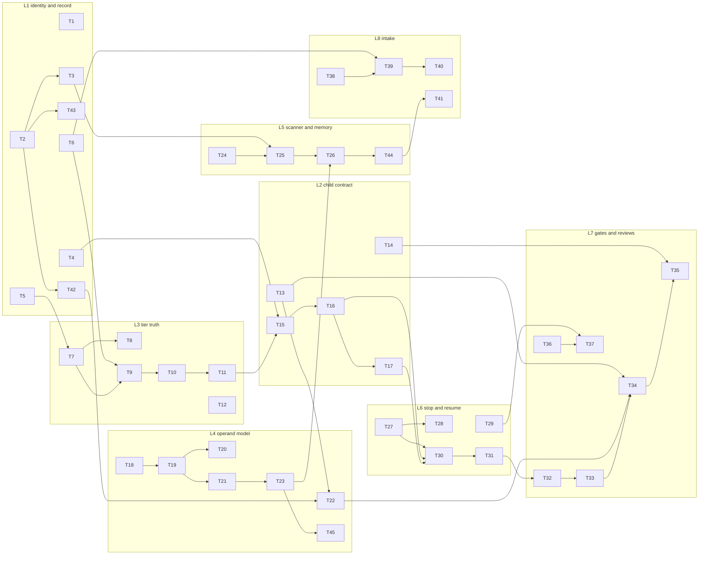

# nyotes attempt 3 fixes: 8 layers, 1 owner each

status: in-progress
base: af86076ffbfa7efb7f06cc63c4157546c8949ee3
commit-mode: orchestrator-commits
language: ruby
panel: Ruby (Linus Torvalds, Jeremy Evans, Sandi Metz, Richard Schneeman, Aaron Patterson)

## Intent

Attempt 3 of the nyotes trial landed 4 of 25 issues at a cost of 15 to 75 human approvals per issue. It also found the account name and home path going to the model provider on every call. The research traced about 40 findings to 8 shared layers, each of which also serves skills the trial never ran (execute-plan, create-plan, research-epic, critique, the daemon, the review queue). This plan fixes each layer once, at its owner, so the sibling sites go with the trial's instance.

Sources:
- `planning/nyotes-attempt3-sweep-research-2026-11.md` (the 8 layers, with origins).
- `tmp/trials/nyotes-attempt3-notes.md` (trial evidence).
- User rulings of 2026-11-21 (memory `attempt3-sweep-rulings-2026-11-21`): 1 plan for all 8 layers; package-cache reads, approval memory, opaque calls to the judge and the retained tree carried forward are all reopened from round 3; identity is scrubbed from everything off-box, and the local journal keeps it. Earlier the same day: lain installs build tools without sudo; linters run in the agent's normal sandbox.

ROADMAP item 77.

**Commit order.** Stream A (T1 to T6, T42, T43) lands first: it closes a privacy leak on every call. The other streams are independent except where `Depends on` says so.

## Grounding

- Date: 2026-11-21. Base: `c9e4b35b` on `main`.
- 5 read-only sweeps produced the research report. 4 more traced the production path for each fix (identity and tiers; children and resume; operands and scanner; gates and intake). I re-read the sites the main claims rest on: `prompt/environment.rb:57-58` (`User:`, `Home directory:`), `shell/parse.rb:34` (`MAX_BYTES = 4096`), `approval/judgement.rb:91` (`OBJECT_READS` without `merge-base`), `confine/profile.rb:250` (`TRACED` unconfined), `exec/sandboxed.rb:189` (the record's `network:` source), `cli/epic_driver/factory.rb:1486` (`unkept` drops `detail`), `epic/review_result.rb:156` (`LIST`), `tools/epic_review.rb:15,19`, `epic/issue_view.rb:22,142` (authored sections).
- Probed, not read: the trial journal (`~/.local/state/lain/sessions/9d832bf6a4ad/20261121T112503-922631.ndjson`) shows shellcheck refused as `refused_exec` on `/home/<account>/.local/bin/shellcheck`, a static ELF. `Profiles#programs` grants a `:user` program only when it is a resolved top-level stage, so shellcheck run inside a compound command or by a hook is refused. That is why T10 grants a named linter list by file, not by stage.
- Docs and code disagree in 3 places. The code won each time:
  - The research said a lost review spends a ROUND; the code spends an ATTEMPT (`epic/review_pack.rb`), while the refusal text says "rounds".
  - The research placed epic-home read failures on the interactive path; `spec/lain/seams/epic_home_read_spec.rb` proves it works there. The failing path is `ToolGuard.detached`, whose `Policy::Null` has no read roots.
  - `role/` and `skill/` live under `lib/lain/prompt/templates/`, not at the repo root.
- Not probed: the runtime premises named in each card's stop conditions (for example whether `MaskList` is cached per session, whether the opaque corpus has a recorded V0 cassette). Each card checks its own before writing code.
- mempalace: the MCP server failed to connect, and `mempalace search` returned nothing. Prior rulings come from the planning docs and memory.

## Compatibility

| Surface | Verdict | Evidence |
|---|---|---|
| System prompt, role and tool-description bytes | free to break | internal; `slots_spec.rb:284-334` pins the system and role digests, rebaselined in T8 (`issue_orchestrator` is not among the pinned roles) |
| `sandbox` journal record, `network` field | free to break, additive meaning | `telemetry/sandbox.rb:6-17`; readers: none in lib except `arm/driver.rb:113` (copies); old sessions are disposable (memory `old-sessions-disposable`) |
| `tripwire` journal record | free to break, additive | `telemetry/tripwire.rb:7-14`; replay fixtures `spec/fixtures/sessions/approval_replay` regenerate in T12 |
| `epic_reviewed` and `CritiqueChunk` records | must keep reading old records | stored epics exist (nyotes, live); `from_journal` tolerates missing fields (`UNRECORDED`); new `outcome` value is additive |
| `RunInterrupted` reasons | additive | `telemetry/run_interrupted.rb:55`, closed list; T28 adds no reason, it reuses `quota` |
| Issue markdown (`issues/<id>.md`) | must keep | the nyotes epic is live; T35 adds an optional `## Allowed paths` section, and `Issue.canonical` and the epic.md grammar stay unchanged, so no approval digest moves |
| `epic.md` grammar and `Issue.canonical` | must keep | approval digests (`Submission.issue_plan`); no card changes them |
| Input pane socket frames | free to break | chat and pane ship in one binary; unknown frames are dropped on both sides (`cli/input_socket.rb:364`, `frontend/input_pane.rb:265-272`) |
| `/held` output format | free to break | internal command; QA scenarios quote it and are updated (Shared files) |
| `.lain/config.rb` `sensitivity` verb | must keep | user config; T15 reuses `related:` and adds no key |
| `Profile::GRANTS`, `BuildGrant::OPTIONS` | free to break | internal tables |
| Gem and crates | free to break | `publish = false` on every crate; no release tags; the only Gemfiles naming lain are its own worktrees under `~/dev/lain-*` |

No trade reports: no must-keep surface blocks a large simplification.

## Spike findings

none. 2 premises are measured inside their cards instead: T24 replays the scanner's labelled corpora (`spec/fixtures/sensitivity/digest_corpus.yml`, `hinted_corpus.yml`) and must lose no true positive; T23 replays the binary-identity opaque corpus and must approve no row the V0 judge refused.

## Shared files

Only the main session edits these. Cards hand back 1-line diffs.
- `.rubocop.yml` (a raised limit goes in its own commit, with its reason)
- `spec/support/slow_files.rb`
- `ROADMAP.md`
- `planning/qa/scenarios/*.md` (updated at the end of each stream, per memory `qa-scenarios-track-features`)
- `spec/fixtures/sessions/approval_replay/*` (regenerated once, after T12 and T23)

## Rejected options

- A new shell parser (conch-parser, brush-parser, shfmt): `shell/parse.rb` already runs tree-sitter-bash; the defect is in the operand model above it.
- Run children in the orchestrator's own worktree: removes the path mismatch but loses per-child isolation, and parallel children would share 1 tree.
- A blanket "network for this issue" grant: against the per-program grant rulings (memory `binary-identity-rulings-2026-10`); T10 and T11 add per-program grants instead.
- A structured `references` or `allowed_paths` field on `Issue`: changes `Issue.canonical`, so every approved issue's digest moves and the live nyotes epic reopens. T17 and T35 read authored sections of the issue view instead.
- Importing gitleaks as a dependency: its rule model is adopted (keyword gates, per-rule entropy, allowlists) and compiled through the existing `RustShapes` path, so no new runtime dependency is needed.
- Masking the account name as a substring: a 4-letter name occurs inside ordinary words. T2 masks it as a whole word.

## Panel changes

The panel (Ruby roster, 2026-11-21) returned REQUEST-CHANGES with 8 blockers and 10 should-fixes. All were taken:
- T23: the bar is off by default (`Arms::DEFAULT` `judge_facts: :off`) and loops are unresolved, so the card now builds `Facts::Resolving` for opaque calls whatever the arm, uses a heredoc-interpreter example, routes only where the workspace profile holds the call, and ships behind a `judge_opaque` arm that is off. New T45 runs a live replay of the opaque `qa_judged` rows and turns the arm on only if no unsafe row is approved (the old cassette scenario could not fail: VCR matches on method and uri).
- T2 split into T2 (identity values), T42 (alias in request bodies and restore in tool inputs) and T43 (phone agenda and `/share`). Identity is aliased to placeholders, never refused, since an `EgressGuard` refusal is sticky; tool inputs and written files restore the real values, so a file read and written back keeps its contents.
- T4 gates only lain's config, `sessions/`, `queue/`, `consent/` and `improvements.ndjson`, so the spill home, the epic home and child checkouts stay readable; it orders before T15.
- T15 and T16: package caches and lent dirs are bound through a masked listing, never bare; T16 carries the agent's bounds on `Confine::Request` and refuses to lend `$HOME`, a project ancestor or a non-ordinary dir. The headless scenario was dropped: no production path spawns a headless issue child.
- T26 replays a secrets release contained with the masks standing, and only when the call's whole disclosure is the released files. The network memory moved to T44, which requires a secret-free disclosure.
- T19: an operand fed by a substitution stays unnamed (`cat $(echo .env)` stays opaque or names `.env`).
- T11 admits only `install <short-name>@<exact version>`, ignores the project's mise config, and counts installed binaries as install bins.
- T10 keeps to static-binary linters and refuses project and fresh-symlink copies.
- T12 keeps the stop per lineage and the second-trip rule, and excuses only hidden toolchain files.
- T37 caps failed rounds separately; T34 counts named bash reads; T35 records an `admit` on the gate decision; T22 runs after configured tool middleware; T8 orders after T7; T9 uses a program T11 does not touch; T21 keeps `cat-file` out of history-only; T20 names its timing probe; T13's cassette condition was moot.

## Open decisions

none. Every reopened ruling was decided on 2026-11-21.

## Dependency graph



## Tasks

### Stream A: identity and the sandbox record (L1)

### T1: Render the environment block without the account name or home path          [risk: medium]

**Depends on:** none
**Files:** `lib/lain/prompt/environment.rb`, `spec/lain/prompt/environment_spec.rb`
**Reuse:** `Environment.expand` (environment.rb:41), the existing `for_child`
**Shared-file wiring:** none
**Reachable from:** `CLI::ChatLaunch` (cli/chat_launch.rb:321-324) -> `Environment.current` -> `Prompt::Slots#initialize` (prompt/slots.rb:219-220) renders `to_s` and `for_child.to_s`

**Acceptance criteria**

```gherkin
Scenario: the block names no user and no home
  Given an environment built by Environment.current with HOME "/home/alice" and user "alice"
  When it is rendered
  Then the text has no "User:" line and no "Home directory:" line
  And the text does not contain "/home/alice" or "alice"

Scenario: paths under home are shown from ~
  Given the project root "/home/alice/dev/app" and a related dir "/home/alice/notes"
  When it is rendered
  Then it shows "Project root: ~/dev/app" and "Related directories: ~/notes"

Scenario: a child's block is the same bytes for every child
  Given 2 children of one environment
  When each renders for_child
  Then the 2 texts are equal and hold no home path
```
Spec file: `spec/lain/prompt/environment_spec.rb`

**Interface**

```ruby
# Environment keeps its fields; only #to_s changes.
def to_s # => String, home-relative paths, no User:/Home directory: lines
```

**Stop and report if:**
- `spec/lain/prompt/slots_spec.rb:288` (`shipped_system_digest`) moves. It renders `Environment.none`, so it stays green without an edit.
- Any prompt template reads `environment.home` or `environment.user` (grep `lib/lain/prompt/templates`).

### T2: Read the session's identity values once          [risk: medium]

**Depends on:** none
**Files:** `lib/lain/sensitivity/secrets/identity.rb` (new), `spec/lain/sensitivity/secrets/identity_spec.rb` (new)
**Reuse:** `Environment.current` reads `HOME` the same way; `Isolation::Clone::Registry::IDENTITY` (isolation/clone/registry.rb:26) names the 2 git keys
**Shared-file wiring:** none
**Reachable from:** `CLI::ChatLaunch` (cli/chat_launch.rb:321) builds it beside the environment and hands it to `CLI::Backend` (consumed by T42 and T43)

**Acceptance criteria**

```gherkin
Scenario: the identity is read once, from the box
  Given HOME "/home/alice", USER "alice", git config user.name "Alice Liddell", user.email "a@example.org", hostname "wonder"
  When Secrets::Identity.current is built
  Then it maps "/home/alice" to "/home/<user>", "alice" to "<user>", "Alice Liddell" to "<git-author>", "a@example.org" to "<git-email>" and "wonder" to "<host>"

Scenario: the mapping round-trips
  Given text that holds every identity value
  When it is aliased and then restored
  Then the result equals the original

Scenario: a word inside another word is left alone
  Given the text "Palace and alicex"
  Then aliasing leaves it unchanged
```
Spec file: `spec/lain/sensitivity/secrets/identity_spec.rb`

**Interface**

```ruby
module Lain::Sensitivity::Secrets
  # Each identity value and its placeholder, longest first so the home path wins over the name.
  Identity = Data.define(:pairs) do
    def self.current(env: ENV, git: ->(key) { ... }, hostname: Socket.gethostname) = ... # git reads `git config --get`
    def alias(text) = ...   # real -> placeholder, whole words, case-sensitive
    def restore(text) = ... # placeholder -> real
  end
end
```

**Stop and report if:**
- A placeholder (`<user>`, `/home/<user>`) collides with a token a shipped template or tool already emits (grep `lib/lain/prompt/templates` and `lib/lain/tools`).

### T42: Alias identity in model-bound requests and restore it in tool inputs          [risk: high]

**Depends on:** T2
**Files:** `lib/lain/provider/http/egress_guard.rb`, `lib/lain/cli/backend/egress_literals.rb`, `lib/lain/middleware/restore_identity.rb` (new), `lib/lain/cli/tool_guard.rb`, `spec/lain/provider/http/egress_guard_spec.rb`, `spec/lain/middleware/restore_identity_spec.rb` (new), `spec/lain/seams/identity_round_trip_spec.rb` (new)
**Reuse:** `Provider::HTTP::EgressGuard` (one Faraday middleware on every model-provider body; egress_guard.rb:120 reads `Literals::FLOOR`), `CLI::ToolGuard.layered` (tool_guard.rb:~678-737)
**Shared-file wiring:** none
**Reachable from:** `CLI::Backend::EgressLiterals#bind` (cli/backend/egress_literals.rb:46-58) for the request body; `CLI::ToolGuard.layered` and `Subagent#child_stack` for tool inputs

**Acceptance criteria**

```gherkin
Scenario: no request body carries an identity value, and nothing is refused for it
  Given HOME=/home/alice and a chat turn, a judge call and a child turn whose bodies name /home/alice/dev/app, the child's working directory under $XDG_STATE_HOME, and the epic home
  When each request passes the production EgressGuard
  Then every body says /home/<user>/... in their place
  And no egress_refused record is written and later requests are not refused

Scenario: a tool input that uses a placeholder reaches the real path
  Given the model calls read_file with path "/home/<user>/dev/app/README.md"
  Then the tool reads /home/alice/dev/app/README.md

Scenario: a file read and written back keeps its real contents
  Given a config file whose text holds "/home/alice/notes"
  When the model reads it, edits one other line, and writes the whole file back
  Then the file on disk still says "/home/alice/notes"

Scenario: the local journal keeps real values
  Then the session journal's turn records hold /home/alice, not the placeholder
```
Spec file: `spec/lain/seams/identity_round_trip_spec.rb`, `spec/lain/provider/http/egress_guard_spec.rb`

**Stop and report if:**
- The prompt-cache prefix changes between 2 requests of one session (aliasing must be a pure function of the body, so `Canonical` bytes stay stable).
- A tool input field is not a string path or command (for example a JSON `content` with nested values): restore every string leaf, and say so in the spec.
- `Literals::FLOOR` would have to drop below 8 bytes for secrets; identity aliasing must not use the secret path.

### T43: Alias identity on the other off-box surfaces          [risk: medium]

**Depends on:** T2
**Files:** `lib/lain/remote/agenda/view.rb`, `lib/lain/cli/command/share.rb`, `spec/lain/remote/agenda/view_spec.rb`, `spec/lain/cli/command/share_spec.rb`
**Reuse:** `Remote::Agenda::View.of` (remote/agenda/view.rb:22-28, runs `TextMask` over every text field), the `/share` export (cli/command/share.rb:61-77)
**Shared-file wiring:** none
**Reachable from:** `Approval::RemoteSurface#publish` (approval/remote_surface.rb:256) -> `View.of`; `Command::Share#call`

**Acceptance criteria**

```gherkin
Scenario: the phone agenda carries no identity
  Given an agenda item whose text names "/home/alice/dev/app"
  When View.of renders it
  Then the published text says "/home/<user>/dev/app"

Scenario: a shared gist carries no identity
  Given a session whose turns name /home/alice
  When /share builds the export
  Then the export holds the placeholder and no real value
```
Spec file: `spec/lain/remote/agenda/view_spec.rb`, `spec/lain/cli/command/share_spec.rb`

**Stop and report if:**
- `crates/lain-daemon/src/relay.rs` forwards any text the Ruby `View` did not build (the relay has no masking of its own).

### T3: Flag identity values in an outgoing command's arguments and headers          [risk: high]

**Depends on:** T2
**Files:** `lib/lain/approval/disclosure.rb`, `spec/lain/approval/disclosure_spec.rb`
**Reuse:** `Disclosure::Sinks` (approval/disclosure.rb:112-150), `Secrets::Identity` from T2
**Shared-file wiring:** none
**Reachable from:** `CLI::ToolGuard#configured_then_parsed` (cli/tool_guard.rb:731) -> `Middleware::ParsedCommand` -> `Approval::Disclosure`

**Acceptance criteria**

```gherkin
Scenario: a curl user agent naming the account parks with a reason
  Given the command "curl -A 'probe (alice@local)' https://crates.io/api/v1/crates/x"
  When the disclosure is built for it
  Then it lists crates.io as a sink and says the request carries the account identity
  And the park reason names "identity in an outgoing request", never the value

Scenario: a generic user agent carries no identity note
  Given the command "curl -A 'nyotes-probe' https://crates.io/api/v1/crates/x"
  When the disclosure is built
  Then it notes the sink and no identity
```
Spec file: `spec/lain/approval/disclosure_spec.rb`

**Stop and report if:**
- `Sinks` cannot see `-A`, `-H` or `--user-agent` values because `Shell::Named` drops them before the disclosure runs.

### T4: Gate lain's own config and private state files          [risk: high]

**Depends on:** none
**Files:** `lib/lain/sensitivity.rb`, `spec/lain/sensitivity_spec.rb`
**Reuse:** `Rule.homed`/`Rule.absolute` (sensitivity.rb:226-262), `Paths#user_config`, `Paths#container` (paths.rb:229-296)
**Shared-file wiring:** none
**Reachable from:** `Sensitivity::Policy` built in `CLI::Wiring::BoardBuild`, read by `Middleware::Sensitivity` and `Middleware::WithholdSecretPaths`

**Acceptance criteria**

```gherkin
Scenario: lain's own config and journals park
  Given ~/.config/lain/config.rb and the state containers sessions/, queue/, consent/ and improvements.ndjson
  When an agent reads any of them
  Then the call is gated with reason "lain's own configuration or records"

Scenario: the session's own read roots stay readable
  Given the spill home (answers/), the epic home (epics/) and a child's checkout under worktrees/
  When an agent reads inside them
  Then no gate applies

Scenario: a non-default XDG state home is gated where it really is
  Given XDG_STATE_HOME "/srv/state"
  When an agent lists "/srv/state/lain/sessions"
  Then the call is gated
```
Spec file: `spec/lain/sensitivity_spec.rb`

**Stop and report if:**
- A gated container is also a read root (`BoardBuild.read_roots`); a read root wins only for its own subtree, and the spec must say so.

### T5: Record a sandbox run's network from the profile it ran under          [risk: medium]

**Depends on:** none
**Files:** `lib/lain/exec/sandboxed.rb`, `lib/lain/telemetry/sandbox.rb`, `spec/lain/exec/sandboxed_spec.rb`, `spec/lain/telemetry/sandbox_spec.rb`
**Reuse:** `Profile#confined?`, `#private_net`, `#connect_ports` (confine/profile.rb:9)
**Shared-file wiring:** none
**Reachable from:** `Confine::Sandbox` (confine/sandbox.rb:269) -> `Exec::Sandboxed#call` -> the 4 `Telemetry::Sandbox` writers (:187, :304, :435, :556)

**Acceptance criteria**

```gherkin
Scenario: a traced run records network
  Given a plain human allow on a call that reads no secrets
  When it runs under Profile::TRACED
  Then its sandbox record says network true and profile "traced"

Scenario: a contained run records no network
  Given a contained run under a private-net profile
  Then its sandbox record says network false

Scenario: a workspace build grant records its ports
  Given a cargo build granted port 443
  Then its sandbox record says network ["443"]
```
Spec file: `spec/lain/exec/sandboxed_spec.rb`

**Interface**

```ruby
# Telemetry::Sandbox: network is true, false, or the granted ports.
attribute :network, default: false # true | false | Array<String>
```

**Stop and report if:**
- `tripwire/hit.rb` or `arm/driver.rb` branches on `network == false` (grep `\.network` in lib).

### T6: Say what a plain `y` runs under on every approval row          [risk: low]

**Depends on:** none
**Files:** `lib/lain/confine/sandbox.rb`, `spec/lain/confine/sandbox_spec.rb`, `spec/lain/frontend/approval_policy_spec.rb`
**Reuse:** `Containment#choice` (confine/sandbox.rb:141-146), `UNABLE_CHOICE` (:71-79)
**Shared-file wiring:** none
**Reachable from:** `Approval::Parked::Queue#choice_face` (approval/parked/queue.rb:376-377) -> `Containment#choice`; rendered by `Frontend::ApprovalPolicy` (:352) and `Frontend::Neovim::ApprovalView` (:521)

**Acceptance criteria**

```gherkin
Scenario: a call that reads no secrets states the tier
  Given a parked bash call with containment state :unstated
  When its row is drawn
  Then the row says "y runs it unconfined, with network"
```
Spec file: `spec/lain/confine/sandbox_spec.rb`

**Stop and report if:**
- Round 30's "a human y runs a project script contained" (ROADMAP item 76) means some `:unstated` calls already run contained; then the text must come from the profile `Profiles#for` would pick, and the card needs T9's predicate.

### Stream B: tier truth (L3)

### T7: End every bash result with 1 line naming the tier it ran under          [risk: medium]

**Depends on:** T5
**Files:** `lib/lain/exec/sandboxed.rb`, `lib/lain/confine/profile.rb`, `spec/lain/exec/sandboxed_spec.rb`, `spec/lain/seams/contained_approval_spec.rb`
**Reuse:** `told_contained` and `contained_line` (exec/sandboxed.rb:242-272), `Profile#homes`, `#private_net`, `#name`
**Shared-file wiring:** none
**Reachable from:** `Confine::Sandbox` -> `Exec::Sandboxed#masked_run` (:197-203) -> `told_contained`

**Acceptance criteria**

```gherkin
Scenario: a reader run says what it lacked
  Given a composed read-only call that runs under the reader profile
  When it finishes
  Then its result ends "[ran: reader; no network; no /dev/dri; home masked]"

Scenario: an unconfined run says so
  Given a call that runs under Profile::TRACED
  Then its result ends "[ran: unconfined, with network]"
```
Spec file: `spec/lain/exec/sandboxed_spec.rb`

**Interface**

```ruby
class Profile
  def tier_line = ... # "[ran: <name>; <network>; <gpu>; <home>]"
end
```

**Stop and report if:**
- `spec/lain/bench/cli_spec.rb` or a VCR cassette pins bash output bytes that now gain a line.
- The added line pushes a result over the spill ceiling where it did not spill before (the `ceiling` passed to `Sandboxed`).

### T8: Describe the execution tiers once in the system prompt          [risk: low]

**Depends on:** T7
**Files:** `lib/lain/prompt/templates/system.md.erb`, `spec/lain/prompt/slots_spec.rb`
**Reuse:** none
**Shared-file wiring:** none
**Reachable from:** `Prompt::Slots#render_with` (prompt/slots.rb:276-279) for chat and `render_child` for every child

**Acceptance criteria**

```gherkin
Scenario: every agent is told the tiers
  Given the shipped system template
  When a chat and a child render it
  Then both contain a static paragraph naming contained, unconfined-with-network and secrets runs, and "the last line of a bash result names its tier"
  And the paragraph holds no per-session value
```
Spec file: `spec/lain/prompt/slots_spec.rb`

**Stop and report if:**
- `LockedBinding` refuses the new text (`slots.rb`), which would mean it reads a value.

### T9: Park a call whose sandbox cannot run its programs, before it is allowed          [risk: high]

**Depends on:** T6, T7
**Files:** `lib/lain/approval/escalation.rb`, `lib/lain/confine/profiles.rb`, `lib/lain/confine/sandbox.rb`, `lib/lain/exec/sandboxed.rb`, `spec/lain/approval/escalation_spec.rb`, `spec/lain/confine/profiles_spec.rb`, `spec/lain/seams/contained_approval_spec.rb`
**Reuse:** `Escalation#contained` and `#uncontainable` (approval/escalation.rb:382-393), `Containment::Deferred`, `Profile#runs?`, `Shell::Executable::Resolver`
**Shared-file wiring:** none
**Reachable from:** `CLI::Switchboard#confined_ladder` (cli/switchboard.rb:518-523) builds the escalation with `containment:` from `Sandbox#containment`

**Acceptance criteria**

```gherkin
Scenario: a program the sandbox hides parks with a reason instead of a dead-end refusal
  Given a contained call "true && ~/.local/bin/uv --version" that the judge would allow
  When the ladder weighs it
  Then it parks for a human with "this call's sandbox cannot run ~/.local/bin/uv"
  And the human may answer network to run it unconfined

Scenario: no refusal text tells the agent to ask a human who was never asked
  Given any of REFUSED, UNCONTAINABLE, UNCONFINED, OVERMASKED, UNSEALABLE, HOLDS_STATE, TAMPERED, HOME_TMPDIR
  When it is returned to the agent
  Then a park for the same call exists in the journal, or the text does not say "ask the human"
```
Spec file: `spec/lain/approval/escalation_spec.rb`, `spec/lain/seams/contained_approval_spec.rb`

**Interface**

```ruby
class Confine::Profiles
  # The same choice #for makes, without building the sandbox.
  def runnable?(ruling, executables) = ... # => true | Array<String> of unrunnable paths
end
```

**Stop and report if:**
- Resolving executables before the ruling changes `bash.rb#parsed_stages`, which returns early on an allow (:445-448); the predicate must resolve programs itself.
- `spec/lain/workspace_run_spec.rb` expects a refusal for a case this card turns into a park.

### T10: Let named static-binary linters run inside the contained and reader sandboxes          [risk: high]

**Depends on:** T9
**Files:** `lib/lain/confine/profile.rb`, `lib/lain/confine/profiles.rb`, `spec/lain/confine/profiles_spec.rb`, `spec/lain/confine/profile_spec.rb`
**Reuse:** `Profiles#programs`, `#exec_files`, `#grantable?` (confine/profiles.rb:343-372), `BuildGrant.placed?` (shadow and fresh tests), `Shell::Executable::Resolver` classes (resolver.rb:241-247)
**Shared-file wiring:** none
**Reachable from:** `Confine::Sandbox` (:299) -> `Profiles.new` -> `Profiles#for`

**Acceptance criteria**

```gherkin
Scenario: shellcheck runs inside a compound command
  Given ~/.local/bin/shellcheck is a static binary of class :user, outside the project root, that shadows nothing and was not written this session
  When a contained call runs "bash -n s.sh && shellcheck s.sh"
  Then shellcheck executes with no network and no refused_exec

Scenario: a linter in the project is not granted
  Given a committed bin/shellcheck in the project, on PATH through direnv
  Then a contained call that runs it is refused

Scenario: a symlink to a fresh file is not granted
  Given ~/.local/bin/shellcheck is a symlink whose target was written this session
  Then it is refused as fresh
```
Spec file: `spec/lain/confine/profiles_spec.rb`

**Interface**

```ruby
class Profile
  # Static binaries only: an interpreter-run linter (yamllint, markdownlint) needs its interpreter chain granted, out of scope here.
  LINTERS = %w[shellcheck shfmt actionlint].freeze
end
```

**Stop and report if:**
- `rustfmt` through the rustup proxy is not already runnable contained (it is under `HOME_EXEC`); if not, report it rather than add it here.

### T11: Let mise install pinned registry tools into its own prefix, with port 443          [risk: high]

**Depends on:** T10
**Files:** `lib/lain/confine/profile.rb`, `lib/lain/confine/profiles.rb`, `spec/lain/confine/profiles_spec.rb`, `spec/lain/seams/cargo_rule_spec.rb`
**Reuse:** `Profile::GRANTS` (profile.rb:82), `BuildGrant` (`OPTIONS`, `trusted?`, `placed?`, profiles.rb:388-462), `Profile.install_bin` (:235-241), `HOME_MISE` and `MISE` (:60-62)
**Shared-file wiring:** none
**Reachable from:** `Profiles#for` -> the workspace profile -> `Profile#granting`

**Acceptance criteria**

```gherkin
Scenario: a pinned registry install runs with port 443 and the project config ignored
  Given the call "mise install cmake@4.5.1" in a project with a mise.toml that declares a postinstall hook
  When it is allowed
  Then it runs under the workspace profile with port 443 only, writes only under ~/.local/share/mise and ~/.cache/mise, and the project's mise.toml is not read
  And its sandbox record says network ["443"]

Scenario: only short-name@exact-version installs are admitted
  Given "mise install asdf:foo@1", "mise install ubi:x/y@1", "mise install cmake@latest" or "mise install cmake@4.5.1 -- --x"
  Then none is granted and each parks

Scenario: an installed tool runs offline and counts as placed, not fresh
  Given cmake@4.5.1 installed by a granted mise install
  When a contained call runs "mise exec cmake@4.5.1 -- cmake --version"
  Then it runs with no network, and its binary is exempt from the fresh rule as an install bin
```
Spec file: `spec/lain/confine/profiles_spec.rb`

**Stop and report if:**
- mise runs any plugin or hook script during a registry install with the project config ignored (check with `MISE_CEILING_PATHS` set to the project's parent on the box's mise).
- `Profile.hidden` is read by another check that would still refuse `/usr/bin/mise` (grep `hidden` in lib/lain/confine and lib/lain/tripwire).

### T12: Keep the tripwire's stop per lineage, window its score, and excuse lain's toolchain masks          [risk: high]

**Depends on:** none
**Files:** `lib/lain/tripwire/ledger.rb`, `lib/lain/tripwire/hit.rb`, `lib/lain/telemetry/tripwire.rb`, `lib/lain/cli/wiring/observers.rb`, `spec/lain/tripwire/ledger_spec.rb`, `spec/lain/tripwire/hit_spec.rb`, `spec/lain/cli/wiring/observers_spec.rb`
**Reuse:** `Hit.confined_hits` (tripwire/hit.rb:114-131), `Resolution#toolchain?`, `Profile::SYSTEM_EXEC`, `Profile.hidden`
**Shared-file wiring:** none
**Reachable from:** `CLI::Wiring::Observers` (cli/wiring/observers.rb:110-120) -> `Tripwire::Ledger.new`

**Acceptance criteria**

```gherkin
Scenario: a system exec spawned by a script is not a hit
  Given a contained run that executes /usr/bin/git and /usr/bin/ls from a script
  Then no unresolved_exec hit is recorded

Scenario: a refusal on a hidden toolchain file is not a hit, a refusal on a secret mask still is
  Given one contained run refused exec of /usr/bin/mise and another refused a read of a masked .env
  Then the first records no hit and the second records its hit

Scenario: a child's hits count toward its lineage
  Given an orchestrator whose child collects 2 strong hits
  When the orchestrator spawns a fresh child
  Then the lineage's standing still holds the 2 hits, and the second-trip rule still stops all agents

Scenario: the score is windowed
  Given hits whose sandbox records are older than the window
  Then they no longer count toward the displayed score
```
Spec file: `spec/lain/tripwire/ledger_spec.rb`, `spec/lain/tripwire/hit_spec.rb`

**Stop and report if:**
- `Hit` has no timestamp source; it must come from the sandbox record's `ts`, not from a clock read in the ledger (functional core).
- `bench/approval_replay` fixtures assert today's cumulative scores (regenerated as a Shared file).

### Stream C: the child checkout contract (L2)

### T13: State the child checkout contract in the subagent tools and the orchestrator role          [risk: low]

**Depends on:** none
**Files:** `lib/lain/tools/subagent.rb`, `lib/lain/prompt/templates/role/issue_orchestrator.md`, `spec/lain/tools/subagent_spec.rb`
**Reuse:** the wording of `review/critique.rb:391-393` and `role/diff_critic.md`
**Shared-file wiring:** none
**Reachable from:** `CLI::Wiring::ToolsetBuild` (cli/wiring/toolset_build.rb:622) -> `Subagent::Choice`; the single-role spawner description (subagent.rb:138-143)

**Acceptance criteria**

```gherkin
Scenario: both subagent descriptions carry the contract
  Given the single-role and the Choice subagent tools
  When their descriptions are rendered
  Then each says the child's working directory is its own checkout cut from the committed tip, that briefs name paths relative to it, and that a spec must be committed before a child can read it

Scenario: the orchestrator role says the same
  Given the issue_orchestrator role template
  Then it says children cannot read the orchestrator's checkout and never to name its absolute path
```
Spec file: `spec/lain/tools/subagent_spec.rb`

**Stop and report if:**
- A spec asserts the description's full bytes (VCR matches on method and uri only, `spec/support/vcr_configuration.rb:233`, so the cassette at `ollama_run_tool_loop.yml:646` stays valid).

### T14: Carry the contract and the epic home into the skills that brief children          [risk: low]

**Depends on:** none
**Files:** `lib/lain/prompt/templates/skill/implement-issue/skill.md`, `lib/lain/prompt/templates/skill/execute-plan/skill.md`, `lib/lain/prompt/templates/skill/create-plan/skill.md`, `lib/lain/prompt/templates/skill/research-epic/skill.md`, `spec/lain/skill/shipped_skills_spec.rb`
**Reuse:** the `<%= epic_home %>` local (`CLI::Backend#skill_locals`, cli/backend.rb:778)
**Shared-file wiring:** none
**Reachable from:** `IssueActor::Brief#to_s` (cli/epic_driver/issue_actor.rb:~245) -> `@library.renderer`; the other skills through `Skill::Library`

**Acceptance criteria**

```gherkin
Scenario: implement-issue names where the epic's sources live
  Given an epic home container "<state>/epics/abc" and slug "nyotes"
  When the issue brief is rendered
  Then it names "<state>/epics/abc/nyotes/sources" (the slug comes from `IssueActor::Brief#slug`, rendered in the brief beside the skill text) and says child briefs use paths relative to the child's checkout

Scenario: execute-plan's landing check follows the card
  Given the execute-plan skill text
  Then Phase 4 says to run the card's named checks and the project's test command where one exists, not "the full suite green" for every card
```
Spec file: `spec/lain/skill/shipped_skills_spec.rb`

**Stop and report if:**
- The new text matches an idiom `shipped_skills_spec.rb:424-451` bans for implement-issue (`\btoolchain\b`, `pre-commit`, `stash`).

### T15: List package caches as related directories, so their masks apply          [risk: high]

**Depends on:** T4, T11
**Files:** `lib/lain/cli/wiring/board_build.rb`, `lib/lain/confine/profile.rb`, `lib/lain/sensitivity/policy.rb`, `spec/lain/cli/wiring/board_build_spec.rb`, `spec/lain/seams/epic_home_read_spec.rb`, `spec/lain/confine/mask_list_spec.rb`
**Reuse:** the `sensitivity related:` config verb (sensitivity.rb:545-575) and `Confine::MaskList#related` (mask_list.rb:131-139), which list a related tree so its secret files stay masked
**Shared-file wiring:** none
**Reachable from:** `CLI::Wiring::BoardBuild` -> the session `Policy` related dirs -> `MaskList` built in `ToolsetBuild#sandboxed` (toolset_build.rb:449)

**Acceptance criteria**

```gherkin
Scenario: dependency source reads do not park
  Given a project with a Cargo.lock
  When an agent reads ~/.cargo/registry/src/<index>/whisper-rs-0.16.0/src/lib.rs or a contained call lists ~/.cargo/registry/src
  Then neither parks

Scenario: a token in a cache stays masked
  Given ~/.cache/huggingface/token exists
  When a project declares ~/.cache/huggingface as related and a contained call reads the token
  Then the token reads empty or as a decoy

Scenario: the built-in list is exact
  Then the built-in related caches are ~/.cargo/registry/src and ~/.cargo/git/checkouts, each only when the project has a Cargo.toml; any other cache is the project's `related:` entry
```
Spec file: `spec/lain/cli/wiring/board_build_spec.rb`, `spec/lain/confine/mask_list_spec.rb`

**Stop and report if:**
- Listing ~/.cargo/registry/src (tens of thousands of files) through `MaskList` exceeds its listing bound; then mask by pattern, not by listing, and say so.

### T16: Carry each agent's bounds to its bash sandbox, through a masked listing          [risk: high]

**Depends on:** T15
**Files:** `lib/lain/confine/request.rb`, `lib/lain/tools/bash.rb`, `lib/lain/confine/profiles.rb`, `lib/lain/confine/mask_list.rb`, `spec/lain/confine/profiles_spec.rb`, `spec/lain/seams/lent_read_spec.rb` (new)
**Reuse:** `Policy.cut` (sensitivity/policy.rb:547-556), `Bounds#lend`, `MaskList` listing of related trees (mask_list.rb:84-131)
**Shared-file wiring:** none
**Reachable from:** `CLI::ToolGuard::Spawned#call` (tool_guard.rb:236) -> `child_stack` -> the child's `Tools::Bash` -> `Confine::Request` (bash.rb:465) -> `Exec::Sandboxed` -> `Profiles#for`

**Acceptance criteria**

```gherkin
Scenario: a read lent to one child is bound read-only in its sandbox, masks standing
  Given a child whose bounds lend /data/refs, which holds notes.md and .env
  When it runs "cat /data/refs/notes.md; cat /data/refs/.env" contained
  Then notes.md prints, .env reads empty or as a decoy
  And a sibling child without the grant gets "No such file or directory"

Scenario: lending a broad directory is refused
  Given a lend of $HOME, of an ancestor of the project root, or of a directory classified other than ordinary
  Then the lend is refused with a reason and nothing is bound
```
Spec file: `spec/lain/seams/lent_read_spec.rb`

**Interface**

```ruby
Confine::Request = Data.define(..., :bounds) # the requesting agent's bounds, read by Profiles#for
```

**Stop and report if:**
- `MaskList` is built once per session and cached across children; the per-agent listing must be built per lend and cached by its directory digest.

### T17: Lend an issue's approved out-of-repo references to its agents, read-only          [risk: high]

**Depends on:** T16
**Files:** `lib/lain/epic/issue_view.rb`, `lib/lain/cli/epic_driver/issue_actor.rb`, `spec/lain/epic/issue_view_spec.rb`, `spec/lain/cli/epic_driver/issue_actor_spec.rb`
**Reuse:** `IssueView::Authored#references` (epic/issue_view.rb:142), `IssueActor::Brief`, T16's lend
**Shared-file wiring:** none
**Reachable from:** `CLI::EpicDriver::Factory` (factory.rb:645) -> `IssueActor` -> the actor's lease and its children's `worker_env.bounds`

**Acceptance criteria**

```gherkin
Scenario: an approved issue's absolute reference files are readable, their secrets are not
  Given an issue approved at the issue_plan gate whose References name "~/dev/pitchcraft/rustfmt.toml" and "~/dev/pitchcraft/"
  When its orchestrator and its dev child read rustfmt.toml and grep -r the directory
  Then both reads succeed with no park, and ~/dev/pitchcraft/.env reads empty in the grep

Scenario: a reference added after approval is not lent
  Given the References section edited after the gate
  Then the issue reopens as today, and nothing new is lent until it is approved again
```
Spec file: `spec/lain/cli/epic_driver/issue_actor_spec.rb`

**Stop and report if:**
- A reference resolves under a DENIED path (`sensitivity.rb:808`); it must stay refused.

### Stream D: the operand model (L4)

### T18: Name only the file operands of programs whose operands have known roles          [risk: high]

**Depends on:** none
**Files:** `lib/lain/shell/named/operand_roles.rb` (new), `lib/lain/shell/named.rb`, `spec/lain/shell/named/operand_roles_spec.rb` (new), `spec/lain/shell/named_spec.rb`
**Reuse:** `Argv` value tables (`GREP`, `AWK`, named.rb:258-400), `Walk#argument_paths`/`operand_paths`/`data_paths` (:1488-1530), the `LoopReading` sibling as the file pattern
**Shared-file wiring:** none
**Reachable from:** `Shell::Named.from` (named.rb:141), read by `Judged`, `Triage`, `RememberedDenials`, `Sensitivity::Policy#shell_named`, `Parked::Queue#named_files`, `RedactSecretReads`, `Gate#commanded`

**Acceptance criteria**

```gherkin
Scenario: echo text is not a path
  Given the command 'echo "exit=$?"'
  When it is named
  Then it names no paths and is not opaque

Scenario: a grep pattern is not a path
  Given "grep -E 'abc|def' notes.txt"
  Then the only path named is notes.txt

Scenario: a sed script and a jq filter are not paths
  Given "sed -n '5,9p' a.c" and "jq '.x' b.json"
  Then the paths named are a.c and b.json

Scenario: an unlisted program keeps today's naming
  Given "frobnicate alpha beta"
  Then alpha and beta are named as paths
```
Spec file: `spec/lain/shell/named/operand_roles_spec.rb`, `spec/lain/shell/named_spec.rb`

**Interface**

```ruby
class Shell::Named
  module OperandRoles
    # Role of each non-option operand, by index; :file is the default.
    ROLES = { "grep" => [:pattern], "echo" => :text, "printf" => [:format], "sed" => [:script],
              "awk" => [:script], "jq" => [:filter], "rg" => [:pattern] }.freeze
    def self.of(program, operands) = ... # => Array<Symbol>
  end
end
```

**Stop and report if:**
- A grep `-e`/`-f` form already moves the pattern into an option value (`Argv::GREP`), so the first operand becomes a file; both forms need a case.
- `.rubocop.yml` ClassLength (309) is crossed by `Walk`; extract, do not raise.

### T19: Read inside compound statements, and treat a substitution-fed operand as unnamed          [risk: high]

**Depends on:** T18
**Files:** `lib/lain/shell/parse.rb`, `lib/lain/shell/named.rb`, `lib/lain/shell/verdict.rb`, `spec/lain/shell/parse_spec.rb`, `spec/lain/shell/named_spec.rb`, `spec/lain/shell/verdict_spec.rb`
**Reuse:** `Walk::READABLE_KINDS` (named.rb:1188), `Walk#readable?` (:1268), `Parse::TERMINAL_KINDS` (parse.rb:40), `LoopReading.unrolled`
**Shared-file wiring:** none
**Reachable from:** `Shell::Named.from` and `Shell::Verdict` (triage)

**Acceptance criteria**

```gherkin
Scenario: a while loop over a file is readable
  Given "while read f; do wc -l \"$f\"; done < list.txt"
  Then list.txt is named and the command is not opaque

Scenario: cd inside a subshell does not move the outer cwd
  Given "(cd sub && ls) ; cat a.txt"
  Then a.txt is named under the outer cwd

Scenario: an operand fed by a substitution stays unnamed
  Given "cat $(echo .env)" or "cat \"$(printf %s .env)\""
  Then the command is opaque, or it names .env; it never reads as naming no path

Scenario: a lister's output over a named root is a pathspec
  Given "wc -l $(git ls-files '*.rb')"
  Then the command names the pathspec *.rb under the repo root

Scenario: an interpreter reading stdin stays opaque
  Given "python3 - <<'EOF'\nprint(1)\nEOF"
  Then the command is opaque
```
Spec file: `spec/lain/shell/named_spec.rb`, `spec/lain/shell/parse_spec.rb`, `spec/lain/shell/verdict_spec.rb`

**Stop and report if:**
- `Parse::Result#stages` cannot yield inner stages without changing the Rust query (`ext/lain/src/treesitter.rs`); then the card stops for a Rust card.
- `if`, `case` or `$(...)` can hide a write the write-set check misses (spec: `named_spec.rb` written examples).

### T20: Raise the shell parse cap to 32 KiB          [risk: medium]

**Depends on:** T19
**Files:** `lib/lain/shell/parse.rb`, `spec/lain/shell/parse_spec.rb`, `ext/lain/src/treesitter.rs` (test constant only)
**Reuse:** `TOO_LONG` (parse.rb:182)
**Shared-file wiring:** none
**Reachable from:** `Shell::Parse#call` (parse.rb:196), used by every bash approval

**Acceptance criteria**

```gherkin
Scenario: a 10 KiB quoted heredoc is parsed
  Given a cat <<'EOF' command of 10,240 bytes
  Then it parses and is not refused as too long

Scenario: input over the cap is still refused before parsing
  Given 33 KiB of input ending in "echo $(id)"
  Then it is refused as too long
```
Spec file: `spec/lain/shell/parse_spec.rb`

**Stop and report if:**
- `Shell::Parse.new.call` on a 32 KiB command takes over 50 ms median of 20 runs on this box (time it with a one-off `ruby -Ilib -e` loop; `bin/hot-path-bench` has no row this size).

### T21: Keep one table of read-only git subcommands          [risk: medium]

**Depends on:** T19
**Files:** `lib/lain/shell/git_reads.rb` (new), `lib/lain/shell/named.rb`, `lib/lain/approval/judgement.rb`, `lib/lain/approval/composed_term.rb`, `spec/lain/shell/git_reads_spec.rb` (new), `spec/lain/approval/judgement_spec.rb`, `spec/lain/approval/composed_term_spec.rb`
**Reuse:** `OwnHistory::OBJECT_READS` (judgement.rb:91), `Program::GIT_READ_ONLY` (named.rb:708), `GIT_TREE_FREE` (:697), `ComposedTerm::Printed::GIT` (composed_term.rb:~690)
**Shared-file wiring:** none
**Reachable from:** `Judgement::OwnHistory#history_only?`, `Shell::Named::Program`, `ComposedTerm::Printed`

**Acceptance criteria**

```gherkin
Scenario: merge-base and rev-list are history reads
  Given "git merge-base --is-ancestor main HEAD; git rev-list --count main..HEAD"
  When the judge weighs it
  Then it is a history-only read and does not park as an object-store read

Scenario: cat-file prints contents and goes through the history mask
  Given "git cat-file -p HEAD:secrets.env"
  Then it is read-only and prints contents, is not history-only, and its output is masked as a read of secrets.env

Scenario: the 3 readers agree
  Given every subcommand in the table
  Then OwnHistory, Program and ComposedTerm each answer from its facets, with no list of their own
```
Spec file: `spec/lain/shell/git_reads_spec.rb`

**Interface**

```ruby
module Shell::GitReads
  # facets: :read_only, :tree_free, :history_only, :prints_contents
  TABLE = { "log" => %i[read_only history_only prints_contents], "merge-base" => %i[read_only tree_free history_only],
            "cat-file" => %i[read_only prints_contents], ... }.freeze
  def self.facet?(subcommand, facet) = ...
end
```

**Stop and report if:**
- `ComposedTerm::Printed::GIT`'s per-form flag objects cannot be expressed as facets (then keep its flags and read only `:read_only` from the table).

### T22: Refuse a malformed tool call before any approval rung sees it          [risk: medium]

**Depends on:** T13, T42
**Files:** `lib/lain/middleware/valid_input.rb` (new), `lib/lain/tool.rb`, `lib/lain/cli/tool_guard.rb`, `lib/lain/tools/subagent.rb`, `spec/lain/middleware/valid_input_spec.rb` (new), `spec/lain/cli/tool_guard_spec.rb`, `spec/lain/tool_spec.rb`
**Reuse:** `Tool#validate_input!` (tool.rb:190, made public as `#invalid`), `Tool::InvalidInput`, `Middleware::Base`
**Shared-file wiring:** none
**Reachable from:** `CLI::ToolGuard.layered` (tool_guard.rb:~678-737) and `Subagent#child_stack` (tools/subagent.rb:~2178)

**Acceptance criteria**

```gherkin
Scenario: a bash call without a command never parks
  Given a bash call whose input is {"name": "pin-check"}
  When it is dispatched through the production stack
  Then the model gets an error naming the missing "command" field
  And no escalation, judge or awaiting_human record is written

Scenario: the layer runs after configured tool middleware and before every guard
  Given a chat stack with a configured :tool member that fills a default field
  Then ValidInput runs after that member and after RestoreIdentity, and before ParsedCommand
```
Spec file: `spec/lain/middleware/valid_input_spec.rb`, `spec/lain/cli/tool_guard_spec.rb`

**Stop and report if:**
- `Gate.closes!` (middleware/gate.rb:116) or a subagent spec pins the order of the head of the stack.

### T23: Route a call whose paths cannot be named to the judge, behind a resolving bar, under an arm that ships off          [risk: high]

**Depends on:** T21
**Files:** `lib/lain/approval/judgement.rb`, `lib/lain/approval/judged.rb`, `lib/lain/approval/judge.rb`, `lib/lain/approval/judge/facts.rb`, `lib/lain/cli/arms.rb`, `lib/lain/cli/switchboard.rb`, `spec/lain/approval/judged_spec.rb`, `spec/lain/approval/judgement_spec.rb`, `spec/lain/approval/judge_spec.rb`, `spec/lain/cli/arms_spec.rb`
**Reuse:** `Weighing#call` (judgement.rb:245), `Judge::Facts::Resolving` and its `bar` (judge/facts.rb:117-124), `Judge#question` (judge.rb:318), `Profiles#workspace?`
**Shared-file wiring:** none
**Reachable from:** `CLI::Switchboard#judged_ladder` (cli/switchboard.rb:592-603) -> `#judged` -> `Approval::Judged`; the arm is read from `CLI::Arms` (cli/arms.rb:126)

**Acceptance criteria**

```gherkin
Scenario: with the arm on, an opaque call whose every stage resolves reaches the judge
  Given the arm judge_opaque :on and "python3 - <<'EOF'\nimport json; print(json.load(open('a.json')))\nEOF"
  When the ladder weighs it
  Then Facts::Resolving is built for it whatever judge_facts says, the bar resolves /usr/bin/python3 as a trusted system file, and the judge is asked
  And the judge's prompt says "paths could not be named" and carries no user request line

Scenario: the bar still defers before any model runs
  Given an opaque call that runs eval, a loop T19 leaves unresolved, or an unresolved program
  Then it parks without a judge call

Scenario: no sandbox, no routing
  Given a session where the workspace profile cannot hold the call (no bwrap or Landlock, or --confine off)
  Then an opaque call parks as today

Scenario: the arm ships off
  Given the default arms
  Then an opaque call parks as today
```
Spec file: `spec/lain/approval/judged_spec.rb`, `spec/lain/cli/arms_spec.rb`

**Stop and report if:**
- `Judged::REPLAYABLE` would gain `:opaque` without an exact-input key (that would replay a human allow onto a different opaque command).
- The bar cannot resolve a heredoc interpreter's stage (then the card's first scenario is unreachable; report it).

### T45: Replay opaque unsafe rows through the production judge, then turn the arm on          [risk: high]

**Depends on:** T23
**Files:** `lib/lain/cli/arms.rb`, `spec/lain/cli/arms_spec.rb`, `planning/binary-identity-research-2026-10/opaque-replay-2026-11.md` (new, the result)
**Reuse:** the `qa_judged` rows and the replay scripts in `planning/binary-identity-research-2026-10/`
**Shared-file wiring:** none
**Reachable from:** `CLI::Arms::DEFAULT` (cli/arms.rb:126), read by `ChatLaunch#recorded_arms` (chat_launch.rb:626)

**Acceptance criteria**

```gherkin
Scenario: the live replay gates the default
  Given every qa_judged row that is opaque, including the 9 unsafe ones
  When each is sent live through the production judge prompt with the arm on, on the session's own provider
  Then the result file records each verdict, and 0 unsafe rows are approved
  And only then does CLI::Arms::DEFAULT set judge_opaque :on
```
Spec file: `spec/lain/cli/arms_spec.rb`

**Stop and report if:**
- Any unsafe row is approved: leave the default off and report the rows.
- The replay needs more than 200 model calls (ask the user before spending them).

### Stream E: the secret scanner and release memory (L5)

### T24: Gate the scanner's entropy arm on a keyword and add id and digest allowlists          [risk: high]

**Depends on:** none
**Files:** `lib/lain/sensitivity/regions.rb`, `lib/lain/sensitivity/entropy.rb`, `lib/lain/credential_patterns.rb`, `lib/lain/sensitivity/rust_shapes.rb`, `spec/lain/sensitivity/regions_spec.rb`, `spec/lain/sensitivity/entropy_spec.rb`, `spec/fixtures/sensitivity/public_corpus.yml` (new)
**Reuse:** `TOKEN` (regions.rb:99), `NAME_HINT` (:57), `DIGEST_HEX` (entropy.rb:62), `RustShapes.compile`, the labelled corpora `digest_corpus.yml` and `hinted_corpus.yml`
**Shared-file wiring:** none
**Reachable from:** `Sensitivity::Regions.detect` (regions.rb:210), shared by `RedactSecretReads`, `Sensitivity::Display`, `Survey::Projection`, `tools/write_file.rb`, `tools/edit_file.rb`, `Secrets::Egress`

**Acceptance criteria**

```gherkin
Scenario: public API JSON reads clean
  Given a GitHub release listing with sha256 digests and base64 node_ids, and a Hugging Face card with a 40-hex sha and a 24-hex _id
  When regions are detected
  Then none is found

Scenario: C and Rust sources read clean
  Given whisper.h, whisper.cpp excerpts and a Rust file using the words token and auth
  Then no region is found

Scenario: the labelled corpora lose no true positive
  Given digest_corpus.yml and hinted_corpus.yml
  Then every line labelled secret is still detected
```
Spec file: `spec/lain/sensitivity/regions_spec.rb`

**Stop and report if:**
- A true positive in the corpora is detected only by the unhinted `TOKEN` arm (report the line; the user decides).
- `RustShapes` cannot translate a lookbehind the new rules need (fancy-regex 0.20).

### T25: Skip binary files in the disclosure and the read mask          [risk: medium]

**Depends on:** T3, T24
**Files:** `lib/lain/approval/disclosure.rb`, `lib/lain/middleware/redact_secret_reads.rb`, `spec/lain/approval/disclosure_spec.rb`, `spec/lain/middleware/redact_secret_reads_spec.rb`
**Reuse:** `Disclosure::Scanner#counted` (approval/disclosure.rb:82), `RedactSecretReads` scan path (:714)
**Shared-file wiring:** none
**Reachable from:** `Middleware::ParsedCommand` -> `Disclosure::Scanner.over`; `CLI::ToolGuard.layered` -> `RedactSecretReads`

**Acceptance criteria**

```gherkin
Scenario: an ELF is listed as binary, not scanned
  Given a call that runs ./target/release/m0-spike
  When its disclosure is built
  Then the file is listed as "binary, not scanned" and holds 0 regions
```
Spec file: `spec/lain/approval/disclosure_spec.rb`

**Stop and report if:**
- `Queue.secrets_of` (queue.rb:52) reads `unscanned` as "may hold secrets"; a binary must count as scanned-clean, so the remembered `secrets` list keeps its meaning.

### T26: Remember a human's secrets release of files by path and content, and replay it contained          [risk: high]

**Depends on:** T23, T25
**Files:** `lib/lain/sensitivity/ledger.rb`, `lib/lain/approval/parked/queue.rb`, `lib/lain/approval/remembered_allow.rb`, `lib/lain/approval/judged.rb`, `spec/lain/sensitivity/ledger_spec.rb`, `spec/lain/approval/parked/queue_spec.rb`, `spec/lain/approval/remembered_allow_spec.rb`
**Reuse:** `Sensitivity::Ledger#release`/`#released?` (keyed by absolute path and digest), `Queue#remember` and `#human_allow?` (queue.rb:880-950), `RememberedAllow#shown?`
**Shared-file wiring:** none
**Reachable from:** `CLI::Wiring::BoardBuild` builds the ledger; `Parked::Queue#admit` (queue.rb:806) and `RememberedAllow` consult it

**Acceptance criteria**

```gherkin
Scenario: a released file does not park again while unchanged
  Given a human answered secrets to "grep -n x whisper.h" while whisper.h held 7 regions
  When the agent later runs "sed -n '1,50p' whisper.h" and whisper.h is unchanged
  Then the call does not park for its secrets
  And it runs contained with every project mask standing, so whisper.h reads in full and .env still reads empty

Scenario: a call that reaches anything else parks
  Given the new call's disclosure also names, cannot name, or did not scan another file
  Then it parks as today

Scenario: a changed file parks again
  Given whisper.h changed after the release
  Then the next read of it parks
```
Spec file: `spec/lain/approval/parked/queue_spec.rb`, `spec/lain/sensitivity/ledger_spec.rb`

**Interface**

```ruby
class Sensitivity::Ledger
  def release_files(files, authority:) = ... # files: Array<[absolute_path, content_digest]>
  def released_files?(files) = ...           # true only when the call's whole disclosure is these files
end
```

**Stop and report if:**
- `Disclosure#holdings` holds counts only (no per-file digest); the digest must be computed from the same bytes the scanner read, not re-read later.
- Running a released file "contained with masks standing" hides the file's own regions (whisper.h is not a mask; if the mask list covers it, report it).

### T44: Remember a human's network answer for the exact call when it reads no secrets          [risk: medium]

**Depends on:** T26
**Files:** `lib/lain/approval/parked/queue.rb`, `lib/lain/approval/remembered_allow.rb`, `spec/lain/approval/parked/queue_spec.rb`, `spec/lain/approval/remembered_allow_spec.rb`
**Reuse:** `Queue#remember_allow` and `call_key` (queue.rb:899-906), `Remembered` (queue.rb:37)
**Shared-file wiring:** none
**Reachable from:** `Parked::Queue#remember` -> `RememberedAllow#call`

**Acceptance criteria**

```gherkin
Scenario: an identical networked call replays
  Given a human answered network to "curl -sL https://example.org/a.tar.gz -o a.tgz" whose disclosure held no secrets
  When the agent makes the identical call in the same cwd
  Then it runs unconfined with network without a park

Scenario: a different or secret-bearing call parks
  Given a different URL, or an identical call whose disclosure now holds secrets
  Then it parks
```
Spec file: `spec/lain/approval/parked/queue_spec.rb`

**Stop and report if:**
- `Remembered` needs a run-mode field that old in-memory entries lack (it is per-process; add the field with a default).

### Stream F: stop, quota and resume (L6)

### T27: Carry a failed actor's cause to its parent and to the run's report          [risk: medium]

**Depends on:** none
**Files:** `lib/lain/tools/subagent/actor.rb`, `lib/lain/supervisor.rb`, `lib/lain/cli/epic_driver/factory.rb`, `spec/lain/tools/subagent/actor_spec.rb`, `spec/lain/supervisor_spec.rb`, `spec/lain/cli/epic_driver/run_spec.rb`, `spec/lain/cli/epic_driver/factory_spec.rb`
**Reuse:** `Actor#process` FAILED farewell (actor.rb:208-216), `Registration#unsettled_turn` (supervisor.rb:~500), `Agent::StopReason` (quota rule, `reset_at`)
**Shared-file wiring:** none
**Reachable from:** `CLI::EpicDriver::Factory#judge` (factory.rb:1454-1460) -> `unkept`; every `mode: :actor` spawn through `Tools::Subagent`

**Acceptance criteria**

```gherkin
Scenario: a quota stop is named, not hidden
  Given an issue actor whose turn raises Provider::HTTP::QuotaError with retry-after 3600
  When the run reports the issue
  Then the report reads "stopped by the provider's usage limit; resets at <time>", not "settled having committed nothing"

Scenario: a child's provider failure reaches its parent
  Given a dev child whose turn raises any error other than Budget::Exceeded
  Then the parent receives a failed note naming the error class and message
```
Spec file: `spec/lain/cli/epic_driver/run_spec.rb`, `spec/lain/tools/subagent/actor_spec.rb`

**Stop and report if:**
- A quota-failed actor with commits proceeds to the gate today (`report.sha` non-nil); that path must say so too, and `spec/lain/cli/epic_driver/factory_spec.rb` may pin it.

### T28: Pause an actor at a usage limit and continue its conversation after the reset          [risk: high]

**Depends on:** T27
**Files:** `lib/lain/tools/subagent/actor.rb`, `lib/lain/agent/stop_reason.rb`, `spec/lain/tools/subagent/actor_spec.rb`
**Reuse:** `StopReason.reset_at` (agent/stop_reason.rb), the actor's live `@agent` and its Timeline (`reopen!`)
**Shared-file wiring:** none
**Reachable from:** `Tools::Subagent` actor spawn -> `Actor#run` -> `#process`

**Acceptance criteria**

```gherkin
Scenario: the actor waits out the window and continues
  Given an actor whose ask raises QuotaError with reset_at 10 minutes ahead, on an injected clock
  When the clock passes reset_at
  Then the actor asks again on the same agent and its timeline continues from the last committed turn
  And a run_interrupted record with reason quota and the reset time was journaled once

Scenario: no reset time means a bounded probe
  Given a QuotaError with no retry-after
  Then the actor probes every 15 minutes, at most 16 times, then fails with the quota cause
```
Spec file: `spec/lain/tools/subagent/actor_spec.rb`

**Interface**

```ruby
class Tools::Subagent::Actor
  # sleeper: #until(time), injected so specs never sleep
  def initialize(..., sleeper: Sleeper.new, probe: 900, probes: 16) = ...
end
```

**Stop and report if:**
- The actor's lease is released while it waits (`Registration#retire` runs from the supervisor on failure); the wait must happen before the turn fails.
- The parent's own budget or iteration ceiling counts the wait.

### T29: Record a critic's provider failure as failed, not refused          [risk: medium]

**Depends on:** none
**Files:** `lib/lain/review/critique.rb`, `spec/lain/review/critique_spec.rb`
**Reuse:** `Critique#answer` (review/critique.rb:244-254), `OUTCOMES` (:68)
**Shared-file wiring:** none
**Reachable from:** `Tools::EpicReview` -> `Review::Critique`; `/critique`

**Acceptance criteria**

```gherkin
Scenario: a quota error is a failed chunk
  Given a critic whose call raises QuotaError
  Then its chunk records outcome "failed" with the error class
  And an old journal with outcome "refused" chunks still loads
```
Spec file: `spec/lain/review/critique_spec.rb`

**Stop and report if:**
- `review/surface/*` or `review/submit/outbox` folds `OUTCOMES` exhaustively (grep `"refused"` in lib/lain/review).

### T30: Hand the retained uncommitted tree to the next attempt, read-only          [risk: high]

**Depends on:** T27, T16, T17
**Files:** `lib/lain/isolation/worktree/leftover.rb`, `lib/lain/isolation/worktree.rb`, `lib/lain/cli/epic_driver/factory.rb`, `lib/lain/cli/epic_driver/issue_actor.rb`, `spec/lain/isolation/worktree/leftover_spec.rb` (new), `spec/lain/isolation/worktree_spec.rb`, `spec/lain/cli/epic_driver/issue_actor_spec.rb`
**Reuse:** `Leftover#move_aside`/`#relocate` (leftover.rb:54-62), `Isolation::Spike#retained` wording (spike.rb:~144), `IssueActor::Brief#standing` (:261-273), T16's per-agent grant
**Shared-file wiring:** none
**Reachable from:** `Factory#next_attempt` (factory.rb:665) -> `Worktree#check_out` -> `Leftover#clear`; `IssueActor::Brief#to_s`

**Acceptance criteria**

```gherkin
Scenario: the next attempt is told where the earlier work is and can read it
  Given an attempt that left spike/ and tools/ uncommitted and was moved aside to retained/<wt>-<hex>
  When the next attempt's brief is rendered
  Then it names that path and says it is read-only
  And the orchestrator's read_file and contained ls of it succeed, and a write there is refused
```
Spec file: `spec/lain/cli/epic_driver/issue_actor_spec.rb`, `spec/lain/isolation/worktree/leftover_spec.rb`

**Stop and report if:**
- `Gc` (spec/lain/isolation/gc_spec.rb:340) may collect a retained tree while an attempt holds a read grant on it.

### T31: Say what a stopped issue keeps and what the next run starts from          [risk: low]

**Depends on:** T30
**Files:** `lib/lain/cli/epic_driver/factory.rb`, `spec/lain/cli/epic_driver/run_spec.rb`
**Reuse:** `HUMAN_STOPPED`, `HUMAN_STOPPED_BARE` (factory.rb:775-781)
**Shared-file wiring:** none
**Reachable from:** `Factory::Run#halted` (factory.rb:1479-1483)

**Acceptance criteria**

```gherkin
Scenario: the stop text says the branch carries forward
  Given an issue stopped by the human with commits on its branch and an uncommitted tree
  Then the report says the next run continues from the branch tip, names the retained tree, and says the conversation does not carry
```
Spec file: `spec/lain/cli/epic_driver/run_spec.rb`

**Stop and report if:**
- `run_spec.rb:1031-1036` asserts "fresh attempt" for a case where the branch is deleted (the "delete" answer to `IssueActor::Earlier`); keep that wording there.

### Stream G: gates, reviews and scope (L7)

### T32: Gate-test only what the issue's acceptance says, and say when no test command applies          [risk: medium]

**Depends on:** T31
**Files:** `lib/lain/cli/epic_driver/factory.rb`, `lib/lain/cli/epic_driver/tip_tests.rb`, `lib/lain/grader/test_harness/adapter/cargo.rb`, `spec/lain/cli/epic_driver/factory_spec.rb`, `spec/lain/cli/epic_driver/tip_tests_spec.rb`, `spec/lain/grader/test_harness/adapter/cargo_spec.rb`
**Reuse:** `Acceptance.of` (cli/epic_driver/acceptance.rb:30-34), `IssueTests::Manual`, `Cargo#read_metadata` (injectable)
**Shared-file wiring:** none
**Reachable from:** `Factory::Run#gated` (factory.rb:1465) -> `tested` -> `TipTests#call`

**Acceptance criteria**

```gherkin
Scenario: a manual issue skips the tip tests
  Given an issue whose level is manual
  When it reaches the implementation gate
  Then no tests_ran record is written and the gate says "judged by a human"

Scenario: no workspace is named, not run
  Given a tested issue in a repo with no Cargo.toml
  Then the gate says "tests: no test command applies (no Cargo.toml)"
```
Spec file: `spec/lain/cli/epic_driver/factory_spec.rb`, `spec/lain/grader/test_harness/adapter/cargo_spec.rb`

**Stop and report if:**
- `Epic::Readiness` (epic/readiness.rb:26) reads tip-test records for manual issues.

### T33: Show the issue's manual procedure at the implementation gate          [risk: medium]

**Depends on:** T32
**Files:** `lib/lain/cli/epic_driver/acceptance.rb`, `lib/lain/epic/submission.rb`, `lib/lain/cli/epic_submit.rb`, `spec/lain/cli/epic_driver/acceptance_spec.rb`, `spec/lain/epic/submission_spec.rb`, `spec/lain/cli/epic_submit_spec.rb`
**Reuse:** `IssueView.read`, `Acceptance.commands_in` (acceptance.rb:44), `Submission#manual_said` (epic/submission.rb:359)
**Shared-file wiring:** none
**Reachable from:** `CLI::EpicSubmit::Artifacts#implementation` (cli/epic_submit.rb:259-265) -> `Submission.implementation`

**Acceptance criteria**

```gherkin
Scenario: a prose procedure is shown
  Given an issue whose criteria say "the human judges at the implementation gate by running the battery" and list 4 steps in prose
  When its implementation gate is asked
  Then the question quotes those steps under "a human runs"

Scenario: old gate records load
  Given a journaled implementation submission without the new field
  Then it loads with the field nil
```
Spec file: `spec/lain/cli/epic_driver/acceptance_spec.rb`, `spec/lain/epic/submission_spec.rb`

**Stop and report if:**
- The new field enters the gate address digest (`Submission#fact` feeds it); the procedure must stay out of the digest.

### T34: Record what an implementation reviewer read and flag a review that read nothing          [risk: high]

**Depends on:** T13, T22, T33
**Files:** `lib/lain/tools/subagent.rb`, `lib/lain/telemetry/reviewer_reads.rb` (new), `lib/lain/epic/submission.rb`, `lib/lain/cli/epic_submit.rb`, `spec/lain/tools/subagent_spec.rb`, `spec/lain/telemetry/reviewer_reads_spec.rb` (new), `spec/lain/epic/submission_spec.rb`
**Reuse:** `Subagent::Answer#read_paths` and `failed_ids` (tools/subagent.rb:844-858), `Answer#bounded` (:809), `Shell::Named` paths of successful bash calls
**Shared-file wiring:** none
**Reachable from:** `Tools::Subagent` completion -> `Answer#bounded`; `CLI::EpicSubmit::Artifacts#implementation`

**Acceptance criteria**

```gherkin
Scenario: a reviewer's reads reach the gate, bash reads included
  Given a reviewer_code child that read 2 files with read_file and 1 with "git show <sha>:src/a.rs" and approved
  When the implementation gate is asked
  Then it says "review read 3 files at <sha>"

Scenario: a blind approval is flagged
  Given a reviewer_code child whose every read failed and whose answer approves
  Then the gate says "review read nothing; its verdict is unverified"
```
Spec file: `spec/lain/tools/subagent_spec.rb`, `spec/lain/epic/submission_spec.rb`

**Stop and report if:**
- The reviewer's answer carries no issue or sha; the record must be keyed by the child's lease commit.

### T35: Check an issue's commits against its allowed paths, at the gate and at landing          [risk: high]

**Depends on:** T14, T34
**Files:** `lib/lain/epic/issue_view.rb`, `lib/lain/epic/submission.rb`, `lib/lain/epic/gate_decision.rb`, `lib/lain/cli/epic_submit.rb`, `lib/lain/forge/local_landing.rb`, `lib/lain/prompt/templates/skill/create-epic-issues/skill.md`, `spec/lain/epic/issue_view_spec.rb`, `spec/lain/forge/local_landing_spec.rb`, `spec/lain/epic/submission_spec.rb`, `spec/lain/epic/gate_decision_spec.rb`, `spec/lain/skill/shipped_skills_spec.rb`
**Reuse:** `IssueView::Authored#body` (epic/issue_view.rb:142), `LocalLanding::Placement#changed` (forge/local_landing.rb:422), `Epic::GateDecision`
**Shared-file wiring:** none
**Reachable from:** `CLI::EpicSubmit::Artifacts#implementation`; `Forge::LocalLanding#inspecting` (:148)

**Acceptance criteria**

```gherkin
Scenario: the gate shows a diffstat and the paths outside scope
  Given an issue whose "## Allowed paths" section lists docs/m0-findings.md
  And its commit adds docs/m0-findings.md and spike/src/main.rs
  When the implementation gate is asked
  Then it shows the diffstat and "outside allowed paths: spike/src/main.rs; answer admit <path> to land it anyway"

Scenario: landing refuses a change outside scope unless the gate admitted it
  Given the gate answer "approve" with no admit
  Then the landing is refused with "changes outside the issue's allowed paths"
  And with the gate answer "approve, admit spike/" the landing proceeds

Scenario: an issue without the section is unchecked
  Given an issue with no "## Allowed paths" section
  Then the gate shows the diffstat and landing is not refused for scope
```
Spec file: `spec/lain/epic/issue_view_spec.rb`, `spec/lain/forge/local_landing_spec.rb`, `spec/lain/epic/gate_decision_spec.rb`

**Interface**

```ruby
Epic::GateDecision = Data.define(..., :admitted) # Array<String> of path prefixes, default []
class Forge::LocalLanding::Placement
  def outside_scope(sha, allowed:, admitted:) = ... # => Array<String>
end
```

**Stop and report if:**
- Adding the section changes the `issue_plan` digest of issues that lack it (it must not).

### T36: Keep each critic's parsed findings and accept blank lines          [risk: medium]

**Depends on:** none
**Files:** `lib/lain/epic/review_result.rb`, `spec/lain/epic/review_result_spec.rb`
**Reuse:** `Closing.one_per_reader` (review_result.rb:178-195), `LIST`, `LISTS`, `BLOCK` (:156-158)
**Shared-file wiring:** none
**Reachable from:** `Tools::EpicReview#call` (tools/epic_review.rb:128) -> `ReviewResult.parse`

**Acceptance criteria**

```gherkin
Scenario: a blank line inside a list parses
  Given a closing block with a blank line after "MUST-FIX:" and before "VERDICT:"
  Then it parses with its items

Scenario: one failed critic keeps the others' findings
  Given 3 critics of which 1 returned no block
  Then the result keeps the 2 parsed critics' findings and says "1 critic did not answer"
```
Spec file: `spec/lain/epic/review_result_spec.rb`

**Stop and report if:**
- The journaled `epic_reviewed` shape must change to hold per-critic results; old records must still load.

### T37: Count review rounds since the last human verdict, and cap failed rounds separately          [risk: medium]

**Depends on:** T29, T36
**Files:** `lib/lain/epic/review_pack.rb`, `lib/lain/tools/epic_review.rb`, `spec/lain/epic/review_pack_spec.rb`, `spec/lain/tools/epic_review_spec.rb`
**Reuse:** `ReviewPack.rounds`, `.answers` (epic/review_pack.rb:67-124), `Epic::GateDecision#artifact_digest`
**Shared-file wiring:** none
**Reachable from:** `Tools::EpicReview#refuse_spent!`/`#refuse_exhausted!` (tools/epic_review.rb:151-164)

**Acceptance criteria**

```gherkin
Scenario: a revision after the human's feedback is reviewed
  Given 2 reviewed rounds for a scope and then a human gate verdict with a deny note
  When the agent revises and calls epic_review
  Then the review runs (round 1 of 2 since the verdict)

Scenario: a round whose critics failed at the provider spends no round
  Given a round in which every critic's chunk is outcome "failed"
  Then the round count does not move, and the failed-round count moves by 1

Scenario: a failing provider is still bounded
  Given 2 failed rounds in a row for one scope
  Then the next epic_review is refused, naming the provider failure
```
Spec file: `spec/lain/epic/review_pack_spec.rb`, `spec/lain/tools/epic_review_spec.rb`

**Stop and report if:**
- `homes.review_results` (cli/epic_mount.rb:115) does not carry gate decisions; the card then reads them from the journal beside it.

### Stream H: intake (L8)

### T38: Drop a held line when its prompt is answered or the run is stopped          [risk: medium]

**Depends on:** none
**Files:** `lib/lain/frontend/intake.rb`, `lib/lain/cli/command/held.rb`, `spec/lain/frontend/intake_spec.rb`, `spec/lain/cli/command/held_spec.rb`
**Reuse:** `Intake#keep`, `#refused`, `#<<` (frontend/intake.rb:192-196, 457-465), `prompt.generation`
**Shared-file wiring:** none
**Reachable from:** `Frontend::Intake` built in `CLI::Wiring::IntakeBuild` (cli/wiring/intake_build.rb:77-78); `Repl#held_line` (cli/repl.rb:255-257)

**Acceptance criteria**

```gherkin
Scenario: a word held at an approval prompt dies with that prompt
  Given "network" was held while approval prompt generation 7 opened
  When prompt 7 is answered
  Then nothing is held and you> receives no line

Scenario: /stop clears held lines
  Given 1 held line
  When /stop lifts a running ask
  Then the held list is empty and the stop notice says "dropped 1 held line"

Scenario: /held lists where each line came from
  Then each entry shows the prompt it was typed at and its age
```
Spec file: `spec/lain/frontend/intake_spec.rb`, `spec/lain/cli/command/held_spec.rb`

**Stop and report if:**
- A line typed at `you>` while a turn runs (typeahead, held by design) would also be dropped; only lines held at an answer prompt expire.

### T39: Re-ask an approval in place when the answer is not one it takes          [risk: medium]

**Depends on:** T6, T38
**Files:** `lib/lain/frontend/approval_policy.rb`, `lib/lain/frontend/intake.rb`, `spec/lain/frontend/approval_policy_spec.rb`, `spec/lain/frontend/intake_spec.rb`
**Reuse:** `Asked#takes?`/`#refused` (frontend/approval_policy.rb:135-153), `Intake::Offer#withhold`, the epic gate's `Submission.again`
**Shared-file wiring:** none
**Reachable from:** `Frontend::Intake#judge` -> `#refused`

**Acceptance criteria**

```gherkin
Scenario: network at a [y/N] prompt is refused at the prompt
  Given an open [y/N] approval
  When the human types "network"
  Then the prompt stays open, says "this prompt takes y or n", and nothing is held

Scenario: a slash command still works
  When the human types "/held"
  Then the command runs and the prompt stays open
```
Spec file: `spec/lain/frontend/approval_policy_spec.rb`

**Stop and report if:**
- `planning/qa/scenarios/greenfield-epic.md:234-241` describes prose at `[y/N]` as held on purpose (update the scenario as a Shared file).

### T40: Show notes in the pane that owns the prompt          [risk: medium]

**Depends on:** T39
**Files:** `lib/lain/cli/input_socket.rb`, `lib/lain/frontend/input_pane.rb`, `lib/lain/cli/wiring/intake_build.rb`, `spec/lain/cli/input_socket_spec.rb`, `spec/lain/frontend/input_pane_spec.rb`, `spec/lain/cli/wiring/intake_build_spec.rb`
**Reuse:** `InputSocket.broadcast`, `InputPane#received` (frontend/input_pane.rb:265-272), `decided_elsewhere` (:289)
**Shared-file wiring:** none
**Reachable from:** `CLI::Wiring::IntakeBuild` (:57-78) -> the screen passed to `Intake` and the Probe

**Acceptance criteria**

```gherkin
Scenario: /held clear answers in the input pane
  Given a cockpit with an input pane
  When the human types "/held clear" there
  Then "dropped 1 held line" appears above the input row and the draft is kept

Scenario: a chat with no pane keeps today's rendering
  Given a chat with no input pane attached
  Then the note renders in the chat pane
```
Spec file: `spec/lain/cli/input_socket_spec.rb`, `spec/lain/frontend/input_pane_spec.rb`

**Interface**

```ruby
# chat -> pane frame
{ "v" => "note", "text" => String }
```

**Stop and report if:**
- `spec/e2e/cockpit_approval_spec.rb` pins where the refusal note appears.

### T41: Close an approval wait on its decision, by park identity          [risk: medium]

**Depends on:** T44
**Files:** `lib/lain/journal/projection/waits.rb`, `lib/lain/telemetry/awaiting_human.rb`, `lib/lain/approval/parked/queue.rb`, `spec/lain/journal/projection/waits_spec.rb`, `spec/lain/telemetry/awaiting_human_spec.rb`
**Reuse:** `Waits#released` (journal/projection/waits.rb:118-131), `Queue#settle` (approval/parked/queue.rb:863-870)
**Shared-file wiring:** none
**Reachable from:** `StatusFeed` (status_feed.rb:646) -> `Waits#approvals_pending`

**Acceptance criteria**

```gherkin
Scenario: the count drops when the human answers
  Given 1 parked approval
  When the human answers y and the requester has not yet resumed
  Then approvals_pending reads 0

Scenario: 2 parks on 1 tool_use_id close separately
  Given a path-gate park and a release park for the same tool_use_id
  When only the first is decided
  Then approvals_pending reads 1
```
Spec file: `spec/lain/journal/projection/waits_spec.rb`

**Stop and report if:**
- `plugin/tmux_plugin_spec.rb` or `remote/agenda_spec.rb` counts on the old release order.

## Integration checks

After the last card lands:
- `bundle exec rake pspec` green with the example count at or above the base count (33,640 on 2026-11-04, higher since), nothing else running (`cat $XDG_STATE_HOME/lain/locks/suite.lock`).
- `bundle exec rubocop`, `cargo test && cargo clippy --all-targets -- -D warnings` (T20 touches a Rust test constant).
- `bin/hot-path-bench --check` (T7 adds output bytes, T19 and T20 touch every bash parse).
- `bin/zeitwerk-census --check` (new files under `shell/named/`, `sensitivity/secrets/`, `middleware/`, `telemetry/`).
- `bin/comment-census --check-tickets` (no card ids in comments).
- T45's replay result recorded before the arm turns on.
- QA scenarios updated for each stream (Shared files), then a manual pass the user owes: relaunch `/implement-epic --width 1` on the nyotes epic and check, on 1 issue:
  1. no `User:` line or home path in `lain://request`;
  2. a contained `curl` result ends with its tier line;
  3. a dev child's brief uses relative paths and it reads the epic's `sources/` without a park;
  4. shellcheck runs without a human;
  5. a `secrets` answer is not asked twice for the same unchanged file;
  6. a `/stop` leaves no held line behind.

## Execution log

- Run started 2026-11-21. Base main at af86076f (the plan commit over the Grounding base c9e4b35b; no lib, spec, crates or ext change between them, so Grounding holds).
- Start state: worktree nyotes/implement-readiness at ~/w/ir left alone. Snapshots in the session scratchpad (start-status.txt, start-worktrees.txt, start-branches.txt, start-submodules.txt).
- Pre-staged user work unstaged for the run. Re-stage at close-out: `git add .gitmodules && git update-index --add --cacheinfo 160000,b48d660ae3c1f6037094d6cfc6b5d9f5938a7957,references/repos/cliffcompaction --cacheinfo 160000,36be9c612e64082a4f0d4d0a94706c38ecbc20a1,references/repos/pi` (both paths sit under the ignored references/repos/).
- Hook (config unchanged since round 30): pre-commit hygiene hooks, gitleaks, lychee and vale (docs), shellcheck, cargo fmt/clippy/test (rust files), cargo deny (Cargo/deny files), `bundle exec rake compile daemon:build check` (rubocop whole repo + pspec, about 121s), daemon-tier (`rspec --tag core --tag daemon`, for crates/lain-(rpc|daemon|wire) and lib/lain/daemon paths and remote_surface.rb), yard-lint --staged, bin/lint-gherkin-docs (planning/specs), bin/lint-commit-msg (commit-msg), bin/lint-price-freshness. Example count: the hook log's first pass or tmp/parallel_runtime_rspec.log.
- Agent checks on own paths: bundle exec rubocop <paths>; bundle exec yard-lint <ruby paths>; gitleaks on new spec fixtures; Rust (T20 only): cargo fmt --check, cargo clippy --all-targets -- -D warnings, cargo test, with its own CARGO_TARGET_DIR.
- Ratchet specs: bundle exec rspec spec/*_spec.rb (top-level scanners), plus spec/lain/rust/binding_coverage_spec.rb, spec/lain/telemetry/round_trip_spec.rb, spec/lain/review/journal_discriminators_spec.rb, spec/lain/sensitivity_spec.rb, spec/lain/comment_census_spec.rb, spec/lain/zeitwerk_census_spec.rb, spec/lain/cli_spec.rb, spec/lain/project/root_defaults_spec.rb, spec/lain/cli/pane_command_spec.rb.
- Build outputs a worktree needs: lib/lain/lain.so (Nov 20 14:40, after the last ext change), target/release/lain-fence, target/release/lain-daemon, tmp/parallel_runtime_rspec.log.
- Locks: tmp/gate.lock and tmp/suite.lock (repo tmp/). Test-runner pattern for wait-quiet: 'rspec|parallel_rspec|cargo (test|build|clippy)|rake (pspec|check|compile|daemon)|tmp/probes/'. Never pipe a locked run into grep: wait-quiet counts it.
- Landings run with the terminal identity unset (KITTY_*, TERM_PROGRAM) and LAIN_SPEC_WORKERS=10.
- Worktree prefix: tmp/worktrees/a3s-T<id>, branch card/a3s-T<id>. Each worktree TMPDIR=$HOME/tmp/lain/a3s-T<id>.
- Memory 15 GB (8 available at start), load 1.1 on 16 cores: at most 5 agents at once, landing counted as 1.
- No path needs user approval. T45's live replay asks before more than 200 model calls.

### Run log
