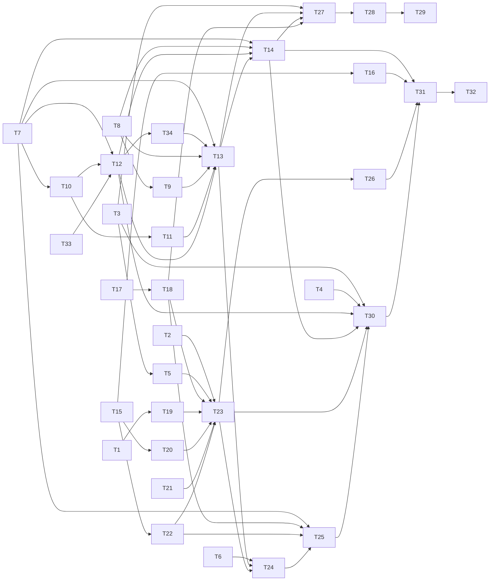

# Bash confinement: binary identity, a reader sandbox, judge facts, and an observing tripwire

status: in-progress
commit-mode: orchestrator-commits
language: ruby (2 Rust cards: T15, T16)
panel: Ruby (Linus Torvalds, Jeremy Evans, Sandi Metz, Richard Schneeman, Aaron Patterson); Rust cards add Raph Levien and Andrew Gallant

## Intent

Neither lain's deterministic checker nor its `auto` judge knows which binary a `bash` call runs. A bare `cat` runs whatever `PATH` finds first, and a planted `<root>/bin/cat` ran under a `ComposedTerm` approval. This plan delivers the 4 items the research marked "plan now" (`planning/binary-identity-research-2026-10.md`, Recommendation):

1. **Identity.** Scrub the inherited env, make the Core shell absolute, resolve every stage into a journalled `Shell::Executable` with ctime-based `fresh`, and name the requester on every ladder record.
2. **The reader sandbox.** `ComposedTerm` rules by the resolved class, and its approvals run under bwrap, strace and a new Landlock helper (`crates/lain-fence`), behind a swappable launcher so gVisor or a microVM can follow.
3. **Judge facts and a structured bar**, as a bench arm that starts off.
4. **An observe-only tripwire ledger** that records what would have stopped an agent and stops nothing.

Each step is a bench arm selected by a CLI flag and recorded in the session header. By the user's ruling (2026-10-16), the safe arms turn on by default in their own card (T31) after the code they switch on: the class table, the reader sandbox (degrading loudly when the kernel lacks a layer) and the observe-only tripwire. Judge facts stay off until bench runs.

Roadmap: `ROADMAP.md` item 59.

## Grounding

2026-10-16, at `6be12e76`. The research report and its 18 spikes are untracked by the user's choice, so their paths resolve only on this box (`planning/binary-identity-research-2026-10.md`, `planning/binary-identity-research-2026-10/spikes/`).

4 Explore passes read the production paths. These claims were checked by hand or by probe:

- **`Exec.child_env` scrubs only `BUNDLE_*`, `BUNDLER_*`, `RSPEC_*`, `RUBYOPT` and `CDPATH`** (`lib/lain/exec.rb:80,84,100-103`). No `LD_*` or `BASH_FUNC_*` scrub exists in `lib/`. `exec/docker.rb` does not scrub `LD_PRELOAD` by name: its `CROSSES` allowlist (:68) never names it. The research report's line saying it does is wrong in that sense.
- **`Exec::Local` already runs `/bin/sh` by absolute path** (`local.rb:22,69`). Only `Exec::Core` sends a bare `sh` (`core.rb:96`), and Core is not production-wired (`cli/exec_backend.rb:42-48`, `BACKENDS = %w[local docker]`). So the "absolute Core shell" item is a 1-line fix with no production effect today.
- **The bash call cannot see how it was approved.** `WithholdAutomaticOutput::Carried` (`middleware/withhold_automatic_output.rb:92-114`) holds the ruling with no public reader, and `Tool::Invocation` has no ruling field (`tool/invocation.rb:16`). `invocation.context` inside `Tools::Bash#perform` is that `Carried` (`effect/handler/live.rb:41`).
- **A `ComposedTerm` allow and a config rule's allow are indistinguishable on the Ruling.** Both are `rung: "rules"`. The rule name survives only inside `reason` text (`escalation.rb:424-427`). The structured name is `Rule::Decision#rule` (`rule.rb:287-289`).
- **`ComposedTerm` never sees the context or the env.** `Escalation::Rules#call(effect, _context)` builds a `Rule::Call` of tool and input only (`escalation.rb:380,398`). Environment reaches the rule only through the injected `sensitivity:` factory, `BoardBuild::Classifiers` (`board_build.rb:326,474-546`), whose `WorkerEnv` has an empty env and so no `PATH`.
- **`Escalation#record` drops the context** (`escalation.rb:256,323-329`), so final denies carry no requester. `Judged#record` (`judged.rb:250-255`) likewise. `RememberedDenials` already writes `"requester"` (`middleware/remembered_denials.rb:100-107`). `read_refused` has none, and the Sensitivity middleware gets no `requester:` (`cli/tool_guard.rb:309`).
- **The only exact-keys pin on an escalation record** is `spec/lain/approval/escalation_spec.rb:414` (`Ruling#record` keys). Every other spec uses `include`.
- **No journal record holds a write's file identity.** `Session#record_write` journals nothing (`session.rb:296-315`). `FilesWritten` carries display paths and a role only (`agent/tool_delivery.rb:100-107`, `session.rb:370-372`). `Session::FileIdentity` (device, inode, size, mtime) exists for reads only (`session.rb:634-662`). Nothing in `lib/` reads ctime. A child's `files_written` reaches the parent's journal through `JournalTee(@seam.telemetry, ...)` with `role` set to the child (`tools/subagent.rb:1606-1607`).
- **No in-process journal observer API exists.** `CLI::JournalTee` is the fan-out (`cli/journal_tee.rb:27-118`), installed by `Chronicle#wrap_tee` from `LiveViews#initialize` (`cli/live_views.rb:129`). `StatusFeed#<<` (`status_feed.rb:269-300`) is the pattern for a sink that folds records.
- **New journal kinds need no registry.** A `Data` with `Telemetry::Journalable` gets its type from its class name. `spec/journalable_surface_spec.rb` sweeps every includer for collisions and shape.
- **There is no experiment-arm config.** The precedent is a CLI flag recorded in the session header, as `--compact-fallback` is (`session_record.rb:40-61`, `session_record/scribe.rb:151-164`, `cli/wiring.rb:390`).
- **`Shell::Pipeline#commands` builds each stage as `[env, [setsid, "setsid"], "--", *argv, stage_options]`** (`pipeline.rb:406-411`). Its `Refusals` preflight checks each stage's own program against `PATH` (:325-352). So a sandbox prefix belongs outside the term the preflight sees.
- **Probe, this box, 2026-10-16:** `Open3.pipeline_r` with a per-stage `{3 => pipe}` option, through `setsid`, `bwrap`, `strace -o /dev/fd/3` and the spike fence, delivered the full execve record to the Ruby pipe (`/bin/sh`, then `cat` and `wc` by absolute path) while stdout came back on its own pipe. `bwrap --size N --tmpfs /tmp` capped the tmpfs (ENOSPC past it). `--size` must come immediately before `--tmpfs`, or bwrap aborts.
- **This box has no KVM** (SVM disabled in the BIOS; no `/dev/kvm`). gVisor's `runsc --rootless --network=none do` runs here at a 43 ms median for `/bin/true` (5 runs), against 9 ms for the bwrap stack.
- **A durable record never reaches a tee sink.** `Chronicle#durable_journal` is "never the tee" (`cli/chronicle.rb:340-345`), and `Tools::Bash` and the spawn seam write there (`cli/wiring.rb:862`, `toolset_build.rb:290`). So an observer that must see `exec_record` or `file_written` cannot be a `LiveViews` sink; T33 adds observers on the session's one `Journal`, which the tee also writes through (`chronicle.rb:228-231`).
- **The Policy is built after the toolset.** `BoardBuild.for` builds it (`board_build.rb:55-70`) when `Wiring#switchboard` first runs (`cli/wiring.rb:985`), after `build_toolset` (`wiring.rb:386,862`). So the toolset reaches it lazily (T18).
- **A child's agent journal discards** (`tools/subagent.rb:1593-1607`), and its `display:` is a tee onto the parent's telemetry and display channel. A child's write record therefore comes from the shared write tools (T10), not from `ToolDelivery`.
- **`Lain::Ledger` and `Lain::Sensitivity::Ledger` exist**, so the tripwire's ledger lives at `Lain::Tripwire::Ledger`. `Shell::Executable` is free.

Files read: `lib/lain/exec{,/local,/core,/docker}.rb`, `lib/lain/shell/{pipeline,term,named,programs}.rb`, `lib/lain/tools/{bash,write_file,edit_file,subagent}.rb`, `lib/lain/approval/{composed_term,rule,escalation,judge,judged,queue,policy_switch}.rb`, `lib/lain/middleware/{withhold_automatic_output,remembered_denials,sensitivity,gate,confine_to_scope}.rb`, `lib/lain/sensitivity/policy.rb`, `lib/lain/session.rb`, `lib/lain/session_record{,/scribe}.rb`, `lib/lain/agent/tool_delivery.rb`, `lib/lain/telemetry{,/read_refused,/shell_arm,/files_written,/judge_approved,/capability_degraded}.rb`, `lib/lain/cli/{wiring,switchboard,tool_guard,journal_tee,live_views,chronicle,exec_backend,isolation_backend,backend}.rb`, `lib/lain/cli/wiring/{board_build,toolset_build}.rb`, `lib/lain/status_feed.rb`, `lib/lain/paths.rb`, `lib/lain/cli/resume/chain_walk.rb`, `lib/lain/core/child.rb`, `crates/lain-core/src/{main,exec}.rs`, `Cargo.toml`, `deny.toml`, `Rakefile`, `.pre-commit-config.yaml`, `.github/workflows/main.yml`, `references/firecracker-microvm-isolation.md`, `ROADMAP.md` (M5, item 18).

Where docs and code disagree:

- The research report says `LD_PRELOAD` is scrubbed in `exec/docker.rb`. It is never named, so it never crosses. Code wins.
- The research report's `Profiles` table scrubs `LD_LIBRARY_PATH`. `CLAUDE.md` requires `LD_LIBRARY_PATH=/home/linuxbrew/.linuxbrew/lib` for OpenSSL in every child Ruby. This plan does not scrub it (Rejected options).
- `composed_term.rb:215-219` says resolving argv0 "changes no decision". T14 changes that, behind the arm flag, and rewrites the comment.

mempalace was unreachable this session (MCP server failed to connect), so prior decisions come from the research report's first-pass queries and the memory files `binary-identity-rulings-2026-10.md` and `approval-layering-direction.md`.

## Compatibility

| Surface | Verdict | Evidence |
|---|---|---|
| `escalation` journal record | free to break; additive only | No lib code reads it back (`grep '"escalation"' lib` hits only the 2 writers). Old session files lack `requester`, and readers must treat absence as unknown. Bench readers are new |
| `Ruling` value (`escalation.rb:89`) and `Ruling#record` keys | free to break | Internal. 1 exact-keys pin, `escalation_spec.rb:414`, updated in T5 |
| `read_refused` record | free to break; additive | `Telemetry::Carriers::ReadRefused` gains `requester` |
| Session header | must keep the old shape readable; new key additive | Resume reads headers of old files (`cli/resume.rb:88`). An `arms` key merges only when a flag differs from off, on the `compaction:` rule, so an all-off run stays byte-identical |
| `Exec#call` keyword contract (Local, Core, Docker) | free to break | Internal duck, 3 implementations, no outside consumer (`grep -rn 'Exec::' ~/dev` outside lain finds none). T23 adds an ignored `confinement:` keyword to each |
| lain-core wire argv (`"sh"` to `"/bin/sh"`) | free to break | Daemon not production-wired. Rust tests pass `"sh"` directly and stay green |
| `Exec.child_env` result | free to break | Internal. `spec/lain/exec/local_spec.rb:202` pins "still leaks a non-framework host var", which stays true for every key T1 does not name |
| `ComposedTerm` decisions | free to break, behind a flag | Behaviour change only under `--confine classes` or `reader` |
| CLI flags `--confine`, `--judge-facts`, `--tripwire` | new | Additive |
| The gem | not published | `lain.gemspec` sets `allowed_push_host` to rubygems.org, but no release tag exists (`git tag` shows only `backup/main-pre-msg-rewrite-tag`) and the memory `harness-vs-own-dev.md` records "no back-compat needed" |
| `crates/lain-fence` | new binary crate, `publish = false` | Built from the workspace like `lain-core` |

No trade report: no must-keep surface blocks a simplification.

## Spike findings

| Question | Result | Evidence |
|---|---|---|
| Can strace's exec record reach Ruby through the existing `Open3.pipeline_r` path, inside bwrap and the fence? | Yes, with a per-stage `{3 => w}` option and `strace -o /dev/fd/3`. The record names each exec by absolute path | probe at `~/tmp/lain/probe-plan/p.rb`, 2026-10-16 |
| Does bwrap cap a tmpfs? | Yes, `--size N --tmpfs /tmp`, in that order. ENOSPC past the cap | same probe |
| Does the stack bound the guardrail list's cases, and at what cost? | Yes, all but git history. 9.01 ms median per light call; 2.05x wall on an exec-heavy `find -exec` | research spikes `composition`, `bwrap-mask`, `surfaces`; critique round 2 probe |
| Can a real producer emit the resolution facts? | 12 of 14 unsafe held-out cases; a structured bar deferred all 12 | research spike `facts-fidelity` |
| Is ctime-based `fresh` sound against backdating? | Yes; mtime is not. Rule (b) over the whole tree marks 44% of this repo after a day, so it applies only to files a call will run | research spike `facts-fidelity` |
| Does `--exec-file` admit exactly 1 file outside the exec dirs? | Yes; a second file in the same directory got EACCES | research spike `string-arm-and-persistence` |
| Can a microVM run here? | No: no `/dev/kvm`. gVisor rootless systrap runs at 43 ms per call; libkrun is the better VM on a KVM box (virtio-fs, TSI) | VM research agent, 2026-10-16; `/home/tara/tmp/lain/probe-gvisor/` |
| Can gVisor do the reader profile without KVM? | Mostly. `runsc run` with an OCI bundle (read-only root, `/usr` ro, project rw, `/dev/null` over `.env`) wrote through to the host project, read `.env` empty, refused `/usr` writes, and had no `~/.ssh`. `--strace --debug-log` names every execve with path and argv in glog text. But an append to the masked `.env` reports success (it lands in `/dev/null`) where bwrap gives EACCES, there is no per-port network rule, and each call costs about 43 ms | `/home/tara/tmp/lain/probe-gvisor/` (bundle, proj, dbg), runsc 20261005, 2026-10-16 |
| Where does the sandbox seam go? | A per-call `Exec` decorator with a launcher (`#wrap(term, profile) -> Term`), the shape `Exec::Docker` already has. A per-stage wrapper in `Pipeline` cannot express a VM | same |

No spike worktree was created for this plan; the probes ran in `~/tmp/lain/`.

## Shared files

Only the main session edits these. Cards hand back 1-line diffs.

- `Cargo.toml` (workspace `members`), `Cargo.lock`
- `ROADMAP.md`: the main session adds item 59 with this plan's commit, and T32 hands back the line marking it done
- `Rakefile` (`compile` also builds `lain-fence`)
- `.rubocop.yml`
- `spec/support/slow_files.rb`

## Rejected options

- **Scrubbing `LD_LIBRARY_PATH`**: this repo's own child Ruby needs it for OpenSSL (`CLAUDE.md` Toolchain). A model that sets it does so in the command string, which a scrub cannot reach; the trace and the fence cover that.
- **A per-stage sandbox wrapper inside `Shell::Pipeline#commands`**: it cannot see the ruling or the profile, and a gVisor or VM backend is not an argv prefix of a stage. The decorator (T23) keeps `Pipeline` to 1 generic change (extra fds, T19).
- **A shim directory or pinned `PATH` as enforcement**: bypassed by `command -p`, `env PATH=` and absolute paths (research, measured). The fence's `--exec-file` enforces instead.
- **A microVM backend in this plan**: no KVM on this box, so nothing could be tested. The seam is built so one can follow (Open decisions).
- **A gVisor launcher in this plan**: it works here (Spike findings), but at about 43 ms per call against 9 ms, with silent writes to masked files and no port grants. It is the natural second launcher, as a compared arm (Open decisions).
- **A `judge_verdict` journal kind**: `escalation` already carries every judge verdict.
- **A ledger middleware or a Queue observer**: a middleware sees only a Result, and the Queue sees only parked calls (research, `ledger-and-masks`).
- **The workspace profile, opaque commands to the judge, per-program grants and hard stops**: each waits on a named measurement (research, Recommendation), so no card here.
- **Pre-masking names that do not exist yet**: bwrap leaves a 0-byte file on the host.
- **Splitting `ComposedTerm` into a new rule class for identity**: the file's own header says the PATH-trust rung "bolts on the same way" (`composed_term.rb:47-49`), 1 predicate in the existing conjunction.

## Open decisions

1. **The second launcher.** gVisor (`runsc --rootless`, no KVM) has now shown a project-only writable mount, a masked file and a per-execve record on this box, so a `Confine::Runsc` launcher behind `--confine reader-gvisor` is a ready next card: it writes an OCI bundle per call and parses `execve(` lines from the debug log. What it lacks: per-port grants and a refusing mask. libkrun needs KVM: SVM enabled in the BIOS, `sudo modprobe kvm_amd`, `sudo usermod -aG kvm $USER`, then `sudo pacman -S libkrun krunvm` and the VM research's probe. A libkrun guest would run `lain-core` over vsock as `Exec::Sandboxed`'s inner exec, with the launcher a no-op.
2. **Rule (a) across worktrees.** Session directories are keyed by a hash of the cwd's realpath (`paths.rb:246-283`), so a worktree child's own sessions are invisible from the main checkout. T12 covers the current lineage and the children whose records reach it. Searching every project directory is deferred.
3. **When judge facts turn on by default**, and whether the request text (T29) ever does. Decided by bench runs of A2 and A2r.
4. **Hard stops (A5).** Wait for a false-trip rate from observe-only runs.
5. **A production consumer for `Exec::Core`.** It is not selectable (`cli/exec_backend.rb:42-47`). T2 fixes its shell now so the vsock or VM backend inherits the fix.

## Dependency graph



Independent starts: T1, T2, T3, T4, T6, T7, T8, T15, T17, T21, T33.

## Interfaces

These are the new shapes several cards share. Each card restates the part it owns.

```ruby
module Lain
  module Shell
    # One stage's program, resolved. Pure value; deeply frozen.
    Executable = Data.define(:name, :resolved, :realpath, :chain, :shadowed, :anomalies, :klass, :fresh, :run_files, :wrappers)
    # wrappers: [Executable] each runner (nice, env, timeout, bundle exec...) resolved and classed; T27 prints them, T28's bar reads them
    # klass: :system | :user | :project | :unresolved
    # chain: [String] each link from `resolved` to `realpath`
    # shadowed: [String] later PATH hits, deduped by realpath
    # anomalies: [Symbol] :empty_path_entry, :relative_path_entry, :project_path_entry, :exported_function, :ld_preload
    # run_files: [RunFiles::Entry] what an interpreter or build tool will run (T9); a stage whose run files cannot be named is :unresolved

    class Executable
      # RunFiles::Entry, as built: Data.define(:path, :klass, :fresh)

      # One per session, shared by the ladder (T14), the bash call (T13) and the judge (T27).
      # @param stat [#lstat, #readlink, #realpath, #executable?, #writable?] a filesystem port; File in production
      class Resolver
        NULL = ... # resolves every stage :unresolved; the default where no session exists
        def initialize(root:, fresh:, stat: Executable::Stat.new) = ...
        # PATH is worker_env.env["PATH"] laid over ENV["PATH"]; cwd is worker_env's
        def for(worker_env) = Bound.new(...)
      end

      class Resolver::Bound
        # @return [Array<Executable>] one per stage of the term, wrappers (env, nice, time,
        #   timeout, bundle exec, direnv exec) unwrapped to the program they run
        def call(term) = ...
      end

      # The structured bar: true means "a machine may not approve this".
      def self.bar?(executables) = ...
    end
  end

  module Confine
    # What a call may do. Pure value; a launcher turns it into argv.
    Profile = Data.define(:name, :exec_dirs, :exec_files, :read_dirs, :write_dirs, :masks, :tmpfs_bytes, :trace)
    # name: :none | :traced | :reader

    # What the bash call hands its exec: how it was approved and what it resolved to.
    Request = Data.define(:ruling, :executables, :cwd, :root, :tool_use_id) # tool_use_id required: T30 matches exec_record to escalation by it

    # term in, term out
    module Launcher
      def wrap(term, profile, trace_fd:) = raise NotImplementedError
    end
  end

  module Exec
    # Decorates an inner Exec (Local in production), the way Docker composes Local.
    class Sandboxed
      def initialize(inner:, launcher:, profiles:, journal:) = ...
      def takes_term?(term) = @inner.takes_term?(term)
      def call(command:, cwd:, env:, timeout:, confinement: Confine::Request::NONE, **sinks) = ...
    end
  end
end
```

## Tasks

### [x] T1: Scrub exported shell functions and loader injection from every child env          [risk: low]

**Depends on:** none
**Files:** `lib/lain/exec.rb`, `spec/lain/exec/local_spec.rb`
**Reuse:** `Exec::FRAMEWORK_ENV` and `SHELL_ENV` (`exec.rb:80,84`), the nil-deletes merge at `exec.rb:100-103`
**Shared-file wiring:** none
**Reachable from:** `Exec::Local#call` (`local.rb:62`), constructed by `CLI::ExecBackend#backend` (`cli/exec_backend.rb:95`) from `ToolsetBuild#initialize` (`cli/wiring/toolset_build.rb:202`)

**Acceptance criteria**

```gherkin
Scenario: an exported function never reaches the shell
  Given the launching process has BASH_FUNC_cat%% set to "() {  echo PLANTED; }"
  When Exec::Local runs the string "cat /dev/null; echo done"
  Then the output is "done" and holds no "PLANTED"

Scenario: the loader cannot be told to inject
  Given the launching process has LD_PRELOAD and LD_AUDIT set
  When Exec::Local runs "env"
  Then neither variable appears in the output

Scenario: the OpenSSL path survives
  Given LD_LIBRARY_PATH is set
  When Exec::Local runs "env"
  Then LD_LIBRARY_PATH appears with its value
```
Spec file: `spec/lain/exec/local_spec.rb`

**Interface**

```ruby
LOADER_ENV = /\A(?:LD_PRELOAD|LD_AUDIT)\z/
FUNCTION_ENV = /\ABASH_FUNC_/
```

**Stop and report if:**
- `spec/lain/exec/docker_spec.rb:539-588` or `spec/lain/exec/core_spec.rb:60-90` start failing: they pin the exact nil keys on the wire, and a new nil key there means the scrub reached a lent variable.
- `spec/lain/grader/test_harness_spec.rb:53-70` fails: the grader passes its own env through `child_env`.

### [x] T2: Send lain-core an absolute shell          [risk: low]

**Depends on:** none
**Files:** `lib/lain/exec/core.rb`, `spec/lain/exec/core_spec.rb`
**Reuse:** `Exec::Local::SHELL` (`local.rb:22`)
**Shared-file wiring:** none
**Reachable from:** deferred: `Exec::Core` is not selectable in production (`cli/exec_backend.rb:42-47`); Open decision 5.

**Acceptance criteria**

```gherkin
Scenario: the daemon is asked for /bin/sh by path
  Given an Exec::Core over a recording client
  When it runs the string "echo hi"
  Then the wire argv is ["/bin/sh", "-c", "echo hi"]
```
Spec file: `spec/lain/exec/core_spec.rb`

**Stop and report if:**
- `crates/lain-core/tests/lifecycle.rs` or `vsock_lifecycle.rs` assume the Ruby side sends `"sh"`: they pass `"sh"` themselves, so they should stay green; if not, the daemon resolves differently than assumed.

### [x] T3: Name the requester on every escalation record          [risk: medium]

**Depends on:** none
**Files:** `lib/lain/approval/escalation.rb`, `lib/lain/approval/judged.rb`, `spec/lain/approval/escalation_spec.rb`, `spec/lain/approval/judged_spec.rb`
**Reuse:** `Queue.requester_for(context, nil)` (`queue.rb:372-374`); the field `RememberedDenials#record` already writes (`middleware/remembered_denials.rb:100-107`)
**Shared-file wiring:** none
**Reachable from:** `CLI::Switchboard#judged_ladder` (`cli/switchboard.rb:507-515`) builds the `Escalation` and `Judged`, from `Switchboard.for` (`switchboard.rb:113-121`) in `BoardBuild` (`cli/wiring/board_build.rb:64`)

**Acceptance criteria**

```gherkin
Scenario: a child's final deny names the child
  Given an auto ladder and a child "researcher" whose call Triage denies as final
  When the child's policy rules on the call
  Then the journal's escalation record holds "requester" => "researcher"

Scenario: the main agent's record says who asked when known and nothing when not
  Given the main agent's context has no requester
  When the ladder rules on a call
  Then the escalation record has no "requester" key

Scenario: a judge defer names the requester
  Given a child "researcher" whose call the judge defers
  When Judged records the hand-down
  Then that escalation record holds "requester" => "researcher"
```
Spec file: `spec/lain/approval/escalation_spec.rb`, `spec/lain/approval/judged_spec.rb`

**Stop and report if:**
- `escalation_spec.rb:414` (the exact `Ruling#record` keys) has to change: the requester belongs on the record hash `Escalation#record` builds, not on `Ruling#record`.
- `spec/lain/seams/judged_approval_spec.rb` or `spec/lain/seams/child_worktree_approval_spec.rb` see a requester other than the child's name: the `Asking` wrapper (`cli/tool_guard.rb:92-104`) is not reaching the record.

### [x] T4: Name the requester on read_refused          [risk: low]

**Depends on:** none
**Files:** `lib/lain/middleware/sensitivity.rb`, `lib/lain/telemetry/read_refused.rb`, `lib/lain/cli/tool_guard.rb`, `spec/lain/middleware/sensitivity_spec.rb`, `spec/lain/cli/tool_guard_spec.rb`
**Reuse:** `RememberedDenials`'s `requester:` constructor and `requester_of` (`remembered_denials.rb:107`); `tool_guard.rb:302-306` passing it
**Shared-file wiring:** none
**Reachable from:** `CLI::ToolGuard#layered` (`cli/tool_guard.rb:287-311`), called by `#stack` (:226) and `#child_stack` (:247)

**Acceptance criteria**

```gherkin
Scenario: a child's refused read names the child
  Given a child stack for "researcher" built by ToolGuard#child_stack
  When the child reads a denied path
  Then the read_refused record holds "requester" => "researcher"
```
Spec file: `spec/lain/cli/tool_guard_spec.rb`, `spec/lain/middleware/sensitivity_spec.rb`

**Stop and report if:**
- `tool_guard_spec.rb:138-139` or `:513-514` (stack order) change: this card adds a constructor argument and must not move a layer.
- `spec/journalable_surface_spec.rb` rejects the carrier change.

### [x] T5: Carry the deciding rule's name on a Ruling          [risk: medium]

**Depends on:** T3
**Files:** `lib/lain/approval/escalation.rb`, `spec/lain/approval/escalation_spec.rb`
**Reuse:** `Rule::Decision#rule` (`approval/rule.rb:287-289`); `Rules#ruling` (`escalation.rb:409-427`); `Ruling#initialize` and its `allow`, `deny`, `abstain`, `fault` factories (`escalation.rb:134-145`)
**Shared-file wiring:** none
**Reachable from:** `Escalation::Rules` inside the ladder built at `cli/switchboard.rb:507-510`, from `BoardBuild.for` (`cli/wiring/board_build.rb:55-70`)

**Acceptance criteria**

```gherkin
Scenario: a ComposedTerm allow is told apart from a config rule's allow
  Given the auto ladder from BoardBuild.for with ComposedTerm and a config allow rule
  When each approves a call
  Then the first Ruling's rule is "composed_term" and the second's is the config rule's name
  And both escalation records carry "rule"

Scenario: a ruling no rule made names none
  When the judge approves a call
  Then the Ruling's rule is nil and the record has no "rule" key

Scenario: a barred allow keeps its rule
  Given a rule allow that the ladder's bar turns into an abstain
  Then the abstain still names the rule
```
Spec file: `spec/lain/approval/escalation_spec.rb`

**Interface**

```ruby
Ruling = Data.define(:verdict, :rung, :reason, :fault, :authority, :final, :told, :said, :rule)
# initialize(..., said: nil, rule: nil); Ruling.allow(rung:, because:, rule: nil) and kin
```

**Stop and report if:**
- The "Ruling#record keys" example in `escalation_spec.rb` (today an exact `%w[verdict rung reason faulted authority final]`) has to change: `rule` goes on the hash `Escalation#record` merges, as T3's `requester` does.
- Any `Ruling.allow`, `.deny`, `.abstain` or `.fault` call outside `escalation.rb` breaks (grep `Ruling\.` across `lib/` and `spec/`).
- The board_build_spec example asserting a reason that starts `"composed_term:"` changes: the reason text stays as is.

### [x] T6: Let a bash call read the ruling that let it run          [risk: low]

**Depends on:** none
**Files:** `lib/lain/middleware/withhold_automatic_output.rb`, `spec/lain/middleware/withhold_automatic_output_spec.rb`
**Reuse:** `Carried#ruled` and `@ruling` (`withhold_automatic_output.rb:92-114`), the `Unruled` default
**Shared-file wiring:** none
**Reachable from:** `WithholdAutomaticOutput#call` (:126-133), in the stack `CLI::ToolGuard#layered` builds (`tool_guard.rb:287-299`)

**Acceptance criteria**

```gherkin
Scenario: the tool sees the ruling the Gate made
  Given the real guard stack from ToolGuard#stack over a recording bash tool
  When the Gate allows a bash call through the ladder
  Then the tool's invocation.context.ruling is that Ruling

Scenario: a call no ladder ruled on says so
  Given a gate over ApproveAll
  When a bash call runs
  Then invocation.context.ruling answers allow? false, human? false and rule nil
```
Spec file: `spec/lain/middleware/withhold_automatic_output_spec.rb`

**Interface**

```ruby
class Carried
  module Unruled
    def self.allow? = false
    def self.human? = false
    def self.rule = nil
  end
  attr_reader :ruling
end
```

**Stop and report if:**
- A non-bash tool's context starts answering `ruling`: `GUARDED_TOOLS` limits `Carried` to bash, and readers duck-type with `respond_to?(:ruling)`.

### [x] T7: Parse the bench arm flags once and record them in the session header          [risk: medium]

**Depends on:** none
**Files:** `lib/lain/cli/arms.rb` (new), `exe/lain`, `lib/lain/cli/wiring.rb`, `lib/lain/cli/wiring/toolset_build.rb`, `lib/lain/cli/wiring/board_build.rb`, `lib/lain/session_record.rb`, `lib/lain/session_record/scribe.rb`, `spec/lain/cli/arms_spec.rb` (new), `spec/lain/session_record_spec.rb`, `spec/lain/cli/wiring_spec.rb`
**Reuse:** `--compact-fallback`'s path into the header (`exe/lain:957`, `cli/backend.rb:602`, `cli/wiring.rb:390`, `session_record/scribe.rb:151-164`); `ExecBackend`'s validation shape (`cli/exec_backend.rb:52-112`)
**Shared-file wiring:** none
**Reachable from:** `exe/lain` `chat` options reach `Wiring` (`cli/chat_launch.rb:424`); `Wiring` builds `@arms = CLI::Arms.from(options)` once and passes it to `ToolsetBuild.new(arms:)` (`wiring.rb:862`), to `BoardBuild.for(arms:)` (`wiring.rb:985`), and to the header beside `compaction:` (`wiring.rb:390`)

**Acceptance criteria**

```gherkin
Scenario: flags parse and reject nonsense
  When lain chat is launched with --confine reader --judge-facts facts --tripwire observe
  Then Wiring's arms answer confine :reader, judge_facts :facts, tripwire :observe
  And --confine sideways exits naming the allowed values

Scenario: one Arms reaches every consumer
  Given a Wiring built from those options
  Then the ToolsetBuild and the BoardBuild receive the same Arms instance

Scenario: an arm off by default writes no header key
  When a session starts with every arm off
  Then its header is byte-identical to one written before this card

Scenario: an arm that is on is recorded
  When a session starts with --confine reader
  Then its header holds "arms" => {"confine" => "reader"}
```
Spec file: `spec/lain/cli/arms_spec.rb`, `spec/lain/cli/wiring_spec.rb`, `spec/lain/session_record_spec.rb`

**Interface**

```ruby
module Lain::CLI
  Arms = Data.define(:confine, :judge_facts, :tripwire) do
    CONFINE = %i[off classes reader].freeze
    JUDGE_FACTS = %i[off facts request].freeze
    TRIPWIRE = %i[off observe].freeze
    def self.from(options) = ...      # raises Arms::Unknown on a bad value
    def to_header = ...               # {} when every arm is at its default
  end
  # Arms::OFF is the keyword default for ToolsetBuild and BoardBuild.for
end
```

**Stop and report if:**
- Any default here is anything but `off`: T31 flips them, after the code they switch on.
- `cli/resume.rb` or `cli/resume/mismatch_notices.rb` read the header's key set exactly.
- `Bench::Harness` or another `ToolsetBuild` / `BoardBuild.for` caller breaks: the keyword defaults to `Arms::OFF`.

### [x] T8: Resolve each stage's program into a classified Shell::Executable          [risk: high]

**Depends on:** none
**Files:** `lib/lain/shell/executable.rb` (new), `lib/lain/shell/executable/resolver.rb` (new), `lib/lain/shell/executable/stat.rb` (new), `spec/lain/shell/executable_spec.rb` (new), `spec/lain/shell/executable/resolver_spec.rb` (new)
**Reuse:** `planning/binary-identity-research-2026-10/spikes/facts-fidelity/executable.rb` (the measured producer); `Shell::Term#stages` (`shell/term.rb:93-99`); `Shell::Programs::TAKES_A_COMMAND` (`shell/programs.rb:43`) for wrapper words
**Shared-file wiring:** none
**Reachable from:** `BaseTools.build` (`cli/wiring.rb:147-158`) constructing `Tools::Bash`, wired by T13. This card's specs drive the resolver against a real temp directory tree.

**Acceptance criteria**

```gherkin
Scenario: a planted cat shadows the system one
  Given PATH "<root>/bin:/usr/bin" and an executable <root>/bin/cat
  When the resolver resolves the term "cat README.md"
  Then the stage resolves to <root>/bin/cat, class :project, shadowing /usr/bin/cat
  And anomalies include :project_path_entry

Scenario: a symlink into rm is followed
  Given ~/bin/ls -> /usr/bin/rm, first on PATH
  When the resolver resolves "ls"
  Then realpath is /usr/bin/rm, the chain lists both, and class is :user

Scenario: mise shims keep their identity
  Given ruby resolves to ~/.local/share/mise/installs/ruby/4.0.6/bin/ruby
  Then class is :user and the chain ends at that file, not at a basename match

Scenario: wrappers are unwrapped
  When the resolver resolves "nice -n 19 bundle exec rspec"
  Then the stages name rspec as the program run, with nice and bundle as wrappers

Scenario: what cannot be resolved says so
  When the term holds eval, a $x as the program, or a name not on PATH
  Then that stage's class is :unresolved

Scenario: an exported function is an anomaly before any scrub
  Given env holds BASH_FUNC_ls%%
  When the resolver resolves "ls"
  Then anomalies include :exported_function

Scenario: an empty PATH entry resolves from the cwd and is flagged
  Given PATH "::/usr/bin" and an executable ./cat
  Then the stage resolves to <cwd>/cat with :empty_path_entry
```
Spec file: `spec/lain/shell/executable/resolver_spec.rb`, `spec/lain/shell/executable_spec.rb`

**Interface** (see Interfaces: `Resolver.new(root:, fresh:)`, `#for(worker_env)`, `Bound#call(term)`; `fresh` answers `#fresh?(path)`, a null answering false until T12)

**Stop and report if:**
- `Ractor.shareable?` fails on an `Executable`: value objects are deeply frozen (`CLAUDE.md` Code style).
- Resolving 15 PATH entries costs more than 1 ms per stage on a quiet box (research measured 0.096 ms). Measure with `nice`, serially, only when no suite runs (`pgrep -cf 'mise/installs/ruby/[0-9.]*/bin/parallel_rspec'` reads 0).
- `system` cannot be decided without root: a directory the user cannot write is the test, by `File.writable?` up the chain, not by owner.

### [x] T9: Classify the file an interpreter or build tool will run          [risk: medium]

**Depends on:** T8
**Files:** `lib/lain/shell/executable/run_files.rb` (new), `lib/lain/shell/executable/resolver.rb`, `spec/lain/shell/executable/run_files_spec.rb` (new)
**Reuse:** the spike's run-file rules (`facts-fidelity/executable.rb`), including `ARGFILES=1`'s spec-argument classification; `Shell::Programs`
**Shared-file wiring:** none
**Reachable from:** `Executable::Resolver#call`, constructed at `cli/wiring.rb:147-158`, wired by T13

**Acceptance criteria**

```gherkin
Scenario: a script operand is a run file
  When the resolver resolves "ruby scripts/x.rb" or "sh x.sh" or "python3 t.py"
  Then the stage's run_files hold that path with its class

Scenario: test runners run their file arguments
  When it resolves "bundle exec rspec spec/x_spec.rb" or "pytest tests/"
  Then run_files hold spec/x_spec.rb or tests/

Scenario: build tools run their config
  When it resolves make, rake, bundle exec, npm run or cargo build in the project
  Then run_files hold the Makefile, Rakefile, Gemfile, Gemfile.lock, package.json, Cargo.toml and build.rs that exist

Scenario: direnv runs the project's envrc
  When it resolves "direnv exec . rspec"
  Then run_files hold .envrc

Scenario: git runs hooks and config
  When it resolves "git commit"
  Then run_files hold .git/config and each existing file under .git/hooks

Scenario: an interpreter reading stdin cannot be classified
  When it resolves "cat <<EOF | ruby" or "ruby -"
  Then the stage is :unresolved
```
Spec file: `spec/lain/shell/executable/run_files_spec.rb`

**Stop and report if:**
- `Shell::Parse` reports the term covered while dropping the stage after `cat <<EOF | bash` (research, `judge-opaque`): mark the term unresolved and report it, rather than fixing the parser here.

### [x] T10: Journal the file identity of every write the write tools make          [risk: high]

**Depends on:** T7
**Files:** `lib/lain/telemetry/file_written.rb` (new), `lib/lain/tools/write_file.rb`, `lib/lain/tools/edit_file.rb`, `lib/lain/cli/wiring.rb`, `spec/lain/telemetry/file_written_spec.rb` (new), `spec/lain/tools/write_file_spec.rb`, `spec/lain/tools/edit_file_spec.rb`
**Reuse:** `Session::FileIdentity` (`session.rb:634-662`) as the shape to extend with ctime; `Tools::Bash`'s `journal:` constructor keyword (`tools/bash.rb:221`) as the precedent for a tool that journals
**Shared-file wiring:** none
**Reachable from:** `BaseTools.build` (`cli/wiring.rb:147-158`) passes `journal:` to `Tools::WriteFile.new` and `Tools::EditFile.new`, as it already does to `Tools::Bash`. The floor is shared by every agent, children included (`exec/docker.rb:237-241` states the sharing), so a child's write lands in the session journal through the same tool instance, with no display channel involved

**Acceptance criteria**

```gherkin
Scenario: a write leaves its identity
  Given the production floor from BaseTools.build with the session journal
  When write_file writes <root>/bin/cat
  Then the journal holds file_written with the absolute path, device, inode and ctime the file has after the write, and the tool_use_id

Scenario: a child's write lands in the same journal
  Given a subagent "researcher" built by Tools::Subagent over the same floor
  When it edit_files a file
  Then the session journal holds that file_written, and the display channel shows nothing new

Scenario: a refused write leaves nothing
  When write_file is refused before writing
  Then no file_written names the path
```
Spec file: `spec/lain/tools/write_file_spec.rb`, `spec/lain/tools/edit_file_spec.rb`, `spec/lain/telemetry/file_written_spec.rb`

**Interface**

```ruby
Lain::Telemetry::FileWritten = Data.define(:tool_use_id, :path, :device, :inode, :ctime) # include Journalable
# Tools::WriteFile.new(journal: Channel::Null.instance); Tools::EditFile.new(journal: Channel::Null.instance)
```

**Stop and report if:**
- `Bench::Harness` (`bench/harness.rb:27`) or another `BaseTools.build` caller breaks: the keyword defaults to `Channel::Null.instance`.
- `spec/journal_routing_discipline_spec.rb` objects: `file_written` goes to the durable journal only, which T33's observers read.
- A child's tools turn out not to be the shared floor instances: report the construction site.

### [x] T11: Journal the identity of what a bash call wrote by name          [risk: medium]

**Depends on:** T10
**Files:** `lib/lain/tools/bash.rb`, `spec/lain/tools/bash_spec.rb`
**Reuse:** `Shell::Named#written` (`shell/named.rb:32,59`); `Telemetry::FileWritten`
**Shared-file wiring:** none
**Reachable from:** `Tools::Bash#perform` (`tools/bash.rb:276-284`), built by `BaseTools.build` (`cli/wiring.rb:155`)

**Acceptance criteria**

```gherkin
Scenario: a redirect is a write
  Given a real Tools::Bash over Exec::Local
  When it runs "echo x > bin/cat" in a temp project
  Then the journal holds file_written for <root>/bin/cat with its ctime after the call

Scenario: a named write that did not happen leaves nothing
  When the command fails before writing
  Then no file_written names a path that does not exist
```
Spec file: `spec/lain/tools/bash_spec.rb`

**Stop and report if:**
- `chmod +x f` yields a written path `<root>/+x` (research, `facts-fidelity`): skip any named path that does not exist after the call, and report the `Named` noise rather than fixing `Named` here.

### [x] T12: Answer whether a file is fresh, from the journal and ctime          [risk: high]

**Depends on:** T7, T10, T33
**Files:** `lib/lain/shell/executable/fresh.rb` (new), `lib/lain/cli/wiring.rb`, `spec/lain/shell/executable/fresh_spec.rb` (new), `spec/lain/cli/wiring_spec.rb`
**Reuse:** `StatusFeed#<<` and `#observe_approval` (`status_feed.rb:269-300,529-535`) for folding both Hash and object records; `CLI::Resume::ChainWalk#paths` (`cli/resume/chain_walk.rb`) for the lineage's files; `Wiring#resume_start` (`cli/wiring.rb:390`), which already knows the resumed path
**Shared-file wiring:** none
**Reachable from:** `Wiring` builds one `Executable::Fresh` from the resumed lineage, registers it with `chronicle.durable_journal.observe(fresh)` (T33), and hands it to the resolver T13 builds

**Acceptance criteria**

```gherkin
Scenario: a file lain wrote is fresh, in a real session
  Given a Wiring for a temp project
  When write_file writes <root>/bin/cat and a bash call later runs
  Then fresh?(<root>/bin/cat) is true at that call

Scenario: a bash redirect is seen too
  Given T11's file_written for a bash redirect on the durable journal
  Then fresh? answers true for that path

Scenario: backdating does not hide a write
  Given lain wrote f, then touch -d 2020-01-01 f
  Then fresh?(f) is true

Scenario: a run file changed outside lain during the lineage is fresh
  Given the lineage's first record is at T and f's ctime is after T, with no write record
  Then fresh?(f) is true

Scenario: an old untouched file is not fresh
  Given f's ctime is before T and no write record names it
  Then fresh?(f) is false

Scenario: a resumed session remembers earlier writes
  Given a lineage of 2 session files, the first holding file_written for f
  When Wiring starts the second as a resume
  Then fresh?(f) is true
```
Spec file: `spec/lain/shell/executable/fresh_spec.rb`, `spec/lain/cli/wiring_spec.rb`

**Interface**

```ruby
class Lain::Shell::Executable::Fresh
  def self.for_lineage(paths, stat: Executable::Stat.new) = ... # loads file_written and the first ts
  def <<(event) = ...          # a Journal observer; folds FileWritten as object or Hash
  def fresh?(path) = ...
end
```

**Stop and report if:**
- Loading the lineage costs more than 50 ms on this repo's largest session file: stream lines with `Enumerator::Lazy`, keep only `file_written` and the first `ts`.
- Rule (a) and rule (b) disagree with the research's probe table (`spikes/facts-fidelity/FINDINGS.md`, Probes) on any row it covers.

### [x] T13: Journal each bash stage's resolution before it runs          [risk: medium]

**Depends on:** T7, T8, T9, T11, T12
**Files:** `lib/lain/telemetry/exec_resolution.rb` (new), `lib/lain/tools/bash.rb`, `lib/lain/cli/wiring.rb`, `lib/lain/cli/wiring/toolset_build.rb`, `spec/lain/tools/bash_spec.rb`, `spec/lain/cli/wiring/toolset_build_spec.rb`, `spec/lain/telemetry/exec_resolution_spec.rb` (new)
**Reuse:** `Tools::Bash#journal_arm` and `Telemetry::ShellArm` (`tools/bash.rb:317`, `telemetry/shell_arm.rb`); `Bash#runtime`'s per-call `session_of(invocation).worker_env` (`tools/bash.rb:338-342`)
**Shared-file wiring:** none
**Reachable from:** `Wiring` builds one `Executable::Resolver` (with T12's `Fresh` and the project root) and passes it through `ToolsetBuild#capability_floor` (`toolset_build.rb:289-291`) to `BaseTools.build` (`cli/wiring.rb:147-158`) and `Tools::Bash.new(resolver:)`. Per call, Bash asks `resolver.for(worker_env)`, so a leased child resolves against its own env

**Acceptance criteria**

```gherkin
Scenario: every stage's identity is on the record
  Given the production toolset from Wiring with a planted <root>/bin/cat first on the worker's PATH
  When the model's bash call "cat README.md | wc -l" runs
  Then before the call's output, the journal holds exec_resolution naming cat as <root>/bin/cat, class project, and wc as /usr/bin/wc, class system

Scenario: a child resolves against its own env
  Given a leased child whose WorkerEnv sets PATH to put <lease>/bin first
  When the child runs "cat x"
  Then its exec_resolution names <lease>/bin/cat

Scenario: the env read is the worker's, before the scrub
  Given BASH_FUNC_ls%% in the launching env
  Then the exec_resolution for "ls" carries :exported_function
```
Spec file: `spec/lain/tools/bash_spec.rb`, `spec/lain/cli/wiring/toolset_build_spec.rb`

**Interface**

```ruby
Lain::Telemetry::ExecResolution = Data.define(:tool_use_id, :stages) # stages: Array<Hash> of Executable#to_journal
# Tools::Bash.new(exec:, verdict:, journal:, resolver: Shell::Executable::Resolver::NULL)
```

**Stop and report if:**
- `Bench::Harness` (`bench/harness.rb:27`) breaks: `resolver:` defaults to a null.
- The worker's `PATH` is not `worker_env.env["PATH"]` laid over `ENV["PATH"]` (`unsetenv_others: false`, `pipeline.rb:425-427`).

### [x] T14: Rule ComposedTerm approvals by the resolved class          [risk: high]

**Depends on:** T7, T8, T12, T13
**Files:** `lib/lain/approval/composed_term.rb`, `lib/lain/cli/wiring/board_build.rb`, `lib/lain/cli/wiring.rb`, `spec/lain/approval/composed_term_spec.rb`, `spec/lain/cli/wiring/board_build_spec.rb`
**Reuse:** the conjunction in `ComposedTerm#approvable?` (`composed_term.rb:504-509`) and the header's note that the PATH rung "bolts on the same way" (:47-49); `BoardBuild::Classifiers#for(worker_env)` (`board_build.rb:546`); T13's `Executable::Resolver`, the same instance, so the ladder and the bash call resolve by one implementation
**Shared-file wiring:** none
**Reachable from:** `Wiring` passes the resolver and `arms` to `BoardBuild.for` (`cli/wiring.rb:985`), which hands them to the `Classifiers` factory (`board_build.rb:63`) that `BoardBuild#approving` gives `ComposedTerm.new(sensitivity: factory)` (:134-136)

**Acceptance criteria**

```gherkin
Scenario: system stages are allowed
  Given the auto ladder from Wiring under --confine classes, and "cat README.md" resolving to /usr/bin/cat
  When the ladder rules
  Then ComposedTerm allows, and its reason names /usr/bin/cat

Scenario: an unchanged user wrapper is allowed
  Given cat resolves to ~/.local/bin/cat, not fresh
  Then ComposedTerm allows

Scenario: a fresh user file is left to the judge
  Given cat resolves to ~/.local/bin/cat, fresh
  Then ComposedTerm abstains

Scenario: a project file is left to the judge
  Given cat resolves to <root>/bin/cat
  Then ComposedTerm abstains

Scenario: an unresolved stage is left to the judge
  Given a stage that does not resolve
  Then ComposedTerm abstains

Scenario: a PATH anomaly is left to the judge
  Given an empty PATH entry ahead of /usr/bin
  Then ComposedTerm abstains

Scenario: a leased child is ruled by its own PATH
  Given a child whose WorkerEnv puts <lease>/bin first with a cat in it
  Then ComposedTerm abstains for the child's "cat x"

Scenario: under --confine off nothing changes
  Given the arm is off and cat resolves to <root>/bin/cat
  Then ComposedTerm allows as before this card
```
Spec file: `spec/lain/approval/composed_term_spec.rb`, `spec/lain/cli/wiring/board_build_spec.rb`

**Stop and report if:**
- The composed_term_spec examples for a qualified argv0 (`./cat`, `/usr/bin/cat`) being refused change: argv0 stays a bare name in the input.
- The rule-name examples in `board_build_spec.rb` and `switchboard_spec.rb` (`%w[composed_term]`, `%w[remembered composed_term]`) change.
- `Classifiers`'s own `WorkerEnv` (`board_build.rb:480`, empty env) is what the rule resolves against for the main agent: it must be the session's worker env, through `#for(worker_env)`.
- `composed_term.rb:215-219`'s comment ("changes no decision") is left as is: rewrite it to say what the class now decides.

### [x] T15: Build the Landlock helper crate          [risk: high]

**Depends on:** none
**Files:** `crates/lain-fence/Cargo.toml` (new), `crates/lain-fence/src/main.rs` (new), `crates/lain-fence/src/rules.rs` (new), `crates/lain-fence/src/status.rs` (new), `crates/lain-fence/tests/fence.rs` (new)
**Reuse:** `planning/binary-identity-research-2026-10/spikes/string-arm-and-persistence/fence-src/src/main.rs` (exec, read, write, connect-port, unix-dir, exec-file, scoping); the `landlock` crate (MIT or Apache-2.0); `crates/lain-core`'s lint posture (`main.rs:16-17`)
**Shared-file wiring:**
- `Cargo.toml`: `members = ["./ext/lain", "./crates/lain-core", "./crates/lain-fence"]`
- `Rakefile`: `compile` also runs `cargo build -p lain-fence --release`
- `Cargo.lock`: regenerated by cargo
**Reachable from:** `CLI::ExecBackend#backend` (`cli/exec_backend.rb:92-97`) building `Confine::Bwrap` with the binary path, wired by T25

**Acceptance criteria**

```gherkin
Scenario: exec is limited to the granted dirs and files
  When fence --exec-dir /usr --exec-file F -- sh -c 'F; ./other'
  Then F runs and ./other fails with EACCES

Scenario: reads and writes are limited
  When fence --read-dir /usr --read-dir P --write-dir /dev/null -- cat ~/.ssh/known_hosts
  Then cat fails with EACCES, and a write under P fails too

Scenario: TCP connect is limited by port
  When fence --connect-port 443 runs a client to 127.0.0.1 on 2 ports
  Then only 443 connects

Scenario: it says what it enforced
  When fence --status runs
  Then it prints one JSON line: the Landlock ABI, and each requested right as enforced or dropped
  And with --status-fd N it writes that line to fd N before exec

Scenario: abstract sockets and signals are scoped
  Then a sandboxed process cannot connect to an abstract socket or signal a process outside
```
Spec file: `crates/lain-fence/tests/fence.rs`

**Stop and report if:**
- `cargo deny check` rejects a dependency licence (`deny.toml:14-26`).
- `#![forbid(unsafe_code)]` cannot hold: the `landlock` crate's safe API covered every rule in the spike.
- The tests cannot run in CI because the runner lacks Landlock: mark them to skip with a printed reason on an ABI below 4, never to pass silently.

### [x] T16: Refuse executable memfds in the fence          [risk: high]

**Depends on:** T15
**Files:** `crates/lain-fence/src/seccomp.rs` (new), `crates/lain-fence/src/main.rs`, `crates/lain-fence/tests/memfd.rs` (new)
**Reuse:** `seccompiler` (Apache-2.0); the memfd probe `planning/binary-identity-research-2026-10/spikes/composition/scripts/memfd_exec.py`
**Shared-file wiring:** `Cargo.lock` regenerated
**Reachable from:** the fence binary, launched by `Confine::Bwrap`, wired at `cli/exec_backend.rb` by T25

**Acceptance criteria**

```gherkin
Scenario: memfd exec is refused
  When a process under the fence calls memfd_create without MFD_NOEXEC_SEAL, writes an ELF and execveats it
  Then memfd_create fails with EPERM and nothing runs

Scenario: a sealed memfd still works
  When it calls memfd_create with MFD_NOEXEC_SEAL
  Then the call succeeds

Scenario: the status line reports the filter
  Then fence --status lists "memfd_noexec" as enforced or dropped
```
Spec file: `crates/lain-fence/tests/memfd.rs`

**Stop and report if:**
- Any of `ruby -e 1`, `git status`, `cargo --version` under the fence fails because the filter refuses a memfd the runtime needs (glibc, JITs): report which, with the flags it used.

### [x] T17: Name the paths a sandbox must mask, from the one Policy          [risk: high]

**Depends on:** none
**Files:** `lib/lain/sensitivity/policy.rb`, `spec/lain/sensitivity/policy_spec.rb`
**Reuse:** `Policy#judge` (`policy.rb:339-345`), `Rows#classify` (:302-309), `Null` (:112-145), `Confined` (:166+, `filter` forward at :199)
**Shared-file wiring:** none
**Reachable from:** `Confine::MaskList` (T18), constructed in `ToolsetBuild#initialize` (`cli/wiring/toolset_build.rb:202`) by T25

**Acceptance criteria**

```gherkin
Scenario: denied and credential files are masked, ordinary ones are not
  Given a project with .env, config/master.key, a symlink to .env, and README.md
  When mask_paths runs over the listing
  Then it returns .env, the symlink's landing, and every path the Policy judges denied or gated as credential or named, each with its reason
  And README.md is absent

Scenario: a location verdict is not a mask
  Then a path judged outside_project or out_of_scope is absent

Scenario: the Null policy masks nothing
  Then Policy::Null#mask_paths returns []

Scenario: there is still one Filter.new
  Then spec/lain/cli/tool_guard_spec.rb:1000-1011 passes unchanged
```
Spec file: `spec/lain/sensitivity/policy_spec.rb`

**Interface**

```ruby
Mask = Data.define(:path, :reason)
def mask_paths(files, cwd:, within: cwd) = ... # Array<Mask>
```

**Stop and report if:**
- The listing filter and `mask_paths` disagree on any path in `policy_spec.rb`'s fixtures: they must share `Rows#classify`'s code path (the file header at :271-275).

### [x] T18: Keep the session's mask list current          [risk: medium]

**Depends on:** T17
**Files:** `lib/lain/confine/mask_list.rb` (new), `lib/lain/cli/switchboard.rb`, `spec/lain/confine/mask_list_spec.rb` (new), `spec/lain/cli/switchboard_spec.rb`
**Reuse:** `git ls-files -z` with `-C <root>`, listing tracked, untracked AND ignored files (`-co` plus `-oi --exclude-standard`, with build and dependency directories such as `tmp/`, `vendor/`, `target/`, `node_modules/` pruned), because the secrets a mask exists for are usually gitignored (T17 review: `-co --exclude-standard` yielded 0 masks on this repo and missed a gitignored `.env`), (the `ls-files` trap in `CLAUDE.md`); `Policy#mask_paths`; the thunk pattern `switchboard: -> { @switchboard }` already used in `Wiring`
**Shared-file wiring:** none
**Reachable from:** `ToolsetBuild` (T25) builds `Confine::MaskList.new(root:, policy: -> { switchboard.sensitivity })`. The toolset is built before the switchboard (`cli/wiring.rb:386,862`), so the Policy is reached lazily, never built twice, keeping the 1 `Filter.new`

**Acceptance criteria**

```gherkin
Scenario: an untracked secret is masked
  Given a git project with an untracked .env
  Then the mask list holds its resolved path

Scenario: a gitignored secret is masked
  Given a git project whose .gitignore lists .env and config/master.key, both present
  Then the mask list holds both resolved paths

Scenario: a new secret is masked from the next call on
  Given the list was built, then a .env.local appears
  When the list is asked again
  Then it re-lists (the listing's hash changed) and holds .env.local

Scenario: an unchanged tree is not re-classified
  Given the listing's hash is unchanged
  Then mask_paths is not called again

Scenario: a changed tree classifies only what is new
  Given the list was built, then 1 file appears
  When the list is asked again
  Then mask_paths is called with the new name only, and earlier masks are kept unless their file is gone

Scenario: only names that exist are masked
  Then no mask names a path absent at ask time

Scenario: the switchboard exposes the session's one Policy
  Then Switchboard#sensitivity is the Policy BoardBuild.for passed in
```
Spec file: `spec/lain/confine/mask_list_spec.rb`, `spec/lain/cli/switchboard_spec.rb`

**Stop and report if:**
- Listing plus hashing costs more than 20 ms on this repo, measured with `nice`, serially, on a quiet box. (Classifying the whole listing costs about 1.2 s here, per the T17 review, which is why only new names are classified.)
- A mask target is a symlink: masks go on resolved paths, or bwrap aborts.

### [x] T19: Let a pipeline hand extra file descriptors to its stages          [risk: medium]

**Depends on:** T1
**Files:** `lib/lain/shell/pipeline.rb`, `lib/lain/exec/local.rb`, `spec/lain/shell/pipeline_spec.rb`, `spec/lain/exec/local_spec.rb`
**Reuse:** `Run#commands` and `#discarded` (`pipeline.rb:406-411`); the probe above
**Shared-file wiring:** none
**Reachable from:** `Exec::Local#call` (`local.rb:60-65`), built at `cli/exec_backend.rb:95`

**Acceptance criteria**

```gherkin
Scenario: a stage writes to a handed fd
  Given a pipe
  When Local runs the term [["sh", "-c", "echo t >&3"]] with fds: {3 => pipe writer}
  Then the pipe reads "t" and stdout is empty

Scenario: no fds changes nothing
  Then every existing pipeline_spec example passes unchanged
```
Spec file: `spec/lain/shell/pipeline_spec.rb`, `spec/lain/exec/local_spec.rb`

**Stop and report if:**
- `close_others: true` (`pipeline.rb:425-427`) closes the handed fd before exec: the per-stage option must name it, as the probe did.
- A handed fd stays open in the parent after the run and blocks the reader's EOF.

### [x] T20: Turn a profile into a bwrap, strace and fence prefix          [risk: high]

**Depends on:** T15
**Files:** `lib/lain/confine.rb` (new, the namespace's docstring), `lib/lain/confine/profile.rb` (new), `lib/lain/confine/launcher.rb` (new), `lib/lain/confine/bwrap.rb` (new), `spec/lain/confine/profile_spec.rb` (new), `spec/lain/confine/bwrap_spec.rb` (new)
**Reuse:** the research's stack (Findings: the sandbox) and the probe's argv; `Core::Child.binary` (`core/child.rb:36-44`) as the precedent for finding a workspace binary
**Shared-file wiring:** none
**Reachable from:** `CLI::ExecBackend#backend` (`cli/exec_backend.rb:92-97`) building `Confine::Bwrap.new(fence: ..., strace: ...)`, wired by T25

**Acceptance criteria**

```gherkin
Scenario: the reader profile's argv
  Given a reader profile for project P with masks [P/.env] and exec_files [~/.local/bin/grep]
  When Bwrap wraps the term [["cat", "README.md"]]
  Then the stage argv starts bwrap --ro-bind / / --dev /dev --proc /proc --size N --tmpfs /tmp --unshare-pid --die-with-parent, binds /dev/null over P/.env, then strace -f --seccomp-bpf -e trace=execve,execveat -o /dev/fd/3 --, then lain-fence with --exec-dir /usr --exec-file ~/.local/bin/grep and the reader dirs, then cat README.md

Scenario: a traced profile has the trace and nothing else
  Then a :traced profile wraps with strace only

Scenario: :none is the identity
  Then a :none profile returns the term unchanged

Scenario: a reader call really is confined
  Given the built fence and bwrap on this box
  When the wrapped term runs "cat ~/.ssh/known_hosts" and "cat P/.env"
  Then both fail, and "cat P/README.md" prints the file
```
Spec file: `spec/lain/confine/bwrap_spec.rb`, `spec/lain/confine/profile_spec.rb`

**Interface**

```ruby
class Lain::Confine::Bwrap
  include Launcher
  def initialize(fence:, bwrap: "/usr/bin/bwrap", strace: "/usr/bin/strace") = ...
  def wrap(term, profile, trace_fd:) = ... # Shell::Term, each stage prefixed
end
```

**Stop and report if:**
- The real-box scenario cannot run in the default suite because bwrap or Landlock is absent: tag it to skip with a printed reason, as the `:vsock` tier does (`spec/support/tags.rb:227-251`).
- `ruby -e 1` or `git status` fail under the reader profile: the research found git needs `~/.gitconfig` or `~/.config/git/config` read and Rust probes need `~/.rustup` and `~/.cargo/bin`; add them to the reader set and report any other.

### [x] T21: Read the exec trace with a cap          [risk: medium]

**Depends on:** none
**Files:** `lib/lain/confine/trace.rb` (new), `lib/lain/telemetry/exec_record.rb` (new), `spec/lain/confine/trace_spec.rb` (new)
**Reuse:** the probe's trace lines; `Exec::Capture::Bounded` (`exec/capture.rb`) as the bounded-read precedent
**Shared-file wiring:** none
**Reachable from:** `Exec::Sandboxed#call` (T23), built at `cli/exec_backend.rb` by T25

**Acceptance criteria**

```gherkin
Scenario: execs and refusals are parsed
  Given strace lines for execve /bin/sh = 0, execve /usr/bin/cat = 0, execve P/bin/x = -1 EACCES, and an execveat on fd 3
  Then the record lists 3 execs with path, argv0 and rc, 1 refusal naming P/bin/x, and 1 fd exec

Scenario: resumed lines join their call
  Then "<unfinished ...>" and "<... execve resumed>" lines join into one exec

Scenario: past the cap the record is truncated
  Given more than the cap of bytes
  Then the reader keeps draining the pipe, stops parsing, and the record says truncated: true
```
Spec file: `spec/lain/confine/trace_spec.rb`

**Interface**

```ruby
Lain::Telemetry::ExecRecord = Data.define(:tool_use_id, :profile, :execs, :refusals, :fd_execs, :truncated)
class Lain::Confine::Trace
  CAP = 8 * 1024 * 1024
  def initialize(io, cap: CAP) = ...
  def record(tool_use_id:, profile:) = ... # drains io, returns ExecRecord
end
```

**Stop and report if:**
- An argv in a trace line holds an embedded quote or newline that strace escapes: parse strace's escaping, and report any shape the fixture set does not cover.

### [x] T22: Probe which sandbox layers this kernel offers          [risk: medium]

**Depends on:** T15
**Files:** `lib/lain/confine/probe.rb` (new), `spec/lain/confine/probe_spec.rb` (new)
**Reuse:** `Telemetry::CapabilityDegraded` (`telemetry/capability_degraded.rb`); the research's degrade matrix (Design, Degrade)
**Shared-file wiring:** none
**Reachable from:** `ToolsetBuild#initialize` (`cli/wiring/toolset_build.rb:202`), once per session, wired by T25

**Acceptance criteria**

```gherkin
Scenario: a full box offers every layer
  Given bwrap that can unshare a user namespace, a fence reporting ABI 9, strace, and ptrace_scope 1
  Then the probe answers supports? true for :bwrap, :landlock, :trace

Scenario: a missing layer is journalled once and narrows the profile
  Given strace is absent
  Then the journal holds one capability_degraded for the trace
  And a reader profile built under it has trace false

Scenario: a missing sandbox never reads as granted
  Given neither bwrap nor Landlock works
  Then the probe answers supports? false for both, and T25's wiring falls back to no confinement with the degradation journalled
```
Spec file: `spec/lain/confine/probe_spec.rb`

**Stop and report if:**
- `ptrace_scope` 2 or 3 cannot be simulated in a spec: inject the reader of `/proc/sys/kernel/yama/ptrace_scope`.

### [x] T23: Run a confined call through Exec::Sandboxed          [risk: high]

**Depends on:** T2, T5, T18, T19, T20, T21, T22
**Files:** `lib/lain/exec/sandboxed.rb` (new), `lib/lain/confine/profiles.rb` (new), `lib/lain/confine/request.rb` (new), `lib/lain/telemetry/sandbox.rb` (new), `lib/lain/exec/local.rb`, `lib/lain/exec/core.rb`, `lib/lain/exec/docker.rb`, `spec/lain/exec/sandboxed_spec.rb` (new), `spec/lain/confine/profiles_spec.rb` (new), `spec/lain/exec/docker_spec.rb`, `spec/lain/exec/core_spec.rb`, `spec/support/shared_examples/exec_term_contract.rb`
**Reuse:** `Exec::Docker`'s inner-exec composition (`docker.rb:87,142-153`); `Ruling#rule` (T5); `Confine::Bwrap`, `Confine::Trace`, `Confine::MaskList`, `Confine::Probe`
**Shared-file wiring:** none
**Reachable from:** `ToolsetBuild` building `Exec::Sandboxed.new(inner: Exec::Local.new, ...)`, wired by T25

**Acceptance criteria**

```gherkin
Scenario: a ComposedTerm approval runs under the reader profile
  Given Exec::Sandboxed over a real Local with the real Bwrap launcher
  When it runs "cat README.md" with a Request whose ruling's rule is "composed_term"
  Then the output is the file, and the journal holds sandbox {profile: reader} and exec_record listing /usr/bin/cat

Scenario: the profile follows the rule, not the resolution
  Given a ComposedTerm allow whose Request resolves cat to <root>/bin/cat (a plant after the ladder ruled)
  When Sandboxed runs the call
  Then it runs nothing, and returns the refusal wording naming <root>/bin/cat, and exec_record is empty

Scenario: a plant between this check and exec is refused by the kernel
  Given the Request resolved cat to /usr/bin/cat
  When a <root>/bin/cat appears first on PATH before the run
  Then the shell's exec of <root>/bin/cat fails with EACCES and exec_record lists it as a refusal

Scenario: every other allowed call is traced only
  When the ruling is a judge or human approval
  Then the profile is :traced and the call is not confined

Scenario: a missing layer narrows the profile
  Given a probe without strace
  Then a reader call runs confined with no trace, and sandbox records trace false

Scenario: other backends accept and ignore the keyword
  Then Local, Core and Docker accept confinement: and behave as before
```
Spec file: `spec/lain/exec/sandboxed_spec.rb`, `spec/lain/confine/profiles_spec.rb`

**Interface**

```ruby
class Lain::Confine::Profiles
  # masks: Confine::MaskList; probe: Confine::Probe; home, root: Strings
  def initialize(masks:, probe:, home:, root:) = ...
  def for(request) = ...  # Confine::Profile; :reader when request.ruling.rule == "composed_term"
end
class Lain::Exec::Sandboxed
  def initialize(inner:, launcher:, profiles:, journal:) = ...
end
```

**Stop and report if:**
- `Shell::Pipeline::Refusals` (`pipeline.rb:325-352`) refuses the wrapped term: the preflight must see the unwrapped term. Report if `Local` gives no seam for that.
- The group kill (`pipeline.rb:519-525`) leaves a process alive after a timeout under bwrap.

### [x] T24: Hand the bash call's ruling and resolution to its exec          [risk: medium]

**Depends on:** T6, T13, T23
**Files:** `lib/lain/tools/bash.rb`, `spec/lain/tools/bash_spec.rb`, `spec/lain/cli/wiring/toolset_build_spec.rb`
**Reuse:** `Carried#ruling` (T6); the executables T13 resolves
**Shared-file wiring:** none
**Reachable from:** `Tools::Bash#perform` (`tools/bash.rb:276-284`), built by `BaseTools.build` (`cli/wiring.rb:155`), passes `confinement: Confine::Request.new(...)` to `@exec.call`

**Acceptance criteria**

```gherkin
Scenario: the request reaches the exec, through the production stack
  Given the toolset and guard stack built by Wiring, with a recording exec
  When ComposedTerm approves "cat README.md"
  Then the exec receives a Request whose ruling's rule is "composed_term" and whose executables match the call's exec_resolution record
  And the Request's tool_use_id is the call's

Scenario: a context with no ruling yields an unruled request
  Given a context that does not answer ruling
  Then the Request's ruling answers allow? false and rule nil
```
Spec file: `spec/lain/tools/bash_spec.rb`, `spec/lain/cli/wiring/toolset_build_spec.rb`

**Stop and report if:**
- The bash_spec examples on the env passed to the exec change.

### [x] T25: Build the sandbox into the production toolset          [risk: medium]

**Depends on:** T7, T18, T22, T24
**Files:** `lib/lain/cli/wiring/toolset_build.rb`, `spec/lain/cli/wiring/toolset_build_spec.rb`
**Reuse:** `ToolsetBuild#initialize`'s `exec:` default (`toolset_build.rb:202-206`); `ExecBackend.resolve`, unchanged
**Shared-file wiring:** none
**Reachable from:** `Wiring` to `ToolsetBuild.new(arms:)` (`cli/wiring.rb:862`). `ToolsetBuild` decorates the backend `ExecBackend.resolve` returns. `ExecFlags.refuse_unusable!` (`exe/lain:1162-1164`) keeps calling `ExecBackend.resolve` alone, so the probe runs once, at toolset build

**Acceptance criteria**

```gherkin
Scenario: --confine reader with --exec local sandboxes
  Given a Wiring for --confine reader --exec local on a box whose probe offers every layer
  When it builds the toolset
  Then the bash tool's exec is Exec::Sandboxed over Exec::Local, with the Bwrap launcher, the mask list over the switchboard's Policy, and the probe

Scenario: docker runs unsandboxed and says so
  Given --confine reader --exec docker
  Then the exec is Exec::Docker unwrapped, and one capability_degraded says the sandbox is unavailable under the docker backend
  And Exec::Docker's class doc still says a container is not a sandbox

Scenario: a box without the layers degrades loudly
  Given the probe offers no bwrap and no Landlock
  Then the exec is Exec::Local, and capability_degraded names both

Scenario: --confine off or classes builds no sandbox
  Then the exec is Exec::Local
```
Spec file: `spec/lain/cli/wiring/toolset_build_spec.rb`

**Stop and report if:**
- The fence binary is missing in a dev checkout: degrade like a missing Landlock, with the path it looked for in the journal.
- `spec/lain/cli/exec_backend_spec.rb` needs any change: `ExecBackend` stays as it is.

### [x] T26: Tell the model a sandbox refusal is final and to ask          [risk: low]

**Depends on:** T23
**Files:** `lib/lain/exec/sandboxed.rb`, `spec/lain/exec/sandboxed_spec.rb`
**Reuse:** wording C from the research (Findings: the judge, What a refused model does next)
**Shared-file wiring:** none
**Reachable from:** `Exec::Sandboxed#call`, wired at T25

**Acceptance criteria**

```gherkin
Scenario: a refused exec gets the wording, always visible
  Given output at or past the output ceiling
  Then the result still carries the REFUSED line
  Given a reader-profile call whose exec_record holds a refusal of P/bin/x
  Then the tool output ends with: "REFUSED by the sandbox, not a transient error: this call may not run P/bin/x. Retrying, or running the same effect another way, will be refused again. Stop and ask the human to approve it, then wait for the answer."

Scenario: a clean call gets nothing extra
  Then a call with no refusal has no such line
```
Spec file: `spec/lain/exec/sandboxed_spec.rb`

**Stop and report if:**
- A refusal of a benign probe (cgroup files, `/proc/stat`, thread-name writes) would trigger the wording: those are not exec refusals; only exec and write refusals count.

### [x] T27: Give the judge each stage's resolution facts          [risk: high]

**Depends on:** T3, T13, T14, T18
**Files:** `lib/lain/approval/judge.rb`, `lib/lain/approval/judged.rb`, `lib/lain/approval/judge/facts.rb` (new), `lib/lain/prompt/templates/role/auto_approver.md`, `lib/lain/cli/switchboard.rb`, `lib/lain/cli/wiring/board_build.rb`, `spec/lain/approval/judge_spec.rb`, `spec/lain/approval/judged_spec.rb`, `spec/lain/approval/judge/facts_spec.rb` (new), `spec/lain/cli/switchboard_spec.rb`
**Reuse:** `Judge::Place` and `#prompt_for` (`judge.rb:35,89-104`); `Judged#place_for` (`judged.rb:196-202`); the research's VF prompt (`spikes/real-judge/harness.rb`); T13's resolver through `#for(worker_env)`
**Shared-file wiring:** none
**Reachable from:** `BoardBuild.for` (`board_build.rb:64`) passes `arms:` and the resolver to `Switchboard.for`; `Switchboard#judged` (`switchboard.rb:512-515`) passes `facts:` to `Approval::Judged.new` when `--judge-facts` is `facts` or `request`

**Acceptance criteria**

```gherkin
Scenario: the prompt carries a facts block
  Given a Switchboard from BoardBuild.for under --judge-facts facts, and "cat README.md" resolving cat to <root>/bin/cat, project, fresh
  When the judge is asked
  Then the prompt holds "facts (computed by lain, not by the model):" and the line "cat -> <root>/bin/cat [project; written this session; shadows /usr/bin/cat]"

Scenario: facts cannot forge a header
  Then a path holding a newline appears inspected, and judge_spec's no-forged-header example passes

Scenario: under --judge-facts off the prompt is unchanged
  Then judge_spec's exact prompt-lines example passes unchanged, and the role text gains no sentence
```
Spec file: `spec/lain/approval/judge/facts_spec.rb`, `spec/lain/approval/judge_spec.rb`, `spec/lain/approval/judged_spec.rb`, `spec/lain/cli/switchboard_spec.rb`

**Stop and report if:**
- judge_spec's example that the role text must not match `/intent/i` conflicts with the 2 role sentences.
- The facts must be computed a second time in `Judged`: they come from the same resolver instance, per worker env.

### [x] T28: Defer a judge approval the structured bar forbids          [risk: high]

**Depends on:** T27
**Files:** `lib/lain/approval/judged.rb`, `lib/lain/shell/executable.rb`, `spec/lain/approval/judged_spec.rb`, `spec/lain/shell/executable_spec.rb`
**Reuse:** `Executable.bar?` (Interfaces); `Judged#ruled`'s `:defer` arm (`judged.rb:155-162`); the research's `facts-fidelity/executable.rb` `Executable.bar`
**Shared-file wiring:** none
**Reachable from:** `Judged#ruled`, wired by `Switchboard#judged` under `--judge-facts facts|request`

**Acceptance criteria**

```gherkin
Scenario: the bar over a judge approve: every stage system
  Given the judge answers approve for a call with every stage system
  Then the ruling is allow

Scenario: the bar over a judge approve: an unchanged user stage
  Given the judge answers approve for a call with an unchanged user stage
  Then the ruling is allow

Scenario: the bar over a judge approve: an unchanged project stage
  Given the judge answers approve for a call with an unchanged project stage
  Then the ruling is allow

Scenario: the bar over a judge approve: a fresh stage or fresh run file
  Given the judge answers approve for a call with a fresh stage or fresh run file
  Then the ruling is deferred, reason "bar"

Scenario: the bar over a judge approve: an unresolved stage
  Given the judge answers approve for a call with an unresolved stage
  Then the ruling is deferred, reason "bar"

Scenario: the bar over a judge approve: a PATH or env anomaly
  Given the judge answers approve for a call with a PATH or env anomaly
  Then the ruling is deferred, reason "bar"

Scenario: the bar never turns a deny into anything else
  Given the judge answers deny
  Then the ruling is the judge's deny

Scenario: the bar is a predicate, not text
  Then Executable.bar? takes executables and reads their classes, never the facts string
```
Spec file: `spec/lain/approval/judged_spec.rb`, `spec/lain/shell/executable_spec.rb`

**Stop and report if:**
- `judged_spec.rb:99-104` (the abstain record's shape) changes for an ordinary defer.

### T29: Add the user's request to the judge prompt, as its own arm          [risk: medium]

**Depends on:** T28
**Files:** `lib/lain/approval/judge.rb`, `lib/lain/approval/judged.rb`, `spec/lain/approval/judge_spec.rb`, `spec/lain/approval/judged_spec.rb`
**Reuse:** `Frontend::Intake`'s history for the human's last line; a child's task text from its `:spawn`
**Shared-file wiring:** none
**Reachable from:** `Switchboard#judged` under `--judge-facts request`

**Acceptance criteria**

```gherkin
Scenario: the main agent's request is the human's last line
  Given --judge-facts request and the human's last line "summarize the README"
  Then the prompt holds "the user's request: \"summarize the README\""

Scenario: a child's request is marked as model-written
  Given a child "researcher"
  Then the prompt holds "the parent agent's task (model-written): ..."

Scenario: a named secret is not authorised by the request
  Given the request "print .env" and the call "cat .env"
  Then the call never reaches the judge: Judged#judgeable? refuses it as today
```
Spec file: `spec/lain/approval/judge_spec.rb`, `spec/lain/approval/judged_spec.rb`

**Stop and report if:**
- The human's last line is not reachable from the context at judge time without a new collaborator through `Switchboard`: report the path before adding one.
- `judgeable?` (`judged.rb:185-193`) lets any of the research's 6 secret reads through on this tree (`.env`, `master.key`, a vault password file, a symlink to env secrets, `.env.local`, an ssh key).

### T30: Record what the tripwire would have stopped          [risk: high]

**Depends on:** T3, T4, T12, T14, T23, T25
**Files:** `lib/lain/tripwire.rb` (new), `lib/lain/tripwire/ledger.rb` (new), `lib/lain/tripwire/signal.rb` (new), `lib/lain/telemetry/tripwire.rb` (new), `lib/lain/cli/wiring.rb`, `spec/lain/tripwire/ledger_spec.rb` (new), `spec/lain/cli/wiring_spec.rb`
**Reuse:** `StatusFeed#<<` and `#observe_approval` (`status_feed.rb:269-300,529-535`); `Journal#observe` (T33)
**Shared-file wiring:** none
**Reachable from:** `Wiring` registers `chronicle.durable_journal.observe(Tripwire::Ledger.new(journal: chronicle.durable_journal))` under `--tripwire observe`. The durable journal sees every record, teed or not (T33), so `exec_record`, `exec_resolution` and `file_written` reach it

**Acceptance criteria**

```gherkin
Scenario: a real sandbox refusal is counted, end to end
  Given a Wiring under --confine reader --tripwire observe, on a box with every layer
  When a ComposedTerm-approved call's shell execs a planted file and the kernel refuses it
  Then the ledger counts a strong signal for the call's requester

Scenario: strong signals
  When the journal carries an exec_record with a refusal outside the profile, an fd exec, a loader exec, or an exec the reader call did not resolve, or an exec_resolution with a fresh argv0 or run file
  Then the ledger counts strong for that requester

Scenario: medium signals
  When the journal carries an escalation final deny on a protected path, or an escalation with rung "remembered"
  Then the ledger counts medium

Scenario: weak signals
  When the journal carries an escalation with rung "auto" and verdict deny
  Then the ledger counts weak

Scenario: the requester of a bash record comes from its escalation
  Given an exec_record whose tool_use_id matches an earlier escalation naming "researcher"
  Then the signal counts for "researcher"; with no match it counts for "unknown"

Scenario: what is never counted
  Then a human deny, a refusal of a file the user's unchanged toolchain resolves to, and a truncated exec_record add nothing

Scenario: observe-only stops nothing
  Given a requester past the hard-stop threshold
  Then the journal holds a tripwire record with stop "would_stop" and the evidence chain, and no agent is stopped or paused

Scenario: the ledger ignores its own records
  Then a tripwire record reaching the ledger as an observer counts nothing
```
Spec file: `spec/lain/tripwire/ledger_spec.rb`, `spec/lain/cli/wiring_spec.rb`

**Interface**

```ruby
class Lain::Tripwire::Ledger
  def initialize(journal:, rules: Tripwire::Rules::DEFAULT) = ...
  def <<(event) = ...   # a Journal observer
  def standing(requester) = ...
end
Lain::Telemetry::Tripwire = Data.define(:requester, :signal, :weight, :score, :stop, :evidence)
# Inside Lain::Telemetry, refer to the module as ::Lain::Tripwire: Telemetry::Tripwire shadows it (CLAUDE.md, Known traps)
```

**Stop and report if:**
- `spec/journal_routing_discipline_spec.rb` objects to the `tripwire` kind.
- A ledger fault is lost: T33 journals an observer's error; check it lands.

### T31: Turn the safe arms on by default          [risk: medium]

**Depends on:** T14, T16, T26, T30
**Files:** `lib/lain/cli/arms.rb`, `spec/lain/cli/arms_spec.rb`, `spec/lain/cli/wiring/toolset_build_spec.rb`
**Reuse:** `CLI::Arms` (T7)
**Shared-file wiring:** none
**Reachable from:** `exe/lain` `chat` to `CLI::Arms.from(options)`

**Acceptance criteria**

```gherkin
Scenario: a plain launch runs the safe arms
  When lain chat starts with no arm flags
  Then confine is :reader, tripwire is :observe, judge_facts is :off
  And the header records the 2 arms that are on

Scenario: each can still be turned off
  When it starts with --confine off --tripwire off
  Then neither runs
```
Spec file: `spec/lain/cli/arms_spec.rb`

**Stop and report if:**
- Any `:e2e` journey (`spec/e2e/*`) fails under the new defaults: the journeys drive the real `exe/lain`. Report which, with the refusal the trace shows, rather than adding a flag to the journey.
- `rake pspec` on a quiet box shows a new failure that `LAIN_SLOW=1` serially does not: a contention flake, not this card (`CLAUDE.md` Toolchain).

### T32: Document confinement and its QA scenarios          [risk: low]

**Depends on:** T31
**Files:** `ARCHITECTURE.md`, `planning/qa/scenarios/secret-boundary.md`, `planning/qa/scenarios/bash-confinement.md` (new), `planning/qa/README.md`
**Reuse:** the research report's Design section; `planning/qa/scenarios/` format
**Shared-file wiring:** `ROADMAP.md` item 59 marked done
**Reachable from:** n/a (docs)

**Acceptance criteria**

```gherkin
Scenario: a reader finds the boundary
  Then ARCHITECTURE.md names the 3 places a bash call is now bounded (resolution, the ladder's class table, the sandbox) and the arms that switch them

Scenario: QA has scenarios for each arm
  Then bash-confinement.md lists a planted bin/cat, an exported function, a memfd exec, a refused exec with the wording, a degraded box, and a would_stop tripwire, each with the journal record to check
```
Spec file: none (docs). `spec/lain/comment_census_spec.rb` reads `CLAUDE.md`, not these.

**Stop and report if:**
- A scenario cannot be driven on this box (no Landlock ABI 9, no bwrap): say so in the scenario.

### [x] T33: Let in-process observers fold every journal record          [risk: high]

**Depends on:** none
**Files:** `lib/lain/journal.rb`, `spec/lain/journal_spec.rb`
**Reuse:** `Journal#record` and `#record_all` (`journal.rb:186-200`), `write_whole` under `@monitor`; `CLI::JournalTee#<<`'s error collection (`cli/journal_tee.rb:66`)
**Shared-file wiring:** none
**Reachable from:** `Chronicle#durable_journal` (`cli/chronicle.rb:345`) is the session's one `Journal`, which the tee also writes through (`chronicle.rb:228-231`); T12 and T30 register on it from `Wiring`

**Acceptance criteria**

```gherkin
Scenario: an observer sees every record, durable or teed
  Given a Journal with an observer registered
  When a record is written directly and another through a JournalTee over that Journal
  Then the observer receives both, in write order, after each is on disk

Scenario: an observer's fault never loses a record
  Given an observer that raises
  When a record is written
  Then the record is on disk, and a journal_error record names the observer and its error

Scenario: an observer that writes back is not re-entered with its own record
  Given an observer that writes a record of its own kind from inside its callback
  Then the record lands once and the observer is not called again for it
```
Spec file: `spec/lain/journal_spec.rb`

**Interface**

```ruby
class Lain::Journal
  # @param observer [#<<] told each entry after it is written, never on the display
  def observe(observer) = ...
end
```

**Stop and report if:**
- `spec/lain/journal_spec.rb`'s pin that each record is written whole under the monitor (the stray-`warn` interleave case in `CLAUDE.md` Output discipline) needs to change: observers run after the write, outside the bytes.
- `spec/journal_routing_discipline_spec.rb` treats an observer as a display sink: observers are not the Channel.

### [x] T34: Extract the run-state cluster out of Wiring          [risk: low]

**Depends on:** T12
**Files:** `lib/lain/cli/wiring.rb`, `lib/lain/cli/wiring/run_state.rb` (new), `spec/lain/cli/wiring/run_state_spec.rb` (new), `spec/lain/cli/wiring_spec.rb`
**Reuse:** the T12 review's measurement (Wiring at 299 of 300 lines after T12, with T13 still to add the Resolver); `CLI::Wiring::Observers` as the shape of an extracted Wiring collaborator
**Shared-file wiring:** none
**Reachable from:** `Wiring` builds one `CLI::Wiring::RunState` over root, paths, notice, chat_env and the chronicle, and delegates `run_state`, `memory_notices`, `memory_view`, `session_over` and `project_memory` to it

**Acceptance criteria**

```gherkin
Scenario: behaviour is unchanged
  Given the run-state and memory methods moved out of Wiring
  Then every existing wiring_spec example passes unchanged

Scenario: Wiring has room for the Resolver
  Then rubocop's Metrics/ClassLength on Wiring reports at least 15 lines under the limit
```
Spec file: `spec/lain/cli/wiring/run_state_spec.rb`, `spec/lain/cli/wiring_spec.rb`

**Stop and report if:**
- Any method in the cluster reads Wiring state beyond root, paths, notice, chat_env and the chronicle.

## Integration checks

After the last card lands, on a quiet box (`pgrep -cf 'mise/installs/ruby/[0-9.]*/bin/parallel_rspec'` and `pgrep -cf '[p]re-commit (hook-impl|run)'` both read 0):

- `bundle exec rake compile pspec`: check the example COUNT against the last recorded run, not only failures.
- `cargo test && cargo clippy --all-targets -- -D warnings`, and `cargo deny check`.
- `bundle exec rubocop`.
- `bin/zeitwerk-census --check`, `bin/comment-census --check-tickets`, `bin/spec-census --check`.
- `pre-commit run --all-files`.
- **Manual pass the user owes:** in a scratch project, `lain chat` with default arms. Plant `bin/cat` with `write_file`, put `bin` first on `PATH`, ask for `cat README.md`. Expect: `ComposedTerm` abstains, the judge or the human rules, and the journal holds `exec_resolution` (project), `sandbox`, `exec_record`, and a `tripwire` record with `would_stop`. Then `--confine off` for the old behaviour.
- **Shelved, needs the user's go-ahead:** the repo's own suite, `cargo test` and `pre-commit` under the stack, and trace volume at 12 workers (research, "Not measured"). Not run while the box is shared.

## Execution log

- 2026-10-16 13:45 start. Base `main` at `09fdec21` (the plan's own commit; the only change since the grounding SHA `6be12e76` is this plan and ROADMAP item 59). `git worktree list` at start: `/home/tara/dev/lain 09fdec21 [main]`, `/home/tara/tmp/lain-qa-2026-10-08-tree b6a3efb2 (detached)`. Branches at start: `flake/review`, `main`, `spike/combined`, `spike/combined2`.
- Hook checks (`.pre-commit-config.yaml`), as agent commands on own paths: whitespace and EOF on changed files; `shellcheck` on shell files; Rust: `cargo fmt -- --check`, `cargo clippy --all-targets -- -D warnings`, `cargo test`, `cargo deny check` (on Cargo.toml/lock/deny.toml change); Ruby: `bundle exec rubocop <paths>`, `bundle exec yard-lint <path>` per changed Ruby file; `bin/lint-gherkin-docs` on plan docs; commit-msg lint (72-char subject, no period, no dashes, no trailers). The ruby hook runs `rake compile check`, which is the full suite (`pspec`, about 58s at 12 workers) plus rubocop, so the hook run is the landing suite. A commit takes about 2 minutes. The suite must run alone (TMPDIR is shared state). Paths needing user approval: none known.
- Worktrees under `tmp/worktrees/<card>` (ignored by `/tmp/`), each with its own `TMPDIR=$HOME/tmp/lain/wt-<card>` and a copy of the main checkout's built `lib/lain/lain.so` (ext unchanged since 2026-10-02).
- 2026-10-16 13:50 T1, T2, T3, T4, T6, T7, T8, T15, T17, T21, T33 started. A separate user session edits markdown (references) in the main checkout during this run: stage card files by explicit path only, and check `git status` before each landing, since the hook's repo-wide autostash can roll back a tracked-file write made while it runs.
- 13:50 T7 scope widened to `lib/lain/cli/chronicle.rb`: `Chronicle#start` must forward `arms:` for the header criterion; the card's Files list missed it.
- 13:54 T18 amended before it is cut (T17 review): the listing includes gitignored files, and a changed tree classifies only new names. T17 rulings by the main session: mask every non-ordinary, non-location verdict (adds gated configured, gated protected, malformed); judge both a link's name and its landing and mask the landing if either is sensitive; never mask under `<root>/.git`, since git exits 128 when its own files are masked.
- 13:57 T33 review note for T12 and T30 wiring: under `--no-journal --nvim`, `Chronicle::Null#durable_journal` is a /dev/null Journal and `wrap_tee` opens a separate one, so an observer on `durable_journal` misses teed records there. Register on both, or share the journal in `Null#wrap_tee`. Also: `Fresh` must fail closed on its own fault (journal faults fail open by design).
- 14:02 T15 review rulings by the main session: the fence always handles TCP connect and bind, and no --connect-port means no TCP (the reader profile gets no network); the fence closes every fd above 2 before exec, so a fenced command cannot forge lines into strace's trace fd. Notes for T20: the reader set needs the mise ruby install dir, `~/.rustup` and `~/.cargo/bin`, `~/.config/git`, and in a linked worktree the main checkout's `.git`. For T22: a --status-fd that reaches EOF with no line is a failed start. For T23/T30: a granted loader (ld-linux) runs any readable ELF, so Execute governs execve only.
- 14:12 Landed in one quiet window: T1 `3971846f`, T2 `0734d22a`, T3 `134d0500`, T4 `6f2c704b`, T6 `d58b3b39`, T21 `12fad042`. Each through the commit hook's full suite, green. Worktrees and branches removed.
- 14:12 Interfaces amended from the T8 review: `Executable` gains `wrappers`; the Stat port is `#lstat, #readlink, #realpath, #executable?, #writable?`; T13 journals `Executable#to_journal`. T9 amended: `Gemfile.lock` and `.envrc` are run files. T8 ruling: an unmodelled command runner (nohup, setsid, stdbuf, xargs, sudo, find -exec and kin) resolves `:unresolved` with the runner as a wrapper; `bundle exec X` stays `:unresolved`, decided later by its run files.
- 14:12 Note for T13: `Shell::Pipeline::Refusals#resolvable?` keeps its own PATH search that drops empty entries; the preflight should read the resolver.
- 14:13 T5, T19 started from `c58fc0b6`.
- 14:14 T7 approved. Note for T14: remove the placeholder `_arms = arms` in `BoardBuild.for` once ComposedTerm reads the arm.
- 14:16 T17 accepted cost: nothing under any `.git` segment is masked, so a token in `.git/config`'s remote URL is readable by bash under the reader profile while `read_file` still asks first. Git breaks (exit 128) when its own files are masked.
- 14:17 Note for T14 and T28 (from T8): an interpreter stage (`sh -c`, `bash x`, `ruby x`) resolves as the interpreter, classed by its own path; what it runs is a run file (T9). Neither ComposedTerm nor the bar may approve on the stage class alone.
- 14:17 T5 scope widened to `spec/lain/cli/wiring/board_build_spec.rb` for its BoardBuild.for criterion.
- 14:19 T19 approved. Notes for T23: a handed fd reaches every descendant of a stage, so a backgrounded or setsid grandchild can hold strace's writer past exit and past the group kill. `Exec::Sandboxed` closes its writer in an `ensure` (the Timeout path too) and reads the trace under the call's deadline (IO.select or read_nonblock), recording a missing EOF as an incomplete trace. Pass only fds 3 and up; wrap only `Exec::Local`.
- 14:19 T15 notes for later cards: closing every fd above 2 also closes a make or cargo jobserver fd, so passing an fd through the fence needs a new flag; a fence test skip still counts as a pass in libtest's summary on a box without Landlock (accepted; CI does not run cargo test).
- 14:20 T5 approved (main session read the diff after the reviewer's in-place restore).
- 14:29 Landed in the second window: T5 `78d83eec`, T7 `af3b7aaf`, T15 `bd84f5d1` (cargo fmt, clippy, test and deny ran in the hook), T17 `5159bd1f`, T19 `ded26bbe`, T33 `e36a67d0`. All green. T8's second review requested changes (a lexical `..` fold in link chains gives the wrong class and freshness through a symlinked directory); asked the user.
- 14:30 T10, T16, T18, T20, T22 started from `5d03aaaa`.
- 14:31 User ruling on T8: fix the blocker, then the same reviewer re-runs only the dotdot probes and spec files.
- 14:33 T16 scope widened to `crates/lain-fence/src/status.rs` (the status line must name memfd_noexec). Ruling: fail closed on kernels without MFD_NOEXEC_SEAL.
- 14:34 Notes for T23 (from the T22 review): the Profiles spec drives a Probe whose strace is absent, and a no-trace reader profile still runs confined. For T25: check supports? for each layer separately so the journal says which are missing; Probe#abi is the number if a minimum is ever needed.
- 14:34 T18 review rulings: masks are filtered by existence at read time only; pruned directories (tmp, vendor, node_modules, target) still list their own top-level files; MaskList#prime classifies on a background thread, and T25 calls it at toolset build so the 1.1 s first pass never lands on a bash call.
- 14:45 Landed: T8 `acb33f4a`, T18 `cfd60afb` (with the .rubocop.yml NewThread wiring), T22 `56421eb8`. All green.
- 14:45 Notes for T23 from the T20 review: a mask target missing at run time fails the whole call (bwrap exits 1), so the mask list must be current; a missing exec file exits 125; a planted program refused through PATH lets execvp fall through to the next PATH entry, so "fails with EACCES" means the refusal is recorded, not that the call fails; the trace lists lain-fence itself and every ENOENT PATH miss. Bundler under the reader profile needs `~/.bundle/config`, which may hold gem-source credentials: T23 decides between granting it and setting BUNDLE_USER_CONFIG=/dev/null after the env scrub. From the T16 review: under strace --seccomp-bpf a memfd_create refused by the fence's filter does not appear in the trace.
- 14:45 Notes for T12 from the T10 review: FileWritten reaches observers as an object and resumed lineages as string-keyed hashes; ctime nanoseconds exceed 2^53.
- 14:45 T9 started from `56421eb8`.
- 14:50 T9 stop condition: Shell::Parse drops the stage after `cat <<EOF | bash` and reports one stage. Not live: Verdict abstains on any heredoc_redirect, so the ladder never approves it. Note for T13 and T14: a term the Verdict does not fully understand resolves as unresolved; never resolve from Parse's stages alone.
- 14:53 T9 review REQUEST-CHANGES (sh -s reads stdin, git worktree and hooksPath not followed, python -m, make -C, bare test runners). Rule set: under-reporting run files is the unsafe direction, so unsure means unresolved. Interfaces: RunFile is RunFiles::Entry.
- 14:59 Landed: T10 `93aa92e4`, T16 `55f7b407`. Both green.
- 14:59 Notes for T14 and T28 (from the T9 review): `git config --global core.hooksPath` is a gated write to a home config, never a read-only git stage; GIT_DIR and GIT_CONFIG* in the worker env are not read by the run-file rules. For T30 (from the T20 review): granting /proc whole exposes /proc/net/tcp, the host's socket list, since the network namespace is not unshared.
- 14:59 T11 started from `55f7b407`.
- 14:59 T12 started from `55f7b407`.
- 15:00 T9, T20 approved. Note for T23: Confine::Bwrap takes the profile's first read dir as the project root (written in Profile's docstring); Profiles must keep the root first.
- 15:05 Landed: T9 `05dbb6c7`, T20 `584bf5e5`. Both green.
- 15:05 T23 started from `f44b7b9e`.
- 15:06 T23 stop condition hit as the card foresaw: Pipeline::Refusals refused the wrapped term (strace and bwrap "not permitted downstream of a pipe"). Scope widened to `lib/lain/shell/pipeline.rb` and its spec for a `launch:` seam: refusals run on the original term, then the launcher wraps it.
- 15:10 Landed: T11 `c69505c2`. Green.
- 15:10 T12 rulings: JournalTee gains observe (delegates to its journal) and spec support's RecordingChannel gains a Journal-like observe; Wiring's ClassLength is met by extracting CLI::Wiring::Observers, which T30 also registers through; rule (a) stays scoped to the current lineage (Open decision 2).
- 15:45 T12 review: APPROVE-WITH-FIXES. Added T34 (extract Wiring's run-state cluster, before T13): Wiring sits at 299 of 300 lines after T12 and T13 adds the Resolver there. Note for T13: Fresh#fresh? takes an absolute path.
- 15:46 T23 review REQUEST-CHANGES. Rulings: under :traced, strace runs a shim that closes the trace fd before exec (a traced command could forge or hide execs); a traced call returns when its direct child exits and strace is detached afterwards, so background children survive as they did before this plan; truncated keeps meaning the cap and a missing EOF is a new `incomplete` member; Profiles confines to request.root; Request#tool_use_id required (Interfaces and T24 amended). Note for T30: an incomplete exec_record still counts its refusals. Note: `bundle exec` under the reader profile fails in this worktree through the mise shim; not live, since ComposedTerm never approves bundle exec.
- 16:02 T23 rulings, round 2: strace under --seccomp-bpf kills its tracees when it exits, so signalling it would kill background jobs. A traced call writes its trace to an unlinked temp file (strace -DD, never signalled) and reads what the file holds when the command returns. A traced record is an audit trail, not tamper-proof (same-uid writes through /proc/<strace pid>/fd); the reader profile is the tamper-resistant one. Note for T30: weigh strong signals from :traced records accordingly.
- 16:04 Landed: T12 `70c1010f`. Green. Base `main` also carries the user's own commits `3ec2881e` and `29a189fb` (references and ROADMAP).
- 16:04 T34 started from `f703bc7b`.
- 16:07 T34 criterion amended from 20 to 15 lines of headroom: the cluster held 15 counted lines; Wiring is at 284 of 300.
- 16:10 Landed: T34 `14478bfb`. Green.
- 16:10 T13 started from `14478bfb`.
- 16:32 Landed: T13 `71fb626b`. Green. T23 second review: REQUEST-CHANGES (a multi-stage term loses execs because each stage's strace appends to one shared file and their lines interleave; a traced background child grows an unlinked trace file without bound, about 250 KB/s for a busy loop); asked the user.
- 16:38 User rulings on T23: fix, then one focused check. On trace growth the user rejected a cap and slower tracing. Ruling: strace stays attached (seccomp mode cannot detach without breaking the child's execs; nothing unprivileged records execs without a tracer), and each stage writes through its own relay (strace -o '|tee -p ...') that feeds the call's pipe and drains to /dev/null after the call hangs up, which also ends the shared-file interleave. If the relay cannot hold, the implementer stops and reports.
- 16:38 T14 started from `71fb626b`.
- 16:53 T23 relay fix in: per-stage trace pipes, tee -p relay under :traced (a background loop ran at 758/s against 768 with no relay over 30 s; nothing grows; about 0.2 ms per call). Accepted the inline Lint/RescueException disable, following 5 existing lib sites (CLAUDE.md's no-inline rule is written for Metrics). Applied .rubocop.yml and slow_files.rb wiring in the worktree.
- 16:57 T14 review REQUEST-CHANGES (Wiring end untested; a lease checkout classed :user; run files resolved at the session cwd). Scope widened to resolver.rb, bash.rb and wiring_spec. Known false abstain the bench will price: under --confine classes, cargo --version in a project with a Cargo.toml goes to the judge (a version probe can run what the project names).
- 17:06 Landed: T23 `c54a0a27` on the second hook run (the first was red on run_clock_spec's monotonic-clock discipline; fixed by the implementer, not a flake).
- 17:06 T26 started from `c54a0a27`.
- 17:10 T26 review REQUEST-CHANGES: the REFUSED line could vanish or turn a good call into a size refusal at the output ceiling. Card amended: exec refusals only (write denials are not traced; tracing openat would bring back benign-probe noise), and the line must always be visible. Follow-up, not in this plan: wording for write refusals.
- 17:13 T14 approved. Out-of-scope gap noted: an unleased child with a different worker cwd (Isolation::Scratch) is judged through the session's classifier factory (Classifiers#for returns self), the confinement factory's existing assumption.
- 17:17 Landed: T14 `77eb05a6`, T26 `0595c439`. Both green.
- 17:17 T24, T27 started from `963d53b9`.
- 2026-10-17 Takeover: this plan's own session had been idle since 2026-10-16 17:17. By the user's ruling, the session running `planning/specs/qa-round-25-fixes.md` adopts T24, T25 and T27 to T32 and lands them on `main`, logging each step in that plan's Execution log (Run 1). T24 and T27 were ported from `tmp/worktrees/T24` and `T27` (cut at `963d53b9`) onto current `main` and re-reviewed. T24 landed `455176be`, after the main checkout's identical uncommitted copies were dropped. With the user's consent, `a0dae0db` replaced the 16:38 `tee -p` relay with a direct `strace -o /dev/fd/N`: under load the relay lost its tracer at start and the dead seccomp tracer killed the call's background process, while strace ignores SIGPIPE under `-D`.
