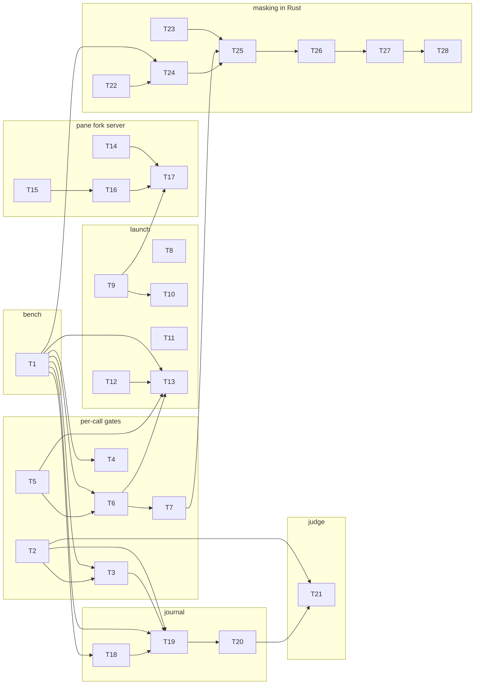

# Bottleneck fixes: per-call gates, launch, panes, journal, judge, masking

status: in-progress
base: a416bd2a787801cd0c4e9b06f8efd64406d4f16e
commit-mode: orchestrator-commits
language: ruby, rust
panel: Ruby (Linus Torvalds, Jeremy Evans, Sandi Metz, Richard Schneeman, Aaron Patterson), plus Andrew Gallant and Raph Levien for the Rust cards

## Intent

The profiling rounds of Nov 9 to 22 measured where lain spends time, and `planning/bottleneck-solutions-research-2026-11.md` ranked the fixes. This plan lands the ranked fixes except the watcher:
- per-call gates that take about 100 ms off a 140 ms bash call;
- launch fixes worth about 1 s of `lain up` and 600 ms of CPU a launch;
- cockpit panes forked from the warm spawner instead of booted;
- a journal that fsyncs per turn instead of per record (56 to 65 ms a turn) and a `.wal` that stops growing;
- concurrent judging of a turn's bash calls;
- masking decisions moved into Rust.

Sources:
- `planning/bottleneck-solutions-research-2026-11.md`, with its follow-up section and evidence directory.
- The profiling reports it cites: `app-profiling-2026-11.md`, `wire-ready-profiling-2026-11.md`, `masking-profiling-2026-11.md`, `boot-weakmap-profiling-2026-11.md`, `hot-path-profiling-2026-11.md`.
- User rulings of 2026-11-23 (memory `bottleneck-plan-rulings-2026-11-23`):
  - fsync once per model turn plus once before any tool with side effects runs;
  - 1 plan for all of it, Rust masking included;
  - the watcher stays out until the gates land and are measured again.

ROADMAP: the "Bottleneck fixes (2026-11-23)" line.

**Commit order.** T1 lands first, because every later card checks its gain against a bench row. The streams are otherwise independent, except where `Depends on` says so.

## Grounding

- Date: 2026-11-23. Base: `9a82c7363` on `main`.
- 4 read-only sweeps traced the production path for each stream: gates, launch, journal and judge, masking. I re-read these sites myself:
  - `agent/tool_runner.rb:480-492`, the innermost dispatch block, which runs after the Gate allows;
  - `tools/write_file.rb:94` and `tools/edit_file.rb:130`: `record_pre_image` runs before the write;
  - `cli/input_socket.rb:340-348`: `welcome` pushes no nudge;
  - `ext/lain/CLAUDE.md:119-145, 205-224`: the corpus is the only authority on agreement with Ruby;
  - `~/.local/bin/lain`: a bash shim that runs `ruby exe/lain`, so a shebang setting never reaches an installed launch.
- Probed, not read:
  - the shim's content (above);
  - the pane spike, which ran a forked child as a full tmux pane (research, "Spike findings");
  - the judge, history-scan and fsync counts in the research follow-up, measured over the 3 sessions of 11-20 and 11-21.
- Docs and code disagree in 4 places. The code won each time.
  - **The per-call plan object.** The research proposed 1 object per call carrying the secret set and the mask listing. The sweep found the approval and run paths build separate `Profiles` instances (`confine/sandbox.rb:343,348`), and the Announcer, Display and output scan each ask `Secrets::Source#for` (`agent/tool_runner/announcer.rb:92`, `sensitivity/display.rb:31`, `middleware/redact_secret_reads.rb:316`). One carrier through all of them is a large threading change. A cache that checks its own stamps gives the same sharing with no carrier, so T4 and T6 do that (see Rejected options).
  - **The secret set build count.** The research said 3 builds a call; the code does 3 or 4. The Announcer builds twice when a display is attached.
  - **The pane fork server.** The research assumed a pane could reach the spawner. The spawner's only socket is a private stdin pair held by the Rust daemon (`crates/lain-daemon/src/spawner.rs:68-96`). The daemon also starts the spawner only at its first run (`supervisor.rs:425-443`). T14 and T15 add the warm start and an addressable socket.
  - **The masking port.** The research said "the Ruby specs as the differential oracle". `ext/lain/CLAUDE.md` reversed that rule on 2026-10-20: Ruby's answers are frozen into a corpus first, and the Ruby is deleted once the Rust agrees with it. T22 freezes the corpus.
- mempalace: the MCP server failed to connect. Prior rulings come from the planning docs and memory.

## Compatibility

| Surface | Verdict | Evidence |
|---|---|---|
| Session file (`.ndjson`) record shapes | free to break, unchanged anyway | T18 to T20 change when bytes reach the disk, not what is written |
| `.wal` contents | free to break | its only reader is `cli/resume/salvager.rb:86`, which wants the last frame of an unlanded request; old sessions are disposable (memory `old-sessions-disposable`) |
| Snapshot log entries | free to break, additive | a round with no write now logs a write-set snapshot (`NoTrees`), the shape `SnapshotSlot#degrade` already produces (`agent/snapshot_slot.rb:184-193`) |
| Daemon build digest value | free to break | `daemon/launch.rb:122-126`; a changed value replaces a running daemon once, the case `daemon.rb:126` already handles |
| Spawner request protocol | free to break | internal between the Rust daemon and `daemon/spawner.rb`, shipped together; `spawner_spec.rb` pins it and moves with T15 |
| `PaneCommand` output string | free to break | internal; `spec/lain/cli/pane_command_spec.rb:25-31` pins it and moves with T9 and T17 |
| `bin/install-shim` output | free to break | writes `~/.local/bin/lain` on this box; the user re-runs it after T9 |
| History pointer file (new) | new, versioned | under `Paths#container("history", ...)`; keyed by a lain source stamp, so any older file is ignored and rewritten |
| Masking output (spans, reasons, over-mask records) | must keep | the secret boundary; T22 freezes today's answers, and every masking card must keep them byte for byte or list a reviewed divergence |
| `Telemetry::OverMasked` metric | must keep | ruling 2026-11-10 (memory `hot-path-followup-rulings-2026-11-10`) |
| Judge records | additive | T21 adds a `judge_prefetch` record; no existing record changes |
| Gem and crates | free to break | `publish = false` on every crate; no release tags |

No trade reports: no must-keep surface blocks a large simplification.

## Spike findings

| Question | Result | Evidence |
|---|---|---|
| Can a forked child run an interactive tmux pane? | Yes, on all 4 checks: controlling tty, Ctrl-C, resize, Reline, exit status. Prompt in 50 ms against 1,438 ms fresh, 7 runs per arm. The order of `TIOCNOTTY`, `setsid` and `TIOCSCTTY` is forced (see T15). The real `exe/lain` was not run. | `planning/bottleneck-solutions-research-2026-11/pane-zygote/` |
| Does git config shrink the shadow-git stage? | Barely: 25.1 to 22.4 ms at best. Skipping the stage is the fix. | `planning/bottleneck-solutions-research-2026-11/stage-timings.txt` |
| What does the history scan spend? | 898 to 929 ms cold; 460 ms of it finds 9 sensitive paths among 5,702; reading their 21 blobs takes 2 ms. | `planning/bottleneck-solutions-research-2026-11/history-split.txt` |
| What does an fsync cost here? | 5.23 ms per record, the same with `fdatasync`; 12 records a turn. | `planning/bottleneck-solutions-research-2026-11/fsync-cost.txt`, `fsync-per-turn.txt` |
| How much would concurrent judging save? | 5% to 49% of judge time, depending on the session. | `planning/bottleneck-solutions-research-2026-11/judge-turns.txt` |

No new spike. T17 is the first run of the real `exe/lain` under the fork server; it is a seam spec, and its stop condition halts the stream if a pane misbehaves.

## Shared files

Only the main session edits these. Cards hand back 1-line diffs.
- `bin/hot-path-bench` `CEILINGS`: T1 hands back the seeded ceilings; a later card hands back a lowered ceiling with its 3 logs. A raised ceiling goes in its own commit.
- `.rubocop.yml` (a raised limit goes in its own commit, with its reason)
- `spec/support/slow_files.rb`
- `Rakefile` (the `rust:mutants` file list)
- `ROADMAP.md`
- `planning/qa/scenarios/*.md`, updated at the end of each stream (memory `qa-scenarios-track-features`): `secret-boundary.md` (streams A and F), `cockpit-surfaces.md` and `session-and-window.md` (streams B and C), `daemon.md` (T14), `shell-term-approval.md` (T21).
- `docs/devs/architecture.md`: 1 paragraph per stream, handed back by the stream's last card.

## Rejected options

- **1 per-call plan object carried from approval to run.** Approval and run build separate `Profiles` instances, and the secret set has 4 askers in 3 layers. Threading 1 object through all of them touches the Gate, the Announcer, Display and every exec path. A cache that checks its own stamps on each ask (T4, T6) shares the result across all of them with no carrier.
- **Memoizing `Verdict#of` on `Parse::Result`.** Never timed, and `Parse::Result` is a frozen `Data` with nowhere to keep a memo. It can come back with a bench row.
- **Skipping the stage for rounds with only `write_file` or `edit_file` calls.** Their write set is known, but `SnapshotLog#keyed` discards pre-images once a pair is staged (`workspace/snapshot_log.rb:146`). A round that mixes them with bash would need both undo paths at once. T3 skips only rounds that cannot write, which is where the research's measured gain is.
- **A file watcher (research theme 2).** Out by ruling until the gates land and are measured again.
- **Tail-only walks for the egress guard (research theme 3).** 6 to 13 ms a 1 MB request against a round trip of seconds; not ranked.
- **`content-addressed request_sent` records.** Ranked after the prefilter and the `.wal` truncate, and it needs a rewrite command. A later plan.
- **The `lain up` process itself forking from the spawner.** The user types `lain up` in a shell, so it would need the shim to try the fork server first, for every command. That is a wider change than the panes; T17's gain is measured first.
- **A shebang `env -S` for the heap settings.** The installed shim runs `ruby exe/lain`, so a shebang never applies. T9 sets them where each process starts.
- **A `fork_panes` config switch.** The client falls back to exec on any failure it can detect. T17's seam spec and the manual pass gate the switch instead of a flag nobody turns off.
- **Hyperscan, SIMD, gitleaks rules, a disk cache of secret values, persisting the judge memo, remembering denials.** Each is discarded in the research, with its number.

## Panel changes

The panel (Ruby roster plus Andrew Gallant and Raph Levien, 2026-11-23) returned REQUEST-CHANGES with 4 blockers, 11 should-fixes and 5 nits. All were taken:
- **T3 stages once per round.** `ToolDelivery#perform` arms the round, and the first prime stages under a lock that `gather`'s sibling fibers wait on. A prime outside an armed round does nothing. The exec reaches the slot through `-> { board.snapshots }`, because `ToolsetBuild` builds the exec before the slot exists, and `Unbound#prime` raises. The reader skip checks the profile's write dirs against the root, not the profile's name, since a reader call writes `/tmp`.
- **T2 has its own predicate.** `rerunnable?` means "a budget may withhold this", so `Tool#side_effects?` (default true) replaces it, with an audit of every tool.
- **T4 stamps every directory under the root.** A probe showed an empty directory made by 1 call receiving a `.env` from the next with no stamp moving. The listing runs without `--exclude-standard`, so the ignore-file stamps and their scenario are gone.
- **T21 prefetches across the turn.** `contiguous_runs` puts each bash call in its own run, so the prefetch starts in `ToolRunner#run`, only under `auto`. It skips calls the memo already approved and repeats in the turn, and cancels what is still in flight at turn end.
- **T15's waiters leave the spawner's group.** The daemon `killpg`s that group on a restart. Pane requests are read without blocking under a deadline, `reap` reports only run pids, and the spawner closes its copies of the pane's fds.
- **A stale spawner hands over at once (T14, T15).** It unlinks the pane socket and writes an unsolicited stale line, and the daemon starts a fresh spawner without killing the old one.
- **T17 names Ruby and the client by absolute path**, with a shell fallback, and the e2e spec is tagged `:core` because it needs the built daemon.
- **T19 and T20 run from a `turn_landed:` hook** that `Wiring` attaches to the main agent only. It runs outside `defer_stop`. Children never truncate the shared WAL.
- **T6 caches in a new `Secrets::Remembered`**, because `Source` is a `Data`. The key includes the lent env. The rewrite scenario now starts from an existing `.env`.
- **T13 reads new commits' path and blob pairs with `git log --raw`**, since `rev-list ^old` drops a blob copied into a new path. The pointer file is written by temp file and rename.
- **T27 measures first and renames repeated groups.** It lands nothing if T26 left under 20% of the scan.
- **T22 also freezes `recurrences` and the entropy answers**, multibyte included. `entropy.rs` and `recurrences.rs` join the mutants list, and T28 gains a `proptest` law.
- **Ordering:** T20 before T21, T7 before T25, T6 before T13. The restart test uses paused time, and the T6 seam spec has a file.

## Open decisions

none. The fsync policy and the scope were decided on 2026-11-23.

## Dependency graph



## Tasks

Every card that changes a path a bench row covers runs `bin/hot-path-bench --check` before it hands back, and hands back a lowered ceiling with its 3 logs when its row moved.

### Stream Z: the bench

### T1: Add bench rows for the paths this plan changes          [risk: low]

**Depends on:** none
**Files:** `lib/lain/bench/hot_paths.rb`, `spec/lain/bench/hot_paths_spec.rb`
**Reuse:** `Bench::HotPaths::Corpus` builders (`hot_paths.rb`), `journal_pair` (`:126-141`), the `bash_true_workspace_masked` row's real `Sandbox` and `MaskList` setup (`bin/hot-path-bench:150-172`)
**Shared-file wiring:** `bin/hot-path-bench` `CEILINGS`: 1 line per new row, seeded from 3 logs at load under 2, after `rake compile`
**Reachable from:** `bin/hot-path-bench` -> `Bench::HotPaths.rows`

Rows to add. Each builds its fixture under a fresh tmpdir, never the real checkout (memory `bench-fixture-builders-mutate-root`):
- `snapshot_reader_round`: 1 `ToolDelivery#perform` of a bash `true` call over a `ShadowGit` slot, on a 2,000-file fixture tree.
- `secrets_for_warm`: `Secrets::Source#for` with a real `HistoryLiterals` over a fixture repo with 20 refs and 3 sensitive files, after 1 warm call.
- `history_scan_launch`: `HistoryLiterals.new(...).split` on a fixture repo of 2,000 history paths, 9 of them sensitive, each rep with a new instance.
- `journal_turn`: 12 records through a Chronicle journal (`CLI::Chronicle.for` settings) on a real file under `TMPDIR`, including its fsyncs.
- `journal_records_typed`: `Journal.records(lines, type: "turn")` over a 20 MB fixture session in which `request_sent` makes up 85% of the bytes.
- `mask_lockfile_100k`: `TextMask` over a 100 KB `Cargo.lock`-shaped fixture with 1 planted secret.

**Acceptance criteria**

```gherkin
Scenario: the new rows run and name themselves
  Given a built extension
  When the hot-path rows are listed
  Then the list holds snapshot_reader_round, secrets_for_warm, history_scan_launch, journal_turn, journal_records_typed and mask_lockfile_100k in the spec's order

Scenario: the masking row still masks
  Given the mask_lockfile_100k fixture
  When its row runs once
  Then the planted secret is absent from the output and its placeholder is present
```
Spec file: `spec/lain/bench/hot_paths_spec.rb`

**Stop and report if:**
- A row cannot be built without the real checkout as its root.
- `journal_turn` reads under 1 ms a record. That would mean `TMPDIR` is not on a disk that honours fsync, and the row measures nothing.

### Stream A: per-call gates

### T2: Call before-effect hooks after approval, before a tool with side effects runs          [risk: medium]

**Depends on:** none
**Files:** `lib/lain/tool.rb`, `lib/lain/tools/*.rb` (each tool's answer to the new predicate), `lib/lain/agent/tool_runner.rb`, `lib/lain/agent.rb`, `lib/lain/tools/subagent.rb`, `lib/lain/agent/before_effect.rb` (new), `spec/lain/agent/tool_runner_spec.rb`, `spec/lain/agent/before_effect_spec.rb` (new), `spec/lain/tools/side_effects_spec.rb` (new)
**Reuse:** the innermost dispatch block (`tool_runner.rb:489-491`)
**Shared-file wiring:** none
**Reachable from:** `Agent#seed_run_state` -> `ToolRunner.new` (`agent.rb:598`); child agents through `Tools::Subagent` (`subagent.rb:2231`)

`Tool#rerunnable?` means "a round budget may withhold this" (`tool.rb:121-128`), not "writes nothing", so it cannot be the guard. A new predicate is:
- `Tool#side_effects?`, defaulting to true, so a tool that says nothing is treated as one that changes something;
- false for each tool the card's audit shows changes nothing outside lain's own memory. Candidates: `read_file`, `grep`, `glob`, `list_files`, `memory_read`, `file_symbols`, `ast_search`, `ast_dump`, `test_pattern`, `session_usage`, `ask_human`.

The audit's table goes in the spec. The hooks run inside the block the Gate calls only on an allow, so a refused call runs none. They run for each call whose tool answers `side_effects?` true. The hook list is fixed at construction. T3 and T19 each add 1 hook.

**Acceptance criteria**

```gherkin
Scenario: an approved writing call runs the hooks first
  Given a runner with a recording hook
  When an approved write_file call is dispatched
  Then the hook saw the call before the tool's handler ran

Scenario: a refused call runs no hook
  Given a runner with a recording hook and a Gate that refuses bash
  When a bash call is dispatched
  Then the hook saw nothing

Scenario: a tool with no side effects runs no hook
  Given a runner with a recording hook
  When a read_file call and an ast_search call are dispatched
  Then the hook saw nothing

Scenario: a tool that makes no claim runs the hooks
  Given a tool class that does not define side_effects?
  Then side_effects? is true for it

Scenario: a child agent carries the parent's hooks
  Given a chat built by the production wiring with a recording hook
  When a subagent's bash call is approved
  Then the hook saw the child's call
```
Spec files: `spec/lain/agent/tool_runner_spec.rb`, `spec/lain/agent/before_effect_spec.rb`, `spec/lain/tools/side_effects_spec.rb` (1 example per tool in the production toolset, with the audit's reason)

**Interface**

```ruby
class Lain::Tool
  def side_effects? = true
end
module Lain
  class Agent
    # The hooks a ToolRunner calls after approval, before a call with side effects runs.
    class BeforeEffect
      NONE = new([])
      def initialize(hooks) = ...
      def call(tool:, context:) = ...   # each hook, in order; a raising hook fails the call
      def with(hook) = ...              # a new BeforeEffect with 1 more hook
    end
  end
end
# ToolRunner.new(..., before_effect: BeforeEffect::NONE)
```

**Stop and report if:**
- A Gate layer runs `downstream` before its own decision is final, so the block runs for a call that ends refused.
- Child agents are built somewhere other than `subagent.rb:2231`.
- A tool's audit is unclear (it writes a cache, a memory store, or another session's file). Mark it `side_effects?` true and list it.
### T3: Stage the snapshot baseline once, before the round's first call that can write          [risk: high]

**Depends on:** T1, T2
**Files:** `lib/lain/agent/snapshot_slot.rb`, `lib/lain/agent/tool_delivery.rb`, `lib/lain/exec/sandboxed.rb`, `lib/lain/exec/priming.rb` (new), `lib/lain/cli/wiring/toolset_build.rb`, `lib/lain/cli/wiring.rb`, `lib/lain/tool.rb`, `lib/lain/tools/bash.rb`, `spec/lain/agent/snapshot_slot_spec.rb`, `spec/lain/agent/tool_delivery_spec.rb`, `spec/lain/exec/sandboxed_spec.rb`, `spec/lain/exec/priming_spec.rb` (new), `spec/lain/seams/snapshot_gate_spec.rb` (new)
**Reuse:** `SnapshotSlot#prime` (`snapshot_slot.rb:88-94`), the write-set `fallback` snapshot (`:193`), `Profile#write_dirs` (`confine/profile.rb:52,346`), T2's `BeforeEffect`
**Shared-file wiring:** none
**Reachable from:** `Wiring#agent_over` -> `snapshot_slot` (`wiring.rb:585,613`); `ToolsetBuild#bash_exec` (`toolset_build.rb:434`)

Today `ToolDelivery#perform` primes before any tool runs (`tool_delivery.rb:72`), and `write` stages again after (`:98`).

**The round.** `ToolDelivery#perform` arms the slot for the round instead of priming it. The first `prime` in an armed round stages the baseline under a lock held through the stage. A `Mutex`, which yields to the fiber scheduler, so `gather`'s sibling fibers wait rather than run 2 `git add`s on 1 index. Every later `prime` in the round waits on that lock, then does nothing. A `prime` outside an armed round does nothing. That is an `:actor` child's bash between parent rounds (`subagent.rb:233,362`), whose writes land in no round, as today.

**Who primes.**
- **Non-bash tools.** A before-effect hook primes for a call whose tool answers `side_effects?` true and `writes_by_profile?` false. A subagent call primes here, so its children's writes fall inside the parent's round.
- **Sandboxed bash.** `Exec::Sandboxed#call` primes after `@profiles.for` returns and before spawning, so the `PhoneAnswered` and `Unsandboxed` refusals inside `profiles.for` prime nothing. It skips the prime only when no entry of the applied profile's write dirs is at, under or above the slot's root: a project under `/tmp` is writable by the reader profile.
- **Unwrapped bash.** `Exec::Priming` wraps whatever `Sandbox#wrap` and `ToolsetBuild#bash_exec` return when that is not an `Exec::Sandboxed`, and primes unconditionally. That covers `--confine off`, the docker backend, and a box where the sandbox degraded (`confine/sandbox.rb:246-249,353-358`).

**Binding.** `ToolsetBuild` builds the exec before `agent_over` creates the slot (`wiring.rb:579-616`), so the exec takes `-> { board.snapshots }`, not a slot. `SnapshotSlot::Unbound#prime` raises `NotBound` rather than doing nothing, since a silent no-op drops the undo.

`write` on a round that never primed lands the write-set snapshot, with no stage. The classification comes from the profile `Sandboxed` applied, never from the command text.

**Acceptance criteria**

```gherkin
Scenario: a reader round stages nothing
  Given a chat over a shadow-git slot
  When a round runs 1 bash call under the reader profile
  Then git add ran 0 times in that round and the round's snapshot holds no trees

Scenario: a workspace bash round can be undone
  Given a chat over a shadow-git slot
  When a round runs 1 bash call under the workspace profile that writes a.txt
  And the user runs /undo
  Then a.txt is back to its contents before the round

Scenario: a bash call with no sandbox can be undone
  Given a chat built with --confine off
  When a round runs 1 bash call that writes a.txt
  And the user runs /undo
  Then a.txt is back to its contents before the round

Scenario: a write_file after a reader bash call is staged before the write
  Given a chat over a shadow-git slot
  When a round runs a reader bash call, then write_file on b.txt
  And the user runs /undo
  Then b.txt is back to its contents before the round

Scenario: 2 parallel calls with side effects stage once
  Given a chat over a shadow-git slot
  When a round runs 2 subagent calls together
  Then git add ran once before them and the round can be undone

Scenario: a second write in the round does not restage
  Given a chat over a shadow-git slot
  When a round runs write_file on a.txt, then a workspace bash call that writes c.txt
  And the user runs /undo
  Then a.txt and c.txt are both back to their contents before the round

Scenario: a project under /tmp is primed for a reader call
  Given a chat over a shadow-git slot rooted under /tmp
  When a round runs 1 bash call under the reader profile that writes a.txt
  And the user runs /undo
  Then a.txt is back to its contents before the round

Scenario: a refused call stages nothing
  Given a chat over a shadow-git slot
  When a round's only bash call is refused
  Then git add ran 0 times in that round
```
Spec files: `spec/lain/seams/snapshot_gate_spec.rb` (`:seam`, the production `Wiring` with a real shadow-git repo), `spec/lain/agent/snapshot_slot_spec.rb`, `spec/lain/exec/sandboxed_spec.rb`, `spec/lain/exec/priming_spec.rb`

**Interface**

```ruby
class Lain::Tool
  # True when the tool's writes are decided by the sandbox profile its exec applies.
  def writes_by_profile? = false     # Tools::Bash: true
end
class Lain::Agent::SnapshotSlot
  def arm = ...      # ToolDelivery#perform, once per round
  def prime = ...    # stages once per armed round; a no-op otherwise
end
# Exec::Sandboxed.new(..., snapshots: -> { board.snapshots })
# Exec::Priming.new(inner, snapshots: -> { board.snapshots })
```

**Stop and report if:**
- A bash exec path reaches a spawn without passing through `Sandboxed#call` or `Exec::Priming`. Grep for every `Exec::` constructed in `toolset_build.rb`, `tool_guard.rb` and `backend*.rb`.
- `Sandboxed` can apply a profile other than the one it journals as `Telemetry::Sandbox`.
- The stage lock is held by a fiber that a `/stop` cancels mid-stage, and the next prime then waits forever.
- `spec/lain/agent/tool_delivery_spec.rb:109-114` ("write after commit") needs a change beyond the unprimed case.
- `snapshot_reader_round` does not fall by at least 40 ms on a tree where a stage costs 23 ms or more.
### T4: Re-list the mask list only when a directory or the index moved          [risk: high]

**Depends on:** T1
**Files:** `lib/lain/confine/mask_list.rb`, `spec/lain/confine/mask_list_spec.rb`
**Reuse:** `MaskList::Stamps` and its racy-stamp rule (`mask_list.rb:316-380`), `reusable?` (`:794`), the prunes in `EXCLUDES`
**Shared-file wiring:** none
**Reachable from:** `Profiles#mask_paths` (`confine/profiles.rb:361-365`), built by `Confine::Sandbox` (`confine/sandbox.rb:343,348`)

The listing is `git ls-files -z -co` without `--exclude-standard` (`mask_list.rb:108-112`). So ignore rules do not change it. Only a name added, removed or renamed anywhere under the root, or a change to the index, can.

The card stamps:
- every directory under the root outside the `EXCLUDES` prunes, not only the directories that hold a listed name, since an empty directory made by 1 call can receive a `.env` from the next;
- `.git/index`.

It runs `ls-files` only when 1 of them moved. The racy rule stays: a stamp younger than the filesystem's resolution vouches for nothing. Approval and run each ask the list, so the second ask costs stats only.

**Acceptance criteria**

```gherkin
Scenario: an unchanged tree does not re-list
  Given a mask list over a repo, asked once
  When it is asked again with nothing changed
  Then git ls-files ran once in total

Scenario: a new file is listed
  Given a mask list over a repo, asked once
  When a file .env is created and the list is asked again
  Then .env is masked

Scenario: a file in a directory made by an earlier call is listed
  Given a mask list over a repo, asked once
  When an empty directory newdir is created and the list is asked
  And newdir/.env is created and the list is asked again
  Then newdir/.env is masked

Scenario: a file deleted from disk but still in the index is seen
  Given a mask list over a repo with a tracked file f, asked once
  When f is removed from the index and the disk and the list is asked again
  Then the listing no longer holds f
```
Spec file: `spec/lain/confine/mask_list_spec.rb`. `:103` ("the listing runs before every call") is rewritten to these scenarios. The panel's probe is `t4_stamp_gap_probe.rb` in the plan session's scratchpad; its case becomes the third scenario.

**Stop and report if:**
- A listing change is found that no stamp above catches: a submodule, `.git/info/sparse-checkout`, or a worktree's `commondir`.
- Stamping every directory costs more than the listing on this repo (641 directories against 5,452 files). Then report both numbers.
- `mask_list_warm` does not fall.
### T5: Fingerprint the refs by stat stamps, not by hashing every ref file          [risk: medium]

**Depends on:** none
**Files:** `lib/lain/sensitivity/history_literals.rb`, `spec/lain/sensitivity/history_literals_spec.rb`
**Reuse:** `Repository#fingerprint` (`history_literals.rb:~290`), `Confine::MaskList::Stamps`
**Shared-file wiring:** none
**Reachable from:** `BoardBuild#secrets` (`cli/wiring/board_build.rb:307-317`), `Gateway#history` (`cli/gateway.rb:95`)

Today each `to_a` globs the refs directory and SHA-256s `HEAD`, `packed-refs`, `reftable/tables.list` and every ref file (`:302`). After this card the fingerprint is the stat stamps (mtime, ctime, inode, size) of those files and of every directory under `refs/`. A ref update by rename changes the inode; an added or removed ref changes its directory. The racy rule applies.

**Acceptance criteria**

```gherkin
Scenario: an unmoved ref set costs no git child and no read
  Given a primed HistoryLiterals
  When to_a is asked twice with no ref moved
  Then rev-list ran once and no ref file was read on the second ask

Scenario: a moved ref is seen
  Given a primed HistoryLiterals
  When a commit adding .env with a secret lands on a new branch
  Then to_a holds that secret

Scenario: a reflog-only change is seen
  Given a primed HistoryLiterals over a repo whose last commit holds a secret
  When that commit is amended away
  Then to_a still holds the secret
```
Spec file: `spec/lain/sensitivity/history_literals_spec.rb` (`:157` and `:565` keep passing)

**Stop and report if:**
- A reftable repository updates refs without changing any stamped file.
- The reflog can move without changing a stamped file. The reflog lives under `logs/`, which today's fingerprint does not read either.

### T6: Keep the secret set while its inputs are unmoved          [risk: high]

**Depends on:** T1, T5
**Files:** `lib/lain/sensitivity/secrets/remembered.rb` (new), `lib/lain/sensitivity/secrets/source.rb`, `lib/lain/cli/wiring/board_build.rb`, `spec/lain/sensitivity/secrets/remembered_spec.rb` (new), `spec/lain/sensitivity/secrets/source_spec.rb`, `spec/lain/seams/secret_set_cache_spec.rb` (new)
**Reuse:** T5's fingerprint, `Confine::MaskList::Stamps`, `HistoryLiterals#on_disk`
**Shared-file wiring:** none
**Reachable from:** `BoardBuild#secrets` builds `Secrets::Remembered.new(Secrets::Source.new(...))`, the board's 1 secret source, which every asker reaches

`Secrets::Source` is a `Data.define` (`secrets/source.rb:14`), so it keeps no memo. `Secrets::Remembered` wraps it, answers `for` and `for_reads`, and returns the last set it built for a key when every stamp in the key is unmoved. The key is:
- the child environment's digest;
- the lent environment's digest (`context.worker_env.env`, read by `Secrets.for`, `secrets.rb:16-18`), so 2 subagent contexts never share an entry;
- the refs fingerprint (T5);
- the stat stamps of every on-disk sensitive file `HistoryLiterals#on_disk` lists;
- the credentials' leaves.

Otherwise it rebuilds. Approval, the Announcer's start and end, the Display and the output scan then share 1 build while nothing moved. `on_disk` itself refreshes only when the refs move (`history_literals.rb:126-130`), so a sensitive file created after that refresh is not in the set today either. This card keeps that behaviour and does not widen it.

**Acceptance criteria**

```gherkin
Scenario: 4 asks in 1 call build once
  Given the board's secret source over a repo with a committed .env holding a secret
  When a bash call's approval, announcer start, output scan and announcer end each ask it
  Then the set was built once

Scenario: a secret rewritten by the call is masked in that call's output
  Given the board's secret source over a repo whose .env already holds OLDVALUE123456
  When a bash call rewrites .env to hold NEWVALUE654321 and then prints it
  Then the output shows a placeholder and not NEWVALUE654321

Scenario: an edit in place is seen
  Given the board's secret source, asked once
  When .env is rewritten in place with a new value of the same length
  Then the next ask holds the new value

Scenario: 2 subagents with different lent envs do not share a set
  Given 2 contexts whose lent envs differ in 1 secret
  When each asks the source
  Then each set holds its own lent secret
```
Spec files: `spec/lain/sensitivity/secrets/remembered_spec.rb`, `spec/lain/seams/secret_set_cache_spec.rb` (`:seam`, the production board)

**Interface**

```ruby
module Lain::Sensitivity::Secrets
  class Remembered
    def initialize(source) = ...
    def for(context) = ...        # the cached set while the key's stamps are unmoved
    def for_reads(context) = ...
  end
end
```

**Stop and report if:**
- A secret source exists whose change no stamp above catches: a decrypted credential, a keyring, or an env var read later than the child env is built.
- The racy rule cannot be applied to a file rewritten within 10 ms of an ask. The rewrite scenario must then fall back to rebuilding.
- `secrets_for_warm` does not fall.
### T7: Detect each output's secrets once          [risk: medium]

**Depends on:** T6
**Files:** `lib/lain/middleware/redact_secret_reads.rb`, `lib/lain/middleware/withhold_automatic_output.rb`, `lib/lain/sensitivity/scan_input.rb`, `spec/lain/middleware/redact_secret_reads_spec.rb`, `spec/lain/middleware/withhold_automatic_output_spec.rb`
**Reuse:** the per-call `env[:output_scan]` lambda (`redact_secret_reads.rb:311`)
**Shared-file wiring:** none
**Reachable from:** `ToolGuard` stack (`cli/tool_guard.rb:690-693`)

`WithholdAutomaticOutput#scanned` and `RedactSecretReads#printed` each run `Regions.detect` over the same text when nothing spilled. The per-call scan keeps the regions of the last text it scanned, compared by content, and answers again from them.

**Acceptance criteria**

```gherkin
Scenario: an automatically allowed output is scanned once
  Given the production ToolGuard stack
  When an automatically allowed bash call prints a line with an API key
  Then Regions.detect ran once for that output and the key is masked

Scenario: a spilled output is still scanned whole
  Given the production ToolGuard stack
  When a bash call's output spills past the head
  Then the withhold decision saw the whole file and the printed head is masked
```
Spec files: `spec/lain/middleware/withhold_automatic_output_spec.rb`, `spec/lain/middleware/redact_secret_reads_spec.rb`

**Stop and report if:**
- The 2 scans pass different `checksums:` or `hinted:` options, so their answers can differ.

### Stream B: launch

### T8: Send a newly attached pane its prompt at once          [risk: low]

**Depends on:** none
**Files:** `lib/lain/cli/input_socket.rb`, `spec/lain/cli/input_socket_spec.rb`
**Reuse:** the spike diff `planning/masking-profiling-2026-11/spike-welcome-nudge.diff`, without its env gate
**Shared-file wiring:** none
**Reachable from:** `lain up` -> chat pane `--input` -> `InputSocket` (`cli/up.rb:1339`)

`welcome` pushes a nudge onto the publisher's queue after spawning the receiver, so the prompt goes out on that nudge instead of on the next 250 ms tick.

**Acceptance criteria**

```gherkin
Scenario: a pane that attaches after the prompt is set gets it without waiting for a tick
  Given an InputSocket with a 10 s tick and a prompt already set
  When a client connects
  Then the client receives a prompt frame within 1 s
```
Spec file: `spec/lain/cli/input_socket_spec.rb`. The long tick makes the test independent of wall time (memory `no-wall-clock-thresholds-in-specs`).

**Stop and report if:**
- A full queue raises anything other than `ThreadError` when the nudge is pushed.

### T9: Start every lain process with the measured initial heaps          [risk: medium]

**Depends on:** none
**Files:** `lib/lain/heap_env.rb` (new), `lib/lain/cli/pane_command.rb`, `lib/lain/daemon/launch.rb`, `bin/install-shim`, `spec/lain/heap_env_spec.rb` (new), `spec/lain/cli/pane_command_spec.rb`, `spec/lain/daemon/launch_spec.rb`, `spec/lain/install_shim_spec.rb`
**Reuse:** `PaneCommand::RUNTIME_ENV` (`pane_command.rb:47-51`), `Launch::RUN_NAMES` (`daemon/launch.rb:40-42`)
**Shared-file wiring:** none
**Reachable from:** `PaneCommand.call` (every pane: `up.rb:1339,1357`, `fork.rb:124`, `btw.rb:54`, `fleet_windows.rb:453`); `Daemon.ensure` -> `Launch.current` (`daemon.rb:54-57`); `bin/install-shim` writes `~/.local/bin/lain`

The values are `RUBY_GC_HEAP_0_INIT_SLOTS=300000`, `RUBY_GC_HEAP_1_INIT_SLOTS=150000` and `RUBY_GC_HEAP_2_INIT_SLOTS=75000` (factor 0.75, `boot-weakmap-profiling-2026-11.md`). They have 1 home, `Lain::HeapEnv::VALUES`:
- `PaneCommand` exports them;
- the daemon's run environment carries them;
- `bin/install-shim` writes them as `export` lines. It reads them by running `ruby -e` against `lib/lain/heap_env.rb` alone, so the shim and the constant cannot drift.

A value the caller already set wins over the default.

**Acceptance criteria**

```gherkin
Scenario: a pane starts with the heap settings
  Given no RUBY_GC_ variables in the environment
  When PaneCommand builds a chat pane command
  Then the command exports the 3 values

Scenario: a caller's own setting wins
  Given RUBY_GC_HEAP_0_INIT_SLOTS=500000 in the environment
  When PaneCommand builds a chat pane command
  Then the command exports 500000 for it

Scenario: a daemon run carries them
  When Launch.current builds the run environment
  Then it holds the 3 values

Scenario: the shim exports them
  When bin/install-shim writes a shim into a tmpdir
  Then the shim holds an export line for each of the 3 values before its exec line
```
Spec files: `spec/lain/heap_env_spec.rb`, `spec/lain/cli/pane_command_spec.rb`, `spec/lain/daemon/launch_spec.rb`, `spec/lain/install_shim_spec.rb`

**Interface**

```ruby
module Lain
  module HeapEnv
    VALUES = { "RUBY_GC_HEAP_0_INIT_SLOTS" => "300000", ... }.freeze
    def self.over(env) = ...   # VALUES merged under env: a set value wins
  end
end
```

**Stop and report if:**
- `lib/lain/heap_env.rb` cannot be loaded without Zeitwerk for the shim's `ruby -e`. A data file may then replace the constant, but it keeps 1 home.

### T10: Hash the daemon binary with blake3          [risk: low]

**Depends on:** T9
**Files:** `lib/lain/daemon/launch.rb`, `spec/lain/daemon/launch_spec.rb`
**Reuse:** `Lain::Ext.blake3_hex` (`ext/lain/src/lib.rs:501-502`, used by `canonical.rb:71`)
**Shared-file wiring:** none
**Reachable from:** `Daemon.ensure` -> `Launch.current` -> `build_digest_of` (`launch.rb:122-126`)

`build_digest_of` hashes the binary as `Lain::Ext.blake3_hex(File.binread(binary))` in place of `Digest::SHA256.file`. The outer digest over the parts may stay SHA-256, because it hashes a few hundred bytes. The extension takes no file path: in-process native code stays pure (`CLAUDE.md`, "Rust").

**Acceptance criteria**

```gherkin
Scenario: the same binary gives the same digest
  Given a binary file
  When 2 Launches are built over it
  Then their build digests are equal

Scenario: a changed binary gives a different digest
  Given a binary file and a Launch over it
  When 1 byte of the binary changes and a second Launch is built
  Then the build digests differ
```
Spec file: `spec/lain/daemon/launch_spec.rb` (`:98-121` keeps passing)

**Stop and report if:**
- The read plus blake3 takes more than 10 ms on the 7.4 MB binary. Measure with the box at load under 2.

### T11: Run the 3 confinement probes at once          [risk: medium]

**Depends on:** none
**Files:** `lib/lain/confine/probe.rb`, `spec/lain/confine/probe_spec.rb`
**Reuse:** `planning/wire-ready-profiling-2026-11/spike-par-probe-n6.diff`
**Shared-file wiring:** `bin/hot-path-bench` `CEILINGS`: the `wire_ready` row, which reads 21.07 to 21.30 against a ceiling of 17.1 at the base
**Reachable from:** `ToolsetBuild` -> `Confine::Probe.new` (`cli/wiring/toolset_build.rb:262`)

`Probe#verdicts` starts `bwrap_gap`, `fence_gap` and `trace_gap` on 3 threads and takes each value. `layers` still journals from the calling thread, in key order, after the joins. `fence_report` is memoized under a lock so the 2 threads that read it build it once.

**Acceptance criteria**

```gherkin
Scenario: the verdicts are the same as a serial probe's
  Given a box with bwrap and no landlock
  When the probe runs
  Then it journals 1 degrade record, for landlock

Scenario: the journal order is fixed
  Given a box missing all 3 layers
  When the probe runs 20 times
  Then every run journals the 3 records in bwrap, landlock, trace order

Scenario: the fence report is built once
  When the probe runs
  Then the fence binary was asked for its report once
```
Spec file: `spec/lain/confine/probe_spec.rb`

**Stop and report if:**
- A check writes shared state other than `fence_report` or `@private_net`.
- `wire_ready` does not fall under its ceiling.

### T12: Give the sensitivity policy a digest of what it classifies by          [risk: medium]

**Depends on:** none
**Files:** `lib/lain/sensitivity/policy.rb`, `lib/lain/sensitivity.rb`, `spec/lain/sensitivity/policy_spec.rb`
**Reuse:** `Sensitivity::Rules.from` (the compiled `.lain/config.rb` `sensitivity` verb, `sensitivity.rb:~588-603`), `Canonical`
**Shared-file wiring:** none
**Reachable from:** `BoardBuild#secrets` and `Gateway#policy` (`cli/gateway.rb:97-100`) build the Policy that T13 reads it from

`Policy#digest` is a blake3 over the canonical form of everything `classify` reads:
- the compiled project rules;
- the home and root anchors;
- the read roots and epic home;
- the taint state.

The built-in tables live in lain's source, so T13's key adds a source stamp for them.

**Acceptance criteria**

```gherkin
Scenario: equal policies share a digest
  Given 2 Policies built from the same config, home and root
  Then their digests are equal

Scenario: a project rule changes the digest
  Given a Policy, and a second built after adding 1 sensitivity rule to .lain/config.rb
  Then their digests differ

Scenario: a different root changes the digest
  Given 2 Policies over different roots
  Then their digests differ
```
Spec file: `spec/lain/sensitivity/policy_spec.rb`

**Interface**

```ruby
class Lain::Sensitivity::Policy
  # @return [String] blake3 hex of the rules, anchors and state classify reads
  def digest = ...
end
```

**Stop and report if:**
- `classify` reads the live filesystem for a path (a realpath, a stat, file facts). A history path need not exist on disk, so a digest cannot cover that read. Report which read, and T13 waits.

### T13: Remember which history blobs are sensitive, never their values          [risk: high]

**Depends on:** T1, T5, T6, T12
**Files:** `lib/lain/sensitivity/history_literals.rb`, `lib/lain/sensitivity/history_literals/pointers.rb` (new), `lib/lain/cli/wiring/board_build.rb`, `lib/lain/cli/gateway.rb`, `spec/lain/sensitivity/history_literals_spec.rb`, `spec/lain/sensitivity/history_literals/pointers_spec.rb` (new), `spec/lain/cli/wiring/board_build_spec.rb`
**Reuse:** `Paths#container` and `Paths#project_hash` (`paths.rb:~250,~293`), T12's `Policy#digest`, `values_of` and `read` (`history_literals.rb:~196`)
**Shared-file wiring:** none
**Reachable from:** `BoardBuild#secrets` and `Gateway#history`, each passing `paths:` to `HistoryLiterals.new`

The pointer file lives at `paths.container("history", key: paths.project_hash(root))/pointers.json`, mode 0600. It is written to a temp file in the same directory and renamed, since 2 launches can race. It holds:
- a lain source stamp;
- the policy digest;
- the commit tips scanned;
- each sensitive history path with its blob ids.

It holds no value: blob ids name content the repository's own `.git` already stores. This keeps the rule in the class comment (`history_literals.rb:9-20`).

On a scan:
- **Same stamp, digest and tips:** read the listed blobs by id with `cat-file --batch`.
- **Moved tips:** read the new commits' path and blob pairs with `git log --raw --no-abbrev -m --format= --all --reflog ^<old tips>`, classify those paths, and add the sensitive ones. `rev-list --objects ^<old tips>` is not enough: it leaves out a blob already reachable from an old tip, so a secret copied or renamed into `.env` would keep its old blob id and never be classified.
- **A tip that no longer exists, or any git error:** do the full scan and rewrite the file.

A blob the reflog has since dropped stays listed until the next full scan. That over-masks, which is the safe direction.

**Acceptance criteria**

```gherkin
Scenario: a second launch classifies no path
  Given a repo with a secret in history and a pointer file from a first scan
  When a new HistoryLiterals splits
  Then Policy#classify ran 0 times and the secret is known

Scenario: a new commit is classified alone
  Given a pointer file from a first scan
  When a commit adds a new .env with a secret and a new HistoryLiterals splits
  Then only the new commit's paths were classified and both secrets are known

Scenario: an old blob copied into a sensitive path is found
  Given a pointer file from a first scan of a repo whose notes.txt holds TOKENVALUE987654
  When a commit copies notes.txt to .env and a new HistoryLiterals splits
  Then TOKENVALUE987654 is known

Scenario: a changed policy rescans
  Given a pointer file from a first scan
  When a sensitivity rule is added and a new HistoryLiterals splits
  Then the full scan ran

Scenario: the file holds no secret value
  Given a repo whose history holds the secret SECRETVALUE123
  When a scan writes the pointer file
  Then the file's bytes do not contain SECRETVALUE123 and its mode is 0600

Scenario: a force-push that drops a tip rescans
  Given a pointer file whose tip commit no longer exists
  When a new HistoryLiterals splits
  Then the full scan ran and the file was rewritten
```
Spec files: `spec/lain/sensitivity/history_literals/pointers_spec.rb`, `spec/lain/sensitivity/history_literals_spec.rb`, `spec/lain/cli/wiring/board_build_spec.rb` (the production construction passes `paths:`)

**Stop and report if:**
- T12 reported a filesystem read inside `classify`.
- `history_scan_launch` falls by less than half on its second launch.
- `spec/support/quiet_priming.rb` stubs the scan in a way that hides the pointer file from the specs.
### Stream C: cockpit panes from the fork server

### T14: Keep a warm spawner running, and replace a stale one at once          [risk: medium]

**Depends on:** none
**Files:** `crates/lain-daemon/src/supervisor.rs`, `crates/lain-daemon/src/spawner.rs`
**Reuse:** `Supervisor::spawner` and `restart_spawner` (`supervisor.rs:425-465`), `Spawner::start` (`spawner.rs:68-96`)
**Shared-file wiring:** none
**Reachable from:** the daemon's start-up in `crates/lain-daemon/src/main.rs`, where the `Supervisor` is constructed

The daemon starts the spawner when it starts, not at the first run. It starts a fresh spawner when either of these happens:
- the current spawner exits;
- the current spawner writes an unsolicited `{"stale": true}` line on its stdin.

T15 makes a stale spawner send that line once. The stale spawner keeps reaping its own runs until they finish, and the daemon must not kill it while it does. Restarts are rate-limited, so a spawner that dies at boot does not loop. Runs keep the exec fallback.

**Acceptance criteria**

```gherkin
Scenario: a spawner is up before any run
  Given a daemon just started
  Then a spawner process is running and has answered no request

Scenario: an exited spawner comes back
  Given a running daemon and spawner
  When the spawner process exits
  Then a new spawner is started

Scenario: a stale spawner is replaced while it drains
  Given a running spawner with 1 live run
  When the spawner writes an unsolicited stale line
  Then a new spawner is started and the old one is not killed

Scenario: a spawner that dies at boot is not restarted in a tight loop
  Given a spawner command that exits at once
  Then the daemon starts it at most 3 times within the restart window
```
Spec file: Rust tests in `crates/lain-daemon/src/supervisor.rs`, using tokio's paused time for the restart window rather than wall time (memory `no-wall-clock-thresholds-in-specs`); run with `cargo test -p lain-daemon`

**Stop and report if:**
- The spawner's environment at daemon start differs from the one a first run would have given it. `settings.env` must already be final when the daemon starts.
- Dropping the old `Spawner` handle `killpg`s its group (`spawner.rs:185,277`). The handle must then be kept until the old process exits on its own.
### T15: Fork a pane program onto a passed terminal          [risk: high]

**Depends on:** none
**Files:** `lib/lain/daemon/spawner.rb`, `lib/lain/daemon/spawner/pane.rb` (new), `lib/lain/paths.rb` (a `spawner_socket` beside `daemon_dir`, `paths.rb:247`), `spec/lain/daemon/spawner_spec.rb`, `spec/lain/daemon/spawner/pane_spec.rb` (new), `spec/lain/paths_spec.rb`
**Reuse:** `planning/bottleneck-solutions-research-2026-11/pane-zygote/server.rb`, `Spawner#detach` (`spawner.rb:~143-153`), `ForkedExit`
**Shared-file wiring:** none
**Reachable from:** `lain daemon spawner` (`cli/daemon_command.rb:121-124`) -> `Spawner.on_stdin(...).call`, which now also listens on the pane socket

The spawner listens on a second socket: a `UNIXServer` at `Paths#spawner_socket`, a fixed path under `Paths#runtime_dir` (`paths.rb:240`), mode 0600, at most 108 bytes. At start it unlinks a path nothing answers on, then binds. It is served from the same single-threaded `IO.select` loop. A pane request is 1 JSON line `{argv, env, cwd}` plus the pane's terminal, passed with `send_io`. Pane requests are read without blocking, under a 1 s deadline per connection, so a stalled client never holds the loop that serves the daemon's runs.

For each request the spawner forks a waiter, which:
1. calls `setsid`, so it leaves the spawner's process group, which the daemon `killpg`s on a restart (`crates/lain-daemon/src/spawner.rs:185,277`);
2. forks the program;
3. relays the program's exit status to the client's socket;
4. sends `SIGHUP` to the program when the client's socket closes.

The program then:
1. calls `setsid`;
2. takes the terminal with `TIOCSCTTY`;
3. moves fds 0 to 2 onto it;
4. takes `env` and `cwd` from the request;
5. runs `LainCLI.start(argv)`.

After forking the waiter, the spawner closes its own copies of the received terminal and the connection. `reap` reports to the daemon only the pids of runs the daemon asked for, never a waiter's.

When the spawner finds itself stale, it does 3 things once: it closes and unlinks the pane socket, it writes `{"stale": true}` on stdin so the daemon starts a fresh spawner (T14), and it goes on reaping its runs. A pane client that connects in between finds no socket and falls back to exec. The server never opens `IO.console` or Reline. The `Thread.list == [Thread.main]` check holds before every fork.

**Acceptance criteria**

```gherkin
Scenario: a pane program owns the passed terminal
  Given a running spawner and a pty pair
  When a client sends a request with the pty's follower, after giving up its own controlling terminal
  Then the program is a session leader whose controlling terminal is the pty

Scenario: the waiter survives a kill of the spawner's group
  Given a running pane program
  When the spawner's process group is sent SIGKILL
  Then the waiter and the program are still running and the client later reads the program's status

Scenario: the program's exit status reaches the client
  Given a pane program that exits 3
  Then the client reads status 3

Scenario: the client going away ends the program
  Given a running pane program
  When the client's socket closes
  Then the program receives SIGHUP

Scenario: a stalled client does not hold the loop
  Given a client that connects and sends nothing
  When a run request arrives on stdin
  Then the run is forked within the deadline

Scenario: a stale spawner hands over
  Given a spawner whose lib changed after boot
  When the next request arrives
  Then the pane socket is gone, a stale line was written on stdin, and nothing was forked

Scenario: the spawner keeps no pane fds
  Given a running pane program
  Then the spawner holds no descriptor for the pane's terminal or its connection

Scenario: the headless run path is unchanged
  When a run request arrives on stdin
  Then the existing spawner_spec examples pass unchanged
```
Spec files: `spec/lain/daemon/spawner/pane_spec.rb` (`:seam`, a real pty), `spec/lain/daemon/spawner_spec.rb`, `spec/lain/paths_spec.rb`

**Interface**

```ruby
# request line on the pane socket, then 1 fd by send_io:
{ "argv" => ["chat", ...], "env" => { ... }, "cwd" => "/abs/dir" }
# answers: {"pid": n} at the fork, {"pid": n, "status": s} at exit, {"stale": true}, {"error": "..."}
class Lain::Paths
  def spawner_socket = ...   # File.join(runtime_dir, "spawner.sock")
end
```

**Stop and report if:**
- `TIOCSCTTY` fails with `EPERM` even after the client gave the terminal up as the spike did (`pane-zygote/client.rb`).
- The select loop needs a second thread to accept while it waits on a run.
- The spawner's stdin protocol has no room for an unsolicited line without confusing the daemon's request and answer pairing.
### T16: Write the pane client that asks the spawner and falls back to exec          [risk: medium]

**Depends on:** T15
**Files:** `exe/lain-pane` (new), `spec/lain/lain_pane_spec.rb` (new)
**Reuse:** `planning/bottleneck-solutions-research-2026-11/pane-zygote/client.rb`
**Shared-file wiring:** `spec/support/slow_files.rb` if the spec crosses the slow threshold
**Reachable from:** T17's `PaneCommand`, which runs it as the pane's command

A Ruby script that loads only `socket`, `json` and `io/console`, never `lain`. It runs as the pane's session leader and:
1. ignores `SIGHUP` and gives up the terminal with `TIOCNOTTY`;
2. connects to the socket path it is given and sends the request and its terminal;
3. waits for the exit status, restores signals and exits with that status.

On any failure before the program starts, it `exec`s the fallback command it was given, unchanged:
- no socket, or a connect error;
- a `stale` answer, or an error answer;
- no `pid` within 2 s.

**Acceptance criteria**

```gherkin
Scenario: no spawner means the fallback runs
  Given no socket at the given path
  When lain-pane runs with a fallback of `echo fallback`
  Then the pane prints fallback and exits 0

Scenario: a stale answer means the fallback runs
  Given a socket that answers stale
  When lain-pane runs with a fallback
  Then the fallback ran

Scenario: the program's status is the pane's status
  Given a running spawner whose program exits 3
  When lain-pane runs under a pty
  Then lain-pane exits 3

Scenario: it does not load lain
  When lain-pane runs with a fallback
  Then no file under lib/lain was loaded
```
Spec file: `spec/lain/lain_pane_spec.rb`

**Stop and report if:**
- The client's own start takes more than 100 ms at load under 2. The gain then shrinks below what the research estimated.
### T17: Launch cockpit panes through the pane client          [risk: high]

**Depends on:** T9, T14, T16
**Files:** `lib/lain/cli/pane_command.rb`, `spec/lain/cli/pane_command_spec.rb`, `spec/e2e/forked_panes_spec.rb` (new)
**Reuse:** `PaneCommand.call` (`pane_command.rb:75-79`), the env lists it exports today, T15's `Paths#spawner_socket`
**Shared-file wiring:** `spec/support/slow_files.rb`: add `spec/e2e/forked_panes_spec.rb`
**Reachable from:** every pane built through `PaneCommand.call`: `Up` (`up.rb:1339,1357`), `Up.respawn_chat` (`up.rb:1199`), `Command::Fork`, `Command::Btw`, `FleetWindows`

The pane command keeps its env exports. Its last step becomes `exec <RbConfig.ruby> <absolute exe/lain-pane> <socket> -- <the command it builds today>`. The Ruby and the client are named by absolute path, so the pane does not depend on the PATH tmux hands it (the tmux PATH trap in `CLAUDE.md`). If that `exec` itself fails, the shell runs today's command. The env the program needs travels in the request, built from the same lists. The fallback is exactly today's command, so a missing or stale spawner gives today's behaviour.

**Acceptance criteria**

```gherkin
Scenario: lain up's panes are forked when the spawner is warm
  Given a running daemon with a warm spawner
  When lain up starts against the e2e stand-in model
  Then the chat and input panes' processes are descendants of the spawner's waiters
  And a line typed in the input pane gets a reply in the chat pane

Scenario: Ctrl-C and resize reach a forked chat pane
  Given a forked chat pane mid-reply
  When the pane is resized and Ctrl-C is sent
  Then the chat redraws at the new width and the reply stops

Scenario: no spawner gives today's panes
  Given no daemon
  When lain up starts
  Then the panes run exe/lain by exec and the session works

Scenario: a forked pane exits like an exec'd one
  Given a forked chat pane
  When the user quits the chat
  Then the pane closes with status 0
```
Spec files: `spec/e2e/forked_panes_spec.rb` (`:e2e`, tagged `:core` as well since it needs the built `lain-daemon`; the `lain up` journey), `spec/lain/cli/pane_command_spec.rb`

**Stop and report if:**
- Any scenario fails only in the forked arm. Report the failing check and land nothing from T17; T14 to T16 stay harmless without it.
- The forked chat pane inherits a spawner fd. `spawner_spec.rb:253` ("holds only its own fds") applies to a pane program too.
- Measured `lain up` to first prompt does not fall by at least 500 ms (5 interleaved runs per arm, load under 2).
### Stream D: the journal

### T18: Skip journal lines of another type before parsing them          [risk: low]

**Depends on:** T1
**Files:** `lib/lain/journal.rb`, `lib/lain/cli/resume.rb`, `spec/lain/journal_spec.rb`, `spec/lain/cli/resume_spec.rb`
**Reuse:** `Journal.records` (`journal.rb:205-209`)
**Shared-file wiring:** none
**Reachable from:** every `Journal.records(..., type:)` caller; `CLI::Resume` (`resume.rb:254` moves to `type:`)

For a String entry, `records(type: t)` skips the line unless it contains `"type":"<t>"` exactly. The parse still checks the top-level type, so a nested match is harmless. Hash entries are not filtered.

**Acceptance criteria**

```gherkin
Scenario: a typed read returns the same records
  Given a session mixing turn, child_turn, request_sent and junk lines
  When records are read with type turn
  Then the result equals today's result: every turn and no child_turn

Scenario: lines of another type are not parsed
  Given a session of 100 request_sent lines and 1 turn line
  When records are read with type turn
  Then JSON.parse ran once

Scenario: Hash entries still filter by type
  Given Hash entries with Symbol keys
  When records are read with type turn
  Then the turn Hashes are returned
```
Spec file: `spec/lain/journal_spec.rb` (`:760-787` keeps passing)

**Stop and report if:**
- A writer emits a type with escaped characters or spaced JSON. Grep `spec/fixtures/` and `lib/` for `"type": "`.

### T19: Fsync the chronicle once per turn and before a tool with side effects          [risk: high]

**Depends on:** T1, T2, T3, T18
**Files:** `lib/lain/journal.rb`, `lib/lain/cli/chronicle.rb`, `lib/lain/agent.rb`, `lib/lain/middleware/journal_turns.rb`, `lib/lain/cli/wiring.rb`, `spec/lain/journal_spec.rb`, `spec/lain/cli/chronicle_spec.rb`, `spec/lain/agent_spec.rb`, `spec/lain/session_record_spec.rb`, `spec/lain/seams/journal_durability_spec.rb` (new)
**Reuse:** `write_whole` (`journal.rb:330-341`), T2's `BeforeEffect`
**Shared-file wiring:** none
**Reachable from:** `CLI::Chronicle.for` (`chronicle.rb:~214-222`), the only production `fsync: true` journal. `Wiring` builds the hooks that call `sync` from the chronicle it holds, since the Agent holds no Journal (its `record_journal` is a `JournalTee`, `cli/journal_tee.rb:66`).

`Journal#sync` fsyncs when a record was written since the last fsync, and does nothing otherwise. It runs under the monitor. The chronicle journal no longer fsyncs per record. It syncs at these points:
1. **A turn landed.** A new Agent collaborator, `turn_landed:` (default a no-op), runs once `commit_and_account` returns, outside its `defer_stop` region, so a `/stop` never waits on an fsync. `Wiring` passes a hook that syncs the chronicle, on the main agent only. Children get the default, because their turns reach the shared journal through `Scribe#call` at commit and are covered by point 3.
2. **The iteration ended.** At the end of `JournalTurns#call`, after `catch_up`, so the iteration's last record is durable.
3. **Before a call with side effects.** A before-effect hook syncs before any call whose tool answers `side_effects?` true. Children carry this hook (T2).
4. **Close.** `close` syncs.

`fsync: true` keeps its meaning for the salvager's journal.

**Acceptance criteria**

```gherkin
Scenario: a turn fsyncs a bounded number of times
  Given a chat over a recording IO
  When 1 model turn writes 12 records and runs 1 read_file call
  Then fsync ran at most 2 times in that turn

Scenario: a side-effecting call is durable before it runs
  Given a chat over a recording IO
  When a bash call is approved
  Then an fsync ran after the call's last journal record and before the call's handler

Scenario: a child's bash call is durable before it runs
  Given a chat over a recording IO
  When a subagent's bash call is approved
  Then an fsync ran after the child's last journal record and before the call's handler

Scenario: sync with nothing new does nothing
  Given a journal just synced
  When sync is called again
  Then fsync did not run

Scenario: close leaves nothing unsynced
  Given a journal with 1 record written since its last sync
  When it closes
  Then fsync ran
```
Spec files: `spec/lain/journal_spec.rb` (`:698-725` updated), `spec/lain/seams/journal_durability_spec.rb` (the production `Wiring` over a recording IO), `spec/lain/agent_spec.rb`, `spec/lain/cli/chronicle_spec.rb` (`:32` updated), `spec/lain/session_record_spec.rb` (`:266` keeps its readability check)

**Interface**

```ruby
class Lain::Journal
  def sync = ...   # fsync once if a record was written since the last one; no-op otherwise
end
# Agent.new(..., turn_landed: ->(response) {})   # called after commit_and_account, outside defer_stop
```

**Stop and report if:**
- `spec/lain/seams/crash_mid_tool_spec.rb` fails. It pins that the assistant turn reaches the file before a tool outlives the process.
- A record is written after the last sync point of a turn and before the next turn's first sync, with no tool between, in a way that makes it the record salvage needs.
- `journal_turn` does not fall by at least 40 ms.
### T20: Truncate the response WAL once a turn is durable          [risk: high]

**Depends on:** T19
**Files:** `lib/lain/provider/response_wal.rb`, `lib/lain/cli/chronicle.rb`, `lib/lain/provider/spool/null.rb`, `lib/lain/cli/wiring.rb`, `spec/lain/provider/response_wal_spec.rb`, `spec/lain/cli/chronicle_spec.rb`, `spec/lain/cli/resume/salvager_spec.rb`, `spec/lain/seams/journal_durability_spec.rb`
**Reuse:** `RelocatableSpool` (`chronicle.rb:132-144`), `ResponseWal#close` (`response_wal.rb:202-212`), T19's `turn_landed:` hook
**Shared-file wiring:** none
**Reachable from:** `Wiring` extends the main agent's `turn_landed:` hook: sync the chronicle (T19), then `chronicle.spool.landed`

`landed` truncates the WAL to 0 bytes when no frame is streaming and none is pending. Otherwise it does nothing, and the next turn's `landed` tries again. The check and the truncate sit under the WAL's own lock. Only the main agent's hook calls it, and only after the sync that made its turn durable. Every child shares the spooled provider (`cli/wiring.rb:729`), so a child must never call it: an actor's turn could otherwise truncate the main frame before the main turn is durable. The append-mode descriptor keeps writing at the new end. `Spool::Null` answers `landed` with nothing.

**Acceptance criteria**

```gherkin
Scenario: a landed turn empties the WAL
  Given a WAL holding 1 closed frame
  When the main turn lands
  Then the WAL file is 0 bytes and the next frame is written from offset 0

Scenario: a sibling's frame in flight keeps the WAL
  Given a WAL with a subagent's frame still streaming
  When the main turn lands
  Then the WAL is not truncated

Scenario: a child's turn never truncates
  Given a chat built by the production Wiring with 1 actor child
  When the child's turn lands
  Then the WAL is not truncated

Scenario: resume still salvages an unlanded response
  Given a session killed after a response streamed and before its turn record
  When the session resumes
  Then the response is salvaged as today
```
Spec files: `spec/lain/provider/response_wal_spec.rb`, `spec/lain/cli/resume/salvager_spec.rb`, `spec/lain/cli/chronicle_spec.rb`, `spec/lain/seams/journal_durability_spec.rb`

**Stop and report if:**
- `landed` can run before T19's sync in any path.
- A frame can be opened between the check and the truncate by a thread that does not take the WAL's lock.
### Stream E: the judge

### T21: Judge a turn's bash calls at once, run them in order          [risk: high]

**Depends on:** T2, T20
**Files:** `lib/lain/agent/tool_runner.rb`, `lib/lain/agent.rb`, `lib/lain/cli/wiring.rb`, `lib/lain/approval/judged.rb`, `lib/lain/approval/judge_prefetch.rb` (new), `lib/lain/telemetry/judge_prefetch.rb` (new), `lib/lain/cli/switchboard.rb`, `spec/lain/agent/tool_runner_spec.rb`, `spec/lain/approval/judged_spec.rb`, `spec/lain/approval/judge_prefetch_spec.rb` (new), `spec/lain/seams/judge_prefetch_spec.rb` (new)
**Reuse:** `Judgement.of` and `Judged#asked` (`judged.rb:~226-240`), `JudgeMemo.key`, the `Sync` and `task.async` pattern of `ToolRunner#gather` (`tool_runner.rb:435`)
**Shared-file wiring:** none
**Reachable from:** `Switchboard` builds `Approval::Judged` (`switchboard.rb:617`); the same `JudgePrefetch` reaches `ToolRunner` through `Wiring` and `Agent#seed_run_state`

`contiguous_runs` puts every bash call in a run of its own (`tool_runner.rb:415`), so the prefetch starts in `ToolRunner#run`, over all of the turn's uses, before the first run. It starts only when all of these hold:
- the live approval level is `auto`;
- the turn holds 2 or more calls whose tool `requires_approval?`.

For each such call it:
1. computes the judge's request from the facts as they stand;
2. skips the call if its `JudgeMemo` key is already approved, or repeats another call's key in the turn;
3. starts the request on the reactor, keyed by the digest of its request.

The ladder then runs each call in order, exactly as today. When the `auto` rung reaches the judge, it recomputes its request:
- **Same digest:** it awaits the prefetched verdict.
- **Different digest** (facts moved, because an earlier call changed the tree or the cwd): it asks fresh.

All of today's bookkeeping happens when a verdict is used, never when it is fetched:
- the memo is checked first;
- the denial breaker counts;
- a breaker that tripped before a call's turn discards that call's verdict and hands the call down as today.

Requests still in flight when the turn ends, or on `Async::Stop`, are cancelled, so nothing spends or journals after the turn. Each prefetch is journaled as `judge_prefetch` with `used: true` or `false`, so wasted judge spend is counted.

**Acceptance criteria**

```gherkin
Scenario: 2 bash calls wait about 1 judge latency
  Given a judge stand-in that answers after 1 s
  When a turn asks for 2 bash calls with unchanged facts
  Then both calls ran, in order, and the turn's judge wait was under 1.5 s

Scenario: a call whose facts moved is judged again
  Given a turn whose first bash call creates dir d and whose second lists d
  When the turn runs
  Then the second call's prefetched verdict is journaled unused and the judge was asked again

Scenario: the breaker still stops the third denial
  Given a breaker that trips at 3 denials and a judge that denies everything
  When a turn asks for 4 bash calls
  Then the fourth call was handed down without its prefetched verdict, as it is today

Scenario: a rule-decided call does not use its verdict
  Given a rule that allows `git status`
  When a turn asks for `git status` then `rm x`
  Then the git status prefetch is journaled unused and git status ran by the rule

Scenario: nothing is prefetched outside auto
  Given the approval level ask
  When a turn asks for 2 bash calls
  Then no judge request started before the first call's turn

Scenario: a stopped turn leaves no judge request running
  Given a judge stand-in that answers after 10 s
  When a turn of 2 bash calls is stopped during the first call
  Then no judge_prefetch record is written after the stop
```
Spec files: `spec/lain/seams/judge_prefetch_spec.rb` (the production `Switchboard` with a judge stand-in), `spec/lain/approval/judge_prefetch_spec.rb`, `spec/lain/approval/judged_spec.rb`, `spec/lain/agent/tool_runner_spec.rb` (`:638-720` barrier semantics keep passing)

**Interface**

```ruby
module Lain::Approval
  class JudgePrefetch
    NONE = ...                                 # fetches nothing; every take returns nil
    def start(calls, context:) = ...           # begins 1 judge request per eligible call
    def take(request_digest) = ...             # the verdict, awaited, or nil
    def cancel = ...                           # stops requests still in flight
  end
end
```

**Stop and report if:**
- The judge's request cannot be computed without running the rungs before `auto`, which have side effects (a park, a journal record).
- `Judge::Pause#live?` refuses the prefetch because it runs on another thread.
- Over the 3 recorded sessions, replayed through `bench/approval_replay`, unused prefetches exceed 30% of prefetches. The wasted judge spend then needs a ruling.
### Stream F: masking decisions in Rust

### T22: Freeze today's masking answers as a corpus          [risk: medium]

**Depends on:** none
**Files:** `ext/lain/corpus/detect.ndjson` (new), `ext/lain/corpus/recurrences.ndjson` (new), `ext/lain/corpus/entropy.ndjson` (new), `ext/lain/corpus/MANIFEST.json`, `spec/conformance/corpus_generator.rb`, `spec/conformance_corpus_spec.rb`, `ext/lain/src/corpus.rs`
**Reuse:** the labelled corpora `spec/fixtures/sensitivity/{hinted,digest,public}_corpus.yml`, `ext/lain/corpus/regions.ndjson` and its generator path
**Shared-file wiring:** none
**Reachable from:** deferred: a test artifact with no production caller. Every later stream F card reads it, and it ships no behaviour, so no Open decision waits on it.

The port rule in `ext/lain/CLAUDE.md` ("When porting a Ruby structure down here") freezes Ruby's answers before any Ruby is deleted. Every Ruby function stream F deletes gets a file:
- **`detect.ndjson`**: `{input: {text, checksums, hinted}, output: {regions: [[start, finish, reason, detector, rank, over_masked_by]...]}}`, from `Regions.detect` at the base.
- **`recurrences.ndjson`**: `{input: {text, secrets}, output: {spans}}`, from `Regions.recurrences`, including overlapping secrets and UTF-16 text.
- **`entropy.ndjson`**: `{input: {token}, output: {shannon, alphabet_run}}`, including multibyte tokens, from `Entropy.shannon` and `alphabet_run?`.

The `detect` inputs:
- every value in the 3 labelled corpora, inside 4 framings each: bare, `KEY=`, quoted YAML and a JSON field;
- 20 slices of a real `Cargo.lock` and `Gemfile.lock`;
- 200 generated texts from a fixed seed, mixing tokens, digests and paths.

The generator writes each file's blake3 digest into `MANIFEST.json`.

**Acceptance criteria**

```gherkin
Scenario: the corpus matches today's Ruby
  Given the base Regions.detect, Regions.recurrences and Entropy
  When the generator re-derives every record
  Then every output equals the recorded one and the manifest digests match

Scenario: cargo reads the corpus
  When cargo test runs
  Then corpus.rs loads the 3 files and checks their digests
```
Spec files: `spec/conformance_corpus_spec.rb`, `ext/lain/src/corpus.rs` tests

**Stop and report if:**
- `Regions.detect` gives different answers for the same input on 2 runs, from hash ordering or a clock.
### T23: Make span merging and masking linear          [risk: low]

**Depends on:** none
**Files:** `lib/lain/sensitivity/spans.rb`, `lib/lain/sensitivity/masking.rb`, `lib/lain/sensitivity/regions.rb`, `spec/lain/sensitivity/spans_spec.rb`, `spec/lain/sensitivity/masking_spec.rb`, `spec/lain/sensitivity/regions_spec.rb`
**Reuse:** `coalesce`'s `bsearch_index` (`regions.rb:358`)
**Shared-file wiring:** none
**Reachable from:** `Regions.detect` and `Masking.render`, called from `RedactSecretReads` (`redact_secret_reads.rb:741,817`)

The changes:
- `Spans#merged` (`spans.rb:63-67`) and `Masking.swap` (`masking.rb:52-55`) build with `each_with_object` into 1 array instead of copying per step.
- `Regions.outside` (`regions.rb:398-400`) sorts the spans once and bisects per candidate.

**Acceptance criteria**

```gherkin
Scenario: answers are unchanged
  Given the specs for Spans, Masking and Regions
  Then they pass unchanged

Scenario: 10,000 spans merge in linear allocations
  Given 10,000 disjoint spans
  When they are merged
  Then allocated arrays number under 100
```
Spec files: `spec/lain/sensitivity/spans_spec.rb`, `spec/lain/sensitivity/masking_spec.rb`, `spec/lain/sensitivity/regions_spec.rb`

**Stop and report if:**
- A caller relies on `merged` returning a new array per step (grep `merged` across `lib/`).

### T24: Compute entropy in Rust          [risk: medium]

**Depends on:** T1, T22
**Files:** `ext/lain/src/entropy.rs` (new), `ext/lain/src/lib.rs`, `lib/lain/sensitivity/entropy.rb`, `spec/lain/sensitivity/entropy_spec.rb`, `spec/lain/rust/entropy_spec.rb` (new), `ext/lain/mutants-baseline.txt`
**Reuse:** `Entropy.shannon` and `alphabet_run?` (`entropy.rb:108-111,159-163`), the measured spike in `planning/masking-profiling-2026-11/`
**Shared-file wiring:** `Rakefile`: add `ext/lain/src/entropy.rs` to the `rust:mutants` file list
**Reachable from:** `Entropy.high?` and `predictable?`, called from `Regions#secret_shaped?` (`regions.rb:498`)

`shannon` and `alphabet_run?` move to Rust, and their Ruby bodies are deleted. The rest of `Entropy` stays in Ruby until T25. Ruby's `shannon` tallies characters (`each_char.tally`), so the Rust takes the token as UTF-8 and counts characters, not bytes, unless `entropy.ndjson` shows the 2 agree for every input.

**Acceptance criteria**

```gherkin
Scenario: the corpus still agrees
  When the conformance corpus runs
  Then every detect.ndjson and entropy.ndjson record matches, multibyte tokens included

Scenario: the laws hold
  Given any string
  Then shannon is between 0 and log2 of its distinct character count
  And shannon of a string equals shannon of any permutation of its characters

Scenario: the tests constrain the code
  When rake rust:mutants runs
  Then the counts equal the rebaselined mutants-baseline.txt
```
Spec files: `spec/conformance_corpus_spec.rb`, `spec/lain/sensitivity/entropy_spec.rb`, `spec/lain/rust/entropy_spec.rb`, `proptest` properties in `ext/lain/src/entropy.rs`

**Stop and report if:**
- A Ruby caller passes a String in an encoding other than UTF-8 or binary.
- `mask_lockfile_100k` does not fall to about 0.6 of its base.
### T25: Decide pattern candidates in Rust, 1 call per scan          [risk: high]

**Depends on:** T7, T23, T24
**Files:** `ext/lain/src/regions.rs`, `ext/lain/src/regions/decide.rs` (new), `ext/lain/src/lib.rs`, `lib/lain/sensitivity/regions.rb`, `lib/lain/sensitivity/entropy.rb`, `lib/lain/sensitivity/rust_shapes.rb`, `spec/lain/sensitivity/regions_spec.rb`, `spec/lain/sensitivity/rust_shapes_spec.rb`, `spec/lain/middleware/redact_secret_reads_spec.rb`, `ext/lain/mutants-baseline.txt`
**Reuse:** `pattern_candidate`, `assignment_candidate`, `qualifies?`, `hinted?`, `substantial?`, `ordinary?`, `secret_shaped?` (`regions.rb:417-498`); `RustShapes::Translation` for the decision regexes that need lookaround
**Shared-file wiring:** `Rakefile`: add `ext/lain/src/regions/decide.rs` to the `rust:mutants` file list
**Reachable from:** `Regions.detect` -> `scan` -> `candidates` (`regions.rb:235,295,378`)

The scan returns its rows, and 1 more call decides all pattern candidates in Rust. The decision uses:
- the shape table;
- the checksum fields;
- the allowlist regexes, compiled once.

It returns the spans with reason, detector and rank. The decision regexes that need lookaround (`SECRET_WORDS`, `SECRET_NOUN_LAST`, `KEY_VALUE`, `HINTED_HEX`, the `ISSUED` shapes, `REFERENCE`) go through the same Onigmo-to-fancy-regex translation as the shapes.

These stay in Ruby:
- the entropy arm (`entropy_candidates`, `digest_hinted?`, `NearestKey`);
- `PublicKey.pem?`, which uses OpenSSL.

The ported Ruby is deleted.

**Acceptance criteria**

```gherkin
Scenario: the corpus still agrees
  When the conformance corpus runs
  Then every detect.ndjson record matches

Scenario: the over-mask metric survives
  Given a shape that hits its backtrack limit on an input
  When the input is scanned through RedactSecretReads
  Then 1 over_masked record names that shape

Scenario: the tests constrain the decision
  When rake rust:mutants runs over regions/decide.rs
  Then the counts equal the rebaselined mutants-baseline.txt
```
Spec files: `spec/conformance_corpus_spec.rb`, `spec/lain/sensitivity/regions_spec.rb` (unchanged and passing), `spec/lain/middleware/redact_secret_reads_spec.rb`, Rust tests in `decide.rs`

**Stop and report if:**
- A decision regex does not translate. List it and keep that check in Ruby; the card then lands with a smaller port.
- A corpus record differs. Each difference goes to the panel, not into `divergences` by the implementer.
- `pattern_candidate`'s share of `detect` does not fall.
### T26: Skip shapes whose required literal is absent          [risk: high]

**Depends on:** T25
**Files:** `ext/lain/src/regions.rs`, `ext/lain/Cargo.toml`, `Cargo.lock`, `lib/lain/sensitivity/rust_shapes.rb`, `spec/lain/sensitivity/rust_shapes_spec.rb`
**Reuse:** `Set::scan_until` (`regions.rs:157`)
**Shared-file wiring:** none
**Reachable from:** `RustShapes.compiled` -> `Ext::Regions.compile` (`rust_shapes.rb:33`)

Each shape may declare literals, at least 1 of which every match contains, compared case-insensitively where the shape is. 1 `aho-corasick` pass finds which literals occur, and a shape runs only if 1 of its literals occurred or it declares none. These shapes declare none and always run:
- `TOKEN`, because the unhinted entropy arm stays ungated by ruling (memory `scanner-allowlists-not-keyword-gate`);
- every shape whose match can lack a fixed literal.

`aho-corasick` becomes a direct dependency at the version already in `Cargo.lock` (1.1.5).

**Acceptance criteria**

```gherkin
Scenario: the corpus still agrees
  When the conformance corpus runs
  Then every detect.ndjson record matches

Scenario: a declared literal is in every match
  Given each shape's positive vectors in regions.ndjson
  Then every match contains at least 1 of its shape's literals

Scenario: a 48-byte input skips most shapes
  Given a 48-byte input with no credential keyword
  When it is scanned
  Then at most TOKEN and the literal-free shapes ran
```
Spec files: `spec/conformance_corpus_spec.rb`, `spec/lain/sensitivity/rust_shapes_spec.rb`, Rust tests in `regions.rs`

**Stop and report if:**
- A shape's literal cannot be derived with certainty. Declare none for that shape rather than guess.
- `cargo deny check` fails on the new direct dependency.

### T27: Scan the plain shapes in 1 pass, if T26 left a gain          [risk: high]

**Depends on:** T26
**Files:** `ext/lain/src/regions.rs`, `ext/lain/Cargo.toml`, `Cargo.lock`, `lib/lain/sensitivity/rust_shapes.rb`, `spec/lain/sensitivity/rust_shapes_spec.rb`
**Reuse:** `regex_automata::meta::Regex::new_many` and `which_overlapping_matches`, at the version already in `Cargo.lock` (0.4.18)
**Shared-file wiring:** none
**Reachable from:** `RustShapes.compiled` -> `Ext::Regions.compile`

First measure. After T26, profile `mask_lockfile_100k` and a 48-byte input. If the per-shape passes of the 15 plain shapes are under 20% of `detect` in both, the card lands nothing and reports the numbers.

Otherwise the 15 shapes without lookaround or backreferences compile into 1 multi-pattern set in ASCII bytes mode (`(?-u)`). The 15 are:
- `aws access key id`, `pem private key block`, `netrc password`, `htpasswd hash`, `msmtprc password`, `mysql password flag`;
- `credential assignment`, `dotenv assignment`, `toml assignment`, `yaml assignment`, `suffixed password key`;
- `TOKEN`, `INTEGRITY_FIELD`, `OBJECT_ID_FIELD`, `NODE_ID_FIELD`.

Points the design must hold:
- **Repeated group names.** `regex-syntax` refuses a repeated capture name inside 1 pattern, and `netrc password` repeats `value` (`regions.rs:622-650`). `RustShapes::Translation` renames each repeat (`value`, `value__2`), and the scan folds them back, reporting the last participating group as today.
- **Overlaps.** A leftmost search yields 1 match per position across patterns, so 1 pass of `which_overlapping_matches` finds which shapes match, and each of those runs its own `captures_iter`. Every overlapping match from different shapes is reported, as today.
- **Limits.** The 12 others stay in fancy-regex with their backtrack limits and over-mask path.

**Acceptance criteria**

```gherkin
Scenario: the corpus still agrees
  When the conformance corpus and regions.ndjson run
  Then every record matches

Scenario: a repeated group name reports the last participating group
  Given a netrc line with 2 value groups
  Then the value reported is the last group that took part, as today

Scenario: overlapping shapes both report
  Given a text where TOKEN and dotenv assignment match the same bytes
  Then both rows are reported
```
Spec files: `spec/lain/sensitivity/rust_shapes_spec.rb` (`:77-86` empty-match behaviour keeps passing), `spec/conformance_corpus_spec.rb`, Rust tests in `regions.rs`

**Stop and report if:**
- The measurement says the card lands nothing. Report the 2 shares.
- The 1-pass set plus per-shape captures is not faster than T26's gated passes on either input.
### T28: Find recurrences of known secrets in 1 pass          [risk: medium]

**Depends on:** T27
**Files:** `ext/lain/src/recurrences.rs` (new), `ext/lain/src/lib.rs`, `lib/lain/sensitivity/regions.rb`, `lib/lain/sensitivity/text_mask.rb`, `spec/lain/sensitivity/regions_spec.rb`, `spec/lain/sensitivity/text_mask_spec.rb`, `ext/lain/mutants-baseline.txt`
**Reuse:** `TextMask::Union` and its precomputed spellings (`text_mask.rb:39-56`), `Regions.spellings` (`regions.rb:290`), the `aho-corasick` dependency from T26
**Shared-file wiring:** `Rakefile`: add `ext/lain/src/recurrences.rs` to the `rust:mutants` file list
**Reachable from:** `Regions.recurrences`, called from `RedactSecretReads` (`redact_secret_reads.rb:648,835`) and `Survey::Projection` (`survey/projection.rb:210`)

`Regions.recurrences` builds 1 automaton over every spelling of every known secret and scans the text once, in place of 1 `byteindex` loop per secret per spelling. Overlapping matches are all reported, as today. The Ruby loop is deleted.

**Acceptance criteria**

```gherkin
Scenario: the corpus still agrees
  When the conformance corpus runs
  Then every recurrences.ndjson record matches

Scenario: overlapping secrets are both found
  Given secrets abcdef123456 and def123456789 and a text holding abcdef123456789
  Then both recurrences are reported

Scenario: every reported span is a known spelling
  Given any text and any set of secrets
  Then the bytes of every reported span equal 1 spelling of 1 secret
```
Spec files: `spec/conformance_corpus_spec.rb`, `spec/lain/sensitivity/regions_spec.rb`, `spec/lain/sensitivity/text_mask_spec.rb`, `proptest` properties in `ext/lain/src/recurrences.rs`

**Stop and report if:**
- The automaton's build cost exceeds the scan saved for the median of 3 secrets and a 48-byte text. Then use it only above a size the card measures.
## Integration checks

After the last card lands:
- `bundle exec rake pspec` green, with the example count at or above the base count. Nothing else may be running (`cat $XDG_STATE_HOME/lain/locks/suite.lock`).
- `bundle exec rubocop`, then `cargo test && cargo clippy --all-targets -- -D warnings`, then `cargo deny check`.
- `bundle exec rake rust:mutants`: counts equal `ext/lain/mutants-baseline.txt` (T25 rebaselines it).
- `bin/hot-path-bench --check`, with every ceiling this plan lowered.
- `bin/zeitwerk-census --check` (new files under `agent/`, `exec/`, `approval/`, `sensitivity/`, `daemon/spawner/`, `telemetry/`).
- `bin/comment-census --check-tickets` (no card ids in comments).
- `LAIN_SLOW=1 bundle exec rspec spec/e2e/forked_panes_spec.rb` serially, once.
- Re-run `bin/install-shim`, then check `~/.local/bin/lain` holds the 3 heap exports.
- QA scenarios updated for each stream (Shared files).
- The manual pass the user owes:
  1. `lain up` in this repo with the daemon warm: both panes come up, typing works, Ctrl-C stops a reply, a resize redraws.
  2. The same with `lain daemon stop` first: the panes still come up, by exec.
  3. A round with only reads, then `/undo`: nothing to undo. A round with a bash `touch x`, then `/undo`: `x` is gone.
  4. A turn with 2 bash calls under `auto`: the HUD shows both judged and both run in order.
  5. A session of 20 turns, then the `.wal` beside it: 0 bytes, or 1 in-flight frame.
- Then measure again, with the research's method, whether the snapshot stage on write rounds still dominates. That decides the watcher.

## Execution log

- Run started 2026-11-23. Base main at a416bd2a7 (the plan commit over the Grounding base 9a82c7363; no lib, spec, crates or ext change between them, so Grounding holds).
- Start state: worktree nyotes/implement-readiness at ~/w/ir left alone. Snapshots in the session scratchpad bf-run/ (start-status.txt, start-worktrees.txt, start-branches.txt, start-submodules.txt).
- Pre-staged user work unstaged for the run. Re-stage at close-out: `git add .gitmodules && git update-index --add --cacheinfo 160000,b48d660ae3c1f6037094d6cfc6b5d9f5938a7957,references/repos/cliffcompaction --cacheinfo 160000,36be9c612e64082a4f0d4d0a94706c38ecbc20a1,references/repos/pi`.
- Hook: pre-commit hygiene hooks, gitleaks, lychee and vale (docs), shellcheck, cargo fmt/clippy/test (rust files), cargo deny (Cargo/deny files), `bundle exec rake compile daemon:build check` (rubocop whole repo + pspec, about 121s), daemon-tier (`rspec --tag core --tag daemon`, for crates/lain-(rpc|daemon|wire), Rakefile and lib/lain/daemon paths), yard-lint --staged, bin/lint-gherkin-docs (planning/specs), bin/lint-commit-msg (commit-msg), bin/lint-price-freshness. Example count: the hook log's first pass or tmp/parallel_runtime_rspec.log.
- Agent checks on own paths: bundle exec rubocop <paths>; bundle exec yard-lint <ruby paths>; shellcheck on shell files; Rust: cargo fmt --check, cargo clippy --all-targets -- -D warnings, cargo test, with its own CARGO_TARGET_DIR.
- Ratchet specs: spec/*_spec.rb (top-level scanners), plus spec/lain/rust/binding_coverage_spec.rb, spec/lain/telemetry/round_trip_spec.rb, spec/lain/review/journal_discriminators_spec.rb, spec/lain/sensitivity_spec.rb, spec/lain/comment_census_spec.rb, spec/lain/zeitwerk_census_spec.rb, spec/lain/cli_spec.rb, spec/lain/project/root_defaults_spec.rb, spec/lain/cli/pane_command_spec.rb, spec/lain/cli/wiring_spec.rb, spec/lain/cli/tool_guard_spec.rb, spec/lain/tools/parallel_safety_spec.rb, spec/lain/tools/parallel_commutation_spec.rb.
- Build outputs a worktree needs: lib/lain/lain.so (Nov 22 10:46, after the last ext change), target/release/lain-fence (fresh: the Nov 18 crate commit was README only), target/release/lain-daemon, tmp/parallel_runtime_rspec.log.
- Locks: tmp/gate.lock and tmp/suite.lock (repo tmp/). Test-runner pattern for wait-quiet: 'rspec|parallel_rspec|cargo (test|build|clippy)|rake (pspec|check|compile|daemon)|tmp/probes/|llama-server'.
- Landings run with the terminal identity unset (KITTY_*, TERM_PROGRAM) and LAIN_SPEC_WORKERS=10.
- Worktree prefix: tmp/worktrees/bf-T<id>, branch card/bf-T<id>. Each worktree TMPDIR=$HOME/tmp/lain/bf-T<id>.
- Memory 15 GB (9 available at start), load 0.8 on 16 cores. User ruling 2026-11-23: go wide, start every ready card at once rather than a fixed cap; watch free memory and swap instead.
- Implementer model: opus for high risk, sonnet otherwise. No path needs user approval.
- The plan's second panel round on the 10 rewritten high-risk cards was offered; the user went to execution instead. Each high-risk card gets a high-depth review.

### Run log
