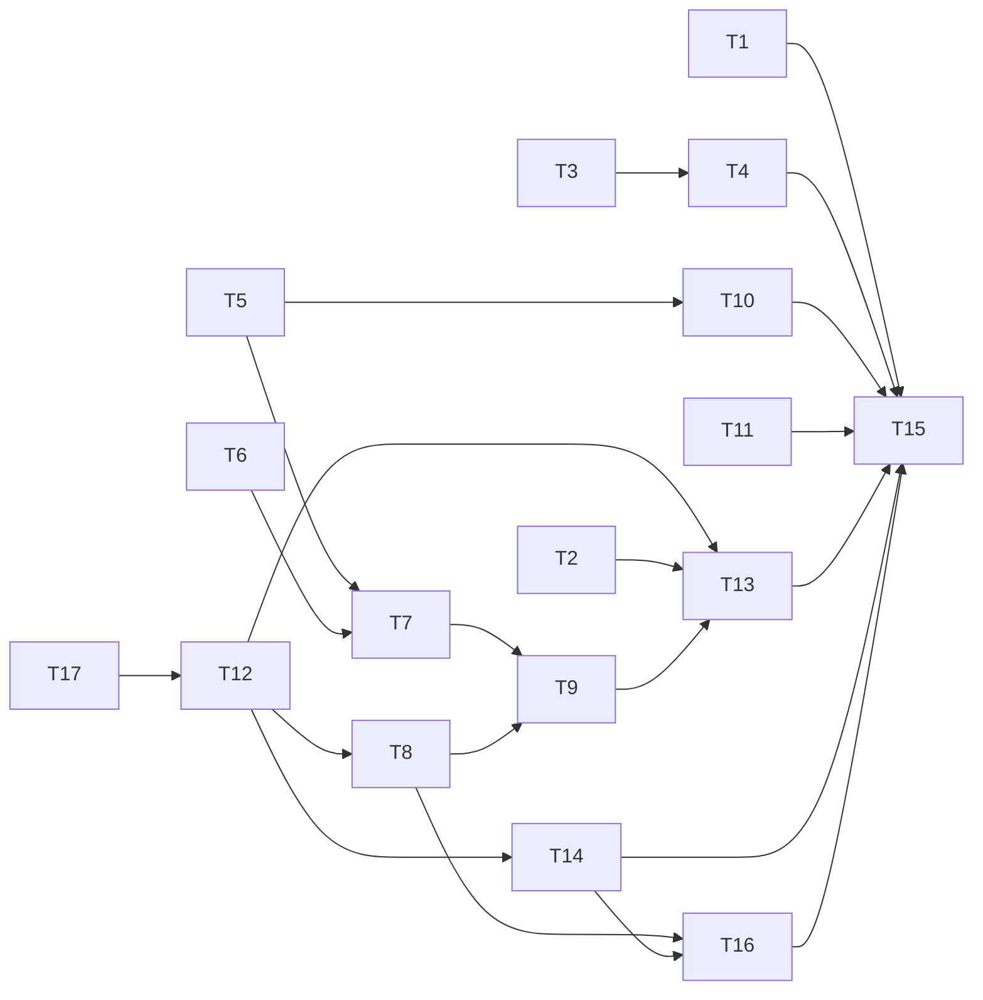

# Cockpit trial 2 fixes: the cloud arm finishes a long write, notes reach a running agent, and the transcript shows both sides

status: draft
commit-mode: orchestrator-commits
language: ruby
panel: Ruby (Linus Torvalds, Jeremy Evans, Sandi Metz, Richard Schneeman, Aaron Patterson)

## Intent

On 2026-10-09 the user reran the frugirl greenfield trial (`lain up ~/dev/frugirl -- --provider ollama-cloud --model glm-5.3`, then `/research-epic`). The interview, the researchers and the related-directory config all worked, but `research.md` was never written: 3 runs ended on `stalled_stream`, 2 of them exactly where the model began the `epic_write` call carrying the whole document. The user also could not tell the agent anything mid-run, could not see their own prompts or answers in the transcript, could not see what was written, and was left looking at an answered question buffer.

This plan fixes each of those, from the user's notes (`notes.md`, "Second run, 2026-10-09") and the session record `~/.local/state/lain/sessions/26b3c41f2bf4/20261009T184309-1814140.ndjson` with its `.wal`. Roadmap line: `ROADMAP.md` item 56.

| Missing concept | Finding | Cards |
|---|---|---|
| a related directory is a related tree | researcher `list_files`/`glob`/`grep` on `~/dev/pitchcraft` itself still parked | T1 |
| a paste is one piece of text | a prompt began with a literal `ESC[200~` | T2 |
| ollama's silence before a whole tool call is not a dead stream | 3 of 3 runs ended `stalled_stream`, no `research.md` | T3, T4 |
| an answered question set is closed | the buffer stayed open and a second `:w` refused | T5 |
| the transcript is a conversation | prompts and answers never appear in the chat pane | T6, T7 |
| the transcript says what was written | no sign of a write until a file shows up | T8, T9, T16 |
| an epic document is readable where it is made | `research.md` lives under XDG state with no viewer | T10, T11 |
| text beside tool results reaches ollama | the ollama encoder drops it, so session reminders after a tool round never arrive | T17 |
| a running agent can be told something | typed text waits until the run ends | T12, T13 |
| a child knows its ceiling is near | both researchers spent 60 of 60 iterations reading and wrote no findings | T14 |
| the docs and QA say all of this | | T15 |

**User rulings, 2026-10-09:**

- Mid-run notes: a line typed while a run is in flight is recorded as a message to the agent and joins its next model request, between tool rounds, without stopping the run.
- Transcript: echo each submitted prompt and each answered question set, stamped.
- Files: 1 stamped transcript line per tool round for writes only (`write_file`, `edit_file`, `epic_write`), aggregating several files into 1 line. Reads stay out of the transcript; `lain://timeline` covers them.
- Epic documents: a read-only `lain://epic/<slug>/<doc>` buffer in nvim, mounted or not, plus `lain epic show`.
- Stall: ollama deployments get their own stall limit tied to their request timeout; Anthropic keeps 30s; a stall says how to change it.
- Researcher: a recorded wrap-up note when a few iterations remain, and the role prompt names its budget. No extra model call after the ceiling.
- Question buffer: mark the answered set answered, close its window, keep the answers readable.

**Ruling taken by this plan, open to the user:** a note typed during the last model call of a run is never folded into that run. It stays pending and joins the first request of the next prompt, and the transcript says so when the run ends (T13). Turning it into an automatic next prompt would fold it twice, once as the prompt and once from the mailbox.

## Grounding

2026-10-09, `main` at `deda26a3`. Working tree: uncommitted edits to `planning/qa/README.md` and `planning/qa/method.md`, and untracked research files, none touched by this plan.

Evidence came from the 2 session records, the user's notes, 7 read-only code maps with file and line citations, and these probes run in this session:

1. **The stalls.** The `.wal` frames each record with a `\x1e` byte. Over all 141 requests of the 2026-10-09 session, the largest gap between 2 streamed chunks was 3.3s. The 3 stalled requests (18:43:49, 19:03:06, 19:07:34 UTC) streamed 2,628, 10,595 and 5,569 chunks, then stopped dead with `done=false`; the stall fired 30s after the last chunk. In the second and third, the last thinking text was "Write it." and "I'll write the file now, then submit the gate", aiming at "around 300 lines". Over 218 tool-call chunks, ollama sent each call's arguments whole, after a pause that grew with their size (2,843 bytes after 2.5s, 2,775 after 3.3s). An `epic_write` of a 300-line document is silent for 30s or more. The first stall followed an `ask_human` plan of 5 to 6 questions and is consistent but not proven. A live spike (Spike findings) measured the rate: 13,693 bytes of tool-call arguments arrived whole after 19.7s of silence, about 0.7 KB a second, so a document over about 21 KB crosses 30s.
2. **Stall settings.** `stream_stall_timeout` defaults to 30 (`provider/http/configuration.rb:97`), read once from `LAIN_STREAM_STALL_TIMEOUT` at `Configuration.new`. `Ollama::Deployment#apply` (`deployment.rb:336-342`) sets only base, key, `request_timeout` (local 300, cloud 120) and `max_retries`. `request_timeout` is Net::HTTP's per-read timeout (`connection/middleware_stack.rb:57`), so a cloud silence over 120s dies either way. A stall is never retried (`stall_protection_spec.rb:115`).
3. **The related root.** `Sensitivity#related?("/home/tara/dev/pitchcraft")` is false and `related?(".../pitchcraft/Cargo.toml")` is true, run against the trial's own `.lain/config.rb`. `spec/lain/sensitivity_spec.rb` pins "answers unrelated for the directory itself, which is no file to read" on purpose, for the masking check. `Sensitivity::Policy::Confined#held?` (`policy.rb:209-212`) reuses that answer to decide whether a child's walk root is in scope, which is where the root case belongs.
4. **The paste.** `Frontend::StdinPump::Typeahead::Typed.from("/research-epic \e[200~para one\npara two\n\e[201~")` returns `lines=["/research-epic \e[200~para one", "para two"], partial=""`: the start marker stays in the first line, and the end marker is dropped as a partial that `said?` finds empty (`stdin_pump.rb:434-446`). Reline itself handles both markers (`line_editor_spec.rb:1108`); the leak is the raw typeahead path the input pane uses while a run is in flight.
5. **Researcher ceiling.** Both children ended `loop ran 60 iterations, ceiling is 60`. The parent's tool result listed about 30 files read per child and no "Its last text block" section, because neither child wrote a text block. The partial handback (`subagent.rb:580-637`) works as designed.
6. **Answers survive a stall.** The 6 and 3 answers given at 18:49:48 and 19:01:39 were committed as the `tool_result` before the next model call; the run after the 19:04 stall used them.
7. **The Mailbox.** No production code builds a real `Tools::Subagent::Log` or `Context::Mailbox::Source`; `Agent.new(mailbox: Context::Mailbox::Null)` is the only production value (`agent.rb:181`). `Agent#step` captures a snapshot and commits `causal_parents: inbox.folded` (`agent.rb:527`, `:549`), but `render_request` (`agent.rb:687-691`) never hands the snapshot to the Context, so a real Source would still render nothing. `Source` takes a fixed recipient, and the main agent's correlation is nil until its first commit. `Mailbox#mailbox_block` renders an empty `<mailbox>` block when every pending message lacks `text`.
8. **Answers and completions are messages too.** An `ask_human` answer is a `:message` to the asker's correlation with body `{"answer"}`, and a one-shot completion is one with `{"result","final","lifecycle"}`. Neither has `text`, and no turn names an answer as a causal parent. Today they reach only the Store and the chronicle observer; a Log fed from either would make them pending forever. So the note Log is fed only by the note writer.
9. **The transcript's stream.** The TTY drains its own `Channel` (`wiring.rb:284`), separate from the record tee. `DocWritten`, `ChildProgress` and everything sent to `record_journal` never reach `Decorators.for`. A child `Agent` is built with `journal: Channel::Null.instance` (`subagent.rb:~1385`).

Where docs and code disagreed:

- `plugin/nvim/doc/lain.txt:645-647` says the last submitted question set leaves you at the inbox. The code leaves the answered `lain://question` buffer on screen and sends nvim nothing (`human_replies.rb:546-554` discards `NOTHING_NEXT`). T5 makes the code do what the user ruled, and T15 rewrites the doc.
- `spec/lain/agent_spec.rb:101` and `:1649` say production wires no non-Null mailbox. True today; T12 makes those comments stale and its card updates them.

## Compatibility

lain is `0.1.0`, unpublished (no release tag; `allowed_push_host` is set but unused), and no project in `~/dev` outside lain's own worktrees depends on its Ruby API (checked for the round 23 plan, unchanged since). Session files on disk are the only stored data with readers outside the running process.

| Surface | Verdict | Evidence |
|---|---|---|
| `Sensitivity#related?` | must keep as is | the masking check depends on "the directory itself is no file"; T1 adds a sibling predicate instead |
| `Typeahead::Typed.from` output | free to break | internal to `Frontend::StdinPump`; 2 spec files pin it |
| `LAIN_STREAM_STALL_TIMEOUT` | must keep | documented in code and specs; still wins on every provider, `0` still disables |
| default stall grace for ollama | free to break | internal default; Anthropic's stays 30 |
| `:message` journal records | must keep, additive | old session files are read by `Bench::Session::Lineages`, `lain watch`, the loader; a note is a new `:message` with body `{"text"}` and no `lifecycle` or `result`, which those readers already ignore (map 7, section 5) |
| assistant turn digests | must keep for the default path | a turn with no folded note keeps `causal_parents: []`; T12 pins byte identity |
| new journal type `files_written` | additive | `spec/journalable_surface_spec.rb` requires a unique `journal_type` |
| nvim runtime rails | free to break | the handshake token is a digest of the injected runtime (`docs/neovim-protocol-history.md`), so Ruby and Lua always ship together |
| `lain://` buffer names | additive | `lain://epic/<slug>/<doc>` is dynamic, like `lain://review/OLD/<path>` |
| `lain epic` verbs | additive | new `show` |
| researcher role prompt | free to break | `.lain/slots/role/researcher.md` overrides exist nowhere outside lain |
| `Repl.new`, `Intake.new`, `Agent.new`, `ToolDelivery.new` keywords | additive | each new keyword has a Null default, so existing callers and specs stand |

No trade was offered: no must-keep surface blocks a simplification.

## Spike findings

| Question | Result | Evidence |
|---|---|---|
| Does ollama stream a tool call's arguments, or send them whole? | Whole, after a pause that grows with their size: 2,843 bytes after 2.5s | Grounding probe 1, over the session `.wal` |
| How long is the silence before a large glm-5.3 tool call on ollama.com? | 19.7s before 13,693 bytes, in 1 chunk, with `done=false`; the stream had been sending 2,518 chunks with no other gap over 5s | 1 streamed `/api/chat` request with a `write_doc` tool, 2026-10-09, script deleted |
| Does the ollama encoder keep a text block beside tool results? | No: `encode_message` returns only the `role: "tool"` messages | Panel probe over `Provider::Ollama::Encoding`, 2026-10-09 |
| Do 2 identical notes get distinct digests? | No: `ChainWriter#put` hashes from, to, correlation, causal parents and body only | Panel probe, 2026-10-09 |
| Where does the paste marker leak? | `Typed.from` keeps `\e[200~` inside a line and drops a trailing `\e[201~` | Grounding probe 4, a read-only `bundle exec ruby -Ilib` call |
| Is the related root a `related?` bug or a `Confined` bug? | `Confined`: the masking spec pins the directory itself as unrelated on purpose | Grounding probe 3 |

No worktree was created; the probes ran as scratch scripts and are deleted.

## Shared files

Only the main session edits these. Cards hand back the 1-line diffs named in their `Shared-file wiring`.

- `lib/lain/cli/wiring.rb`
- `lib/lain/cli/wiring/toolset_build.rb`
- `spec/lain/cli/wiring_spec.rb` (the main session adds the reachability example each card hands back)
- `exe/lain` (Thor declarations)
- `spec/support/slow_files.rb`
- `.rubocop.yml`
- `ROADMAP.md`

`docs/commands.md`, `README.md`, `plugin/nvim/doc/lain.txt`, `docs/neovim-protocol-history.md` and `planning/qa/scenarios/` are edited by T15 only.

## Rejected options

- **Retry a stalled stream.** The retry repeats the same generation and meets the same silence; a stall is deliberately outside the retry allowlist (`faraday_handlers.rb:25-32`).
- **Raise the global stall default.** A dead Anthropic stream would take 4 times longer to notice, and Anthropic streams tool-call arguments as they are written.
- **Stall grace equal to the request timeout.** Net::HTTP's read timeout would race the stall clock and usually win, surfacing as a retried timeout instead of a named stall. T3 sits 5s under it.
- **Make `Sensitivity#related?` true for the directory itself.** It would change what the masking check means; `Confined` needs a different question.
- **The test-only `A1MailboxSeam` as the production shape.** It is mutable state inside a Context pipeline, and `Compaction::Source` makes its pipeline Ractor-shareable (`compaction/source.rb:889-891`), which would freeze it. T12 applies the snapshot at the Agent, after `context_for`.
- **A separate user message for a note.** A note rides the tool-results message like a reminder does; T17 makes that message survive on ollama, which also fixes reminders.
- **Session reminders as the note channel.** Reminders sit before `CacheBreakpoints`, are not recorded, and have no snapshot shared by render and commit.
- **Feed the note Log from the chronicle observer or `Lineage`.** Ask-human answers and one-shot completions would become pending messages forever (Grounding 8).
- **A final summary call after the ceiling.** It reverses the earlier ruling that a stopped child sends no further request; the user chose the warning.
- **A `lain://files` buffer.** The user chose the transcript line, and `lain://timeline` already lists reads.
- **Show reads in the transcript.** Ruled out by the user.

## Open decisions

- **Actor children's wrap-up note.** T14 covers one-shot children, whose spawn digest exists before the Agent is built. An actor's spawn digest exists only after `Actor#launch` (`actor.rb:80-90`), which runs after `spawn_agent`. T14 takes a recipient thunk so an actor can be added later, but no card wires it. Revisit with the epic driver's ceilings.
- **Replay of a folded note.** `Bench::DryReplay` re-renders from `context.render` and will show a `messages` diff on a turn that folded a note, as it does today for workspace reminders. No bench arm uses notes; revisit if one does.

## Dependency graph



T1, T2, T3, T5, T6, T11 and T17 can start at once. Ordering edges that exist only for a shared file: T12 before T8 (`agent.rb`), T7 before T9 (`tty.rb`), T9 before T13 (`tty.rb`), T2 before T13 (`stdin_pump.rb`), T14 before T16 (`subagent.rb`), T5 before T10 (`rpc_thread.rb`). T16 also needs T8's `display:` keyword on `Agent`.

## Tasks

### T1: A child may walk a related directory itself, not only the files in it          [risk: medium]

**Depends on:** none
**Files:** `lib/lain/sensitivity.rb`, `lib/lain/sensitivity/policy.rb`, `spec/lain/sensitivity_spec.rb`, `spec/lain/sensitivity/policy_spec.rb`
**Reuse:** `Sensitivity#under_related?` and `#lexical` (`sensitivity.rb:938-943`); `Confined#under_root?`, which already accepts the root itself (`policy.rb:214`); the `#confined` spec fixture (`policy_spec.rb:713-730`)
**Shared-file wiring:** none
**Reachable from:** `CLI::ToolGuard` confines every spawned child with `inputs.sensitivity.confined(roots: [...])` (`cli/tool_guard.rb:253`)

**Acceptance criteria**

```gherkin
Scenario: a child lists, globs and greps a related directory by its own path
  Given a policy whose rules relate "~/notes", confined to a worker root
  When a child calls list_files, glob or grep with path "<home>/notes"
  Then none of the calls is gated

Scenario: a sibling that shares the prefix is still outside
  When a child lists "<home>/notes-old"
  Then the call is gated as outside_project

Scenario: masking still treats the directory itself as no file
  Given the same rules
  Then Sensitivity#related? of "<home>/notes" is false
  And Sensitivity#related? of "<home>/notes/a.md" is true
```
Spec files: `spec/lain/sensitivity/policy_spec.rb` (the `#confined` group), `spec/lain/sensitivity_spec.rb` (the "a related directory" group keeps its "directory itself" example)

**Interface**

```ruby
class Lain::Sensitivity
  # true for a related directory itself and for any path below one
  def in_related_tree?(path) = ...
end

class Lain::Sensitivity::Policy
  def in_related_tree?(path) = @sensitivity.in_related_tree?(path)
end
```

**Stop and report if:**
- `Confined#held?` turns out to use `related?` anywhere else that must keep the masking meaning (grep `related?` in `lib/lain/sensitivity/policy.rb` and `lib/lain/middleware/redact_secret_reads.rb`).
- `Policy::Null` needs the new predicate for `spec/lib_null_defaults_spec.rb`; answer false there and say so.

### T2: A paste reaches the agent as the text that was pasted          [risk: medium]

**Depends on:** none
**Files:** `lib/lain/frontend/stdin_pump.rb`, `spec/lain/frontend/stdin_pump_spec.rb`, `spec/lain/frontend/input_pane_spec.rb`
**Reuse:** `Typeahead::Typed.from`, `LINE_END`, `KEY_SEQUENCE` and `said?` (`stdin_pump.rb:434-446`); `CUT_AT` and `StdinPump.uncut` (`stdin_pump.rb:70`, `:83`); the pasted-pair example (`input_pane_spec.rb:627`); Reline's own marker constants for the byte values
**Shared-file wiring:** none
**Reachable from:** `CLI::Up` launches the pane with `PaneCommand.call("input", ...)` (`cli/up.rb:1174`), whose `Frontend::InputPane#unprompted` reads through `Typeahead#listen` and `Typed.from` (`input_pane.rb:294-313`)

The bytes between `\e[200~` and `\e[201~` are 1 piece of text: the markers go, and a line end inside them does not end a line. A newline at the very end of the paste is dropped, as Reline does. A paste with no end marker yet stays in the partial until it arrives.

**Acceptance criteria**

```gherkin
Scenario: a paragraph pasted after a command is 1 line with no markers
  Given typeahead bytes "/research-epic \e[200~para one\npara two\n\e[201~\r"
  When they are read as typed-ahead text
  Then there is 1 line, "/research-epic para one\npara two"
  And no line or partial holds "\e[200~" or "\e[201~"

Scenario: a paste still arriving is kept, not dropped
  Given typeahead bytes "\e[200~a\nb"
  Then there are no lines and the partial is "\e[200~a\nb"

Scenario: the input pane forwards a pasted paragraph as 1 line
  Given a running input pane with nothing published
  When the terminal sends a bracketed paste of 2 lines and Enter
  Then the chat side receives 1 line frame holding both lines and no markers

Scenario: a long paste arrives whole
  Given a running input pane with nothing published
  When the terminal sends a bracketed paste of 6,000 bytes over 40 lines and Enter
  Then the chat side receives 1 line frame of those 6,000 bytes, or a cut notice that names the size, never a line with a marker in it
```
Spec files: `spec/lain/frontend/stdin_pump_spec.rb`, `spec/lain/frontend/input_pane_spec.rb` (beside "sends a pasted pair of lines as two lines")

**Stop and report if:**
- The pane example cannot drive a bracketed paste through a PTY the way `line_editor_spec.rb:1108` does.
- The cooked-mode cut at `CUT_AT` applies per paste rather than per line, so the 6,000-byte example can only be met with the cut notice; report the size at which it cuts.

### T3: An ollama deployment waits out the silence before a whole tool call          [risk: medium]

**Depends on:** none
**Files:** `lib/lain/provider/ollama/deployment.rb`, `spec/lain/provider/ollama/deployment_spec.rb`, `spec/lain/provider/ollama_spec.rb`
**Reuse:** `Deployment#apply` and `#request_timeout` (`deployment.rb:304-342`); `Blankness.blank?` as `Configuration#env_seconds` uses it (`configuration.rb:184-187`); `with_env` (`spec/support/with_env.rb`)
**Shared-file wiring:** none
**Reachable from:** `Provider::Ollama#build_config` calls `@deployment.apply(Provider::HTTP::Configuration.new)` (`provider/ollama.rb:616`) for every ollama and ollama-cloud chat

Both deployments change, local included: the ollama server holds a tool call's arguments for every model, and a local model writes them more slowly than the cloud (Spike findings). The local grace of 295s still bounds the 400-second silence the original stall fix names (`configuration.rb:~94-100`). The stall monitor polls at most once a second (`POLL_BOUNDS` in `streaming/faraday_handlers.rb`), well inside the 5s margin, so the named stall fires before Net::HTTP's read timeout.

**Acceptance criteria**

```gherkin
Scenario: the local and cloud deployments wait 5s less than their request timeout
  When an ollama provider is built for the local deployment
  Then its stream stall timeout is 295
  When an ollama provider is built for the cloud deployment
  Then its stream stall timeout is 115

Scenario: the environment still wins
  Given LAIN_STREAM_STALL_TIMEOUT is "7"
  Then both deployments' stall timeout is 7
  Given LAIN_STREAM_STALL_TIMEOUT is "0"
  Then both deployments' stall timeout is off
  Given LAIN_STREAM_STALL_TIMEOUT is " "
  Then the deployments' own values apply

Scenario: Anthropic keeps its 30s
  When an Anthropic provider is built with the variable unset
  Then its stream stall timeout is 30
```
Spec files: `spec/lain/provider/ollama/deployment_spec.rb`, `spec/lain/provider/ollama_spec.rb` (the production `build_config` path), `spec/lain/provider/http/stall_protection_spec.rb:312` stays green unchanged

**Interface**

```ruby
class Lain::Provider::Ollama::Deployment
  STALL_MARGIN = 5
  def stream_stall_timeout = request_timeout - STALL_MARGIN

  def apply(config)
    # ...the existing writes...
    config.stream_stall_timeout = stream_stall_timeout if Blankness.blank?(ENV.fetch("LAIN_STREAM_STALL_TIMEOUT", nil))
    config
  end
end
```

**Stop and report if:**
- `spec/lain/provider/ollama/transport_spec.rb:275` or `:341` (which call `deployment.apply`) assert a configuration whose stall value changes.
- `Transport#probe_config` (`ollama/transport.rb:232-238`) must not inherit the longer grace for a reason the code states.
- `POLL_BOUNDS` allows a poll interval of 5s or more, which would let the read timeout fire first.

### T4: A stalled stream says how to wait longer          [risk: low]

**Depends on:** T3
**Files:** `lib/lain/cli/repl/ask.rb`, `spec/lain/cli/repl/ask_spec.rb`
**Reuse:** `Ask#refuse`, `#record_interruption` and the remedy constants (`ask.rb:30-32`, `:62-101`); `Agent::StopReason.for` (`agent/stop_reason.rb:21`); the `stall`/`wrapped_stall` lets (`ask_spec.rb:25-28`)
**Shared-file wiring:** none
**Reachable from:** `CLI::Repl` settles every ask through `Repl::Ask#settle` (`cli/repl/ask.rb`)

**Acceptance criteria**

```gherkin
Scenario: a stall is followed by its remedy
  Given an ask that ends with a provider error caused by a stalled stream
  When the ask settles
  Then the transcript shows the stall error
  And the next line names LAIN_STREAM_STALL_TIMEOUT, says it is in seconds and that 0 turns it off

Scenario: other refusals get no remedy line
  Given an ask torn by a transport error that is not a stall
  Then render_error is called once
```
Spec file: `spec/lain/cli/repl/ask_spec.rb` (beside "names a provider stall rather than a generic interruption", `:205-209`)

**Stop and report if:**
- `Ask#remedy_for` (`ask.rb:68-72`) is the better home and generalizing it changes the max_tokens examples at `ask_spec.rb:138-160`.

### T5: Submitting the last open question set marks it answered and closes its window          [risk: medium]

**Depends on:** none
**Files:** `lib/lain/cli/human_replies.rb`, `lib/lain/frontend/neovim/buffers.rb`, `lib/lain/frontend/neovim/question_view.rb`, `lib/lain/frontend/neovim/rpc_thread.rb`, `lib/lain/frontend/neovim/runtime/60_question.lua`, `spec/lain/cli/human_replies_spec.rb`, `spec/lain/frontend/neovim/buffers_spec.rb`, `spec/lain/frontend/neovim/question_view_spec.rb`, `spec/lain/frontend/neovim/rpc_thread_spec.rb`, `spec/lain/frontend/neovim/runtime/60_question_spec.rb`
**Reuse:** `HumanReplies#answer_document` and `#advance` (`human_replies.rb:534-554`) with its `NoViews` null (`human_replies.rb:71`); `Buffers#open_next` (`buffers.rb:233`); `Gestures#open_next` and `NOTHING_NEXT` (`inbox_view/gestures.rb:55`, `:124-130`); the approval window's `w:lain_approval_opened`, `close_opened_windows` and its last-window-of-a-tabpage guard (`62_approval.lua:95-107`, `:164-165`); `RenderQueue::RAILS` (`rpc_thread.rb:~134-250`)
**Shared-file wiring:** none
**Reachable from:** `Frontend::Neovim` routes `question` writes to `QuestionView#wrote` (`rpc_thread.rb:891`, `neovim.rb:312`), and `CLI::HumanReplies#answer_document` handles the `question_answered` route (`human_replies.rb:480`, `:534`) in every `lain up` chat

When `advance` finds no next set (`NOTHING_NEXT`), `HumanReplies` asks its views to settle the submitted digest, through a new `Buffers#question_settled` and a matching `NoViews` method. That posts a `question_settled` rail with the digest and the time, outside `QuestionView`'s lock. Lua acts only if `b:lain_question_digest` still equals that digest, because the agent may already have asked again and `set_question` may have drawn the next set. It then puts `answered at HH:MM; your answers went to the agent` as the first line, makes the buffer read-only, and closes the window if `w:lain_question_opened` marks it as lain's and it is not the last window of its tabpage. `set_question` sets that marker when it opens a window, and restores `modifiable` when it reuses the buffer. The buffer stays hidden with the answers in it, so `:buffer lain://question` shows them again.

**Acceptance criteria**

```gherkin
Scenario: the last set closes and stays readable
  Given 1 open question set shown in a window lain opened
  When the human ticks valid answers and writes the buffer
  Then the window closes
  And the buffer lain://question still exists, is not modifiable, and begins "answered at "
  And its other lines are the document as written

Scenario: a next set still opens in place
  Given 2 open question sets and the first is shown
  When the human submits the first
  Then the buffer shows the second set, modifiable, with no "answered at" line

Scenario: a settle that arrives after a newer set is ignored
  Given the human submitted the last set and the agent asked a new set before the settle rail ran
  When the settle rail for the old digest arrives
  Then the new set stays modifiable and its window stays

Scenario: a window the human opened is left open
  Given the human opened lain://question in a window of their own
  When they submit the last set
  Then that window stays, showing the answered document

Scenario: a refused write closes nothing
  When the human writes a set with 2 boxes ticked on a pick-one question
  Then the refusal names the line, the buffer stays modifiable, and the window stays
```
Spec files: `spec/lain/frontend/neovim/runtime/60_question_spec.rb`, `spec/lain/cli/human_replies_spec.rb` (the "advancing after a submitted document" group, including "returns to the inbox when the last set is submitted", which changes), `spec/lain/frontend/neovim/buffers_spec.rb`, `spec/lain/frontend/neovim/rpc_thread_spec.rb:277-286` and `:416` for the new rail

**Interface**

```ruby
# rpc_thread.rb, RAILS
question_settled: Rail.new(lua: "set_question_settled", params: "digest, at", blocking: false)

class Lain::Frontend::Neovim::Buffers
  def question_settled(digest, at:) = ...
end
```

**Stop and report if:**
- `question_view_spec.rb:337` ("the advance cannot chain from inside the write") would be broken by the settle post.
- `spec/refusal_delivery_discipline_spec.rb` objects to the new Lua message.

### T6: The transcript shows each prompt typed in the input pane          [risk: medium]

**Depends on:** none
**Files:** `lib/lain/cli/repl.rb`, `lib/lain/frontend/tty.rb`, `spec/lain/cli/repl_spec.rb`, `spec/lain/frontend/tty_spec.rb`
**Reuse:** `Repl#converse` and `#next_text` (`repl.rb:55-58`, `:162-167`); `TTY#stamp` and `#legible` (`tty.rb:212`, `:429`); the stamped-clock examples (`tty_spec.rb:469`, `:604-668`)
**Shared-file wiring:**
- `wiring.rb` `build_repl` (`:982-995`): pass `echo_input: attended? && !input_socket_name.nil?` to `Repl.new`
- `wiring_spec.rb`: a cockpit-shaped wiring (an `--input socket:` name) builds a Repl that echoes, and a plain chat one that does not
**Reachable from:** `Wiring#build_repl` (`wiring.rb:982`) constructs the Repl for every chat; `lain up` passes `--input socket:<session>` (`cli/up.rb:1166`)

Only a line read at `you>` echoes, through 1 private read wrapper around both `prompt.read` calls. Goal-driven text, the `/btw` seed and a dispatched held line do not. Slash commands echo, so their output has a cause. A multi-line prompt prints its first line after `you> ` and the rest indented under it.

**Acceptance criteria**

```gherkin
Scenario: the cockpit transcript shows a typed prompt, stamped
  Given a Repl built with echo_input true and a fixed wall clock at 13:14:01
  When the human submits "say hi"
  Then the transcript shows "13:14:01 you> say hi" before the reply

Scenario: a plain chat echoes nothing
  Given a Repl built without echo_input
  When the human submits "say hi"
  Then no you> line is rendered

Scenario: lines nobody typed at you> are not echoed
  Given echo_input true
  When a held line, a goal-driven prompt or a first prompt is dispatched
  Then no you> line is rendered for it

Scenario: a pasted paragraph keeps its shape
  When the human submits "one\ntwo"
  Then the transcript shows "13:14:01 you> one" and an indented "two"
```
Spec files: `spec/lain/cli/repl_spec.rb`, `spec/lain/frontend/tty_spec.rb`

**Interface**

```ruby
class Lain::Frontend::TTY
  def render_prompt_echo(text) = ...   # stamped, "you> " then indented continuation lines
end
```

**Stop and report if:**
- `repl_spec.rb`'s `instance_double(HumanReplies, take_held: nil)` (`:677`) or the conductor double (`:307-311`) needs the new keyword; it must default to off.
- `Theme::DEFAULT_TOKENS` has no token that reads as the human's line; add 1 with `spec/lain/frontend/theme_spec.rb` under Files and say so.

### T7: The transcript shows each answered question set          [risk: medium]

**Depends on:** T5, T6
**Files:** `lib/lain/cli/human_replies.rb`, `lib/lain/question/answer_set.rb`, `lib/lain/frontend/tty.rb`, `spec/lain/cli/human_replies_spec.rb`, `spec/lain/question/answer_set_spec.rb`, `spec/lain/frontend/tty_spec.rb`
**Reuse:** `HumanReplies#deliver` and `#handed_on`, the one answer path every surface uses (`human_replies.rb:380-394`); `AnswerSet::Reply` and `Rendering#labels` (`answer_set.rb:206-298`); `TTY#stamp`
**Shared-file wiring:** none
**Reachable from:** `Wiring#build_repl` constructs `HumanReplies` (`wiring.rb:~977`); the nvim route, `:LainReply`, `/inbox` and `human>` all end in `#deliver`

The summary is built when the answer is rendered, so it rides on the `Reply` and survives to `#deliver`. 1 line per question: the id, then the chosen labels or the first line of the free-text answer. A prose reply to a whole set is 1 line, `(in prose)` and its first line. A plain String answer (a bare question) echoes its first line. The echo is written after `handed_on` succeeds, never for a refused or already-resolved answer.

**Acceptance criteria**

```gherkin
Scenario: a ticked set is echoed per question
  Given a set with questions "device-sync" (single) and "out-of-scope" (multi)
  And the human chose "undecided" and "barcode, pantry"
  When the answer is delivered at 13:14:01
  Then the transcript shows "13:14:01 answered lain's questions"
  And the lines "device-sync: Haven't decided" and "out-of-scope: Barcode scanning, Pantry inventory"

Scenario: every surface echoes through the same path
  When an answer arrives from lain://question, :LainReply, /inbox or human>
  Then the transcript echo appears exactly once

Scenario: a refused answer is not echoed
  When an answer arrives for a set that was already answered elsewhere
  Then no echo is rendered
```
Spec files: `spec/lain/cli/human_replies_spec.rb` (the cross-surface example at `:3032` is the place for the second scenario), `spec/lain/question/answer_set_spec.rb`, `spec/lain/frontend/tty_spec.rb`

**Interface**

```ruby
class Lain::Question::AnswerSet::Reply < String
  def summary = ...   # Array<String>, 1 per question, frozen
end
class Lain::Frontend::TTY
  def render_answer_echo(lines) = ...
end
```

**Stop and report if:**
- The `Struct.new(:render)` fakes in `human_replies_spec.rb` (`:1890`, `:1917`, `:1951`, `:2033`) must change shape; prefer reading `summary` only when the answer responds to it.
- `spec/reply_surface_discipline_spec.rb` classifies the echo as a reader.

### T8: A tool round reports the files it wrote          [risk: medium]

**Depends on:** T12
**Files:** `lib/lain/agent/tool_delivery.rb`, `lib/lain/agent.rb`, `lib/lain/session.rb`, `lib/lain/tools/epic_write.rb`, `lib/lain/telemetry/files_written.rb` (new), `spec/lain/agent/tool_delivery_spec.rb`, `spec/lain/session_spec.rb`, `spec/lain/tools/epic_write_spec.rb`, `spec/lain/telemetry/files_written_spec.rb` (new), `spec/lain/agent_spec.rb`
**Reuse:** `ToolDelivery#settle` (`tool_delivery.rb:84-90`); `Session#pre_images`, the round's write set before `settle_pre_images` (`session.rb:337-368`); `Tool#session_of` as `write_file.rb` uses it; the `SnapshotNarrowed` record as the model of a record that rides both the record tee and the display channel (`agent/snapshot_slot.rb:40-50`)
**Shared-file wiring:**
- `wiring.rb` `agent_over` (`:656-663`): pass `display: channel` (the TTY channel `SnapshotSlot` already gets at `:661`)
**Reachable from:** `Wiring#agent_over` builds the main `Agent`, which builds `ToolDelivery` in `seed_run_state` (`agent.rb:508-511`)

After a round's commit, `settle` reads the round's writes first, before `@snapshots.write` (which can raise) and before `settle_pre_images` (which clears them), and sends 1 `Telemetry::FilesWritten` to both the journal and the display channel when there is anything to report. A path under the project root is shown relative to it; any other path is shown absolute, with the home directory as `~`. Each document `epic_write` wrote is shown as `<slug>/<home-relative path>`; `epic_write` records it with a new session method that stays out of the snapshot write-set. A cancelled round sends nothing. A round torn before it settled carries its writes into the next round (`session.rb:~328-335`), so that round's line lists both, which is accepted.

**Acceptance criteria**

```gherkin
Scenario: 1 record per writing round
  Given a round that ran write_file on lib/a.rb and edit_file on lib/b.rb
  When the round settles
  Then 1 files_written record is journaled with paths ["lib/a.rb", "lib/b.rb"] and role "lain"
  And the same record reaches the display channel

Scenario: the record goes out even when the snapshot write fails
  Given a round that wrote lib/a.rb and a snapshot writer that raises
  When the round settles
  Then the files_written record was sent before the raise

Scenario: an epic document is named by its slug
  Given a round whose epic_write wrote research.md for slug frugirl
  Then the record's paths are ["frugirl/research.md"]
  And Session#writes does not include it

Scenario: a write outside the root is shown in full
  Given a round that wrote ~/notes/a.md outside the project root
  Then the record's paths are ["~/notes/a.md"]

Scenario: reads and empty rounds send nothing
  Given a round that only ran read_file and grep
  Then no files_written record is sent
```
Spec files: `spec/lain/agent/tool_delivery_spec.rb`, `spec/lain/session_spec.rb`, `spec/lain/tools/epic_write_spec.rb`, `spec/lain/telemetry/files_written_spec.rb`, `spec/lain/agent_spec.rb` (1 example through a real `Agent` with a real `write_file`)

**Interface**

```ruby
Lain::Telemetry::FilesWritten = Data.define(:role, :paths)   # include Journalable, JOURNAL_TYPE "files_written"
class Lain::Session
  def record_document(path) = ...   # this round only; cleared by settle_pre_images
  def round_writes = ...            # Array<String>, display-ready, in write order
end
class Lain::Agent
  def initialize(..., display: Channel::Null.instance, display_as: "lain") = ...
end
```

**Stop and report if:**
- `spec/journal_routing_discipline_spec.rb` or `spec/journalable_surface_spec.rb` cannot build the record with `GenericBuild`.
- `ToolDelivery#cancel` must report too; it is inside `defer_stop` and kept free of IO on purpose.
- `Session::Null` (`session.rb:1022-1036`) needs the new methods for `spec/lib_null_defaults_spec.rb`.

### T9: The transcript prints 1 stamped line per writing round          [risk: low]

**Depends on:** T7, T8
**Files:** `lib/lain/frontend/decorators.rb`, `lib/lain/frontend/decorators/files_written.rb` (new), `lib/lain/frontend/tty.rb`, `spec/lain/frontend/decorators_spec.rb`, `spec/lain/frontend/decorators/files_written_spec.rb` (new), `spec/lain/frontend/tty_spec.rb`
**Reuse:** `Decorators.for` (`decorators.rb:30-38`); `Decorators::SnapshotNarrowed` as the model (`decorators/snapshot_narrowed.rb`); `TTY#render` and `#stamp` (`tty.rb:450-454`, `:212`)
**Shared-file wiring:** none
**Reachable from:** `TTY#render_until_closed` drains the display channel for every chat (`tty.rb:~436`), the channel `Wiring#run` builds (`wiring.rb:284`)

A decorator says it is stamped, and `TTY#render` stamps its line. The line names up to 3 paths and counts the rest; a child's line starts with its role.

**Acceptance criteria**

```gherkin
Scenario: 1 file
  Given a files_written record with role "lain" and paths ["lib/a.rb"] at 13:14:01
  Then the transcript shows "13:14:01 wrote lib/a.rb"

Scenario: several files on 1 line
  Given paths ["lib/a.rb", "lib/b.rb", "lib/c.rb", "spec/a_spec.rb", "spec/b_spec.rb"]
  Then the transcript shows "13:14:01 wrote 5 files: lib/a.rb, lib/b.rb, lib/c.rb (+2 more)"

Scenario: a child's writes name the child
  Given role "dev" and paths ["src/main.rs"]
  Then the transcript shows "13:14:01 dev wrote src/main.rs"
```
Spec files: `spec/lain/frontend/decorators/files_written_spec.rb`, `spec/lain/frontend/decorators_spec.rb`, `spec/lain/frontend/tty_spec.rb` (1 example draining a real channel)

**Stop and report if:**
- Stamping in `TTY#render` changes the unstamped decorators' output in `tty_spec.rb:69-123`.

### T10: An epic document opens read-only in nvim when it is written          [risk: medium]

**Depends on:** T5
**Files:** `lib/lain/frontend/neovim/epic_doc_view.rb` (new), `lib/lain/frontend/neovim/surfaces.rb`, `lib/lain/frontend/neovim/rpc_thread.rb`, `lib/lain/frontend/neovim/runtime/63_epic_doc.lua` (new), `lib/lain/cli/epic_mount.rb`, `spec/lain/frontend/neovim/epic_doc_view_spec.rb` (new), `spec/lain/frontend/neovim/surfaces_spec.rb`, `spec/lain/frontend/neovim/rpc_thread_spec.rb`, `spec/lain/frontend/neovim/runtime/63_epic_doc_spec.rb` (new), `spec/lain/cli/epic_mount_spec.rb`
**Reuse:** `Epic::DocWritten` (`epic/doc_written.rb`), which already reaches `Surfaces#post` through the record tee under `--nvim`; `EpicMount::Homes#for` (`epic_mount.rb:80-84`); `named_buf` and `set_view` (`20_buffers.lua:~88-103`, `45_views.lua:32-44`); the dynamic `lain://review/OLD/<path>` naming; `nvim_open_win(buf, false, ...)` so focus never moves (`45_views.lua:1-5`)
**Shared-file wiring:**
- `wiring.rb` `epic_status` (`:914-925`): hand the frontend the chat's `Homes` (mounted or not) as `epic_docs:`
- `wiring_spec.rb`: an unmounted chat's nvim frontend receives a docs reader
**Reachable from:** `Wiring` builds `Frontend::Neovim` for `lain up` and passes `epic_docs:` beside `epic:` (`wiring.rb:914-925`); `EpicMount.for` returns `NoEpic` for an unmounted chat (`epic_mount.rb:125-130`)

On a `DocWritten`, `EpicDocView` reads the document through `Homes#for(slug)` and posts it on a new `epic_doc` rail as `lain://epic/<slug>/<path>`. Lua writes it into a read-only markdown buffer and, the first time only, opens it in a split without taking focus. A later write of the same document refreshes it in place.

**Acceptance criteria**

```gherkin
Scenario: research.md opens beside the human's window without stealing focus
  Given an unmounted lain up chat with nvim attached and the cursor in the human's own buffer
  When epic_write writes research.md for slug frugirl
  Then a buffer "lain://epic/frugirl/research.md" holds the file's lines, filetype markdown, not modifiable
  And a window shows it
  And the cursor is still in the human's buffer

Scenario: a second write refreshes in place
  When research.md is written again with new text
  Then the same buffer holds the new text and no second window opens

Scenario: an issue plan uses its home path
  When epic_write writes plans/a1.md
  Then the buffer is "lain://epic/frugirl/plans/a1.md"
```
Spec files: `spec/lain/frontend/neovim/runtime/63_epic_doc_spec.rb` (headless editor, `45_views_spec.rb:12-50` as the pattern), `spec/lain/frontend/neovim/epic_doc_view_spec.rb`, `spec/lain/frontend/neovim/surfaces_spec.rb`, `spec/lain/frontend/neovim/rpc_thread_spec.rb`, `spec/lain/cli/epic_mount_spec.rb`

**Interface**

```ruby
# rpc_thread.rb, RAILS
epic_doc: Rail.new(lua: "set_epic_doc", params: "name, lines", blocking: false)

class Lain::CLI::EpicMount::NoEpic
  attr_reader :homes
end
```

**Stop and report if:**
- `spec/plugin/nvim_plugin_spec.rb` requires the dynamic buffer name in `plugin/nvim/doc/lain.txt`; hand T15 the exact sentence.
- `spec/lain/frontend/neovim/runtime_loader_spec.rb` reserves the 63 band.
- The document read can land on the nvim drain thread while `Journaled::Written#write` still holds the file.

### T11: `lain epic show` prints an epic document          [risk: low]

**Depends on:** none
**Files:** `lib/lain/cli/epic.rb`, `spec/lain/cli/epic_spec.rb`
**Reuse:** `CLI::Epic#status`, `#resolve_slug`, `#chosen` and `#sole` (`cli/epic.rb:203-225`, `:369-386`); `Epic::Home#research`, `#epic`, `#issue`, `#plan` and `Artifact#read` (`epic/home.rb:139-142`, `:178+`)
**Shared-file wiring:**
- `exe/lain` `class Epic < Thor`: `desc "show [DOC] [SLUG]", "Print one of an epic's documents: research (the default), epic, issues/ID or plans/ID"` and `def show(doc = "research", slug = nil) = render { Lain::CLI::Epic.new.show(doc, slug) }`
**Reachable from:** `exe/lain` `Epic#show`, beside `status` (`exe/lain:532-534`)

**Acceptance criteria**

```gherkin
Scenario: the sole epic's research
  Given 1 epic, frugirl, whose research.md holds "# Research"
  When the human runs "lain epic show"
  Then it prints "# Research"

Scenario: an issue plan by its home path
  When the human runs "lain epic show plans/a1"
  Then it prints plans/a1.md

Scenario: a missing document and an unknown name are refused by name
  When the human runs "lain epic show epic" before epic.md exists
  Then it fails naming epic.md and the epic home
  When the human runs "lain epic show notes"
  Then it fails listing research, epic, issues/ID and plans/ID
```
Spec file: `spec/lain/cli/epic_spec.rb` (1 example through `Lain::CLI.start(..., debug: true)` per CLAUDE.md)

**Stop and report if:**
- An issue id fails `Epic::Home.checked_name`, so `issues/ID` needs a different spelling.

### T12: An agent folds its pending notes into its next request          [risk: high]

**Depends on:** T17
**Files:** `lib/lain/context/mailbox.rb`, `lib/lain/context/mailbox/live.rb` (new), `lib/lain/agent.rb`, `spec/lain/context/mailbox_spec.rb`, `spec/lain/context/mailbox/live_spec.rb` (new), `spec/lain/agent_spec.rb`
**Reuse:** `Mailbox::Snapshot`, `Source#capture`, `Null` (`context/mailbox.rb:36-87`); `Event::Projection#pending` (`event/projection.rb:47-50`); `Event::ChainWriter#put` and `.correlation_of` (`event/chain_writer.rb:33-36`); `Tools::Subagent::Log`; `Lineage#initialize`'s observer composition and its `adoption` counter (`tools/subagent/lineage.rb:27-30`); `Context#with_pipeline` with a provider lambda (`context.rb`); `PipelineSource::Null` and `Compaction::Source#context_for`, which both return `base` or `base.with_pipeline(...)` (`agent/pipeline_source.rb:37`, `compaction/source.rb:553`)
**Shared-file wiring:** none (T13 and T14 wire it)
**Reachable from:** `Wiring#agent_over` (`wiring.rb:656`) through T13's wiring, and `ChildBuilder#spawn_agent` (`subagent.rb:~1384`) through T14; until those land, this card's production-path example drives a real `Agent` with a real `Live` and a real ollama encoder

`Live#post` only queues the text, under a Mutex, and returns at once; the socket thread never touches the Store. `Live#capture` runs on the agent's fiber at turn start: it turns each queued text into a `:message` addressed to the recipient the timeline names now, through a `ChainWriter` whose observer journals it and appends it to `Live`'s own `Log`, then snapshots. Addressing at capture means a note never waits under a stale correlation, and a note queued before the first commit is addressed once there is one. Each body carries a per-`Live` sequence number beside the text, because `ChainWriter#put` has no time or nonce and 2 identical notes would otherwise share a digest. A `Live` that has never queued anything returns an empty snapshot without walking the timeline.

`Agent#step` passes its snapshot down `call_model`, `attempt` and `retry_refused` to `render_request(snapshot)`, which applies `snapshot.over(turn_context)` after `pipeline_source.context_for`, so compaction never sees it. `Null.over` returns the same Context object. When `attempt` dispatches a `RequestOverride` (a `/resend`), nothing was rendered, so the commit records `causal_parents: []` and the note stays pending. The `over` lambda closes over a Context that may hold the live `/model` slot, so it is deliberately not Ractor-shareable; it lives only for 1 turn. `mailbox_block` renders nothing when no pending message has text.

**Acceptance criteria**

```gherkin
Scenario: a note posted between tool rounds reaches the model on the wire
  Given a real Agent over the ollama provider's encoder, wired with a Mailbox::Live, and a provider that asks for 1 tool, then answers
  When a note "use Syncthing" is posted while the tool runs
  Then the second request's encoded messages include "human | use Syncthing" in a <mailbox> block
  And that turn's assistant commit names the note's digest as a causal parent
  And the third request does not repeat the note

Scenario: the same words twice are 2 notes
  When "continue" is posted, folded, and posted again
  Then the second "continue" folds into a later request too

Scenario: the default path is byte-identical
  Given an Agent with Mailbox::Null
  Then render_request's Context is the object pipeline_source returned
  And every assistant turn's causal_parents is []

Scenario: a note posted before the first commit waits for it
  Given a chat whose timeline is empty
  When a note is posted
  Then it is addressed at the first capture that has a recipient, and folds into that request

Scenario: a resend does not claim a note it never sent
  Given a pending note and a queued RequestOverride
  When the override is dispatched
  Then the commit's causal_parents is [] and the note folds into the next rendered request

Scenario: an answer or completion message is never folded
  Given an ask_human answer message and a one-shot completion message in the Store
  Then neither appears in Live's pending set

Scenario: posts from another thread are safe
  When 2 threads post 100 notes each while the agent captures
  Then all 200 are folded exactly once across the following requests

Scenario: a mid-dispatch note waits for the next turn
  When a note is posted during the provider round trip
  Then it is in neither that request nor that commit, and it folds into the next
```
Spec files: `spec/lain/context/mailbox/live_spec.rb`, `spec/lain/context/mailbox_spec.rb` (the empty-block case), `spec/lain/agent_spec.rb` (the "per-turn mailbox snapshot" group gains production-shaped examples; the `A1MailboxSeam` comments at `:101` and `:1649` are updated)

**Interface**

```ruby
class Lain::Context::Mailbox::Live
  # recipient: ->(timeline) { digest or nil }; observer: the chronicle's
  def initialize(recipient:, observer:) = ...
  def post(from:, text:) = ...       # queues; thread-safe; => nil
  def capture(timeline) = ...        # addresses the queue, => Snapshot
  def pending?(timeline) = ...
end
class Lain::Context::Mailbox::Snapshot
  def over(context) = ...   # context.with_pipeline(->(ws) { context.pipeline_for(ws) >> Mailbox.new(snapshot: self) })
end
module Lain::Context::Mailbox::Null
  def self.over(context) = context
end
```

**Stop and report if:**
- `Context#with_pipeline` or `#pipeline_for` is unavailable on what `Compaction::Source#context_for` returns (`compaction/source.rb:804-891`).
- `spec/value_object_shareability_spec.rb` or `spec/lib_null_defaults_spec.rb` objects to `Live` or the new `Null.over`.
- A compaction handoff or `/rewind` gives the chain a new root between a note's capture and its consuming turn; report which path does.

### T13: A line typed during a run becomes a note to the agent          [risk: high]

**Depends on:** T2, T9, T12
**Files:** `lib/lain/cli/human_notes.rb` (new), `lib/lain/frontend/intake.rb`, `lib/lain/frontend/stdin_pump.rb`, `lib/lain/frontend/tty.rb`, `lib/lain/cli/repl.rb`, `spec/lain/cli/human_notes_spec.rb` (new), `spec/lain/frontend/intake_spec.rb`, `spec/lain/frontend/stdin_pump_spec.rb`, `spec/lain/frontend/tty_spec.rb`, `spec/lain/cli/repl_spec.rb`, `spec/lain/status_feed_spec.rb`
**Reuse:** `Intake#deliver`, `#unread?`, `#hold` and `#lifts?` (`intake.rb:139-251`); `StdinPump#forwarded`, which already sees lines during a run through `with_line_reader` (`stdin_pump.rb:225-255`); `Conductor#ask_in_flight?` (`cli/conductor.rb:299`); `TTY#render_note` (`tty.rb:220-224`); `Mailbox::Live` from T12
**Shared-file wiring:**
- `wiring.rb` `wire_agent` (`:375`), after `parent = -> { @agent.timeline }`: `@notes = Lain::CLI::HumanNotes.new(mailbox: Lain::Context::Mailbox::Live.new(recipient: ->(t) { Lain::Event::ChainWriter.correlation_of(t) }, observer: chronicle.observer), in_flight: -> { @conductor&.ask_in_flight? })`. The conductor is built later, in `run` (`:290`), so it is read through the thunk.
- `wiring.rb` `agent_over` (`:656`) and the `build_agent` call that reaches it: pass `mailbox: @notes.mailbox` to `Lain::Agent.new`.
- `wiring.rb` `run` (`:288`): `Lain::Frontend::Intake.new(screen: tty, history: history_for(tty), notes: @notes)`.
- `wiring.rb` `input_for` (`:448-453`): pass `notes: @notes` to the `StdinPump` it builds.
- `wiring.rb` `build_repl` (`:982`): pass `notes: @notes` to `Repl.new`.
- `wiring_spec.rb`: a built chat's Agent, Intake, StdinPump and Repl share 1 `HumanNotes`.
**Reachable from:** `Wiring#wire_agent` and `#run` build the main chat for `lain chat` and `lain up`

While an ask is in flight and nothing is published, a line that does not start with `/` is posted as a note instead of held. In the cockpit the branch is in `Intake#deliver`; in a plain terminal it is in `StdinPump#forwarded`, before a line is put back as typeahead. The transcript says `13:14:01 note for the agent: <text>`. Slash commands and `/stop` behave as today, and prose at a parked `human>`, `[y/N]` or `command>` prompt keeps its current handling, including the held-beside notices. When a run settles with a note still pending, the transcript says `your note joins your next prompt`. A goal-driven run takes notes the same way; its held-line steering is untouched because only prose typed mid-run changes route.

**Acceptance criteria**

```gherkin
Scenario: prose typed mid-run joins the next request
  Given a lain up chat whose ask is waiting on a tool
  When the human types "prefer Syncthing" in the input pane
  Then the transcript shows "13:14:01 note for the agent: prefer Syncthing"
  And the next model request carries it in a <mailbox> block
  And nothing is held as the next prompt
  And the HUD's inbox count stays 0

Scenario: a slash command mid-run is still held
  When the human types "/model" during a run
  Then it is held as the next prompt, as today

Scenario: /stop still stops
  When the human types "/stop" during a run
  Then the run stops and no note is posted

Scenario: a note typed during the last call waits
  Given the model's final reply is streaming
  When the human types "also check Aldi"
  Then when the run ends the transcript says the note joins the next prompt
  And the next prompt's first request carries it

Scenario: the plain terminal path does the same
  Given a plain chat with no input pane
  When the human types a line and Enter during a run
  Then it is posted as a note and not put back as typeahead
```
Spec files: `spec/lain/frontend/intake_spec.rb` (the "a line delivered while no prompt is published" group, `:817-860`), `spec/lain/frontend/stdin_pump_spec.rb`, `spec/lain/cli/human_notes_spec.rb`, `spec/lain/cli/repl_spec.rb`, `spec/lain/frontend/tty_spec.rb`, `spec/lain/status_feed_spec.rb` (the inbox count)

**Interface**

```ruby
class Lain::CLI::HumanNotes
  def initialize(mailbox:, in_flight:) = ...
  attr_reader :mailbox
  def take?(line) = ...      # true when it queued the line as a note
  def pending?(timeline) = ...
  # Null declines every line; the default for Intake.new, StdinPump.new and Repl.new
end
```

**Stop and report if:**
- `Conductor#ask_in_flight?` is true while a `human>` or `[y/N]` prompt is parked, so `take?` would steal an answer; `Intake#deliver` must only offer a line when nothing is published.
- `spec/lain/frontend/intake_spec.rb:817-860` pins a held prose line during a run in a way that is a deliberate rule rather than today's default.

### T14: A child near its ceiling is told to write its findings          [risk: medium]

**Depends on:** T12
**Files:** `lib/lain/tools/subagent.rb`, `lib/lain/tools/subagent/wrap_up.rb` (new), `lib/lain/prompt/templates/role/researcher.md`, `spec/lain/tools/subagent_spec.rb`, `spec/lain/tools/subagent/wrap_up_spec.rb` (new), `spec/lain/role/catalog_spec.rb`, `spec/lain/skill/role_spawn_spec.rb`
**Reuse:** `ChildBuilder#spawn_agent` and `#recorded_turns` (`subagent.rb:~1384-1392`); the spawn digest a one-shot `Progress` holds before `build_child` (`subagent.rb:256-284`); the turn middleware env's `iteration:` (`agent.rb:~398-402`); `Budget#max_iterations`; `Mailbox::Live` from T12; the partial handback spec (`subagent_spec.rb:~515-600`)
**Shared-file wiring:** none
**Reachable from:** `ToolsetBuild#research_subagent` (`toolset_build.rb:405`) builds the chat's `subagent` tool; every one-shot child is built by `ChildBuilder#spawn_agent`

Every one-shot child (researcher, dev, reviewer, the epic driver's one-shot spawns) gets a `Mailbox::Live` addressed to its spawn digest and a `WrapUp` turn middleware. `Agent#run_loop` wraps `step` in the turn middleware (`agent.rb:~395-402`), so `WrapUp` runs before `step`'s capture, and `env[:iteration]` is the count before `step` increments it. When the iterations left reach 5, `WrapUp` posts 1 note from `lain`: how many of the ceiling remain, and that a stopped child hands back only the files it read and its last text block. With a ceiling of 8 that is the 4th request. A child whose ceiling is 5 or less gets the note on its first request. Only the researcher's role prompt changes: 1 sentence saying it works to an iteration budget and writes findings as text as it goes.

**Acceptance criteria**

```gherkin
Scenario: a researcher is warned once, 5 iterations before its ceiling
  Given a researcher child with a ceiling of 8 and a provider that only calls read_file
  When it runs to its ceiling
  Then its 4th request carries a <mailbox> note naming "5 of 8"
  And no other request carries one
  And the note is journaled as a message to the child's spawn digest

Scenario: a child that writes findings after the warning hands them back
  Given the same child, whose provider answers the warning with a text block and then keeps reading
  When the ceiling stops it
  Then the parent's tool result quotes that text block

Scenario: the note does not look like a completion
  Then the note's body has "text" and no "lifecycle" or "result"
  And lain watch's lineage filter admits it for that child
```
Spec files: `spec/lain/tools/subagent/wrap_up_spec.rb`, `spec/lain/tools/subagent_spec.rb` (through `ToolsetBuild#research_subagent`'s real child path), `spec/lain/role/catalog_spec.rb` (the prompt sentence), `spec/lain/skill/role_spawn_spec.rb:95-102` (request counts that now include the note)

**Interface**

```ruby
class Lain::Tools::Subagent::WrapUp < Lain::Middleware::Base
  REMAINING = 5
  def initialize(mailbox:, ceiling:) = ...
end
```

**Stop and report if:**
- An `:inherit` child's spawn digest is not known at `spawn_agent` (`subagent.rb:1170-1180`).
- The epic driver's issue workers reach `spawn_agent` as one-shots and a warning changes `spec/lain/cli/epic_driver/*` request counts.

### T16: A child's writes reach the parent's transcript under its role          [risk: medium]

**Depends on:** T8, T14
**Files:** `lib/lain/tools/subagent.rb`, `spec/lain/tools/subagent_spec.rb`
**Reuse:** `ChildBuilder#spawn_agent` (`subagent.rb:~1384-1392`), which passes `journal: Channel::Null.instance` on purpose (`subagent.rb:1378-1390`); the `Seam` (`subagent.rb:1012`) and its `telemetry` member, the record tee a child's own records reach the session file through; `ChildBuilder`'s `name:`, the role a human is told is asking (`subagent.rb:98-100`); `Agent.new(display:, display_as:)` from T8
**Shared-file wiring:**
- `toolset_build.rb` `initialize` (`:205`) takes `display:`, and `spawn_seam` (`:341-349`) passes `display:` to `Seam.new`
- `wiring.rb` `ToolsetBuild.new` (`:835`): pass `display: @channel`, the TTY channel `wire_agent` stores at `:380`
- `wiring_spec.rb`: a built chat's subagent `Seam` holds the TTY channel as `display`
**Reachable from:** `ToolsetBuild#spawn_seam` (`toolset_build.rb:341`) builds the `Seam` every chat's `subagent` tool and the epic driver's workers share; `ChildBuilder#spawn_agent` builds each child

The `Seam`'s `journal` member is the durable session journal (`wiring.rb:838`), not the display channel, so `Seam` gains a `display` member with a `Channel::Null` default. A child `Agent` gets `display_as:` its role and a `display:` that fans each `FilesWritten` out to the Seam's `display` and to its `telemetry`, so the record holds a child's writes too and the routing discipline holds.

**Acceptance criteria**

```gherkin
Scenario: a dev child's write is reported under its role
  Given a chat whose subagent tool spawns a "dev" child that runs write_file on src/main.rs
  When the child's round settles
  Then the Seam's display receives a files_written record with role "dev" and paths ["src/main.rs"]
  And the Seam's telemetry receives the same record

Scenario: a read-only child sends nothing
  Given a researcher child that only reads
  Then no files_written record reaches the display or the telemetry
```
Spec file: `spec/lain/tools/subagent_spec.rb` (through the real `ChildBuilder`, with recording channels as the Seam's display and telemetry)

**Stop and report if:**
- `spec/journal_routing_discipline_spec.rb` objects to a child record reaching the display through a fan-out rather than the parent's own journal.
- A leased child's write paths are relative to its worktree, so a parent reading "src/main.rs" cannot tell which checkout; report whether the worktree name belongs on the line.

### T17: The ollama encoder keeps text that rides beside tool results          [risk: high]

**Depends on:** none
**Files:** `lib/lain/provider/ollama/encoding.rb`, `spec/lain/provider/ollama/encoding_spec.rb`
**Reuse:** `Encoding#encode_message`, `#tool_message` and `#assistant_or_user` (`ollama/encoding.rb:147-160`); the Anthropic encoder, which already sends text beside `tool_result` blocks in 1 user message
**Shared-file wiring:** none
**Reachable from:** `Provider::Ollama` encodes every request through `Encoding#encode_messages` (`ollama/encoding.rb:129`), for every ollama and ollama-cloud chat

`encode_message` keeps only the `tool_result` blocks of a user message that carries any (`encoding.rb:152-153`), so every text block beside them is dropped on the wire. That is where `Context::Reminder` puts the session's reminders after a tool round, and where T12 puts a note. After the `role: "tool"` messages, the non-result blocks go out as 1 `role: "user"` message in their original order.

**Acceptance criteria**

```gherkin
Scenario: text beside tool results reaches the wire after them
  Given a user message holding 2 tool_result blocks and then a text block "<mailbox>\nhuman | hi\n</mailbox>"
  When it is encoded for ollama
  Then the wire has 2 role "tool" messages followed by 1 role "user" message whose content is that text

Scenario: a message of only tool results is unchanged
  Given a user message holding only tool_result blocks
  Then the wire has exactly the role "tool" messages it had before

Scenario: a session reminder survives a tool round on ollama
  Given a real Context with a workspace reminder and a timeline whose last turn is a tool round
  When the request is rendered and encoded for ollama
  Then the reminder text is on the wire
```
Spec file: `spec/lain/provider/ollama/encoding_spec.rb`

**Stop and report if:**
- An image or attachment block beside a tool result needs the `images` field rather than text content (`assistant_or_user`), and the order of tool and user messages matters for it.
- A recorded cassette under `spec/fixtures/vcr_cassettes/` matches on request body and a tool round with a reminder is in it; list the cassettes that change.

### T15: Docs and QA scenarios describe the second trial's fixes          [risk: low]

**Depends on:** T1, T4, T10, T11, T13, T14, T16
**Files:** `docs/commands.md`, `README.md`, `plugin/nvim/doc/lain.txt`, `docs/neovim-protocol-history.md`, `planning/qa/scenarios/greenfield-epic.md`, `planning/qa/scenarios/cockpit-surfaces.md`, `planning/qa/scenarios/epic-tier.md`, `planning/qa/scenarios/subagents-and-backends.md`
**Reuse:** the existing sections each map named: `docs/commands.md` `### lain epic` (`:317-349`) and `sensitivity` (`:921-926`); `README.md`'s env table (`:636-642`); `lain.txt` `*lain-question*` (`:608-672`) and `*lain-buffers*` (`:265-290`); `greenfield-epic.md` §3 (`:134+`)
**Shared-file wiring:** none
**Reachable from:** not code; `spec/plugin/nvim_plugin_spec.rb` reads `lain.txt` against the runtime

**Acceptance criteria**

```gherkin
Scenario: every new surface is documented where a reader looks for it
  Then docs/commands.md documents lain epic show, notes typed mid-run, and that a related directory itself is in a child's scope
  And README.md's env table has a LAIN_STREAM_STALL_TIMEOUT row naming ollama's per-deployment default
  And lain.txt says what happens to lain://question after the last set, and documents lain://epic/<slug>/<doc>
  And docs/neovim-protocol-history.md is unchanged in substance (it is a closed record) or gains 1 sentence if the panel asks

Scenario: QA scenarios check each fix where it lives
  Then greenfield-epic.md checks: no stall on a long epic_write over ollama-cloud, the you> and answer echoes, the files-written line, lain://epic opening without focus, a mid-run note, a researcher warned before its ceiling, and a child's write reported under its role
  And cockpit-surfaces.md's buffer counts and the question-buffer check match the code
```
Spec files: `spec/lain/comment_census_spec.rb` and `spec/plugin/nvim_plugin_spec.rb` stay green (run only)

**Stop and report if:**
- `spec/plugin/nvim_plugin_spec.rb` needs a documented name the cards did not hand over.

## Integration checks

After the last card lands:

1. `pgrep -cf 'mise/installs/ruby/[0-9.]*/bin/parallel_rspec'` and `pgrep -cf '[p]re-commit (hook-impl|run)'` both read 0, then `bundle exec rake pspec`. Compare the example count against the run before T1 plus the examples the cards added.
2. `bundle exec rubocop`, `bin/comment-census --check-tickets`, `bin/zeitwerk-census --check`, `bin/spec-census --check`.
3. `pre-commit run --all-files`.
4. **Manual QA the user owes:** `/manual-qa greenfield-epic`, then `/manual-qa cockpit-surfaces epic-tier subagents-and-backends`.
5. Rerun the frugirl trial: a fresh empty `~/dev/frugirl` with the same `.lain/config.rb`, `lain up ~/dev/frugirl -- --provider ollama-cloud --model glm-5.3`, `/research-epic` with the vision on the prompt, a mid-run note, and the research gate reached. Compare against the 2026-10-09 session record.

## Execution log
