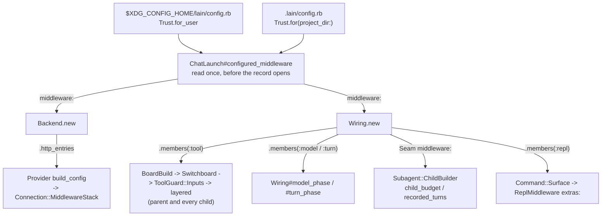
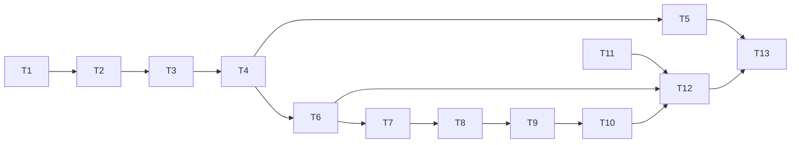

# Middleware declared in config.rb, at the user level and in the project

status: done
commit-mode: orchestrator-commits
language: ruby
panel: Ruby (Linus Torvalds, Jeremy Evans, Sandi Metz, Richard Schneeman, Aaron Patterson)

## Intent

A user can define a middleware in Ruby and register it into any of lain's 5 middleware areas from a
`config.rb`: the user-level `$XDG_CONFIG_HOME/lain/config.rb` and the project's `.lain/config.rb`.
The areas are `model`, `tool`, `turn` and `repl` (the `Lain::Middleware::Stack` phases) and `http`
(the Faraday stack under each provider). Every agent a chat runs gets the configured middleware,
subagents included.

Round 20 replaced `.lain/config.toml` with a trust-gated `.lain/config.rb` so that this step could
follow. Its Open decisions 1 and 2 (`planning/specs/qa-round-20-fixes.md:248-252`) are this plan.
It is also `ROADMAP.md`'s "User-injectable middleware (TODO 44)" line, and the direction recorded
on 2026-09-14 that reachability for middleware should come from real `lain chat` and `lain up`
wiring a user can extend.

## Grounding

Verified 2026-10-07 at `40ce3736` by 2 read-only explorations, a panel review that probed the suite,
and direct reads of:

- `lib/lain/config.rb`, `lib/lain/config/builder.rb`, `lib/lain/project/trust.rb`,
  `lib/lain/cli/trust.rb`, `exe/lain:1196-1203`, `lib/lain/paths.rb`, `lib/lain/project_dir.rb`
- `lib/lain/middleware.rb` (`Base`, `Stack`, `settles!`), `lib/lain/middleware/gate.rb` (`closes!`)
- `lib/lain/cli/chat_launch.rb:100-116,160-163,219,398-400` (`call`, `preflight`, `backend`,
  `converse`)
- `lib/lain/cli/wiring.rb:254,693-746,833-836,951-969,1003-1005` (`initialize`, `backing`,
  `model_phase`, `turn_phase`, `build_toolset`, `switchboard`, `verdict`, `assemble_surface`)
- `lib/lain/cli/tool_guard.rb:55-57,107-146,200-285`, `lib/lain/cli/switchboard.rb:103-110,191,212`,
  `lib/lain/cli/wiring/board_build.rb:50-62`
- `lib/lain/tools/subagent.rb:982-1015,1293-1365`, `lib/lain/cli/wiring/toolset_build.rb:214,270,320-355`
- `lib/lain/cli/repl_middleware.rb:33-38`, `lib/lain/cli/command/surface.rb:47-54,86-92`
- `lib/lain/provider/http/connection.rb:78`, `lib/lain/provider/http/connection/middleware_stack.rb`,
  `lib/lain/provider/http/configuration.rb:26,126-129`, `lib/lain/provider/anthropic.rb:116-131`,
  `lib/lain/provider/ollama.rb:608-612`, `lib/lain/provider/ollama/transport.rb:139,233-237`,
  `lib/lain/cli/backend.rb:188-191,264-270,637`, `lib/lain/cli/backend/ollama_tier.rb:176-182`
- `spec/support/isolated_state_home.rb`, `spec/support/nulls/no_switchboard.rb:30`,
  `spec/support/tool_registry.rb:52`

What the code says today:

- Nothing reads a user-level Ruby config. The only file lain has ever read from
  `$XDG_CONFIG_HOME/lain/` is `prompt.toml` (`lib/lain/frontend/prompt_composer.rb:164`). The old
  TOML config was `.lain/config.toml`, per project only (`git log -S config.toml`, retired in
  `5841e3cd`). The human recalled a user-level TOML file; history shows none.
- `Config::Builder::VERBS` is `epics approval isolation sensitivity shell tests`. No middleware verb.
- `Middleware::Stack` has `use`, `insert_before` and `insert_after`. No production code lets a user
  reach them. `ReplMiddleware.build(extras:)` exists and no caller passes `extras:`.
- `Lain.hook` appears only in `ROADMAP.md:600` as a sketch. It was never built.
- `Backend#provider` serves much more than chat: the bench (`exe/lain:789`, `bench/spawn_seam.rb`),
  `lain consolidate` (`cli/consolidate.rb:81,89`), `lain improve` (`cli/improve.rb:173,268`) and
  `lain epic submit` (`cli/epic_submit.rb:427`). So config is read in `ChatLaunch` and handed down,
  never read inside `Backend`.
- The suite isolates `XDG_STATE_HOME` (`spec/support/isolated_state_home.rb`) and leaves
  `XDG_CONFIG_HOME` pointing at the developer's real `~/.config/lain`. T4 closes that.
- The tool stack has 8 members (`spec/lain/cli_spec.rb:259-265`); the comment at
  `tool_guard.rb:238` and `docs/GLOSSARY.md:413-418` say 6. The code wins; T13 corrects the docs.
- Planning docs still say `config.toml` in places (`planning/epic-orchestration.md:273`,
  `planning/merge-conflict-handling.md:61`). They are historical and this plan leaves them.

## Compatibility

| Surface | Verdict | Evidence |
|---|---|---|
| `.lain/config.rb` DSL (verbs, refusal text) | must keep, additive only | live in every trusted project; `spec/lain/config/builder_spec.rb:70-83` pins the unknown-verb message, which gains `middleware` |
| `Project::Trust` digest of `.lain/*.rb` | must keep | marks in `$XDG_STATE_HOME/lain/trust/<digest>` on this machine; T4 gives the user file a domain-separated digest and leaves the project digest's inputs unchanged |
| `lain trust [PATH]` CLI | must keep, additive | `exe/lain:1196`; T5 adds `--user` |
| `Middleware::Stack` member order per phase | free to break | internal; specs pin it (`cli_spec.rb:259-265`, `wiring_spec.rb:3600-3626`) and stay green because an empty config adds nothing |
| `ToolGuard::Inputs` members | free to break | `Data` built at `switchboard.rb:212` and `tool_guard.rb:278` in `lib/`, and 6 spec sites including `spec/support/nulls/no_switchboard.rb:30` and `spec/support/tool_registry.rb:52`; the new member defaults to empty so none of them must change |
| `Provider::HTTP::Configuration` options | free to break | vendored from ruby_llm, internal; no consumer outside lain (grep of `~/dev` found only lain copies) |
| `ChatLaunch`, `Wiring`, `Backend`, `Surface`, `Subagent::Seam` constructors | free to break | internal; every new keyword defaults to empty |
| Env keys each phase hands a middleware | new public surface | nothing outside lain uses them yet; T13 documents them as the contract |
| gem `lain` 0.1.0 | no constraint | no release tags, CHANGELOG has only the initial entry, no consumers in `~/dev` |

No trade report: nothing must-keep blocks a simplification.

## Spike findings

| Question | Result | Evidence |
|---|---|---|
| Where does `class Stamp ... end` land when a config is `instance_eval`'d as a String, and does re-evaluating the same bytes collide? | It lands under the receiver's singleton class (`#<Class:0x...>::Stamp`), never at top level, so 2 evaluations make 2 distinct classes with no "already initialized constant" warning and no clash with Zeitwerk's `Lain::` tree. The class is `Ractor.shareable?`. Top-level constants (`Lain::Middleware::Base`) resolve. A bare `Middleware::Base` does NOT resolve, because the lexical scope is the singleton class, not `Lain`. | `ruby` 4.0.6 run of a 12-line script in the session scratchpad on 2026-10-07; no worktree was needed |
| Does the suite isolate `XDG_CONFIG_HOME`? | No. Inside `spec_helper`, `Paths.new.config_home` is `/home/tara/.config/lain` while `state_home` is a tmp dir. | panel probe `cfgmw_config_home_probe_spec.rb` in the session scratchpad |
| Do a user Trust and a project Trust over identical bytes share a mark? | Yes, with today's digest: basename plus bytes, and both files are `config.rb`. Granting only the project mark makes the user file trusted. | panel probe `cfgmw_digest_collision_probe.rb` in the session scratchpad |

Consequences: the docs (T13) tell a user to write `Lain::Middleware::Base` in full, and a refusal
names such a class by its anonymous path. The config memo (`Config.evaluated`) evaluates one set of
bytes once per process, so each class is defined once. T4 isolates the config home in the suite and
domain-separates the user digest.

## Shared files

Only the main session edits these. Cards hand back 1-line diffs.

- `ROADMAP.md`: item 53 for this plan, and the "User-injectable middleware (TODO 44)" line marked
  as planned here.
- `.rubocop.yml`: only if a card's stop condition says to raise a limit (own commit, with a reason).

## Design



The DSL, the same in both files:

```ruby
# ~/.config/lain/config.rb  or  <root>/.lain/config.rb
class TagRequests < Lain::Middleware::Base
  def initialize(tag:) = (@tag = tag)
  def call(env, &app) = downstream(env.merge(tag: @tag), &app)
end

middleware do
  model TagRequests, tag: "home"
  tool  { |env, &downstream| downstream.call(env) }   # a block becomes Middleware::Inline
  turn  SomeTurnMiddleware                            # must answer #settle; Base does
  repl  SomeReplMiddleware
  http  SomeFaradayMiddleware, header: "x-mine"       # a Class only; Faraday instantiates it
end
```

Rules the cards implement:

1. **Placement.** In every phase, configured middleware runs OUTERMOST, user-level first and then
   project, in the order written, ahead of every member lain builds. In the tool phase each guard
   judges whatever a user middleware passes on, and on the way back a user middleware sees results
   after `RedactSecretReads` has masked them. `Gate.closes!` still holds because `Sensitivity` and
   `Gate` stay last. In `http`, entries sit after stall protection and before `request :json`, so
   each retry attempt passes through them and they see the body as a Hash.
2. **Fresh instances.** A `model`, `tool`, `turn` or `repl` registration is a recipe:
   `Registration#build` makes a new instance each time a stack is built, so 2 agents never share
   one, as `Agent::Instrumentation`'s comment requires. Arguments are made Ractor-shareable at
   registration, so instances cannot share mutable state through them. **`http` is the exception:**
   Faraday builds handlers once per `Connection`, and children use the parent's provider
   (`subagent.rb:1297`), so 1 instance serves the parent and every child, concurrently. T13 says
   an `http` middleware must be thread-safe.
3. **One read per launch.** `ChatLaunch` reads `Config.middleware(root:)` once, before
   `open_chronicle`, and hands the value to `Backend` and `Wiring`. Nothing below `ChatLaunch` reads
   config for middleware, so an edit mid-launch cannot split the phases, and an untrusted or broken
   file refuses before a session record exists.
4. **Loud at load.** A registration that is not a Class with an instance `#call`, a `turn` class
   without `#settle`, an `http` block, an argument that cannot be made shareable, or an unknown area
   is refused as a `Config::Refusal` naming `path:line`. An `ArgumentError` from `new` at build time
   is re-raised as a `Refusal` at the line that registered it.
5. **Trust is consent to reviewed bytes.** The user file runs only after `lain trust --user` has
   marked its exact bytes, under a digest domain-separated from every project digest. This matches
   what project trust already is. It is not containment: an agent that can write
   `~/.config/lain/config.rb` can also write a mark under `$XDG_STATE_HOME/lain/trust/`, as it can
   for a project today. Containment is Open decision 2. The user file accepts only the `middleware`
   verb; the 6 project tables stay project-only.
6. **Scope.** `lain chat` and `lain up` (whose chat pane is `lain chat`), every subagent they spawn
   (epic issue workers spawned from a chat through `seam.with`, `toolset_build.rb:270`, included),
   and the approval-judge children built through `ToolGuard.refusing` (`tool_guard.rb:146`), which
   copy the board's inputs. Commands that build a `Backend` without a chat (`lain bench`,
   `lain consolidate`, `lain improve`, `lain epic submit`) and `ToolGuard.detached` read no config:
   a bench arm must not change with the user's home directory.

## Rejected options

- **Targeted placement (`insert_before Lain::Middleware::Gate`).** It would make the class names of
  lain's own guards a public API, and a member placed inside the guards could rewrite an effect
  after it was judged. Outermost-only has 1 rule, and the security posture does not depend on what
  the user writes.
- **A global registry (`Lain.hook :model do ... end`, the `ROADMAP.md:600` sketch).** Global mutable
  state, evaluated at require time, and 2 roots in 1 process (bench) would share it. The config memo
  keyed on path and bytes already gives the one-evaluation property.
- **Reading config where each stack is built** (`BoardBuild`, `Wiring`, `Surface`, `Backend`). 4
  reads per launch, each re-checking trust, and the `Backend` read would reach the bench and
  consolidate. Panel, 2026-10-07.
- **Implicitly trusting the user file.** Human ruling, 2026-10-07: gate it.
- **Sharing one digest between the user file and a project file.** A project mark over identical
  bytes would trust a file that runs in every project. Panel probe, 2026-10-07.
- **Letting the user file declare the 6 project tables.** Out of scope for this request, and it
  would need merge rules for `sensitivity` and `approval` that are security decisions of their own.
  Open decision 1.
- **Separate verbs per area at top level (`tool_middleware X`).** The block form matches `approval`
  and `epics` and reuses `Builder::Collector`.
- **A Faraday block form.** Faraday instantiates `use`'d classes itself with the app as the first
  argument; wrapping a Proc in a generated `Faraday::Middleware` subclass adds a class per block for
  no current caller.

## Open decisions

1. **User-level project tables** (`sensitivity`, `approval`, `shell` and the rest in
   `$XDG_CONFIG_HOME/lain/config.rb`). Not in this plan; no card depends on it.
2. **Containment of the config and trust paths.** No sensitivity table names
   `$XDG_CONFIG_HOME/lain/` or `$XDG_STATE_HOME/lain/trust/`, and `lain trust --yes` exists for
   headless runs. Gating agent writes to those paths would apply to project trust too, so it is its
   own plan. No card depends on it.
3. **Compaction as a middleware area.** Round 20 named it. Compaction is a context render pipeline
   (`CLI::ContextPipeline`, `--context-pipeline`), not a `Middleware::Stack`, so it would need its
   own stage registration. No card depends on it.
4. **Config middleware for commands without a chat** (bench, consolidate, improve, epic submit).
   Deferred by design (rule 6). No card depends on it.

## Dependency graph



T6 to T10 and T12 run in sequence because each adds a production-path example to
`spec/lain/cli/wiring_spec.rb` or `spec/lain/cli/chat_launch_spec.rb`, and several edit
`wiring.rb`. T11 runs in parallel with T1 to T10. T4 and T5 commit back to back, because T4's
refusal names `lain trust --user`, which T5 adds.

## Tasks

### [x] T1: Add Middleware::Inline, a block as a middleware          [risk: low]

**Depends on:** none
**Files:** `lib/lain/middleware/inline.rb`, `spec/lain/middleware/inline_spec.rb`
**Reuse:** `Middleware::Base#downstream` and `#settle` (`lib/lain/middleware.rb:42-65`)
**Shared-file wiring:** none
**Reachable from:** T2's `Registration#build` for a block registration, which T7 to T10 reach from
`ChatLaunch#configured_middleware`

**Acceptance criteria**

```gherkin
Scenario: a block wraps the rest of the stack
  Given an Inline over a block that merges tagged: true into env and calls downstream
  When a Stack of [inline] is called with an app that returns env
  Then the result carries tagged: true

Scenario: a block that does not call downstream short-circuits
  Given an Inline over a block that returns env.merge(response: "x")
  When a Stack of [inline] is called with an app that raises
  Then the result carries response: "x" and the app never ran

Scenario: an Inline settles
  Given an Inline over any block
  Then Middleware.settles!(Stack.new([inline])) does not raise
```
Spec file: `spec/lain/middleware/inline_spec.rb`

**Interface**

```ruby
module Lain
  module Middleware
    class Inline < Base
      def initialize(block) # the user's |env, &downstream| proc
      def call(env, &app)   # @block.call(env) { |e| downstream(e, &app) }
    end
  end
end
```

**Stop and report if:**
- A proc declared `|env, &downstream|` does not receive the block passed to `Proc#call` under Ruby
  4.0.6.
- `Middleware.settles!` needs more than `Base#settle` to accept an Inline.

### [x] T2: Add Config::Middleware, the registrations per area          [risk: medium]

**Depends on:** T1
**Files:** `lib/lain/config/middleware.rb`, `spec/lain/config/middleware_spec.rb`
**Reuse:** `Config::Refusal` (`lib/lain/config/refusal.rb`) for every refusal with `path:`, `table:`
and `key:`; the `TABLE` label convention of `Config::Answers::TABLE`
**Shared-file wiring:** none
**Reachable from:** T3's `Builder#middleware`, evaluated by `Config.built`, which T6's
`ChatLaunch#configured_middleware` reaches on every `lain chat`

**Acceptance criteria**

```gherkin
Scenario: a class registration builds a fresh instance each time
  Given a Config::Middleware with model registration [StampClass, kwargs {tag: "a"}] at "/p:3"
  When members(:model) is called twice
  Then each call returns 1 StampClass instance with tag "a", and the 2 instances are distinct objects

Scenario: registration arguments cannot carry shared mutable state
  Given a model registration [StampClass, kwargs {tags: ["a"]}]
  Then the tags Array each built instance receives is frozen

Scenario: an argument that cannot be made shareable is refused at its line
  Given a model registration whose kwargs hold a Proc that closes over a local, at "/p:8"
  Then building the Config::Middleware raises Config::Refusal naming "/p:8"

Scenario: a block registration builds an Inline
  Given a tool registration holding a block
  Then the built member is a Middleware::Inline that runs that block

Scenario: earlier registrations first, in written order
  Given registrations [A, B] for tool and other registrations [C] for tool
  When they are combined as first + other
  Then the tool members build as [A, B, C]

Scenario: a registration that cannot be a middleware is refused at its line
  Given a tool registration of the String "Stamp" at "/p:4"
  Then building the Config::Middleware raises Config::Refusal whose message names "/p:4" and says a middleware is a Class or a block

Scenario: a turn class without settle is refused at its line
  Given a turn registration of a Class whose instances answer call but not settle, at "/p:5"
  Then it raises Config::Refusal naming "/p:5" and "settle"

Scenario: an http block is refused
  Given an http registration holding a block at "/p:6"
  Then it raises Config::Refusal naming "/p:6" and saying http takes a Faraday middleware class

Scenario: wrong constructor arguments are refused at the registering line
  Given a model registration [StampClass] with no kwargs at "/p:7", where StampClass requires tag:
  When its members are built
  Then Config::Refusal names "/p:7" and carries the ArgumentError's message

Scenario: an empty value builds nothing
  Then Config::Middleware.empty builds [] for model, tool, turn and repl, and http_entries is []
```
Spec file: `spec/lain/config/middleware_spec.rb`

**Interface**

```ruby
module Lain
  class Config
    class Middleware
      AREAS = %i[model tool turn repl http].freeze
      TABLE = "`middleware`"

      Registration = Data.define(:factory, :args, :kwargs, :block, :at) do
        def build  # a fresh middleware instance; Refusal at `at` on ArgumentError
      end

      def self.empty
      def self.from(calls, path:)       # calls: Builder::Collector calls, verb = area
      def initialize(**by_area)          # each area a frozen Array<Registration>
      def +(other)                       # self's registrations first, per area
      def members(area)                  # Array of fresh instances (model/tool/turn/repl)
      def http_entries                   # frozen Array of [klass, *args, kwargs] for faraday.use
    end
  end
end
```

**Stop and report if:**
- `Ractor.make_shareable` on a registration's arguments also freezes something the caller still
  owns (a constant defined elsewhere in lain); refuse instead of freezing.
- `lib/lain/config/middleware.rb` trips `Metrics/ClassLength` or `Metrics/MethodLength`; split the
  validation into a private collaborator before raising any limit.
- `Config::Refusal.new` cannot carry the area name as `key:` without changing
  `spec/lain/config/refusal_spec.rb`.

### [x] T3: Read a middleware table from the project's config.rb          [risk: medium]

**Depends on:** T2
**Files:** `lib/lain/config/builder.rb`, `lib/lain/config.rb`, `spec/lain/config/builder_spec.rb`,
`spec/lain/config_spec.rb`
**Reuse:** `Builder::Collector` and `#collect` (`builder.rb:29-52,163`), `#declare` (`:145`),
`Config.built`'s trust and memo (`config.rb:81-108`)
**Shared-file wiring:** none
**Reachable from:** `Config.middleware(root:)`, which T6's `ChatLaunch#configured_middleware` calls
with `project.root`

**Acceptance criteria**

```gherkin
Scenario: a trusted project declares middleware
  Given a trusted .lain/config.rb that defines class Stamp < Lain::Middleware::Base and says middleware { tool Stamp }
  When Config.middleware(root:) is read
  Then members(:tool) is 1 instance of that Stamp class

Scenario: a block inside the area verb is kept
  Given a trusted .lain/config.rb saying middleware { model { |env, &downstream| downstream.call(env) } }
  Then members(:model) is 1 Middleware::Inline

Scenario: an unknown area is refused at its line
  Given a trusted .lain/config.rb whose line 2 says middleware { modle Stamp }
  Then Config.middleware raises Config::Refusal naming ".lain/config.rb:2" and listing model, tool, turn, repl, http

Scenario: declaring middleware twice is refused
  Given a trusted .lain/config.rb that calls middleware on 2 lines
  Then it raises Config::Refusal saying it declares middleware twice

Scenario: the unknown-verb message names the new verb
  Given a trusted .lain/config.rb whose line 4 says shel exclude: ["rm"]
  Then the refusal lists epics, approval, isolation, sensitivity, shell, tests, middleware

Scenario: no file or no table means no middleware
  Given a root with no .lain/config.rb
  Then Config.middleware(root:) equals Config::Middleware.empty

Scenario: an untrusted file refuses before any middleware is read
  Given an untrusted .lain/config.rb declaring middleware
  Then Config.middleware(root:) raises Project::Trust::Untrusted

Scenario: one evaluation serves every reader
  Given a trusted .lain/config.rb declaring middleware and a shell table
  When Config.middleware and Config.shell_exclusions are both read for that root
  Then the file was evaluated once
```
Spec files: `spec/lain/config/builder_spec.rb`, `spec/lain/config_spec.rb`

**Interface**

```ruby
class Lain::Config::Builder
  VERBS = %i[epics approval isolation sensitivity shell tests middleware].freeze
  Collector::Call = Data.define(:verb, :args, :kwargs, :block, :line)
  def middleware(&block)   # declare(:middleware, Config::Middleware::TABLE) { ... }
end
Lain::Config::Built      # gains :middleware, default Config::Middleware.empty
def Lain::Config.middleware(root:) # Config::Middleware; T4 widens it to user + project
```

**Stop and report if:**
- Adding `:block` to `Collector::Call` changes what `approval` or `epics` accept (a block passed to
  `allow` or `gate` must be ignored or refused exactly as today; check `builder_spec.rb:75-83`).
- `spec/lain/project/root_defaults_spec.rb` flags `Config.middleware`; its `root:` is required.
- `builder.rb` passes `Metrics/ClassLength`'s limit; move the call-to-registration translation into
  `Config::Middleware.from` rather than raising the limit.

### [x] T4: Read the user-level config.rb under its own trust          [risk: high]

**Depends on:** T3
**Files:** `lib/lain/paths.rb`, `lib/lain/project/trust.rb`, `lib/lain/config.rb`,
`lib/lain/config/builder.rb`, `spec/support/isolated_config_home.rb` (new),
`spec/lain/paths_spec.rb`, `spec/lain/project/trust_spec.rb`, `spec/lain/config_spec.rb`,
`spec/lain/config/builder_spec.rb`
**Reuse:** `Paths#config_home` (`paths.rb:227`), `ProjectDir::CONFIG_FILE` for the file name,
`Trust::Record`, `Trust#require!`, `Config.evaluated`'s memo, `Config::NOT_A_FILE`
(`config.rb:87-91`), `spec/support/isolated_state_home.rb` as the pattern for the new support file
**Shared-file wiring:** none
**Reachable from:** `Config.middleware(root:)`, called by T6's `ChatLaunch#configured_middleware`

**Acceptance criteria**

```gherkin
Scenario: the suite never reads the developer's config home
  Given the suite's spec_helper has loaded
  Then Paths.new.config_home is under the suite's tmp directory and not under the real ~/.config

Scenario: user then project
  Given a trusted user config.rb registering tool A and a trusted project config.rb registering tool B
  When Config.middleware(root:) is read
  Then members(:tool) builds as [A, B]

Scenario: the user file alone is enough
  Given a trusted user config.rb registering model A and a root with no .lain/
  Then members(:model) builds as [A]

Scenario: an untrusted user file refuses and names the remedy
  Given a user config.rb whose bytes have no trust mark
  When Config.middleware(root:) is read
  Then it raises Project::Trust::Untrusted whose message names the file, says it runs in every project, and names "lain trust --user"

Scenario: a project mark does not trust the user file
  Given a project .lain/config.rb and a user config.rb with identical bytes, and only the project marked
  Then Config.middleware raises Project::Trust::Untrusted for the user file

Scenario: one changed byte voids the user mark
  Given a trusted user config.rb
  When one byte of it changes
  Then Config.middleware raises Project::Trust::Untrusted

Scenario: the user file evaluates the bytes trust judged
  Given a trusted user config.rb
  When the file on disk is rewritten after Trust.for_user read it and before evaluation
  Then the evaluated registrations are the ones in the judged bytes

Scenario: the user file accepts only middleware
  Given a trusted user config.rb whose line 1 says shell exclude: ["rm"]
  Then it raises Config::Refusal naming that file and line 1, and saying shell belongs in a project's .lain/config.rb

Scenario: the user file location follows XDG
  Given env XDG_CONFIG_HOME=/x
  Then Paths#user_config is "/x/lain/config.rb"

Scenario: a user config path that is not a regular file refuses
  Given $XDG_CONFIG_HOME/lain/config.rb is a directory
  Then Config.middleware raises Project::Trust::Unreadable

Scenario: both trust lookups use the injected Paths
  Given a Paths over an env Hash whose state home holds both marks
  Then Config.middleware(root:, paths:) finds the user mark and the project mark there

Scenario: project readers ignore the user file
  Given an untrusted user config.rb and a root with a trusted .lain/config.rb
  Then Config.shell_exclusions(root:) and Config.load(root:) still answer
```
Spec files: `spec/lain/config_spec.rb`, `spec/lain/project/trust_spec.rb`,
`spec/lain/paths_spec.rb`, `spec/lain/config/builder_spec.rb`

**Interface**

```ruby
class Lain::Paths
  def user_config  # File.join(config_home, ProjectDir::CONFIG_FILE)
end

class Lain::Project::Trust
  USER_DOMAIN = "user"  # mixed into the user digest only; the project digest's inputs are unchanged
  def self.for_user(paths: Paths.new) # sources: {user_config => bytes} when it is a regular file;
                                      # Config refuses a path that exists and is not one (NOT_A_FILE)
  def initialize(root:, sources:, record:, domain: nil, untrusted: UNTRUSTED)
end

class Lain::Config
  def self.middleware(root:, paths: Paths.new) # user(paths:) + built(root, paths:).middleware
end

class Lain::Config::Builder
  USER_VERBS = %i[middleware].freeze
  def self.evaluate(source, path:, verbs: VERBS)  # Config.evaluated keys its memo on [path, source]
end
```

**Stop and report if:**
- `Trust.for_user` needs `ProjectDir` to know about `$XDG_CONFIG_HOME`; that breaks the split
  `paths.rb`'s header states (project `.lain/` and XDG are separate concerns).
- `spec/support/isolated_config_home.rb` cannot set `XDG_CONFIG_HOME` the way
  `isolated_state_home.rb` sets `XDG_STATE_HOME`, or any spec still resolves the real
  `~/.config/lain`.
- `Config.load`, `.sensitivity`, `.shell_exclusions` or `.test_layout` start reading the user file;
  only `.middleware` may.
- `spec/lain/project/trust_spec.rb`'s project digest examples change value.

### [x] T5: Let `lain trust --user` mark the user config          [risk: medium]

**Depends on:** T4
**Files:** `lib/lain/cli/trust.rb`, `exe/lain`, `spec/lain/cli/trust_spec.rb`
**Reuse:** `CLI::Trust#show`, `#confirmed?` and `NOTHING` (`cli/trust.rb:17-69`),
`Trust.for_user` from T4
**Shared-file wiring:** none
**Reachable from:** `exe/lain` `LainCLI#trust` -> `Lain::CLI::Trust.new(user: options[:user], ...)`

**Acceptance criteria**

```gherkin
Scenario: trusting the user file
  Given an untrusted $XDG_CONFIG_HOME/lain/config.rb
  When CLI::Trust is called with user: true and the input "y"
  Then it prints the file's bytes, writes the mark, and Config.middleware no longer raises Untrusted

Scenario: declining leaves it untrusted
  When CLI::Trust is called with user: true and the input "n"
  Then it raises CLI::Trust::Declined and no mark is written

Scenario: nothing to trust
  Given no user config.rb
  When CLI::Trust is called with user: true
  Then it says the user config does not exist, so there is nothing to trust

Scenario: --user with a PATH is refused
  When `lain trust --user some/dir` is run through LainCLI.start with debug: true
  Then it fails with a message saying --user takes no PATH

Scenario: the project form is unchanged
  When CLI::Trust is called with a root and no user flag
  Then it behaves as spec/lain/cli/trust_spec.rb pins today
```
Spec file: `spec/lain/cli/trust_spec.rb`

**Interface**

```ruby
class Lain::CLI::Trust
  def initialize(root:, input:, output:, paths: Paths.new, yes: false, user: false)
end
# exe/lain: method_option :user, type: :boolean, default: false,
#   desc: "Trust $XDG_CONFIG_HOME/lain/config.rb instead of a project's .lain/*.rb"
```

**Stop and report if:**
- `exe/lain`'s Thor `trust` command cannot take the flag without changing `spec/lain/cli_spec.rb`'s
  command listing.

### [x] T6: Read configured middleware once per chat launch          [risk: high]

**Depends on:** T4
**Files:** `lib/lain/cli/chat_launch.rb`, `lib/lain/cli/wiring.rb` (`initialize` only),
`lib/lain/cli/backend.rb` (`initialize` only), `spec/lain/cli/chat_launch_spec.rb`
**Reuse:** `ChatLaunch#preflight`'s existing `Config.load(root: project.root)` (`chat_launch.rb:163`)
and its comment on why config is evaluated before the record; `ChatLaunch#backend`
(`chat_launch.rb:219`); `@wiring_factory` (`chat_launch.rb:399`)
**Shared-file wiring:** none
**Reachable from:** `exe/lain` `LainCLI#chat` -> `ChatLaunch#call` -> `backend` ->
`Backend.new(..., middleware: configured_middleware)`, and `ChatLaunch#converse` ->
`Wiring.new(..., middleware: configured_middleware)`

**Acceptance criteria**

```gherkin
Scenario: one read serves the backend and the wiring
  Given a trusted .lain/config.rb declaring model and http middleware
  When ChatLaunch#call runs with a recording Config reader
  Then Config.middleware was read once, and the Backend and the Wiring hold the same value

Scenario: an untrusted user file refuses before any record exists
  Given an untrusted $XDG_CONFIG_HOME/lain/config.rb
  When ChatLaunch#call runs
  Then it raises Project::Trust::Untrusted and no session file was opened

Scenario: lain up's preflight refuses on the operator's terminal
  Given an untrusted $XDG_CONFIG_HOME/lain/config.rb
  When ChatLaunch#preflight runs
  Then it raises Project::Trust::Untrusted

Scenario: other commands read no config
  Given a trusted .lain/config.rb declaring http middleware
  When the bench's model_backend (exe/lain) builds a Backend
  Then that Backend's middleware is Config::Middleware.empty
```
Spec file: `spec/lain/cli/chat_launch_spec.rb`

**Interface**

```ruby
class Lain::CLI::ChatLaunch
  def configured_middleware # memoized Config.middleware(root: project.root)
end
class Lain::CLI::Backend
  def initialize(options, root:, ..., middleware: Config::Middleware.empty)
end
class Lain::CLI::Wiring
  def initialize(options:, ..., middleware: Config::Middleware.empty)
end
```

**Stop and report if:**
- `ChatLaunch#backend` is built before `resolve_project!` in a way that makes `project.root` the
  working directory; `call` reaches `backend.num_ctx` before `resolve_project!` today
  (`chat_launch.rb:109-112`), so confirm `project` resolves lazily to the same root.
- Any `lib/` site other than `ChatLaunch` would need to call `Config.middleware`.

### [x] T7: Put configured tool middleware outermost in every guarded stack          [risk: high]

**Depends on:** T6
**Files:** `lib/lain/cli/tool_guard.rb`, `lib/lain/cli/switchboard.rb`,
`lib/lain/cli/wiring/board_build.rb`, `lib/lain/cli/wiring.rb` (`switchboard` only),
`spec/lain/cli/tool_guard_spec.rb`, `spec/lain/cli/switchboard_spec.rb`,
`spec/lain/cli/wiring_spec.rb`, `spec/lain/tools/subagent_gate_spec.rb`
**Reuse:** `ToolGuard.layered` (`tool_guard.rb:241-255`), the one place members are listed;
`Middleware::Gate.closes!`; `Inputs`'s existing `scope:` default (`tool_guard.rb:57`) as the shape
for the new member's default
**Shared-file wiring:** none
**Reachable from:** `Wiring#switchboard` (`wiring.rb:951`) -> `BoardBuild.for(middleware: @middleware)`
-> `Switchboard.for(middleware:)` -> `Switchboard#initialize` -> `ToolGuard::Inputs.new(middleware:)`
(`switchboard.rb:212`); then `Wiring#backing` -> `ToolGuard.stack` -> `layered`, and
`Subagent::ChildBuilder#child_stack` -> `ToolGuard::Spawned#call` -> `child_stack` -> `working` ->
`layered`

**Acceptance criteria**

```gherkin
Scenario: a chat's tool stack starts with the configured middleware
  Given a Wiring built with a Config::Middleware holding tool [Stamp] (wiring_spec's production fixture, no injected stack)
  When Wiring#run builds the agent
  Then the agent's tool middleware classes are [Stamp, ConfineToScope, RefuseSecretWrites, RedactSecretReads, WithholdSecretPaths, GuardTestLayout, WithholdAutomaticOutput, Sensitivity, Gate]

Scenario: the guards still judge what a user middleware passes on
  Given a configured tool middleware that rewrites a read_file path to a classified secret path
  When the tool stack runs that call
  Then the effect is withheld or gated exactly as if the model had named the secret path

Scenario: every child gets its own instance
  Given a configured tool middleware class
  When 2 children are built through ToolGuard::Spawned
  Then each child's first tool member is a distinct instance of that class, and Gate.closes! passes for both

Scenario: RefuseUnpermitted still sits just before Sensitivity
  Given a configured tool middleware and a handler_union posture
  When a child stack is built
  Then RefuseUnpermitted is immediately before Sensitivity and the configured member is first

Scenario: a detached run reads no config
  When ToolGuard.detached(journal:) builds a stack
  Then its first member is ConfineToScope

Scenario: no config keeps today's stack
  Given a Wiring built with no middleware keyword
  Then the tool stack is the 8 classes spec/lain/cli_spec.rb pins today
```
Spec files: `spec/lain/cli/wiring_spec.rb`, `spec/lain/cli/tool_guard_spec.rb`,
`spec/lain/tools/subagent_gate_spec.rb`, `spec/lain/cli/switchboard_spec.rb`

**Interface**

```ruby
ToolGuard::Inputs = Data.define(..., :middleware) # defaults to Config::Middleware.empty, as scope: defaults
# layered: Stack.new([*inputs.middleware.members(:tool), ConfineToScope..., Sensitivity, Gate])
BoardBuild.for(chronicle:, options:, model:, toolset:, project:, paths: Paths.new, verdict: ...,
               middleware: Config::Middleware.empty)
Switchboard.for(..., middleware: Config::Middleware.empty)
```

**Stop and report if:**
- `spec/support/nulls/no_switchboard.rb:30` or `spec/support/tool_registry.rb:52` must change; the
  default exists so they need not.
- `spec/lain/consolidation_spec.rb:263` (guard-stack class parity between 2 builders) needs to
  change; detached and chat stacks must still agree on lain's own members.
- Explaining the new first members would need a WHAT comment at `tool_guard.rb:238`; name a method
  instead.

### [x] T8: Put configured model and turn middleware outermost in a chat          [risk: medium]

**Depends on:** T7
**Files:** `lib/lain/cli/wiring.rb`, `spec/lain/cli/wiring_spec.rb`
**Reuse:** `Wiring#model_phase` and `#turn_phase` (`wiring.rb:731-746`); `@middleware` from T6
**Shared-file wiring:** none
**Reachable from:** `ChatLaunch#converse` -> `Wiring#run` -> `wire_agent` -> `build_agent` ->
`agent_over` -> `backing` -> `model_phase` and `turn_phase`

**Acceptance criteria**

```gherkin
Scenario: the model stack starts with configured middleware
  Given a Wiring built with model [Stamp]
  When Wiring#run builds the agent
  Then the model stack's classes start [Stamp, RequestBudget] and end with ResolveAttachments

Scenario: a configured model middleware sees the round trip
  Given a configured model middleware that records env[:response] after downstream
  When the agent completes 1 turn against Provider::Mock
  Then the recorded response is the one the agent committed

Scenario: the turn stack starts with configured middleware
  Given a Wiring built with turn [Settling]
  Then the turn stack's classes start [Settling, ResolveWindow]
```
Spec file: `spec/lain/cli/wiring_spec.rb`

**Stop and report if:**
- `wiring_spec.rb:3600-3626` (turn order and `%i[window chronicle]` trail) changes under an empty
  config.
- `wiring.rb` trips `Metrics/ClassLength`; move the 2 phase builders into an existing `Wiring::`
  shard before any limit moves.

### [x] T9: Give each subagent its own configured model and turn middleware          [risk: medium]

**Depends on:** T8
**Files:** `lib/lain/tools/subagent.rb`, `lib/lain/cli/wiring/toolset_build.rb`,
`lib/lain/cli/wiring.rb` (`build_toolset` only), `spec/lain/tools/subagent_spec.rb`,
`spec/lain/cli/wiring_spec.rb`
**Reuse:** `ChildBuilder#child_budget` and `#recorded_turns` (`subagent.rb:1325-1365`);
`Seam#initialize`'s keyword validation (`subagent.rb:982-1015`); `@middleware` from T6
**Shared-file wiring:** none
**Reachable from:** `Wiring#build_toolset` -> `ToolsetBuild.new(middleware: @middleware)`
(`wiring.rb:834`) -> `ToolsetBuild#spawn_seam` -> `Subagent::Seam.new(middleware:)` ->
`ChildBuilder#spawn_agent`

**Acceptance criteria**

```gherkin
Scenario: a child's model stack starts with configured middleware
  Given a Seam carrying a Config::Middleware with model [Stamp]
  When a child agent is built
  Then its model stack's classes are [Stamp, RequestBudget, ResolveAttachments]

Scenario: a child's turn stack starts with configured middleware
  Given a Seam carrying turn [Settling]
  Then the child's turn stack's classes are [Settling, JournalTurns]

Scenario: parent and child never share an instance
  Given a Wiring built with a configured model middleware class
  When the chat builds its agent and spawns 1 child (wiring_spec production fixture)
  Then the parent's and the child's first model members are distinct instances of that class

Scenario: a grandchild inherits through seam.with
  Given a Seam carrying model [Stamp]
  When seam.with(...) derives a seam for a grandchild
  Then the derived seam carries the same Config::Middleware

Scenario: a Seam without middleware keeps today's stacks
  Given a Seam built with no middleware keyword
  Then the child's stacks are the ones spec/lain/tools/subagent_spec.rb pins today
```
Spec files: `spec/lain/tools/subagent_spec.rb`, `spec/lain/cli/wiring_spec.rb`

**Interface**

```ruby
class Lain::Tools::Subagent::Seam
  def initialize(..., middleware: Config::Middleware.empty)
  attr_reader :middleware
end
class Lain::CLI::Wiring::ToolsetBuild
  def initialize(..., middleware: Config::Middleware.empty)
end
```

**Stop and report if:**
- A grandchild's seam is built anywhere other than from the parent's seam, so it would miss the
  value.
- `spec/lain/tools/subagent_posture_equivalence_spec.rb` compares stacks across postures and
  disagrees once a member is added.

### [x] T10: Put configured repl middleware ahead of skill dispatch          [risk: low]

**Depends on:** T9
**Files:** `lib/lain/cli/command/surface.rb`, `lib/lain/cli/wiring.rb` (`assemble_surface` only),
`spec/lain/cli/command/surface_spec.rb`, `spec/lain/cli/wiring_spec.rb`
**Reuse:** `ReplMiddleware.build(extras:)` (`repl_middleware.rb:33-38`), already outermost and
pinned by `spec/lain/repl_middleware_spec.rb:80`
**Shared-file wiring:** none
**Reachable from:** `Wiring#build_repl` -> `assemble_surface` (`wiring.rb:1003`) ->
`Command::Surface.new(middleware: @middleware)` -> `Surface#middleware` ->
`ReplMiddleware.build(extras: @configured.members(:repl))`

**Acceptance criteria**

```gherkin
Scenario: a configured repl middleware wraps every non-command line
  Given a Wiring built with repl [a block that upcases env[:text] and calls downstream]
  When the Repl built by Wiring#run handles the line "hi"
  Then the agent receives "HI"

Scenario: the repl stack order
  Given a Surface built with repl [Echo]
  Then Command::Surface#middleware's classes are [Echo, SkillDispatch]

Scenario: no config keeps today's stack
  Given a Surface built with no middleware keyword
  Then Command::Surface#middleware's classes are [SkillDispatch]
```
Spec files: `spec/lain/cli/command/surface_spec.rb`, `spec/lain/cli/wiring_spec.rb`

**Interface**

```ruby
class Lain::CLI::Command::Surface
  def initialize(..., middleware: Config::Middleware.empty)
end
```

**Stop and report if:**
- `Surface#middleware`'s memo (`surface.rb:90`) is read before the Surface holds its middleware
  value in any production path.

### [x] T11: Let a provider configuration carry Faraday middleware          [risk: medium]

**Depends on:** none
**Files:** `lib/lain/provider/http/configuration.rb`,
`lib/lain/provider/http/connection/middleware_stack.rb`,
`spec/lain/provider/http/configuration_spec.rb`,
`spec/lain/provider/http/connection/middleware_stack_spec.rb` (new)
**Reuse:** `Configuration.option` (`configuration.rb:26`); the `respond_to?` stance for options
added after vendoring (`middleware_stack.rb`'s `connect_budget` and `stall_grace` comments)
**Shared-file wiring:** none
**Reachable from:** `Provider::HTTP::Connection#initialize` -> `MiddlewareStack#build`, for every
Anthropic and Ollama provider; T12 supplies the entries

**Acceptance criteria**

```gherkin
Scenario: entries run around every attempt
  Given a Configuration whose http_middleware is [[Counter, {}]] and max_retries 2
  And a Faraday test adapter that returns 503 twice and then 200
  When a Connection posts once
  Then Counter saw 3 requests

Scenario: entries see the body before JSON encoding
  Given an http middleware that records env.body's class
  When a Connection posts a Hash payload
  Then the recorded class is Hash

Scenario: 2 configurations never share a default
  Then Configuration.new.http_middleware is frozen and empty for every instance

Scenario: no entries keeps today's stack
  Given a Configuration with no http_middleware
  Then the built Faraday handlers are the ones built today, in today's order

Scenario: a configuration-alike without the option still builds
  Given a config double that does not respond to http_middleware
  Then MiddlewareStack#build succeeds
```
Spec files: `spec/lain/provider/http/connection/middleware_stack_spec.rb`,
`spec/lain/provider/http/configuration_spec.rb`

**Interface**

```ruby
# Configuration: option :http_middleware, [].freeze   # Array of [klass, *args, kwargs]
# MiddlewareStack#build: setup_timeout, setup_logging, setup_retry, setup_stall_protection,
#   setup_configured, setup_middleware, setup_http_proxy
```

**Stop and report if:**
- Placing entries after `request :retry` stops `retry_block` from firing in
  `spec/lain/provider/http/error_handling_spec.rb`.
- `StackLocked` fires because an entry is added after the first request.

### [x] T12: Hand the configured http middleware to every chat provider          [risk: medium]

**Depends on:** T11, T6, T10
**Files:** `lib/lain/cli/backend.rb`, `lib/lain/cli/backend/ollama_tier.rb`,
`lib/lain/provider/anthropic.rb`, `lib/lain/provider/ollama.rb`,
`lib/lain/provider/ollama/transport.rb`, `spec/lain/cli/backend_spec.rb`,
`spec/lain/provider/ollama/transport_spec.rb`
**Reuse:** `Backend#provider` (`backend.rb:264-270`), the `middleware:` T6 stored on `Backend`,
`Config::Middleware#http_entries`; both providers' `build_config`; `probe_config`
(`ollama/transport.rb:233-237`)
**Shared-file wiring:** none
**Reachable from:** `ChatLaunch#backend` -> `Backend.new(middleware: configured_middleware)` ->
`Backend#provider` -> `anthropic_provider` / `OllamaTier#provider` -> `Provider::Anthropic.new` /
`Provider::Ollama.local` / `.cloud` -> `build_config`

**Acceptance criteria**

```gherkin
Scenario: the chat provider carries the entries
  Given a Backend built with http [Counter]
  When Backend#provider builds the anthropic provider
  Then its Configuration's http_middleware is [[Counter, {}]]

Scenario: both ollama arms carry the entries
  When the same Backend builds the local and the cloud ollama arm
  Then each Configuration's http_middleware is [[Counter, {}]]

Scenario: the summarizer tier carries them too
  When Backend#summarizer_provider builds a provider
  Then its Configuration's http_middleware is [[Counter, {}]]

Scenario: the ollama probe carries none
  Given an ollama provider whose Configuration has http_middleware [[Counter, {}]]
  Then the transport's probe_config has http_middleware []

Scenario: an injected config is left alone
  Given a Provider::Anthropic built with an explicit config:
  Then that config's http_middleware is not rewritten

Scenario: a Backend with no middleware keyword adds nothing
  Given a Backend built without middleware:
  Then every provider it builds has http_middleware []
```
Spec files: `spec/lain/cli/backend_spec.rb`, `spec/lain/provider/ollama/transport_spec.rb`

**Interface**

```ruby
# Provider::Anthropic.new(..., http_middleware: [])  and  Provider::Ollama.new(..., http_middleware: [])
# each build_config sets config.http_middleware = http_middleware
# Ollama::Transport#probe_config clears http_middleware on its copy
```

**Stop and report if:**
- `Backend#provider` or anything under it calls `Config`; the value must arrive through
  `Backend.new`.
- `Ollama`'s deployment `apply` (`ollama.rb:609`) overwrites `http_middleware`, the same ordering
  trap its comment describes for `--api-base`.

### [x] T13: Document the middleware table, the user file and its trust          [risk: low]

**Depends on:** T5, T12
**Files:** `docs/commands.md`, `README.md`, `ARCHITECTURE.md`, `docs/GLOSSARY.md`,
`lib/lain/cli/tool_guard.rb` (the guard-count comment at `:238` only),
`planning/qa/scenarios/config-middleware.md` (new), `planning/qa/README.md`,
`spec/docs_config_examples_spec.rb` (new)
**Reuse:** `docs/commands.md:793-850` ("Configuration (config.rb)") as the section to extend;
`spec/docs_naming_spec.rb` as the pattern for a spec that reads `docs/commands.md`
**Shared-file wiring:** `ROADMAP.md`: item 53 marked landed with the SHA range
**Reachable from:** `spec/docs_config_examples_spec.rb` reads `docs/commands.md`; this card adds no
runtime behavior

**Acceptance criteria**

```gherkin
Scenario: every documented example evaluates
  Given each Ruby block under "Configuration (config.rb)" in docs/commands.md
  When it is evaluated by Config::Builder.evaluate in a spec
  Then none raises
```
Spec file: `spec/docs_config_examples_spec.rb`

Checked by the reviewer, not by a spec (manual):

- `docs/commands.md` lists, for each of model, tool, turn and repl, the env keys a middleware
  receives and must pass on, read from `ModelCaller#call`, `ToolRunner#dispatch`, `Agent#run_loop`
  and `Repl#middleware_env`.
- It says an `http` middleware is 1 instance per provider shared by the parent and every child, so
  it must be thread-safe, and that faraday-retry hands the same body object to each attempt, so an
  in-place edit repeats per retry.
- It says trust is consent to reviewed bytes, and names `lain trust --user`.
- `docs/GLOSSARY.md` and the `tool_guard.rb:238` comment name 8 members, plus configured ones
  outermost.
- `planning/qa/scenarios/config-middleware.md` covers trusting the user file, a refused untrusted
  edit, a tool middleware in a live cockpit, and a subagent inheriting it, and
  `planning/qa/README.md` lists it in run order.

**Stop and report if:**
- `docs/commands.md:803`'s claim that every launch is refused contradicts `config.rb:81-84` (a
  missing file is never refused); correct the doc, not the code.

## Integration checks

After the last card lands:

1. `pgrep -cf 'mise/installs/ruby/[0-9.]*/bin/parallel_rspec'` reads 0, then
   `bundle exec rake pspec`. Compare the example COUNT against the pre-plan baseline plus the new
   examples.
2. `bundle exec rubocop`, `bin/comment-census --check-tickets`, `bin/zeitwerk-census --check`.
3. `bin/spec-census --check` (ceilings 184 and 76 must hold).
4. With a real `~/.config/lain/config.rb` present and untrusted, `bundle exec rspec` stays green:
   the suite must not read it.
5. **Manual pass the human owes:** run `planning/qa/scenarios/config-middleware.md` with
   `/manual-qa config-middleware` against a real `lain up` cockpit and a local model. It covers what
   no spec reaches: a refused launch printing `lain trust --user`, and a configured `http` middleware
   seeing a real streamed Ollama request.

## Execution log


- 2026-10-07: base `main` at `40ce3736`. `git worktree list`: only `/home/tara/dev/lain`.
  Branches at start: `flake/review`, `main`, `spike/combined`, `spike/combined2`.
- Hook (`.pre-commit-config.yaml`): pre-commit-hooks basics, shellcheck, cargo fmt/clippy/test
  and cargo deny on Rust or Cargo files only, `rake compile check` (rubocop plus the full `pspec`)
  on any Ruby or Rust file, `yard-lint --staged` on Ruby, `bin/lint-gherkin-docs` on staged
  `planning/specs/*.md`, and `bin/lint-commit-msg` at commit-msg. A Ruby commit takes about 70s.
  The suite cannot run beside another suite (shared `TMPDIR`), so cards land in windows.
- Grounding re-checked: the plan was verified at `40ce3736`, which is the base. No drift.
- T1 started
- T11 started
- T1 landed 7f47b802
- T11 landed a3fb62f0
- T2 started
- T2 landed 2dbd54a1
- T3 started
- T3: the review called `Config::Middleware`'s "has no area" refusal dead code. It is pinned by
  `spec/lain/config/middleware_spec.rb` and guards the public `Middleware.from`, so it stays.
- T3 hook run 1 red: `Lain::CLI::HumanReplies a question settled elsewhere while human> is open for
  it stops the read, retires the item, and draws no human> for it on the next three lines`, seed
  40099. Green alone. Seed 40099 on base `2dbd54a1`: that example green, but the documented flake
  `Lain::Tools::ReadFile ... reads at most a bounded probe of the file it refuses, and never slurps
  it` red (its 2nd sighting). Seed 40099 on the T3 tree: 22,069 examples, 0 failures (base 22,057).
  Not caused by T3 and not reproduced; T3 landed on a new-seed hook run.
- T3 landed b51cc26b
- The human has another session reworking `/manual-qa`, which touches `planning/qa/`. T13 writes
  `planning/qa/scenarios/config-middleware.md` and edits `planning/qa/README.md`: re-read both
  before T13 starts.
- T4 started
- abe46807 landed from another session (manual-qa docs, planning/qa/README.md top 3 lines). T4 worktree was cut at b51cc26b, before it; no file overlap.
- T4 deviations accepted by review: `untrusted:` replaces `refusal:` (spec/refusal_width_discipline_spec.rb reads any `refusal:` keyword as editor text); the memo key drops `verbs`; the config-home check is "not under ~/.config", since the suite TMPDIR is under $HOME. Card text updated. Scope change: spec/lain/cli/chat_launch_spec.rb:658 now matches with hash_including.
- T4 landed 4079a42a
- T5 started
- T6 started
- T5 landed b5078391
- T6 review: REQUEST-CHANGES. The untrusted-user-file example could not fail (a late-opened session file is reaped before the check). Accepted a design change: Wiring takes no `middleware:` keyword and reads `backend.middleware`, so one value has one path. T7 to T10 read `@middleware` from that source.
- Pre-existing, not from this plan: about 187 examples in wiring_spec and backend_spec fail under LC_ALL=C on main (T6 reviewer).
- T6 approved on its second review (APPROVE). Hook run red on the same HumanReplies example as T3,
  seed 11428: expected "(human> closed -- answered elsewhere)", got "(human> closed -- the ask
  waiting on it was stopped)". 2 sightings on 2 unrelated cards. A fix runs in
  `tmp/worktrees/flake-hr` before T6 lands. T7 started on HEAD plus T6's approved files.
- T7 started
- T7 review: APPROVE-WITH-FIXES. Substantive fix accepted, extending scope to lib/lain/tools/subagent.rb: RefuseUnpermitted is placed with an is_a? match on Sensitivity, so a configured member subclassing Sensitivity would put it outside the user member. Second review follows.
- T7 approved on its second review. T8 started on HEAD plus T6 and T7 approved files.
- From here, at the human's request (a game running): commits run `direnv exec . env LAIN_SPEC_WORKERS=4 git commit`, and agents keep parallel spec runs at 4 workers. Expect a slower hook (about 3 min) and more wall-clock reds from the extra load.
- T8 approved (mechanical fixes applied). T9 started on HEAD plus T6, T7 and T8 approved files.
- Race fix reworked after REQUEST-CHANGES; second review running. Side sighting during it: `spec/lain/cli/review_spec.rb` "the released text once the run's ledger holds the release" red once in a bare parallel spec/lain/cli/ run, green alone and in a LAIN_SLOW run.
- T9 review: APPROVE-WITH-FIXES (1 comment). Follow-up not in this plan: give Config::Middleware value `==` and `hash`, which would retire Subagent::Seam::NO_MIDDLEWARE. `lain epic submit` building its Seam without middleware is intended (Design rule 6).
- T9 approved. T10 started on HEAD plus T6 to T9 approved files.
- T10 approved. T12 started on HEAD plus T6 to T10 approved files.
- Race fix second review: REQUEST-CHANGES (the rework can leave a read claimed forever on a ScriptError or Async::Stop). Fixes sent to the implementer; the human is asked whether a third review may run.
- User ruled: a third review of the race fix may run. T12 approved. T13 started on HEAD (which has abe46807) plus T6 to T12 approved files.
- Race fix third review: REQUEST-CHANGES, 1 mechanical blocker (a read stays claimed if `settled` raises after hand-off). Applied without a fourth review, per the mechanical-fix rule; the main session checks the probes itself.
- Landed: race fix de3320ac, T6 5ec4c2e7, T7 28b00e16. T8 hook red: spec/lain/seams/window_self_correction_spec.rb (:slow) calls the private turn_phase with the old 2 arguments; 8 examples, a real failure, not a flake. Back to the implementer with a spec-only fix preferred, since 4 later worktrees carry the new wiring.rb.
- Landed: T8 ea19a1e8 (after a spec-only fix to window_self_correction_spec), T9 b075bd06, T10 bada6a54. T12 hook red: spec/provider_construction_discipline_spec.rb finds ollama_tier.rb:179 and :182 constructing Provider::Ollama with no journal visible; a real failure. Back to the implementer.
- T12 hook run 2 red on 4 timing specs: `typing in a real cockpit while the model is busy stops the next model call when /stop is typed after the approval was answered in nvim`, `a chat fed by an input pane ends only the pane on HUP, and the chat answers a line from a respawned pane`, `a chat fed by an input pane takes a countdown key pressed at a countdown that opened under an open read`, `Lain::Isolation::WorkingBranch#current_in? is true only while the checkout's HEAD is on the branch`. Each green alone; base suite green at 4 workers; T12 tree suite green at 4 workers. Load from the human's game; not caused by T12.
- T13 hook run 1 red: `typing in a real cockpit while the model is busy consumes the question when an ask parked on it is stopped` (spec/e2e/stop_while_busy_spec.rb, the same file as a T12 load flake). Green alone; T13 changes docs and 1 comment only; base 35ffa335 green in its own hook.
- Landed: T12 35ffa335 (after a fix that spells `journal:` out at both ollama_tier.rb constructions),
  T13 88bd8680. The ROADMAP.md wiring went into the close-out commit, since it names the SHA range.
- Integration checks, 2026-10-07, at 4 workers:
  1. `rake pspec`: 22,145 examples, 0 failures, 13 pending. For scale, 22,057 at `2dbd54a1` on seed
     40099, before T3 to T13 and the race fix.
  2. `rubocop`, `bin/comment-census --check-tickets`, `bin/zeitwerk-census --check`: all exit 0.
  3. `bin/spec-census --check`: exit 0.
  4. Untrusted real `~/.config/lain/config.rb` during `bundle exec rspec`: see the next entry.
  5. Manual pass owed by the human: `/manual-qa config-middleware`.
- `git worktree list` and `git branch --list` match the start of the run.
- Check 4: a real `~/.config/lain/config.rb` whose first line raises was in place during `bundle exec rspec`: 20,567 examples, 0 failures, 13 pending. The file and directory were removed afterwards (neither existed before).
