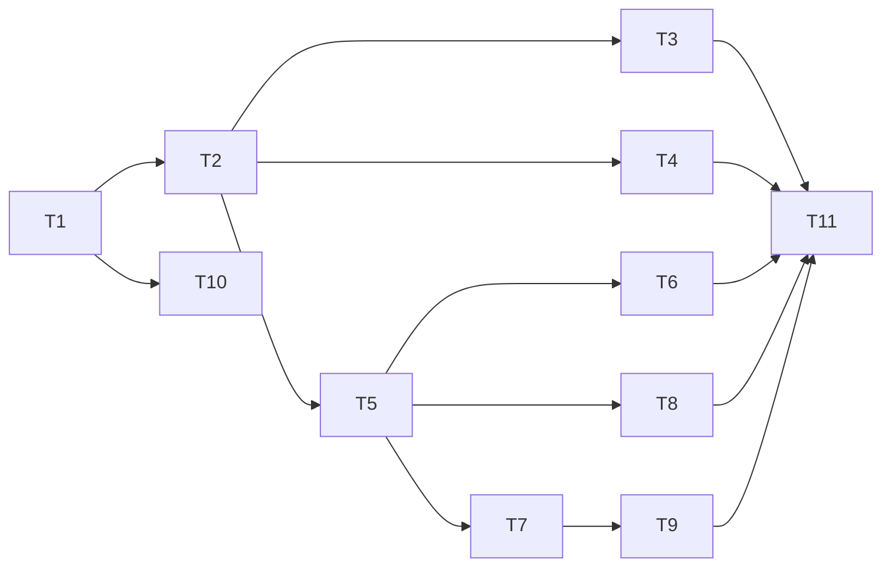

# End-to-end journeys over the real binary

status: done
commit-mode: orchestrator-commits
language: ruby
panel: Linus Torvalds, Jeremy Evans, Sandi Metz, Richard Schneeman, Aaron Patterson

## Intent

Add a small tier of automated journeys that run this checkout's real `exe/lain` (plain chat, and the `lain up` cockpit with tmux and nvim) against a spec-owned stand-in for ollama. The stand-in replays VCR-format cassettes recorded from a real local ollama, so the journeys run offline in `rake pspec` and the commit hook. Each journey takes sections off the manual QA scenarios, so `/manual-qa` rounds can skip what the suite now drives. Where a journey reproduces every assertion of an older seam spec that only approximated the binary, the old examples are deleted and the run time of both is recorded.

The suite has 21,603 examples and none drives `lain up` through a model turn. Every manual QA round since round 4 found its defects in seams with specs on both sides (`planning/qa/README.md`).

## Grounding

Checked 2026-10-03 at `c2606a82`.

Files read or surveyed: `spec/support/{vcr_configuration,webmock_configuration,network_access,cassette_hygiene,ollama_wire,ollama_probe,ollama_tag,streaming_upstream,isolated_tmux,headless_editor,warm_pool,warm_cockpit,seed_repo,trusted_project,slow_files,tags,endpoint_env}.rb`, `spec/fixtures/vcr_cassettes/*`, `spec/lain/seams/{recorded_run,terminal_gone,stop_ask,typed_during_ask,input_pane_socket,cockpit_answer_surfaces,plain_chat_prompt_guards,crash_mid_tool}_spec.rb`, `spec/lain/cli/up_spec.rb`, `spec/lain/provider/ollama_recorded_spec.rb`, `lib/lain/provider/ollama{,/transport,/encoding,/deployment}.rb`, `lib/lain/tools/subagent.rb` (`ModelChoice`), `lib/lain/skill/catalog.rb`, `lib/lain/middleware/skill_dispatch.rb`, `lib/lain/cli/backend.rb`, `lib/lain/frontend/neovim/runtime/62_approval.lua`, `exe/lain`, `.claude/skills/manual-qa/SKILL.md` and `scripts/qa-sandbox.sh`, `planning/qa/{README,method}.md`, all 18 files in `planning/qa/scenarios/`, `planning/qa-findings-round{11,13,14,15,16,17,18,19,20}-*.md` and their fix plans.

Facts the cards rely on:

- `exe/lain` has no mock provider. `--provider` takes `anthropic`, `ollama` or `ollama-cloud` (`lib/lain/cli/backend.rb:76`). A scripted or recorded model reaches a subprocess only through `--api-base` / `$LAIN_API_BASE`.
- A base on `127.0.0.1` counts as local, so `lain` probes it with `GET /api/ps` (a varying number of times per run) and `POST /api/show`. Turns are `POST /api/chat` with `stream: true`, NDJSON back. Nothing in `lib/` calls `/api/tags`.
- Every `/api/chat` body carries `options.num_predict` (`lib/lain/provider/ollama/encoding.rb:224`). `num_batch` defaults to 2048 (`lib/lain/cli/backend.rb:69`).
- VCR is in-process only. The repo convention is match on method and URI, played in recorded order, no body matching (`spec/support/vcr_configuration.rb:228-247`), re-recorded with `LAIN_RECORD=ollama` after deleting the file.
- `spec/support/endpoint_env.rb:93-99` deletes the `LAIN_*` endpoint variables at load, so a subprocess must get them explicitly.
- `spec/support/**/*.rb` loads in sorted order: `e2e/` after `cassette_hygiene.rb` and before `streaming_upstream.rb`. `SlowFiles.verify!` raises at load on a path that does not exist (`spec/support/tags.rb:266`).
- The cassette-hygiene sweep reads `Dir.glob("ollama_*.yml")` at the cassette root only, through `CassetteHygiene.findings_in(paths)` (`spec/lain/provider/ollama_recorded_spec.rb:184`, `spec/support/cassette_hygiene.rb:132`).
- A forward to ollama from the rspec process is blocked by WebMock unless `NetworkAccess.permit_loopback(port)` is held (`spec/support/network_access.rb:417-431`), which only allows loopback hosts.
- A skill at `.lain/skills/<name>/skill.md` with front-matter `model:` binds its role spawn's child to that model (`lib/lain/skill/catalog.rb:50`, `lib/lain/middleware/skill_dispatch.rb:136`). Project skills need no trust.
- Panes inherit the tmux server's environment, not the client's (`lib/lain/cli/pane_command.rb:32`). `lib/lain/paths.rb:198` and `lib/lain/project/resolver.rb:291` read `HOME`.

Where docs and code disagreed:

- `planning/qa/README.md` and the manual-qa skill quote a suite of about 14,000 examples. The suite is 21,603 (`LAIN_SLOW=1 bundle exec rspec --dry-run`). The code wins; T11 corrects the docs it touches.
- A scenario survey claimed no spec drives a chat through the real binary. `spec/lain/seams/terminal_gone_spec.rb:91` does, against a stand-in that never replies.
- Fix plans for rounds 16 to 20 cite 10 spec paths that no longer exist (for example `spec/lain/cli/command/small_spec.rb`, `spec/lain/frontend/reline_spec.rb`). No card here depends on them.

## Compatibility

| Surface | Verdict | Evidence |
|---|---|---|
| `spec/support/` helpers | free to break | Test code; no consumer outside `spec/`. |
| `spec/fixtures/vcr_cassettes/` layout | free to break | Read only by specs. New cassettes go in a new `e2e/` subdirectory; existing ones are untouched. |
| `LAIN_RECORD` convention | must keep | `vcr_configuration.rb:51-66`, documented in `recorded_run_spec.rb:47-85`. The recorder honours the same variable and values. |
| `spec/support/slow_files.rb`, `tags.rb` tiers | free to break | Internal; `rake pspec`, the hook and CI go through them. |
| `exe/lain` flags and session file format | must keep | The journeys drive them as they are, and the user's sessions are stored in this format. No lib change is planned. |
| `planning/qa/` scenario docs, manual-qa skill | free to break | Internal docs. |

Gem version 0.1.0, no release tags, and the user's standing note says no back-compat is needed for lain itself.

User decisions (2026-10-03): journeys run in `rake pspec`, the hook and CI, slow-gated so a bare `rspec` skips them; older specs are deleted only when a journey reproduces every assertion, with the run time of old and new recorded and a stop if the new way is much worse; cassettes record against `qwen3:4b`, and a second local model (`lfm2.5:latest`) drives a skill child so a one-shot on another model is wired end to end. The wire-contract journey asserts on request bodies the stand-in sees, which is the subprocess equivalent of `allow(...).to receive(...).and_call_original`.

## Spike findings

| Question | Result | Evidence |
|---|---|---|
| Can a spec-owned server record a real `exe/lain chat` tool turn by proxying to ollama, and replay it offline? | Yes. 19 records in the same type order on record and replay; turn and `request_sent` digests identical across 5 replays; 0 mismatches. | Throwaway `replay_server.rb` (TCPServer, stdlib only) forwarded to `localhost:11434` and wrote VCR 6 YAML; replay matched method and path in order. Prompt: `read_file` on `NOTES.md` with `qwen3:4b`, `--seed 1 --temperature 0`. |
| Do request bodies carry per-run values? | No: 0 hits for tmp paths, root, pids, timestamps, session ids. Responses carry `expires_at` (`/api/ps`) and `created_at` (chunks), which a committed cassette should redact. An absolute path would leak if a prompt or tool result held one. | Grep of both recorded cassettes. |
| Do probes need a fallback? | Yes. `/api/ps` count went 3 then 1 between runs of the same journey. | Request logs of the 2 recordings. |
| Does a skill-declared second model wire through? | Yes. `.lain/skills/ask-lfm/skill.md` with `model: lfm2.5:latest`, invoked `@dev[/ask-lfm]`: the child's `/api/show` and both `/api/chat` carried `"model":"lfm2.5:latest"`, clean `tool_calls`, no `<function=` prose. A role-bound skill sends no parent `/api/chat`. | Recorded, replayed 5 times. |
| How does a plain chat run end? | Wait for `turn_usage` with `stop_reason` `end_turn` (a skill run writes a `message` record of kind `message` instead), then type `/quit`. Counting `you>` lines fired `/quit` early. | Spike driver. |
| Cost of a plain chat run | Boot to `you>` 2.1 to 2.3s, replayed turn 0.5s, exit 0.2s. Recording a turn took 3.4 to 14.6s. | 5 timed replays. |
| Can a spec boot the real `exe/lain up` (tmux, nvim, chat, input pane), prompt through the input pane, and approve a parked gated `bash` call in nvim over RPC? | Yes, 9 of 9 runs: 1 approve, 1 deny, 5 serial, 3 in parallel. No leftover processes. | Throwaway `cockpit_drive.rb` against a scripted stand-in emitting `bash` `touch made-by-agent.txt`. |
| Cost of a cockpit run | Boot to `you>` 3.7 to 4.0s; prompt to parked 0.3 to 0.5s; approve to done 0.2s; teardown 0.1s. About 5s per run, 0.1s slower with 3 at once. Not measured under 12 pspec workers. | Spike timings. |

The cockpit recipe that worked, for T5:

- A short directory under `$TMPDIR` holding `state`, `run` (mode 0700), `config`, `cache`, `bin`, `proj`; `git init` in `proj`.
- Environment: the 4 `XDG_*` variables, `TMPDIR` = that directory, `LANG=C.UTF-8`, `TERM=xterm`, `PATH` with `bin` first, where `bin/tmux` execs the real tmux with `-f /dev/null`.
- `PTY.spawn(env, exe/lain, "up", "--session", s, "--socket", sock, proj, "--", "--provider", "ollama", "--api-base", url, "--model", "qwen3:4b", chdir: proj)`, then `writer.winsize = [50, 220]` at once (`require "io/console"`).
- Signals, in order: tmux option `@lain_input_pane` set; `you>` in the input pane capture; `run/lain/nvim-<hash>.sock` exists, then attach; `state.json` `approvals_pending > 0`; `b:lain_approval_calls` non-empty; after the answer, the final assistant turn plus `turn_usage`; `approvals_pending == 0`.
- Approve: `win = evaluate("bufwinid(bufnr('lain://approval'))")`, `call win_gotoid(win)`, `:1`, `:LainApprove` (or `:LainDeny`). The decision journals `surface: "nvim"`, `verdict: "approve"`.
- Teardown: `tmux -L <sock> kill-server`, TERM the `up` process, unlink sockets, then `pgrep -f <dir>` is empty.

The spike typed with `send-keys -l`, a fixed 0.2s pause, then `Enter`. The cards replace the pause with a wait until the input pane shows the typed text.

Both spike worktrees and branches are removed.

## Shared files

Only the main session edits these. Cards hand back 1-line diffs. Every wiring line lands in the same commit as the card's files: `SlowFiles.verify!` raises on a path that is missing or not yet on disk, and a new support file and the spec that loads it are 1 commit (CLAUDE.md, Committing).

- `spec/support/slow_files.rb`: each new `spec/e2e/*_spec.rb` joins `PATHS`; a deleted spec leaves it.
- `spec/support/tags.rb`: the `:e2e` derived tag and its shared `after` hook (T1).
- `bin/runtime-census`: a ceiling per journey file at 2x its measured time (T9).
- `CLAUDE.md`: the Testing section gains the `:e2e` level (T1) and the re-record command (T2).
- `ROADMAP.md`: the Status line for this plan.
- `.rubocop.yml`, only if a card reports a cop it cannot satisfy.

## Rejected options

- **Run the journeys in-process under VCR, as `recorded_run_spec.rb` does.** VCR cannot cross a process boundary, and the binary seam is the point.
- **Add a mock or replay provider to `exe/lain`.** Test-only production code, and it would skip the real HTTP transport the defects live behind.
- **Use the VCR library to record inside the stand-in.** WebMock intercepts the parent's calls; writing VCR-shaped YAML directly worked in the spike with stdlib only.
- **Match requests on the whole body.** Every prompt or slot edit would break every cassette. A fingerprint of the parts a reply depends on (model, tool names, option keys, last message) catches a stale cassette without that churn; the system prompt is left out of it on purpose.
- **Record probes into each journey cassette.** Probe counts vary per run, and each `/api/show` answer is about 58 KB. 1 shared `probes.yml` serves them.
- **Delete `spec/lain/seams/cockpit_answer_surfaces_spec.rb`.** 12 examples in 0.87s, including surface restarts and held-line timing a journey cannot reproduce cheaply.
- **Delete `input_pane_socket_spec.rb`, `terminal_gone_spec.rb`, `plain_chat_prompt_guards_spec.rb`.** They pin the restarted-chat rebind, the hangup exit and plain-chat prompt guards, which no journey here reproduces.
- **Delete the "on the chat's own terminal" group of `typed_during_ask_spec.rb`.** It drives `--no-nvim`'s stdin pump, which the cockpit journeys do not.
- **A survey-review journey in nvim.** Fast real-nvim specs already pin each piece (`annotate_spec.rb`, `runtime/47_diff_spec.rb`, `runtime/30_commands_spec.rb`).
- **A launch-refusal sweep through the binary.** The logic is pinned by fast specs, and about 40 boots at 2s each in 1 file would become the suite's slowest file.
- **Share the session-file reader with `crash_mid_tool_spec.rb`.** That spec reads inside its own killed child's paths; the lookup differs and the reuse saves under 5 lines.
- **Record against a remote ollama.** `NetworkAccess.permit_loopback` allows loopback hosts only, by design.
- **Grade model output.** Replay fixes the answer at recording time. Bowling, rails-blog economics, bench variance and summary quality stay manual.

## Open decisions

None.

## Dependency graph



After T5, cards T6, T7 and T8 can run at the same time. T6 alone edits `spec/support/e2e/cockpit.rb` (the `reply` gesture); T7 and T8 must not. T3 and T4 run beside the cockpit cards and touch no `spec/support/e2e/` file except as their stop conditions say. T10 can run beside anything after T1.

## Tasks

### T1: Drive a real plain chat against a scripted stand-in          [risk: medium] [landed 5f5c9b89]

**Depends on:** none
**Files:** `spec/support/e2e/sandbox.rb`, `spec/support/e2e/upstream.rb` (holds `E2E::Upstream` and the `E2E::Scripted` handler), `spec/support/e2e/session_file.rb`, `spec/support/e2e/plain_chat.rb`, `spec/e2e/upstream_faults_spec.rb`
**Reuse:** `StreamingUpstream::Wire` and its chunked writer (`spec/support/streaming_upstream.rb`), `OllamaWire.body_hash` (`spec/support/ollama_wire.rb`), `SeedRepo.at` (`spec/support/seed_repo.rb`), the PTY boot in `spec/lain/seams/terminal_gone_spec.rb:80-100`, `WaitUntil#wait_until`, the `IsolatedTmux` wrapper already first on `PATH`.
**Shared-file wiring:** `spec/support/slow_files.rb`: add `spec/e2e/upstream_faults_spec.rb` to `PATHS`. `spec/support/tags.rb`: `config.define_derived_metadata(file_path: %r{/spec/e2e/}) { |meta| meta[:e2e] = true }` and `config.after(:example, :e2e) { E2E::Sandbox.reap_all! }`, beside the `:seam` block, with 1 comment line: `:e2e` names a level like `:seam`, and its cost is carried by `:slow`. `CLAUDE.md` Testing section: 1 bullet for `:e2e`: real `exe/lain` processes against a spec-owned stand-in, under `spec/e2e/`, 1 file per journey and deliberately unmirrored like `spec/lain/seams/`, slow-gated.
**Reachable from:** `spec/e2e/upstream_faults_spec.rb` spawns `exe/lain chat` through `E2E::PlainChat.start`, which builds `E2E::Sandbox` and points `--api-base` at `E2E::Upstream#url`. Production code is not changed.

`E2E::Upstream` answers `/api/ps` and `/api/show` from a fallback (`{"models":[]}` and `{}`, or a handler-supplied probe source) and passes every other request to its handler, logging each (method, path, parsed JSON body). A handler returns a reply: NDJSON lines, NDJSON lines severed after a byte count, an HTTP error, or hold (keep the connection open until `release`). `E2E::Sandbox` builds the child environment from an allowlist, not a merge of `ENV`: `PATH`, `LANG=C.UTF-8`, `TERM=xterm`, the bundler variables `bundle exec` set (`BUNDLE_GEMFILE`, `RUBYOPT`, `BUNDLE_BIN_PATH`), the 4 `XDG_*` directories, `TMPDIR` and `HOME`, all under the sandbox directory. Credential variables (`ANTHROPIC_API_KEY`, `OLLAMA_API_KEY` and any name ending `_KEY`, `_TOKEN` or `_SECRET`) never reach the child. `E2E::SessionFile` finds the session file under the sandbox's `XDG_STATE_HOME`. `E2E::PlainChat` boots `exe/lain chat` on a PTY, waits for `you>`, types lines, answers `[y/N]` and `human>` prompts, and quits. Every typed line waits until the screen shows it before Enter is sent.

**Acceptance criteria**

```gherkin
Scenario: a reply severed mid-stream is refused by name and recorded
  Given a plain chat whose stand-in sends 2 NDJSON lines of an answer and then closes the connection
  When the human types a prompt
  Then the session file holds a truncated_stream record
  And the chat screen names the truncated stream without a Ruby backtrace
  And the chat returns to you> and answers a second, complete scripted reply

Scenario: an endpoint that refuses connections is named at the first ask
  Given a plain chat launched with --api-base pointing at a closed loopback port
  When the human types a prompt
  Then the chat screen names the unreachable endpoint without a Ruby backtrace
  And no turn_usage record is written

Scenario: the chat runs inside its sandbox
  Given a plain chat booted while the parent has ANTHROPIC_API_KEY set
  Then the chat process's /proc/<pid>/environ has HOME and every XDG directory under the sandbox
  And it has no ANTHROPIC_API_KEY and no variable ending _KEY, _TOKEN or _SECRET

Scenario: a process that outlives its journey fails the example
  Given a journey that starts a process whose command line names its sandbox directory and leaves it running
  When the shared :e2e after hook runs
  Then it raises naming that process, and kills it
```
Spec file: `spec/e2e/upstream_faults_spec.rb`

**Interface**

```ruby
module E2E
  class Sandbox
    def self.create(files: {}, share_state_with: nil) -> Sandbox   # git project via SeedRepo
    def self.reap_all!                       # raises when a process naming a live sandbox survives
    def env -> Hash                          # allowlist only, see above
    def project -> Pathname
    def dir -> Pathname
  end

  class Upstream
    Reply = Data.define(:status, :lines, :sever_after, :hold)
    def self.start(handler, probes: nil) -> Upstream
    def url -> String
    def requests -> Array<Hash>               # {method:, path:, body:}
    def release                                # ends every held connection
    def stop
  end

  class Scripted                               # handler: replies in order, raises when exhausted
    def initialize(replies)
    def call(request) -> Upstream::Reply
  end

  class SessionFile
    def self.in(sandbox) -> SessionFile
    def records(type = nil) -> Array<Hash>
    def wait_for(type, timeout: 15, &match) -> Hash
  end

  class PlainChat
    def self.start(sandbox, upstream, *flags) -> PlainChat
    def type(line)                             # waits until the screen shows line, then Enter once
    def answer(text)                           # at a drawn [y/N] or human> prompt
    def screen -> String
    def pid -> Integer
    def session -> SessionFile
    def quit                                   # /quit, then waits for exit status 0
  end
end
```

**Stop and report if:**
- `E2E::Upstream` needs `StreamingUpstream::Wire` at class-body time: `e2e/` loads first. Reference it inside methods only.
- `lain chat` records no `truncated_stream` for a severed stream (round 15 got 0 from 2 severing proxies). That is a live defect: report it rather than loosen the assertion.
- Moving `HOME` breaks the child's bundler or Ruby boot. Report the error; do not fall back to the real `HOME` silently.
- `spec/endpoint_env_isolation_spec.rb` fails because a helper writes `LAIN_*` into the parent's `ENV`.

### T2: Replay and record a journey's model turns as a cassette          [risk: high] [landed 19288ef3]

**Depends on:** T1
**Files:** `spec/support/e2e/cassette.rb`, `spec/e2e/wire_contract_spec.rb`, `spec/fixtures/vcr_cassettes/e2e/probes.yml`, `spec/fixtures/vcr_cassettes/e2e/wire_contract.yml`, `spec/lain/provider/ollama_recorded_spec.rb` (the hygiene group's glob becomes `{ollama_*.yml,e2e/*.yml}`)
**Reuse:** `CassetteHygiene.redact` and `CassetteHygiene.findings_in` (`spec/support/cassette_hygiene.rb`), the `LAIN_RECORD` parsing in `spec/support/vcr_configuration.rb:51-66`, `NetworkAccess.permit_loopback` (`spec/support/network_access.rb:417`), the YAML shape of `spec/fixtures/vcr_cassettes/ollama_run_tool_loop.yml`, `OLLAMA_API_BASE` (`spec/support/ollama_tag.rb:147`).
**Shared-file wiring:** `spec/support/slow_files.rb`: add `spec/e2e/wire_contract_spec.rb`. `CLAUDE.md` Testing section: 1 line: re-record a journey with `rm spec/fixtures/vcr_cassettes/e2e/<name>.yml && LAIN_RECORD=ollama bundle exec rspec spec/e2e/<name>_spec.rb` against a loopback ollama serving `qwen3:4b` and `lfm2.5:latest`.
**Reachable from:** `E2E::Cassette.for(name)` is the handler a journey passes to `E2E::Upstream.start`, with `E2E::Cassette.probes` as its probe source. It returns a `Replay`, or a `Recorder` when `LAIN_RECORD=ollama` and the file is absent.

A journey cassette holds `/api/chat` interactions only. Probes come from `probes.yml`, 1 `/api/ps` and 1 `/api/show` per model, recorded on first use and answered on every probe call. `Replay` answers `/api/chat` in recorded order, matched on method and path, writing each recorded body back as chunked NDJSON split on newlines. Each recorded interaction carries a fingerprint of its request: the model, the sorted tool names, the sorted `options` keys, and the role and text of the last message. `Replay` still answers in order, and logs a named mismatch when a request's fingerprint differs from the one recorded, or when a request arrives after the cassette is exhausted. `Recorder` holds `NetworkAccess.permit_loopback` for the ollama port, forwards to `OLLAMA_API_BASE`, returns the answer, and on `save` writes VCR 6 YAML through `CassetteHygiene.redact`, with `expires_at` and `created_at` replaced by a fixed placeholder. `DIR` resolves from `__dir__`.

The journey: a plain chat launched with `--model qwen3:4b --num-batch 1024 --seed 1 --temperature 0` in a project holding `NOTES.md` and a skill `.lain/skills/ask-lfm/skill.md` with `model: lfm2.5:latest`. The human asks for `NOTES.md` to be read, then invokes `@dev[/ask-lfm]`, then quits.

**Acceptance criteria**

```gherkin
Scenario: every model call carries the launched options
  Given the wire-contract journey has replayed
  Then every POST /api/chat body the stand-in saw has an Integer options.num_predict
  And every one has options.num_batch equal to 1024

Scenario: each caller names its own model
  Given the wire-contract journey has replayed
  Then the parent's /api/chat bodies name qwen3:4b
  And the skill child's /api/chat bodies name lfm2.5:latest

Scenario: replay is offline and complete
  Given the cassettes exist and LAIN_RECORD is unset
  When the journey runs
  Then the stand-in logs no mismatch
  And every recorded /api/chat interaction was played

Scenario: a stale cassette fails the journey and says how to fix it
  Given a replay whose next recorded fingerprint names a tool the request does not offer
  When that request arrives
  Then the journey fails with a message naming the differing field and the LAIN_RECORD=ollama command

Scenario: a committed cassette holds nothing of this machine
  Given every YAML file under spec/fixtures/vcr_cassettes/e2e/
  Then CassetteHygiene.findings_in reports nothing for them

Scenario: a missing cassette says how to record it
  Given no cassette named "absent" exists and LAIN_RECORD is unset
  When E2E::Cassette.for("absent") is asked for a handler
  Then it raises an error whose message contains the LAIN_RECORD=ollama command
```
Spec file: `spec/e2e/wire_contract_spec.rb`, plus the hygiene group in `spec/lain/provider/ollama_recorded_spec.rb`

**Interface**

```ruby
module E2E
  module Cassette
    DIR = File.expand_path("../../fixtures/vcr_cassettes/e2e", __dir__)
    def self.for(name) -> Replay | Recorder
    def self.probes -> #call                   # answers /api/ps and /api/show from probes.yml

    Fingerprint = Data.define(:model, :tools, :option_keys, :last_message)

    class Replay
      def call(request) -> Upstream::Reply
      def mismatches -> Array<Hash>            # {index:, field:, recorded:, sent:}
      def unplayed -> Array<Hash>
    end

    class Recorder
      def call(request) -> Upstream::Reply
      def save
    end
  end
end
```

**Stop and report if:**
- After 3 recording attempts `qwen3:4b` will not call `read_file` or `lfm2.5:latest` will not answer cleanly. Report the prompts tried; do not hand-edit a recorded reply.
- An `/api/chat` body lacks `num_batch` 1024 on any path. That is the round 19 class of defect: report it, do not weaken the assertion.
- The last message's text differs between record and replay for a reason other than a lain change (a per-run value in a tool result). Report the field before widening the fingerprint.
- `CassetteHygiene.findings_in` flags a recording and redaction cannot remove it without changing a request the fingerprint depends on.

### T3: Run consolidate and improve over a recorded session with its profile          [risk: medium] [landed 2dd3b310]

**Depends on:** T2
**Files:** `spec/e2e/session_passes_spec.rb`, `spec/fixtures/vcr_cassettes/e2e/session_passes.yml`
**Reuse:** `E2E::PlainChat`, `E2E::Cassette`, `E2E::Upstream` (T1, T2); the `ask-lfm` skill shape from T2, which leaves a completed lineage.
**Shared-file wiring:** `spec/support/slow_files.rb`: add `spec/e2e/session_passes_spec.rb`.
**Reachable from:** `exe/lain consolidate SESSION` and `exe/lain improve SESSION` (`exe/lain:1232-1243`) read the session header's recorded profile, as in production.

The journey records a session as in T2 (launched with `--num-batch 1024`), then runs `exe/lain consolidate <session>` and `exe/lain improve <session>` as subprocesses against the same stand-in, with no profile flags of their own.

**Acceptance criteria**

```gherkin
Scenario: a pass over a recorded session carries that session's profile
  Given a session recorded with --model qwen3:4b --num-batch 1024
  When exe/lain consolidate <session> runs with no profile flags
  Then it exits 0
  And every /api/chat body it sent names the model the session header recorded and has options.num_batch 1024

Scenario: the improve pass does the same
  Given the same session
  When exe/lain improve <session> runs with no profile flags
  Then it exits 0
  And every /api/chat body it sent names the recorded model and has options.num_batch 1024
```
Spec file: `spec/e2e/session_passes_spec.rb`

**Stop and report if:**
- Either command makes no `/api/chat` call over this session (it may need a lineage shape the skill run does not leave). Report what the command did instead of adding turns by hand.
- A pass sends `num_batch` 2048 or a different model: the round 18 to 19 class of defect. Report it, do not weaken the assertion.
- The card needs a change in `spec/support/e2e/`. Hand back the diff.

### T4: Fork and resume a session whose subagent parked a question          [risk: medium] [landed aa6b0ad9]

**Depends on:** T2
**Files:** `spec/e2e/fork_resume_spec.rb`, `spec/fixtures/vcr_cassettes/e2e/fork_resume.yml`, `spec/fixtures/vcr_cassettes/e2e/fork_resume_child_question.yml`
**Reuse:** `E2E::PlainChat` (with `answer` for the `human>` prompt), `E2E::Cassette`; a skill `.lain/skills/ask-question/skill.md` with `model: lfm2.5:latest` whose child is told to ask the human a question with `ask_human`; `lain chat --fork SESSION@DIGEST` and `--resume` (`exe/lain:1109-1112`).
**Shared-file wiring:** `spec/support/slow_files.rb`: add `spec/e2e/fork_resume_spec.rb`.
**Reachable from:** the plain chat's `@dev[/ask-question]` runs `Skill::RoleSpawn` through `Middleware::SkillDispatch`, with the child bound to `lfm2.5:latest` by `Tools::Subagent::ModelChoice`; `--fork` and `--resume` replay the session through `CLI::Resume`.

**Acceptance criteria**

```gherkin
Scenario: a session whose child parked a question can be forked
  Given a plain chat session in which a skill child on lfm2.5:latest asked a question and the human answered it
  When exe/lain chat --fork <session>@<head digest> boots against the same stand-in
  Then it reaches you> and exits 0 on /quit

Scenario: the same session can be resumed
  Given that session
  When exe/lain chat --resume boots against the same stand-in
  Then it reaches you> and exits 0 on /quit
```
Spec file: `spec/e2e/fork_resume_spec.rb`

**Stop and report if:**
- `lfm2.5:latest` will not call `ask_human` after 3 recording attempts with explicit prompts. Report the prompts; do not script the reply by hand.
- The fork or resume makes a model call at boot that the cassette lacks. Report which request.
- The card needs a change in `spec/support/e2e/`. Hand back the diff.

### T5: Approve and deny a parked call in a real cockpit          [risk: medium] [landed 8f447b68]

**Depends on:** T2
**Files:** `spec/support/e2e/cockpit.rb`, `spec/e2e/cockpit_approval_spec.rb`, `spec/fixtures/vcr_cassettes/e2e/cockpit_approve.yml`, `spec/fixtures/vcr_cassettes/e2e/cockpit_deny.yml`
**Reuse:** `E2E::Sandbox`, `E2E::Upstream`, `E2E::SessionFile`, `E2E::Cassette` (T1, T2); `HeadlessEditor.connect` (`spec/support/headless_editor.rb:142`); the cockpit recipe in Spike findings; the tmux idioms and assertions of `spec/lain/cli/up_spec.rb:2886-2960`.
**Shared-file wiring:** `spec/support/slow_files.rb`: add `spec/e2e/cockpit_approval_spec.rb`.
**Reachable from:** `E2E::Cockpit.start` runs `exe/lain up` on a PTY; the cockpit's chat builds its approval gate and nvim rail through `CLI::Wiring` (`runtime/62_approval.lua:156` sets `b:lain_approval_calls`).

Each `E2E::Cockpit` gets its own tmux socket name, and `stop` kills only that server. The model turns are recorded from `qwen3:4b` asked to run `touch made-by-agent.txt` with `bash`, which the gate parks. The approve example also asserts what `up_spec.rb`'s "lain up, under a real terminal" group asserts (a `you>` line, a `fleet:` line, the input pane's height), so T9 can delete that group.

**Acceptance criteria**

```gherkin
Scenario: a call approved in nvim runs and the surfaces clear
  Given a cockpit whose model asks to run touch made-by-agent.txt with bash
  When the human types the prompt in the input pane
  And approves the parked call in lain://approval with :LainApprove
  Then made-by-agent.txt exists in the project
  And the session file holds an approval_decision with surface nvim and verdict approve
  And lain://approval reads "(no approvals pending)"
  And state.json reports approvals_pending 0
  And the chat pane shows the model's final reply
  And the cockpit shows a you> line and a fleet: line, with the input pane at the height up_spec.rb's terminal group checks

Scenario: a call denied in nvim does not run
  Given the same cockpit and prompt
  When the human denies the parked call with :LainDeny
  Then made-by-agent.txt does not exist
  And the session file holds an approval_decision with surface nvim and verdict deny
  And the tool result sent to the model says the approval was denied
  And the chat returns to you>
```
Spec file: `spec/e2e/cockpit_approval_spec.rb`

**Interface**

```ruby
module E2E
  class Cockpit
    def self.start(sandbox, upstream, *chat_flags, rows: 24) -> Cockpit   # own tmux socket; waits for you> in the input pane
    def type(line)                    # input pane: send-keys -l, wait until the pane shows it, Enter once
    def capture(pane) -> String       # :chat, :input, :editor
    def state -> Hash                 # state.json
    def editor -> Neovim::Client
    def session -> SessionFile
    def approve(line = 1)
    def deny(line = 1)
    def stop                          # kill this cockpit's server only, wait for up and its panes to exit
  end
end
```

**Stop and report if:**
- The approval window does not take focus, or `b:lain_approval_calls` is empty while `approvals_pending > 0`: that disagrees with `spec/lain/frontend/neovim/approval_view_spec.rb` and is a finding.
- The cockpit needs a pane size or environment variable the recipe does not set.
- The file runs over 20s under `rake pspec`; report the per-phase times before changing anything.

### T6: Answer a subagent's question in a real cockpit          [risk: medium] [landed 554fac15]

**Depends on:** T5
**Files:** `spec/support/e2e/cockpit.rb` (adds the `reply` gesture only), `spec/e2e/cockpit_question_spec.rb`, `spec/fixtures/vcr_cassettes/e2e/cockpit_question.yml`
**Reuse:** `E2E::Cockpit`, `E2E::Cassette`; an `ask-question` skill written into this journey's own sandbox files (T4 may not have landed, so nothing is shared with it).
**Shared-file wiring:** `spec/support/slow_files.rb`: add `spec/e2e/cockpit_question_spec.rb`.
**Reachable from:** the cockpit chat's `@dev[/ask-question]` runs `Skill::RoleSpawn` through `Middleware::SkillDispatch`; the question reaches `lain://inbox` through the nvim rail `CLI::Wiring` builds.

**Acceptance criteria**

```gherkin
Scenario: a parked child question is answered in nvim and every reader agrees
  Given a cockpit whose skill child, on lfm2.5:latest, asks the human a question
  When the question parks
  Then lain://inbox lists it and state.json reports inbox_count 1
  When the human answers it with :LainReply
  Then state.json reports inbox_count 0, and fleet 0 once the child finishes
  And lain://inbox lists no open question
  And /inbox typed in the input pane reports none open
```
Spec file: `spec/e2e/cockpit_question_spec.rb`

**Interface**

```ruby
class E2E::Cockpit
  def reply(text, question = 1)   # focus lain://inbox, :LainReply
end
```

**Stop and report if:**
- `lfm2.5:latest` will not call `ask_human` in the cockpit after 3 recording attempts. Report the prompts.
- The change to `spec/support/e2e/cockpit.rb` grows beyond the `reply` method: T7 and T8 run beside this card.

### T7: Stop an ask and hold typed lines while the model is busy          [risk: medium] [landed 95a6092d]

**Depends on:** T5
**Files:** `spec/e2e/stop_while_busy_spec.rb`
**Reuse:** `E2E::Cockpit`, `E2E::Upstream` hold replies, `E2E::Scripted` (T1). No cassette: a held request cannot be recorded. The assertions to reproduce are those of `spec/lain/seams/stop_ask_spec.rb` examples 1 and 3, and the "in the input pane" group of `spec/lain/seams/typed_during_ask_spec.rb:152-180`.
**Shared-file wiring:** `spec/support/slow_files.rb`: add `spec/e2e/stop_while_busy_spec.rb`.
**Reachable from:** the cockpit's `lain input` pane sends to the real chat's `Frontend::Intake` over the input socket, as in production.

**Acceptance criteria**

```gherkin
Scenario: /stop typed at a parked approval stops the ask
  Given a cockpit whose scripted model asks to run a gated bash command and the call parks
  When the human types /stop in the input pane
  Then the session file holds a run_interrupted record
  And the gated command did not run
  And the input pane returns to you> and the session is not closed

Scenario: /stop reaches the chat at once while the model never answers
  Given a cockpit whose stand-in holds every /api/chat open
  When the human types a prompt and then /stop in the input pane
  Then the session file holds a run_interrupted record before the hold is released

Scenario: lines typed mid-ask are held and sent once, in order
  Given a cockpit whose stand-in holds the first /api/chat and then answers scripted replies
  When the human types a prompt, then "/goal off", "hello", "one" and "two" while it is held, and the hold is released
  Then "/goal off" runs as a command and "hello", "one" and "two" reach the stand-in as the next 3 user prompts, in that order, once each

Scenario: stopping an ask parked on a question consumes the question
  Given a cockpit whose scripted model calls ask_human and the question parks
  When the human types /stop
  Then the session file holds exactly 1 assistant turn for that ask and no turn after it
  And state.json reports inbox_count 0, lain://inbox lists no open question, and the session records 1 question asked
```
Spec file: `spec/e2e/stop_while_busy_spec.rb`

**Stop and report if:**
- A typed line is answered as an approval, dropped or sent twice: a live defect of the round 17 to 20 class. Report it.
- `stop_ask_spec.rb` example 3's fields (1 digest, no turn, inbox hud 0, buffer 0, asked 1) have no outside-visible equivalent. Report which, so T9 keeps that example.
- The card needs to edit `spec/support/e2e/cockpit.rb`. Hand back the diff.

### T8: Run two cockpits on one machine          [risk: medium] [landed 16ea6bd2]

**Depends on:** T5
**Files:** `spec/e2e/two_cockpits_spec.rb`, `spec/fixtures/vcr_cassettes/e2e/two_cockpits_a.yml`, `spec/fixtures/vcr_cassettes/e2e/two_cockpits_b.yml`
**Reuse:** `E2E::Cockpit`, `E2E::Sandbox.create(share_state_with:)`, 1 `E2E::Upstream` and 1 cassette per cockpit, `HeadlessEditor.connect`.
**Shared-file wiring:** `spec/support/slow_files.rb`: add `spec/e2e/two_cockpits_spec.rb`.
**Reachable from:** each `exe/lain up` builds its own nvim pane argv in `CLI::Up` as in production.

**Acceptance criteria**

```gherkin
Scenario: a second cockpit's editor does not deadlock on the first one's swap file
  Given a cockpit is running in project A
  When a second cockpit starts in project B, sharing project A's XDG directories, on its own tmux socket
  Then both editors answer an RPC evaluate of 1+1 within 15 seconds
  And neither editor pane shows E325

Scenario: each cockpit's HUD feed reports its own run
  Given each cockpit has completed 1 replayed turn from its own cassette
  Then each state.json lives under its own project's hash
  And each reports the run_tokens of its own turn

Scenario: stopping one cockpit leaves the other running
  When cockpit A stops
  Then cockpit B's editor still answers an RPC evaluate of 1+1
```
Spec file: `spec/e2e/two_cockpits_spec.rb`

**Stop and report if:**
- Either editor hangs on E325: the round 13 swap deadlock is back. Report it with the nvim argv.
- The same-project case comes up: round 13's shared status feed (2 processes, 1 project) has no recorded fix. Do not add that example; report it as a candidate finding.
- The card needs to edit `spec/support/e2e/cockpit.rb`. Hand back the diff.

### T9: Delete the seam examples the cockpit journeys reproduce          [risk: medium] [landed a5767c10]

**Depends on:** T7
**Files:** `spec/lain/seams/stop_ask_spec.rb` (remove examples 1 and 3; delete the file only if T7 also reproduced example 2, the Ctrl-C countdown, which it does not plan to), `spec/lain/seams/typed_during_ask_spec.rb` (remove the "in the input pane" group and its now-unused helpers), `spec/lain/cli/up_spec.rb` (remove the "lain up, under a real terminal" group at line 2886)
**Reuse:** `tmp/parallel_runtime_rspec.log`; `bin/runtime-census` (no flag) for the simulated wall; `LAIN_SLOW=1 bundle exec rspec --dry-run` for counts.
**Shared-file wiring:** `spec/support/slow_files.rb`: remove a deleted file's path, in the same commit. `bin/runtime-census`: add a ceiling for each `spec/e2e/*_spec.rb` at 2x its measured time.
**Reachable from:** none: this card deletes examples and adds no capability.

Before deleting, record in the execution log, per removed example, the `spec/e2e/` example that asserts the same outcome, and the seconds of the old file and of the replacing journey file from `tmp/parallel_runtime_rspec.log`. On 2026-10-03 the old files took: `stop_ask_spec.rb` 6.0s, `typed_during_ask_spec.rb` 6.4s, `up_spec.rb` 26.4s (whole file).

**Acceptance criteria**

```gherkin
Scenario: the suite counts exactly what was removed
  Given LAIN_SLOW=1 bundle exec rspec --dry-run before and after the deletion
  Then the after count equals the before count minus the removed examples

Scenario: the deleted examples' outcomes still fail when broken
  Given the journey examples that replace them
  When bundle exec rspec spec/e2e/stop_while_busy_spec.rb spec/e2e/cockpit_approval_spec.rb runs
  Then it reports 0 failures

Scenario: the suite's wall did not grow past the budget
  Given bin/runtime-census run before and after
  Then the simulated wall at 12 workers rose by no more than 5 seconds
  And no spec/e2e file is the slowest file in tmp/parallel_runtime_rspec.log
```
Spec file: the commands named in each scenario.

**Stop and report if:**
- A replacing journey file takes more than 3x the seconds of the examples it replaces. Record both numbers and ask the user before deleting: the old mechanism may be worth keeping.
- T7 reported an example it could not reproduce. Keep that example.
- Removing the `up_spec.rb` group leaves a helper only it used. Remove the helper in the same commit.

### T10: Run terminal_gone's chat against the shared stand-in          [risk: low] [landed 45a5becc]

**Depends on:** T1
**Files:** `spec/lain/seams/terminal_gone_spec.rb`
**Reuse:** `E2E::Upstream` with a hold reply in place of the file's `ParkingOllama` class (lines 21-77), which is removed.
**Shared-file wiring:** none
**Reachable from:** none: spec-only refactor, no capability. It is the second consumer of `E2E::Upstream`'s hold reply.

**Acceptance criteria**

```gherkin
Scenario: the hangup examples hold against the shared stand-in
  Given terminal_gone_spec.rb with ParkingOllama removed
  When it runs
  Then its 3 examples pass with the same example count as before
```
Spec file: `spec/lain/seams/terminal_gone_spec.rb`

Record its seconds in `tmp/parallel_runtime_rspec.log` before and after (6.4s on 2026-10-03) in the execution log.

**Stop and report if:**
- An example depended on `ParkingOllama` answering a path `E2E::Upstream` answers differently (it answered every non-chat request with `{}`).

### T11: Mark the scenario sections the suite now drives          [risk: low]

**Depends on:** T3, T4, T6, T8, T9
**Files:** `planning/qa/README.md`, `planning/qa/scenarios/cockpit-surfaces.md`, `planning/qa/scenarios/failure-injection.md`, `planning/qa/scenarios/shell-term-approval.md`, `planning/qa/scenarios/subagents-and-backends.md`, `planning/qa/scenarios/session-and-window.md`, `planning/qa/scenarios/repl-commands.md`, `planning/qa/scenarios/memory-and-dogfood.md`, `.claude/skills/manual-qa/SKILL.md`
**Reuse:** each journey's example descriptions.
**Shared-file wiring:** none
**Reachable from:** none: documentation, no capability.

Each absorbed section gets 1 line naming the `spec/e2e/` file and example that drives it, and says what still needs a human (a live model, a judgement, pane attributes). The README gains a short "automated by spec/e2e" table and drops the "~14,000 examples" figure. The manual-qa skill's Phase 1 tells a round to skip automated sections unless the user scopes them in.

Sections to mark, at least: `cockpit-surfaces` §5 (approve and deny in nvim); `failure-injection` §1a, §4 and §5 (severed and unreachable upstream); `shell-term-approval` §7 (a gated term approved); `subagents-and-backends` §2 (a skill child on its own model); `session-and-window` §6 (options on the wire); `repl-commands` `/stop` and `/inbox` checks; `memory-and-dogfood` §4 and §5 (consolidate and improve carry the profile; quality stays manual).

**Acceptance criteria**

```gherkin
Scenario: a marked section names a spec that exists
  Given every "automated by" line added under planning/qa/ and in the manual-qa skill
  When each named file is checked with test -f and each named description with grep -F in that file
  Then every check succeeds

Scenario: nothing a journey cannot judge is marked automated
  Given the sections marked
  Then none of them grades model output, needs a live model's timing, or reads pane attributes
```
Spec file: the `test -f` and `grep -F` checks named in the first scenario.

**Stop and report if:**
- A scenario section mixes automated and manual checks so that marking it would hide the manual half. Split the line rather than mark the section.
- `.claude/skills/manual-qa/SKILL.md` and `planning/qa/README.md` disagree about the roster (README wins, per the skill itself).

## Integration checks

After the last card lands:

1. `pgrep -cf 'mise/installs/ruby/[0-9.]*/bin/parallel_rspec'` and `pgrep -cf '[p]re-commit (hook-impl|run)'` both read 0, then `bundle exec rake pspec`: 0 failures, and an example count equal to 21,603 plus the added examples minus T9's removals.
2. `bundle exec rake pspec` 3 more times on a quiet box: record any `spec/e2e/` failure by example name. A failure that passes alone is a defect, never a re-run.
3. A bare `bundle exec rspec` skips every `spec/e2e/` file and says so.
4. `LAIN_SLOW=1 bundle exec rspec spec/e2e` serially: green, with per-file seconds.
5. `bundle exec rubocop`, `bin/comment-census --check-tickets`, `bin/spec-census --check`, `bin/zeitwerk-census`.
6. `bin/runtime-census --record` after 3 pspec runs, then `bin/runtime-census --check`.
7. Re-record proof, on this box with ollama serving `qwen3:4b` and `lfm2.5:latest`: delete `spec/fixtures/vcr_cassettes/e2e/cockpit_approve.yml`, run `LAIN_RECORD=ollama bundle exec rspec spec/e2e/cockpit_approval_spec.rb`, then run it again with `LAIN_RECORD` unset and confirm green. Revert the cassette if the user does not want the new recording.
8. Manual pass the user owes: 1 `/manual-qa` round scoped to `cockpit-surfaces`, to confirm the marked sections read right and the remaining manual sections still stand on their own.

## Execution log

- 2026-10-03 start. Base `main` at `c2606a82`. Worktrees: only the main checkout. Branches besides main: `flake/review`, `spike/combined`, `spike/combined2` (left alone).
- Hooks: pre-commit runs file hygiene, shellcheck, the cargo checks on Rust changes, `bundle exec rake compile check` on any Ruby or Rust change (`rake pspec` plus rubocop, about 70s), `yard-lint --staged`, `bin/lint-gherkin-docs` on staged plan docs, the price freshness lint; commit-msg runs `bin/lint-commit-msg`. The suite cannot run beside another suite (shared `TMPDIR`), so cards land in windows.
- Grounding re-checked: HEAD equals the checked SHA; `spec/e2e/` and `spec/support/e2e/` absent; ollama serves `qwen3:4b` and `lfm2.5:latest`.
- T1 started (worktree `tmp/worktrees/T1` at `19c82872`).
- T1 stop: a severed stream writes `truncated_stream` but the screen says only "unrecognized stop_reason from provider". User ruled 2026-10-03: fix lib inside T1 (a named failure message, with its unit spec); the strict assertion stays.
- T1 implemented with a new `:truncated` stop reason in lib; review raised to high depth because the card now changes production code.
- T1 review 1: APPROVE-WITH-FIXES, substantive. Fixing should-fix 1 to 9 and nits 1 to 10 (truncated wins over tool_use; subagent floors on any failure; failure-injection 1b updated). Out of scope, for the user: a truncated turn's partial text is committed and resent as a complete assistant turn (same under `:unknown`); 1 of 17 runs drew no retried answer after a FIN mid-body, not reproduced.
- T1 review 2: APPROVE-WITH-FIXES, 1 mechanical fix (screen tail nil on a short screen), applied.
- T1 first hook run red on 1 of 21,616: tty_spec "loses and repeats nothing typed while notes keep arriving", green alone, a known flake. Cause: the spec wrote its notes file in place while the child polled and read it, so the child read it empty. User ruled to fix it first; landed `e0479601`, red with a 0.2s pause injected, green after the rename fix.
- T1 landed `5f5c9b89`. Worktree and branch removed.
- T2 and T10 started (worktrees at `5f5c9b89`).
- T10 review: APPROVE-WITH-FIXES, mechanical (unused reader, dead require, a WHAT comment). Runtime-log seconds to be read after landing; the plan's before figure is 6.4s.
- T10 landed `45a5becc`. `terminal_gone_spec.rb` in `tmp/parallel_runtime_rspec.log`: 6.4s before (plan figure), 6.18s after; 3 examples before and after. Worktree and branch removed.
- T2 implemented: recorded first attempt, replays offline. Its agent ran `pre-commit run --files`, which fired a full pspec beside the T10 hook run (16 failures, no evidence either way). Cassette 173 KB for 3 calls against the hygiene 200,000-byte limit; main session ruled that a recorded request stores its fingerprint, not its full body.
- T2: requests stored as fingerprints, cassette 117,530 bytes; replies are 97% and a 6-call journey is about 270 KB. Main session accepted a 400,000-byte limit for `e2e/` cassettes in `cassette_hygiene.rb` (recorded replies may not be edited, so the limit is the only lever).
- T2 review 1: REQUEST-CHANGES. Blocker: recording a probe never reached ollama (the suite's probe stub answered first, then scrub raised FrozenError). Should-fix: a refused first call timed out instead of naming the stale cassette; the size-limit example was a spec of a support helper (my ask, withdrawn). Noted: a re-record churns the whole cassette because qwen3's thinking stream differs run to run.
- T2 review 2: APPROVE-WITH-FIXES. Recording reaches ollama; a failed recording must write nothing (fix 16), plus 2 nits. Buffering accepted: the card's "streams the answer back" now reads "returns the answer". The card also edits `spec/support/ollama_probe.rb`, `once_per_file.rb` and `network_access.rb`, outside its Files list, for the probe blocker.
- T2 first hook run red: 17 of 21,625 across 13 unrelated files, all 17 green alone, load average 34 (Steam starting, a long-running python job). User ruled: treat as contention, wait for a quiet box, commit again.
- T2 landed `19288ef3` on a quiet box (load 3.5). Worktree and branch removed.
- T3, T4, T5 started (worktrees at `19288ef3`).
- T4 implemented: 1 cassette (87,864 bytes), about 9.2s. `--fork` resolves only parent turn digests, so the journey sends a plain parent turn first and forks there; the panel judges whether that hides a defect. Recording needs `LAIN_SPEC_BUDGET=600`; added to the CLAUDE.md re-record command with T4's wiring.
- T3 stopped: \`session_passes.yml\` records at 568 to 627 KB (consolidate thinks 2,800+ tokens), over the 400,000 e2e cap; both passes carried \`qwen3:4b\` and \`num_batch\` 1024. User ruled: raise the e2e cap to 800,000, landed with T3. Recording needs \`LAIN_SPEC_BUDGET=900\`; the CLAUDE.md command (with T4) and the \`Cassette::Missing\` message (T4 fix) both say 900.
- T4 review 1: APPROVE-WITH-FIXES, substantive. The extra parent turn is correct: the child's \`spawned_from\` is the fork digest. Should-fix: examples 2 and 3 could not fail (assert the \`resumed_from\` header), fork and resume share one failure, \`/quit\` can race the child, the \`Missing\` message lacks the budget.
- T3 review 1: REQUEST-CHANGES. Blocker: \`qwen3:4b\` is \`Provider::Ollama::DEFAULT_MODEL\`, so dropping the header's model stayed green; \`num_batch\` 1024 is proven. User ruled: T3 records on \`lfm2.5:latest\` and asserts the header's model. Other journeys stay on \`qwen3:4b\`.
- T4 review 2: APPROVE-WITH-FIXES. A refused fork made all 3 examples wait out the watchdog; T4 fixes \`spec/support/e2e/plain_chat.rb\` to stop waiting once the chat has exited (scope change, ruled in the main session; no other in-flight card touches it).
- T5 implemented: \`E2E::Cockpit\`, 7 examples, about 9s serial, cassettes 90,710 and 115,651 bytes. \`lain up\` ends as a tmux client that survives kill-server and ignores TERM; the panel judges whether that is a defect.
- T4 landed `aa6b0ad9`. Worktree and branch removed.
- T3 review 2: APPROVE-WITH-FIXES, 1 mechanical (cap comment as a past measurement), applied. Recorded on `lfm2.5:latest`, cassette 83,489 bytes; the 800,000 cap stays as ruled.
- T5 review 1: REQUEST-CHANGES. Blocker: at 50 rows the input-pane height check cannot fail (up_spec's group checks below 50), so T9 may not delete that group until the approve journey runs smaller. The surviving `up` client was a test defect: the cockpit never drained the PTY master, so the client blocked writing to a full terminal; drained, it exits in 0.10s.
- T3 landed `2dd3b310`. Worktree and branch removed.
- T5 review 2: APPROVE-WITH-FIXES, mechanical. The cockpit boots at 24 rows by default (`rows:`), so the height check fails with SEAT_INPUT disabled; `stop` leaves socket cleanup to nvim, the input pane and the sandbox. Card interface amended to match.
- T5 landed `8f447b68`; `cockpit_approval_spec.rb` 10.8s under pspec (limit 20s). Worktree and branch removed.
- T6, T7, T8 started (worktrees at `8f447b68`).
- T6 implemented: cassette 26,692 bytes, 5 examples, about 8 to 9s; `/inbox` answers in the chat pane. T8 implemented: 2 cassettes (34,217 and 104,226 bytes), 5 examples, 9 to 20s; `E2E::Cockpit` could not run 2 cockpits from one sandbox, so T8 used a spec-local subclass while T6 holds cockpit.rb; its suggested cockpit.rb diff lands with T8 after T6.
- T6 review 2: APPROVE (1 nit left unapplied). T7 implemented: 4 examples, about 18s, red by 3 lib mutations; the in-process {stopped, closed} outcome is proxied by run_interrupted plus no session_closed; stop_ask example 2 (Ctrl-C countdown) is kept. Flagged: 1 of about 60 runs failed inside `Cockpit.start`, not reproduced; the T7 panel investigates.
- T6 landed `554fac15`. Worktree and branch removed. pspec seconds: cockpit_approval 10.2, fork_resume 10.4, upstream_faults 10.7, cockpit_question 5.5, session_passes 5.7, wire_contract 5.4.
- T8 review 1: REQUEST-CHANGES. Blocker: the E325 example passed with NO_SWAPFILE removed, because nvim raises E325 only when the other editor's buffer is dirty. T8's worktree fast-forwarded to `554fac15`; the two-cockpit support moves into `Cockpit` and `Sandbox` (scope change, no other in-flight card touches them). Time 13 to 16s, about 1.5s of wall at 12 workers.
- T7 review 1: REQUEST-CHANGES. Blockers: the you> return checks cannot fail (the first prompt's you> stays on the pane); the held-lines example passes with the hold bypassed. Proxy ruling: no session_closed equals closed=>false, but run_interrupted is weaker than stopped=>true; T7 asserts Shutdown::STOPPED's text, else T9 keeps the old examples. Boot flake not reproduced in about 200 boots; `Cockpit.start` leaks processes when launch raises, and `cockpit_approval_spec`'s prompt_back? has the same always-true you> check. Those 2 support fixes go to T7 after T8 lands (T8 holds cockpit.rb).
- T7 review fixes applied (spec only): last-line you> check, 4 held notes and 1 chat request before release, Shutdown::STOPPED asserted in 3 examples; each mutant red. For T9: keep stop_ask example 3 (a Ctrl-C stop of an ask parked on ask_human has no e2e) and the typed_during_ask burst-split example ("one\rtwo\r"), or log the loss.
- T8 review 2: APPROVE-WITH-FIXES (1+1 timeout swallowed by the neovim gem's loop; `Replay#fail` reported every early failure as Stale, hiding the E325 pane text). Found: `cockpit_approval_spec` on main is red 4 of 12 under 4 parallel copies, a capture race (it reads the chat pane once after an always-true you> check); the fix goes to T7 with the Cockpit.start leak fix.
- T8 landed `16ea6bd2`; two_cockpits 9.8s under pspec. Worktree and branch removed. Candidate finding for the user: under the NO_SWAPFILE mutant, B's `lain chat` and `lain input` panes outlived tmux kill-server while nvim was blocked on E325; `Cockpit#stop` now KILLs survivors after 2s.
- T7 review 2: APPROVE-WITH-FIXES. All 7 mutants red; start-leak probe green at 4 failure points; cockpit_approval 32 of 32 at 4 parallel copies. T9 deletes stop_ask examples 1 and 3 (log that 3 stopped via Ctrl-C, the journey types /stop) and typed_during_ask's "reaches the chat at once" and "is held" examples (2 lines at once is covered at input_pane_spec.rb:380); T9 keeps stop_ask example 2 and the "on the chat's own terminal" group. Last fix: cockpit_question_spec's you> check uses prompt_back?.
- T7 first hook run red on 1 of 21,649: deletability_spec "does NOT load when a forced dependent is left behind", green alone. Cause: `BootWithout#boot` read any output containing "ok" as a clean boot, and a failed boot's backtrace names its mktmpdir path, whose suffix held "ok" in 81 of 20,000 names. User ruled to fix it first; landed `c93da81b`, red with a forced "ok" name, green after judging by exit status.
- T7 landed `95a6092d`; stop_while_busy 23.7s under pspec. Worktree and branch removed. The T9 mapping is in the scratchpad copy of `.handback-T7.md` and in the T7 review 2 log line above.
- T9 started (worktree at `95a6092d`).
- T9 implemented: 7 examples removed (21,649 to 21,642 in LAIN_SLOW=1 dry runs); removed examples 18.63s against 35.16s for the replacing journeys, under the 3x stop. The 2-lines-at-once coverage is input_pane_spec.rb:380 ("sends a pasted pair of lines as two lines, in order, once each"). Flagged: up_spec's terminal group asserted at 60, 40 and 24 rows, the journey runs 24 only. runtime-census ceilings applied in the T9 worktree, all 8 e2e files included per the card.
- T9 review: APPROVE-WITH-FIXES, mechanical. Every removed assertion is covered (3 lib mutants red on old and new). The 60 and 40 row cases need nothing kept: 40 is the same shrink as 24, and 60 stayed green with seating disabled. Accepted loss: a Ctrl-C stop of an ask parked on ask_human no longer runs end to end. runtime-census: upstream_faults ceiling 24; `--check` reads "0 of 3" until 3 fresh pspec logs are recorded (integration check 6). User asked for low CPU while gaming: reviews run niced and serial, hook commits use `LAIN_SPEC_WORKERS=4 nice -n 19`, integration pspec loops wait.
- T9 landed `a5767c10` (hook at 4 workers, niced). Worktree and branch removed.
- T11 started (worktree at `a5767c10`).
- T11 review: APPROVE-WITH-FIXES, mechanical plus 1 ruling. Main session ruled from the card: a full manual-qa round skips automated halves, a round scoped to a named scenario runs it whole. Follow-ups, not in this plan: a durable check that each "automated by" citation still names a real example (the check script lives only in the scratchpad); marks for fork_resume and two_cockpits in bowling-ruby.md and method.md.
- T11 landed `6d2a1ee2` (docs only; hook skipped the suite). Citation check against the main checkout: 49 checks, all passed. Worktree and branch removed.
- Checkpoint: all 11 cards landed. Integration checks remain.
- Integration checks, 2026-10-03 on a quiet box (fresh boot, load 0.5):
  1-2. `rake pspec` 4 times at 12 workers: 21,642 examples, 0 failures, 13 pending each run; walls 61, 63, 66 and 61s. 21,642 equals T9's post-deletion dry-run count (21,603 at plan time, plus the journeys and the T1 and T2 lib and support specs, minus T9's 7).
  3. A bare `rspec --dry-run` counts 20,093 and filters every `spec/e2e` file out.
  4. Serial `LAIN_SLOW=1 rspec` per journey, 38 examples, 0 failures: cockpit_approval 11.1s, cockpit_question 6.2s, fork_resume 10.9s, session_passes 7.5s, stop_while_busy 19.6s, two_cockpits 9.9s, upstream_faults 11.6s, wire_contract 5.6s.
  5. rubocop: 1,834 files, no offenses. `comment-census --check-tickets`, `zeitwerk-census --check` exit 0. `spec-census --check`: assertions 184 (at the ceiling), lib_reach 57 (ceiling 76, could be lowered).
  6. `runtime-census --record` after 3 runs, then `--check`: ok. Simulated wall at 12 workers 51.8s; slowest file input_pane_socket 36.3s; slowest e2e file stop_while_busy 21.9s.
  7. Re-record proof: ollama started from `/mnt/nvme/opt/ollama-env.sh` (the box had rebooted). `cockpit_approve.yml` deleted and recorded with `LAIN_RECORD=ollama LAIN_SPEC_BUDGET=900` (6 examples, 0 failures, 18.5s, 84,813 bytes), replayed offline green (8.5s), the hygiene group green against it, then the committed cassette restored.
  8. Owed by the user: 1 `/manual-qa` round scoped to `cockpit-surfaces`.
- Close-out: worktrees and branches match the start of the run (main checkout; `flake/review`, `spike/combined`, `spike/combined2`). Status done.
