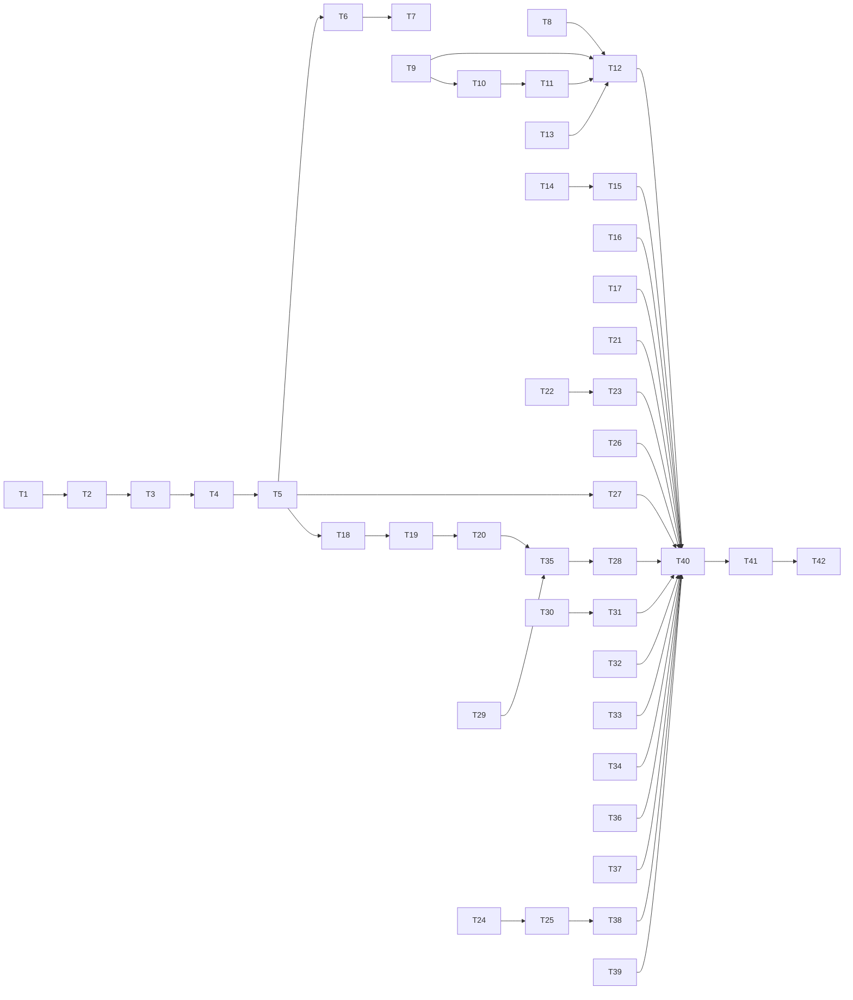

# Greenfield trial fixes: search that cannot freeze the session, epic skills an agent can run, and a cockpit that behaves

status: draft
commit-mode: orchestrator-commits
language: ruby
panel: Ruby (Linus Torvalds, Jeremy Evans, Sandi Metz, Richard Schneeman, Aaron Patterson). T7 is Rust and is reviewed with the Rust roster (Linus Torvalds, Raph Levien, Andrew Gallant, Frank McSherry, Ashley Williams).

## Intent

On 2026-10-08 the user started a new project, `~/dev/frugirl`, with `lain up` on `--provider ollama-cloud --model glm-5.3` and ran `/research-epic` against an empty directory. The run never reached `research.md`. A `grep` over `~/dev` (171.6 GB) froze the whole process until it was killed, both researcher subagents died at their iteration ceiling and handed back nothing, the agent spent its turns reading lain's own source because the skill named Ruby internals it cannot call, and the cockpit misreported context, hid approvals that then auto-denied, and swallowed Shift+Enter.

This plan fixes every finding from that run, in the user's notes (`notes.md` at the repo root, 2026-10-08) and in the session record `~/.local/state/lain/sessions/26b3c41f2bf4/20261008T123711-2567322.ndjson`. It also makes epics usable for a local side project with no forge, and adds the manual QA scenarios that would have caught each defect. Roadmap line: `ROADMAP.md` item 54.

| Missing concept | Findings it closes | Cards |
|---|---|---|
| a search walks what git would show, within a bound, off the reactor | 2 freezes (105s on `~/dev/lain`, killed after 2 min on `~/dev`), SIGTERM ignored | T1 to T7 |
| a skill names only what the agent can reach | the detour into lain's source, `lain epic submit` not on PATH | T8 to T12 |
| an epic can finish with no remote | user goal: epics as very large local plans | T13 |
| a child's work survives its ceiling | 51 turns of research lost | T14, T15 |
| a flagged region is a secret, and a related tree never prompts | 5 of 5 flags were false positives | T16, T17 |
| an approval deadline is visible before and after it fires | the first `bash` call auto-denied unseen | T18 to T20 |
| the cloud arm knows its window and its plan's width | `ctx:~72%` at 0.6%, subagents serialized | T21 to T23 |
| the cockpit starts as documented under a real user config | `:LainStart` missing, Shift+Enter submits, no scrollback, mid-word wraps | T24 to T29 |
| the HUD and the transcript say what is happening and when | `fleet:0`, no in-flight segment, windows opened at exit, no timestamps | T30 to T32, T35 |
| forms and help that guide the reader | question-buffer errors, plain `/help` | T33, T34, T36 |
| setup that does not depend on the repo's `.envrc` | `lain` not on PATH, stale tmux env, missing directory refused | T37 to T39 |
| manual QA covers the journey | none of this was in a scenario | T40, T41 |

**User rulings, 2026-10-08:**

- Scope: all findings, tiers 1 to 3.
- Epic access: render the epic home path into the skill, and give the agent in-process tools for writing artifacts and requesting gates. A forge-free finish is in this plan.
- Search: honor ignore files on both the Ruby and the daemon path, offer a bounded walk for large trees, and let `.lain/config.rb` re-include ignored paths (for example git-ignored research markdown).
- Prose at `command>`: a clearer held notice only. Typed prose never answers a question.
- Related directories: reads under a declared related tree never prompt; a flagged region there is masked and never released.
- Approval timeout: keep 300s, make it configurable, announce it before and when it fires.
- Cloud concurrency: a higher default, a launch notice, and narrowing to the plan's limit on a 429.
- Skip mempalace for this plan.
- Out of scope, 2026-10-08: a config-file setting for the cloud width (the env var, the launch notice and the 429 narrowing cover it), and a local issue board.

## Grounding

2026-10-08, `main` at `7599bad4`, working tree clean apart from `notes.md` and an untracked reference clone.

Evidence came from the live session record above, the user's notes, 9 read-only code maps (each with file and line citations), and 4 probes run in this session:

1. **Context window.** `ContextWindow::DEFAULT.resolve("glm-5.3")` falls to `CONSERVATIVE_FALLBACK` with `GUESSED`: `matched_key` (`context_window.rb`) looks for a table key inside the model name, and every cloud key carries a `:cloud` or `-cloud` tag. The session's `compaction_decision` records `"window_tokens":8192,"provenance":"guessed"`. ollama.com accepts both `glm-5.3` and `glm-5.3:cloud` (probed with curl).
2. **The freezes.** `Tools::Grep::Files.walk` globs `**/*` and skips only `. .. .git` (`grep.rb:70`, `:117-121`). Production never wires the daemon: `Grep.new` is constructed without a client at `cli/wiring.rb:153`, `cli/epic_submit.rb:692` and `cli/improve.rb:278` (grepped). `/proc/<pid>/io` showed 62 MB/s of reads inside `belle-curves/target/` while every thread but an io_uring worker slept; the journal had no write for the whole stall.
3. **Offload works.** In a `Sync` reactor, 1s of `Dir.glob` walking inline let a 10ms ticker fiber run 2 times; the same walk in `Thread.new { }.value` from a fiber let it run 106 times (async 2.46.0, io-event 1.22.1, Ruby 4.0.6).
4. **Secret false positives.** `Sensitivity::Regions.detect` on the 5 files the session flagged returned 1 "high-entropy token" each: `Cargo/Dioxus/clippy/deny/pre-commit`, `XDG_CONFIG_HOME/lain/config`, `com/lmcnulty/gender-voice-visualization_corpus` (twice) and a base64 alphabet literal. `TOKEN` admits `/` (`regions.rb:81`).
5. **`:LainStart`.** `nvim --headless --cmd 'set rtp+=<lain>/plugin/nvim'` with the user's lazy.nvim config: `exists(':LainStart') == 0` and the rtp entry is gone. With `--clean`: `2`. lazy.nvim's default `performance.rtp.reset = true` drops `--cmd` rtp entries. `up.rb:795` skips the missing command silently by design.
6. **Researcher role.** `Role::Catalog::BUILT_INS` gives `researcher` only `read_file list_files web_fetch web_search` (`role/catalog.rb:33`), so a survey of a sibling repo costs 1 iteration per directory listed. Both children died at `loop ran 25 iterations, ceiling is 25` and the parent's tool result held only that string.
7. **Cloud concurrency** (spike, below): ollama.com refuses with 429 and names the plan's limit.
8. **Panel probes, 2026-10-08.** `LockedBinding#render_template("<%= epic_home %>")` raises `ImpureSlot`: with no declared local, Prism parses the name as a call. Shannon entropy of the false positives is 4.21 to 4.40 bits per character against 4.66 for the AWS-shaped secret, so no threshold separates them. In `ignore` 0.4.30, 1 whitelist glob makes `Override::matched` ignore every path matching none (`src/overrides.rs:106`).
9. **Where the tools are built.** `ToolsetBuild#capability_floor` (`toolset_build.rb:291`) calls `Wiring::BaseTools.build` (`wiring.rb:~143-153`). A lone tool call runs through `ToolRunner#sequential` (`tool_runner.rb:350-352`); only a batch of parallel-safe calls uses `gather`. `~/dev` is not a git repository, so a walk there needs the nested-repository handling in T1.

Where docs and code disagreed:

- `up.rb:777-779` says `--cmd` runs before rtp `plugin/` files are sourced. True for a bare nvim, false once a plugin manager rewrites `rtp` in `init.lua`. Probe 5 wins; T24 rewrites the comment.
- The `--summarizer-model` help text reads as if the summarizer follows the chat's provider. `DEFAULT_SUMMARIZER_PROVIDER = "ollama"` (`backend.rb:83`) and the docs are right; no card.
- `research-epic` Phase 3 tells the agent to use `Epic::Home.resolve`. No tool exposes it. T8 to T12.

## Compatibility

lain is `0.1.0`, unpublished (no release tag, `allowed_push_host` unused), and no project in `~/dev` outside lain's own worktrees carries a `.lain/config.rb` or `.lain/skills/` (grepped). Session journals on disk are the only stored data with readers outside the running process.

| Surface | Verdict | Evidence |
|---|---|---|
| `grep`/`glob`/`list_files` results (model-facing) | free to break | internal tools; `WithholdSecretPaths` matches their sentinels (`withhold_secret_paths.rb:113-153`), so new trailers keep those sentinels |
| core RPC `grep` params (`respect_ignores`, new `include`) | free to break | daemon and client ship together; `grep_parity_spec.rb` pins both |
| `.lain/config.rb` verbs | additive | new `search` verb, `approval timeout:`, `sensitivity related:`; existing keys unchanged |
| shipped skill text | free to break | `.lain/skills/` overrides exist nowhere outside lain; `shipped_skills_spec.rb` is updated with the text |
| `Skill::Library.load`, `Purity.check!` | additive | new `locals:` keywords with empty defaults |
| `Provider::Admission` | additive | new `narrow!` on the gate and on `Null` |
| `Role` value | additive | new `max_iterations` member with a default |
| `approval_decision` journal record | must keep | old session files are read back by `lain sessions`, replay and the bench; the new `reason` field is optional and absent in old records |
| HUD state file | free to break | written and read by the same checkout; the input pane reads the field it needs |
| `lain epic finish` | additive | new `--local` flag; the forge path is unchanged |
| `lain up` | additive | new `--create` flag; tmux options are set per session where tmux allows it (T25 records the one server-scoped option) |
| `PaneCommand::PANE_ENV` | free to break | internal allowlist |
| cloud admission default width | free to break | `LAIN_OLLAMA_CLOUD_CONCURRENCY` still overrides it |

No trade was offered: no must-keep surface blocks a simplification.

## Spike findings

| Question | Result | Evidence |
|---|---|---|
| Does a thread-offloaded walk keep the Async reactor running? | Yes. 2 ticks inline against 106 offloaded over 1s of `Dir.glob`. | Grounding probe 3; script run with `bundle exec ruby` under the repo's toolchain |
| What does ollama.com send past the plan's concurrency? | `429 {"error":"too many concurrent requests"}` with `retry-after: 12..20`, `x-ratelimit-max-concurrent: 3`, `x-ratelimit-active: 3`, `x-ratelimit-queue-limit: 10`, `x-ratelimit-queued: 10`. 20 parallel requests: 13 answered (3 running plus 10 queued server-side), 7 refused. | curl, 2026-10-08, this account |
| Do successful responses carry the rate-limit headers? | No. Plain and streaming `/api/chat` and `/api/tags` returned 200 with none of them, so the width is learnable only from a 429. | curl, 2026-10-08 |
| Does lazy.nvim drop a `--cmd` rtp entry? | Yes. `exists(':LainStart')` is 0 with the user's config and 2 with `--clean`. | Grounding probe 5 |

No worktree was created; all 4 spikes ran as scratch scripts and curl calls, now deleted.

## Shared files

Only the main session edits these. Cards hand back the 1-line diffs named in their `Shared-file wiring`.

- `lib/lain/cli/wiring.rb`
- `lib/lain/cli/wiring/toolset_build.rb`
- `lib/lain/cli/repl_middleware.rb`
- `lib/lain/cli/chronicle.rb`
- `lib/lain/cli/wiring/board_build.rb`
- `exe/lain` (Thor option declarations)
- `spec/lain/cli/wiring/toolset_build_spec.rb` (the main session adds the reachability example each tool card hands back)
- `lib/lain/config/builder.rb`
- `lib/lain/tool/bounds.rb` (the `CEILINGS` table)
- `spec/support/slow_files.rb`
- `.rubocop.yml`
- `ROADMAP.md`

`docs/commands.md`, `README.md` and `ARCHITECTURE.md` are edited by T42 only.

## Rejected options

- **Route production grep through the daemon.** The daemon already uses the `ignore` crate, but a chat does not start `lain-core`, and the placement rule puts the daemon behind an explicit backend. Fixing the Ruby path fixes every session today; T7 keeps the daemon in step.
- **Confine grep to the project root.** CLAUDE.md is explicit that tier-1 readers do not check paths and the boundary lives in one place. A bound on the walk (T4) stops the cost without a second boundary.
- **A fixed list of build directories to skip.** Ignore files already name them per project, and a list would drift.
- **`ASYNC_SCHEDULER_WORKER_POOL`.** It only offloads C code that calls `rb_nogvl`; `Dir.glob` and `File.foreach` do not, so the hook never fires for this work (async 2.46.0 `scheduler.rb:31-96`).
- **Answer a question with prose typed at `command>`.** User ruling; a line typed ahead could answer the wrong set.
- **Release flagged regions under related directories.** User ruling; masking keeps the boundary.
- **Keep the alternate screen and add only `mouse on`.** tmux has no scrollback for an alternate screen and cannot reflow it, so wheel scrolling would still show nothing.
- **Reflowable soft wrapping in the transcript.** Only the terminal can reflow, and it breaks at the column edge. T28 wraps at word boundaries when a line is written; a later resize narrower than the write width re-breaks lines. This plan accepts that as the smaller problem.
- **Tool approval for `epic_write`.** It names 1 of 4 artifact kinds under the epic home, never a path, and every write is journaled; a prompt per write would repeat the noise this plan removes.
- **An `OverrideBuilder` whitelist for the daemon include list.** It turns the walk into an allowlist (Grounding probe 8). T7 uses a second, filtered pass.
- **A second retry layer for a cloud 429.** faraday-retry already honors `Retry-After` inside the slot; T22 only narrows the width from the hook it already calls.
- **Mounting a newly created epic mid-chat.** The mount carries the review, the status view and the driver seams; building them mid-turn is a larger change than a restart, which the skills now ask for.
- **Retry the eager oracle when the local summarizer slot is busy.** The oracle skips a summary by design (`queue: false`); 2 skipped summaries in the session cost nothing.

## Open decisions

- **Production wiring for the daemon grep.** No chat starts `lain-core` for search (Grounding probe 2), so T7 keeps the daemon in parity and its only construction site is the `:core` parity spec. Wiring a chat to the daemon is a separate decision about the placement rule. T7 does not depend on it.

## Dependency graph



## Tasks

### T1: A streaming file walk lists what git would show, nested repositories included          [risk: medium]

**Depends on:** none
**Files:** `lib/lain/file_walk.rb` (new), `spec/lain/file_walk_spec.rb` (new), `lib/lain/survey/walk.rb`, `spec/lain/survey/walk_spec.rb`
**Reuse:** `Survey::Walk`'s `LS_FILES` (`survey/walk.rb:91`), `git()` with `GIT_CONTEXT_SCRUB` and `GIT_TIMEOUT` (`:280-288`), `skipped?` (`:212`), and the survey's `lstat` existence filter. The survey keeps its behavior and delegates its listing to `FileWalk`.
**Shared-file wiring:** none
**Reachable from:** `Survey::Walk#candidates` delegates to `Lain::FileWalk` once this card lands; `CLI::Survey` builds the survey walk for `/survey` and `lain survey`. T2 adds the grep path.

The walk is a lazy `Enumerator`. It descends with `Dir.each_child`, never with an eager `Dir.glob("**/*")`. When it enters a directory that holds a `.git` entry, or starts inside a repository, it lists that repository with `git ls-files -z --cached --others --exclude-standard` run from that directory and does not descend into it by hand. Outside any repository it descends every directory except `.git`. A listed path that no longer exists as a regular file (deleted in the working tree, or a submodule gitlink) is dropped. `FileWalk` is a distinct name so that a bare `Walk` inside `Survey` cannot shadow it (CLAUDE.md known traps).

**Acceptance criteria**

```gherkin
Scenario: a repository lists tracked and untracked files, not ignored ones
  Given a git repository with a tracked file, an untracked file and a .gitignore naming target/
  And 3 files under target/
  When the walk lists the repository root
  Then it yields the tracked and the untracked file
  And it yields nothing under target/ or .git/

Scenario: a plain parent holding a repository honors that repository's ignores
  Given a plain directory holding notes.txt and a repository app/ whose .gitignore names target/
  And 50 files under app/target/
  When the walk lists the plain directory
  Then it yields notes.txt and app's listed files
  And it yields nothing under app/target/

Scenario: a directory outside any repository is walked whole
  Given a plain directory with 2 files and no .git
  When the walk lists it
  Then it yields both files

Scenario: the walk is lazy
  Given a plain directory of 1,000 files
  When the first 5 entries are taken from the walk
  Then fewer than 1,000 directory entries have been read

Scenario: a file deleted in the working tree is not yielded
  Given a tracked file removed from disk but not from the index
  When the walk lists the repository
  Then that path is not yielded

Scenario: the survey still lists what it listed before
  Given the existing survey walk fixtures
  When the survey enumerates its candidates
  Then the candidate list is unchanged
```
Spec files: `spec/lain/file_walk_spec.rb`, `spec/lain/survey/walk_spec.rb`

**Interface**

```ruby
module Lain
  class FileWalk
    include Enumerable
    def initialize(root:, shell_out_factory: ShellOut.method(:new)) = ...
    def each(&) # yields absolute paths of existing regular files, lazily; sorted within each directory
  end
end
```

**Stop and report if:**
- `spec/lain/survey/walk_spec.rb` needs a behavior change to pass; the survey must not change here.
- `git ls-files` run from a subdirectory yields paths relative to that subdirectory in a form the survey's callers did not expect (CLAUDE.md: `ls-files` truncates against the process directory; use `-C`).

### T2: grep and ast_search search only what the walk lists          [risk: medium]

**Depends on:** T1
**Files:** `lib/lain/tools/grep.rb`, `lib/lain/tools/ast_search.rb`, `spec/lain/tools/grep_spec.rb`, `spec/lain/tools/ast_search_spec.rb`
**Reuse:** `Lain::FileWalk` from T1 behind `Grep::Files.under`, which `AstSearch` already calls (`ast_search.rb:182`); `RubySearch#call` keeps its match cap and `Fill` byte ceiling
**Shared-file wiring:** none
**Reachable from:** `ToolsetBuild#capability_floor` (`toolset_build.rb:291`) calls `Wiring::BaseTools.build`, whose tool list constructs `Lain::Tools::Grep.new` (`wiring.rb:153`) for every chat. The other construction sites (`cli/consolidation.rb:188`, `cli/epic_submit.rb:691-692`, `cli/improve.rb:278`) get the same walk because it lives in the tool.

**Acceptance criteria**

```gherkin
Scenario: grep skips git-ignored build output
  Given a repository whose .gitignore names target/ and whose target/ holds a file containing "needle"
  And src/main.rs containing "needle"
  When grep searches the repository for "needle"
  Then it reports src/main.rs
  And it reports nothing under target/

Scenario: grep over a plain parent skips a nested repository's ignored tree
  Given a plain directory holding a repository app/ that ignores target/
  And app/target/x.txt and app/src/y.txt both containing "needle"
  When grep searches the plain directory
  Then it reports app/src/y.txt only

Scenario: ast_search skips the same ignored files
  Given a repository ignoring target/ with a Ruby file in each of target/ and lib/
  When ast_search runs over the repository
  Then it reports only the file under lib/
```
Spec files: `spec/lain/tools/grep_spec.rb`, `spec/lain/tools/ast_search_spec.rb`

**Stop and report if:**
- `spec/lain/middleware/withhold_secret_paths_spec.rb` fails: its sentinels (`withhold_secret_paths.rb:113-153`) must keep matching.
- `spec/lain/seams/symlink_boundary_spec.rb` changes outcome; a symlink the old walk followed may now be absent from `ls-files`.

### T3: glob and list_files enumerate only what the walk lists          [risk: medium]

**Depends on:** T2
**Files:** `lib/lain/tools/glob.rb`, `lib/lain/tools/list_files.rb`, `spec/lain/tools/glob_spec.rb`, `spec/lain/tools/list_files_spec.rb`
**Reuse:** `Lain::FileWalk`; `File.fnmatch` with `FNM_PATHNAME | FNM_EXTGLOB | FNM_DOTMATCH` to keep a pattern's meaning; the `Enumeration(500)` bound and byte ceilings stay
**Shared-file wiring:** none
**Reachable from:** `Wiring::BaseTools.build` constructs `Lain::Tools::Glob.new` and `Lain::Tools::ListFiles.new` (`wiring.rb:153`), reached from `ToolsetBuild#capability_floor` (`toolset_build.rb:291`)

A directory is a match when it holds at least 1 listed file, so `glob("src/*")` still returns `src/sub/` when `src/sub/` holds a listed file. An empty directory, or one holding only ignored files, is no longer returned.

**Acceptance criteria**

```gherkin
Scenario: glob does not return git-ignored files
  Given a repository ignoring target/, with target/a.rs and src/b.rs
  When glob runs "**/*.rs" at the repository root
  Then it returns src/b.rs only

Scenario: glob still returns directories that hold listed files
  Given src/sub/c.rs listed and src/empty/ holding nothing
  When glob runs "src/*"
  Then it returns src/sub and not src/empty

Scenario: an absolute pattern outside the root keeps working
  Given a pattern naming an absolute directory outside the project
  When glob runs it
  Then it returns that directory's matching files, filtered by that directory's own ignore files

Scenario: a recursive listing skips .git and ignored trees
  Given a repository with .git/, target/ ignored, and src/
  When list_files runs recursively at the root
  Then no entry is under .git/ or target/
```
Spec files: `spec/lain/tools/glob_spec.rb`, `spec/lain/tools/list_files_spec.rb`

**Stop and report if:**
- A `glob_spec.rb` example depends on `Dir.glob` brace semantics that `File.fnmatch` with `FNM_EXTGLOB` does not reproduce.
- `spec/lain/tools/parallel_commutation_spec.rb` changes result order.

### T4: Bound the walk by entries listed and bytes read, and name the truncation          [risk: medium]

**Depends on:** T3
**Files:** `lib/lain/file_walk.rb`, `lib/lain/tool/bounds/walk_limit.rb` (new), `spec/lain/tool/bounds/walk_limit_spec.rb` (new), `lib/lain/tools/grep.rb`, `lib/lain/tools/glob.rb`, `lib/lain/tools/list_files.rb`, `lib/lain/tools/ast_search.rb`, `spec/lain/file_walk_spec.rb`, `spec/lain/tools/grep_spec.rb`, `spec/lain/tools/glob_spec.rb`, `spec/lain/tools/list_files_spec.rb`
**Reuse:** `Tool::Bounds::WalkCap` (`bounds/walk_cap.rb`) for shape and naming; `Files#notices` (`grep.rb`) for the trailer
**Shared-file wiring:** none (the defaults live in `walk_limit.rb`; T5 makes them configurable)
**Reachable from:** the same `Wiring::BaseTools.build` constructions as T2 and T3

The file limit counts entries the walk has listed, including directories descended, so enumeration itself stops at the limit. The byte limit counts bytes read by grep and ast_search.

**Acceptance criteria**

```gherkin
Scenario: a walk past the entry limit stops listing and says so
  Given a plain directory of 30 files and a walk limit of 10 entries
  When grep searches it for a string in every file
  Then the walk lists no more than 10 entries
  And the result ends with a line naming the limit and how to narrow the search

Scenario: a huge ignored tree under a plain parent does not count against the limit
  Given a plain directory holding a repository whose ignored target/ has 5,000 files and whose src/ has 3
  And a walk limit of 100 entries
  When grep searches the plain directory
  Then all 3 src files are searched and no truncation line appears

Scenario: a walk past the byte limit stops reading and says so
  Given 3 files of 1 MB each and a byte limit of 1.5 MB
  When grep searches them
  Then it reads no more than 1.5 MB
  And the result names the byte limit

Scenario: a walk under both limits carries no trailer
  Given a directory of 3 small files
  When grep searches it
  Then the result has no truncation line
```
Spec files: `spec/lain/tool/bounds/walk_limit_spec.rb`, `spec/lain/file_walk_spec.rb`, `spec/lain/tools/grep_spec.rb`, `spec/lain/tools/glob_spec.rb`, `spec/lain/tools/list_files_spec.rb`

**Interface**

```ruby
module Lain::Tool::Bounds
  WalkLimit = Data.define(:entries, :bytes)
  class WalkLimit                 # reopened: a constant inside Data.define's block lands on the module
    DEFAULT = new(entries: 20_000, bytes: 200 * 1024 * 1024)
    def notice(listed:, read_bytes:) # => String | nil
  end
end
```

**Stop and report if:**
- `spec/tool_bounds_discipline_spec.rb` requires every bound to live in `CEILINGS`; then hand back a shared-file diff for `bounds.rb`.
- The default limits make an existing grep spec fixture truncate.

### T5: A `search` verb re-includes ignored paths and sets the walk limit          [risk: medium]

**Depends on:** T4
**Files:** `lib/lain/search_rules.rb` (new), `spec/lain/search_rules_spec.rb` (new), `lib/lain/config.rb`, `spec/lain/config_spec.rb`, `lib/lain/file_walk.rb`, `spec/lain/file_walk_spec.rb`, `lib/lain/tools/grep.rb`, `lib/lain/tools/glob.rb`, `lib/lain/tools/list_files.rb`, `lib/lain/tools/ast_search.rb`
**Reuse:** `Shell::Exclusions` (`shell/exclusions.rb`: `TABLE`, `KEYS`, `.from`, strict unknown-key refusal) as the exemplar; `Config.shell_exclusions(root:)` (`config.rb:56`) for the reader shape; `git ls-files -z --others --ignored --exclude-standard` filtered by the include globs for the re-included half, de-duplicated against the normal listing
**Shared-file wiring:**
- `builder.rb`: add `search` to `VERBS`, `def search(**table) = declare(:search, SearchRules::TABLE, table) { SearchRules.from(shaped(table), path: at) }`, and a `search:` member on `Built` defaulting to `SearchRules.empty`
- `wiring.rb` (`BaseTools.build`, near `:143-153`): take `search: SearchRules.empty` and pass it to `Grep.new`, `Glob.new`, `ListFiles.new`, `AstSearch.new`
- `toolset_build.rb:291-293` (`capability_floor`): pass `search: Lain::Config.search(root:)`
**Reachable from:** `ToolsetBuild#capability_floor` (`toolset_build.rb:291`) for every chat. `cli/consolidation.rb:188`, `cli/epic_submit.rb:691-692` and `cli/improve.rb:278` keep `SearchRules.empty` on purpose: they run headless over lain's own state, and they still get ignore handling, the default limits and the offload because those live in the tools.

**Acceptance criteria**

```gherkin
Scenario: an ignored path named in search include is searched
  Given a repository that git-ignores planning/notes/
  And .lain/config.rb declaring search include: ["planning/notes/**/*.md"]
  And planning/notes/a.md containing "needle"
  When grep searches the repository for "needle"
  Then planning/notes/a.md matches

Scenario: other ignored paths stay unsearched
  Given the same config and target/x.txt containing "needle", with target/ ignored
  When grep searches the repository
  Then nothing under target/ matches

Scenario: the walk limits are configurable
  Given .lain/config.rb declaring search max_entries: 5
  When grep searches a directory of 8 files
  Then the result names a limit of 5 entries

Scenario: an unknown key is refused by name
  Given .lain/config.rb declaring search incldue: ["x"]
  When the config loads
  Then it refuses naming "incldue" and listing include, max_entries, max_bytes

Scenario: an include glob that leaves the project is refused
  Given .lain/config.rb declaring search include: ["../other/**"]
  When the config loads
  Then it refuses naming the glob and saying include globs stay under the project root

Scenario: no config keeps the defaults
  Given a project with no .lain/config.rb
  When grep runs
  Then it honors ignore files with the default walk limits
```
Spec files: `spec/lain/search_rules_spec.rb`, `spec/lain/config_spec.rb`, `spec/lain/file_walk_spec.rb`

**Interface**

```ruby
module Lain
  SearchRules = Data.define(:include, :limit)
  class SearchRules                 # reopened for the constants, as in T4
    TABLE = ...                     # include: [glob], max_entries: Integer, max_bytes: Integer
    def self.from(table, path:) = ...
    def self.empty = ...
  end
  class Config
    def self.search(root:) # => SearchRules
  end
end
```

**Stop and report if:**
- `spec/lain/config/builder_spec.rb:82`'s verb list or `spec/lain/project/root_defaults_spec.rb` fails after the shared diff; both pin the verb set and the `root:` rule.

### T6: Every walk and search runs off the reactor and stops cleanly          [risk: high]

**Depends on:** T5
**Files:** `lib/lain/tool/offload.rb` (new), `spec/lain/tool/offload_spec.rb` (new), `lib/lain/file_walk.rb`, `lib/lain/tools/grep.rb`, `lib/lain/tools/glob.rb`, `lib/lain/tools/list_files.rb`, `lib/lain/tools/ast_search.rb`, `spec/lain/file_walk_spec.rb`, `spec/lain/tools/grep_spec.rb`
**Reuse:** the spike's shape (`Thread.new { work }.value` joined from a fiber); the thread census in `.rubocop.yml` (`:326-337`)
**Shared-file wiring:** `.rubocop.yml:326-337`: add `lib/lain/tool/offload.rb` to the thread census, raise its count, and give the reason "a walk calls Dir.glob, Dir.each_child and File.foreach, which no scheduler hook offloads"
**Reachable from:** each tool's `perform`. `Agent::ToolRunner` runs a lone call through `sequential` (`tool_runner.rb:350-352`) and a batch of parallel-safe calls through `gather` (`:369-374`, `:398-400`); both run on the chat's reactor, so the offload covers both.

**Acceptance criteria**

```gherkin
Scenario: a lone slow search does not stall sibling fibers
  Given a reactor running a fiber that ticks every 10ms
  And a single grep call whose walk takes about 1 second, run through the sequential path
  When the grep runs
  Then the ticker runs at least 50 times during the grep

Scenario: a batched slow search does not stall sibling fibers
  Given the same ticker and 2 grep calls run through gather
  Then the ticker runs at least 50 times during the batch

Scenario: an error inside the walk reaches the caller
  Given a walk that raises Errno::EACCES on its first file
  When grep runs
  Then the tool result names the unreadable path, as it does today

Scenario: a stopped search leaves no thread and no git child behind
  Given a grep in flight over a repository, with its git ls-files child running
  When the surrounding task is stopped
  Then no offload thread is alive and no git child of this process is running after the stop returns

Scenario: a signal during a search is handled promptly
  Given a chat running a grep whose walk takes 10 seconds
  When the process receives SIGTERM
  Then the grace countdown starts within 1 second
```
Spec files: `spec/lain/tool/offload_spec.rb`, `spec/lain/file_walk_spec.rb`, `spec/lain/tools/grep_spec.rb`

**Interface**

```ruby
module Lain::Tool
  module Offload
    def self.call(&work) = ... # runs work on a thread joined from the current fiber; re-raises its error; kills the thread on Async::Stop
  end
end
```

**Stop and report if:**
- `Thread#value` from a fiber blocks the reactor under `rake pspec`'s worker setup (the spike ran under `bundle exec ruby` only).
- `FileWalk`'s git child cannot be killed from the walk because `Shell::Out` (`shell/out.rb:208-217`) owns the process; report rather than change `Shell::Out` for every caller.
- `spec/lain/tools/parallel_commutation_spec.rb` changes result order or count.

### T7: The daemon honors ignores by default and searches the include list, matching the Ruby path          [risk: medium]

**Depends on:** T6
**Files:** `crates/lain-core/src/grep.rs`, `lib/lain/tools/grep.rb`, `spec/lain/tools/grep_spec.rb`, `spec/lain/core/grep_parity_spec.rb`
**Reuse:** `walk()` (`grep.rs:325-337`), which already toggles the `ignore` crate's 5 sources together; `CoreSearch#wire_params` (`grep.rb:253-262`)
**Shared-file wiring:** none
**Reachable from:** deferred in production: no chat wires `CoreSearch` (Grounding probe 2; Open decisions). The `:core`-tagged parity spec drives a real daemon and is the only construction site.

The default flips: `respect_ignores` becomes true on the wire and in `GrepParams`. The include list is a second pass: a walk with ignores off, filtered through a `filter_entry` that keeps only paths matching an include glob, merged with the normal walk and de-duplicated. An `OverrideBuilder` whitelist is not used: with 1 whitelist glob, `Override::matched` ignores every path that matches none (`ignore-0.4.30/src/overrides.rs:106`), which would hide `src/`.

Named parity gaps, accepted and pinned in the parity spec's comments: `git ls-files --cached` keeps a tracked file that also matches `.gitignore`, while the `ignore` crate skips it; `File.fnmatch` and gitignore glob syntax differ on `**` edge cases; a bare `.ignore` file is honored by the crate only.

**Acceptance criteria**

```gherkin
Scenario: both paths skip the same ignored file
  Given a repository ignoring target/ with target/x.txt and src/y.txt both containing "needle"
  When the Ruby path and the daemon path each grep for "needle"
  Then both report src/y.txt only

Scenario: both paths search a re-included ignored file and everything else
  Given the same repository with search include ["target/x.txt"]
  When both paths grep for "needle"
  Then both report target/x.txt and src/y.txt
```
Spec files: `spec/lain/core/grep_parity_spec.rb`, `spec/lain/tools/grep_spec.rb`; Rust unit tests in `grep.rs` replace `respect_ignores_defaults_off` (`:637`) with a test of the new default and add the 2-pass include test

**Stop and report if:**
- `cargo clippy --all-targets -- -D warnings` or `cargo deny check` refuses the change.
- A parity fixture differs for a reason outside the 3 named gaps.

### T8: The skill library renders every skill with the epic home          [risk: medium]

**Depends on:** none
**Files:** `lib/lain/prompt/locked_binding.rb`, `lib/lain/skill/renderer.rb`, `lib/lain/skill/library.rb`, `lib/lain/cli/backend.rb`, `spec/lain/prompt/locked_binding_spec.rb`, `spec/lain/skill/renderer_spec.rb`, `spec/lain/skill/library_spec.rb`, `spec/lain/skill/shipped_skills_spec.rb`
**Reuse:** `Purity.check!` and `clean_binding` (`locked_binding.rb:96-110`); Prism's `scopes:` option to declare locals when parsing; `Binding#local_variable_set`; `Epic::Home.container(config:, paths:, root:)` (`epic/home.rb:79`); `Backend#library` (`backend.rb:602`, `Skill::Library.load(root:)`), the one place a run builds its library
**Shared-file wiring:** none
**Reachable from:** `Backend#library` builds the run's `Skill::Library` with the locals. Every renderer comes from that library: `repl_middleware.rb:34` (`/skill`), `toolset_build.rb:383` (`RunSkill`), `command/surface.rb:166`, and the epic driver factory (`factory.rb:563`, `:613`, `:619`). So no call site changes.

Today a template that reads `epic_home` is refused: Prism parses a bare identifier with no declared local as a receiverless call, and `Purity` rejects calls (probed by the panel). This card lets `Purity.check!` take the declared local names, parses with them in scope, and sets them on the clean binding. Includes and holes render through the same `LockedBinding`, so they see the same locals.

**Acceptance criteria**

```gherkin
Scenario: a template reads a declared local
  Given a library loaded with the local epic_home set to "/state/lain/epics/abc"
  When a skill template containing <%= epic_home %> is rendered
  Then the output contains /state/lain/epics/abc

Scenario: an undeclared name is still refused
  Given a library loaded with no locals
  When a template containing <%= epic_home %> is rendered
  Then it is refused as impure, naming epic_home

Scenario: a method call is still refused
  Given a library loaded with epic_home
  When a template containing <%= epic_home.upcase %> is rendered
  Then it is refused as impure

Scenario: the chat's library carries the project's epic home
  Given a project whose epics home is the XDG default
  When the chat's backend loads its library and /research-epic is rendered
  Then the scaffold names that project's absolute epic home directory

Scenario: an included fragment sees the same locals
  Given a skill whose included conventions fragment reads epic_home
  When the skill is rendered
  Then the fragment's output contains the epic home
```
Spec files: `spec/lain/prompt/locked_binding_spec.rb`, `spec/lain/skill/renderer_spec.rb`, `spec/lain/skill/library_spec.rb`, `spec/lain/skill/shipped_skills_spec.rb` (its renderer is built through `Library` with a test `epic_home`)

**Interface**

```ruby
module Lain::Prompt::LockedBinding::Purity
  def self.check!(source, locals: []) = ... # locals: Array<Symbol>, declared in scope for the parse
end
class Lain::Skill::Library
  def self.load(root:, locals: {}) = ...    # Hash{Symbol => String}, frozen, handed to every renderer
end
```

**Stop and report if:**
- `Prism.parse(source, scopes: [[...]])` is not available in the bundled Prism; report the version and the alternative.
- `Backend` has no `Paths` or `Config` reachable when `#library` is first called.
- `Slots#render_skill` renders through a path that does not use `LockedBinding`; report where it goes.

### T9: The epic mount owns an `epic_write` tool that works with or without an epic          [risk: high]

**Depends on:** none
**Files:** `lib/lain/tools/epic_write.rb` (new), `spec/lain/tools/epic_write_spec.rb` (new), `lib/lain/cli/epic_mount.rb`, `spec/lain/cli/epic_mount_spec.rb`
**Reuse:** `Epic::Home.resolve(config:, paths:, slug:, root:)`, `Artifact#write` (symlink check and atomic rename); `Epic::Home::Journaled` and its `reviews:` (`epic/home/journaled.rb:52`); `Review.from_journal` as `EpicMount.for` already builds it (`epic_mount.rb:223`); `Tools::RequestReview` (`request_review.rb:47`, `Input` at `:92`) as the tier-2 exemplar
**Shared-file wiring:**
- `bounds.rb` `CEILINGS`: add an `"epic_write"` row
- `toolset_build_spec.rb`: the reachability example the card hands back
**Reachable from:** `EpicMount.for` (`epic_mount.rb:66-71`), called from `wiring.rb:904-905`, returns either a mount or `NoEpic`; `ToolsetBuild#build` appends `epic.tools` (`toolset_build.rb:244`). Both now include `epic_write`.

The mount is the owner, so the review guard is real in both cases. A mounted epic's `epic_write` shares the mount's `Review`, so a review opened with `request_review` refuses a write. `NoEpic`'s `epic_write` resolves the home per call and builds `Home::Journaled` with `Review.from_journal` for that slug, so a review open in another session still refuses. A chat that creates its first epic stays unmounted until restart: it has no `request_review` and `lain://status` shows no epic. This plan accepts that, since `/implement-epic` already needs a launch with `--epic`, and the skills tell the user to restart.

`epic_write` does not ask for tool approval (`Tool#requires_approval?` stays false, `tool.rb:116`). It can name only the 4 artifact kinds under the project's epic home, never a path, and every write is journaled.

**Acceptance criteria**

```gherkin
Scenario: research.md lands in the epic home from an unmounted chat
  Given a chat in a project with no epics yet
  When the agent calls epic_write with slug "frugirl-mvp", artifact research and some markdown
  Then <epic home>/frugirl-mvp/research.md holds that markdown
  And the session journal records the write

Scenario: a mounted chat's write is refused while its review is open
  Given a chat mounted on epic "frugirl-mvp" with a review open on research.md through request_review
  When the agent calls epic_write for research
  Then the tool refuses and names the open review

Scenario: an unmounted chat honors a review opened in another session
  Given another session's journal records an open review on frugirl-mvp's research.md
  When an unmounted chat calls epic_write for research on frugirl-mvp
  Then the tool refuses and names the open review

Scenario: an issue plan needs an issue id
  When the agent calls epic_write with artifact plan and no issue
  Then the tool refuses naming the missing issue field

Scenario: a malformed slug is refused
  When the agent calls epic_write with slug "Frugirl MVP"
  Then the tool refuses quoting the slug rule
```
Spec files: `spec/lain/tools/epic_write_spec.rb`, `spec/lain/cli/epic_mount_spec.rb`

**Interface**

```ruby
class Lain::Tools::EpicWrite < Lain::Tool
  class Input < Lain::Tool::Input
    field :slug, :string, required: true
    field :artifact, :string, required: true   # research | epic | issue | plan
    field :issue, :string                      # required for issue and plan
    field :content, :string, required: true
  end
  def initialize(homes:) = ...                 # homes: #for(slug) => Epic::Home::Journaled
end
```

**Stop and report if:**
- `NoEpic` cannot reach `config`, `paths`, `root` and the chat journal at `EpicMount.for`'s call site (`wiring.rb:904-905`); report what is missing rather than add a second construction site.
- `spec/tool_bounds_discipline_spec.rb` needs more than a `CEILINGS` row.

### T10: An `epic_submit` tool requests a stage's gate in-process          [risk: high]

**Depends on:** T9
**Files:** `lib/lain/tools/epic_submit.rb` (new), `spec/lain/tools/epic_submit_spec.rb` (new), `lib/lain/cli/epic_submit.rb`, `spec/lain/cli/epic_submit_spec.rb`, `lib/lain/cli/epic_mount.rb`, `spec/lain/cli/epic_mount_spec.rb`
**Reuse:** `CLI::EpicSubmit#submit(stage, slug, issue:, digest:)` (`epic_submit.rb:447`), `decide`/`settled` (`:476-500`); the driver factory's construction of the same submitter (`cli/epic_driver/factory.rb:661-666`), which lends `@chronicle.record_journal` and asks through the `ask_human` tool adapted by `Heard.over`
**Shared-file wiring:**
- `toolset_build.rb:201`: `ToolsetBuild#initialize` gains `config:` and `paths:` keywords, and `wiring.rb:834` passes them (`@paths` and the `Config.load(root:)` already done at `wiring.rb:905`)
- `toolset_build.rb:244`: `EpicMount`'s tools receive the submitter built from `ask_human:` (the `Tools::AskHuman` handed to `#build`), the chronicle's `record_journal`, and `@role_spawn`
- `bounds.rb` `CEILINGS`: add an `"epic_submit"` row
- `toolset_build_spec.rb`: the reachability example the card hands back
**Reachable from:** `CLI::Wiring#build_toolset` (`wiring.rb:834`) constructs `ToolsetBuild`, whose `#build` appends `epic.tools` (`toolset_build.rb:244`); the mount and `NoEpic` both carry `epic_submit`

Decisions this card makes:

- **Asker.** An interactive gate asks through `ask_human`, the same path the epic driver uses. The human answers in `lain://question`, `/inbox` or `:LainReply`, not in the tool-approval pane.
- **Journal.** The chronicle's `record_journal`, lent as the factory lends it, so `ReadBack` (`epic_submit.rb:310`) sees this chat's own decisions. Under `--no-journal` the tool refuses by name, because a gate decision that no reader can see would let the same stage be approved twice.
- **Adjudicated gates** keep refusing by name in-process, as they do for the driver today (`factory.rb:666` passes no `brief`). The refusal tells the agent to ask the user to run `lain epic submit` from a shell.
- **Stages.** `research`, `epic_plan` and `issue_plan`. `implementation` needs a changeset digest that only the driver holds, so the tool does not offer it.

**Acceptance criteria**

```gherkin
Scenario: an interactive research gate asks the human through the question surfaces
  Given a written research.md for slug "frugirl-mvp" and the default interactive policy
  When the agent calls epic_submit with stage research
  Then a question set asking for sign-off appears in lain://inbox
  And answering it with approval journals the gate decision under this session

Scenario: a hands-off gate approves audibly
  Given .lain/config.rb with gate :research, :hands_off
  When the agent calls epic_submit with stage research
  Then the tool result says approved by policy hands_off

Scenario: a deferred gate parks and tells the agent where
  Given gate :research, :deferred
  When the agent calls epic_submit with stage research
  Then the result says the sign-off is parked and names lain epic queue

Scenario: the same stage is not approved twice
  Given research for frugirl-mvp was approved earlier in this chat
  When the agent calls epic_submit with stage research again
  Then the result says the stage is already approved

Scenario: no journal means no gate
  Given a chat started with --no-journal
  When the agent calls epic_submit
  Then the tool refuses naming --no-journal

Scenario: submitting a stage whose artifact is missing is refused
  When the agent calls epic_submit with stage epic_plan before epic.md exists
  Then the tool refuses naming the missing artifact
```
Spec files: `spec/lain/tools/epic_submit_spec.rb`, `spec/lain/cli/epic_submit_spec.rb`, `spec/lain/cli/epic_mount_spec.rb`

**Interface**

```ruby
class Lain::Tools::EpicSubmit < Lain::Tool
  class Input < Lain::Tool::Input
    field :stage, :string, required: true   # research | epic_plan | issue_plan
    field :slug, :string, required: true
    field :issue, :string                   # required for issue_plan
  end
  def initialize(submitter:) = ...           # responds to #submit(stage, slug, issue:, digest: nil)
end
```

**Stop and report if:**
- `Gate#call` parks on the `ask_human` promise in a way that deadlocks the turn that called the tool (`ToolRunner` runs the tool inside the chat's reactor).
- `EpicSubmit` cannot be built without `input:`/`output:` terminal streams; report rather than pass `$stdin`/`$stdout` (output discipline).

### T11: An `epic_graph` tool adds, splits and merges issues in-process          [risk: medium]

**Depends on:** T10
**Files:** `lib/lain/tools/epic_graph.rb` (new), `spec/lain/tools/epic_graph_spec.rb` (new), `lib/lain/cli/epic.rb`, `spec/lain/cli/epic_spec.rb`, `lib/lain/cli/epic_mount.rb`, `spec/lain/cli/epic_mount_spec.rb`
**Reuse:** `CLI::Epic#add` (`epic.rb:258`), `#split` (`:294`), `#merge` (`:314`), `resolve_slug` (`:221`), and the `graph_revision` journaling behind them
**Shared-file wiring:**
- `bounds.rb` `CEILINGS`: add an `"epic_graph"` row
- `toolset_build_spec.rb`: the reachability example the card hands back
**Reachable from:** `EpicMount` and `NoEpic` tools, appended at `toolset_build.rb:244`

The tool takes a required `slug`, so a chat with several epics never relies on "the sole epic". `CLI::Epic` opens its own journal around each revision (`journal_revision`, `epic.rb:548`); the tool lends the chat's `record_journal` instead, as T10 does, so the revision lands in this session's record.

**Acceptance criteria**

```gherkin
Scenario: split replaces 1 issue with 2 and journals the revision in this session
  Given an epic whose epic.md has issue "scaffold"
  When the agent calls epic_graph with verb split, slug frugirl-mvp, id scaffold, into "cargo-init,ci"
  Then epic.md lists cargo-init and ci in place of scaffold
  And this session's journal holds a graph_revision naming the split

Scenario: merge needs a resulting id
  When the agent calls epic_graph with verb merge and no as field
  Then the tool refuses naming the missing as field

Scenario: an unknown verb is refused
  When the agent calls epic_graph with verb rename
  Then the tool refuses listing add, split and merge
```
Spec files: `spec/lain/tools/epic_graph_spec.rb`, `spec/lain/cli/epic_spec.rb`, `spec/lain/cli/epic_mount_spec.rb`

**Stop and report if:**
- `CLI::Epic`'s verbs write to a terminal stream; the tool must return text, never print (output discipline).

### T12: The epic skills name only the tools and paths an agent can reach          [risk: medium]

**Depends on:** T8, T9, T11, T13
**Files:** `lib/lain/prompt/templates/skill/research-epic/skill.md`, `lib/lain/prompt/templates/skill/plan-epic/skill.md`, `lib/lain/prompt/templates/skill/iterate-epic/skill.md`, `lib/lain/prompt/templates/skill/create-epic-issues/skill.md`, `spec/lain/skill/shipped_skills_spec.rb`
**Reuse:** the T8 local `epic_home`; the tools from T9 to T11; the existing gate-policy prose
**Shared-file wiring:** none
**Reachable from:** `Middleware::SkillDispatch` (`repl_middleware.rb:34`) renders these on `/research-epic` and siblings, through the library `Backend#library` builds

**Acceptance criteria**

```gherkin
Scenario: no shipped epic skill names an internal Ruby API
  When each of the 4 epic skills is rendered
  Then none contains "Epic::Home.resolve", "Epic::Home::NAME" or "Lain::Epic"

Scenario: each skill names its tools
  When research-epic is rendered
  Then it names epic_write and epic_submit and the rendered epic home path
  When iterate-epic is rendered
  Then it names epic_graph

Scenario: human-only commands stay as instructions for the human
  When create-epic-issues is rendered
  Then lain epic queue and lain epic finish appear only in text addressed to the user
  And it mentions lain epic finish --local for a project with no remote

Scenario: research stays on the paths the user named
  When research-epic is rendered
  Then Phase 2 tells the agent to ground against the project and the paths the user gave, and to report rather than search above them

Scenario: a newly created epic tells the user how to mount it
  When research-epic is rendered
  Then its closing step tells the user to restart the chat to mount the new epic before review or /implement-epic
```
Spec file: `spec/lain/skill/shipped_skills_spec.rb` (its examples at `:288`, `:355-373`, `:386`, `:394` are rewritten to the new contract)

**Stop and report if:**
- `spec/lain/skill/catalog_spec.rb` or `spec/lain/prompt/skill_slots_spec.rb` pin text this card removes.

### T13: `lain epic finish --local` merges a finished epic with no remote          [risk: high]

**Depends on:** none
**Files:** `lib/lain/cli/epic_finish.rb`, `lib/lain/forge/local_finish.rb` (new), `spec/lain/forge/local_finish_spec.rb` (new), `spec/lain/cli/epic_finish_spec.rb`
**Reuse:** `EpicFinish`'s `Unfinished` check and journal fold (`epic_finish.rb:~85`, `:98-107`); the `Forge::Intent` and `Forge::Outcome` journal types it already records; the shell-out and git-scrub conventions of `Forge::LocalLanding`. `LocalLanding` lands an issue commit onto the epic branch; this card merges the epic branch into the default branch, so it is a new collaborator beside it.
**Shared-file wiring:** `exe/lain`'s `epic finish` declaration gains `method_option :local, type: :boolean`
**Reachable from:** `exe/lain epic finish --local` constructs `CLI::EpicFinish` with `Forge::LocalFinish` in place of `Forge::Landing`, `Promotion` and `Reconcile::World.live(github:)`, none of which run on the local path

**Acceptance criteria**

```gherkin
Scenario: a finished epic merges into the default branch
  Given a git repository with no remote, main checked out and clean, and an epic whose every issue is done on epic/frugirl-mvp
  When the user runs lain epic finish frugirl-mvp --local
  Then main holds a merge commit of epic/frugirl-mvp
  And nothing is pushed and no forge command runs
  And the journal records an Intent and an Outcome for the finish with remote false

Scenario: an unfinished epic is refused
  Given 1 issue not done
  When the user runs lain epic finish --local
  Then it refuses naming the unfinished issue

Scenario: a conflicting merge leaves the default branch untouched
  Given main moved and conflicts with the epic branch
  When the user runs lain epic finish --local
  Then it refuses naming the conflicting paths
  And main's head and working tree are unchanged

Scenario: a dirty worktree is refused before any merge
  Given main checked out with an uncommitted change
  When the user runs lain epic finish --local
  Then it refuses naming the dirty worktree

Scenario: the default branch must be checked out
  Given epic/frugirl-mvp checked out instead of main
  When the user runs lain epic finish --local
  Then it refuses naming the branch it expected
```
Spec files: `spec/lain/forge/local_finish_spec.rb`, `spec/lain/cli/epic_finish_spec.rb`

**Interface**

```ruby
module Lain::Forge
  class LocalFinish
    def initialize(root:, shell_out_factory:) = ...
    # Merges epic/<slug> into the checked-out default branch with --no-ff in a temporary worktree,
    # then fast-forwards the default branch; on conflict the temporary worktree is removed and nothing moves.
    def call(slug:, base:) = ...           # => Outcome
  end
end
```

**Stop and report if:**
- The spec's git fixtures read the user's git config; use `spec/support/isolated_git_config.rb` and scrub `GIT_INDEX_FILE` (CLAUDE.md known traps).
- `Forge::Outcome` cannot carry `remote: false` without changing how `EpicFinish` folds earlier runs.
- `lain epic finish` without `--local` changes behavior in any existing example.

### T14: A role declares its iteration ceiling, and researchers can search          [risk: medium]

**Depends on:** none
**Files:** `lib/lain/role.rb`, `lib/lain/role/catalog.rb`, `lib/lain/tools/subagent.rb`, `spec/lain/role_spec.rb`, `spec/lain/role/catalog_spec.rb`, `spec/lain/tools/subagent_spec.rb`
**Reuse:** `Agent::Budget.new(max_iterations:)`; `ChildBuilder` holds the budget (`subagent.rb:1132-1142`) and passes it to `Agent.new` (`:1311`)
**Shared-file wiring:**
- `toolset_build.rb:396`: `research_subagent` takes its budget from the researcher role rather than the default
- `toolset_build_spec.rb:944-945`: the research subagent's ceiling changes from 25 to 60
**Reachable from:** `ToolsetBuild#research_subagent` (`toolset_build.rb:396`) builds the chat's `subagent` tool for every chat

**Acceptance criteria**

```gherkin
Scenario: a researcher child may run 60 iterations
  Given the built-in researcher role
  When a chat spawns a researcher child
  Then the child's budget ceiling is 60 iterations

Scenario: a role with no ceiling keeps the default
  Given a role declaring no max_iterations
  When a child of that role is spawned
  Then its ceiling is 25

Scenario: a researcher can grep and glob
  When a researcher child lists its tools
  Then they include grep and glob beside read_file and list_files
```
Spec files: `spec/lain/role_spec.rb`, `spec/lain/role/catalog_spec.rb`, `spec/lain/tools/subagent_spec.rb`

**Interface**

```ruby
Lain::Role = Data.define(:name, :only, :unattended, :max_iterations) do
  def initialize(name:, only:, unattended: false, max_iterations: Agent::Budget::DEFAULT_MAX_ITERATIONS) = super
end
```

**Stop and report if:**
- Adding grep or glob to the researcher's `only:` list breaks an attenuation invariant in `spec/lain/toolset_spec.rb` (a child's tools must be a subset of the parent's).

### T15: A child stopped by its ceiling still hands back what it found          [risk: medium]

**Depends on:** T14
**Files:** `lib/lain/tools/subagent.rb`, `spec/lain/tools/subagent_spec.rb`
**Reuse:** `Subagent::Answer#bounded` and its byte bound (`subagent.rb:529-660`); the child's timeline, which holds its turns after the raise
**Shared-file wiring:** none
**Reachable from:** `ToolsetBuild#research_subagent` (`toolset_build.rb:396`)

**Acceptance criteria**

```gherkin
Scenario: the parent receives a partial report built without a model call
  Given a child that read 3 files and wrote 2 text blocks before hitting its ceiling
  When the ceiling stops it
  Then the parent's tool result is an error that starts with the ceiling message
  And it lists the 3 paths the child read
  And it quotes the child's last text block, within the answer's byte bound
  And no further model request is sent for the child

Scenario: the lifecycle still records a failure
  When the ceiling stops a child
  Then its completion message carries lifecycle failed and error Lain::Agent::Budget::Exceeded
```
Spec file: `spec/lain/tools/subagent_spec.rb` (`:502` keeps its lifecycle assertion)

**Stop and report if:**
- The child's timeline is unreachable after `Exceeded` unwinds `run_child` (`subagent.rb:321`); report where it is dropped.

### T16: Slash-joined words and alphabet literals are not secrets          [risk: high]

**Depends on:** none
**Files:** `lib/lain/sensitivity/regions.rb`, `spec/lain/sensitivity/regions_spec.rb`
**Reuse:** `entropy_candidates` and `secret_shaped?`/`high_entropy?` (`regions.rb:166`, `:195`); the negatives table (`regions_spec.rb:350-368`) and the repo-as-fixture negatives (`:497`, `:504`)
**Shared-file wiring:** none
**Reachable from:** `Middleware::RedactSecretReads` calls `Sensitivity::Regions.detect` (`redact_secret_reads.rb:413`) on every `read_file` result in every chat

Entropy cannot separate the cases: the false positives score 4.21 to 4.40 bits per character and the AWS-shaped secret 4.66 (panel probe). The rule is about shape, applied to TOKEN candidates only (the assignment-value path at `regions.rb:154-159` is unchanged):

1. **Path-shaped.** Split the candidate on `/`. When there are at least 2 segments and every non-empty segment is word-shaped, the candidate is not a secret. A segment is word-shaped when it is all lowercase letters, digits, `.`, `_` and `-`; or all uppercase letters, digits and `_`; or 1 uppercase letter followed by lowercase letters. `wJalrXUtnFEMI` is none of these, so the AWS secret stays flagged.
2. **Alphabet run.** A candidate holding a run of 16 or more characters with consecutive ascending code points is not a secret.

Accepted trade: a real secret made only of lowercase, slash-joined segments (for example `abc123def/ghi456jkl/mno789`) is no longer flagged by entropy. A positive test pins the boundary on the other side: 1 mixed-case segment keeps the whole candidate flagged.

**Acceptance criteria**

```gherkin
Scenario: slash-joined words are not flagged
  Given the text "Cargo/Dioxus/clippy/deny/pre-commit"
  And the text "XDG_CONFIG_HOME/lain/config"
  And the text "github.com/lmcnulty/gender-voice-visualization_corpus"
  When regions are detected
  Then none is reported

Scenario: a base64 alphabet literal is not flagged
  Given the text "ABCDEFGHIJKLMNOPQRSTUVWXYZabcdefghijklmnopqrstuvwxyz0123456789+/"
  When regions are detected
  Then none is reported

Scenario: a secret containing slashes is still flagged
  Given the AWS-shaped secret "wJalrXUtnFEMI/K7MDENG/bPxRfiCYEXAMPLEKEY"
  When regions are detected
  Then it is reported as a high-entropy token

Scenario: 1 mixed-case segment keeps a slash-joined candidate flagged
  Given the text "config/prod/q8ZtLm2xR4vN7kPw9sYb"
  When regions are detected
  Then it is reported as a high-entropy token

Scenario: every existing positive still fires
  When the existing positive fixtures in regions_spec.rb are detected
  Then each still yields its region
```
Spec file: `spec/lain/sensitivity/regions_spec.rb`

**Stop and report if:**
- Any existing positive at `regions_spec.rb:103-123`, `:290-306` or `:125-173` stops firing.
- The repo-as-fixture negatives at `:497` or `:504` gain a region.

### T17: Reads under a related directory mask flagged regions without asking          [risk: high]

**Depends on:** none
**Files:** `lib/lain/sensitivity.rb`, `lib/lain/middleware/redact_secret_reads.rb`, `spec/lain/sensitivity_spec.rb`, `spec/lain/middleware/redact_secret_reads_spec.rb`
**Reuse:** `Sensitivity::Rules` (`sensitivity.rb:366-600`: `KEYS`, `TABLE`, the `DIRECTORY` and existence checks used for `exempt`); `Ledger#outstanding` (`redact_secret_reads.rb:271`)
**Shared-file wiring:**
- `wiring/board_build.rb:253`: `Config.sensitivity` already reaches `RedactSecretReads`; pass `related` through if the middleware is built there
- `builder.rb`: only if its `sensitivity` declaration does not derive from `Rules::TABLE`; then add `related` to the declared table
**Reachable from:** `Config.sensitivity` is read at `wiring/board_build.rb:253` and reaches `RedactSecretReads` in every chat's middleware stack

`related` is a 4th member of `Rules` beside `denied`, `gated` and `exempt`. Each entry is a directory, expanded and absolute. Ledger interaction: a read under a related directory masks every flagged region and records them as outstanding-and-declined at once, so no approval is parked and `Ledger#release` never offers them. A later read of the same file is masked again without asking.

**Acceptance criteria**

```gherkin
Scenario: a related read with a flagged region does not prompt
  Given .lain/config.rb declaring sensitivity related: ["~/dev/pitchcraft"]
  And ~/dev/pitchcraft/notes.md holding a high-entropy token
  When the agent reads ~/dev/pitchcraft/notes.md
  Then no approval is parked
  And the result masks the region
  And the journal records the read as redacted with 0 released

Scenario: a read outside related directories still asks
  Given the same config and ~/dev/other/notes.md holding a high-entropy token
  When the agent reads it
  Then an approval is parked as today

Scenario: a related entry must be a directory
  Given sensitivity related: ["~/dev/pitchcraft/notes.md"] naming a file
  When the config loads
  Then it refuses naming the entry and saying related takes directories

Scenario: built-in denials still win
  Given a related directory holding .env
  When the agent reads that .env
  Then it is denied as today
```
Spec files: `spec/lain/sensitivity_spec.rb`, `spec/lain/middleware/redact_secret_reads_spec.rb`

**Stop and report if:**
- `spec/lain/seams/` secret-boundary seams change outcome for a path outside the related list.
- Recording regions as declined breaks `Ledger#release` for a later read of the same file from outside a related directory.

### T18: The approval timeout is configurable          [risk: low]

**Depends on:** T5
**Files:** `lib/lain/config.rb`, `lib/lain/cli/switchboard.rb`, `spec/lain/config_spec.rb`, `spec/lain/cli/switchboard_spec.rb`
**Reuse:** `Approval::Queue.new(journal:, timeout:)` (`queue.rb:246`) already takes it; `Switchboard.for`
**Shared-file wiring:**
- `builder.rb:117-123`: `def approval(timeout: nil, &)` records an `approval_timeout` member on `Built`, default `Approval::Queue::DEFAULT_TIMEOUT`. `Answers` keeps its 3-key table.
- `wiring/board_build.rb:253`: pass `Config.approval_timeout(root:)` to `Switchboard.for`
**Reachable from:** `Wiring::BoardBuild` builds the chat's `Switchboard`, which builds the queue at `switchboard.rb:210`

T18 depends on T5 only because both edit `spec/lain/config_spec.rb`.

**Acceptance criteria**

```gherkin
Scenario: a configured timeout reaches the chat's queue
  Given .lain/config.rb declaring approval timeout: 900
  When a chat starts
  Then its approval queue denies an unanswered call after 900 seconds

Scenario: a non-positive timeout is refused
  Given approval timeout: 0
  When the config loads
  Then it refuses naming the timeout and saying it must be above 0

Scenario: no setting keeps 300 seconds
  When a chat starts with no approval timeout configured
  Then its queue uses 300 seconds
```
Spec files: `spec/lain/config_spec.rb`, `spec/lain/cli/switchboard_spec.rb`

**Interface**

```ruby
class Lain::Config
  def self.approval_timeout(root:) # => Numeric, seconds
end
```

**Stop and report if:**
- `spec/docs_config_examples_spec.rb` parses the docs' config examples and fails; T42 owns the docs, so report the example it needs.

### T19: Every surface shows an approval's deadline and says when it fired          [risk: medium]

**Depends on:** T18
**Files:** `lib/lain/approval/queue.rb`, `lib/lain/frontend/approval_policy.rb`, `lib/lain/frontend/neovim/approval_view.rb`, `lib/lain/cli/repl/approval_surfaces.rb`, `spec/lain/approval/queue_spec.rb`, `spec/lain/frontend/approval_policy_spec.rb`, `spec/lain/frontend/neovim/approval_view_spec.rb`
**Reuse:** `Pending`'s `drawn_at` (`queue.rb:408`) and `timed_out?` (`:211`); `Asked#closed` (`approval_policy.rb:93`), which already writes "decided by timeout: denied"; `ApprovalView::HINT` (`approval_view.rb:82`); the chat note at `approval_surfaces.rb:130`
**Shared-file wiring:** none
**Reachable from:** `Switchboard` (`switchboard.rb:210`) builds the queue whose pendings these surfaces draw

**Acceptance criteria**

```gherkin
Scenario: the chat announces the deadline when a call parks
  Given a 300 second timeout
  When the agent's bash call parks for approval
  Then the chat line names the call and says it auto-denies in 5:00

Scenario: the nvim approval row shows the time left
  Given a parked call drawn 60 seconds ago
  When lain://approval renders
  Then the row shows 4:00 left

Scenario: a fired timeout is announced
  When an unanswered call reaches its deadline
  Then the chat prints that the call was denied after 5:00 with no answer
  And lain://approval drops the row and shows the same line once
```
Spec files: `spec/lain/approval/queue_spec.rb`, `spec/lain/frontend/approval_policy_spec.rb`, `spec/lain/frontend/neovim/approval_view_spec.rb`

**Stop and report if:**
- `Pending` has no clock reachable from the views; report rather than read `Time.now` in a view (the views are pure projections).
- `spec/lain/cli/command/approve_spec.rb`'s `outcome_line` text changes.

### T20: A human can give a reason when denying, and the model reads it          [risk: high]

**Depends on:** T19
**Files:** `lib/lain/approval/queue.rb`, `lib/lain/frontend/approval_policy.rb`, `lib/lain/frontend/neovim/approval_view.rb`, `lib/lain/frontend/neovim/runtime/62_approval.lua`, `lib/lain/approval/escalation.rb`, `lib/lain/middleware/gate.rb`, `spec/lain/approval/queue_spec.rb`, `spec/lain/frontend/approval_policy_spec.rb`, `spec/lain/frontend/neovim/approval_view_spec.rb`, `spec/lain/frontend/neovim/runtime/62_approval_spec.rb`, `spec/lain/middleware/gate_spec.rb`
**Reuse:** `ApprovalPolicy#decide` (`approval_policy.rb:164`) already treats any non-yes line as a denial; `Ruling#told` (`escalation.rb:87`, `:128-137`); `Middleware::Gate::DENIAL` (`gate.rb:78`)
**Shared-file wiring:** none
**Reachable from:** `Switchboard#denial` (`switchboard.rb:~335`) and the chat's middleware stack; nvim's `:LainDeny` reaches `ApprovalView#decide` (`approval_view.rb:327`) over RPC

**Acceptance criteria**

```gherkin
Scenario: a reason typed after n reaches the model
  Given the agent's bash call is parked
  When the human answers "n stay inside ~/dev/frugirl"
  Then the tool result reads approval denied for tool "bash": stay inside ~/dev/frugirl
  And the approval_decision record carries reason "stay inside ~/dev/frugirl"

Scenario: :LainDeny takes a reason
  When the human runs :LainDeny not this file on the row
  Then the model reads the reason "not this file"

Scenario: a bare n keeps today's text
  When the human answers "n"
  Then the tool result reads approval denied for tool "bash"
  And the record has no reason field

Scenario: an old session file without reasons still replays
  Given a session file recorded before this change
  When lain sessions lists it and replay reads it
  Then both succeed
```
Spec files: `spec/lain/approval/queue_spec.rb`, `spec/lain/frontend/approval_policy_spec.rb`, `spec/lain/frontend/neovim/runtime/62_approval_spec.rb`, `spec/lain/middleware/gate_spec.rb` (the exact denial strings at `:98`, `:167`, `:254`, `:526` keep matching for a bare deny)

**Stop and report if:**
- `spec/lain/middleware/sensitivity_spec.rb:333` pins a denial string this changes.
- A reason can carry text the model would read as an instruction outside the tool result; report how it is framed.

### T21: A bare cloud model name finds its published window          [risk: low]

**Depends on:** none
**Files:** `lib/lain/context_window.rb`, `spec/lain/context_window_spec.rb`
**Reuse:** `#resolve` and `#matched_key`; the `CLOUD_WINDOWS` table as it stands
**Shared-file wiring:** none
**Reachable from:** `Backend#context_window` (`cli/backend.rb:~401`) builds `WindowBook::Live` over `ContextWindow.default` for every chat

**Acceptance criteria**

```gherkin
Scenario: a bare cloud name resolves to its tagged row
  When the window for "glm-5.3" is resolved
  Then it is 1,000,000 tokens with provenance published

Scenario: a size-tagged cloud row is found from its bare name
  When the window for "gemma4:31b" is resolved
  Then it is 256,000 tokens

Scenario: the longest key still wins
  When the window for "glm-5.3-flash" is resolved
  Then it resolves to the glm-5.3-flash row, not the glm-5.3 row

Scenario: an unknown name still guesses
  When the window for "no-such-model" is resolved
  Then it is the 8,192 fallback with provenance guessed
```
Spec file: `spec/lain/context_window_spec.rb` (the key-shape regex at `:379-392` stays)

**Stop and report if:**
- A local model name (for example "qwen3:4b") newly resolves to a cloud row.

### T22: The cloud arm starts at 3 requests and narrows to the plan on a concurrency 429          [risk: high]

**Depends on:** none
**Files:** `lib/lain/provider/ollama/deployment.rb`, `lib/lain/provider/admission.rb`, `lib/lain/provider/ollama/retry_tap.rb`, `lib/lain/telemetry/admission_narrowed.rb` (new), `spec/lain/provider/ollama/deployment_spec.rb`, `spec/lain/provider/admission_spec.rb`, `spec/lain/provider/ollama/retry_tap_spec.rb`, `spec/lain/telemetry/admission_narrowed_spec.rb` (new)
**Reuse:** `Admission.for(endpoint:, width:)` and its registry (a finite entry is never superseded, so a narrowed gate persists for the endpoint); `RetryTap#retry_block` (`ollama.rb:642`, composed through `then_call:`), which already sees each retried attempt; `Telemetry::ProviderWait` for the record shape; the Spike findings for the status, body and headers
**Shared-file wiring:** none
**Reachable from:** `OllamaTier#provider` (`cli/backend/ollama_tier.rb:177-181`) builds `Provider::Ollama.cloud` for every `--provider ollama-cloud` chat and child

How it fits the code at this SHA: `RateLimitError` is already in `retry_exceptions`, and faraday-retry already sleeps `Retry-After` on a 429 and retries inside the held admission slot, up to `CLOUD_MAX_RETRIES = 5` (`deployment.rb:125`). This card adds no retry layer. `RetryTap#retry_block` reads `x-ratelimit-max-concurrent` from a concurrency 429 and calls `Admission#narrow!`, which lowers the endpoint's width for every later request. Requests already holding a slot finish; no new request is admitted until the count falls under the new width. When the 5 retries are spent, the request fails as today with the 429 named.

`narrow!` writes `@width` under `@lock`, the lock `take_slot` already uses; it only ever lowers. `Admission::Null` gets a no-op `narrow!`, because `LAIN_PROVIDER_CONCURRENCY=0` and undeclared hosted endpoints use it.

Premise, recorded as an assumption: only an account with `max-concurrent: 3` was probed. Its server queue (10) means width 3 rarely sees a 429; the narrowing matters for a smaller plan or several sessions on 1 key. Whether a Free plan also has a server queue is unprobed.

**Acceptance criteria**

```gherkin
Scenario: the default width is 3
  Given LAIN_OLLAMA_CLOUD_CONCURRENCY is unset
  When the cloud deployment is built
  Then its admission width is 3

Scenario: a concurrency 429 narrows the endpoint for later requests
  Given a cloud endpoint at width 3
  When a request is refused with 429 "too many concurrent requests" and x-ratelimit-max-concurrent 1
  Then the endpoint's width becomes 1
  And the journal records the narrowing with the old width, the new width and the header values
  And the retried request is sent once by faraday-retry, not twice

Scenario: narrowing never widens
  Given a width of 1
  When a later 429 reports x-ratelimit-max-concurrent 3
  Then the width stays 1

Scenario: an explicit setting is the ceiling
  Given LAIN_OLLAMA_CLOUD_CONCURRENCY=2
  When the server reports x-ratelimit-max-concurrent 3
  Then the width stays 2

Scenario: a 429 for another reason is not treated as concurrency
  When a request is refused with 429 and a body naming context length
  Then the width is unchanged and the context-length error is raised as today

Scenario: an unbounded endpoint ignores the narrowing
  Given LAIN_PROVIDER_CONCURRENCY=0
  When a concurrency 429 arrives
  Then nothing raises and admission stays unbounded
```
Spec files: `spec/lain/provider/ollama/deployment_spec.rb` (`:354-412` change from 1 to 3), `spec/lain/provider/admission_spec.rb`, `spec/lain/provider/ollama/retry_tap_spec.rb`, `spec/lain/telemetry/admission_narrowed_spec.rb`

**Interface**

```ruby
class Lain::Provider::Admission
  def narrow!(width) = ... # lowers only; under @lock; returns the width in force
  class Null
    def narrow!(_width) = self
  end
end
```

**Stop and report if:**
- `retry_block` does not receive the response headers for a `RateLimitError`; report where they are dropped.
- A Free-plan key becomes available and shows no server queue; then width 3 would refuse on every fan-out, and the default needs a decision.

### T23: A cloud launch says how many requests it will run at once          [risk: low]

**Depends on:** T22
**Files:** `lib/lain/cli/backend/ollama_tier.rb`, `spec/lain/cli/backend/ollama_tier_spec.rb`
**Reuse:** `Up`'s `@warnings` and the chat's startup notices (`ScreenNotices`, `wiring.rb:430`)
**Shared-file wiring:** `wiring.rb:430`: add the tier's notice to the startup notices
**Reachable from:** `Backend` owns the `OllamaTier`; `Wiring` collects startup notices at `wiring.rb:430`

**Acceptance criteria**

```gherkin
Scenario: a cloud chat prints its width at startup
  Given --provider ollama-cloud and LAIN_OLLAMA_CLOUD_CONCURRENCY unset
  When the chat starts
  Then a startup notice says it runs up to 3 cloud requests at once, names LAIN_OLLAMA_CLOUD_CONCURRENCY, and says it narrows on a concurrency refusal

Scenario: a local chat prints nothing about cloud width
  Given --provider ollama
  When the chat starts
  Then no cloud width notice appears
```
Spec file: `spec/lain/cli/backend/ollama_tier_spec.rb`

**Stop and report if:**
- The notice would print the API key or any header value; it names the variable only.

### T24: The cockpit's nvim loads lain's plugin after the user's config, and says when it cannot          [risk: medium]

**Depends on:** none
**Files:** `lib/lain/cli/up.rb`, `spec/lain/cli/up_spec.rb`, `spec/plugin/nvim_plugin_spec.rb`
**Reuse:** `nvim_pane_command` and `rtp_flag` (`up.rb:845-876`); `LAIN_START` (`up.rb:795`); `boot_nvim` (`nvim_plugin_spec.rb:70-77`)
**Shared-file wiring:** none
**Reachable from:** `lain up` builds the editor pane through `nvim_pane_command`

**Acceptance criteria**

```gherkin
Scenario: a config that resets runtimepath still gets :LainStart
  Given an nvim init that replaces runtimepath with only $VIMRUNTIME
  When the cockpit's nvim pane command starts nvim with that init
  Then exists(':LainStart') is 2 after startup

Scenario: a missing plugin is reported in nvim
  Given the plugin directory is absent
  When the pane command starts nvim
  Then nvim shows an error naming :LainStart and the plugin path

Scenario: a clean nvim still lays out the cockpit
  Given nvim started with --clean and the pane command
  When the chat attaches
  Then the cockpit layout opens as today
```
Spec files: `spec/lain/cli/up_spec.rb` (`:1801-1818`, `:1888-1907` change to the new argv), `spec/plugin/nvim_plugin_spec.rb` (new example with a runtimepath-resetting init)

**Stop and report if:**
- A `-c` argument that chains with `|` hits E488 again (the reason recorded at `up.rb:775-794`); use separate `-c` arguments.
- nvim allows only 10 `-c`/`+` arguments and the new command exceeds that; report the count.

### T25: The cockpit turns on mouse scrolling and extended keys          [risk: medium]

**Depends on:** T24
**Files:** `lib/lain/cli/up.rb`, `spec/lain/cli/up_spec.rb`
**Reuse:** `configure_session` and `set_option` (`up.rb:1306-1310`, `:1353`)
**Shared-file wiring:** none
**Reachable from:** `lain up` calls `configure_session` when it creates a session

**Acceptance criteria**

```gherkin
Scenario: the session has mouse mode on
  When lain up creates a session
  Then tmux show-options -t <session> mouse reads on

Scenario: extended keys reach the panes
  When lain up creates a session
  Then the server's extended-keys option reads on
  And lain up prints that it set a server option, when it changed one

Scenario: the user's global session options are untouched
  When lain up creates a session
  Then tmux show-options -g mouse is unchanged
```
Spec file: `spec/lain/cli/up_spec.rb` (beside `:153-158` and the global-untouched example at `:422-427`)

**Stop and report if:**
- tmux 3.7b scopes `extended-keys` to the server only and `up_spec.rb:422-427` forbids any server change; report it as a decision for the user rather than setting it.

### T26: Shift+Enter inserts a new line at every prompt          [risk: medium]

**Depends on:** none
**Files:** `lib/lain/frontend/line_editor.rb`, `lib/lain/frontend/input_pane.rb`, `spec/lain/frontend/line_editor_spec.rb`, `spec/lain/frontend/input_pane_spec.rb`
**Reuse:** `LineEditor.bind` and `Registry#bind` (`line_editor.rb:142`, `:389-400`); Reline's `key_newline`
**Shared-file wiring:** none
**Reachable from:** `InputPane` (`input_pane.rb:347`) and `StdinPump` (`stdin_pump.rb:361`) read every `you>`, `command>` and `human>` line through `LineEditor#read`

**Acceptance criteria**

```gherkin
Scenario: the CSI-u Shift+Enter sequence inserts a newline
  Given the input pane at you>
  When the bytes "ab", ESC [ 13 ; 2 u, "cd" and Enter arrive
  Then the submitted line is "ab" newline "cd"

Scenario: the xterm modifyOtherKeys sequence does the same
  When the bytes "ab", ESC [ 27 ; 2 ; 13 ~, "cd" and Enter arrive
  Then the submitted line is "ab" newline "cd"

Scenario: Backspace joins the lines again
  Given "ab" newline "" in the editor
  When Backspace arrives
  Then the buffer is "ab" on 1 line

Scenario: the prompt says how to write more than 1 line
  When the input pane draws an empty you> prompt
  Then the hint names Shift+Enter and Alt+Enter
```
Spec files: `spec/lain/frontend/line_editor_spec.rb`, `spec/lain/frontend/input_pane_spec.rb`

**Stop and report if:**
- Reline 0.7.0 cannot bind a multi-byte sequence through `add_default_key_binding_by_keymap`; report the API that works.

### T27: The cockpit's chat pane writes to normal scrollback          [risk: medium]

**Depends on:** T5
**Files:** `spec/lain/cli/wiring_spec.rb`
**Reuse:** `TTY#initialize(alternate_screen:)` (`tty.rb:105-112`) already supports `false`; `input_socket_name` (`wiring.rb:457`); `ScreenNotices` (`wiring.rb:430`)
**Shared-file wiring:** `wiring.rb:423`: `alternate_screen: attended? && input_socket_name.nil?`, so a chat reading a `lain input` pane writes to scrollback
**Reachable from:** `CLI::Wiring` builds the chat's `Frontend::TTY` at `wiring.rb:420-423`

T27 depends on T5 only so the main session applies `wiring.rb` diffs in a fixed order.

**Acceptance criteria**

```gherkin
Scenario: a cockpit chat does not enter the alternate screen
  Given a chat started with --input socket:frugirl on a terminal
  When it starts
  Then it never writes ESC [ ? 1049 h

Scenario: a plain attended chat keeps the alternate screen
  Given a chat started on a terminal with no --input
  When it starts
  Then it enters the alternate screen as today
```
Spec file: `spec/lain/cli/wiring_spec.rb`

**Stop and report if:**
- `input_socket_name` answers a non-nil default when `--input` is absent; check `InputSocket.named(nil)` first.
- `ScreenNotices` repeats startup notices that now stay visible in scrollback; report whether to drop the repeat for the cockpit.

### T28: Transcript prose wraps at word boundaries          [risk: medium]

**Depends on:** T35
**Files:** `lib/lain/frontend/wrap.rb` (new), `spec/lain/frontend/wrap_spec.rb` (new), `lib/lain/frontend/tty.rb`, `spec/lain/frontend/tty_spec.rb`
**Reuse:** `Lain::Ext::Prompt.width` (`prompt_composer.rb:206-207`) as the grapheme-aware measure; `::TTY::Screen.width` read per write, as `rule` does (`tty.rb:448-450`)
**Shared-file wiring:** none
**Reachable from:** `CLI::Wiring` builds `Frontend::TTY` (`wiring.rb:420-423`); every transcript write goes through its `render_line`, `render` and `print_above` paths

**Acceptance criteria**

```gherkin
Scenario: a long sentence breaks between words
  Given a terminal 20 columns wide
  When the transcript writes "the quick brown fox jumps over the lazy dog"
  Then no line exceeds 20 columns and no word is split

Scenario: a word longer than the width is hard-broken
  Given a terminal 10 columns wide
  When the transcript writes a 25-character word
  Then it is split into lines of at most 10 columns

Scenario: styling escapes do not count toward width
  Given a terminal 20 columns wide
  When a coloured line of 18 visible characters is written
  Then it stays on 1 line

Scenario: wide characters count as 2 columns
  Given a terminal 10 columns wide
  When a line of 6 CJK characters is written
  Then it wraps after 5
```
Spec files: `spec/lain/frontend/wrap_spec.rb`, `spec/lain/frontend/tty_spec.rb`

**Interface**

```ruby
module Lain::Frontend::Wrap
  def self.call(text, width:) # => String, newline-joined; ANSI escapes kept and not counted
end
```

**Stop and report if:**
- Code blocks in a response lose their indentation when wrapped; report whether fenced blocks should be exempt.

### T29: The held-line notice says why and where to answer          [risk: low]

**Depends on:** none
**Files:** `lib/lain/frontend/tty.rb`, `lib/lain/cli/human_replies.rb`, `spec/lain/frontend/tty_spec.rb`, `spec/lain/cli/human_replies_spec.rb`
**Reuse:** `HELD` (`tty.rb:50`); `routed` (`human_replies.rb:1313-1319`); the inbox's `pending?` (`human_replies.rb:212`)
**Shared-file wiring:** none
**Reachable from:** `CommandLine` is the cockpit read when an editor is attached (`human_replies.rb:284`)

**Acceptance criteria**

```gherkin
Scenario: prose at command> with a question pending names the answer paths
  Given a question set is pending
  When the human types prose at command>
  Then the notice says the line is held as the next prompt and does not answer the question
  And it names /inbox and :LainReply

Scenario: prose with nothing pending keeps a short notice
  Given no question is pending and a tool approval is parked
  When the human types prose at command>
  Then the notice says the line is held as the next prompt and names /approve
```
Spec files: `spec/lain/frontend/tty_spec.rb`, `spec/lain/cli/human_replies_spec.rb`

**Stop and report if:**
- `spec/lain/frontend/intake_spec.rb` asserts the exact `HELD` text.

### T30: One-shot subagents count in the HUD's fleet          [risk: medium]

**Depends on:** none
**Files:** `lib/lain/status_feed.rb`, `lib/lain/status_feed/fleet.rb`, `spec/lain/status_feed_spec.rb`, `spec/lain/cli/live_views_spec.rb`
**Reuse:** `StatusFeed#observe` (`status_feed.rb:~540`), `Fleet#launched`/`#digests` (`fleet.rb:150`); the production path `Lineage#spawn` (`tools/subagent/lineage.rb:75`) to `chronicle.observer` (`cli/chronicle.rb:212`) to `Scribe#message` to the tee built in `LiveViews` (`cli/live_views.rb:128-129`)
**Shared-file wiring:** none
**Reachable from:** `LiveViews` wraps the chronicle tee with the status feed for every chat (`live_views.rb:128-129`)

**Acceptance criteria**

```gherkin
Scenario: a running one-shot child is counted
  Given a chat whose research subagent has spawned and not finished
  When the HUD line is read from the published state
  Then it shows fleet:1

Scenario: the count drops when the child completes or fails
  When the child's completion message is journaled with lifecycle failed
  Then the HUD shows fleet:0
```
Spec files: `spec/lain/cli/live_views_spec.rb` (a seam example through the real tee and scribe), `spec/lain/status_feed_spec.rb`

**Stop and report if:**
- The seam example passes before any change. Then the session's `fleet:0` was the reactor freeze withholding publication; record that, close the card with the seam example only, and report.

### T31: The HUD shows when a model call or a tool is in flight          [risk: medium]

**Depends on:** T30
**Files:** `lib/lain/status_feed.rb`, `lib/lain/status_feed/reading.rb`, `lib/lain/agent/transition_listener.rb`, `spec/lain/status_feed_spec.rb`, `spec/lain/status_feed/reading_spec.rb`, `spec/lain/agent/transition_listener_spec.rb`
**Reuse:** the loop machine's `awaiting_model`/`awaiting_tools` states (`agent/loop_machine.rb:39-70`) and `announce_transition`; `Instrumentation.with` (`cli/chronicle.rb:308-315`); `Reading#optional_segments` (`reading.rb:~218`)
**Shared-file wiring:** `cli/chronicle.rb:187-191`: pass the status feed's listener into the chat's `Instrumentation`
**Reachable from:** `Chronicle` builds the chat's instrumentation at `chronicle.rb:187-191`

**Acceptance criteria**

```gherkin
Scenario: a model call in flight shows in the HUD
  Given the chat's agent enters awaiting_model
  When the HUD line is read
  Then it carries a model segment with seconds elapsed

Scenario: a tool in flight shows its name
  Given the agent enters awaiting_tools for a grep call
  When the HUD line is read
  Then it carries a tool segment naming grep

Scenario: an idle agent shows neither
  Given the agent is awaiting_user
  When the HUD line is read
  Then it carries no model or tool segment
```
Spec files: `spec/lain/status_feed_spec.rb`, `spec/lain/status_feed/reading_spec.rb`, `spec/lain/agent/transition_listener_spec.rb`

**Stop and report if:**
- Publishing on every transition exceeds the `Publication` throttle and the input pane redraws more than once a second.

### T32: `--windows` opens a child's watch window while the child runs          [risk: medium]

**Depends on:** none
**Files:** `lib/lain/cli/fleet_windows.rb`, `spec/lain/cli/fleet_windows_spec.rb`
**Reuse:** `Pump::DEFAULT_SPAWNER` (`fleet_windows.rb:~143`), `ensure_task` (`:~188`), `drain_pending`
**Shared-file wiring:** none
**Reachable from:** `LiveViews` puts `@fleet` (the `FleetWindows`) in the tee's sinks (`live_views.rb:128-129`) when `--windows` is on

**Acceptance criteria**

```gherkin
Scenario: a spawn observed outside a reactor task still opens its window promptly
  Given --windows and a spawn event delivered from a thread with no current Async task
  When the next reactor tick runs
  Then the window open command has been sent to tmux

Scenario: a spawn inside the reactor opens its window as today
  Given a spawn event delivered inside a reactor task
  Then the window opens without waiting for chat exit
```
Spec file: `spec/lain/cli/fleet_windows_spec.rb` (beside "the pump under a real reactor" at `:727-737`)

**Stop and report if:**
- Reproducing a late window needs the T6 freeze; if windows open promptly once T6 lands, record that and close with the first scenario only.

### T33: The question buffer shows where answers go and marks a bad indent          [risk: low]

**Depends on:** none
**Files:** `lib/lain/frontend/neovim/runtime/60_question.lua`, `spec/lain/frontend/neovim/runtime/60_question_spec.rb`
**Reuse:** `set_question` (`60_question.lua:81-96`), `question_bounds` (`:193`); the extmark pattern in `65_review.lua:25-27`, `:274`
**Shared-file wiring:** none
**Reachable from:** `lain://question` opens from `lain://inbox` with `<CR>` on a pending set

**Acceptance criteria**

```gherkin
Scenario: an empty free-text answer slot shows a hint
  Given a question set with a free-text question and no answer
  When lain://question renders
  Then virtual text under that question reads "answer here, indented 2 spaces"

Scenario: a line written at column 0 under a question is highlighted
  Given the human typed an unindented line below a question's body
  When the buffer changes
  Then that line carries an error highlight before :w

Scenario: the hint disappears once an answer is typed
  When the human types an indented answer
  Then the hint for that question is gone
```
Spec file: `spec/lain/frontend/neovim/runtime/60_question_spec.rb`

**Stop and report if:**
- An extmark changes the buffer bytes compared at `:w` (`b:lain_question_rendered`); virtual text must not alter content.

### T34: A refused question answer says where answers belong          [risk: low]

**Depends on:** none
**Files:** `lib/lain/question/document.rb`, `spec/lain/question/document_spec.rb`
**Reuse:** `refuse_body!` (`document.rb:303-309`) and `INDENT`
**Shared-file wiring:** none
**Reachable from:** `Question::Document` parses every `:w` of `lain://question`

**Acceptance criteria**

```gherkin
Scenario: an answer written inside a question body is refused with directions
  Given a reply that put text between the numbered sub-questions of "scope"
  When the document is parsed
  Then the refusal names the line and says answers go below the whole question, after a blank line, indented 2 spaces
```
Spec file: `spec/lain/question/document_spec.rb`

**Stop and report if:**
- Any spec asserts the current "cannot be edited" sentence (none found at the grounding SHA).

### T35: Transcript status lines carry the time they happened          [risk: medium]

**Depends on:** T20, T29
**Files:** `lib/lain/frontend/tty.rb`, `lib/lain/frontend/approval_policy.rb`, `spec/lain/frontend/tty_spec.rb`, `spec/lain/frontend/approval_policy_spec.rb`
**Reuse:** the TTY's injected `wall_clock:` (`tty.rb:112`, `:123`); `render_line` (`:397-402`), `Inbox#announce` (`:651-654`), `render(event)` (`:~440`), and the approval lines (`approval_policy.rb:55-70`, `:125-134`)
**Shared-file wiring:** none
**Reachable from:** `CLI::Wiring` builds `Frontend::TTY` with the wall clock (`wiring.rb:420-423`)

**Acceptance criteria**

```gherkin
Scenario: a held-line notice carries a time
  Given the wall clock reads 13:14:01
  When a line is held
  Then the notice starts with 13:14:01

Scenario: an approval arrival and its timeout carry times
  When a call parks and later times out
  Then both lines start with their own wall-clock times

Scenario: assistant prose is not stamped
  When the model's reply text is written
  Then it carries no time prefix
```
Spec files: `spec/lain/frontend/tty_spec.rb`, `spec/lain/frontend/approval_policy_spec.rb`

**Interface**

```ruby
class Lain::Frontend::TTY
  def stamp(text) = ... # "HH:MM:SS text", from the injected wall clock
end
```

**Stop and report if:**
- `spec/lain/e2e/` journeys compare transcript text exactly; report which cassette lines change.

### T36: `/help` shows commands and skills as aligned, styled columns          [risk: low]

**Depends on:** none
**Files:** `lib/lain/cli/command/help.rb`, `lib/lain/frontend/theme.rb`, `spec/lain/cli/command/help_spec.rb`, `spec/lain/frontend/theme_spec.rb`
**Reuse:** `Renderable` and the `section` method (`help.rb:20-52`); `Theme::DEFAULT_TOKENS` (`theme.rb:51-70`)
**Shared-file wiring:** none
**Reachable from:** the command registry dispatches `/help` from every chat

**Acceptance criteria**

```gherkin
Scenario: section headers are emphasised
  When /help renders
  Then each section header uses a bold token, not dim

Scenario: names line up in a column
  When /help renders 3 commands of different name lengths
  Then their descriptions start at the same column

Scenario: a long description wraps under its own column
  Given a terminal 60 columns wide
  When /help renders a 120-character description
  Then its continuation lines start at the description column
```
Spec files: `spec/lain/cli/command/help_spec.rb`, `spec/lain/frontend/theme_spec.rb`

**Stop and report if:**
- `spec/lain/cli/command/surface_spec.rb` compares `/help` output literally.

### T37: `bin/install-shim` puts a working `lain` on PATH          [risk: low]

**Depends on:** none
**Files:** `bin/install-shim` (new), `spec/lain/install_shim_spec.rb` (new)
**Reuse:** `bin/with-ruby` (fixed environment, `LD_LIBRARY_PATH`); `exe/lain`'s `BUNDLE_GEMFILE` pin (`exe/lain:~27-30`)
**Shared-file wiring:** none
**Reachable from:** run by hand once; the shim it writes execs this checkout's `exe/lain`

**Acceptance criteria**

```gherkin
Scenario: the shim runs this checkout's lain from any directory
  Given bin/install-shim run with a target directory
  When the shim is run as "lain --version" from an empty directory
  Then it prints this checkout's version

Scenario: the shim carries the interpreter and library path it was installed with
  Given LD_LIBRARY_PATH was set when the shim was installed
  When the shim runs with LD_LIBRARY_PATH unset
  Then exe/lain runs with the installed value and the installing Ruby

Scenario: an existing file is not overwritten silently
  Given the target already holds a lain that is not a shim from this script
  When bin/install-shim runs
  Then it refuses naming the file
```
Spec file: `spec/lain/install_shim_spec.rb`

**Stop and report if:**
- `pre-commit`'s shellcheck refuses the script's quoting; fix, do not disable.

### T38: `lain up --create` makes a missing project directory          [risk: low]

**Depends on:** T25
**Files:** `lib/lain/cli/up.rb`, `spec/lain/cli/up_spec.rb`
**Reuse:** `NotADirectory` and the `File.directory?` check (`up.rb:~56-75`)
**Shared-file wiring:** `exe/lain`'s `up` declaration gains `method_option :create, type: :boolean`
**Reachable from:** `exe/lain up` constructs `CLI::Up`

**Acceptance criteria**

```gherkin
Scenario: a missing directory is created with --create
  Given ~/dev/frugirl does not exist
  When the user runs lain up ~/dev/frugirl --create
  Then the directory exists and the cockpit opens there

Scenario: without --create the refusal names the flag
  When the user runs lain up on a missing directory
  Then it refuses and names --create

Scenario: a path whose parent is missing is refused
  When the user runs lain up /nonexistent/a/b --create
  Then it refuses naming the missing parent
```
Spec file: `spec/lain/cli/up_spec.rb`

**Stop and report if:**
- `Project::Resolver`'s refusal set would refuse the created directory (`$HOME`, `/tmp`); report the case.

### T39: Cockpit panes get the environment lain needs, or `lain up` says what is missing          [risk: medium]

**Depends on:** none
**Files:** `lib/lain/cli/pane_command.rb`, `spec/lain/cli/pane_command_spec.rb`, `lib/lain/cli/tmux_surface.rb`, `spec/lain/cli/tmux_surface_spec.rb`
**Reuse:** `PaneCommand::PANE_ENV` (`pane_command.rb:32-36`); the secret-exclusion reasoning at `pane_command.rb:~145`; `tmux show-environment -g`
**Shared-file wiring:** none
**Reachable from:** `lain up` builds every pane command through `PaneCommand.call` (`pane_command.rb:61`)

**Acceptance criteria**

```gherkin
Scenario: non-secret runtime variables reach the panes
  Given LD_LIBRARY_PATH, TMPDIR and LAIN_OLLAMA_CLOUD_CONCURRENCY set in the launching shell
  When lain up builds the chat pane command
  Then each is exported in that command

Scenario: a provider key missing from the tmux server is named
  Given --provider ollama-cloud, OLLAMA_API_KEY set in the shell, and a tmux server whose global environment lacks it
  When lain up runs
  Then it warns that the chat pane will not see OLLAMA_API_KEY and says how to fix it
  And the key's value appears in no command line

Scenario: a server that has the key gets no warning
  Given the tmux server's global environment holds OLLAMA_API_KEY
  When lain up runs
  Then no key warning appears
```
Spec files: `spec/lain/cli/pane_command_spec.rb`, `spec/lain/cli/tmux_surface_spec.rb`

**Stop and report if:**
- A spec process is itself a tmux client and passes its own environment, hiding the defect (`pane_command.rb:~96-106`, `docs/toolchain-traps.md`); report how the spec isolates the server.

### T40: A greenfield-epic QA scenario drives the trial journey          [risk: low]

**Depends on:** T12, T15, T16, T17, T21, T23, T26, T27, T28, T31, T32, T33, T34, T36, T37, T38, T39
**Files:** `planning/qa/scenarios/greenfield-epic.md` (new), `planning/qa/README.md`
**Reuse:** the section and "what wrong looks like" shape of `planning/qa/scenarios/cockpit-surfaces.md`; the cost and preconditions block of `ollama-cloud-arm.md`; `planning/qa/method.md` for sandboxing
**Shared-file wiring:** none
**Reachable from:** the `/manual-qa` skill reads `planning/qa/README.md`'s scenario tables

**Acceptance criteria**

```gherkin
Scenario: the scenario walks the trial from an empty directory to an approved research gate
  Given the scenario file
  When a QA driver follows it
  Then it starts with lain up <empty dir> --create on --provider ollama-cloud with a bare cloud model name
  And it checks the HUD's ctx segment against the published window, not the 8,192 guess
  And it runs /research-epic, answers the question set in lain://question, and reaches an approved research gate through epic_submit
  And it records each failure shape seen on 2026-10-08 as what wrong looks like

Scenario: the scenario covers the freeze
  Then a step asks the agent to grep a parent of the project holding a git-ignored build tree
  And it checks that the HUD and the journal keep updating during the search, and that the result names the walk limit if it is hit

Scenario: the scenario covers the subagent ceiling
  Then a step spawns a researcher on a sibling repository and checks that a ceiling stop hands back paths and text

Scenario: the README lists it
  Then planning/qa/README.md has a row naming greenfield-epic.md, the question it answers and its cost
```
Spec file: none (a QA document). `bin/lint-gherkin-docs` does not scan `planning/qa/`.

**Stop and report if:**
- A step needs a feature whose card was closed as "not reproducible" (T30, T32); record that step as an observation rather than a check.

### T41: Existing QA scenarios check each fix where it lives          [risk: low]

**Depends on:** T40
**Files:** `planning/qa/scenarios/cockpit-surfaces.md`, `planning/qa/scenarios/secret-boundary.md`, `planning/qa/scenarios/ollama-cloud-arm.md`, `planning/qa/scenarios/subagents-and-backends.md`, `planning/qa/scenarios/epic-tier.md`
**Reuse:** each file's existing section numbering and "what wrong looks like" lines
**Shared-file wiring:** none
**Reachable from:** the `/manual-qa` skill runs these scenarios

**Acceptance criteria**

```gherkin
Scenario: cockpit-surfaces checks the cockpit fixes
  Then it checks :LainStart under a runtimepath-resetting nvim config, Shift+Enter and Backspace at you> and command>, mouse-wheel scrollback, word wrap after a resize, the held-line notice, transcript timestamps, the question-buffer hints and the approval deadline lines

Scenario: secret-boundary checks the detector and related directories
  Then it checks that slash-joined text is not masked, that the AWS-shaped secret still is, and that a read under sensitivity related masks without parking an approval

Scenario: ollama-cloud-arm checks window and width
  Then it checks a bare cloud model name's window provenance, the launch width notice, and a forced 429 narrowing recorded in the journal

Scenario: subagents-and-backends checks children
  Then it checks the researcher's 60-iteration ceiling, the partial handback, the HUD fleet count, the in-flight segment and a --windows window opening while the child runs

Scenario: epic-tier checks the agent tools and the local finish
  Then it checks epic_write, epic_submit and epic_graph from a chat, and lain epic finish --local on a repository with no remote
```
Spec file: none (QA documents)

**Stop and report if:**
- A scenario's existing step contradicts a new behavior (for example a step expecting the alternate screen); rewrite that step and list it in the hand-back.

### T42: Docs describe the new verbs, tools and cockpit behavior          [risk: low]

**Depends on:** T41
**Files:** `docs/commands.md`, `README.md`, `ARCHITECTURE.md`
**Reuse:** `docs/commands.md` "Configuration (config.rb)" (`:795-827`); README's "An Ollama Cloud key" row and cockpit key table
**Shared-file wiring:** `ROADMAP.md`: mark item 54 done
**Reachable from:** not code; `spec/docs_config_examples_spec.rb` parses the config examples

**Acceptance criteria**

```gherkin
Scenario: the configuration section lists the new keys
  Then docs/commands.md names the search verb with include, max_files and max_bytes, approval timeout, and sensitivity related, and its verb count matches Builder::VERBS

Scenario: the commands list the new flags
  Then docs/commands.md documents lain up --create and lain epic finish --local

Scenario: README says how to type more than 1 line and how cloud width works
  Then README.md names Shift+Enter and Alt+Enter, LAIN_OLLAMA_CLOUD_CONCURRENCY with its default of 3, and the 429 narrowing

Scenario: ARCHITECTURE.md states the search and secret changes
  Then it says searches honor ignore files and run off the reactor, and it updates the measured false-positive note for the entropy detector
```
Spec file: `spec/docs_config_examples_spec.rb` (existing; must pass with the new examples)

**Stop and report if:**
- `spec/lain/comment_census_spec.rb` reads CLAUDE.md's scope text and a doc edit changes it.

## Integration checks

After the last card lands:

1. `pgrep -cf 'mise/installs/ruby/[0-9.]*/bin/parallel_rspec'` and `pgrep -cf '[p]re-commit (hook-impl|run)'` both read 0, then `bundle exec rake pspec`. Compare the example count against the run before T1 plus the examples the cards added.
2. `cargo test && cargo clippy --all-targets -- -D warnings`, then `bundle exec rake core:build && bundle exec rspec --tag core` for the grep parity spec.
3. `bundle exec rubocop`, `bin/comment-census --check-tickets`, `bin/zeitwerk-census --check`, `bin/spec-census --check`.
4. `pre-commit run --all-files`.
5. **Manual QA the user owes:** `/manual-qa greenfield-epic`, then `/manual-qa cockpit-surfaces secret-boundary ollama-cloud-arm subagents-and-backends epic-tier`. The greenfield run uses a fresh empty directory, `--provider ollama-cloud` and a bare cloud model name, and the user's own nvim config.
6. Rerun the frugirl trial from the user's notes with `lain up ~/dev/frugirl --create` and compare against the 2026-10-08 session record.

## Execution log
