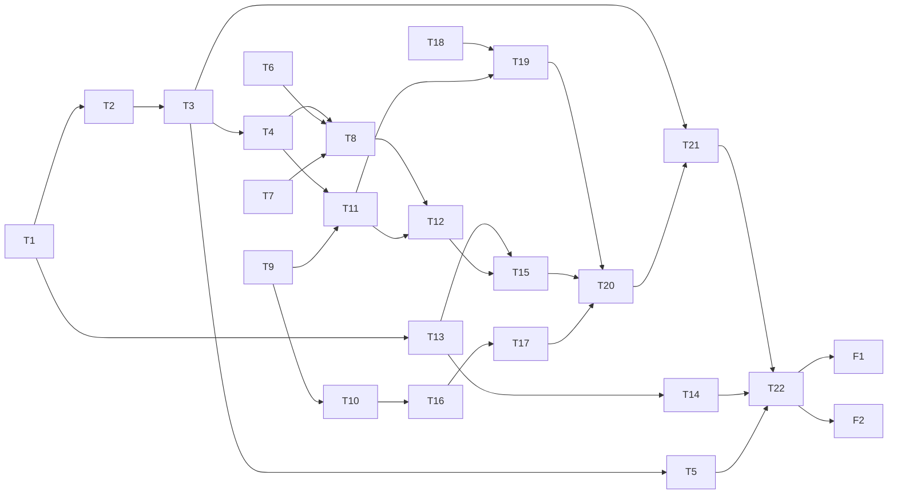

# Agent states, herdr, park and resume

status: in-progress
commit-mode: orchestrator-commits
language: ruby
panel: Ruby (Linus Torvalds, Jeremy Evans, Sandi Metz, Richard Schneeman, Aaron Patterson)

## Intent

Carry out `planning/herdr-research-2026-11.md`.

lain gains a state for every agent (blocked, working, done, idle), folded from the records the chat
already writes. It drives the HUD, `lain://status`, and desktop and morning-feed notices that wait
30 s and skip the window you are looking at.

Inside herdr, lain reports the chat's state and resume command the way herdr's Claude Code
integration does, and opens its windows and popups as herdr tabs. Outside herdr, nothing changes
but the new state surfaces.

`/park <note>` leaves a re-entry note. `lain up` hints at an unclosed session, and `/resume`
restarts the cockpit chat on one in place.

The user runs Claude Code in herdr for work and is moving to lain over time. So **nothing in this
plan may change how herdr treats Claude Code**:

- lain writes to herdr's config only when the user runs `lain herdr link`;
- lain reports only for a pane it can prove is its own;
- lain never overwrites a pane another agent holds.

The ROADMAP line is under `## Status` as "Agent states and herdr".

## Grounding

2026-11-10, `main` at `2d47036c`. Read: `CLAUDE.md`, `ROADMAP.md` `## Status`,
`planning/herdr-research-2026-11.md` and its spike folder, the tailoring report at
`~/.local/state/lain/research/herdr-tailoring-research-2026-11.md`,
`planning/specs/ux-first-dogfood.md` (T4, T16, T47, T48, T50), and the user's
`~/.config/herdr/config.toml`. 2 code surveys and a panel covered every file the cards name. I
checked these by hand or by probe:

- No pane-focus code exists in `lib/`, `plugin/`, `exe/` or `bin/`. I grepped for `pane_active`,
  `window_active`, `session_attached` and `focus-in` and found 0 hits.
- **Probed.** On tmux 3.7b, `display-message -p -t <pane>
  '#{pane_active}#{window_active}#{session_attached}'` printed `010` for an inactive pane of a
  detached session. `session_attached` is a client count.
- `lain up` selects the input pane, not the chat pane (`up.rb:1578`). So "the human is at the
  cockpit" means the chat pane's window is active.
- `Notifier#call` writes the OSC sequence, the tmux message and the feed on every ring, at once
  (`notifier.rb:69-75`). The TTY rebinds the notifier to its writer lock (`tty.rb:131, 637-640`).
- `notify-feed` takes `<source> <title> [body]` and also pops a desktop bubble (morning-feed
  `notify_feed_cli.rb`).
- `Requester` has no spawn, and denials are keyed on the requester (`requester.rb`,
  `queue.rb:605-615`).
- Journal lines get `ts` at write time. Live tee objects carry none (`journal_tee.rb:66`).
- **Probed by the panel:** `lain watch` reads lines with `Telemetry.read(hash, strict: false)`
  (`watch.rb:97`). Over 5 real files, `approval_decision`, `gate_decision` and `questions_consumed`
  read back as `Telemetry::Untyped`, while the live tee carries `Queue::Pending`,
  `Epic::GateDecision` and `QuestionsConsumed`. A fold used by both must accept both.
- `StatusFeed` already folds open waits: approvals, deferred and held gates, question waves by
  `question_key`, and degraded `journal_error` records (`status_feed.rb:562-600`).
- `ChatLaunch` builds the feed (`chat_launch.rb:73-75, 204`) before `LiveViews` (`:189-191`), and
  `Wiring` (`:503`) never sees `LiveViews`. `LiveViews` exists only with a journal or `--nvim`
  (`:189`). The chat closes in `ChatLaunch#close_session` (`:310`).
- Surfaces start in `ConversationScope#open` (`repl/conversation_scope.rb:60-68`) under
  `Repl#run`'s `Sync` (`repl.rb:113`), a reactor every chat mode has.
- `ConversationScope::Attention` exists (`conversation_scope.rb:33`), so the new namespace is
  `AgentStates`.
- `PaneCommand` is shared by the chat, input, `/fork`, `/btw` and fleet-window panes
  (`pane_command.rb:64`). `/fork`, `/btw` and fleet windows run in the cockpit's tmux session, so a
  session-wide herdr pane would reach them too.
- `Exec::ChildEnv::KEEP` strips every `HERDR_*` name from bash children (`child_env.rb:34-37`). A
  Claude Code bash child does NOT strip them, so a `lain` started from Claude inherits Claude's
  pane id.
- `--windows` is refused outside tmux (`chat_launch.rb:412-417`). `/fork` checks `inside_tmux?`
  (`fork.rb:114, 140`).
- The user's herdr sidebar has a `$parked` row for their Claude setup
  (`~/.config/herdr/config.toml:87`).

A path marked `(new)` is created by the first card that names it. A later card that edits it
depends on that card. `planning/herdr-research-2026-11.md` and `planning/herdr-research-2026-11/`
are untracked, so a card in a worktree reads them from `/home/tara/dev/lain/planning/`.

Where docs and code disagreed:

- `lib/lain/cli/command.rb:11-12` says new commands add a require there. No requires remain, and
  Zeitwerk loads commands. **Code wins.**
- The research report called ux-first T16 the card that restores parked approvals. T16 journaled
  deferred epic gates, and commit `93b3ec8c` replaced its record with `awaiting_human`. A parked
  approval can't outlive its chat. **Code wins**, and no card restores parked approvals.
- `fleet.rb:2-4, 36` says the input pane header shows the fleet tree. `wiring.rb:445-449` and the
  code say it doesn't. **Code wins.**
- `docs/commands.md:1324` lists 11 config verbs, and `builder.rb:30` has 14. T7 corrects the count.

## Compatibility

| Surface | Verdict | Evidence |
|---|---|---|
| `state.json` keys | must keep existing keys; adding `agents` is free | Readers: `plugin/tmux/scripts/lain-status`, `plugin/nvim/lua/lain/init.lua:204, 231`, `Frontend::TTY::Warmth` (`tty.rb:709-740`), `Up::Hud#status_right` (`up.rb:1117`). All read named keys. `waiting` and `approvals_pending` keep their meaning after T2. |
| HUD string | free to extend | Display only. It must avoid `"`, `\` and `#` (`Reading::UNRENDERABLE`). |
| `awaiting_human` record | free to extend, must keep reading old lines | Optional `spawn`, omitted when nil. Old sessions are disposable (ruling 2026-10-28). |
| New record `reentry_note` | free | Replay and the bench loader ignore unknown types (`replay.rb:135-140, 273-278`, `loader.rb:61, 208`). |
| `notify-feed` argv | must keep | morning-feed's `notify_feed_cli.rb`. Source stays `lain`. |
| When notices reach the desktop and the feed | free to change where states are tracked | User ruling 2026-11-10: 30 s delay, skip the focused window, in-pane bell immediate. A chat without `LiveViews` (`--no-journal` without `--nvim`) keeps today's immediate notices. |
| herdr CLI (0.9.5) | must keep | External. lain calls `pane report-agent`, `pane release-agent`, `pane report-metadata` and `agent get` for its own pane only. It calls `plugin pane open` and the `tab` verbs only when the user has linked the plugin, and `plugin link`, `unlink` and `list` only from `lain herdr`. Source `lain`, never `herdr:...`. |
| The user's herdr setup for Claude Code | must keep untouched | `~/.config/herdr/config.toml` (incl. its `$parked` row), the Claude integration hook, `~/bin/claude-session-hook`. lain checks pane ownership before every first report (T9). |
| tmux options `@lain_*` | free | Internal to `lain up`. Adds `@lain_herdr`. |
| `PaneCommand` exports | must keep as is | Shared by 5 pane kinds. |
| `/resume` command name | free | Not registered (`registry.rb:20-26` raises on a duplicate). The `--resume` flag is unchanged. |
| `lain sessions` row text | free | Human display. |
| User config verbs | free to extend | Adds `attention`, user file only. |
| `TmuxSurface` messages | must keep | 6 callers. `HerdrSurface` answers the same messages. |
| `Pending#to_journal` (`approval_decision`) and the phone wire | must keep | `Remote::Agenda` reads `Pending` (`remote/agenda.rb`). The spawn is added in memory only. |
| `Command::Env` members | free | Internal (`command/env.rb:6`). Gains `reporter`. |
| `--windows` refusal outside tmux | free to widen | Internal check (`chat_launch.rb:412-417`). It allows a herdr target with the plugin linked. |

No must-keep surface, if broken, would remove a card or about 20% of the plan.

## Spike findings

| Question | Result | Evidence |
|---|---|---|
| Can the 4 states be folded from what the chat journals? | Yes, given a spawn on each wait. 91 of 92 waits in 15 real files close. `stream_started` is never journaled; `request_sent` stands in. | `planning/herdr-research-2026-11/attention_spike.rb` |
| Does a wait name its agent? | Only by role name. 30 approvals in 1 file named a role with no live spawn. | same |
| Can lain report to herdr 0.9.5? | Yes. `agent wait --until blocked` returned in 2.6 s, and `-- lain chat --resume abc123` was accepted. An apostrophe or a path as the first word is refused. `idle` shows as `done` until focused. `agent get` shows the holding agent's name. | `planning/herdr-research-2026-11/q2.out` |
| Do `HERDR_*` reach a chat inside tmux inside herdr? | Only when the tmux server starts from that pane, or when passed explicitly | `q3.out` |
| Can `TmuxSurface`'s messages run over herdr? | Yes, in 95 lines | `herdr_surface.rb`, `drive.rb` |
| Can a herdr tab run lain's command with no shell typed into, and report its exit? | It runs argv through the plugin's `sh -c` and returns `pane_id` and `tab_id`. The pane closes at once on any exit, and `pane.exited` has no status, so the plugin's script writes the status to a file and holds a failed pane itself. `tab rename` labels it. | Spike 3, herdr isolated under its own `XDG_CONFIG_HOME` |
| Can several lain panes report at once? | Yes, under `--source lain` with distinct agent names | same |
| Does a plugin pane get herdr's variables? | Yes: `HERDR_ENV`, `HERDR_PANE_ID`, `HERDR_BIN_PATH`, `HERDR_SOCKET_PATH`, plus `--env` and `--cwd` | same |
| What does `plugin link` write? | The link record under herdr's config dir. A running plugin pane also creates `$XDG_STATE_HOME/herdr/plugins/<id>/`. | same |

All spike worktrees, herdr sessions and tmux servers are gone. Their code is in
`planning/herdr-research-2026-11/`.

## Shared files

Only the main session edits these. Cards hand back 1-line diffs.

- `lib/lain/cli/chat_launch.rb`:
  - build the tracker, the target resolver and the reporter, memoised beside `status_feed` (T4, T11);
  - pass them to the feed factory, `live_views_factory` and `wiring_factory`;
  - call `reporter.release` in `close_session` (T11);
  - widen the `--windows` refusal (T20).
- `lib/lain/cli/live_views.rb`: the tracker first in the tee sink list (T4).
- `lib/lain/cli/wiring.rb`: build `AgentStates::Notices` and `Focus` (T8, T12), and pass `reporter`
  on to `Command::Surface` (T15).
- `lib/lain/cli/command/surface.rb`, `lib/lain/cli/command/env.rb`: `history_commands` gains `Park`
  (T13) and `ResumeSession` (T17). `Env` gains `reporter` (T15). `assemble_env`'s `tmux_surface:`
  comes from `WindowSurface` (T20).
- `spec/lain/cli/command/surface_spec.rb`: the command list (T13, T17, T20).
- `docs/commands.md`: `/park`, `/resume`, the `attention` verb and the verb count, `lain herdr`.
- `exe/lain`: the `herdr` subcommand (T18).
- `ROADMAP.md`: the Status line.

## Rejected options

- **Export `HERDR_*` through `PaneCommand`.** 5 pane kinds share it.
- **A session-wide herdr pane read by any chat in the cockpit.** `/fork`, `/btw` and fleet windows
  share the session (panel B1). Only the pane named `@lain_chat_pane` may report.
- **Trust an inherited `HERDR_PANE_ID` alone.** A lain started from Claude Code's bash inherits
  Claude's pane (panel B2). Ownership is checked with `agent get` first.
- **Report under `--non-interactive`.** A scripted run is somebody else's child, never a herdr agent
  of its own.
- **Journal a "seen" record.** No reader needs it yet (panel YAGNI). Seen is an in-memory step of
  the tracker.
- **OR the tmux and herdr focus probes.** A tmux client inside a herdr pane says nothing about
  whether herdr shows that pane (panel B6).
- **Probe focus on every tick.** Probe only when a notice falls due (panel S11).
- **OSC 7501, a herdr socket client, auto-resume in `lain up`, restoring parked approvals, a bench
  fold over closed files.** Reasons in `planning/herdr-research-2026-11.md` and Grounding.
- **A second wait fold beside `StatusFeed`'s.** T2 extracts 1 fold both use (panel S3).

## Open decisions

- The user's dotfiles event logger (tailoring report, step 4) should skip `agent=lain` so the feed
  doesn't get lain's records twice. That is dotfiles work, not this repo, and no card depends on
  it.

## Dependency graph



## Tasks

### [x] T1: Name the spawn behind every wait on a human          [risk: medium]

**Depends on:** none
**Files:**
- lib: `lib/lain/telemetry/awaiting_human.rb`, `lib/lain/approval/parked/queue.rb`,
  `lib/lain/tools/subagent.rb`, `lib/lain/cli/wiring/askers.rb`, `lib/lain/tools/ask_human.rb`,
  `lib/lain/remote/agenda.rb`
- specs: `spec/lain/telemetry/awaiting_human_spec.rb`, `spec/lain/telemetry/round_trip_spec.rb`,
  `spec/lain/approval/parked/queue_spec.rb`, `spec/lain/tools/subagent_spec.rb`,
  `spec/lain/cli/wiring/askers_spec.rb`, `spec/lain/tools/ask_human_spec.rb`
**Reuse:** `chain.spawn` in `ChildBuilder#build` (`subagent.rb:1905-1912`) and `spawn_agent`
(`:2024`). `Queue.identity_for(context)` (`queue.rb:605`). `AwaitingHuman#to_journal` already
omits default-valued fields (`awaiting_human.rb:116-134`).
**Shared-file wiring:** none
**Reachable from:** a child spawned by `Tools::Subagent` in `lain chat`:
- its gate parks through `Queue#park` (`queue.rb:669`);
- its `ask_human` waits through `AskHuman#waiting` (`ask_human.rb:848`), enrolled at
  `subagent.rb:1911`.

**Acceptance criteria**

```gherkin
Scenario: a child's parked approval names its spawn
  Given a chat that spawns a child whose bash call parks for approval
  When the wait is journaled
  Then the awaiting_human record carries spawn equal to that child's :spawn digest

Scenario: a child's question names its spawn
  Given a spawned child that calls ask_human
  When the question waits
  Then its awaiting_human record carries the child's spawn digest

Scenario: the main chat's waits carry no spawn
  Given the main agent parks a call
  When the wait is journaled
  Then the record has no spawn key, byte for byte as before

Scenario: an old record still reads
  Given an awaiting_human line with no spawn key
  When Telemetry reads it
  Then spawn is nil and every other field is unchanged
```
Spec files: `spec/lain/telemetry/awaiting_human_spec.rb`, `spec/lain/approval/parked/queue_spec.rb`,
`spec/lain/tools/ask_human_spec.rb`, `spec/lain/tools/subagent_spec.rb` (the first scenario runs a
real `Tools::Subagent` spawn on `Provider::Mock`, with no double between the child and the queue).

Stays green outside Files:
- `policy_switch_spec`, `epic_queue_spec`, `planning_view_spec`, `wiring_spec` and
  `status_feed_spec` build `AwaitingHuman` without `spawn`, which defaults to nil and is left out
  of the journal line.
- Other `enrol` callers pass no `spawn:`, which defaults to nil.

**Interface**

```ruby
AwaitingHuman = Data.define(..., :spawn) # String digest, nil for the main chat
Pending#spawn                            # in memory; #to_journal unchanged
Askers#enrol(parent, agent: nil, spawn: nil)
```

**Stop and report if:**
- Carrying the spawn needs a new member on `Requester`. Denials and the judge memo are keyed on it
  (`queue.rb:609-615`). Carry the spawn beside the requester, and report if no context reaching
  `Queue#park` can hold it.
- `awaiting_human_spec.rb:95-111` (the byte-exact line) changes for a main-chat record.
- `Remote::Agenda` serializes `Pending` by its members onto the phone wire.

### [x] T2: Fold open waits once for the feed and the agent states          [risk: high]

**Depends on:** T1
**Files:** `lib/lain/journal/projection/waits.rb` (new), `lib/lain/status_feed.rb`,
`spec/lain/journal/projection/waits_spec.rb` (new), `spec/lain/status_feed_spec.rb`,
`spec/fixtures/waits/closing_records.ndjson` (new; replay_spec reads every file under spec/fixtures/sessions/)
**Reuse:** `StatusFeed`'s wait arms (`status_feed.rb:562-600`): `opened`, `release_approval`,
`closed`, the question-wave close by `question_key`, deferred and held gates, and the degraded
`journal_error` Hash. `Journal::Projection` (`projection.rb`). `Telemetry.read(hash, strict: false)`.
**Shared-file wiring:** none
**Reachable from:** `StatusFeed#<<`, a sink on the chat's tee (`live_views.rb:129-132`). After the
change `waiting` and `approvals_pending` are read from the fold.

**Acceptance criteria**

```gherkin
Scenario: the feed counts the same as before
  Given the record sequences status_feed_spec already uses for waiting and approvals_pending
  When they are stepped through the new fold
  Then state.json's waiting and approvals_pending are the values those examples expect today

Scenario: a closing record read back from a file closes its wait
  Given the fixture's real lines for an awaiting_human and its approval_decision, gate_decision and questions_consumed,
    read through Telemetry.read(hash, strict: false)
  When they are stepped
  Then every wait closes, though the closing records arrive as Telemetry::Untyped

Scenario: every open wait names its agent and summary
  Given open waits from main and from spawn C
  When the fold is read
  Then each wait lists ref, kind, agent (main or C) and summary

Scenario: a held gate stays open and a deferred gate opens
  Given a held GateDecision and a deferred gate park
  When stepped
  Then the held gate's wait stays open and the deferred gate's wait is open
```
Spec files: `spec/lain/journal/projection/waits_spec.rb`, `spec/lain/status_feed_spec.rb`

**Interface**

```ruby
module Lain
  module Journal
    class Projection
      class Waits < Projection
        Wait = Data.define(:ref, :kind, :agent, :summary) # agent: "main" or a spawn digest
        def step(record) = ...  # live objects and Telemetry::Untyped of the same journal type
        def open = ...          # Array<Wait>
        def open_for(agent) = ...
      end
    end
  end
end
```

**Stop and report if:**
- Any existing `status_feed_spec` expectation for `waiting` or `approvals_pending` changes value.
  That is a behaviour change, not a refactor. Report it rather than edit the expectation.
- A closing record can't be told apart by its `type` once it is `Untyped`.

### T3: Fold each agent's state from the chat's records          [risk: medium]

**Depends on:** T2
**Files:** `lib/lain/agent_states.rb` (new), `lib/lain/journal/projection/agent_states.rb` (new),
`spec/lain/journal/projection/agent_states_spec.rb` (new)
**Reuse:** `Projection::Waits` (T2) for blocked. `SpawnLifecycle#terminal?`. The rules proved in
`planning/herdr-research-2026-11/attention_spike.rb`. `AskSettled` reaches the tee through
`Chronicle#settled` (`chronicle.rb:423-427`). `RequestSent#requester` is nil for the main chat,
`judge` for the judge and `summarizer` for the summarizer.
**Shared-file wiring:** none
**Reachable from:** `AgentStates::Tracker#<<` (T4) on the chat's tee, and `lain watch` (T21).

**Acceptance criteria**

```gherkin
Scenario: a child's wait blocks that child only
  Given a spawn for C and an awaiting_human with spawn C
  When stepped
  Then C is blocked with what equal to the wait's summary, and main is not

Scenario: the main chat works, is done, then is seen
  Given a RequestSent with no requester
  When an AskSettled is stepped, then the tracker's Seen value
  Then main goes working, done, idle

Scenario: the judge and the summarizer never make main working
  Given a RequestSent from requester judge, then one from summarizer
  When stepped
  Then main's state is unchanged

Scenario: a child's completion makes it done
  Given child C working
  When a completion Message citing C's spawn with lifecycle stopped is stepped
  Then C is done

Scenario: blocked rolls up over working and done
  Given main working, C done and D blocked
  When the rollup is read
  Then it is blocked

Scenario: an interrupt ends working
  Given main working
  When a RunInterrupted is stepped
  Then main is idle

Scenario: the same states from a file
  Given the fixture lines of T2 plus a spawn, child progress and completion, read through Telemetry.read
  When stepped
  Then the states equal those from the live objects
```
Spec file: `spec/lain/journal/projection/agent_states_spec.rb`

**Interface**

```ruby
module Lain
  module AgentStates          # lib/lain/agent_states.rb holds the docstring and these
    MAIN = "main"
    ORDER = %i[blocked working done idle].freeze
    Seen = Data.define(:agent) # not journaled; nil agent = every done agent
  end
  module Journal
    class Projection
      class AgentStates < Projection
        Agent = Data.define(:id, :state, :what)
        def step(record) = ...
        def agents = ...       # main first
        def rollup = ...
        def done_unseen = ...
      end
    end
  end
end
```

**Stop and report if:**
- A completion `Message` read from a file isn't a `Telemetry::Message` (the watch reads it with
  `strict: false`). Then match it by type there, as T2 does.

### T4: Track agent states once per chat and publish them          [risk: medium]

**Depends on:** T3
**Files:**
- lib: `lib/lain/agent_states/tracker.rb` (new), `lib/lain/status_feed.rb`,
  `lib/lain/status_feed/reading.rb`, `lib/lain/frontend/tty.rb`
- specs: `spec/lain/agent_states/tracker_spec.rb` (new), `spec/lain/status_feed_spec.rb`,
  `spec/lain/status_feed/reading_spec.rb`, `spec/lain/cli/live_views_spec.rb`,
  `spec/lain/cli/chat_launch_spec.rb`, `spec/plugin/tmux_plugin_spec.rb`,
  `spec/plugin/nvim_plugin_spec.rb`
**Reuse:** `StatusFeed#publish_if_changed` and `Publication` (`publication.rb:56`). `Reading#hud`
and `Reading::UNRENDERABLE`. `ChatLaunch#status_feed`'s memoisation (`chat_launch.rb:204`).
**Shared-file wiring:**
- `lib/lain/cli/chat_launch.rb`:
  - a memoised `agent_states` (`AgentStates::Tracker.new(clock: run_clock)`);
  - `status_feed_factory` gets `agent_states:`;
  - `live_views_factory` gets it at `:191`.
- `lib/lain/cli/live_views.rb:129-132`: the tracker goes first in the sink list.
**Reachable from:** `exe/lain chat` to `ChatLaunch#call` to `open_chronicle` (`chat_launch.rb:183-191`).

**Acceptance criteria**

```gherkin
Scenario: state.json carries every agent's state
  Given a chat whose child C is blocked on an approval
  When the feed publishes
  Then state.json has agents.rollup "blocked" and a row for C with state "blocked" and its what

Scenario: the HUD shows unseen finished agents
  Given main done and unseen
  When the HUD is read
  Then it ends with " done:1 " and has no '"', '\' or '#'

Scenario: a HUD with nothing done is unchanged
  Given no agent done
  When the HUD is read
  Then it equals what Reading#hud gave before for the same state

Scenario: observers hear each change once
  Given an observer on the tracker
  When 2 records change main's state and 1 does not
  Then the observer is called twice with the rollup, the changed agent and the time from the clock

Scenario: a real chat publishes the state
  Given lain chat built through ChatLaunch with Provider::Mock, whose agent parks a call
  When the wait opens
  Then the project's state.json agents.rollup is "blocked"
```
Spec files: `spec/lain/agent_states/tracker_spec.rb`, `spec/lain/status_feed_spec.rb` (the last
scenario through `ChatLaunch` with no double between the tee and the feed),
`spec/lain/status_feed/reading_spec.rb`

**Interface**

```ruby
module Lain
  module AgentStates
    class Tracker
      Change = Data.define(:rollup, :agent, :since)
      def initialize(clock:) = ...
      def <<(record) = ...         # never raises; an unknown record is ignored
      def seen(agent = nil) = ...  # steps AgentStates::Seen
      def on_change(&observer) = ...
      def projection = ...
    end
  end
end
```

**Stop and report if:**
- `Frontend::TTY::Warmth` (`tty.rb:709-740`) raises on a `state.json` written before this change,
  with no `agents` key.
- A plugin spec reads the `contain_exactly` key list of `status_feed_spec.rb:1999` as a schema.

### T5: Show each agent's state in `lain://status`          [risk: low]

**Depends on:** T3
**Files:** `lib/lain/frontend/neovim/status_view.rb`, `spec/lain/frontend/neovim/status_view_spec.rb`
**Reuse:** `StatusView`'s own Channel fold (`status_view.rb:99, 200-207`) and `Fleet::Row.composed`.
**Shared-file wiring:** none
**Reachable from:** `Frontend::Neovim` buffers (`buffers.rb:195`) under `--nvim` or `lain up`.

**Acceptance criteria**

```gherkin
Scenario: a blocked child shows its wait
  Given the view received a spawn for C and an awaiting_human with spawn C, summary "bash"
  When the buffer renders
  Then C's row shows "blocked: bash"

Scenario: the main chat gets a row
  Given main done and unseen
  When the buffer renders
  Then a row reads "main  done"
```
Spec file: `spec/lain/frontend/neovim/status_view_spec.rb`

**Stop and report if:**
- `status_view_spec.rb` pins whole buffers whose rows would shift. Then the main row goes last.

### [x] T6: Ask tmux whether the human is at the chat's window          [risk: low]

**Depends on:** none
**Files:** `lib/lain/frontend/focus.rb` (new), `spec/lain/frontend/focus_spec.rb` (new)
**Reuse:** `TmuxMessage`'s `shell_out:`, `TIMEOUT = 2` and the `TMUX`/`TMUX_PANE` slice
(`tty.rb:1048-1090`). The probed format in Grounding.
**Shared-file wiring:** none
**Reachable from:** `AgentStates::Notices` (T8), built in `Wiring`.

**Acceptance criteria**

```gherkin
Scenario: the cockpit's window is active and a client is attached
  Given TMUX and TMUX_PANE set, and tmux answers window_active 1 and session_attached 2 for the chat pane
  When focused? is asked
  Then it is true, whichever pane of that window is active

Scenario: another window, or nobody attached
  Given tmux answers window_active 0, or session_attached 0
  When focused? is asked
  Then it is false

Scenario: outside tmux, or tmux fails
  Given TMUX empty, or the call raises, exits non-zero or times out
  When focused? is asked
  Then it is false and nothing raises
```
Spec file: `spec/lain/frontend/focus_spec.rb` (1 `:seam` example on a real `tmux -L` server: a
split window with the other pane selected still counts as focused only when a client is attached)

**Interface**

```ruby
module Lain
  module Frontend
    class Focus
      def self.tmux(env: ENV, shell_out: ...) = ... # Focus::Never when TMUX is empty
      def focused? = ...
    end
  end
end
```

**Stop and report if:**
- A detached real-tmux server can't fake an attached client in a spec. Then the seam example
  covers the "nobody attached" half only, and says so.

### [x] T7: Read `attention delay:` from the user's config          [risk: low]

**Depends on:** none
**Files:** `lib/lain/config/attention.rb` (new), `lib/lain/config/builder.rb`, `lib/lain/config.rb`,
`spec/lain/config/attention_spec.rb` (new), `spec/lain/config/builder_spec.rb`,
`spec/lain/config_spec.rb`
**Reuse:** `Config::Keys` (`config/keys.rb`): `TABLE`, `DEFAULTS`, `.from`, `.empty`, `Refusal`.
`Builder::USER_VERBS` and `small_tables` (`builder.rb:54, 254`). `Config.keys` (`config.rb:129`).
**Shared-file wiring:** `docs/commands.md`: `### attention` beside `### theme` (`:1562`), and the
verb count at `:1324` set to the builder's list.
**Reachable from:** `Wiring` reads `Config.attention` for `AgentStates::Notices` (T8).

**Acceptance criteria**

```gherkin
Scenario: the default delay
  Given no attention table in the user's config.rb
  When Config.attention is read
  Then delay is 30

Scenario: a set delay
  Given the user's config.rb says attention delay: 5
  When read
  Then delay is 5

Scenario: a project file may not set it
  Given a project .lain/config.rb says attention delay: 5
  When the project config loads
  Then it is refused naming the file, the line and the user's config.rb

Scenario: bad values
  Given delay: -1, delay: "soon", or an unknown key dealy
  When it loads
  Then a Refusal names the key and the value
```
Spec files: `spec/lain/config/attention_spec.rb`, `spec/lain/config_spec.rb`

**Interface**

```ruby
Config::Attention = Data.define(:delay) # seconds, Numeric >= 0
# user config.rb:  attention delay: 30
```

**Stop and report if:**
- `builder.rb` trips a `Metrics/*` limit. Treat it as a smell per `CLAUDE.md`, never an inline
  disable.

### T8: Send delayed desktop and feed notices for blocked and done          [risk: medium]

**Depends on:** T4, T6, T7
**Files:**
- lib: `lib/lain/agent_states/notices.rb` (new), `lib/lain/frontend/tty/notifier.rb`,
  `lib/lain/cli/repl/conversation_scope.rb`
- specs: `spec/lain/agent_states/notices_spec.rb` (new), `spec/lain/frontend/tty/notifier_spec.rb`,
  `spec/lain/frontend/tty_spec.rb`, `spec/lain/cli/wiring_spec.rb`,
  `spec/lain/cli/repl/conversation_scope_spec.rb`
**Reuse:** `Notifier`'s sequence writer, passthrough wrap, mask and title (`notifier.rb:57-90`) and
its TTY-bound form (`tty.rb:131, 637-640`). `Notices.for(env:)`. `ConversationScope#open`'s surface
fibers (`conversation_scope.rb:60-68`). `Mode::Layer` `quiet`.
**Shared-file wiring:** `lib/lain/cli/wiring.rb`: build `AgentStates::Notices.new(tracker:, notifier:,
focus:, delay: Config.attention.delay, layers:)` when a tracker was passed. Pass it to the
conversation scope. Build the `Notifier` with `deferred: true` in that case, and as today otherwise.
**Reachable from:** `Wiring` to `Repl` to `ConversationScope#open` under `Repl#run`'s `Sync`
(`repl.rb:113`), on every `lain chat` with a tracker.

**Acceptance criteria**

```gherkin
Scenario: a wait that outlasts the delay notifies once
  Given delay 30 and focus false
  When main is blocked for 31 s on a spec clock
  Then 1 OSC sequence goes through the TTY-bound notifier and notify-feed gets ["lain", "<project>", "blocked: <what>"]

Scenario: a wait settled within the delay notifies nobody
  When main is blocked, then working 10 s later
  Then nothing is sent and focus is never probed

Scenario: a finished agent notifies after the delay
  Given child C done and unseen for 31 s, focus false
  When the notice falls due
  Then notify-feed gets "done: <C's role or task>"

Scenario: being at the window marks it seen instead
  Given main done for 31 s and focus true
  When the notice falls due
  Then nothing is sent and the tracker steps Seen for main

Scenario: quiet silences the out-of-band notices
  Given the quiet layer is up
  When main is blocked for 31 s
  Then nothing is sent

Scenario: the in-pane bell stays immediate
  Given a tracker is wired
  When a ring happens
  Then BEL and the tmux message happen at once, and the notifier writes no OSC and calls no feed

Scenario: a chat with no tracker keeps today's notices
  Given --no-journal and no --nvim
  When a ring happens
  Then the OSC sequence and the feed fire at once, as before

Scenario: focus is probed only when a notice falls due
  Given 3 polls with no notice due
  When the loop runs
  Then focus was never asked
```
Spec files: `spec/lain/agent_states/notices_spec.rb`, `spec/lain/frontend/tty/notifier_spec.rb`,
`spec/lain/frontend/tty_spec.rb` (the `fed ==` expectations at `:1798-1835` stay for the no-tracker
case and move to the notices spec otherwise), `spec/lain/cli/repl/conversation_scope_spec.rb`. 1
scenario runs `Wiring` with a TTY frontend on a `Provider::Mock` chat, with no double between the
tracker and the notices.

**Interface**

```ruby
module Lain
  module AgentStates
    class Notices
      def initialize(tracker:, notifier:, focus:, delay:, layers:, clock: Time, poll: 1) = ...
      def spawn(task) = ... # a surface fiber, as ConversationScope#open starts the others
    end
  end
end
```

**Stop and report if:**
- `ConversationScope#open`'s surfaces are stopped in an order that would close `Notices` while a
  notice is being written.

### [x] T9: Resolve a herdr pane lain may report to          [risk: high]

**Depends on:** none
**Files:** `lib/lain/herdr.rb` (new), `lib/lain/herdr/target.rb` (new),
`spec/lain/herdr/target_spec.rb` (new), `spec/support/isolated_herdr_env.rb` (new)
**Reuse:** `Shell::Out`. `ChatRestart#chat_pane?` (`up.rb:536-541`), which compares `TMUX_PANE` with
the session's `@lain_chat_pane` (`up.rb:307`). `spec/support/isolated_tmux_env.rb` as the shape of a
spec-wide env scrub.
**Shared-file wiring:** none
**Reachable from:** `Herdr::Target::Resolver`, built once in `ChatLaunch` (T11) and shared by the
reporter, focus and the window surface.

**Acceptance criteria**

```gherkin
Scenario: a chat started in a herdr pane
  Given HERDR_ENV=1 and the 3 HERDR_* paths in ENV, TMUX empty, an interactive chat
  When the resolver answers
  Then the candidate names that pane, binary and socket

Scenario: the cockpit's chat pane reads what lain up recorded
  Given TMUX_PANE equal to the session's @lain_chat_pane, and @lain_herdr naming w1:p9
  When the resolver answers
  Then the candidate is w1:p9, whatever HERDR_PANE_ID the process inherited

Scenario: other panes of the cockpit get nothing
  Given TMUX_PANE is a /fork window, a /btw popup or a fleet window in that session
  When the resolver answers
  Then there is no candidate

Scenario: a non-interactive chat gets nothing
  Given --non-interactive
  When the resolver answers
  Then there is no candidate, whatever HERDR_* says

Scenario: a pane another agent holds is never a target
  Given a candidate pane where herdr agent get names agent claude
  When the target is asked for
  Then it is absent, 1 note says the pane belongs to claude, and herdr is not called again for that pane

Scenario: a free pane, or one lain already holds
  Given agent get answers agent_not_found, or names agent lain
  When the target is asked for
  Then it is that pane

Scenario: no herdr
  Given no HERDR_ENV and no TMUX
  When the resolver answers
  Then there is no candidate and no process is spawned
```
Spec file: `spec/lain/herdr/target_spec.rb` (a `:seam` example reads real `tmux -L` session and pane
options; herdr is a stub script on a temp path)

**Interface**

```ruby
module Lain
  module Herdr                     # lib/lain/herdr.rb: docstring, SOURCE = "lain"
    Target = Data.define(:bin, :pane, :socket, :via) # via: :env or :cockpit
    class Target
      OPTION = "@lain_herdr"
      def environment = { "HERDR_SOCKET_PATH" => socket }
      def to_option = ...

      class Resolver
        def initialize(env:, interactive:, shell_out: ..., notes: Sink::Null.new) = ...
        def current = ...          # a Target or nil, looked up on each call; ownership checked once per pane
      end
    end
  end
end
```

**Stop and report if:**
- `agent get` on 0.9.5 returns no agent name for a pane held by an integration that reports only a
  session id (Claude's hook does that; its state is screen-derived). Then ownership must also treat
  any detected agent (`agent list` row for the pane) as held. Probe with a stub, and record what the
  real CLI prints in the hand-back.
- A spec that inherits the developer's `HERDR_*` could reach a real herdr.
  `spec/support/isolated_herdr_env.rb` removes those names for every example.

### [x] T10: Record the herdr pane when `lain up` attaches from herdr          [risk: medium]

**Depends on:** T9
**Files:** `lib/lain/cli/up.rb`, `spec/lain/cli/up_spec.rb`
**Reuse:** `create_session` (`up.rb:1509-1518`), `reattach_session` (`:1642-1647`),
`@tmux.act("set-option", ...)` as `run_chat` does (`:1611`). `Herdr::Target#to_option`.
**Shared-file wiring:** none
**Reachable from:** `exe/lain up` to `Up#launch_plan` to `Up#call`.

**Acceptance criteria**

```gherkin
Scenario: lain up from a herdr pane records it
  Given lain up's own TMUX is empty, HERDR_ENV=1 and the 3 HERDR_* paths set
  When lain up creates the cockpit
  Then the session option @lain_herdr holds that pane, binary and socket

Scenario: reattaching from another herdr pane updates it
  Given @lain_herdr names w1:p3
  When lain up reattaches from w2:p1
  Then @lain_herdr names w2:p1

Scenario: reattaching from a plain terminal clears it
  When lain up reattaches with no HERDR_ENV
  Then @lain_herdr is unset

Scenario: a nested lain up never records
  Given lain up runs with TMUX set, whatever HERDR_* it inherited
  When it creates or switches to the cockpit
  Then @lain_herdr is neither written nor cleared

Scenario: real-tmux specs never see the developer's herdr
  When up_spec's real-tmux examples run
  Then their tmux server's environment has no HERDR_ name
```
Spec file: `spec/lain/cli/up_spec.rb` (the first scenario on a real `tmux -L` server)

**Stop and report if:**
- `up_spec.rb:2526-2528` (verb order) or `:3541` (the `ChatRestart` regex) breaks.

### T11: Report the chat's state and resume command to herdr          [risk: high]

**Depends on:** T4, T9
**Files:** `lib/lain/herdr/reporter.rb` (new), `spec/lain/herdr/reporter_spec.rb` (new),
`spec/lain/exec/child_env_spec.rb`
**Reuse:**
- `AgentStates::Tracker#on_change` (T4) and `Target::Resolver` (T9).
- 1 worker `Thread` with a queue, `TIMEOUT = 2` and a rescue to a note, after `TmuxMessage`
  (`tty.rb:1048-1090`).
- `Notifier`'s mask and control scrub (`notifier.rb:80-83`) for `--message`.
**Shared-file wiring:** `lib/lain/cli/chat_launch.rb`:
- a memoised `herdr_resolver` (`Target::Resolver.new(env: @env, interactive: !options[:non_interactive],
  notes:)`);
- a memoised `herdr_reporter` (`Herdr::Reporter.new(resolver:, session: chronicle.journal_path,
  root: project.root, up_session:)`), subscribed with `agent_states.on_change(&reporter)`;
- `reporter.release` in `close_session` (`:310`).
**Reachable from:** `exe/lain chat` to `ChatLaunch#call`. It does nothing unless the resolver
yields a target.

**Acceptance criteria**

```gherkin
Scenario: state changes reach herdr in order
  Given a target and a recorded stub herdr
  When main goes working, a child blocks on approval of bash, then all go done
  Then the stub got pane report-agent <pane> --source lain --agent lain with states working, blocked, idle in that order,
    each --seq greater than the last, and the blocked call's --message is the wait's summary after masking

Scenario: the resume command matches how the chat was started
  Given a cockpit target (via :cockpit) for tmux session S, session file F, project root R
  When it reports
  Then the report ends with -- lain up R --session S -- --resume F (F absolute)
  And a chat in a plain herdr pane (via :env) reports -- lain chat --resume F

Scenario: a root herdr would refuse leaves out the resume command
  Given a root containing an apostrophe
  When it reports
  Then there is no resume command and the state still goes

Scenario: a new target releases the old one and resends
  Given lain reported blocked on pane w1:p3
  When the resolver next answers w2:p1
  Then the stub got pane release-agent w1:p3 --source lain, then report-agent w2:p1 with blocked

Scenario: lain releases its pane on exit
  When the session closes
  Then pane release-agent <pane> --source lain is called once

Scenario: a pane held by claude is left untouched
  Given the resolver found the candidate pane held by agent claude
  When main changes state
  Then no report-agent or release-agent is sent for that pane

Scenario: lain touches nothing else in herdr
  Given a full run that reports, blocks, finishes and closes
  When the stub's calls are listed
  Then every call is agent get, pane report-agent or pane release-agent, and none names herdr:, integration, plugin, config or server

Scenario: herdr missing or failing
  Given HERDR_BIN_PATH missing, or the stub exits 1, or sleeps 5 s
  When main changes state
  Then the chat goes on, 1 note says reporting failed, and a later success clears it

Scenario: a bash child cannot report into lain's pane
  Given the 4 HERDR_* names in the chat's ENV
  When the bash tool builds a child environment
  Then none reach the child
```
Spec files: `spec/lain/herdr/reporter_spec.rb` (a `:seam` example builds a real `ChatLaunch` with
`Provider::Mock` and a stub `herdr` script as `HERDR_BIN_PATH`), `spec/lain/exec/child_env_spec.rb`

**Interface**

```ruby
module Lain
  module Herdr
    class Reporter
      AGENT = "lain"
      def initialize(resolver:, session:, root:, up_session: nil, agent: AGENT, resume: true,
                     shell_out_factory: ..., notes: Sink::Null.new) = ...
      def to_proc = ...           # for tracker.on_change(&reporter)
      def call(change) = ...
      def metadata(token, value) = ... # pane report-metadata, used by T15
      def release = ...
    end
  end
end
```

**Stop and report if:**
- `pane release-agent` or `pane report-metadata` on 0.9.5 take other arguments. Check `--help` before
  writing the spec, and record it in the hand-back.
- The first word `lain` resolves to a different install on herdr's `PATH` than the `$PROGRAM_NAME`
  the panes exec (`pane_command.rb:64-77`). herdr requires a bare command name, so report it for
  integration check 4 instead of working around it.

### T12: Combine tmux and herdr focus by where the chat runs          [risk: medium]

**Depends on:** T8, T11
**Files:** `lib/lain/frontend/focus.rb`, `lib/lain/herdr/focus.rb` (new),
`spec/lain/frontend/focus_spec.rb`, `spec/lain/herdr/focus_spec.rb` (new)
**Reuse:** `Frontend::Focus.tmux` (T6). `Target::Resolver` (T9). The `focused` field of `herdr
agent get` (`q2.out`).
**Shared-file wiring:** `lib/lain/cli/wiring.rb`: `focus: Frontend::Focus.for(env: ENV, resolver:
herdr_resolver)`.
**Reachable from:** `Wiring` to `AgentStates::Notices`.

**Acceptance criteria**

```gherkin
Scenario: the cockpit inside herdr needs both
  Given a cockpit target and tmux says the chat's window is active
  When herdr says its pane is not focused
  Then focused? is false
  And when herdr says focused, it is true

Scenario: plain tmux uses tmux only
  Given TMUX set and no target
  Then focused? is tmux's answer and herdr is never called

Scenario: a plain herdr pane uses herdr only
  Given an env target and TMUX empty
  Then focused? is herdr's answer

Scenario: herdr fails
  Given the stub exits 1
  Then the herdr probe answers false
```
Spec files: `spec/lain/frontend/focus_spec.rb`, `spec/lain/herdr/focus_spec.rb`

**Interface**

```ruby
Frontend::Focus.for(env:, resolver:) # tmux AND herdr in a cockpit inside herdr; one probe otherwise
```

**Stop and report if:**
- `agent get <pane>` needs a name herdr assigns rather than the pane id. `q2.out` shows the pane id
  works on 0.9.5.

### [x] T13: Journal a re-entry note with `/park` and replay it on resume          [risk: low]

**Depends on:** T1
**Files:**
- lib: `lib/lain/telemetry/reentry_note.rb` (new), `lib/lain/session.rb`,
  `lib/lain/session_record/replay.rb`, `lib/lain/cli/command/park.rb` (new), `lib/lain/cli/resume.rb`
- specs: `spec/lain/telemetry/reentry_note_spec.rb` (new), `spec/lain/session_spec.rb`,
  `spec/lain/session_record/replay_spec.rb`, `spec/lain/cli/command/park_spec.rb` (new),
  `spec/lain/cli/resume_spec.rb`, `spec/lain/telemetry/round_trip_spec.rb`
**Reuse:** `/label` end to end: `Command::Label` (`label.rb:29`), `Session#record_label`
(`session.rb:441-446`), `Telemetry::TurnLabeled`, `Replay::Labels` (`replay.rb:119-133, 148, 176`).
`Resume#notices` (`resume.rb:296-315`).
**Shared-file wiring:** `lib/lain/cli/command/surface.rb:215` `history_commands` gains `Park`.
`docs/commands.md` gains `### /park` after `### /label` (`:1080`).
**Reachable from:** `Command::Surface` to `/park TEXT`. `CLI::Resume` to `Replay#session` and
`Resume#notices`.

**Acceptance criteria**

```gherkin
Scenario: parking journals the note
  Given a running chat
  When the human types /park waiting on review from X; next: address comments
  Then a reentry_note record holds that note, and the reply says it is noted

Scenario: the latest note wins and an empty park clears it
  Given 2 /park notes, then /park with no text
  When the session replays
  Then it has no note

Scenario: resuming prints the note first
  Given a session whose last note is "waiting on CI"
  When lain chat --resume opens it
  Then the first notice reads "parked: waiting on CI"
```
Spec files: `spec/lain/cli/command/park_spec.rb`, `spec/lain/cli/resume_spec.rb` (the resume
scenario runs `CLI::Resume` over a real file written by `Session`)

**Interface**

```ruby
Telemetry::ReentryNote = Data.define(:note) # "" clears; a different word from Approval::Parked
Session#record_reentry_note(note); Session#reentry_note
```

**Stop and report if:**
- `spec/lain/cli/command/surface_spec.rb` pins command order in a way 1 new command breaks
  elsewhere. That spec is a shared file; hand back the diff.

### [x] T14: Show the re-entry note in `lain sessions`          [risk: low]

**Depends on:** T13
**Files:** `lib/lain/journal/projection/session_row.rb`, `lib/lain/cli/sessions.rb`,
`lib/lain/bench/session/loader.rb`, `spec/lain/journal/projection/session_row_spec.rb`,
`spec/lain/cli/sessions_spec.rb`
**Reuse:** `SessionRow#step`, `Sessions::Row#to_s` (`sessions.rb:112-120`).
**Shared-file wiring:** none
**Reachable from:** `exe/lain sessions` (`exe/lain:1598-1600`) and `/sessions`, both through
`CLI::Sessions#listing`.

**Acceptance criteria**

```gherkin
Scenario: a parked session shows its note
  Given a session whose last reentry_note is "waiting on review"
  When lain sessions lists it
  Then its row ends with "  parked: waiting on review"

Scenario: a long note is cut
  Given a 300-character note
  Then the row shows its first 60 characters and an ellipsis

Scenario: an unparked session is unchanged
  Then its row equals the row before this change
```
Spec file: `spec/lain/cli/sessions_spec.rb`
Stays green outside Files: `spec/docs_naming_spec.rb` names `SessionRow` only as a documented
constant, and the class keeps its name.

**Stop and report if:**
- `Bench::Session::Loader` reads `SessionRow` with an exact field list that a new field breaks.

### T15: Send the re-entry note to the feed and to herdr          [risk: low]

**Depends on:** T13, T12
**Files:** `lib/lain/cli/command/park.rb`, `lib/lain/herdr/reporter.rb`,
`spec/lain/cli/command/park_spec.rb`, `spec/lain/herdr/reporter_spec.rb`
**Reuse:** `Notices.for(env:)`. `Herdr::Reporter#metadata` (T11).
**Shared-file wiring:**
- `lib/lain/cli/command/env.rb`: `Env` gains `reporter`.
- `lib/lain/cli/command/surface.rb`: `assemble_env` passes it, and `Park` reads `env.reporter` and
  the feed.
- `lib/lain/cli/wiring.rb`: hands `ChatLaunch`'s reporter to `Command::Surface`.
**Reachable from:** `/park TEXT` in `lain chat`.

**Acceptance criteria**

```gherkin
Scenario: parking writes the feed at once
  Given notify-feed stubbed
  When the human parks with "waiting on CI"
  Then notify-feed gets ["lain", "<project>", "parked: waiting on CI"] with no delay

Scenario: parking inside herdr sets lain's own token
  Given a reporting target
  When the human parks with "waiting on CI"
  Then pane report-metadata sets token lain_parked for lain's pane, and no token named parked is ever set

Scenario: clearing a park clears the token
  When the human types /park with no text
  Then lain_parked is cleared and the feed gets nothing

Scenario: the allowed herdr calls grow by 1
  Given T11's "lain touches nothing else" run plus a park
  Then the calls are agent get, pane report-agent, pane release-agent and pane report-metadata only
```
Spec files: `spec/lain/cli/command/park_spec.rb`, `spec/lain/herdr/reporter_spec.rb`

**Stop and report if:**
- `pane report-metadata` can't clear a token on 0.9.5. Then send an empty value and record what
  herdr shows.

### T16: Hint at an unclosed session when `lain up` builds a cockpit          [risk: low]

**Depends on:** T10
**Files:** `lib/lain/cli/up.rb`, `spec/lain/cli/up_spec.rb`
**Reuse:** `Resume::Selector#newest` (`resume/selector.rb:~190`), `SessionRow#closed`,
`Liveness::Writer.from_header(header).verdict(probe)` (`resume.rb:300-304`). `LaunchPlan` messages.
**Shared-file wiring:** none
**Reachable from:** `exe/lain up` to `Up#launch_plan` on the create path only.

**Acceptance criteria**

```gherkin
Scenario: a reboot left the last session open
  Given the newest resumable session has no session_closed and its writer is dead
  When lain up creates a cockpit with no --resume or --fork in its chat args
  Then the messages include "last session <name> was not closed: lain up -- --resume <name>"
  And the chat starts fresh

Scenario: a live writer is not a candidate
  Given the newest session is open in a running process
  Then no hint

Scenario: reattaching never hints
  Given an existing cockpit
  Then no hint
```
Spec file: `spec/lain/cli/up_spec.rb`

**Interface**

```ruby
# Extracted for T16 and T17: the newest resumable session after except, if its writer is dead and it has
# no session_closed; older ones are not searched
Resume::Selector#unclosed(except: nil) = ... # a path or nil
```

**Stop and report if:**
- `Resume::Selector` needs a constructed `Resume` with chat options to list candidates. Then report
  the extraction before doing it.

### T17: Restart the cockpit chat on a named session with `/resume`          [risk: medium]

**Depends on:** T16
**Files:** `lib/lain/cli/up.rb`, `lib/lain/cli/command/resume_session.rb` (new),
`spec/lain/cli/up_spec.rb`, `spec/lain/cli/command/resume_session_spec.rb` (new)
**Reuse:** `Command::Clear` (`clear.rb:11-41`) as the shape. `Up.respawn_chat` and `ChatRestart`
(`up.rb:493-556, 1316-1328`). `Resume::Selector#unclosed` (T16). `Liveness::Writer`.
**Shared-file wiring:** `lib/lain/cli/command/surface.rb:215` `history_commands` gains
`ResumeSession`. `docs/commands.md` gains `### /resume`.
**Reachable from:** `Command::Surface` to `/resume [SESSION]` in a `lain up` chat pane.

**Acceptance criteria**

```gherkin
Scenario: resume a named session in place
  Given a cockpit chat pane and a closed or dead-writer session S
  When the human types /resume S
  Then a restart is armed whose respawn command is the fresh command plus " --resume <S, shell-escaped>"
  And the chat quits through the path /clear uses

Scenario: a session with a live writer is refused before quitting
  Given S is open in a running process
  When the human types /resume S
  Then the reply says S is still open in process N, and the chat stays

Scenario: resume the newest unclosed session
  Given Selector#unclosed(except: the current file) is U
  When the human types /resume
  Then the restart resumes U, and with none the reply says so and the chat stays

Scenario: a plain chat refuses
  Given a chat outside a lain up cockpit
  When the human types /resume S
  Then the reply says to run lain chat --resume S, and the chat stays

Scenario: /clear still starts fresh
  Given a resumed cockpit chat
  When the human types /clear
  Then the respawn command has no --resume
```
Spec files: `spec/lain/cli/command/resume_session_spec.rb`, `spec/lain/cli/up_spec.rb` (the first
scenario arms a real `ChatRestart` on a `tmux -L` server, tagged `:seam`)

**Interface**

```ruby
Up.respawn_chat(pane:, socket: nil, waiting_on: Process.pid, extra: [], shell_out_factory: ...)
# extra is shell-escaped into the stored fresh command string
CLI::Command::ResumeSession # name "resume"; named so it can't shadow CLI::Resume
```

**Stop and report if:**
- `ChatRestart`'s `ARMED` guard (`up.rb:499`) makes a `/resume` after a `/clear` a silent no-op.
- `up_spec.rb:3541`'s regex on the restart script breaks.

### [x] T18: Ship lain's herdr plugin and `lain herdr link`          [risk: medium]

**Depends on:** none
**Files:** `plugin/herdr/herdr-plugin.toml` (new), `lib/lain/cli/herdr_link.rb` (new),
`spec/lain/cli/herdr_link_spec.rb` (new), `spec/plugin/herdr_plugin_spec.rb` (new)
**Reuse:** the gem-root lookup `Up::Cockpit` uses for `plugin/nvim` (`up.rb:898`). `Shell::Out`.
The spike's manifest (`planning/herdr-research-2026-11/herdr-plugin.toml`) and spike 3's script.
**Shared-file wiring:** `exe/lain`: `subcommand "herdr", CLI::HerdrLink` beside `worktrees`.
`docs/commands.md`: `### herdr`.
**Reachable from:** `exe/lain herdr link|unlink|status`, run by the user. Nothing else in lain
writes to herdr's config.

**Acceptance criteria**

```gherkin
Scenario: the plugin runs a command and records its exit
  Given the manifest's run script, LAIN_RUN_COMMAND "exit 7" and LAIN_RUN_STATUS a temp file
  When the script runs under sh
  Then the status file holds 7

Scenario: a command that execs still records its exit
  Given LAIN_RUN_COMMAND "export X=1; exec sh -c 'exit 5'", shaped like a PaneCommand string
  When the script runs
  Then the status file holds 5

Scenario: a failed command holds the pane when asked, a clean one closes
  Given LAIN_KEEP_FAILED=1
  When the command exits 3, and separately 0
  Then the first records 3 and waits until killed, and the second records 0 and exits 0

Scenario: link, unlink and status
  Given a stub herdr on PATH
  When lain herdr link, unlink and status run
  Then the stub got plugin link <gem root>/plugin/herdr, plugin unlink lain and plugin list, and nothing else

Scenario: herdr is not installed
  When lain herdr link runs with no herdr on PATH
  Then it exits 1 saying herdr was not found, and writes nothing
```
Spec files: `spec/plugin/herdr_plugin_spec.rb` (real `sh`), `spec/lain/cli/herdr_link_spec.rb` (Thor
`.start` with `debug: true`)

**Interface**

```toml
# plugin/herdr/herdr-plugin.toml
id = "lain"
name = "lain"
version = "0.1.0"
min_herdr_version = "0.9.5"

[[panes]]
id = "run"
title = "lain"
command = ["sh", "-c", "<run LAIN_RUN_COMMAND in a child sh; write its status to LAIN_RUN_STATUS; hold if LAIN_KEEP_FAILED and non-zero>", "lain-run"]
```

```ruby
CLI::HerdrLink < Thor # the subcommand word is `herdr`; the class name keeps CLI::Herdr from shadowing Lain::Herdr
```

**Stop and report if:**
- `herdr plugin link` copies the folder instead of linking it, so an upgrade leaves a stale script.
  Then `status` compares versions.
- The id `lain` is refused (plugin ids allow letters, digits, `.`, `:`, `_` and `-`). Then use
  `lain.cockpit` in T19 too.

### T19: Open lain's windows and popups in herdr          [risk: medium]

**Depends on:** T18, T11
**Files:** `lib/lain/cli/herdr_surface.rb` (new), `spec/lain/cli/herdr_surface_spec.rb` (new),
`lib/lain/cli/command/fork.rb`, `lib/lain/cli/fleet_windows.rb`
**Reuse:** the spike's class (`planning/herdr-research-2026-11/herdr_surface.rb`) without its shell
wrapper. `TmuxSurface::Placement`, `WindowState`, `TmuxUnavailable` and the `=name` and
`session:=name` target forms (`tmux_surface.rb:60-87, 564`). `Target#environment` (T9).
**Shared-file wiring:** none
**Reachable from:** `WindowSurface.for` (T20) at `command/surface.rb:153` and `fleet_windows.rb:315`.

**Acceptance criteria**

```gherkin
Scenario: a window opens as a labelled herdr tab running the command
  Given a stub herdr answering plugin pane open with pane w1:p5 and tab w1:t5
  When window(command: "lain watch X", name: "dev-3f2a", cwd: "/repo", keep_failed: true) is called
  Then the stub got plugin pane open --plugin lain --entrypoint run --placement tab --cwd /repo
    with env LAIN_RUN_COMMAND, LAIN_RUN_STATUS and LAIN_KEEP_FAILED=1, then tab rename w1:t5 dev-3f2a

Scenario: window_state follows a renamed window
  Given "dev-3f2a" renamed to "dev-3f2a done" and its status file holding 7
  When window_state(target: "=dev-3f2a done") is called
  Then status is 7, and nil while no status is recorded

Scenario: a popup, and a busy popup
  When popup(command:, width: "60%", height: 10) is called
  Then the stub got --placement popup with those sizes
  And when it answers ui_busy, a window opens instead, marked degraded with reason ui_busy

Scenario: errors are tmux errors to callers
  When rename_window names a tab that tab list doesn't have
  Then it raises an error that rescue TmuxSurface::TmuxUnavailable catches

Scenario: the callers work unchanged
  Given /fork, /btw and FleetWindows built over a HerdrSurface on the stub
  When each opens its pane
  Then each succeeds through the messages it sends a TmuxSurface
```
Spec file: `spec/lain/cli/herdr_surface_spec.rb` (the last scenario builds the real `Command::Fork`,
`Command::Btw` and `FleetWindows`)

**Interface**

```ruby
module Lain
  module CLI
    class HerdrSurface
      Unavailable = Class.new(Up::TmuxUnavailable)
      PLUGIN = "lain"
      def initialize(target:, shell_out_factory: ..., status_dir: ...) = ... # status files keyed by pane id
      def window(command:, name: nil, target_session: nil, cwd: nil, keep_failed: false) = ...
      def window_state(target:) = ...
      def popup(command:, title: nil, width: nil, height: nil, target_session: nil, cwd: nil) = ...
      def rename_window(target:, name:) = ...
      def missing_from_global_environment(_names) = []
    end
  end
end
```

**Stop and report if:**
- A caller passes `Placement#target` to another tmux call (check `fork.rb`). Then that caller needs
  the surface to answer the follow-up too.
- Status files would collect. Delete one when its tab closes or its final status is read, and
  report if `FleetWindows` reads a state twice after the end.

### T20: Choose the herdr surface inside herdr          [risk: medium]

**Depends on:** T19, T15, T17
**Files:** `lib/lain/cli/window_surface.rb` (new), `lib/lain/cli/fleet_windows.rb`,
`lib/lain/cli/command/fork.rb`, `spec/lain/cli/window_surface_spec.rb` (new),
`spec/lain/cli/fleet_windows_spec.rb`, `spec/lain/cli/command/fork_spec.rb`,
`spec/lain/cli/chat_launch_spec.rb`
**Reuse:** `FleetWindows.for(options, env:)` (`fleet_windows.rb:315`). `Target::Resolver` (T9),
passed from `ChatLaunch`. `lain herdr status`'s linked check (T18), cached per process.
**Shared-file wiring:**
- `lib/lain/cli/command/surface.rb:153`: `tmux_surface: WindowSurface.for(resolver:)`.
- `lib/lain/cli/chat_launch.rb:412-417`: `--windows` is allowed when `TMUX` is set or a herdr target
  with the plugin linked exists.
**Reachable from:** `Command::Surface#assemble_env` and `FleetWindows.for`, on every `lain chat`.

**Acceptance criteria**

```gherkin
Scenario: inside herdr with the plugin linked
  Given an env target (a plain herdr pane) and lain linked
  When the surface is chosen
  Then it is a HerdrSurface

Scenario: the cockpit inside herdr keeps tmux windows
  Given a cockpit target
  When the surface is chosen
  Then it is a TmuxSurface, so /fork and fleet windows stay in the cockpit's tmux session

Scenario: inside herdr without the plugin
  Given an env target and lain not linked
  Then it is a TmuxSurface, and 1 note says lain herdr link would open windows in herdr

Scenario: outside herdr
  Given no target
  Then it is a TmuxSurface and herdr is never called

Scenario: /fork and --windows work in a plain herdr pane
  Given an env target, the plugin linked and TMUX empty
  When /fork runs, and when chat --windows starts
  Then both open herdr tabs instead of refusing for want of tmux
```
Spec files: `spec/lain/cli/window_surface_spec.rb`, `spec/lain/cli/fleet_windows_spec.rb`,
`spec/lain/cli/command/fork_spec.rb`

**Interface**

```ruby
module Lain
  module CLI
    module WindowSurface
      def self.for(resolver:, env: ENV) = ... # HerdrSurface only for a plain herdr pane with the plugin linked
    end
  end
end
```

**Stop and report if:**
- `fork.rb`'s `inside_tmux?` (`:114, 140`) guards something besides opening the window (for example
  reading `TMUX_PANE`). Then the herdr branch needs its own value for it.

### T21: Report each watched child's state from its herdr tab          [risk: medium]

**Depends on:** T3, T20
**Files:** `lib/lain/cli/watch.rb`, `spec/lain/cli/watch_spec.rb`
**Reuse:** `CLI::Watch#follow` (`watch.rb:92-97`), which reads records through
`Telemetry.read(hash, strict: false)`. `Projection::AgentStates` (T3), which accepts those records.
`Herdr::Reporter` (T11) with `agent:` and `resume: false`.
**Shared-file wiring:** none
**Reachable from:** `exe/lain watch SELECTOR`, opened by `FleetWindows` in a herdr tab through
`HerdrSurface` (T19, T20). In that pane `HERDR_ENV` and `HERDR_PANE_ID` are set and `TMUX` is empty
(spike 3).

**Acceptance criteria**

```gherkin
Scenario: a watch tab reports its child under its own name
  Given lain watch on child C (role dev, spawn 3f2a...) in a herdr tab with a stub herdr
  When the watched file shows C working, blocked on bash, then an approval_decision, then done
  Then the stub got --source lain --agent lain-dev-3f2a with states working, blocked, working, idle, and no resume command

Scenario: the watch releases on exit
  When the watch ends
  Then pane release-agent is called for its pane

Scenario: a watch in a tmux window reports nothing
  Given TMUX set, as in a cockpit's fleet window
  When lain watch runs
  Then no herdr process is spawned
```
Spec file: `spec/lain/cli/watch_spec.rb` (1 `:seam` example runs `lain watch` over a real session
file with the stub herdr)
Stays green outside Files: `journal_spec`, `subagent_spec` and `watch/lineage_filter_spec` drive
`lain watch` with no herdr target.

**Stop and report if:**
- 2 watch tabs for the same role can't be told apart in herdr's agent list. The spawn prefix in the
  name is what separates them.

### T22: Write the QA scenarios for agent states, herdr, park and resume          [risk: low]

**Depends on:** T5, T14, T21
**Files:** `planning/qa/scenarios/notifications.md`, `planning/qa/scenarios/session-and-window.md`,
`planning/qa/scenarios/repl-commands.md`, `planning/qa/scenarios/cockpit-surfaces.md`,
`planning/qa/scenarios/herdr.md` (new)
**Reuse:** the format of those files.
**Shared-file wiring:** none
**Reachable from:** the `manual-qa` skill, which reads `planning/qa/scenarios/`.

**Acceptance criteria**

```gherkin
Scenario: every new behaviour has a scenario
  Given the plan's Intent
  When the scenario files are read
  Then each of these has a happy and an unhappy path:
    delayed notice, the focused window skipped, quiet, done:N in the HUD, lain://status rows,
    herdr state and resume, a herdr restart, Claude Code beside lain in herdr, lain started from Claude's bash,
    /park, lain sessions, the lain up hint, /resume, /resume in a plain chat,
    lain herdr link and unlink, a /fork tab in a plain herdr pane
```
Spec file: none; review checks the list above.

**Stop and report if:**
- An existing scenario describes "every ring feeds at once" for a chat that now has a tracker.
  Rewrite it.

### F1: Make `two cockpits on one machine` hold under load          [risk: medium]

**Depends on:** T22 (runs at the end of the plan, user ruling 2026-11-10)
**Files:** `spec/e2e/two_cockpits_spec.rb`, plus whatever lib file the cause sits in
**Evidence:** `docs/toolchain-traps.md` entries 2026-11-04 and 2026-11-10 (herdr run): STARVED at load 29-33,
green alone and 3 of 3 on base. Red in at least 3 landing windows.

**Acceptance criteria**

```gherkin
Scenario: the journey holds on a loaded box
  Given a load of about 2x the cores beside the spec (a bounded CPU and memory burner)
  When the file runs 5 times with its failing seed 48706
  Then it is green 5 of 5, or it ends pending with the STARVED line rather than a STUCK raise
```

**Stop and report if:** the only fix found is a longer timeout or a looser bound. That goes to the user.

### F2: Make `EpicSubmit Ctrl-C through the real CLI exits 130` hold under load          [risk: medium]

**Depends on:** T22
**Files:** `spec/lain/cli/epic_submit_spec.rb`, plus whatever lib file the cause sits in
**Evidence:** `docs/toolchain-traps.md` entries 2026-10-21 and 2026-11-10: timed out waiting for the gate's
prompt; the screen held only a RubyGems plugin LoadError (gem-ctags_plugin.rb in the 4.0.6 install).

**Acceptance criteria**

```gherkin
Scenario: the spawned CLI's prompt is found whatever else the terminal prints first
  Given a RubyGems plugin warning printed before the gate's prompt
  When the example waits for the prompt
  Then it finds the prompt and passes

Scenario: the example holds on a loaded box
  Given a load of about 2x the cores beside the spec
  When the file runs 5 times with seed 43526
  Then it is green 5 of 5, or it ends pending with the STARVED line
```

**Stop and report if:** the only fix found is a longer timeout. That goes to the user.

## Integration checks

1. `bundle exec rake pspec` green under the suite lock. The example count is at least the baseline
   plus the new examples.
2. `bundle exec rubocop` clean. `bin/comment-census --check-tickets` and `--check-load-order` clean.
   `bin/zeitwerk-census --check` clean with the new `Lain::AgentStates` and `Lain::Herdr`.
3. `bin/spec-census --check` within its ceilings.
4. Manual pass in the user's own herdr:
   - **Claude Code is unchanged.** Claude Code in 1 pane and `lain up` in another. Claude's state,
     sidebar row, `$parked` row and resume work as before.
   - **lain reports.** lain shows as `lain`, working, blocked and done. `herdr agent wait <lain pane>
     --until blocked` returns when lain parks.
   - **A lain started from Claude doesn't touch Claude's pane.** From Claude's bash, run `lain chat
     --non-interactive --prompt hi`. Claude's row and resume command are unchanged.
   - **Restart.** Restart the herdr server. The lain pane comes back on `lain up R --session S --
     --resume <file>`. Note which `lain` herdr's `PATH` finds.
   - **Detach.** Detach the cockpit with herdr running, and record what herdr shows for that pane.
   - **Windows.** `lain herdr link`, then `/fork` and `chat --windows` from a plain herdr pane, then
     `lain herdr unlink`.
5. Manual pass outside herdr: `lain up` in plain tmux and `lain chat` in a bare terminal. No herdr
   call is made (a `HERDR_BIN_PATH` stub that logs, with `HERDR_ENV` unset, logs nothing).
6. The `manual-qa` skill runs the scenarios T22 wrote.

## Execution log
- Run started 2026-11-10. Base main at f7477d8b. Grounding was at 2d47036c; the commits between touch only test_map tooling, specs for it, and the comment census, none of the card files, so Grounding holds.
- Start state: 84 worktrees and branches from earlier plans (card/T*, BD, EXT, FLK, HARNESS, TIM, nyotes/implement-readiness at ~/w/ir); left alone. Snapshots in the scratchpad (start-status.txt, start-worktrees.txt, start-branches.txt, start-submodules.txt, prestaged-index.txt).
- Pre-staged user work unstaged for the run. Re-stage at close-out: git update-index --add --index-info < prestaged-index.txt (.gitmodules, references/repos/cliffcompaction, references/repos/pi).
- Hook: pre-commit hygiene hooks, shellcheck, cargo fmt/clippy/test (rust files), cargo deny, `bundle exec rake compile check` (rubocop whole repo + pspec, about 121s), yard-lint --staged, bin/lint-gherkin-docs (planning/specs), bin/lint-commit-msg (commit-msg, subject at most 72), bin/lint-price-freshness. Example count: the hook log's first pass or tmp/parallel_runtime_rspec.log. The suite cannot run beside other tests.
- Agent checks on own paths: bundle exec rubocop <paths>; bundle exec yard-lint <ruby paths>; shellcheck on shell files; bin/comment-census --check-tickets.
- Ratchet specs: bundle exec rspec spec/*_spec.rb (34 top-level scanners), plus spec/lain/telemetry/round_trip_spec.rb, spec/lain/review/journal_discriminators_spec.rb, spec/lain/rust/binding_coverage_spec.rb, spec/lain/comment_census_spec.rb.
- Build outputs a worktree needs: lib/lain/lain.so (17:53 today), target/release/lain-fence, tmp/parallel_runtime_rspec.log.
- Locks: tmp/gate.lock and tmp/suite.lock (repo tmp/). Test-runner pattern for wait-quiet: 'rspec|parallel_rspec|cargo (test|build|clippy)|rake (pspec|check)|tmp/probes/'.
- Worktree prefix: tmp/worktrees/herdr-T<id>, branch card/herdr-T<id>. Each worktree TMPDIR=$HOME/tmp/lain/herdr-T<id>.
- Memory 15 GB: at most 4 agents at once, landing counted as 1.
- No path needs user approval. The user's ~/.config/herdr is read-only to every card.
- 18:00 T1 T9 T6 T7 started, cut at 03375460 (T9 on opus)
- 18:00 T1 stopped: a child's park reaches Queue#park only through PolicySwitch::Requested, built by ToolGuard::Asking. Ruling: Files widened to cli/tool_guard.rb and approval/parked/policy_switch.rb with their specs (no other card touches them). Continued.
- 18:02 T6 handed back (NameError red, 10/0 green, 460/0 ratchet). Low review started. T18 started, cut at 03375460
- 18:02 T7 handed back (load-error red, 216/0 card, 581/0 ratchet). Main applied docs/commands.md wiring in the worktree (14 verbs, ### attention). Low review started. T18 implementer started.
- 18:03 T7 low review APPROVE-WITH-FIXES, mechanical: Complex delay raises NoMethodError not Refusal; Infinity accepted (ruled: refuse); stale 'four readers' docstring. Sent; main verifies.
- 18:03 T6 low review APPROVE (both mutants red; 1 nit, argv example env lacks an unrelated key, not taken). Landing attempt 1.
- 18:04 T7 fixes done (8/2 red, 878/0); main verified the diff. Landing attempt 1 queued behind T6.
- 18:17 T6 attempt 1 red: 34151 examples, 3 failures, all watchdog STUCK/STARVED at load1 29-33/16 and memory PSI 29%: subagent_spec 'keeps the ceiling message and the last text block when the lists are huge' (seed 48531), epic_submit_spec 'Ctrl-C through the real CLI exits 130, with the fail-closed decision already journaled' (seed 43526), e2e two_cockpits 'leaves the second cockpit's editor answering after the first stops' (seed 48706). None in T6's files. Hook log kept as hook-T6-1.keep.log. Alone-runs after T7's hook.
- 18:32 T7 landing stopped by pid: wait-quiet counted the agents' Claude tool-runner (comm 2.1.322, argv holding rspec) as a test run while their flock -s waited on the suite lock, a deadlock until its 1800 s timeout. Main checkout clean. Local wait-quiet copy skips comm claude and version-string comms. T9 handed back: 19 examples incl. 3 :seam, red NameError, 19/0 and 469/0 before final lint renames; rerun pending.
- 18:44 T1 handed back (810/8 red, 7538/0 + 662/0 green; builder duck now takes spawn:). Medium review started. Flaky check for T6: 3 failures green alone on base at load 1.2; seed runs x3 running.
- 18:44 T9 rerun on final code 19/0 and 469/0 (twice). High review (opus) started.
- 18:45 T18 handed back (load-error red, 11/0 and 461/0 green; id lain untested by the spike). Main applied exe/lain and docs wiring; rubocop clean, exe/lain herdr help loads. Medium review started.
- 18:56 T6 flaky procedure: 3 failures green alone (load 1.2) and 3 of 3 with worker seeds on base. Recorded by name in docs/toolchain-traps.md (397d86a5). Repeats, each a follow-up card: two cockpits 'leaves the second cockpit's editor answering', EpicSubmit 'Ctrl-C through the real CLI exits 130'. Landing T6 attempt 2, then T7 attempt 2.
- 19:13 User ruling: fix the repeat flakes at the end of the plan. F1 (two cockpits) and F2 (EpicSubmit Ctrl-C) drafted in scratch flake-cards.md, folded into the plan between landings. Later repeats join as F-cards.
- 19:31 T6 landed 4a6bf3d3 (attempt 2)
- 19:31 T1 medium review APPROVE-WITH-FIXES: production fine (Requester untouched, to_journal unchanged, no lib caller of the builder duck breaks; 12 of 15 mutants red). 3 test gaps survive: Spawned#call and child_stack, Detached#leased, subagent enrolled spawn on the ask_human path. Sent as test-only fixes, red shown by mutant; no second review, main verifies.
- 19:48 T18 medium review APPROVE-WITH-FIXES, mechanical: no example for herdr exiting non-zero (ok? mutant survives); help prints 'herdr_link tree'; WHAT comment in plugin spec. Sent; main verifies.
- 19:49 T7 landed 04c6ad9b (attempt 2)
- 19:49 T6 T7 cleanup done (runtime log 1319 files).
- 19:51 T18 fixes done (6/1 red on the ok? mutant; 576/0; help reads lain herdr). Main verified. Landing attempt 1.
- 19:51 T1 fixes done (3 new examples, each red on its mutant; 1263/0). Main verified. Landing attempt 1 queued behind T18.
- 20:02 T18 landed 272331e9 (attempt 1)
- 20:07 T1 landed 5c16bb9a (attempt 1)
- 20:07 T18 landed 272331e9, T1 landed 5c16bb9a. Cleanup done. T2 (opus) and T13 started, cut at 5c16bb9a.
- 20:09 T9 high review APPROVE-WITH-FIXES: ownership rule holds on real tmux with a stub herdr (Claude pane named or unnamed gets no target; 13 of 15 mutants red). Fixes: from_option non-Hash JSON, a Mutex on the pane cache, 2 surviving mutants, AGENT vs SOURCE, 2 WHAT comments; substantive: agent_not_found's stream and exit code are unknown. Ruling: parse the error from either stream, and a real-herdr probe isolated by its own --session and XDG dirs records the shapes. Second review follows.
- 20:10 T13 handed back (3 load errors red; 1294/0 and 454/0). Main applied surface.rb, surface_spec and docs wiring (59/0). Low review started.
- 20:12 T13 low review APPROVE-WITH-FIXES: double read in parked_notice; first-notice ordering mutant unconfirmed. Sent. Fork showing the note judged right; main added that to the /park docs.
- 20:13 T13 fixes done (ordering mutant 147/1 red; 1734/0). Main verified. Landing attempt 1.
- 20:25 T13 landed d8e895d6 (attempt 1)
- 20:38 T9 fixes done (28/7 red; 28/0 and 478/0). Isolated probe: agent_not_found goes to stderr with exit 1 and empty stdout; no source field in agent get. Stop condition 1 then fired (a session-only report reads as free). User allowed 2 read-only queries on this session's own Claude pane: agent get and pane get both name agent claude (agent_status working, agent_session source herdr:claude), exit 0, so a real Claude pane reads as held. Cleared with evidence. Second review (same reviewer) next.
- 20:38 T13 landed d8e895d6 (attempt 1). Cleanup done. T2 stopped on gate_decision_fold_discipline_spec (reader moved to waits.rb); Files widened to it, continued. T14 started, cut at d8e895d6.
- 20:40 T2 handed back (NameError + 164/1 red; 178/0 card, 628/0 with ratchets and the discipline spec). High review (opus) started.
- 20:41 T14 handed back (42/3 red; 42/0, 1043/0). Low review started.
- 20:42 T14 low review APPROVE-WITH-FIXES: note carry-forward past later records unpinned (mutant survives); nested ternary. Sent; main verifies.
- 20:44 T9 review 2 APPROVE (11 mutants red twice each; the live Claude shape yields no target, 1 call, 1 note). 3 mechanical: note written under the Mutex deadlocks a re-entrant sink; a silent held-on-failure gets a note; a comment cites a probe file. Sent; main verifies.
- 20:44 T14 fixes done (mutant 44/2 red; 1045/0). Main verified. Landing attempt 1.
- 20:49 T14 landing stopped by pid (mine): wait-quiet counted the T2 reviewer's mutation probe (argv holds tmp/probes/) while the probe waited for the gate the landing held. The reviewer asked the main session to kill its probe after its own kill was refused; declined (the main session does not carry out a refused action for an agent), freed the gate instead. Pattern now drops tmp/probes/ and skips lock-blocked processes. T2 high review provisional APPROVE-WITH-FIXES pending 13 mutants: substantive, a deferred gate stays in asks and a later live ask for the same artifact inherits its agent and summary; nits: released drops a degraded park first, 18-line class doc, unnamed means degraded parks, fixture lacks prev (harmless). Real-data gate: 9 files, 676 wait records, identical counts at every step.
- 21:01 T14 landed 3cb21ae6 (attempt 2)
- 21:01 T14 cleanup done.
- 21:02 T2 review final APPROVE-WITH-FIXES: 16 mutants, 14 caught, status_feed back-out caught. Fix round sent: deferred wait replaced by a later live ask for the same artifact (substantive); pin approval ref by tool_use_id; pin degraded-first release; rename unnamed to degraded_parks; trim doc. Second review follows.
- 21:03 T9 last fixes done (31/3 red; 31/0, 481/0). Main verified the lock and note code. Landing attempt 1.
- 21:15 T9 landed 65f523af (attempt 1)
- 21:15 T9 landed 65f523af (attempt 1). Cleanup done; probes kept in t9-probes/. T10 started, cut at 65f523af.
- 21:17 T2 fix round done (18/2 red for the deferred replace; surviving mutants 18/4 in a copy; 632/0). Extra: a deferred park on a live ask adds nothing. Second review (same reviewer) started, incl. real-data recount.
- 21:21 T2 review 2 REQUEST-CHANGES: BLOCKER, answered closes a ref in a deferred wait first, so waiting sticks at 1 (fuzz vs old feed diverges 131-190 of 9000 steps per seed; real data never deferred, 0 diff). All back-outs red. Fix round 3 sent (repro spec + fuzz to 0); third review follows per the standing rule.
- 21:23 T2 round 3 done (19/1 red; fuzz 3 seeds 0 diffs; 633/0). Third review started on a fresh opus reviewer.
- 21:24 T10 handed back (5/5 red; 846/0, 866/0) with Metrics/MethodLength 16/15 on Up#initialize from a new env ivar. Ruling: env moves to call(env: ENV) / launch_plan where it is used; no limit raise. Continued.
- 21:26 T10 reworked (env on call and launch_plan; 1119/0; rubocop clean). Medium review started.
- 21:29 T10 medium review APPROVE-WITH-FIXES (every mutant red; set-option -u on an unset option exits 0 on tmux 3.7b). Substantive: nested reattach clears a still-right record. Ruling: nested neither writes nor clears; Up uses the exe's nested: rather than re-reading TMUX. Card scenario to reword: 'a nested lain up never writes or clears it'. Fix sent; short second review follows.
- 21:32 T10 fixes done (7/3 red; 1121/0). Review 2 APPROVE (old clear-on-nested branch red at the reattach example; TMUX re-read red at 3). Landing attempt 1.
- 21:36 T10 landed a2dab8af (attempt 1)
- 21:36 T10 landed a2dab8af (attempt 1). Cleanup done. T16 started, cut at a2dab8af.
- 21:37 T16 stopped: Files missed resume/selector.rb, where the public Selector#unclosed must live. Ruling: Files widened to selector.rb and its spec; probe as a launch_plan keyword or 1 collaborator up/unclosed_hint.rb. Continued.
- 21:37 T2 review 3 APPROVE-WITH-FIXES, all mechanical: 2 surviving mutants (replacing ask position; approvals_pending vs waiting never told apart), 2 comment fixes, discipline reason, a per-event Array. Wider fuzz 0 diffs over 60000 steps incl. spawns, journal_error, Untyped, denies; real data agrees. Sent; main verifies.
- 21:39 T2 last fixes done (both mutants 185/2 red; 635/0). Main verified. Landing attempt 1.
- 21:41 T16 handed back (7/34 + 4 red; 11/0, 1607/0); probe keyword on launch_plan; unclosed judges only the newest. Low review started.
- 21:43 T2 attempt 1 red: 34273 examples, 1 failure, replay_spec 'reads every committed session fixture at the current format' (seed 49944): the new fixture under spec/fixtures/sessions/ has no session header. Card-caused, not a flake. Sent back. Ratchet list gains spec/lain/session_record/replay_spec.rb for later briefs.
- 21:44 T16 low review REQUEST-CHANGES: BLOCKER, the hint path lets UnusableHome and Unresolvable stop lain up (HOME '/' is real); writer_dead? NoMethodError on a vanished file; docstring split. Ruling on newest-only: keep (no endless hint from an old open file; /resume gets the previous session or nothing); card text amended. Fix round sent; second review follows.
- 21:45 T2 fixture moved to spec/fixtures/waits/ (replay 71/1 red; 706/0). Landing attempt 2.
- 21:46 T16 fix round done (UnusableHome red then green; vanished-file red on ENOENT; 13/0, 1609/0). Second review (same reviewer) started.
- 21:49 T2 landed d6a17d83 (attempt 2)
- 21:49 T2 landed d6a17d83 (attempt 2). Cleanup done.
