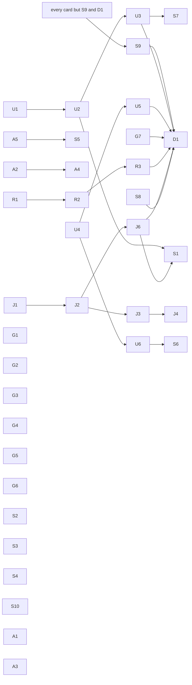

# Hot-path fixes from the 2026-11 profiling round

status: in-progress (panel-reviewed 2026-11-09, REQUEST-CHANGES folded in)
commit-mode: orchestrator-commits
language: ruby, rust (cards R2 only)
panel: Ruby (Linus Torvalds, Jeremy Evans, Sandi Metz, Richard Schneeman, Aaron Patterson); Rust seats for R2 (Raph Levien, Andrew Gallant)

## Intent

Land the fixes the 2026-11 profiling round measured, in the 6 groups the user chose on 2026-11-09:
user-felt hot paths, git call consolidation, suite speed, secret scanning in Rust, Ruby-side
allocations, and fewer judge waits. The evidence is
[`planning/hot-path-profiling-2026-11.md`](../hot-path-profiling-2026-11.md) and its directory;
every number below names its file there. The largest user-facing costs: 70 ms to 6 s of mask
listing per sandboxed bash call, about 800 ms of extra boot per `lain up`, and 1,046 s of judge
waiting over 2 real sessions, about 60% of it on commands a parser and allowlist can settle.

## Grounding

- Date 2026-11-09, `main` at `04f2cfad`. Checked by 6 read-only Explore passes (hot paths, git
  calls, suite, secret scanning, judge and triage, allocations) and by direct probes in this session.
- Probed, not read:
  - Every judged call in the 2 session copies, joined to its shell verdict
    (`judged_calls.rb`, `judged-calls.txt`, `judged_fixable.rb`, `judged-fixable.txt`). 44 calls,
    527 s, abstained only for quoted strings and redirects; 6 calls, 40 s, for `;`; 15 calls, 68 s,
    parsed fine with no rule. 9 `sleep 13` calls waited 24 s.
  - Both sessions predate round 3's T21 (`fc522b32`, 2026-11-04), which widened `ComposedTerm`.
    Re-scored against today's table through the approval replay's own call rebuild
    (`judged_today_term.rb`, `judged-today-term.txt`): of 98 judged bash calls, today's table admits
    4 (`lain epic status`, 26 s) and leaves 94 (694 s). The non-bash 24 calls (342 s) are outside
    the rules rung. So J1 to J4 still address about 694 s; the memo (J6) the repeats.
  - git origin of every spawn in a hooked `pspec` (`git_origin_hook.rb`, `git-origin-summary.txt`):
    45% subject, 44% fixture (half through lib helpers), 12% collateral, 2,445 of them on threads
    outside any example.
  - Mask list premise (`mask_dir_stat.rb`, `mask-dir-stat.txt`): this checkout lists 4,044 names in
    14 ms, lstats them in 7 ms, and their 552 parent directories in 0.8 ms; the 50,000-file `.venv`
    checkout lists in 79 ms with 502 parent directories at 0.7 ms. The 70 ms warm cost is the Ruby
    `Identity` and `Beneath` work, not syscalls.
  - `lain up` wall (`up-wall.txt`): `ChatPreflight#call` is 810 of 1,687 ms; `Binaries#present?`
    122 ms. In e2e only, every `up` boots twice (`cockpit-reexec.txt`).
  - Launch (`launch-phases.txt`, `ab-frozen-load-path.txt`): `bundler/setup` 108 of 756 ms; a frozen
    load path 755 to 665 ms, verdict `differs`.
  - `git cat-file --batch -z` works on git 2.55.0 and answers `<name> missing` for an absent path.
  - Panel probes, 2026-11-09 (scripts in `~/tmp/lain/review-hpf/`, copied to the evidence directory as `panel-probes/`):
    a chained link retarget (`link -> ../out/hop`, then `hop` retargeted) lands elsewhere while the
    link's parent mtime stays put; `sh -c 'cd nonexist && true ; cat secret.txt'` prints the secret
    in the original cwd; a `PRUNED`-style exclude still lists `.venv/.env` at the top level;
    `cat-file --batch -Z` NUL-terminates a missing name holding a newline; `git show rev:path`
    applies no textconv; `bundler/setup` exports about 20 variables (PATH with the gem bin first,
    `GEM_HOME`, `RUBYLIB`, `RUBYOPT`, `BUNDLER_VERSION`, `BUNDLE_BIN_PATH`, `BUNDLE_LOCKFILE`);
    Ruby's repeated named group reads the last group that took part; `CHECKSUM_FIELD` carries
    `(?-mix:` groups and `CHECKSUM` uses `\h`; after `require "lain"` there is 1 Ruby thread and
    2 OS tasks; directory mtimes moved in 200 of 200 changes on this ext4 (multigrain timestamps,
    kernel 7.1), which older kernels, overlayfs and NFS do not promise; Zeitwerk 2.8.3 accepts a
    managed file loaded by absolute path before setup.
  - Output masking already covers every bash result, whoever approved it:
    `RedactSecretReads#printed` (`lib/lain/middleware/redact_secret_reads.rb:284-292`).
  - Production renders pass the Agent's own `PrefixChain` (`lib/lain/agent.rb:806`, `:855`), so the
    `NONE` cold chain (candidate D) reaches benches, specs and one-shot callers only.
- Docs against code, code wins in each:
  - `docs/spec-suite-performance.md:133-136` says `factory_spec` has "no hot spot to cut"; the flow
    repeats ref, HEAD and worktree-list reads (card G1 to G6 sites).
  - `docs/spec-suite-performance.md:171-181` says LocalBranch's constructor runs 3 git commands; it
    runs 2 (`spec/lain/review/source/local_branch_spec.rb:690`).
  - `docs/toolchain-traps.md:303` names `CLI::Up::PreFlight`; the class is `ChatPreflight`.
  - `ROADMAP.md:161` lists "a cheaper mask listing" as built; only classification got cheaper.
  - The report's candidate D row "no Entry, no intern" was the arm that still interned
    (`ab-cold-chain.txt`: no_entry 62.6 ms, no_intern 59.5 ms). Card A4 uses the measured arms.

## Compatibility

| Surface | Verdict | Evidence |
|---|---|---|
| `.lain/config.rb` `approval` block | must keep, 1 key added (`judge_memo:`) | user config files; `docs/commands.md:1304` |
| Journal record shapes (escalation, telemetry) | must keep shape and bytes; new reason strings allowed | chained journals; `bench/approval_replay` joins on them; old sessions disposable (memory ruling 2026-10-28) |
| Shell verdict and Reading accepted shapes | free to widen, never to narrow | internal; each new shape carries a real-shell parity spec (research ruling, `planning/research-agents-and-approval-research-2026-10.md:162-185`) |
| `ComposedTerm` allowlist | widened by user ruling 2026-11-09 | internal |
| `exe/lain` launch from a checkout and from the packaged gem | must keep both | `spec/lain/cli_spec.rb:1099-1240`, `spec/lain/install_shim_spec.rb` |
| The environment `exe/lain` hands its children | must keep: a cache hit exports what `bundler/setup` exports | `lib/lain/exec.rb:71` strips only `BUNDLE_`, `BUNDLER_`, `RUBYOPT`; PATH and `GEM_HOME` reach children |
| `lain up` refusals in chat's own words | must keep | `spec/lain/cli/up_spec.rb:1295-1522` |
| Review source port (`#file_at`) | must keep; a batch read is added beside it | `spec/support/shared_examples/review_source.rb:375-430` |
| `Lain::Ext` bindings | free to add | internal; `spec/lain/rust/binding_coverage_spec.rb` must list the new one |
| Masked paths in the sandbox | narrowed for `.venv`-style dirs at any depth by user ruling 2026-11-09 | `lib/lain/confine/mask_list.rb:12-29` |
| `ComposedTerm`'s contract comment ("reads only, writes nothing, fetches nothing, executes nothing") | rewritten by J4 for cargo with `--locked` or `--offline` | `lib/lain/approval/composed_term.rb:530` |
| Spec helpers and tags | free to break | internal |

No trade report: no must-keep surface blocks a large simplification.

## Spike findings

| Question | Result | Evidence |
|---|---|---|
| Can a frozen `$LOAD_PATH` stand in for `bundler/setup` at launch? | Yes, same help output, 90 ms faster | `spike-frozen-load-path.diff`, `ab-frozen-load-path.txt` |
| Can Rust run all 22 secret shapes with Ruby's offsets? | Yes for group 0 on 2 corpora, with fancy-regex `seek(true)`; value groups and the checksum shapes were not checked | `regex-engines/`, `regex-fancy-seek.txt` |
| Does skipping `Copy` for shareable values keep the carrier guarantees? | Yes, 1,397 examples green, 13% per record | `spike-carrier-settled-setter.diff` |
| Does an entry-free `NONE` roll keep digests? | Yes, 74.8 to 62.6 ms, or 59.5 ms without the intern | `spike-cold-chain-request-rb.diff`, `ab-cold-chain.txt` |
| Does `BUNDLER_VERSION` stop the e2e double boot? | Yes, 4 `up` execs to 2 | `spike-sandbox-bundler-version.diff`, `cockpit-reexec.txt` |

All spikes ran in scratch copies under `~/tmp/lain/`; no worktree was made.

## Shared files

Only the main session edits these; cards hand back 1-line diffs:

- `ext/lain/Cargo.toml`, `Cargo.lock`, `deny.toml`
- `ext/lain/src/lib.rs` (binding registration)
- `Rakefile` (`MUTANT_FILES`), `ext/lain/mutants-baseline.txt`
- `ext/lain/CLAUDE.md` (the second string-boundary policy)
- `docs/rust-bindings.md` (the ruling)
- `ROADMAP.md` (the user keeps edits there uncommitted; stage by hunk)
- `.rubocop.yml`

## Rejected options

- **More suite workers.** 16 workers measured 9% faster; the user keeps 12 for desktop slack.
- **Deferring Zeitwerk loading for boot.** `lib/lain.rb:75-79`: eager load is load-bearing.
- **The ActiveModel setter monkey patch.** Not shown alone (0.957), overrides a private method.
- **`GC.disable` while lain loads.** About 80 ms for 37 MB of peak RSS a session keeps.
- **Rails main for carriers.** 10% fewer objects per class, no faster.
- **A git index or ref fingerprint as the mask list trigger.** Neither moves when an ignored file
  appears, and `-co` lists exactly those.
- **1 shared parser for `worktree list --porcelain`.** Removes code, not spawns; a later cleanup.
- **Sharing `target(named.ref)` between `Anchor#standing` and `#anchor`.** The sync between them
  may anchor the ref (`retirement.rb:~78-82`).
- **Candidate D's Rust-roll arm.** 3 ms for a new binding.
- **Caching path verdicts by cleaned path.** `Sensitivity` must stay deeply frozen and shareable;
  the verdict table (A5) takes the measured 11% without state.

## Open decisions

- **Lazy `define_attribute_method` for boot (about 100 ms upper bound).** Needs a spike: record
  attribute names, define on the first `new`, `build` or `valid?`, then rerun `boot_carriers.rb`
  and `carrier_count.rb`. No card depends on it.

## Dependency graph



## Tasks

### U1: prune Python environment and cache directories from the mask list at any depth          [risk: medium]

**Depends on:** none
**Files:** `lib/lain/confine/mask_list.rb`, `spec/lain/confine/mask_list_spec.rb`, `lib/lain/sensitivity/history_literals.rb` (reads `MaskList::EXCLUDES` for its own listing), `spec/lain/sensitivity/history_literals_spec.rb`
**Reuse:** `MaskList::PRUNED`, `MaskList::EXCLUDES` (`mask_list.rb:28-29`)
**Shared-file wiring:** none
**Reachable from:** `CLI::Wiring::ToolsetBuild` (`toolset_build.rb:425`) builds the `MaskList` the sandbox asks on every bash call

`PRUNED` keeps its meaning (below a directory's top level). A second tier, `PRUNED_WHOLE` =
`.venv venv __pycache__ .tox .mypy_cache .pytest_cache`, excludes the directory and everything in
it at any depth, the directory itself included. The class doc (`mask_list.rb:12-18`) says both.

**Acceptance criteria**

```gherkin
Scenario: an ignored .venv lists and masks nothing at any depth
  Given a checkout whose .gitignore ignores .venv/ and whose .venv holds .env, pyvenv.cfg and lib/x/.env
  When the mask list is asked for its masks
  Then no mask lies under .venv, and the git listing names no path under .venv

Scenario: an ignored .env at the root is still masked
  Given the same checkout with an ignored .env at the root
  When the mask list is asked for its masks
  Then .env is masked

Scenario: a tmp directory keeps its top-level files listed
  Given an ignored tmp/.env
  When the mask list is asked
  Then tmp/.env is masked, as mask_list_spec.rb:164 pins today
```
Spec file: `spec/lain/confine/mask_list_spec.rb`

**Stop and report if:**
- `spec/lain/confine/mask_list_spec.rb:177` ("masks what judge masks over this checkout's listing") fails, which means the judge's own listing disagrees.
- `spec/lain/sensitivity/history_literals_spec.rb` counts of `ls-files` change.

### U2: restate only plain names under changed directories in the mask list          [risk: high]

**Depends on:** U1
**Files:** `lib/lain/confine/mask_list.rb`, `spec/lain/confine/mask_list_spec.rb`
**Reuse:** `Tree#restated`, `Identity.of`, the `Beneath` walk, `Landings` (`mask_list.rb:259-302`)
**Shared-file wiring:** none
**Reachable from:** `Confine::Profiles#mask_paths` (`profiles.rb:222`) on every sandboxed bash call

The git listing still runs per ask; it is what finds a new secret. Every listed symlink is
re-resolved (`Identity.of`, realpath included) on every ask, as today: a chain can be retargeted
outside the checkout without moving any listed directory. Only plain names are gated: each
listed name's parent directory is kept with its lstat mtime, inode and device; on the next ask
those directories are lstat'd, and a plain name is re-identified only when its directory moved,
it is new to the listing, or its directory's mtime falls within 1 coarse tick (the larger of
1 ms and the filesystem's granularity) of the previous ask, the racy-window rule git uses for its
index. A `Beneath` leaf is re-walked when any directory it walked moved or is racy.

**Acceptance criteria**

```gherkin
Scenario: a new secret is masked from the next ask on
  Given a mask list that has answered once
  When a file named .env appears in an existing directory
  Then the next ask masks it

Scenario: a chained link retarget is seen
  Given repo/link -> ../out/hop -> plain, listed and answered once
  When hop is retargeted to ../secret/id without touching repo
  Then the next ask reflects link's new landing

Scenario: a file swapped for a symlink is seen
  Given a masked file
  When it is replaced by a symlink to a path outside the checkout
  Then the next ask reflects the symlink's identity

Scenario: an unchanged tree re-identifies no plain name
  Given a mask list that answered once, longer than 1 tick ago
  When it is asked again with no change on disk
  Then no plain listed name is lstat'd again and no Beneath leaf is walked again

Scenario: a change inside the racy window is still seen
  Given a mask list that answered once
  When a file is renamed in the same directory within 1 ms of that answer
  Then the next ask reflects it
```
Spec file: `spec/lain/confine/mask_list_spec.rb`

**Stop and report if:**
- A pinned contract in `mask_list_spec.rb` fails: `:90-97` (new secret), `:119` (drops a gone mask), `:152` (restored after delete), or the swap examples at `:704-783`.
- The racy-window example cannot be made deterministic without a clock seam; report rather than sleeping in the spec.

### U3: a hot-path-bench row for the real mask list          [risk: low]

**Depends on:** U2
**Files:** `lib/lain/bench/hot_paths.rb`, `spec/lain/bench/hot_paths_spec.rb`, `bin/hot-path-bench`
**Reuse:** `Bench::HotPaths::Bash` and its `NoMasks` stub (`hot_paths.rb:229-282`)
**Shared-file wiring:** none
**Reachable from:** `bin/hot-path-bench --record`

**Acceptance criteria**

```gherkin
Scenario: the bench reports the mask list on a real checkout
  Given a seeded checkout with ignored files
  When the hot-path bench runs at a tiny size
  Then it reports a mask_list row beside the bash row, and the bash row still uses NoMasks
```
Spec file: `spec/lain/bench/hot_paths_spec.rb`

**Stop and report if:**
- `bin/hot-path-bench --check` refuses the new row for having no ceiling; seed it only from 3 logs at load under 2, in its own commit (repo `CLAUDE.md`).

### U4: run the chat pre-flight in a fork of the loaded process          [risk: high]

**Depends on:** none
**Files:** `lib/lain/cli/up.rb`, `spec/lain/cli/up_spec.rb`, `exe/lain`
**Reuse:** `ChatPreflight#call` and its refusal handling (`up.rb:580-650`), `ChatLaunch#preflight` (`chat_launch.rb:162-183`)
**Shared-file wiring:** none
**Reachable from:** `Up#create_session` (`up.rb:1495`) calls `@chat_preflight.call(@chat_args)`; `exe/lain`'s `up` command builds the `ChatPreflight` with the starter below

`lib/` never names `LainCLI` (it lives only in `exe/lain:63`) and never touches the process's
stdout or stderr (`spec/output_discipline_spec.rb`). So `exe/lain` injects a starter, a lambda
that runs `LainCLI.start(["chat", *args])`, and the fork-and-capture mechanics live with it in
`exe/lain`. The child: reopens stdin on `/dev/null`, points fds 1 and 2 at pipes, `Dir.chdir`s to
the pane's cwd, sets `LAIN_PREFLIGHT=1`, runs the starter, flushes, and leaves with `exit!` and
chat's status, so no inherited `at_exit` hook runs. Process isolation, ENV and `Config.load`
side effects stay in the child, as today. A non-forking host (no `Process.respond_to?(:fork)`)
keeps the spawned pre-flight.

**Interface**

```ruby
class Lain::CLI::Up::ChatPreflight
  # @param run [#call] (args, cwd:, environment:, timeout:) -> Shell::Out-like answer
  #   (stdout, stderr, exitstatus); exe/lain passes the forking runner, specs a double
  def initialize(run:, cwd:) = ...
end
```

**Acceptance criteria**

```gherkin
Scenario: a bad chat argument is refused in chat's own words before a pane exists
  Given lain up with a chat flag chat refuses
  When the cockpit is created
  Then the refusal text equals what `lain chat` prints for that flag, and no tmux session was made

Scenario: the pre-flight boots no new Ruby
  Given exe/lain up with valid chat flags
  When the cockpit is created
  Then no ruby or exe/lain process was exec'd for the pre-flight, and no at_exit hook of the parent ran in the child

Scenario: a pre-flight that hangs degrades to a warning
  Given a pre-flight that does not finish within ChatPreflight::TIMEOUT
  When the cockpit is created
  Then the child is killed, the cockpit opens, and the warning says the check did not finish
```
Spec file: `spec/lain/cli/up_spec.rb`

**Stop and report if:**
- `/proc/self/task` counts more than the 2 OS tasks a fresh `require "lain"` shows at the fork site in a real `lain up` (a forked thread would be lost mid-work; `Thread.list` misses native threads).
- `spec/lain/cli/up_spec.rb:376` (the real pre-flight seam) or `:1349-1362` (a bad `config.rb` refuses with `config.rb:2`) fails.
- `spec/lain/cli/pane_command_spec.rb:35-57` fails (the pane must still unset `LAIN_PREFLIGHT`).
- `spec/output_discipline_spec.rb` flags the change.

### U5: find nvim on PATH instead of spawning it          [risk: low]

**Depends on:** U4
**Files:** `lib/lain/cli/up.rb`, `spec/lain/cli/up_spec.rb`
**Reuse:** `Shell::Path.find` (`lib/lain/shell/path.rb:16-19`)
**Shared-file wiring:** none
**Reachable from:** `Up#cockpit_wanted?` (`up.rb:1643`) through `Binaries#present?`

**Acceptance criteria**

```gherkin
Scenario: nvim on PATH builds the editor pane without spawning it
  Given an executable nvim on PATH
  When the cockpit is created
  Then the editor pane is built and no `nvim --version` ran

Scenario: no nvim on PATH skips the editor pane
  Given no nvim on PATH
  When the cockpit is created
  Then no editor pane is built
```
Spec file: `spec/lain/cli/up_spec.rb`

**Stop and report if:**
- `up_spec.rb:1943-1964` (the probe's 3 cases) cannot be rewritten without a filesystem double; use `Shell::Path.find`'s `filesystem:` seam.

### U6: launch from a checkout through a cached frozen load path          [risk: high]

**Depends on:** U4 (both edit `exe/lain`)
**Files:** `exe/lain`, `lib/lain/boot/frozen_load_path.rb` (new), `spec/lain/boot/frozen_load_path_spec.rb` (new), `spec/support/child_boot.rb`, `spec/child_boot_spec.rb`, `spec/lain/cli_spec.rb`
**Reuse:** `ChildBoot#script` (`spec/support/child_boot.rb:46-88`): the script generator moves to the new lib file and `ChildBoot` calls it, keeping its own content-hash key
**Shared-file wiring:** none
**Reachable from:** `exe/lain:27-31`, the guarded `require "bundler/setup"`

`Lain::Boot::FrozenLoadPath` is plain Ruby with no gem dependency, loaded by `exe/lain` by
absolute path before Bundler. A hit loads the cached file, which sets `$LOAD_PATH`, narrows the
gem specs as `ChildBoot` does, and exports the same ENV `bundler/setup` exported on the miss that
wrote it (recorded then, replayed now). A miss runs `bundler/setup` as today and writes the file.
The key covers `Gemfile`, `Gemfile.lock`, `lain.gemspec`, `.bundle/config`, the `BUNDLE_GEMFILE`
value, `RUBY_VERSION`, the ruby binary, and the mtime of `Gem.dir/specifications` (mtime and size,
no hashing at launch). A `LoadError` after a hit falls back to `bundler/setup` and rewrites the file.

**Interface**

```ruby
module Lain
  module Boot
    module FrozenLoadPath
      # @return [Boolean] true when the cached path was loaded, false when Bundler ran
      def self.setup(gemfile:, cache_dir:) = ...
    end
  end
end
```

**Acceptance criteria**

```gherkin
Scenario: a second launch skips Bundler and hands children the same environment
  Given a checkout launched once
  When exe/lain help runs again, and each launch prints the ENV a child would get
  Then Bundler::SharedHelpers is not loaded, the help text is unchanged, and the 2 environments are equal

Scenario: a changed lockfile or installed gem rebuilds the cache
  Given a cached load path
  When Gemfile.lock's mtime changes, or a gem is installed into Gem.dir
  Then the next launch runs bundler/setup and rewrites the cache

Scenario: a stale cache recovers
  Given a cached load path naming a gem directory that no longer exists
  When exe/lain help runs
  Then it prints the help text and the cache is rewritten

Scenario: the packaged gem and a foreign cwd still boot
  Given a copy of exe/lain with no sibling Gemfile, and a cwd whose Gemfile names a missing gem
  When each runs help
  Then both print the help text and neither raises Bundler::GemNotFound
```
Spec file: `spec/lain/boot/frozen_load_path_spec.rb`, `spec/lain/cli_spec.rb`

**Stop and report if:**
- A child that `lain up` starts (a pane, `lain input`, `GcSchedule`) behaves differently on a hit (`lib/lain/cli/pane_command.rb:112-117`).
- `spec/lain/cli_spec.rb:1192-1240` (bootsnap order) fails.
- `bin/zeitwerk-census --check` reports the new file.

### G1: answer WorkingBranch's nesting clash with 1 for-each-ref          [risk: medium]

**Depends on:** none
**Files:** `lib/lain/isolation/working_branch.rb`, `spec/lain/isolation/working_branch_spec.rb`
**Reuse:** `above`, `beneath`, `refuse_nesting_clash` (`working_branch.rb:466-485`)
**Shared-file wiring:** none
**Reachable from:** `WorkingBranch#claim` (`working_branch.rb:~207`) from `CLI::EpicDriver::Factory#working_branch` (`factory.rb:682`)

1 `for-each-ref --format=%(refname)` over every shorter name and `refs/heads/<name>/`, filtered in
Ruby: `above` keeps candidates found exactly, in candidate order; `beneath` keeps refs under
`<ref>/`. `refuse_unholdable` still runs first, so no glob character reaches the pattern.

**Acceptance criteria**

```gherkin
Scenario: a branch above the new name is refused, above before beneath
  Given refs/heads/epic exists and refs/heads/epic/demo/x exists
  When epic/demo is claimed
  Then the refusal names refs/heads/epic first, then refs/heads/epic/demo/x

Scenario: the clash check spawns 1 git process
  Given a fresh repository
  When lain/issue/demo/a is claimed
  Then exactly 1 for-each-ref and no rev-parse ran for the nesting check
```
Spec file: `spec/lain/isolation/working_branch_spec.rb`

**Stop and report if:**
- `working_branch_spec.rb:286-299` (spawn-count parity with forward on and off) fails.
- A racing hook keyed on `rev-parse --verify` (`:737`, `:758-759`) stops firing.

### G2: read the rebase state in 1 git call during self-sync          [risk: low]

**Depends on:** none
**Files:** `lib/lain/isolation/self_sync.rb`, `spec/lain/isolation/self_sync_spec.rb`
**Reuse:** `Checkout#operation_in_progress?` (`isolation/checkout.rb:112-118`)
**Shared-file wiring:** none
**Reachable from:** `SelfSync::Run#attempt` (`self_sync.rb:248`) through `Tree#rebasing?`

**Acceptance criteria**

```gherkin
Scenario: a rebase in progress is seen with 1 call
  Given a worker checkout mid-rebase (rebase-merge or rebase-apply)
  When self-sync checks it
  Then it reports the rebase, and 1 rev-parse --git-path call ran
```
Spec file: `spec/lain/isolation/self_sync_spec.rb`

**Stop and report if:**
- `self_sync_spec.rb:45` (keyed on `"rebase"` without `"--abort"`) changes meaning.

### G3: ask each repository's common dir once per process          [risk: medium]

**Depends on:** none
**Files:** `lib/lain/isolation/git_home.rb` (new), `spec/lain/isolation/git_home_spec.rb` (new), `lib/lain/isolation/parent_lock.rb`, `lib/lain/isolation/merge_coordinator.rb`, `lib/lain/isolation/merge_coordinator/drain.rb`, `lib/lain/isolation/worktree/repo_lock.rb`, `spec/lain/isolation/parent_lock_spec.rb`, `spec/lain/isolation/merge_coordinator_spec.rb`, `spec/lain/isolation/worktree/repo_lock_spec.rb`, `spec/lain/isolation/worktree/registry_spec.rb`
**Reuse:** the `rev-parse --path-format=absolute --git-common-dir` call in `MergeCoordinator::Home.common_dir` (`merge_coordinator.rb:46-55`)
**Shared-file wiring:** none
**Reachable from:** `LandingQueue.candidate` (`landing_queue.rb:112-116`), `Drain.for` (`drain.rb:44-47`), `CandidateDesk::Forward#call` through `ParentLock.for`, `Worktree#initialize` through `RepoLock.for`

`GitHome.common_dir(root, shell_out_factory:)` returns an absolute path or nil, memoised for the
process under a Mutex by the expanded root plus the lstat device and inode of `<root>/.git` (a
root recreated as another repository misses the memo), and never memoises nil. Each caller keeps its own
failure policy and wording. `Drain.for` reads `main_root` once. `RepoLock` takes the injected
`shell_out_factory` it ignores today. `Confine::Profile::Seal.git_dirs` does not use it.

**Interface**

```ruby
module Lain::Isolation::GitHome
  # @return [String, nil] the absolute common git dir, or nil when root is in no repository
  def self.common_dir(root, shell_out_factory: Shell::Out.public_method(:new)) = ...
end
```

**Acceptance criteria**

```gherkin
Scenario: a landing asks the common dir once
  Given a repository and 3 landing moves in 1 process
  When each takes the parent lock
  Then 1 rev-parse --git-common-dir ran

Scenario: a directory that becomes a repository is seen
  Given a directory that is in no repository
  When common_dir is asked, git init runs there, and common_dir is asked again
  Then the first answer is nil and the second is the new .git

Scenario: a root recreated as another repository is asked again
  Given common_dir answered for a repository at /x
  When /x is removed and a new repository is made at /x
  Then the next answer is the new repository's .git

Scenario: the coordinator's refusal keeps its wording
  Given a directory in no repository
  When MergeCoordinator::Home.for is asked
  Then it raises "<root> is in no git repository, so it has no merge coordinator home"
```
Spec file: `spec/lain/isolation/git_home_spec.rb`, `spec/lain/isolation/merge_coordinator_spec.rb`

**Stop and report if:**
- `parent_lock_spec.rb:121-131` (a failing factory gives `path == nil` and an in-process hold) fails.
- Any reader of `Confine::Profile::Seal` would see the memo (`lib/lain/confine/profile.rb:728`, `:821-831`).

### G4: read the worker HEAD once when self-sync rewrote nothing          [risk: medium]

**Depends on:** none
**Files:** `lib/lain/isolation/worktree/handback/retirement.rb`, `spec/lain/isolation/worktree_handback_retirement_spec.rb`
**Reuse:** `Anchor#head_of`, `#standing`, `#anchor`, `#nothing?` (`retirement.rb:72-112`)
**Shared-file wiring:** none
**Reachable from:** `Retirement.over` (`retirement.rb:179`) from the handback path in `CLI::EpicDriver::Factory`

When the sync outcome is `:current`, `:disabled`, `:dirty` or `NONE`, `#anchor` reuses
`#standing`'s HEAD and its `fold_in!`; and `#nothing?` reads `@base.tip` once per pass.

**Acceptance criteria**

```gherkin
Scenario: a current worker is anchored with 1 HEAD read
  Given a worker whose self-sync reports :current
  When it retires
  Then rev-parse HEAD ran once in the worker and the anchor names that commit

Scenario: a rebased worker is re-read
  Given a worker whose self-sync rebased it
  When it retires
  Then the anchor names the rebased HEAD
```
Spec file: `spec/lain/isolation/worktree_handback_retirement_spec.rb`

**Stop and report if:**
- `worktree_handback_retirement_spec.rb:25-53` (a canned head for any `rev-parse`) can no longer tell the 2 reads apart.

### G5: list worktrees once per gc batch          [risk: low]

**Depends on:** none
**Files:** `lib/lain/isolation/gc.rb`, `spec/lain/isolation/gc_spec.rb`
**Reuse:** `WorkingBranch.holders`' single read for a batch (`working_branch.rb:250-255`)
**Shared-file wiring:** none
**Reachable from:** `lain worktrees gc` through `Isolation::Gc` (`gc.rb:489-500`, `in_use`)

**Acceptance criteria**

```gherkin
Scenario: judging 5 branches lists the worktrees once
  Given 5 branches and 2 registered worktrees
  When gc judges them
  Then worktree list ran once and each branch's in-use answer is unchanged
```
Spec file: `spec/lain/isolation/gc_spec.rb`

**Stop and report if:**
- `gc_spec.rb:38-45` (`interleaved(marker)` on the first matching argv) changes meaning.

### G6: reuse the checkout entry VerifyCheckout already read          [risk: medium]

**Depends on:** none
**Files:** `lib/lain/isolation/verify_checkout.rb`, `spec/lain/isolation/verify_checkout_spec.rb`
**Reuse:** `VerifyCheckout#at`, `#standing?`, `#reuse` (`verify_checkout.rb:41-67`)
**Shared-file wiring:** none
**Reachable from:** the merge coordinator's verify step through `VerifyCheckout#at`

1 listing per reuse, taken where `reuse` needs it, so `claim`'s compare-and-swap on `seal` still
reads it fresh. A tree gone between `Dir.exist?` and the listing re-creates, rather than raising
`NoMethodError` on `held.seal`.

**Acceptance criteria**

```gherkin
Scenario: reusing a verify checkout lists worktrees once
  Given a standing verify checkout
  When it is reused
  Then worktree list ran once

Scenario: a checkout removed mid-check is rebuilt
  Given a verify checkout whose directory exists but whose registration is gone
  When it is asked for
  Then a fresh checkout is made and no NoMethodError is raised
```
Spec file: `spec/lain/isolation/verify_checkout_spec.rb`

**Stop and report if:**
- `factory_spec.rb:1300-1332` (`after_first_listing`) fires on a different listing.

### G7: read a review's file sides with 1 git cat-file          [risk: medium]

**Depends on:** none
**Files:** `lib/lain/review/source.rb`, `lib/lain/review/source/local_branch.rb`, `lib/lain/review/source/github_pr.rb`, `spec/lain/review/source/local_branch_spec.rb`, `spec/support/shared_examples/review_source.rb`
**Reuse:** `HistoryLiterals::Batch.each` header parser (`history_literals.rb:258-268`), `Isolation::Checkout#run(input:)`
**Shared-file wiring:** none
**Reachable from:** `Review::Source::Diffed#files` (`source.rb:267`), which every `lain review` opens

`Diffed#files` asks the source for every `(revision, path)` it needs at once; `LocalBranch` answers
with 1 `cat-file --batch -Z` (NUL-delimited in and out), `GithubPr` delegates to its local source. A missing name or a
non-blob answers nil. `#file_at` stays for the lazy callers.

**Acceptance criteria**

```gherkin
Scenario: a 30-file review reads its sides in 1 process
  Given a branch changing 30 files with hunks
  When the review's files are read
  Then 1 git cat-file ran and every side equals what git show rev:path prints

Scenario: added, deleted, empty and non-UTF-8 sides keep their meaning
  Given an added file, a deleted file, an empty file and a latin-1 file
  When their sides are read
  Then base of the added file is nil, head of the deleted is nil, the empty is "", and the latin-1 bytes are ASCII-8BIT and unchanged
```
Spec file: `spec/lain/review/source/local_branch_spec.rb`, `spec/support/shared_examples/review_source.rb`

**Stop and report if:**
- `HistoryLiterals::Batch.each` cannot parse `-Z` output without a change to its own callers; write a sibling parser instead.
- `spec/lain/review/source/github_pr_spec.rb:734,753` (the port contract) fails.

### S1: let specs build wirings without priming background git          [risk: medium]

**Depends on:** U2 (both edit `spec/lain/confine/mask_list_spec.rb`), J6 (both edit `spec/lain/cli/wiring/board_build_spec.rb`)
**Files:** `spec/support/quiet_priming.rb` (new), `spec/lain/confine/mask_list_spec.rb`, `spec/lain/confine/sandbox_spec.rb`, `spec/lain/bench/harness/confinement_spec.rb`, `spec/lain/seams/workspace_profile_spec.rb`, `spec/lain/cli/wiring/board_build_spec.rb`, `spec/lain/sensitivity/history_literals_spec.rb`
**Reuse:** the prepend pattern of `spec/support/suite_profile/spawn_tally.rb`; tag handling in `spec/support/tags.rb`
**Shared-file wiring:** none
**Reachable from:** `spec/spec_helper.rb`'s `spec/support` glob loads it

`HistoryLiterals#prime` and `MaskList#prime` become no-ops in an example unless it carries
`:primes`; `known`, `masks` and `related` still compute on demand. An `after` hook joins any
priming thread an example started, so none outlives it.

**Acceptance criteria**

```gherkin
Scenario: a wiring spec starts no git after it ends
  Given an example that builds a board without :primes
  When it finishes
  Then no git process starts after it, and no priming thread is alive

Scenario: a :primes example still primes
  Given an example tagged :primes
  When it builds a board
  Then the priming thread runs git as today
```
Spec file: `spec/lain/cli/wiring/board_build_spec.rb`

**Stop and report if:**
- An example relies on prime having already run and turns red rather than slower (list it by name).

### S2: build the review command's repository once and copy it          [risk: low]

**Depends on:** none
**Files:** `spec/lain/cli/command/review_spec.rb`
**Reuse:** `SeedRepo.derived` (`spec/support/seed_repo.rb`), as `spec/lain/forge/local_landing_spec.rb:16` uses it
**Shared-file wiring:** none
**Reachable from:** spec-only

**Acceptance criteria**

```gherkin
Scenario: every review example starts from the same derived repository
  Given the review_spec around hook
  When 82 examples run
  Then branch, checkout and the 2 commits run once per process, and the example count and results are unchanged
```
Spec file: `spec/lain/cli/command/review_spec.rb`

**Stop and report if:**
- An example asserts distinct commit shas across examples.

### S3: build worker commits with 1 git process in landing specs          [risk: medium]

**Depends on:** none
**Files:** `spec/support/commit_builder.rb` (new), `spec/lain/isolation/merge_coordinator/drain_spec.rb`, `spec/lain/forge/local_landing_spec.rb`, `spec/lain/isolation/worktree_handback_spec.rb`
**Reuse:** `SeedRepo::PINS` and `SeedRepo::SCRUB` (`spec/support/seed_repo.rb`)
**Shared-file wiring:** none
**Reachable from:** spec-only

`CommitBuilder` writes a commit with explicit parent, files and ref through 1 `git fast-import`;
`worker` in the drain and landing specs uses it, and `commit_in` in the handback spec drops to 2
spawns with `commit -a` where its files are tracked.

**Acceptance criteria**

```gherkin
Scenario: a worker commit takes 1 git process
  Given a seeded repository
  When the drain spec's worker helper makes a commit
  Then 1 git process ran, and the ref names a commit with the given parent and files
```
Spec file: `spec/lain/isolation/merge_coordinator/drain_spec.rb`

**Stop and report if:**
- A `git maintenance` or `gc --auto` process outlives an example (the PINS flake).

### S4: move load-time tree sweeps into the examples' timed window          [risk: low]

**Depends on:** none
**Files:** `spec/lain/review/deletability_spec.rb`, `spec/refusal_width_discipline_spec.rb`
**Reuse:** `TreeSweep` (`deletability_spec.rb:318-335`), `MEASURED_REFUSALS` (`refusal_width_discipline_spec.rb:838`)
**Shared-file wiring:** none
**Reachable from:** spec-only

**Acceptance criteria**

```gherkin
Scenario: loading the 2 files does no sweep
  Given rspec --dry-run over the 2 files
  When they load
  Then no lib file is read or parsed, and the dry run's example count is unchanged

Scenario: the runtime log charges the sweep to the file
  Given a pspec run
  When tmp/parallel_runtime_rspec.log is written
  Then both files' logged time includes the sweep
```
Spec file: `spec/lain/review/deletability_spec.rb`, `spec/refusal_width_discipline_spec.rb`

**Stop and report if:**
- The sweep runs more than once per worker (a per-example `let` instead of a memo).

### S5: share parsed trees across spec files that parse lib          [risk: medium]

**Depends on:** A5 (both edit `spec/lain/sensitivity_spec.rb`)
**Files:** `spec/support/parsed_source.rb`, `spec/lain/isolation/checkout_calls_spec.rb`, `spec/lain/landing_calls_spec.rb`, `spec/lain/sensitivity_spec.rb`
**Reuse:** `ParsedSource.sexp`, its `PARSED` keying and lifecycle
**Shared-file wiring:** none
**Reachable from:** spec-only

A `ParsedSource.prism(path)` sibling with the same lifecycle; the 2 `*_calls_spec.rb` files use
it, and `sensitivity_spec.rb` moves to `ParsedSource.sexp`.

**Acceptance criteria**

```gherkin
Scenario: 2 files parsing all of lib with Prism parse each file once per worker
  Given both calls specs in 1 worker
  When they run
  Then each lib file was parsed with Prism once, and both specs' results are unchanged
```
Spec file: `spec/lain/isolation/checkout_calls_spec.rb`

**Stop and report if:**
- A visitor in either spec mutates a cached Prism node.
- Peak RSS of a worker rises more than 50 MB (`/usr/bin/time -v`).

### S6: pass BUNDLER_VERSION to the e2e sandbox          [risk: low]

**Depends on:** U6 (a cache hit may already remove the restart; measure first)
**Files:** `spec/support/e2e/sandbox.rb`, `spec/e2e/cockpit_approval_spec.rb`
**Reuse:** `Sandbox::BUNDLER_VARIABLES` (`sandbox.rb:11`)
**Shared-file wiring:** none
**Reachable from:** spec-only

**Acceptance criteria**

```gherkin
Scenario: a cockpit boots lain up once
  Given the cockpit approval journey under bundle exec
  When it runs
  Then each lain up process execs exe/lain once
```
Spec file: `spec/e2e/cockpit_approval_spec.rb`

**Stop and report if:**
- A plain `rspec` (no `bundle exec`) leaves `BUNDLER_VERSION` unset; set it from `Bundler::VERSION` then.

### S7: build the bench specs' shared report once per file          [risk: low]

**Depends on:** U3 (both edit `spec/lain/bench/hot_paths_spec.rb`)
**Files:** `spec/lain/bench/hot_paths_spec.rb`, `spec/lain/bench/sweep_spec.rb`
**Reuse:** the existing `let(:rows)` and `subject(:report)` bodies
**Shared-file wiring:** none
**Reachable from:** spec-only

**Acceptance criteria**

```gherkin
Scenario: the sweep report is computed once for its 12 readers
  Given sweep_spec's #report group
  When it runs
  Then the default k: 5 report was built once, and the determinism examples still build fresh
```
Spec file: `spec/lain/bench/sweep_spec.rb`

**Stop and report if:**
- An example mutates the shared report or rows.

### S8: report untagged examples that run real git          [risk: low]

**Depends on:** none
**Files:** `spec/support/seam_report.rb` (new), `docs/spec-suite-performance.md`
**Reuse:** `git_origin_hook.rb` in the evidence directory
**Shared-file wiring:** none
**Reachable from:** `LAIN_SEAM_REPORT=1 bundle exec rake pspec`

Report-only: off unless the variable is set; never fails a run.

**Acceptance criteria**

```gherkin
Scenario: the report names an untagged git-running file
  Given LAIN_SEAM_REPORT=1 and a spec file that runs git without :seam
  When the suite ends
  Then the report lists that file with its git count, and the exit status is unchanged
```
Spec file: `spec/support/seam_report.rb` is exercised by `spec/seam_report_spec.rb` (new)

**Stop and report if:**
- The report changes any example's result or the example count.

### S9: tag the spec files that drive real git as :seam          [risk: low]

**Depends on:** every other card but D1, so no card running beside it edits a file it tags
**Files:** the spec files S8's report lists, pasted into this card by the main session before it starts (known today: `spec/lain/cli/command/review_spec.rb`, `spec/lain/cli/wiring_spec.rb`, `spec/lain/confine/profile_spec.rb`, `spec/lain/confine/mask_list_spec.rb`, `spec/lain/cli/epic_submit_spec.rb`, `spec/lain/supervisor_spec.rb`)
**Reuse:** existing group-level `:seam` tags
**Shared-file wiring:** none
**Reachable from:** spec-only

**Acceptance criteria**

```gherkin
Scenario: the inner loop runs no git
  Given bundle exec rspec --tag '~seam'
  When it runs with LAIN_SEAM_REPORT=1
  Then the report lists no file
```
Spec file: the listed spec files

**Stop and report if:**
- A whole file would be tagged where only 1 group drives git; tag the group.

### S10: keep Process.spawn public under the spawns lens          [risk: low]

**Depends on:** none
**Files:** `spec/support/suite_profile/spawn_tally.rb`, `spec/suite_profile_spec.rb`
**Reuse:** `fix-spawn-tally-public.diff` in the evidence directory
**Shared-file wiring:** none
**Reachable from:** `bin/suite-profile spawns`

**Acceptance criteria**

```gherkin
Scenario: the spawns lens leaves spawning examples green
  Given SUITE_PROFILE_LENS=spawns
  When a spec that calls Process.spawn runs
  Then it passes and its spawn is tallied
```
Spec file: `spec/suite_profile_spec.rb`

**Stop and report if:**
- none beyond the criterion.

### R1: freeze a per-shape secret corpus with Ruby's answers          [risk: medium]

**Depends on:** none
**Files:** `spec/conformance/corpus_generator.rb`, `ext/lain/corpus/regions.ndjson` (new), `ext/lain/corpus/MANIFEST.json`, `spec/conformance_corpus_spec.rb`
**Reuse:** the corpus and manifest convention of `ext/lain/corpus/*.ndjson`
**Shared-file wiring:** none
**Reachable from:** spec-only; R2's Rust tests read it

Per shape (the 19 `CONTENT_SHAPES`, `TOKEN`, `PEM_PUBLIC`, `OPENSSH_PUBLIC`, `CHECKSUM_FIELD`,
`INTEGRITY_FIELD`): at least 1 positive and 1 near-miss, each recording group 0 and every named
group's byte range, including netrc's repeated `value`. Plus a BOM text, invalid UTF-8, UTF-16, and
the 2 spike corpora's matches.

**Acceptance criteria**

```gherkin
Scenario: every shape has a positive the Ruby regex matches
  Given the frozen corpus
  When each shape's Ruby regex scans its positives
  Then every recorded range is reproduced, and no shape lacks a positive
```
Spec file: `spec/conformance_corpus_spec.rb`

**Stop and report if:**
- A shape cannot be given a realistic positive without a real credential (use generated values only).

### R2: scan bytes for every secret shape in Rust          [risk: high]

**Depends on:** R1
**Files:** `ext/lain/src/regions.rs` (new), `ext/lain/src/read_bytes.rs` (new), `lib/lain/sensitivity/rust_shapes.rb` (new), `spec/lain/sensitivity/rust_shapes_spec.rb` (new), `spec/lain/rust/regions_spec.rb` (new), `spec/lain/rust/binding_coverage_spec.rb`
**Reuse:** `astgrep.rs` (stateless singleton, `HOLD_BELOW`, `ffi` module, `raised()`), `nogvl::without_gvl_when`, the spike crate `planning/hot-path-profiling-2026-11/regex-engines/`
**Shared-file wiring:** `ext/lain/Cargo.toml` add `regex = "=1.13.1"`, `fancy-regex = "=0.20.0"`; `ext/lain/src/lib.rs` register `Lain::Ext::Regions`; `deny.toml` unchanged unless `cargo deny check` warns; `Rakefile` add `regions` to `MUTANT_FILES`; `ext/lain/CLAUDE.md` name `read_bytes.rs` as the second boundary, for byte scans
**Reachable from:** `Sensitivity::RustShapes.compiled`, built on first use from the Ruby regexes, called by R3's scanner

`RustShapes` translates each Ruby `Regexp#source` and options into the Rust dialect once, on
first use (not at class-body time, which eager load would pay on every boot):

- Every pattern runs in bytes mode with Unicode off (`(?-u)`), since Ruby scans `content.b`.
- Ruby's `m` (dot matches newline) becomes Rust's `s`; Ruby's line anchors are always multiline,
  so `(?m)` is always on; an inline `(?-mix:...)` group maps each flag the same way.
- `\h` becomes `[0-9a-fA-F]`, `\H` its negation; `\A`, `\z`, `\Z` keep their meaning.
- A repeated group name is renamed apart (`value`, `value__2`), and the scan reports the name's
  range as Ruby does: the last group of that name that took part.

It compiles them through 1 binding call. A scan returns every `(shape, start, end, groups)` tuple
for a byte string, and separately the shapes that hit fancy-regex's `backtrack_limit` (run with
`seek(true)`), never swallowed.

**Interface**

```ruby
module Lain::Ext::Regions
  # @param shapes [Array<Array(String, String)>] name and Rust source
  # @return [Lain::Ext::Regions::Set] frozen, shareable
  def self.compile(shapes) = ...
end
# Set#scan(bytes) -> frozen Scan with
#   #matches -> Array of [shape_index, start, end, {group_name => [start, end]}]
#   #limited -> Array of shape indexes that hit their backtrack limit
```

**Acceptance criteria**

```gherkin
Scenario: Rust reproduces Ruby on the frozen corpus
  Given the R1 corpus
  When the compiled set scans each text
  Then every shape's ranges and named groups equal the recorded ones, netrc's repeated value included

Scenario: random bytes agree with Ruby
  Given 1,000 generated byte strings mixing shape fragments, newlines, invalid UTF-8 and NULs, from a printed seed
  When Rust and the Ruby regexes both scan them
  Then every match range is equal, and a failure names the seed that replays it

Scenario: a shape over its backtrack limit is reported apart
  Given a text built to exceed a fancy-regex shape's backtrack limit
  When it is scanned
  Then that shape is in limited and the others still return their matches

Scenario: booting lain compiles nothing
  Given a fresh process
  When require "lain" finishes
  Then RustShapes has compiled no shape
```
Spec file: `spec/lain/rust/regions_spec.rb`, `spec/lain/sensitivity/rust_shapes_spec.rb`, plus `cargo test` in `ext/lain/src/regions.rs`

**Stop and report if:**
- A shape uses an Onigmo feature the translation rules above do not cover (`CHECKSUM_FIELD` and `INTEGRITY_FIELD` were never tried in Rust).
- `cargo deny check` fails, or fancy-regex adds a second version of `bit-set`.
- Building the result for a 1 MB secret-dense text costs more than the regex work (measure the boundary; the spike never did).
- The first compile costs more than 50 ms (measure it; it lands on the first scan of a session).

### R3: detect secret regions from the Rust scan          [risk: high]

**Depends on:** R2
**Files:** `lib/lain/sensitivity/regions.rb`, `lib/lain/sensitivity/regions/ruby_scanner.rb` (new), `lib/lain/sensitivity/regions/rust_scanner.rb` (new), `spec/lain/sensitivity/regions_spec.rb`, `spec/lain/middleware/redact_secret_reads_spec.rb`
**Reuse:** every post-processing step of `Regions.detect` (`regions.rb:195-366`): `pattern_candidate`, `value_group_span`, `secret_shaped?`, `PublicKey`, `coalesce`, `merge`
**Shared-file wiring:** none
**Reachable from:** `Middleware::RedactSecretReads` (`redact_secret_reads.rb:613`), `Provider::HTTP::EgressGuard` (`egress_guard.rb:138`), `Sensitivity::TextMask` (`text_mask.rb:42`), all through `Regions.detect`

`candidates` takes its raw matches from a scanner collaborator: `RustScanner` in production (1
Rust scan per text), `RubyScanner` (today's 1 pass per shape) as the spec oracle and as the
production fallback for each shape the Rust scan reports as limited, so a limit never under-masks.

**Interface**

```ruby
# Both scanners: #scan(bytes) -> Array of [shape_name, start, end, {group_name => [start, end]}]
Regions.detect(content, checksums: false, scanner: Regions::RustScanner.default)
```

**Acceptance criteria**

```gherkin
Scenario: detect returns what the Ruby scanner returns
  Given the regions spec's texts and the R1 corpus
  When Regions.detect runs with the Rust scanner and with the Ruby scanner
  Then the regions, reasons, detectors and digests are equal

Scenario: a backtrack limit falls back to Ruby
  Given a text that drives a shape over its limit
  When Regions.detect runs with its default scanner
  Then the shape's regions are still found

Scenario: a production read is masked through the Rust scanner
  Given a chat whose read_file returns a file holding an AWS key
  When the tool result reaches the model
  Then the key is masked, and the Rust scanner ran
```
Spec file: `spec/lain/sensitivity/regions_spec.rb`, `spec/lain/middleware/redact_secret_reads_spec.rb`

**Stop and report if:**
- `Regions.detect` over 1 MB of source does not improve by at least 3x (rerun `regions_detect.rb` from the evidence directory); the per-hit Ruby work may dominate.
- Any spec under `spec/lain/sensitivity/`, `spec/lain/middleware/redact_secret_reads_spec.rb` or `spec/lain/provider/http/egress_guard_spec.rb` fails.

### A1: settle shareable carrier values without copying          [risk: low]

**Depends on:** none
**Files:** `lib/lain/declarative/carrier.rb`, `spec/lain/declarative/carrier_spec.rb`
**Reuse:** `Copy#of` (`carrier.rb:~176-184`), the `SPIKE_SETTLED` arm of `spike-carrier-settled-setter.diff`
**Shared-file wiring:** none
**Reachable from:** `Declarative#settle!`, which every telemetry record and tool input runs

`Copy.of(attribute, value)` returns a shareable value as is and builds a `Copy` only otherwise;
`settled` calls it. `Telemetry::Untyped` keeps `Copy.new(name).of`.

**Interface**

```ruby
class Lain::Declarative::Carrier::Copy
  # @return [Object] value itself when Ractor-shareable, else a deep frozen copy
  def self.of(attribute, value) = ...
end
```

**Acceptance criteria**

```gherkin
Scenario: a shareable value comes back as the same object
  Given a carrier attribute holding a frozen String
  When it is settled
  Then the settled value is the same object and no Copy was built

Scenario: a mutable collection is still copied
  Given an attribute holding an unfrozen Array
  When it is settled
  Then the result is deeply frozen and the caller's Array is not frozen
```
Spec file: `spec/lain/declarative/carrier_spec.rb`

**Stop and report if:**
- `spec/value_object_shareability_spec.rb` fails.

### A2: roll a request's prefix states without a pair per message          [risk: low]

**Depends on:** none
**Files:** `lib/lain/request.rb`, `spec/lain/request_spec.rb`
**Reuse:** the loop shape of `digest_through` (`request.rb:84-98`)
**Shared-file wiring:** none
**Reachable from:** `Telemetry::RequestSent.from` through `Request#prefix_digests` and `#rolled_states` (`request.rb:171`, `:281-286`), once per request

**Acceptance criteria**

```gherkin
Scenario: prefix digests are unchanged
  Given a request with marked and unmarked messages
  When its prefix digests are taken
  Then they equal the digests before the change

Scenario: a warm walk digests nothing
  Given a chain that has seen the request
  When prefix digests are taken again
  Then Canonical.digest_bytes was not called
```
Spec file: `spec/lain/request_spec.rb`

**Stop and report if:**
- `spec/lain/agent_spec.rb:2310` or `spec/lain/middleware/journal_requests_spec.rb:71` fails.

### A3: build journal records without rebuilding their keys          [risk: medium]

**Depends on:** none
**Files:** `lib/lain/telemetry.rb`, `lib/lain/journal.rb`, `spec/lain/telemetry_spec.rb`, `spec/lain/journal_spec.rb`
**Reuse:** `Journalable#to_journal`, `#journal_type` (`telemetry.rb:28-49`), `Journal#record_hash` (`journal.rb:~394-398`)
**Shared-file wiring:** none
**Reachable from:** `Journal#record` for every record a session writes

`to_journal` keys with `Symbol#name`; `journal_type` is computed once per class (not on the frozen
instance; `Provider::Residency` keeps its override); `record_hash` skips the second key rebuild
when keys are already Strings.

**Acceptance criteria**

```gherkin
Scenario: records are byte-identical
  Given 1 record of every journaled telemetry type
  When each is written to a chained journal
  Then every line, and the chain's digests, equal the lines before the change
```
Spec file: `spec/lain/journal_spec.rb`

**Stop and report if:**
- Key order changes in any record (`omitting_defaults`, `telemetry.rb:~37-41`; `unforged`, `journal.rb:~404`).

### A4: roll the cold NONE chain without per-message entries          [risk: medium]

**Depends on:** A2
**Files:** `lib/lain/request.rb`, `lib/lain/request/prefix_chain.rb`, `spec/lain/request/prefix_chain_spec.rb`, `spec/lain/request_spec.rb`
**Reuse:** `Entry.rolled`, `Entry.digested`, `None` (`prefix_chain.rb:23-81`), the no_entry arm of `spike-cold-chain-request-rb.diff`
**Shared-file wiring:** none
**Reachable from:** `Context#render` with its default chain (`context.rb:127`), `Request.new` (`request.rb:23`), the benches, and one-shot callers; not the Agent (Grounding)

`digest_through` asks the chain to roll: `None#roll` loops with `Entry.digested` for unmarked
messages and `Entry.rolled` for marked ones; `PrefixChain#roll` keeps its memo. No `equal?(NONE)`.

**Interface**

```ruby
# @return [Array(String, Array)] the rolled state and the markers
def roll(messages, seed) = ...
```

**Acceptance criteria**

```gherkin
Scenario: the cold digest is unchanged with a marked message mid-history
  Given 10 messages with a marked one at index 4
  When the request digest is taken through NONE and through a fresh PrefixChain
  Then both equal the digest before the change
```
Spec file: `spec/lain/request/prefix_chain_spec.rb`

**Stop and report if:**
- `spec/support/prefix_digests.rb` counts of `digest_bytes` change for the memoised chain.

### A5: return path verdicts from a frozen table          [risk: low]

**Depends on:** none
**Files:** `lib/lain/sensitivity.rb`, `spec/lain/sensitivity_spec.rb`
**Reuse:** `Verdict` (`sensitivity.rb:48-52`, its `check!` at `:99-102`), `Rule#verdict` (`:288`)
**Shared-file wiring:** none
**Reachable from:** `Sensitivity::Policy#classify` (`policy.rb:438`), every gated path and every listing row

A frozen class-level table of every `Verdict` keyed by level and reason, built once; `Rule#verdict`
looks it up, so no carrier is built per classification.

**Acceptance criteria**

```gherkin
Scenario: classifying builds no carrier
  Given a policy over a checkout
  When 1,000 paths are classified
  Then no Declarative::Carrier was built and every verdict equals the one before
```
Spec file: `spec/lain/sensitivity_spec.rb`

**Stop and report if:**
- `sensitivity_spec.rb:1806-1810` (deeply frozen, shareable) fails.

### J1: read 2>&1, a /dev/null discard and ';' in the reading the rules use          [risk: high]

**Depends on:** none
**Files:** `lib/lain/shell/reading.rb`, `lib/lain/shell/term.rb`, `spec/lain/shell/reading_spec.rb`
**Reuse:** `Shell::Reading` (`reading.rb:5-90`), the discard rule in `Shell::Verdict` (`verdict.rb:66-76`, `:236-255`)
**Shared-file wiring:** none
**Reachable from:** `Approval::ComposedTerm#read` (`composed_term.rb:745-754`) when the verdict abstains

A redirect is read only as `2>&1`, `2>/dev/null` or `>/dev/null` after its stage. `&>` is not
read: it is a bash feature, and `sh` that is dash (Docker's `sh -c`, `lib/lain/exec/docker.rb:239`)
reads `cmd &>/dev/null` as "background, then truncate". `;` separates pipelines that each must be
approvable, and a reading with any leading `cd` move refuses `;`: `Reading#moved` applies the move
to every stage, while `sh` runs a stage after `;` in the original cwd when the `cd` failed. Every
new shape has a spec that runs it under `/bin/sh` and under `dash` when installed. `Term`'s doc
(`term.rb:9-10`, "each pipeline runs only if the one before it succeeded") says a Reading term
with `;` is for approval only; no consumer runs `pipelines` (grep before relying on it).

**Acceptance criteria**

```gherkin
Scenario: a merged stderr reads as its stages
  Given `cargo clippy --workspace 2>&1 | tail -2`
  When it is read
  Then the stages are cargo clippy and tail -2, and sh agrees on what runs

Scenario: a file redirect and &> still refuse to read
  Given `ls > out.txt`, `ls 2>&1 > out.txt` and `ls &>/dev/null`
  When each is read
  Then none reads

Scenario: ';' reads as independent pipelines
  Given `git status --short; ls -a`
  When it is read
  Then 2 pipelines are read, and sh runs both whatever the first's status

Scenario: a failed cd cannot move a later stage's paths
  Given `cd nonexist && true ; cat secret.txt`
  When it is read
  Then it does not read
```
Spec file: `spec/lain/shell/reading_spec.rb`

**Stop and report if:**
- Any existing `reading_spec.rb` or `verdict_spec.rb` example changes answer.
- A consumer of `Term#pipelines` exists outside approval.

### J2: approve inert utilities by rule          [risk: medium]

**Depends on:** J1
**Files:** `lib/lain/approval/composed_term.rb`, `spec/lain/approval/composed_term_spec.rb`, `spec/fixtures/approval_replay/hazards.ndjson`, `planning/qa/scenarios/shell-terms.md`, `spec/lain/cli/wiring/board_build_spec.rb`
**Reuse:** `ComposedTerm::PROGRAMS` and its flag tables (`composed_term.rb:250-632`)
**Shared-file wiring:** none
**Reachable from:** `Approval::Escalation::Rules`, built by `CLI::Switchboard#judged_ladder` (`switchboard.rb:551-556`)

`sleep` with 1 numeric operand; `echo` and `printf` with literal words and no redirect; `true`
and `false`.

Widened behind round 3's replay, as T21 was: new hazard lines (`sleep x`, `sleep 1; rm -rf x`, `echo hi > notes.txt`, `printf '%s' $(id)`) go into `spec/fixtures/approval_replay/hazards.ndjson`, and `lain bench approval-replay --composed-term <candidate> --hazards spec/fixtures/approval_replay/hazards.ndjson` over copies of the 2 sessions (`~/.local/state/lain/sessions/9d832bf6a4ad/20261102T170908-346239.ndjson` and `20261103T160611-1812006.ndjson`; copy them, never replay the originals) must admit 0 hazards and 0 calls against a recorded deny before the table changes.

**Acceptance criteria**

```gherkin
Scenario: sleep 13 is approved with no judge
  Given auto approval
  When the agent runs `sleep 13`
  Then the rules rung approves it and the judge is not asked

Scenario: echo to a file is not approved by rule
  Given auto approval
  When the agent runs `echo hi > notes.txt`
  Then the rules rung has no opinion

Scenario: the board's real auto ladder settles sleep before the judge
  Given a board built by BoardBuild.for under auto with a scripted judge
  When `sleep 1` is gated
  Then the rules rung approves it and the scripted judge was never asked
```
Spec file: `spec/lain/approval/composed_term_spec.rb`, `spec/lain/cli/wiring/board_build_spec.rb`

**Stop and report if:**
- `planning/qa/scenarios/shell-terms.md:377-380` and `:443` enumerate the allowlist differently from the table after this card.

### J3: approve git status, listings and path-checked reads by rule          [risk: high]

**Depends on:** J2
**Files:** `lib/lain/approval/composed_term.rb`, `spec/lain/approval/composed_term_spec.rb`, `spec/fixtures/approval_replay/hazards.ndjson`, `planning/qa/scenarios/shell-terms.md`
**Reuse:** the existing git `Reads` entry and its comment (`composed_term.rb:617-629`), `HISTORY_SHORT`, `HISTORY_LONG`, `NAMES` (`:518-528`), the `ls` walk predicate, `Shell::Named::GIT_READ_ONLY` (`lib/lain/shell/named.rb:717`), and T21's `quiet_repository?` in `lib/lain/approval/composed_term/repository.rb`
**Shared-file wiring:** none
**Reachable from:** `Approval::Escalation::Rules` via `CLI::Switchboard#judged_ladder`

Builds on the git entry that exists, whose comment says why it prints no bytes and no names:
nothing held them to a name check. This card adds the checks, then the forms:

- `status`, `ls-files` and listing-only `branch` (no name operand, no `-d`, `-D`, `-m`, `-c`, `-f`),
  each holding its tree to what the `ls` walk predicate may print.
- `show`, and `log` and `diff` that print patches, only when every `rev:path` operand and every
  pathspec classifies as ordinary under the session's policy; a form whose paths cannot be named
  stays the judge's.
- Every global option stays refused, as do `--ext-diff`, `--textconv` and the rest of
  `HISTORY_LONG` that runs or writes; `quiet_repository?` still refuses repository config that
  runs a program.

Output masking stays on behind this: `RedactSecretReads#printed` masks every bash result,
whoever approved it (Grounding). The entry's comment is rewritten to say both layers.

Widened behind round 3's replay, as T21 was: new hazard lines (`git -c core.pager=id log`, `git log --output=x`, `git diff --ext-diff`, `git branch -D main`, `git --git-dir=/tmp/x status`) go into `spec/fixtures/approval_replay/hazards.ndjson`, and `lain bench approval-replay --composed-term <candidate> --hazards spec/fixtures/approval_replay/hazards.ndjson` over copies of the 2 sessions (`~/.local/state/lain/sessions/9d832bf6a4ad/20261102T170908-346239.ndjson` and `20261103T160611-1812006.ndjson`; copy them, never replay the originals) must admit 0 hazards and 0 calls against a recorded deny before the table changes.

**Acceptance criteria**

```gherkin
Scenario: git status is approved by rule
  Given auto approval
  When the agent runs `git status --short`
  Then the rules rung approves it

Scenario: a show of an ordinary file is approved, a secret one is not
  Given auto approval and a tracked .env the policy classifies as a credential
  When the agent runs `git show HEAD:lib/a.rb`, then `git show HEAD:.env`
  Then the first is approved by rule and the second gets no rule opinion

Scenario: a config override is not
  Given auto approval
  When the agent runs `git -c core.fsmonitor=id status`
  Then the rules rung has no opinion
```
Spec file: `spec/lain/approval/composed_term_spec.rb`

**Stop and report if:**
- `git show <rev>` with no path, or a `log -p` with no pathspec, would need every changed path classified; leave those to the judge rather than listing the commit's paths.
- `lib/lain/shell/programs.rb:79-83` (git in `OPTION_DIRECTED`) is read by `ComposedTerm` in a way that blocks the entry; report rather than editing the runner list.

### J4: approve cargo check, lint, build and test by rule          [risk: high]

**Depends on:** J3
**Files:** `lib/lain/approval/composed_term.rb`, `spec/lain/approval/composed_term_spec.rb`, `spec/fixtures/approval_replay/hazards.ndjson`, `planning/qa/scenarios/shell-terms.md`
**Reuse:** the `VERSION_PROBES` cargo entry (`composed_term.rb:652`)
**Shared-file wiring:** none
**Reachable from:** `Approval::Escalation::Rules` via `CLI::Switchboard#judged_ladder`

`cargo fmt --check`, and `check`, `clippy`, `build` and `test` with `--locked` or `--offline`,
with an optional `+<toolchain>`; refuse `--config`, `-Z`, `--manifest-path` or `-C` outside the
root, and `fmt` without `--check`. The allowlist's contract comment (`composed_term.rb:530`) is
rewritten: cargo runs code the project controls and may fetch what the lockfile pins.

Widened behind round 3's replay, as T21 was: new hazard lines (`cargo fmt`, `cargo --config build.rustc=id build`, `cargo -Z unstable-options test`, `cargo test --manifest-path /tmp/x/Cargo.toml`) go into `spec/fixtures/approval_replay/hazards.ndjson`, and `lain bench approval-replay --composed-term <candidate> --hazards spec/fixtures/approval_replay/hazards.ndjson` over copies of the 2 sessions (`~/.local/state/lain/sessions/9d832bf6a4ad/20261102T170908-346239.ndjson` and `20261103T160611-1812006.ndjson`; copy them, never replay the originals) must admit 0 hazards and 0 calls against a recorded deny before the table changes.

**Acceptance criteria**

```gherkin
Scenario: a locked clippy run with merged stderr is approved
  Given auto approval in a Rust checkout
  When the agent runs `cargo clippy --locked --workspace --all-targets -- -D warnings 2>&1 | tail -2`
  Then the rules rung approves it

Scenario: an unlocked build is the judge's
  Given auto approval
  When the agent runs `cargo build`
  Then the rules rung has no opinion

Scenario: cargo fmt that writes is not
  Given auto approval
  When the agent runs `cargo fmt`
  Then the rules rung has no opinion
```
Spec file: `spec/lain/approval/composed_term_spec.rb`

**Stop and report if:**
- The `-- -D warnings` tail is read as paths by the landing predicate.

### J6: remember the judge's approvals for exact repeats, behind judge_memo          [risk: high]

**Depends on:** J2 (both edit `spec/lain/cli/wiring/board_build_spec.rb`)
**Files:** `lib/lain/config/builder.rb`, `lib/lain/config.rb`, `spec/lain/config/builder_spec.rb`, `spec/lain/config_spec.rb`, `docs/commands.md`, `lib/lain/approval/judge_memo.rb` (new), `spec/lain/approval/judge_memo_spec.rb` (new), `lib/lain/approval/judged.rb`, `spec/lain/approval/judged_spec.rb`, `lib/lain/cli/switchboard.rb`, `lib/lain/cli/wiring.rb`, `lib/lain/cli/wiring/board_build.rb`, `spec/lain/cli/wiring/board_build_spec.rb`, `lib/lain/bench/approval_replay/stack.rb`
**Reuse:** `approval(timeout:, judge_timeout:, silence:)` and `Built` (`config/builder.rb:15`, `:158`), `judge_timeout` in `config.rb:39`, `:239-264`, `:291`; `Judged#weigh` (`judged.rb:249-270`); `Judge::Place`; `Canonical.digest`
**Shared-file wiring:** none
**Reachable from:** `CLI::Wiring#switchboard` (`wiring.rb:919-924`, memoised per chat) builds 1 `JudgeMemo` from `config.judge_memo` and passes it through `BoardBuild.for` to `Switchboard.for`, which holds it as an ivar; `Switchboard#judged` passes it to every `Approval::Judged.new(memo:)` it builds (seed, each plan-scope entry, each leased worker)

`approval judge_memo:` in `.lain/config.rb`, a boolean, default true. The memo's key is a digest
of the tool, the input and the `Judge::Place` (requester, cwd, outside, classified, facts and
request), so a changed classification or fact misses by construction. A call whose input digest
is nil is never remembered. The check sits in `weigh` after `Judgement.of` (barred and
unweighable calls are still unjudged) and after `@denials.tripped?`. Only an `:approve` is stored;
a deny, defer, fault or unjudgeable never is. A hit counts as an approval to `@denials`, journals
the `auto` rung with reason "the judge approved this exact call earlier this session", and asks no
provider. The memo is a Mutex-guarded Hash, since `Judged` is frozen and shared across worker
threads. `judge_memo: false` builds `JudgeMemo.off`, which never remembers. The approval replay's
stack passes a memo, so its auto arm matches production.

**Interface**

```ruby
class Lain::Approval::JudgeMemo
  def self.off = ...
  # @param key [String, nil] a digest of tool, input and place; nil is never remembered
  # @return [Boolean]
  def approved?(key) = ...
  def approve(key) = ...
end
```

**Acceptance criteria**

```gherkin
Scenario: an exact repeat skips the judge through the production board
  Given a chat wired by Wiring#switchboard under auto with a scripted judge that approves
  When the agent runs `sleep 13` twice in the same cwd
  Then the scripted judge was asked once, and the second escalation record says it was remembered

Scenario: the setting reaches the board
  Given `approval judge_memo: false` in .lain/config.rb
  When the same 2 calls are gated through Wiring#switchboard
  Then the scripted judge was asked twice

Scenario: another requester, cwd or classification asks the judge again
  Given the judge approved `sleep 13` from the agent in /repo
  When a subagent asks for it, the agent asks in /repo/sub, or a named path's classification changed
  Then the judge is asked

Scenario: a deny is never remembered
  Given the judge denied a call
  When it is asked again
  Then the judge is asked again

Scenario: a non-boolean setting is refused in the file's own line
  Given `approval judge_memo: "yes"`
  When the config loads
  Then the refusal names config.rb and the line
```
Spec file: `spec/lain/approval/judge_memo_spec.rb`, `spec/lain/approval/judged_spec.rb`, `spec/lain/cli/wiring/board_build_spec.rb`, `spec/lain/config/builder_spec.rb`

**Stop and report if:**
- `board_build_spec.rb`'s identity pins (a dropped keyword disarms a rung with a green suite) show the memo can be dropped between `Wiring` and `Judged` without a failure.
- `Approval::DenialBreaker` semantics change for a call the judge itself answers (`denial_breaker.rb:19-21`).

### D1: correct the docs the profiling round found stale          [risk: low]

**Depends on:** U3, U5, G7, R3, J6, S8, S9
**Files:** `docs/spec-suite-performance.md`, `docs/toolchain-traps.md`, `docs/commands.md`
**Reuse:** Grounding's list of disagreements
**Shared-file wiring:** `ROADMAP.md:161` "a cheaper mask listing" to name the mtime-gated restate; `docs/rust-bindings.md` record the 2026-11-09 ruling on bounded worst case
**Reachable from:** documentation

**Acceptance criteria**

```gherkin
Scenario: the docs say what the code does
  Given the merged cards
  When docs/spec-suite-performance.md, docs/toolchain-traps.md and docs/commands.md are read
  Then each Grounding disagreement is gone, and judge_memo and the new allowlist entries are documented
```
Spec file: none can fail on prose; the check is `grep -n` for each stale phrase in Grounding returning nothing, run by the main session before landing

**Stop and report if:**
- A doc claim cites a number from before a card landed.

## Integration checks

1. `bundle exec rake pspec` on a quiet box: 0 failures and an example count at or above 33,645.
2. `bundle exec rubocop`, `cargo test`, `cargo clippy --all-targets -- -D warnings`, `cargo deny check`.
3. `bin/hot-path-bench --record` 3 times at load under 2, then `--check` (U3's row seeded in its own commit).
4. `bin/runtime-census --record` after a pspec, then `--check`.
5. `bin/zeitwerk-census --check` (U6 adds a lib file loaded before Zeitwerk).
6. Measure what landed: `judged_today_term.rb` and a count of exact judged repeats left after
   J1 to J4 over a fresh real session (the memo's remaining value), the `lain up` wall before and
   after U4 (`up_wall_hook.rb`, `cockpit_boots.sh`), and rerun `judged_fixable.rb`, `mask_list_bench.rb`, `regions_detect.rb`, `launch_phases.sh`, `git_origin_run.sh`.
7. Manual pass the user owes: `lain up` in this checkout and in a Python checkout with a `.venv`, 1 auto-mode session with cargo and git work, and a review of a 30-file branch.

## Execution log
- Run started 2026-11-09. Base main at e44eb582 (the plan commit over the plan's base 04f2cfad; only ROADMAP.md and this plan changed between them, so Grounding holds).
- Start state: 84 worktrees and branches from earlier plans (card/T*, BD, EXT, FLK, HARNESS, TIM, nyotes/implement-readiness at ~/w/ir); left alone. Snapshots in the scratchpad (start-status.txt, start-worktrees.txt, start-branches.txt, start-submodules.txt).
- Pre-staged user work unstaged for the run. Re-stage at close-out: git add .gitmodules references/repos/cliffcompaction references/repos/pi
- Hook: pre-commit hygiene hooks, shellcheck, cargo fmt/clippy/test (rust files), cargo deny (Cargo/deny files), `bundle exec rake compile check` (rubocop whole repo + pspec, about 121s), yard-lint --staged, bin/lint-gherkin-docs (planning/specs), bin/lint-commit-msg (commit-msg), bin/lint-price-freshness. Example count: the hook log's first pass or tmp/parallel_runtime_rspec.log.
- Agent checks on own paths: bundle exec rubocop <paths>; bundle exec yard-lint <ruby paths>; cargo fmt --check, cargo clippy --all-targets -- -D warnings, cargo test (Rust cards, own CARGO_TARGET_DIR).
- Ratchet specs: bundle exec rspec spec/*_spec.rb (top-level scanners: output discipline, zeitwerk, lain_spec membership, value object shareability, git scrub discipline, refusal width, and the rest), plus spec/lain/rust/binding_coverage_spec.rb for R2.
- Build outputs a worktree needs: lib/lain/lain.so, target/release/lain-fence, tmp/parallel_runtime_rspec.log.
- Locks: tmp/gate.lock and tmp/suite.lock (repo tmp/). Test-runner pattern for wait-quiet: 'rspec|parallel_rspec|cargo test|rake (pspec|check)'.
- Worktree prefix: tmp/worktrees/hpf-<id>, branch card/hpf-<id>. Each worktree TMPDIR=$HOME/tmp/lain/hpf-<id>.
- Memory 15 GB: at most 5 agents at once, landing counted as 1.
- No path needs user approval. Orchestrator rulings while the user is away are marked "ruling" here for review.
- U1 started 21:23, cut at b38a16c2
- J1 started 21:23, cut at b38a16c2
- R1 started 21:23, cut at b38a16c2
- U4 started 21:23, cut at b38a16c2
- A1 started 21:23, cut at b38a16c2
- 21:24 A1 handed back (32/1 red, 1198/0 green). Low review started.
- 21:26 A1 low review APPROVE (mutant red). Landing attempt 1.
- 21:27 U1 handed back (67/2 red, 1232/0 green). Medium review queued behind the A1 landing.
- 21:34 A1 landing 1 red (land/A1-1.hook.keep): 20 failures, all starvation (load 149, zram swap 4G full, memory PSI avg300 31%; watchdog STARVED). Running them alone in the A1 worktree.
- 21:38 A1 flake check: 20 of 20 green alone in the worktree, 3 of 3 on base. Starvation event, not the card; names kept in land/A1-1.failed (workspace_profile_spec "passes the fence crate's tests" is a repeat of a listed starvation flake). Landing attempt 2.
- R1 handed back (15/7 red, 354/0 green; 120 records over 24 shapes; spike texts re-sampled, frozen in the file). Medium review queued behind the A1 landing.
- J1 handed back (15/4 red, 3201/0 green). Stop condition fired on 2 changed refusal examples (cat a; cat b and cat a 2>/dev/null). Ruling: accepted, the card's own acceptance requires both to read; the reviewer checks every other command in those examples still refuses. dash is not installed and /bin/sh is bash, so the dash parity never ran; noted for the manual pass. High review (opus) queued.
- A1 landed 0559ae29 (attempt 2)
- 21:41 A1 landed 0559ae29 (attempt 2; 1247 of 1252 runtime files). Cleanup done.
- 21:42 Reviews started: U1 medium, R1 medium, J1 high (opus). A2 started, cut at 0559ae29.
- 21:43 U1 medium review APPROVE-WITH-FIXES, mechanical: symlinked .venv unpinned (bare-name exclude mutant survives), 2 nits. Fixes sent; no second review.
- 21:44 R1 medium review APPROVE-WITH-FIXES, mechanical: FILES-covers-manifest unpinned, 1 comment, 1 count. Fixes sent; no second review.
- 21:44 A2 handed back (54/1 red on allocations, 1020 to 18 objects; 468/0 + agent_spec 234/0 green). Low review started.
- 21:45 A2 low review APPROVE (back-out red). Landing attempt 1.
- 21:45 R1 fixes done (16/1 red on the manifest spec, 355/0 green). Lands after A2.
- 21:45 U1 fixes done (67/1 red on the symlink example, 1232/0 green). Lands after R1.
- 21:46 U4 handed back (241/6 red, 724/0 + 4 cockpit e2e 18/0 green). Stop condition fired: 3 OS tasks at the fork site on the gc-day launch (GcSchedule's Process.detach waiter). Ruling: accepted, the waiter only reaps the gc child in the parent and the child leaves by exit!; the reviewer verifies. Wiring applied in worktree: .rubocop.yml ThreadSafety/DirChdir excludes exe/lain, with the reason. High review (opus) queued behind the A2 landing.
- A2 landed 06fb4d6f (attempt 1)
- 21:48 A2 landed 06fb4d6f (attempt 1). Cleanup done. Landing R1 then U1.
- R1 landed d138d932 (attempt 1)
- U1 landed b928ba2d (attempt 1)
- 21:54 R1 landed d138d932, U1 landed b928ba2d (attempt 1 each). Cleanup done.
- 21:55 U2, R2, A4 started, cut at b928ba2d (R2 gets a copy of target/debug and leave to make its named wiring edits in the worktree, handed back as diffs: ruling, the crate cannot build without them).
- 21:58 R2 stopped before code: fancy-regex adds bit-set 0.8 beside ast-grep-core's 0.11. Ruling: accept the duplicate (deny.toml multiple-versions = warn; user chose fancy-regex; PCRE2 is C, a patch is a fork). Skip entry only if cargo deny fails. Corpus check moves to regions_spec (corpus carries no regex sources); netrc space as  . Continued.
- 21:59 A4 handed back (24/4 red, 741/0 green). Medium review started.
- 22:00 J1 high review REQUEST-CHANGES: seam stub interleaves (8/25 red, blocker, mechanical); redirect rule duplicated from Verdict (substantive); 2 stale docs; 2-redirect stage unpinned; 6 nits. Real journals: 57 to 166 of 455 commands read, none narrowed; replay admits 4 to 5. Scope change: verdict.rb, verdict_spec, composed_term.rb:52-55 comment, ARCHITECTURE.md:758-759 join J1. Fix round sent; second review follows.
- 22:01 A4 medium review APPROVE (6 mutants red; Request.new 200 messages 1.9 to 1.75 ms, digest identical). Landing attempt 1.
- 22:12 A4 landing 1 red (land/A4-1.hook.keep): 1 failure, e2e fork_resume_spec "records a child question the human answered" STARVED at load 27 (30s watchdog). Green alone in the worktree and 3 of 3 on base. Recorded, landing attempt 2.
- 22:13 J1 fix round done (seam 4/25 red to 0/25; refactor green 187/0 before and after; 3861/0 over 77 files). Second review queued behind the A4 landing.
- 22:19 A4 landing 2 red (land/A4-2.hook.keep): 23 failures, all STARVED at load 80-100; memory PSI avg300 21%, zram full; a rust-analyzer this session's LSP started holds 1.3 GB (kill denied by the classifier; R2 told to stop using LSP). Flake check running.
- 22:23 A4 flake check 2: 23 of 23 green alone in the worktree and 3 of 3 on base. Repeat by name: workspace_profile_spec "passes the fence crate's tests, none of them skipped" (A1 landing 1 too, and listed before): follow-up card FU-1. Ruling: landings run LAIN_SPEC_WORKERS=10 while memory is short (zram full, PSI 20%); fewer workers than the user's 12, so more desktop slack, never more load. Landing attempt 3.
- 22:23 U4 high review APPROVE-WITH-FIXES: no-new-Ruby example cannot fail (substantive); interrupted parent orphans the child; pump copied from Shell::Out (substantive, extract); forked check reuses the parent's Config memo so a cwd-reading config.rb refuses wrongly (substantive); fork-path cwd refusal unpinned; 5 nits. Ruling stand verified. Scope change: shell/out.rb and spec join U4 (config.rb only if needed). Fix round sent; second review follows. Follow-up FU-2: lain up by a relative path gives panes that die with 127.
- 22:23 R2 handed back (compile and 3 load errors red; cargo 354 pass, 646/0 + 355/0 green; first compile 6.3 ms; 1 MB dense text 14 ms boundary vs 41.5 ms regex; cargo deny warns only). Departures: no direct regex dep, magnus bytes feature, extended mode removed in translation. Main applied .rubocop.yml ClassInstanceVariable exclude for rust_shapes.rb and backed out MUTANT_FILES (no baseline row; follow-up FU-3: run the regions mutant sweep at a quiet time and add both together). High review queued behind the A4 landing. Note for R3: shapes with no named groups report numbered groups as "1", "2".
- A4 landed 63e74e5f (attempt 1)
- 22:28 U2 handed back (72/1 red, 1245/0 green; warm restated 20.4 to 7.5 ms, lstats per ask 3,362 to 0). Ruling: add ctime to the directory stamp (touch -d can reset mtime inside the sandbox, not ctime), stat seam accepted for the racy example, pin nested-repo link re-resolution; File.stat parents and the 10 ms / 2 s tick accepted. Sent back before review.
- 22:28 A4 landed 63e74e5f (attempt 3, 10 workers). Cleanup done. G7 started, cut at 63e74e5f. J1 second review and R2 high review started.
- 22:33 U4 fix round done (9/5 red; refactor 281 to 286 green, out_spec unchanged; 892/0 over 39 files incl. cockpit e2e). Shell::Out::Bounded shared; Config.forget! in the child. Second review started. hot-path-bench --check owed before landing (bash-call path).
- 22:35 U2 rulings done (74/2 red; 1248/0 green; 4 mutants killed; 2 examples pin existing code, mutant-proved). High review (opus) started.
- 22:36 J1 review 2 APPROVE-WITH-FIXES (all 10 fixed, every back-out red, 0 Verdict differences over 479 commands); 3 mechanical nits sent; main verifies.
- 22:36 G7 handed back (7/7 red, 2309/0 green; sibling -Z parser). Medium review started.
- 22:39 G7 medium review APPROVE-WITH-FIXES: GithubPr delegation untested and non-blob nil unpinned (substantive, small), fallback untested, 4 mechanical. Rulings: drop the per-pair fallback (cat-file -Z needs git 2.43+; fail loudly), drop .uniq, raise on a record-count mismatch. Fix round sent; second review follows. 188-file real branch: 0 mismatches against git show.
- 22:43 G7 fix round done (4 and 7 red before code, 2/3/5 red by mutant; 2314/0 green). Second review started.
- 22:43 R2 high review APPROVE-WITH-FIXES, no blockers: GVL release untested; repeated-name renaming does no work (substantive, delete); .rev() unpinned; 2 stale comments; 2 silent translation gaps (}+, empty match); 4 surviving translation mutants. Real data 61 MB + references + 20 journals: 0 differences, Rust 1.07 s vs Ruby 18.4 s. Departures accepted. Fix round sent (empty-matching shapes refused at translation); second review follows.
- 22:44 J1 nits done (94/1 red; 3863/0 green; seam 0/25); main verified the parse.rb diff. Landing attempt 1.
- 22:44 G7 review 2 APPROVE-WITH-FIXES (every back-out red); 1 nit: main dropped the unverified git version from the comment (my ruling had named 2.43 without checking). Lands after J1.
- J1 landed d12488d5 (attempt 1)
- 23:02 J1 landed d12488d5 (attempt 1). Cleanup done. Landing G7.
- 23:04 U4 review 2 APPROVE-WITH-FIXES (every back-out red): a self-TERM in the child reads as a refusal (re-raise the signal), 2 nits; mechanical, sent; main verifies. Hot rows U4 vs main within spread (bash_true 0.87-0.99, request 1.00-1.05) at load 10-12. Incident: a reviewer mutant orphan held tmp/suite.lock for about 23 min and stalled J1's landing; it killed them. hot-path-bench --check still owed before landing.
- G7 landed 8666ccd8 (attempt 1)
- 23:08 G7 landed 8666ccd8 (attempt 1). Cleanup done. J2 and A3 started, cut at 8666ccd8.
- 23:11 U2 high review REQUEST-CHANGES: BLOCKER, a reused Beneath leaf loses a walk it gave up to a vanished claimer, so a confined agent reads a gated secret in 3 commands through real bwrap (old code refused). Plus 4 unpinned paths (6 mutants survive), mutable Leaf/Stamps in State, stale class doc, 6 nits. 8 other sandbox attacks green. Warm restated 20.2 to 9.5 ms, 0 lstats. Fix round sent (keep given-up walks on the Leaf); second review follows.
- 23:18 U4 hot-path-bench: worktree --check fails wire_ready at 17.04-17.16 against 17.1; main at the same load (2.2-3, above the ceiling's under-2 rule) reads wire_ready 17.05-17.11 and fails request_100000 instead. U4's bash_true rows equal main's. Ruling: no regression from U4; land. Logs land/U4-bench.txt, land/main-bench.txt.
- 23:18 A3 handed back (115/3 red, 2789/0 green; key order unchanged). Medium review started; reviewer to explain the 1 error outside examples when both spec groups run in 1 command.
- 23:18 J2 handed back (276/3 red, 2325/1 green; replay admits 0 of 32 hazards, 0 against a recorded deny). Scope change: spec/lain/bench/approval_replay_spec.rb:558 hazard count 28 to 32, applied by main in the worktree. Medium review started.
- 23:18 U4 round 3 done (signal re-raise red first; 893/0 incl. cockpit e2e). Main verified the diff. Landing attempt 1.
- 23:19 R2 fix round done (each red recorded; cargo 355 pass, 268/0 + sensitivity 1036/0 + 355/0). Second review started.
- U4 landed 55324f1b (attempt 1)
- 23:22 U4 landed 55324f1b (attempt 1). Cleanup done. U6 started (opus), cut at 55324f1b.
- 23:25 J2 medium review APPROVE-WITH-FIXES: stale cockpit-surfaces QA scenarios park echo; hand-back replay compared the table with itself (reviewer's true replay: 9 parks removed, 0 against a recorded deny, 1 of 46 hazards admitted, a no-op); 3 nits. Scope: cockpit-surfaces.md joins J2. Ruling: refuse printf widths of 4+ digits. Fixes sent; main verifies.
- 23:28 A3 medium review APPROVE-WITH-FIXES: key-identity example cannot fail (String keys intern either way), pin allocations instead; stringly allocates an Enumerator per record. The 1 error outside examples did not reproduce on worktree or main. Fixes sent; main verifies the test-only diff.
- 23:28 J2 fixes done (690/0). Main's diff check found printf '%*s' N x still amplifies (width from an argument); 1 more item sent.
- 23:28 R2 review 2 APPROVE-WITH-FIXES (every named mutant red; 100k fuzz and real data 0 differences): a no-group-0 match dropped silently (ruled: report the shape as limited so Ruby covers it), spec runtime halved, 1 comment. Sent; main verifies.
- 23:28 U2 fix round done (blocker red first, 81/1; bwrap drive now Permission denied; 1267/0 green; Leaf and Stamps deeply frozen through a Gathering builder; warm restated 9.5 ms, 0 lstats). Second review started.
- 23:29 J2 '*' width item done (149/1 red, 504/0). Landing attempt 1.
- J2 landed ffd91279 (attempt 1)
- 23:34 J2 landed ffd91279 (attempt 1). Cleanup done. A3 fixes done (28/1 and 88/1 red against mutants; 116/0). J3 (opus) and J6 (opus) started, cut at ffd91279. Landing A3.
- A3 landed 48106c8c (attempt 1)
- 23:38 A3 landed 48106c8c (attempt 1). Cleanup done. Landed so far: A1 A2 R1 U1 A4 J1 G7 U4 J2 A3. In flight: U2 (review 2), R2 (fixes after review 2), U6, J3, J6.
- 23:40 R2 review 2 fixes done (no-group-0 reports limited; regions_spec 15.5 to 3.5 s with GVL mutants still red; cargo 355, 87/0, 355/0). Main verified. Landing attempt 1.
- 23:46 R2 landing 1 red (land/R2-1.hook.keep): 2 failures, workspace_profile_spec "passes one spec file with the example count an unconfined run reports" STARVED at load 49 (listed flake, repeat), plain_chat_prompt_guards "Ctrl-C at an idle you> ends the chat over an empty line" (you> never shown). Flake check.
- 23:49 R2 flake check: 2 of 2 green alone in the worktree and 3 of 3 on base. workspace_profile_spec "passes one spec file with the example count an unconfined run reports" is a repeat (listed 2026-11-02, round 3 FU-1): follow-up card FU-4 here. plain_chat_prompt_guards "Ctrl-C at an idle you> ends the chat over an empty line" recorded, first sighting. Landing attempt 2.
- 23:50 U2 review 2 APPROVE-WITH-FIXES (blocker fixed through bwrap; 7 ceded-walk attacks green; 18 of 20 mutants killed): leaf-identity check unpinned (a retargeted listed link), 3 nits. Mechanical, sent; main verifies.
- 23:50 U6 stopped on scope: exe/lain reads LAIN_LOAD_PATH_CACHE and child_boot points spec children at a temp dir, which reds 2 LAIN_ name lists. Ruling: lib/lain/cli/pane_command.rb and spec/endpoint_env_isolation_spec.rb join U6; main applied .rubocop.yml Naming/PredicateMethod AllowedMethods += setup in the worktree (the card's interface returns a Boolean from setup). Red runs weak (child_boot example written after the code; unit red by setting the file aside): the high reviewer must back each out.
- 23:50 J6 handed back (memo spec load error + 487/14 red; 494/0, 3853/0 + 1250/0 green; dropping the memo at any of 3 hand-offs reds a board example). wiring.rb unchanged (BoardBuild builds the memo from config). High review queued behind the R2 landing.
- R2 landed 4b453bd9 (attempt 2)
- 23:54 R2 landed 4b453bd9 (attempt 2). Cleanup done. R3 started (opus), cut at 4b453bd9. J6 high review started.
- 23:55 U6 scope files done (899/0; zeitwerk-census 0). High review (opus) started; reds are weak, reviewer backs out each change.
- 23:58 U2 review 2 fixes done (both reds against mutants; 1277/0). hot-path-bench in the worktree: bash_true rows equal main's; --check fails request_1000000 (U2 does not touch it; main failed request_100000 earlier at the same load). Landing attempt 1.
- 23:59 J3 handed back (159/6 red, 2933/0 green twice; replay 1 park removed, 0 against a deny, 1 of 37 hazards admitted, cleared by the hazard-corpus spec; closed a gap where today's table approved git log --dd). High review queued behind the U2 landing.
- U2 landed 88addc1e (attempt 1)
- 00:02 U2 landed 88addc1e (attempt 1). Cleanup done. U3 started, cut at 88addc1e. J3 high review started.
- 00:05 U3 handed back (24/2 red, 1832/0 green; row mask_list_warm about 4 ms at load 4.3, unseeded). Low review started. Its ceiling is seeded at close-out (integration check 3), in its own commit.
- 00:05 U3 low review APPROVE (2 optional nits; row shipped as mask_list_warm). Landing attempt 1.
- 00:06 J6 high review APPROVE-WITH-FIXES (real chat probe green; 16-thread memo stress 0 lost): 4 Place fields unpinned in the key (build from place.to_h), breaker order unpinned, replay memo unguarded (the named sessions record no prompt_digest, so the replay never exercises it), 2 nits. Fixes sent; main verifies. Follow-up FU-5 for the user: a remembered approval shows no transcript line, so it reads like a rule approval.
- U3 landed f80de3dc (attempt 1)
- 00:09 U3 landed f80de3dc (attempt 1). Cleanup done. U5 started, cut at f80de3dc.
- 00:10 R3 handed back (570/382 red on missing scanners plus a fallback mutant; 3567/0 green; Regions.detect 1 MB 225 to 29 ms, 7.8x, same regions; credential_scan rows unchanged, they do not call detect). High review (opus) started.
- 00:12 J6 fixes done (each new example red against its mutant; 1135/0). approval_replay_spec joined J6 (J3 also edits it; the later landing applies 3-way). Landing attempt 1.
- J6 landed 7b93a744 (attempt 1)
- 00:15 J6 landed 7b93a744 (attempt 1). Cleanup done. S1 started, cut at 7b93a744.
- 00:16 U5 handed back (26 red on unknown keywords; 248/0 + e2e 253/0 + 467/0). Low review started.
- 00:17 U5 low review APPROVE (PATH probe: dir, non-exec, empty, relative all right; 1 comment-wrap nit skipped). Landing attempt 1.
- 00:20 J3 high review REQUEST-CHANGES: 3 BLOCKERs print .env bytes through a rule-approved git (printf | git log/diff --stdin; git diff <blob id> -- ordinary; rev:path split at the wrong colon with a decoy file); Listing copies Gitlinks; Printed reads disk and runs git outside the factory (replay not offline); 5 unpinned guards; a post-index-change hook runs under git status; probe uses -uall so status parks in the main checkout. Scope: repository.rb and replay header join J3. Fix round sent; second review follows. Follow-up FU-6 (masking layer, outside the card): output masking left STRIPE_KEY=sk_live_... in plain text over a leaked .env patch.
- 00:21 U5 landing 1 red (land/U5-1.hook.keep): suite_load_spec "SuiteLoad::Group#stop returns as soon as a group that exits on TERM has ended" took 0.44 s against a 0.15 s wall-clock bound at load 12. Green alone and 3 of 3 on base. Recorded; a wall-clock threshold in a spec goes against the 2026-10-27 ruling: follow-up FU-7. Landing attempt 2.
- 00:23 U6 high review APPROVE-WITH-FIXES (real launches: hit skips Bundler, child ENV equal key by key; warm help 816 to 684 ms): empty or cut cache file breaks every launch; 3 unpinned guards; panes still load bundler through the replayed RUBYOPT (ruled into this card); 7 nits. Follow-up FU-8: nothing prunes the load-path cache (about 54 KB per worktree, lock or PATH). Fix round sent; second review follows.
- U5 landed 61afa9d8 (attempt 2)
- 00:24 U5 landed 61afa9d8 (attempt 2). Cleanup done. S7 started, cut at 61afa9d8.
- 00:25 S1 stopped: toolset_build_spec "primes the mask list it built when told to" asserts priming. Ruling: it is a :primes example; toolset_build_spec joins S1; implementer sweeps every spec naming prime/MaskList/HistoryLiterals by path before review.
- 00:28 S7 handed back (both files share their built value once per file; hot_paths_spec 2.21 to 1.66 s; 406/0). Low review started.
- 00:28 S1 done (3 examples tagged :primes; 82 files 4982/0). Medium review started.
- 00:29 S7 low review APPROVE. Landing attempt 1.
- 00:44 S7 landing 1 red (land/S7-1.hook.keep): 21 failures, 20 STARVED at load 100 to 155; the R3 reviewer's corpus probe ran 17 min outside the lock at 1.2 GB beside the suite, plus a cargo build of lain-fence, while zram was full. Told the reviewer to run every probe under the lock in bounded runs. Not the card. Re-landing once the probe ends.
- 01:16 S7 landing 2 never committed: wait-quiet timed out after 1800 s (agent and reviewer runs kept matching). Landing attempt 3.
- S7 landed be9280e1 (attempt 3)
- 01:19 S7 landed be9280e1 (attempt 3). Cleanup done.
- 01:19 G1 started, cut at be9280e1.
- 01:20 U6 fix round done (40/8 red before code; 4 items red by back-out; 952/0; real lain up: warm round's panes load no Bundler). Second review started.
- 01:20 S1 medium review APPROVE-WITH-FIXES (git execs 181 to 29; 3 of 4 mutants red): unbounded join; join unguarded (substantive, a spec); ivar coupling; header. Fixes sent; main verifies.
- 01:22 J3 fix round done (3 blockers refused; 171/8 red; 2946/0 over 60 files; git status --short approves in the main checkout; replay 1 park removed, 0 against a deny). Outer class at its 306-line limit. Second review started.
- 01:22 S1 fixes done (each red first or by back-out; 800/0). Main verified. Landing attempt 1.
- 01:23 G1 handed back (60/1 red; 1342/0 incl. slow factory_spec). Medium review queued behind the S1 landing.
- S1 landed b9493873 (attempt 1)
- 01:40 S1 landed b9493873 (attempt 1). Cleanup done. G1 medium review started. G2 started, cut at b9493873.
- 01:42 G1 medium review APPROVE (3 mutants red; packed-refs-only pair pinned). Landing attempt 1.
- 01:43 G2 handed back (32/2 red; 1096/0). Low review queued behind the G1 landing.
- 01:44 J3 review 2 REQUEST-CHANGES: new BLOCKER from the fix round (untracked-mode words passed to ls-files, where -u means --unmerged, printed a conflicted .env); 3 mutants unpinned incl. the fail-closed hook path; 3 nits. Ruling: the class at 306/306 has 2 responsibilities; extraction becomes card J3b (refactor-only, own commit, after J3, before J4), no limit raise. Fix round 2 sent; a third review follows (policy).
- G1 landed 97dc3c51 (attempt 1)
- 01:46 G1 landed 97dc3c51 (attempt 1). Cleanup done. G2 low review started. G3 started, cut at 97dc3c51.
- 01:47 G2 low review APPROVE. Landing attempt 1.
- G2 landed 174d9acb (attempt 1)
- 01:50 G2 landed 174d9acb (attempt 1). Cleanup done. G4 started, cut at 174d9acb.
- 01:53 J3 fix round 2 done (175/3 red; 4 mutants killed; 2950/0). Third review started (last under policy).
- 01:53 G3 handed back (31/1 red + load error; 493/0 + e2e 3/0; memo key adds the .git kind after an inode was reused). Medium review started.
- 01:55 G3 medium review APPROVE-WITH-FIXES: a linked worktree recreated for another repo reuses the .git inode and reads the old common dir (2 of 3 probe runs); a subdir root's memo is never invalidated; ftype and the Drain once-read unpinned; Mutex held across git. Rulings: key a .git file on its gitdir line, a .git dir on dev/ino/ctime; no memo without a .git of its own. Fixes sent; second review follows.
- 01:56 U6 review 2 APPROVE (every named back-out red; real lain up: warm-round panes load no Bundler, 1 miss per distinct launch environment, key stable after). 2 small items sent before landing (strip bundler -r only beside a Gemfile; spec block order); main verifies.
- 01:57 G4 stopped: the new moved: keyword breaks the RetireAnchor duck in supervisor_spec (8 red). Ruling: supervisor_spec joins G4 (1 line); the :dirty-without-rebase-attempt deviation accepted as the safe side.
- 01:58 J3 review 3 APPROVE (every blocker from both rounds refused; 22 of 24 mutants killed, 2 equivalent; replay 1 park removed, 0 against a deny; git status --short approves in the main checkout in 62 ms). Landing attempt 1.
- 02:00 G3 fix round done (3 red first; 1340/0, 1 pending). Deviation: .git directory keyed on .git/config's ctime (the lock writes into .git). Second review started.
- J3 landed c61ce71e (attempt 1)
- 02:02 J3 landed c61ce71e (attempt 1). Cleanup done. J3b (new card, refactor-only extraction of ls/find policies) started with J3's implementer, cut at c61ce71e.
- 02:02 G4 done (13/1 red; 505/0; duck takes **). Medium review started.
- 02:03 G3 review 2 APPROVE (reuse probe 0 of 5 stale; config-ctime deviation accepted after 20 recreate attacks; pending example not this card's). Landing attempt 1.
- G3 landed 4271db1c (attempt 1)
- 02:08 G3 landed 4271db1c (attempt 1). Cleanup done. G5 started, cut at 4271db1c.
- 02:08 U6 round 5 done (preamble example red first; both pane back-outs red on a copy; 632/0). Landing attempt 1; zeitwerk-census at close-out.
- 02:09 U6 landing 1 stopped at the path check (untracked directories listed, not files); main checkout restored clean. Paths rebuilt with --untracked-files=all. Landing attempt 2.
- 02:09 R3 high review APPROVE-WITH-FIXES, no blocker (0 differences over 813 MB of real files; real chat masked via Rust; every mutant red; 7.7x). Stale cost comments in redact/egress (now 7x off) and rust_shapes' cold-compile race join R3; 3 nits. Fixes sent; main verifies. Follow-up FU-9 for the user: UTF-16 text yields 0 regions under both scanners, so an AWS key in a UTF-16LE file is not masked (here and on main).
- 02:10 G4 medium review REQUEST-CHANGES: BLOCKER data loss, a leftover mid-rebase with retries 0 reads :disabled with attempts and reuses the stale HEAD, so the worker's commit is never anchored. Ruling: moved? true whenever attempts are non-empty. Fix sent; second review follows.
- 02:10 J3b handed back (class 306 to 264 lines; 2966/0 before and after; replays byte-identical). Medium review by J3's reviewer started.
- U6 landed b521a9c8 (attempt 2)
- 02:13 U6 landed b521a9c8 (attempt 2). Cleanup done. S6 started, cut at b521a9c8.
- 02:14 G5 handed back (1/1 red, 6 to 2 listings; 460/0). Low review started.
- 02:15 G4 fix done (new spec red first: nothing_to_do where declined+commit expected; 513/0). Second review started.
- 02:15 G5 low review APPROVE-WITH-FIXES: the batch snapshot lets a branch checked out mid-batch be deleted (update-ref -d checks only the tip). Ruling: 1 fresh listing before the reap phase, skip anything it shows checked out, with a red-first example; 2 nits. Fixes sent; main verifies.
- 02:16 G4 review 2 REQUEST-CHANGES: WorkerChecks can commit a fix after standing's read, recorded under checks, so the fix commit goes unanchored. Ruling: reuse only on a positive whitelist (no sync or checks attempts, benign outcomes). Fix sent; third review follows.
- 02:19 R3 fixes done (8 compiles to 1 red first; 3999/0 over 103 files); hot-path-bench --check passes in the R3 worktree (exit 0). J3b medium review APPROVE (100 decisions and both replays byte-identical; 25 of 26 mutants killed, 1 fails safe; rg left in place confirmed). Landing R3 then J3b.
- 02:19 G4 fix 2 done (whitelist; new checks-commit spec red first; 515/0). S6 handed back (strace: 4 lain up execs to 2 after U6; 1/1 red; 406/0). G4 third review and S6 low review queued behind the R3/J3b landings.
- 02:20 G5 fixes done (late-checkout example red first; 526/0). Main verified. Lands after R3 and J3b.
- R3 landed 262e7fb6 (attempt 1)
- J3b landed f158f4c8 (attempt 1)
- 02:27 R3 landed 262e7fb6, J3b landed f158f4c8 (attempt 1 each). Cleanup done. J4 (opus) and G6 started, cut at f158f4c8. G4 third review and S6 low review started. Landing G5.
- G5 landed b4a12a95 (attempt 1)
- 02:31 G5 landed b4a12a95 (attempt 1). Cleanup done.
- 02:31 S8 started, cut at b4a12a95.
- 02:32 G4 review 3 APPROVE-WITH-FIXES (every probe case green incl. checks fix; both mutants red); main moved the 2 constants above the Standing docstring (yard-lint clean). Landing attempt 1.
- 02:32 G6 handed back (14/1 red; 542/0). Medium review queued behind the G4 landing.
- G4 landed 7f6613ad (attempt 1)
- 02:35 G4 landed 7f6613ad (attempt 1). Cleanup done. G6 medium review started. A5 started, cut at 7f6613ad.
- 02:35 S6 low review APPROVE-WITH-FIXES: plain rspec raises NameError (require bundler); explain 2 execs vs the once-per-up criterion; 1 nit. Sent; main verifies.
- 02:37 S6 fixes done (NameError red first; 2 execs = 2 lain up processes, no restart left; 362/0). Landing attempt 1.
- 02:37 S8 handed back (3/2 red; 359/0; hooks Kernel spawn/system too, not backticks; per-worker stderr). Low review queued behind the S6 landing.
- 02:38 G6 medium review APPROVE-WITH-FIXES (seal CAS still reads fresh; 4-process race probe matches HEAD's outcome classes): the vanished-tree example is static, make it hit the real window. Sent; main verifies.
- S6 landed 23a1ccce (attempt 1)
- 02:41 S6 landed 23a1ccce (attempt 1). Cleanup done. S8 low review started. S10 started, cut at 23a1ccce.
- 02:43 S10 handed back (1 red: private method spawn; 357/0). Low review started.
- 02:44 S8 low review APPROVE-WITH-FIXES: backticks, popen and Kernel.spawn uncounted (6 of 9 styles); ruled to count them; 2 nits. Sent; main verifies.
- 02:45 J4 handed back (243/2 red; 2598/0 over 58 files; class 266/306; replay 0 parks removed because no recorded cargo call uses --locked). High review (opus) started. Follow-up FU-10 for the user: J4 saves judge time only if agents add --locked; whether to tell them to is the user's call.
- 02:45 S10 low review APPROVE. Landing attempt 1.
- 02:45 G6 fix done (vanishing-registration example red on an unguarded copy; 542/0). Lands after S10.
- 02:52 S10 landing 1 red (land/S10-1.hook.keep): journal_discriminators_spec "answers for every includer, including the ones no generic dummy constructs" (143 unique against 145), not starvation. Green alone and 3 of 3 on base. A repeat of a listed flake (2026-10-28, toolchain-traps): follow-up card FU-11. Landing attempt 2.
- 02:52 S8 back-out proof done (3-styles example red on a copy). A5 handed back (396/1 red; 6484/0). Landing S10, G6, S8 in sequence; A5 low review after.
- S10 landed 1f1b6ced (attempt 2)
- G6 landed 610a2216 (attempt 1)
- 03:02 S10 landed 1f1b6ced (attempt 2), G6 landed 610a2216 (attempt 1). Cleanup done.
- 03:04 S8 landing 1 red (land/S8-1.hook.keep): 9 failures under load 31 to 52 (4 STARVED, the rest tmux/nvim/e2e waits); 9 of 9 green alone and 3 of 3 on base. workspace_profile_spec fence-crate example is a repeat (FU-1). Landing attempt 2.
- S8 landed 97da862e (attempt 2)
- 03:07 S8 landed 97da862e (attempt 2). Cleanup done. A5 low review started. S2, S3, S4 started, cut at 97da862e.
- 03:08 A5 low review APPROVE (mutant red). Landing attempt 1.
- 03:08 S2 handed back (refactor, no red possible; 82/0 same count; 361/0). Low review queued behind the A5 landing.
- A5 landed 06a19672 (attempt 1)
- 03:11 A5 landed 06a19672 (attempt 1). Cleanup done. S2 low review started.
- 03:12 S2 low review APPROVE (3.15 to 2.18 s). Landing attempt 1.
- S2 landed 79b1adbe (attempt 1)
- 03:15 S2 landed 79b1adbe (attempt 1). Cleanup done.
- 03:16 S3 handed back (1/1 red, 6 spawns to 1; 182/0; fast-import needs --force for re-anchored refs). Medium review started.
- 03:17 S4 handed back (51/2 red; 362/0; adds a subprocess dry-run probe per file). Low review started.
- 03:19 J4 high review REQUEST-CHANGES: BLOCKER the class predicate (default confine workspace) refuses cargo's run files, so the entry never approves in production (real chat: judge 11 s); BLOCKER no check of which manifest/workspace/config cargo loads (outer build.rs, workspace sibling, ancestor rustc-wrapper ran). Rulings: trust in-root run files for an admitted cargo stage; require manifest, workspace and every config cargo reads inside the root (CARGO_HOME config trusted only without alias/wrapper/runner/linker/rustflags); refuse alias.fmt/alias.clippy; 3 surviving mutants; 5 nits. Scope: run_files.rb and approval_replay.rb join. Fix round sent; second review follows.
- 03:19 S3 medium review APPROVE-WITH-FIXES (commits match the old helper's tree/parent/message; --force needed; scrub holds; timing gain within noise): 1 stale comment, commit time from the parent. Sent; main verifies.
- 03:20 S4 low review APPROVE-WITH-FIXES (sweep cost now charged to each file's first example; probes worth ~3 s each; eager-load mutants red): extract the duplicated probe. Sent; main verifies.
- 03:21 S3 fixes done (time is now, not parent+1: reading the parent costs a second spawn; accepted). Landing attempt 1.
- S3 landed d9cf5750 (attempt 1)
- 03:24 S3 landed d9cf5750 (attempt 1). Cleanup done.
- 03:24 Checkpoint: 33 cards landed (A1 A2 R1 U1 A4 J1 G7 U4 J2 A3 R2 U2 U3 J6 U5 S7 S1 G1 G2 J3 G3 J3b U6 R3 G5 G4 S10 G6 S8 A5 S2 S3 S6). In flight: J4 (fix round after high review), S4 (1 mechanical fix). Left: S9 (after J4 and S4), D1, close-out.
- 03:25 S4 fix done (shared DryRunReads helper; eager-load mutants red). Landing attempt 1.
- S4 landed 543d5880 (attempt 1)
- 03:28 S4 landed 543d5880 (attempt 1). Cleanup done.
- 03:31 Seam report run (LAIN_SEAM_REPORT=1 rake pspec, 10 workers): 33903 examples, 1 failure (seam_report_spec "prints nothing without the variable" inherits the exported variable: a spec defect, folded into S9). 56 files run untagged git (list: land/seam-files.txt), against the card's 6 known. S9 starts after J4 lands.
- 03:37 J4 fix round done (254/10 red; 3501/0 over 77 files; real chat under default confine: rules rung approves cargo check --locked, then the sandbox denies ~/.cargo/bin/cargo under an isolated HOME). Ruling: path deps, [patch] and workspace members named by an in-root manifest are the project's choice, not refused (FU-12 for the user to confirm). Second review started.
- 03:48 J4 review 2: REQUEST-CHANGES (opus panel). Blocker: a quoted or escaped TOML key (`"fmt"`, `"workspace"`) got past the alias and workspace checks, and real cargo ran code outside the root. Should-fix: [env]/credential-provider missing from RUNS, 2 untested guards (FIFO, CARGO_HOME on the ascent), and the replay header leaves out a live disk read. Ruling: fail closed, no TOML gem. The crate predicate abstains on any quoted key or \u escape (an abstain only goes to the judge). Every mechanical fix and nit was taken. A third review follows the fix (high risk).
- 03:48 Ruling: J4 lands without k28-4. The reviewer confirmed that the sandbox refuses ~/.cargo/bin/cargo (read-only grant, HOME_READ) even with the real HOME, so the card saves judge time only once k28-4 lands. FU-13: land k28-4, or the J4 rule approves calls the sandbox then refuses.
- 03:53 J4 fix round 2 back: abstain on quoted keys, quoted headers and  escapes; env and credential providers in RUNS; FIFO and CARGO_HOME-ascent examples (both mutants killed); replay header line (score.rb added to scope); nits. 2 class examples changed (cargo --version over an in-root Cargo.toml is now approved). Accepted over-refusal: a quoted cfg target header goes to the judge. Red 263/8, green 295/0 + 356/0. Third review sent to the same reviewer.
- 04:02 J4 review 3: APPROVE-WITH-FIXES, all mechanical. Blocker: a project config's include = [{ path }] loads an unread config (real cargo ran the project binary through an included fmt alias). Fix: abstain on any include key; nits: cargo_home: injection in the spec, score.rb wording. The same implementer fixes and the main session verifies.
- 04:05 J4 fixes verified by the main session (include abstain over project + own, cargo_home: injection, header wording). Landing J4:1.
- J4 landed c4dd3792 (attempt 1)
- 04:08 J4 landed c4dd3792
- 04:08 S9 started (56 files from the seam report + the seam_report_spec env fix)
