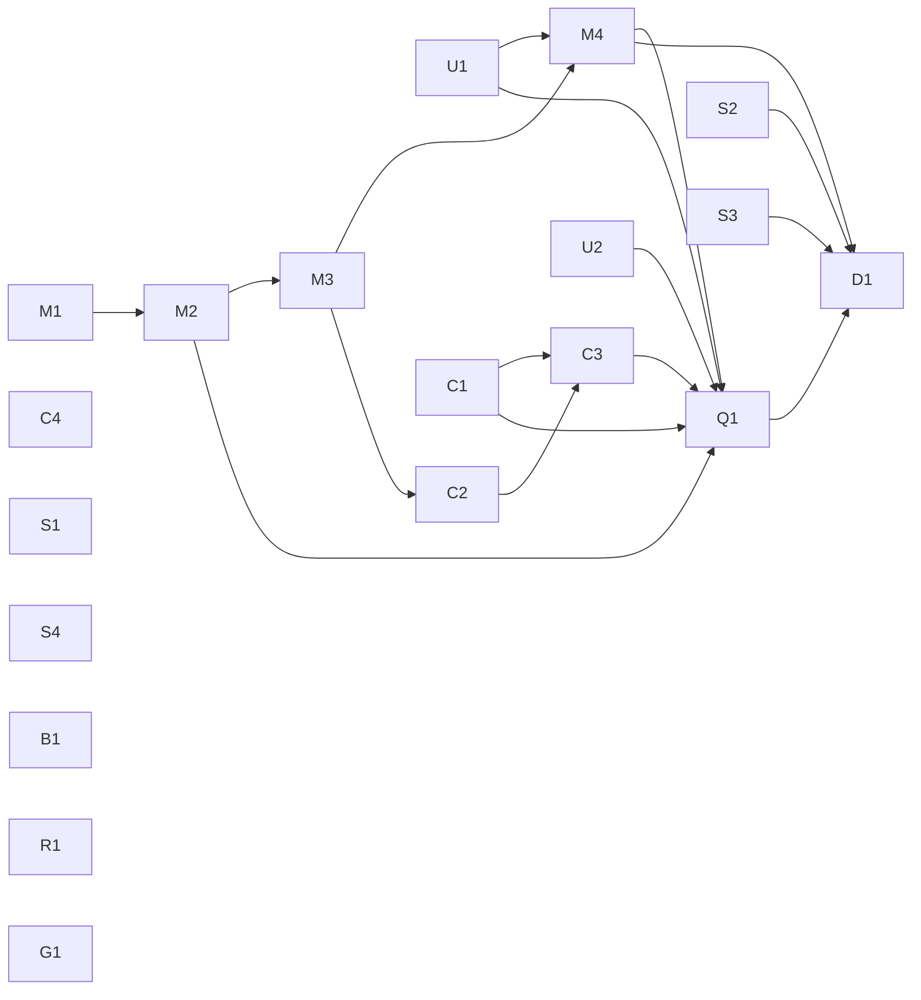

# Hot-path follow-ups: masking gaps, cargo by rule, and the run's loose ends

status: draft
commit-mode: orchestrator-commits
language: ruby, rust (cards M3 and C2)
panel: Ruby (Linus Torvalds, Jeremy Evans, Sandi Metz, Richard Schneeman, Aaron Patterson); Rust seats for M3 and C2 (Raph Levien, Andrew Gallant)

## Intent

The hot-path fixes run (`planning/specs/hot-path-fixes-2026-11.md`, done 2026-11-10) left 17
follow-ups. The user ruled on them on 2026-11-10 (`planning/hot-path-followups-2026-11-10.md`).

This plan lands those rulings:
- close 3 masking gaps, scan UTF-16 text, and move every secret scan into Rust, counting how
  often a scan has to over-mask;
- make the cargo rule J4 added actually run, and read cargo's files with a real TOML parser;
- fix the cockpit's relative launch, and show a remembered judge approval;
- settle 3 flaky or clock-bound specs and 1 bench ceiling;
- measure what the judge-wait cards and the handback fast path paid;
- add the manual-QA scenarios the user will run at the end.

## Grounding

Checked on 2026-11-10 at main `181e08bb`. 3 Explore agents read the production paths. A spike ran
the real cargo path (see Spike findings). Where the follow-up list and the code disagreed, the
code won, and these items changed:

- **FU-6 (masking leak).** The premise was "a `+` diff prefix defeats masking". It is only partly
  true.
  - `Regions.detect` (`lib/lain/sensitivity/regions.rb:199-213`) still finds a long random
    `+STRIPE_KEY=sk_live_...` by entropy (`TOKEN`, `regions.rb:89`).
  - The real gaps are 3:
    1. **No Stripe shape.** The "openai-style api key" shape (`lib/lain/credential_patterns.rb:123`)
       needs `sk-`, so it never matches `sk_live_`. As a result 1% of random live keys, and every
       short or low-entropy one, are missed.
    2. **No `key` in `NAME_HINT`** (`regions.rb:51`), so a name like `STRIPE_KEY` gives no hint.
    3. **Line-start anchors.** The dotenv, toml and yaml assignment shapes
       (`credential_patterns.rb:173-175`) and the suffixed password key (`regions.rb:149`) are
       anchored at `^[ \t]*`. On a `+` or `-` diff line, short values under weak names are lost:
       `SESSION_ID=abc12345xyz` and `AUTH=hunter2hunter2` are found plain and lost with the prefix.
  - Egress does not catch it either: `lib/lain/provider/http/egress_guard.rb` refuses only known
    literal values and only flags regions.
- **FU-9 (UTF-16).** Nothing decodes text before detection. `detect` does `content.b`, so UTF-16LE
  gives 0 regions. The only BOM handled is UTF-8 (`regions.rb:141`, `182-205`). Offsets are byte
  offsets throughout, applied by `Masking.render` (`lib/lain/sensitivity/masking.rb`).
  `regions_spec.rb:891-909` asserts only that UTF-16 does not raise.
- **FU-13 (cargo refused).** k28-4 landed as T5 (`f9d2ec92`). Its exec grant works: by realpath
  `~/.cargo/bin/rustup`, with the toolchain under `HOME_EXEC` (`lib/lain/confine/profile.rb:54-56`).
  The real defect is J4's own. `Profiles#for` (`lib/lain/confine/profiles.rb:112-116`) gives the
  read-only reader profile to every `composed_term` allow. So a rule-approved `cargo check --locked`
  exits 101: target/ is read-only, and the registry is not mounted. The spike proved this.
- **Scanner facts.**
  - The Rust scanner has 24 shapes, 10 of them with lookaround (`lib/lain/sensitivity/rust_shapes.rb:17-20`).
  - The empty-match refusal (`rust_shapes.rb` `Translation#source`) refuses no shape today.
  - A limited shape (`ext/lain/src/regions.rs:112-158`) falls back silently to `RubyScanner` in
    `lib/lain/sensitivity/regions/rust_scanner.rb`.
  - No `backtrack_limit` is set, so fancy-regex uses its default of 1,000,000.
  - No counter or journal records a limited scan.
- **TOML.** The `toml` crate 1.1.6 is already a direct dependency of `ext/lain`. Its only binding
  is `Lain::Ext::Prompt.from_toml`, a typed parse with `deny_unknown_fields`
  (`ext/lain/src/prompt.rs:240-246`). `Setting::from_toml` (`prompt.rs:270-285`) already projects a
  `toml::Value`. J4's predicate is `Crate` at `lib/lain/approval/composed_term.rb:874-961`, with
  its regexes at `875-889`.
- **Judge memo.** A memo hit (`lib/lain/approval/judged.rb:254-277`) never calls `show`
  (`judged.rb:338-343`). So no `Telemetry::JudgeRuled` reaches the transcript, and the hit reads
  like a rule approval.
- **Relative launch.** `PaneCommand.call` (`lib/lain/cli/pane_command.rb:70-72`) writes
  `exec #{$PROGRAM_NAME}` unexpanded. Panes start with `-c @cwd`, so a relative `exe/lain` fails in
  any pane whose cwd differs. Siblings that expand correctly: `up.rb:616`, `gc_schedule.rb:76`.
- **suite_load_spec.** It holds `be < 0.15` (`spec/lain/suite_load_spec.rb:75-77`).
  `Group#stop` (`bin/suite-load:90-103`) sends KILL unconditionally after a hard-coded 0.2 s
  grace, and has no seam.
  - Other sub-second wall-clock bounds in spec/, for a later card:
    - `stall_protection_spec.rb:491,499`
    - `admission_spec.rb:1109`
    - `docent_spec.rb:198,1214,1228`
    - `line_editor_spec.rb:1457`
    - `tty_spec.rb:2226`
    - `parked/queue_spec.rb:1372`
    - `epic/gate/policy_spec.rb:217`
    - `land_spec.rb:409`
- **journal_discriminators flake.** It enumerates named Journalable classes through ObjectSpace
  (`spec/lain/review/journal_discriminators_spec.rb:29-35`). `telemetry_spec.rb:253-262`
  `stub_const`s `Lain::Telemetry::Probe` 3 times. Each named class stays in ObjectSpace until GC,
  which is exactly 145 classes against 143 discriminators. This is read, not run.
- **workspace_profile.** The 2 examples set no budget, so the global 30 s watchdog
  (`spec/support/watchdog.rb:56`) is their only bound. `Sentry::Starvation` (`watchdog.rb:79-166`)
  reads CPU and load, not memory.
- **Load-path cache.** `lib/lain/boot/frozen_load_path.rb` (from `b521a9c8`) writes
  `~/.cache/lain/load_path/<key>.rb`, keyed on PATH, HOME and gem stamps. Nothing prunes it.
- **request_100000.** The timed block (`lib/lain/bench/hot_paths.rb:99-107`) includes
  `Request.new` and `Canonical.dump`. `lib/lain/request.rb` changed 3 times since the ceiling's
  seed `a345b7e5`: `d3f1302b`, `06fb4d6f` and `63e74e5f`.
- **G4 hit rate.** `moved?` (`lib/lain/isolation/worktree/handback/retirement.rb:247-252`) records
  nothing. A hit is derivable from each `Telemetry::Handback` record (`sync`, `attempts`, `checks`)
  in epic journals. Watch the symbol versus string forms of `checks.outcome`.
- **Approval replay.** `lain approval-replay` (`exe/lain:1196-1232`, `lib/lain/bench/approval_replay.rb`)
  shows each call's rung. It does not count judge calls removed or seconds saved.
  `planning/hot-path-profiling-2026-11/judged-calls.txt` holds the baseline: 122 calls, 1046.4 s.
- **QA scenarios.** No scenario covers `lain up` beside a large `.venv`, an auto-mode chat doing
  cargo and git, or a review of about 30 files.

Docs that disagree with the code, corrected by D1:
- `ARCHITECTURE.md` "The secret boundary" (from l.1132) is Ruby-era. It quotes 578 ms per MB and
  never names the Rust scanner, the limited fallback, or UTF-16.
- `credential_patterns.rb:20-28` (an encoding contract) and `regions.rb:187-190` call UTF-16
  "safe". M2 corrects those comments.

## Compatibility

| Surface | Verdict | Evidence |
|---|---|---|
| Journal record shapes (`judge_ruled` verdicts, a new `over_masked` record) | must keep old records readable; additive only | Old sessions are disposable, but a shape change rewrites rather than refuses (memory, 2026-11-04). Both changes add, and neither removes |
| `lain approval-replay` output | free to break | Bench output with no consumer outside `spec/` (grep of `~/dev`) |
| `Lain::Ext` bindings (a new `Toml`) | free to break | `ext/lain/Cargo.toml:7 publish = false`; no git release tags; gem not pushed |
| Masking output (`<redacted:N>` placement) | free to break | Model-facing only; no stored consumer |
| Pane command strings, `bin/suite-load`, the load-path cache files | free to break | Internal dev tools and a local cache |
| Role prompt `role/dev.md` | free to break | Text changes; cache prefix shifts once |
| Sandbox profile for a rule-approved cargo build | free to break | Fixes J4 (landed `c4dd3792` the same day); no consumer relied on the failure |

No trade report: keeping these costs nothing.

## Spike findings

| Question | Result | Evidence |
|---|---|---|
| A rule-approved `cargo check --locked` in a self-contained crate: which profile, does exec succeed, does cargo finish? | Reader profile. Exec of `~/.cargo/bin/cargo` succeeds (`--exec-file ~/.cargo/bin/rustup`). cargo exits 101 with "Read-only file system" on target/. With 1 cached dependency, it fails on "Could not resolve host: index.crates.io", since the registry is not mounted. A judge-rung allow gets workspace and finishes with exit 0 | Spike through the production `ToolsetBuild`, ToolGuard, Switchboard and ComposedTerm, with a real `Confine::Sandbox`, bwrap and lain-fence. Copied to the run scratchpad `spike-cargo/` (`cargo_spike_spec.rb`, `run0.out`, `run1.out`). Worktree removed |
| Where does a bare "Permission denied" on `~/.cargo/bin/cargo` come from? | Only when the reader profile gets no exec file for rustup: exit 126 and the kernel's message. In a real chat that means `Profiles#placed` dropped rustup, either as fresh or as a shadowing user program. Not reproduced through the real trigger | `run_noexec.out`. C1 carries it as a stop condition |

## Shared files

The main session edits these; cards hand back 1-line diffs:
- `ext/lain/corpus/MANIFEST.json`. The main session regenerates it with
  `CORPUS_SHA=<sha> bundle exec rake conformance:corpus` when landing M1, M2, M3 and C2.
- `docs/rust-bindings.md`, for C2's ruling.
- `.rubocop.yml`.
- `spec/spec_helper.rb`.
- `spec/support/slow_files.rb`, for C1's seam.
- `CLAUDE.md`, for D1's correction of the hot-path-bench line.

## Rejected options

- **A bare `key` name hint.** It would mask `primary_key=id` and `sort_key=name`. M1 adds only an
  upper-case glued `_KEY` suffix, behind a corpus gate.
- **The `tomlrb` gem.** It would be a second TOML parser beside the one cargo uses, and it lacks
  TOML 1.1. The user ruled for the Rust `toml` crate.
- **Widening the reader profile for cargo.** The user ruled that build-class cargo approvals run
  under workspace, like the judge's.
- **A process-wide counter for limited scans.** The journal is lain's only metrics mechanism, and
  a counter would not survive the session.
- **Keeping the Ruby rescan as a last resort.** The user ruled that over-masking plus a metric
  replaces it.
- **Fixing all 13 sub-second wall-clock bounds now.** Out of scope. They are listed in Grounding.
- **Moving `RubyScanner` to spec/support.** It stays in lib as the spec oracle; a spec-census
  entry for it is expected and named in M3's hand-back.
- **Per-line over-masking for shapes that cross lines.** It would leave a limited PEM body in
  plain text (panel probe, 1.17 MB PUBLIC KEY block), which the ruling forbids.

## Open decisions

None.

## Dependency graph



## Tasks

### M1: Mask Stripe keys, diff-prefixed assignments and `_KEY` names          [risk: high]

**Depends on:** none
**Files:** `lib/lain/credential_patterns.rb`, `lib/lain/sensitivity/regions.rb`,
`spec/lain/credential_patterns_spec.rb`, `spec/lain/sensitivity/regions_spec.rb`,
`spec/lain/sensitivity/rust_shapes_spec.rb`, `spec/lain/middleware/redact_secret_reads_spec.rb`,
`spec/lain/middleware/refuse_secret_writes_spec.rb`, `spec/conformance_corpus_spec.rb` (its shape
counts at about l.106-110), `spec/conformance/corpus_generator.rb` (a positive and a near-miss row
per new shape), `ext/lain/corpus/regions.ndjson` (regenerated)
**Reuse:** the `ISSUED` shapes and their literal-value gate (`credential_patterns.rb:110-127`);
`SECRET_NOUN_LAST` (`regions.rb:66-69`); the parity helper in `regions_spec.rb:7-11`; the
joined-parts fixture convention of `hinted_corpus.yml`, so no vendor-shaped literal sits in the tree
**Shared-file wiring:** `ext/lain/corpus/MANIFEST.json`, regenerated by the main session
**Reachable from:** `Tools::Bash` result, then `CLI::ToolGuard` stack
(`lib/lain/cli/tool_guard.rb:659`), then `Middleware::RedactSecretReads#printed`, then
`Sensitivity::TextMask#call`, then `Regions.detect`. The write side: `RefuseSecretWrites` through
`CredentialPatterns.for(:write)`

The Stripe prefixes go in `ISSUED`, as vendor-issued tokens, so a write that carries one is
refused the way a GitHub token is. The real-data gate therefore measures both sides.

**Acceptance criteria**

```gherkin
Scenario: a Stripe key on a git diff line is masked
  Given the git patch the J3 review leaked, a "+STRIPE_KEY=sk_live_" line with 24 characters of low entropy
  When it passes through the production masking middleware as a bash result
  Then the value is replaced by a placeholder and no "sk_live_" text reaches the result

Scenario: issued Stripe keys are found by shape
  Given each of sk_live_, sk_test_, rk_live_, rk_test_ and whsec_ followed by a short value
  When Regions.detect runs
  Then each is a region, under both the Rust and the Ruby scanner

Scenario: a write carrying a Stripe key is refused
  Given a write_file whose content holds "sk_live_" and a short value
  When RefuseSecretWrites judges it
  Then it is refused as a credential

Scenario: a short value under a weak name keeps its region on a diff line
  Given "SESSION_ID=abc12345xyz" and "AUTH=hunter2hunter2", each prefixed by "+" and by "-"
  When Regions.detect runs
  Then each gives the same region as the unprefixed line

Scenario: an upper-case _KEY name hints, a lower-case one does not
  Given "STRIPE_KEY=Zx9Qw8Lm2Pq" and "sort_key=created_at"
  When Regions.detect runs
  Then the first is a region and the second is not
```
Spec file: `spec/lain/sensitivity/regions_spec.rb`, `spec/lain/credential_patterns_spec.rb`,
`spec/lain/middleware/redact_secret_reads_spec.rb`, `spec/lain/middleware/refuse_secret_writes_spec.rb`

**Stop and report if:**
- The real-data gate gains a region, or a write refusal, that is not a credential. The gate is
  `planning/hot-path-profiling-2026-11/regions_detect.rb` over this checkout, `references/` and 20
  journal copies, compared against `181e08bb`. Report each new hit with 20 bytes of context.
- A new shape fails `RustShapes` translation (`rust_shapes_spec.rb`).

### M2: Find secrets in UTF-16 text          [risk: high]

**Depends on:** M1
**Files:** `lib/lain/sensitivity/regions.rb`, `lib/lain/sensitivity/regions/view.rb` (new),
`lib/lain/sensitivity/masking.rb`, `lib/lain/sensitivity/text_mask.rb`,
`lib/lain/credential_patterns.rb` (the encoding contract comment only),
`spec/lain/sensitivity/regions_spec.rb`, `spec/lain/sensitivity/regions/view_spec.rb` (new),
`spec/lain/sensitivity/masking_spec.rb`, `spec/lain/sensitivity/text_mask_spec.rb`,
`spec/lain/middleware/redact_secret_reads_spec.rb`
**Reuse:** the UTF-8 BOM skip and its offset re-add in `region_at` (`regions.rb:182-205`, `284-288`)
**Shared-file wiring:** `ext/lain/corpus/MANIFEST.json`, if the regions corpus changes
**Reachable from:** `Regions.detect` and `Masking.render`, called by `TextMask#mask` and
`RedactSecretReads::Scan`

Decided here, so the card does not stop on it: a UTF-16 view is transcoded to UTF-8 and scanned,
and each region maps back to byte offsets in the original string, aligned to 2 bytes.
Callers hand in strings tagged UTF-8 or BINARY, so the encoding tag never says UTF-16. One object
decides instead: `Regions::View.of(bytes)` reads the BOM or the NUL pattern once. `detect`,
`Masking.render`, `Regions.placeholders`, `numbering_after` and `recurrences` all ask it, so
re-masking stays idempotent. `render` writes the placeholder in the view's UTF-16 byte order, so the
result stays legible UTF-16. `TextMask::Stream` cuts a UTF-16 view on its 2-byte newline, not on
the byte 0x0A. `read_file` already refuses a UTF-16 file with a BOM as not text
(`lib/lain/tools/read_file.rb:156,190`), so the read arm here is a BOM-less file. That reads as
valid UTF-8 and reaches masking.

**Acceptance criteria**

```gherkin
Scenario: a bash cat of a UTF-16LE file with a BOM is masked legibly
  Given a UTF-16LE file with a BOM holding an AWS access key
  When `cat` of it passes through the production masking middleware as a bash result
  Then no key text reaches the result, and the result decoded as UTF-16LE reads with a <redacted:N> placeholder

Scenario: a read_file of BOM-less UTF-16 is masked
  Given UTF-16LE and UTF-16BE files without a BOM holding a credential assignment
  When read_file returns each through the masking middleware
  Then no credential text reaches the result

Scenario: the live display masks UTF-16 output
  Given a bash `cat` of a UTF-16LE file holding an AWS key, streamed in pieces through Sensitivity::Display
  When the stream is masked piece by piece
  Then no key text is shown, and every piece decodes as UTF-16LE

Scenario: masking masked UTF-16 text again changes nothing
  Given UTF-16LE text already masked once
  When TextMask masks it again
  Then the bytes are unchanged

Scenario: ordinary binary is not mistaken for UTF-16
  Given a PNG header and a gzip stream
  When Regions.detect runs
  Then the result equals the result before this card
```
Spec file: `spec/lain/sensitivity/regions/view_spec.rb`, `spec/lain/sensitivity/regions_spec.rb`,
`spec/lain/sensitivity/masking_spec.rb`, `spec/lain/sensitivity/text_mask_spec.rb`,
`spec/lain/middleware/redact_secret_reads_spec.rb`

**Interface**

```ruby
Regions::View.of(bytes) # => View with #encoding (:utf8, :utf16le, :utf16be), #text (UTF-8), #offset(utf8_byte) -> original byte
# Regions.detect(content) and Masking.render(content, regions) keep their signatures and ask View.
```

**Stop and report if:**
- A caller in `lib/lain/survey/projection.rb` or `egress_guard.rb` depends on offsets that no
  longer index its own string.
- The NUL-pattern test for BOM-less UTF-16 changes any region in the M1 real-data gate.

### M3: Run every secret scan in Rust and over-mask what it cannot finish          [risk: high]

**Depends on:** M2
**Files:** `ext/lain/src/regions.rs`, `lib/lain/sensitivity/regions/rust_scanner.rb`,
`lib/lain/sensitivity/rust_shapes.rb`, `lib/lain/sensitivity/regions.rb` (an over-masked row skips
`qualifies?` and the other value gates), `spec/lain/rust/regions_spec.rb`,
`spec/lain/rust/binding_coverage_spec.rb` (it pins `[:matches, :limited]` at about l.72),
`spec/lain/sensitivity/rust_shapes_spec.rb`, `spec/lain/sensitivity/regions_spec.rb`,
`ext/lain/corpus/regions.ndjson` (regenerated)
**Reuse:** `Shape#hits` and `scan_until` (`regions.rs:112-158`); the 1.1 MB unclosed `PEM_PUBLIC`
example (`regions_spec.rb:1339-1357`); `RubyScanner` stays, used only as the spec oracle
**Shared-file wiring:** `ext/lain/corpus/MANIFEST.json`
**Reachable from:** `RustScanner.default`, used by `Regions.detect`

The over-mask rule, by the user's ruling "over-mask the span, never under-mask":
- A shape that cannot cross a newline is retried line by line at the higher limit, and each line
  it still cannot finish on is over-masked.
- A shape that can cross a newline is over-masked from the end of its last completed match, or
  the start of the text, to the end of the text.
- Which is which is declared, not inferred: `RustShapes` gives each shape a `single_line` flag, and
  a spec checks every flag against a 2-line probe (a shape flagged single-line must never match
  across `\n`). The Rust dialect lets `.`, `\s` and `[^...]` match a newline, so expect about 13
  of the 24 shapes to be multi-line unless their translation forbids it.

**Acceptance criteria**

```gherkin
Scenario: a limited shape is retried in Rust
  Given text where a shape exhausts fancy-regex's backtrack limit at the default
  When Regions.detect runs
  Then Rust retries that shape at a higher limit, and no RubyScanner is built in production

Scenario: a single-line shape is over-masked by line
  Given text where a single-line shape still exhausts the higher limit on 1 line of 10
  When Regions.detect runs
  Then that line is 1 region with the reason "over-masked: <shape> hit the backtrack limit", and the other 9 lines are masked only as before

Scenario: a multi-line shape is over-masked to the end
  Given a closed 1.17 MB PUBLIC KEY block holding a body that is not a key
  When Regions.detect runs
  Then every byte the Ruby scanner masked is masked, at least from the BEGIN line to the end of the text

Scenario: every Ruby region is covered
  Given the frozen corpus and 1,000 random byte strings
  When both scanners run
  Then every Ruby region lies inside a Rust region, and where nothing is over-masked the 2 are equal

Scenario: a shape that can match empty is scanned like Ruby scans it
  Given a shape that matches the empty string
  When it is translated and scanned over text with and without matches
  Then translation no longer refuses it, and its non-empty Rust matches equal Onigmo's non-empty matches
```
Spec file: `spec/lain/sensitivity/regions_spec.rb`, `spec/lain/sensitivity/rust_shapes_spec.rb`,
`spec/lain/rust/regions_spec.rb`

**Interface**

```rust
// Scan gains the spans it over-masked; `limited` is no longer handed to Ruby.
pub struct Scan { matches: Vec<Hit>, overmasked: Vec<(usize, usize, u16 /* shape */)> }
```

```ruby
Region#over_masked_by # => the shape name for an over-masked region, else nil
```

**Stop and report if:**
- The default-limit corpus run (`spec/lain/rust/regions_spec.rb` frozen corpus plus the 1,000
  random strings) shows any shape limited. A limited shape on ordinary input means the retry is
  the common path, not a backstop.
- The 1 MB scan in `hot-path-bench` (`credential_scan_*` rows) gets slower than its ceiling.
- More than 20 of the 24 shapes come out multi-line, so the single-line arm covers almost nothing.
  Report the list before building both arms.
- Rewriting the parity helper (`regions_spec.rb:7-11`) to "covered" would hide a real Rust miss:
  report each example whose equality had to become coverage.

### M4: Journal each over-masked tool result          [risk: medium]

**Depends on:** M3, U1
**Files:** `lib/lain/telemetry/over_masked.rb` (new, with its `Carriers::OverMasked`),
`lib/lain/middleware/redact_secret_reads.rb`, `lib/lain/journal/projection/redactions.rb`,
`spec/lain/telemetry/over_masked_spec.rb` (new), `spec/lain/middleware/redact_secret_reads_spec.rb`,
`spec/lain/journal/projection/redactions_spec.rb`, `spec/lain/telemetry/round_trip_spec.rb`
**Reuse:** `Region#over_masked_by` (M3), never a parse of the reason string;
`lib/lain/telemetry/command_redacted.rb` as the shape (counts only, never bytes);
`RedactSecretReads#record` (about l.564-568); `Telemetry::Readers::BY_TYPE`
**Shared-file wiring:** none
**Reachable from:** `CLI::ToolGuard` stack, then `RedactSecretReads#record`

Scope: tool results, the text that reaches the model, through `RedactSecretReads`. The survey,
display and egress callers of `Regions.detect` are not counted. That is enough for the user's
"how often over epics" question.

**Acceptance criteria**

```gherkin
Scenario: an over-masked tool result leaves a record
  Given a bash result whose scan over-masks 2 lines for 1 shape
  When the masking middleware finishes
  Then the journal holds one over_masked record naming the tool, the shape and 2 spans, and no bytes of the text

Scenario: the redactions projection counts them
  Given a session journal with 3 over_masked records
  When Journal::Projection::Redactions folds it
  Then its over-masked count is 3
```
Spec file: `spec/lain/telemetry/over_masked_spec.rb`, `spec/lain/journal/projection/redactions_spec.rb`

**Interface**

```ruby
OverMasked = Data.define(:tool, :shape, :spans) # include Telemetry::Journalable; journal_type "over_masked"
```

**Stop and report if:**
- `spec/journalable_surface_spec.rb`'s generic build sweep cannot build the new record. Report the
  carrier validation that refuses it.

### C1: Run a rule-approved cargo build under the workspace profile          [risk: high]

**Depends on:** none
**Files:** `lib/lain/approval/composed_term.rb` (its decision says when the run builds),
`lib/lain/approval/rule.rb` (the decision carries it), `lib/lain/approval/escalation.rb` (the
ruling carries it), `lib/lain/confine/profiles.rb`, `spec/lain/confine/profiles_spec.rb`,
`spec/lain/approval/composed_term_spec.rb`, `spec/lain/seams/cargo_rule_spec.rb` (new)
**Reuse:** `WORKSPACE_RUNGS` (`profiles.rb:56`); `Pinned#run` (`composed_term.rb:819`), which
already names the admitted subcommand; the spike's construction through `ToolsetBuild`,
`ToolGuard`, `Switchboard` and `ComposedTerm` (scratchpad `spike-cargo/cargo_spike_spec.rb`)
**Shared-file wiring:** `spec/support/slow_files.rb` gains `spec/lain/seams/cargo_rule_spec.rb`
(the spike took 11.5 s)
**Reachable from:** `CLI::Wiring::BoardBuild` (`board_build.rb:196`) builds `ComposedTerm`, then
`Tools::Bash#perform` builds `Confine::Request` with the ruling (`bash.rb:415`), then
`Exec::Sandboxed` calls `Profiles#for` (`sandboxed.rb:111`)

`BuildGrant` only knows `cargo build` and `fetch` in 1 stage (`profiles.rb:299-302`), so it cannot
decide this. ComposedTerm already knows which subcommand it admitted, so its decision says the run
builds (check, build, clippy, test; never `--version` or `fmt --check`), and `Profiles#for` sends
such a ruling to `workspace?` instead of the reader.

**Acceptance criteria**

```gherkin
Scenario: a rule-approved cargo check finishes
  Given a self-contained crate with 1 cached dependency and a Cargo.lock
  When the production bash tool runs `cargo check --locked` approved by the composed_term rule
  Then it runs under the workspace profile, exits 0, writes target/, and reads the registry with no network

Scenario: the usual pipeline shape runs too
  Given the same crate
  When the composed_term rule approves `cargo test --locked 2>&1 | tail -5`
  Then it runs under the workspace profile and exits 0

Scenario: a read-only probe stays on the reader
  Given the same crate
  When the composed_term rule approves `cargo --version`, `cargo fmt --check` and `git log`
  Then each runs under the reader profile

Scenario: a reader-confined session keeps cargo confined
  Given a session launched with --confine reader
  When the composed_term rule approves `cargo check --locked`
  Then it runs under the reader profile, never TRACED or unconfined
```
Spec file: `spec/lain/seams/cargo_rule_spec.rb` (`:seam`; skips without bwrap, lain-fence or a
cached crate), `spec/lain/confine/profiles_spec.rb`

**Interface**

```ruby
# Rule::Decision and Escalation::Ruling gain a `builds` flag, false by default.
ruling.builds? # => true only for a composed_term allow of a building cargo subcommand
```

**Stop and report if:**
- `profiles_spec.rb` "confines a ComposedTerm approval under the reader profile" (about l.38)
  would have to change for a non-cargo command.
- "never grants a human's approval or a ComposedTerm one" (`profiles_spec.rb` about l.876) is
  expected to change: `cargo build --locked` under workspace now gets the build port grant. Confirm
  the grant matches the judge's and rewrite that example's name, nothing else.
- The real run ends in a bare "Permission denied" on `~/.cargo/bin/cargo`. That is the
  rustup-dropped path in Spike findings: find why `Profiles#placed` dropped rustup, and report it
  before fixing.

### C2: Bind a generic TOML parse in ext/lain          [risk: medium]

**Depends on:** M3 (both edit `spec/lain/rust/binding_coverage_spec.rb` and
`spec/conformance/corpus_generator.rb`)
**Files:** `ext/lain/src/toml_table.rs` (new), `ext/lain/src/lib.rs`, `ext/lain/src/prompt.rs`
(move the `toml::Value` projection out, reused by both), `spec/fixtures/toml-test/` (new: a vendored
subset of toml-test's valid and invalid cases with their expected JSON, MIT, with its license
file), `ext/lain/corpus/toml.ndjson` (new, generated from those fixtures),
`spec/lain/rust/toml_spec.rb` (new), `spec/lain/rust/binding_coverage_spec.rb`,
`spec/conformance/corpus_generator.rb`, `ext/lain/mutants-baseline.txt`
**Reuse:** `Setting::from_toml` (`prompt.rs:270-285`); the nesting bound the toml crate enforces
(`prompt.rs:79-84`)
**Shared-file wiring:** `docs/rust-bindings.md` gains, under tests 2 and 3: "Parser parity with the
consumer admits a binding that is neither asymptotically better nor hot per turn, by ruling
2026-11-10: lain reads a Cargo manifest with the `toml` crate cargo uses, so a file cargo reads one
way is never read another way." Also `ext/lain/corpus/MANIFEST.json`.
**Reachable from:** `Lain::Ext::Toml.parse`, called by `ComposedTerm::Crate` (C3)

The oracle is toml-test's expected JSON, not the binding's own output: Ruby has no TOML parser.

**Acceptance criteria**

```gherkin
Scenario: a TOML document becomes a frozen Ruby Hash
  Given each vendored valid toml-test case, including TOML 1.1 cases and quoted, escaped, dotted and inline-table keys
  When Lain::Ext::Toml.parse runs
  Then the result equals the case's expected JSON, decoded the same way, and is Ractor-shareable

Scenario: invalid TOML raises one error class
  Given each vendored invalid toml-test case, plus deeply nested input
  When Lain::Ext::Toml.parse runs
  Then each raises Lain::Ext::Toml::Invalid with the parser's message
```
Spec file: `spec/lain/rust/toml_spec.rb`

**Interface**

```ruby
Lain::Ext::Toml.parse(text) # => Hash (deeply frozen); raises Lain::Ext::Toml::Invalid
# A datetime, date or time becomes the String toml-test expects for it (RFC 3339 text).
```

**Stop and report if:**
- The toml crate disagrees with a vendored toml-test expectation. Name the case; do not edit the
  fixture to match.
- `prompt.rs`'s typed parse changes behaviour (`spec/lain/frontend/prompt_composer_spec.rb`).

### C3: Read cargo manifests and configs as parsed TOML          [risk: high]

**Depends on:** C1 (both edit `composed_term.rb` and its spec), C2
**Files:** `lib/lain/approval/composed_term.rb`, `spec/lain/approval/composed_term_spec.rb`,
`spec/fixtures/approval_replay/hazards.ndjson` (only if a hazard count moves)
**Reuse:** `Crate` (`composed_term.rb:874-961`): keep `text` with its FIFO and 64 KiB guard, and
`ascent`; replace `KEY`, `RUNS`, `ALIASED`, `INCLUDES`, `WORKSPACE` and `UNPLAIN` with lookups in
the parsed tree
**Shared-file wiring:** none
**Reachable from:** `CLI::Wiring::BoardBuild` (`board_build.rb:196`), then `ComposedTerm.new`,
then `#crate_held?`, then `Crate#held?`

A key name is looked for at any depth of the parsed tree, as the regex did at any position, not
at fixed paths. So an alias or a `rustc-wrapper` nested under a target table still counts. The one
exception is `workspace`: only a string value is a pointer to a workspace root, so the `[workspace]`
table and `x.workspace = true` are not checked, as today's regex does not check them.

**Acceptance criteria**

```gherkin
Scenario: a workspace root and inherited fields still approve
  Given a crate whose Cargo.toml holds a [workspace] table and `version.workspace = true`
  When the production ComposedTerm judges `cargo check --locked`
  Then it approves

Scenario: a quoted table header no longer costs a judge call
  Given a crate whose Cargo.toml holds [target.'cfg(unix)'.dependencies] and [dependencies."foo"]
  When the production ComposedTerm judges `cargo check --locked`
  Then it approves

Scenario: every bypass the J4 reviews found still goes to the judge
  Given an alias for fmt or clippy spelled plain, quoted, escaped, dotted or as an inline table; a workspace key pointing out of the root, spelled the same ways; an include in any config; a FIFO; and a file past 64 KiB
  When ComposedTerm judges the matching cargo call
  Then each abstains

Scenario: the user's own cargo home config still refuses anything that runs
  Given the user's cargo home config naming any key RUNS holds today (alias, rustc, rustdoc, rustc-wrapper, rustc-workspace-wrapper, runner, linker, rustflags, rustdocflags, include, env, credential-provider, global-credential-providers), each spelled plain, quoted, dotted and nested under a target table
  When ComposedTerm judges `cargo check --locked`
  Then each abstains

Scenario: a file that does not parse goes to the judge
  Given a Cargo.toml with a duplicate key
  When ComposedTerm judges `cargo check --locked`
  Then it abstains
```
Spec file: `spec/lain/approval/composed_term_spec.rb`

**Stop and report if:**
- An example in `describe "a manifest or config whose keys are quoted or escaped"`
  (`composed_term_spec.rb:2409`) would approve a call that runs code outside the root. Run real
  cargo, as the J4 reviews did, before changing its expectation. Expected: the `["package"]` and
  `demo` examples (about l.2433-2434) now approve, and their names change to say so.
- The outer class passes its 306-line limit (`.rubocop.yml`). Extract `Crate` to
  `lib/lain/approval/composed_term/crate.rb` instead.

### C4: Hint `--locked` in the dev role prompt          [risk: low]

**Depends on:** none
**Files:** `lib/lain/prompt/templates/role/dev.md`, `spec/lain/prompt/slots_spec.rb` (only if it
pins the template's text)
**Reuse:** none
**Shared-file wiring:** none
**Reachable from:** the dev role's prompt slot, rendered by `Prompt` for a chat in the dev role

**Acceptance criteria**

```gherkin
Scenario: the dev role says why --locked helps
  Given a chat in the dev role
  When its system prompt renders
  Then it holds 1 line: a cargo call with --locked is approved without waiting for the judge
```
Spec file: `spec/lain/prompt/slots_spec.rb`

**Stop and report if:**
- A spec pins the rendered dev prompt's bytes or digest elsewhere (grep spec/ for `role/dev`).

### U1: Show a remembered judge approval in the transcript          [risk: low]

**Depends on:** none
**Files:** `lib/lain/approval/judged.rb`, `lib/lain/telemetry/judge_ruled.rb`,
`lib/lain/frontend/decorators/judge_ruled.rb`, `spec/lain/approval/judged_spec.rb`,
`spec/lain/telemetry/judge_ruled_spec.rb`, `spec/lain/frontend/decorators/judge_ruled_spec.rb`,
`spec/lain/telemetry/round_trip_spec.rb`, `spec/lain/seams/judged_approval_spec.rb`
**Reuse:** `Judged#show` (`judged.rb:338-343`); the decorator's `SAID` table
**Shared-file wiring:** none
**Reachable from:** `CLI::Wiring::BoardBuild` (`board_build.rb:99`) builds `Judged` with
`JudgeMemo.new`. A memo hit goes through `Judged#remembered`.

**Acceptance criteria**

```gherkin
Scenario: a memo hit prints a dim line
  Given a chat where the judge approved `git log --oneline -5` once
  When the same call repeats and the memo answers
  Then the transcript shows 1 stamped, dim line naming the call as a remembered judge approval, distinct from "the judge approved"

Scenario: the record round-trips
  Given a JudgeRuled with the remembered verdict
  When it is journaled and read back
  Then it equals the original
```
Spec file: `spec/lain/approval/judged_spec.rb`, `spec/lain/seams/judged_approval_spec.rb`

**Interface**

```ruby
Carriers::JudgeRuled::VERDICTS # gains "remembered"; Judged#remembered calls show(effect, "remembered")
```

**Stop and report if:**
- The breaker example in `judged_spec.rb` "the memo of the judge's approvals" (about l.1650-1745)
  counts the display event as a second approval.

### U2: Launch panes by an absolute program path          [risk: low]

**Depends on:** none
**Files:** `lib/lain/cli/pane_command.rb`, `spec/lain/cli/pane_command_spec.rb`,
`spec/lain/cli/fleet_windows_spec.rb`
**Reuse:** `ChatPreflight.spawning`'s expand rule (`up.rb:616-617`); `as_a_pane_would(program:)`
(`fleet_windows_spec.rb:910-925`)
**Shared-file wiring:** none
**Reachable from:** `CLI::Up` (`up.rb:1461`, `1477`), `FleetWindows` (`fleet_windows.rb:456`),
`Command::Fork` (`fork.rb:124`), `Command::Btw` (`btw.rb:55`), all through `PaneCommand.call`

**Acceptance criteria**

```gherkin
Scenario: a relative launcher runs in a pane with another cwd
  Given $PROGRAM_NAME "exe/lain", resolved from the checkout
  When a pane built by PaneCommand.call starts with -c set to another directory
  Then the pane execs the absolute path, shell-escaped, and does not exit 127

Scenario: a bare name on PATH is left alone
  Given $PROGRAM_NAME "lain"
  When PaneCommand.call builds the command
  Then it still execs "lain"
```
Spec file: `spec/lain/cli/pane_command_spec.rb`, `spec/lain/cli/fleet_windows_spec.rb`

**Stop and report if:**
- `bundle_exports` (`pane_command.rb:86-93`) finds a different Gemfile once the program is
  absolute.

### S1: Prove Group#stop's early exit without a clock          [risk: low]

**Depends on:** none
**Files:** `bin/suite-load`, `spec/lain/suite_load_spec.rb`
**Reuse:** `Group#await_end` (`bin/suite-load:100-103`)
**Shared-file wiring:** none
**Reachable from:** `bin/suite-load`'s main, through `Group.spawn`, then `#stop`; also loaded by
`bin/suite-redrate`

**Acceptance criteria**

```gherkin
Scenario: a group that exits on TERM is never sent KILL, and the grace is not waited out
  Given a group whose process exits on TERM
  When stop runs with a 60 s grace, longer than the spec watchdog's 30 s budget
  Then the signals sent are TERM only, and the example finishes without the watchdog firing

Scenario: a group that ignores TERM is killed after the grace
  Given a group whose process ignores TERM
  When stop runs with a short grace
  Then the signals sent are TERM then KILL
```
Spec file: `spec/lain/suite_load_spec.rb`

**Interface**

```ruby
Group#stop(grace: 0.2) # skips KILL when await_end saw the group end
```

**Stop and report if:**
- `bin/suite-redrate` depends on the unconditional KILL.

### S2: Count only Journalable classes a constant names          [risk: low]

**Depends on:** none
**Files:** `spec/lain/review/journal_discriminators_spec.rb`
**Reuse:** `Telemetry::Readers.records_under` (`lib/lain/telemetry/readers.rb`)
**Shared-file wiring:** none
**Reachable from:** spec-only

**Acceptance criteria**

```gherkin
Scenario: a stubbed record left in ObjectSpace does not count
  Given 3 classes named Lain::Telemetry::Probe from stub_const still in ObjectSpace
  When the discriminator example runs
  Then it counts only classes for which Object.const_get(name) is the class itself, and passes
```
Spec file: `spec/lain/review/journal_discriminators_spec.rb`

**Stop and report if:**
- With the filter, 2 real lib classes still share a discriminator. That is a real collision: name
  both.

### S3: Skip the workspace profile's slow examples when the box is starved          [risk: low]

**Depends on:** none
**Files:** `spec/support/watchdog.rb`, `spec/watchdog_spec.rb` (new),
`spec/lain/seams/workspace_profile_spec.rb`
**Reuse:** `Sentry::Starvation` and its injectable readers (`watchdog.rb:79-166`); `starved_line`
(`watchdog.rb:232-239`)
**Shared-file wiring:** none
**Reachable from:** `spec/support/watchdog.rb`'s `SENTRY`, loaded for every spec run

The outcome, decided here: an example tagged `starvable:` that overruns its budget while the box is
starved ends as pending, with the STARVED line as its reason, not red. Every other example keeps
today's STUCK raise, starved or not.

**Acceptance criteria**

```gherkin
Scenario: memory pressure reads as starved
  Given an injected memory pressure reader showing some avg10 at 20% or more
  When an example overruns its budget
  Then the STARVED line names memory pressure

Scenario: a starvable example that overruns on a starved box is pending
  Given an example tagged starvable with a reason
  When it overruns its budget while the injected readers show starvation
  Then it ends pending with the STARVED line and the reason, and the run has 0 failures

Scenario: a starvable example that overruns on a quiet box is red
  Given the same example
  When it overruns its budget with no starvation
  Then it fails with the STUCK line

Scenario: the 2 sandboxed examples are starvable
  Given "passes the fence crate's tests, none of them skipped" and "passes one spec file with the example count an unconfined run reports"
  When the spec file loads
  Then each carries starvable metadata with its reason and its own budget
```
Spec file: `spec/watchdog_spec.rb`

**Stop and report if:**
- `/proc/pressure/memory` is absent on this box. Report it, and keep the CPU and load rule only.

### S4: Prune stale load-path cache entries          [risk: low]

**Depends on:** none
**Files:** `lib/lain/boot/frozen_load_path.rb`, `spec/lain/boot/frozen_load_path_spec.rb`
**Reuse:** `write_atomically`; the cache directory rule (`exe/lain:38`)
**Shared-file wiring:** none
**Reachable from:** `exe/lain:30-39`, then `FrozenLoadPath.setup` on every checkout launch

Decided here: `~/.cache` is mounted `noatime` on this box, so pruning goes by write mtime alone.
A launch never touches a file, so a replay stays a read. An entry still in use after 30 days is
deleted once and re-recorded on its next launch, at the cost of 1 record.

**Acceptance criteria**

```gherkin
Scenario: a write prunes entries written over 30 days ago
  Given 3 cache files, 1 written today and 2 written 31 days ago
  When setup records a new entry
  Then the 2 old files are gone and the others stay

Scenario: a replay never prunes or touches
  Given a cache hit
  When setup replays it
  Then no file is deleted and no mtime changes
```
Spec file: `spec/lain/boot/frozen_load_path_spec.rb`

**Stop and report if:**
- Another process can be replaying an entry while a write deletes it. Show the rename-based write
  makes that safe, or report it.

### B1: Settle the request_100000 bench ceiling          [risk: medium]

**Depends on:** none
**Files:** `bin/hot-path-bench` (a ceiling change only, in its own commit)
**Reuse:** `bin/hot-path-bench --record`; `git bisect` between `a345b7e5` and HEAD
**Shared-file wiring:** none
**Reachable from:** `bin/hot-path-bench --check`

**Acceptance criteria**

```gherkin
Scenario: drift is measured before the ceiling moves
  Given worktrees at a345b7e5 and at HEAD
  When the request_100000 row is recorded 5 times in each, interleaved, at load under 2
  Then the hand-back reports both medians and spreads, and either bisects a real drift over every commit since a345b7e5, or re-seeds the ceiling at 1.25x the largest of 3 fresh HEAD medians
```
Spec file: none can fail on a measurement; the evidence is the hand-back's table

**Stop and report if:**
- The bisect names a commit. Report it, and do not raise the ceiling over a real regression.

### R1: Sum the judge wait a replay removes          [risk: medium]

**Depends on:** none
**Files:** `lib/lain/bench/approval_replay/report.rb`, `lib/lain/bench/approval_replay/call.rb`,
`spec/lain/bench/approval_replay_spec.rb`
**Reuse:** `Call#judged` (`call.rb:88`); the recorded judge records `judged_calls.rb` reads
(`planning/hot-path-profiling-2026-11/judged_calls.rb`)
**Shared-file wiring:** none
**Reachable from:** `exe/lain approval-replay`, then `Bench::CLI#approval_replay_report`, then
`ApprovalReplay`

**Acceptance criteria**

```gherkin
Scenario: the report totals what the current stack no longer judges
  Given the fixture session spec/fixtures/sessions/approval_replay/auto.ndjson
  When `lain approval-replay --approval auto` runs over it
  Then the summary names the judged calls in the record, how many the current stack still judges, and the recorded judge seconds of the ones it no longer judges

Scenario: the summary splits out the parser's share
  Given calls the record judged that hold a quoted string or a redirect
  When the report is built
  Then it gives their count and judge seconds as their own line
```
Spec file: `spec/lain/bench/approval_replay_spec.rb`

**Stop and report if:**
- The judge's wait is not in the journal of the fixture session. Name the record that carries it in
  real sessions (`judged_calls.rb` reads it).

### G1: Report how often a handback reuses the standing HEAD          [risk: low]

**Depends on:** none
**Files:** `lib/lain/isolation/worktree/handback/retirement.rb` (expose the predicate),
`lib/lain/bench/handback_reuse.rb` (new), `lib/lain/bench/epic_metrics.rb`,
`spec/lain/bench/handback_reuse_spec.rb` (new), `spec/lain/bench/epic_metrics_spec.rb`,
`spec/lain/isolation/worktree_handback_retirement_spec.rb`
**Reuse:** `Retirement#moved?`'s whitelists `SYNC_STILL` and `CHECKS_STILL` (`retirement.rb:28-29`),
called as the one predicate, never copied; `Journal.records(entries, type:)`
**Shared-file wiring:** none
**Reachable from:** `Arm::Epic` outcome (`lib/lain/arm/epic.rb:161`), then
`Bench::EpicMetrics.from_journal`

**Acceptance criteria**

```gherkin
Scenario: an epic's handbacks give a reuse rate
  Given an epic journal with 4 handback records, 3 of which pass the whitelist
  When EpicMetrics.from_journal folds it
  Then it reports 3 of 4 handbacks reused the standing HEAD

Scenario: journaled string values read like the symbols Retirement sees
  Given a handback record with string keys and the checks outcome "passed"
  When it is folded
  Then it counts as reused, exactly as :passed does in Retirement
```
Spec file: `spec/lain/bench/handback_reuse_spec.rb`

**Interface**

```ruby
Retirement.reused_head?(record) # the negation of moved?, shared by Retirement and the fold
```

**Stop and report if:**
- Exposing the predicate changes any example in
  `spec/lain/isolation/worktree_handback_retirement_spec.rb`.

### Q1: Add the manual-QA scenarios for this round          [risk: low]

**Depends on:** C1, C3, U1, U2, M2, M4
**Files:** `planning/qa/scenarios/cockpit-surfaces.md`, `planning/qa/scenarios/shell-term-approval.md`,
`planning/qa/scenarios/changeset-review.md`, `planning/qa/scenarios/secret-boundary.md`
**Reuse:** each file's existing numbered sections and their subject setup
**Shared-file wiring:** none
**Reachable from:** documentation, read by `/manual-qa`

**Acceptance criteria**

```gherkin
Scenario: the user's manual pass has a scenario for each journey
  Given the 4 scenario files
  When /manual-qa reads them
  Then cockpit-surfaces holds `lain up` by `exe/lain` and by an absolute path, in this checkout and in a Python checkout with a 50k-file .venv, checking pane health and the warm mask listing
  And shell-term-approval holds an auto-mode chat doing cargo check, cargo test and git work, showing the rule approvals, the workspace profile, and the remembered-judge line
  And secret-boundary holds a UTF-16 secret read, a Stripe key in a git diff, and an over_masked record
  And changeset-review holds `lain review` of a 30-file branch
```
Spec file: none; the check is `/manual-qa` reading each section without a missing step

**Stop and report if:**
- A journey needs a model the box lacks (`planning/qa/README.md` lists the subjects and models).

### D1: Correct the docs this round changes          [risk: low]

**Depends on:** M4, Q1, S2, S3
**Files:** `ARCHITECTURE.md`, `docs/commands.md`, `docs/toolchain-traps.md`
**Reuse:** Grounding's list of disagreements
**Shared-file wiring:** `docs/rust-bindings.md:29`: replace the `Scan#limited` sentence with the
Rust retry and over-mask rule. `CLAUDE.md`'s hot-path-bench paragraph: the request rows time
`Request.new` and `Canonical.dump` too, so "not an encoder" is wrong; say what they time.
**Reachable from:** documentation

**Acceptance criteria**

```gherkin
Scenario: the docs say what the code does
  Given the merged cards
  When the docs are read
  Then the secret boundary names the Rust scanner, the over-mask rule and the over_masked record, and UTF-16; commands.md names the remembered-judge line and that a rule-approved cargo build runs under the workspace profile; toolchain-traps marks the journal_discriminators and workspace_profile flakes fixed by name
```
Spec file: none can fail on prose; the main session greps for "578", "Ruby scanner rescans" and "Scan#limited" before landing

**Stop and report if:**
- A doc claim cites a number from before a card landed.

## Integration checks

1. `bundle exec rake pspec` on a quiet box: 0 failures, and an example count at or above 33,924.
2. `bundle exec rubocop`, `cargo test`, `cargo clippy --all-targets -- -D warnings`, `cargo deny check`.
3. `bin/hot-path-bench --record` 3 times at load under 2, then `--check`. M3 must not raise a
   `credential_scan_*` row, and B1 settles `request_100000`.
4. `bin/runtime-census --record` after a pspec, then `--check`; `bin/zeitwerk-census --check`.
5. The real-data masking gate from M1, rerun after M3: 0 regions lost against `181e08bb`, and
   every gained region a credential.
6. Measurements:
   - `lain approval-replay --approval auto` over the 2 sessions `judged_calls.rb` read, for the
     judge seconds removed;
   - G1's reuse rate over the epic journals in `~/.local/state/lain/epics`;
   - the `over_masked` count over the 20 journal copies.
7. Manual pass the user owes: `/manual-qa` over Q1's 4 scenario files.

## Execution log
