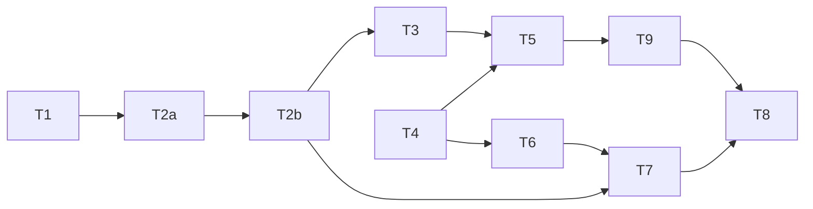

# Idle compaction: commit the cut while the human is away

status: in-progress
commit-mode: orchestrator-commits
language: ruby
panel: Ruby (Linus Torvalds, Jeremy Evans, Sandi Metz, Richard Schneeman, Aaron Patterson)

## Intent

When a chat sits idle long enough that the prompt cache has gone cold, lain computes and commits
the compaction cut then, so the human's next line renders through a held cut with no summarizer
round trip. Today the summarizer's `await` runs inside the render under the agent's dispatch lock
(`lib/lain/compaction/strategy/summarizing.rb:199`, reached from `Source#weigh`), so a returning
human waits for the model call before the first token. The owner's ask, 2026-10-17: "an idle
compaction that helps us get a compaction for free versus having to compact when we first come
back and end up waiting a minute or three."

`Compaction::Prepared` was built for this and never wired. It could never have applied: its hold is
keyed on the exact head digest, and `Agent#ask` commits the human prompt before any render
(`lib/lain/agent.rb:246`), so the key never matches on resume. The shipped derived chain already
has the right hold: a committed `compaction_cut` is a session record, and `HeldCut.holds?` keeps it
for any later head whose chain contains the cut's head (`lib/lain/compaction/source/held_cut.rb:81-84`),
replayed under the HOLDING policy with no summarizer call (`source/derived.rb:207`). So idle-prepare
is "commit the cut at idle", and this plan deletes `Prepared`, adds `Source#prepare`, drives it from a
conversation-lifetime REPL surface, and records the schedule as a bench arm.

Roadmap: M3c cache-aware compaction, CAC-5 (`ROADMAP.md:236-241`, item 62). Rulings 2026-10-17:
the default schedule is `idle`; a provider with no cache TTL must sit idle 2 minutes before a prepare
runs, as a constant; Compare carries 3 journal-derived metrics.

## Grounding

2026-10-17 at `8dc84539`. Files checked: `lib/lain/compaction/{source,cold,scheduler,prepared}.rb`,
`compaction/source/{held_cut,derived}.rb`, `compaction/strategy/summarizing.rb`, `lib/lain/agent.rb`,
`agent/{pipeline_source,instrumentation}.rb`, `lib/lain/cli/{repl,backend,compaction_profile,chat_launch,compaction_mount}.rb`,
`cli/repl/conversation_scope.rb`, `cli/resume/mismatch_notices.rb`, `cli/conductor.rb`, `lib/lain/run_clock.rb`,
`lib/lain/frontend/intake.rb`, `lib/lain/bench/{session,variance}.rb`, `bench/session/loader.rb`, `lib/lain/compare.rb`,
`lib/lain/telemetry/{compaction,compaction_cut,context_derived}.rb`, `lib/lain/session.rb`,
`lib/lain/session_record/replay.rb`, `exe/lain`, `ARCHITECTURE.md`, `planning/specs/cache-aware-compaction.md`,
and the specs each card names.

Where docs and code disagree, and which won:

1. CAC-5 says the held compaction is "keyed on the head digest" (`cache-aware-compaction.md:64-67`),
   and `Prepared` does that (`prepared.rb:50-56`). Production keys a cut on `cut.head` standing on the
   current chain (`held_cut.rb:81-84`) and memoizes summaries by the range's content address
   (`summarizing.rb:178`). Code wins; T8 amends the spec.
2. `ARCHITECTURE.md:433-438` presents `Prepared` as "the third policy" with no note that nothing
   calls it; `lib/lain/compaction.rb:15-19` says it has no caller, and a grep confirms it. Code wins;
   T1 removes the paragraph.
3. CAC-3 and the Scheduler read `cold?` as a fact at render. In code, an idle gap only raises
   `pending?`; `cold?` is confirmed by the NEXT response's zero cache read (`cold.rb:62-83`,
   pinned at `spec/lain/compaction/source_spec.rb:376-381`). An idle prepare has no next response,
   so it treats pending as cold ("presumed cold") and records which it was.

Runtime premises probed rather than read: a `Monitor` held by 1 fiber under Async (Spike
findings); readers' tolerance of an unknown record type (`replay.rb:126-133` has no `else`, and the
class comment at `:52-54` says foreign entries are skipped); `HeldCut.holds?` over a chain that
gained a prompt after the cut (`spec/lain/compaction/source/held_cut_spec.rb:62-101` pins chain
containment, not head equality).

## Compatibility

| Surface | Verdict | Evidence |
|---|---|---|
| `--compact-schedule` flag | free to add | internal CLI of an unpublished gem: `lain.gemspec` version 0.1.0, `CHANGELOG.md` holds only the 0.1.0 entry, no release tag, no file under `~/dev` outside this repo names `compact_strategy` |
| session header key `compact_schedule` | must keep reading headers without it | journals written before this plan lack it; `CompactionProfile.from_header` yields nil for a missing key (`compaction_profile.rb:31-33`); nil means "written before the field" and those runs scheduled on the turn |
| `compaction_cut` record | must keep | stored data folded on resume (`replay.rb:152-163`); unchanged, an idle cut is an ordinary advance |
| record types `compaction_prepared`, `compaction_applied` | free to add | no reader refuses an unknown type (`replay.rb:126-133`); the first name is pinned only by `spec/lain/compaction/prepared_spec.rb:87`, deleted in T1 |
| `Compaction::Prepared`, `Prepared::CompactionPrepared` | free to break | 0 lib callers (`compaction.rb:19`); every reference is listed in T1 |
| `Compaction::Source#initialize` and `#context_for` | free to change | 1 constructor at `backend.rb:747`; 1 caller at `agent.rb:714` |
| `Bench::Session::Recording` | must keep fixture bytes | an absent header key writes no key (`bench/session.rb:310-320`), pinned by `spec/lain/bench/variance_fixture_spec.rb` |
| `Agent#initialize` | unchanged | `prepare_idle` is a new method; the constructor's clash table is untouched |

No must-keep surface blocks a simplification, so there is no trade to report.

## Spike findings

| Question | Result | Evidence |
|---|---|---|
| Does a `Monitor` held by 1 fiber make another fiber's `synchronize` wait and `try_enter` return false, while the reactor keeps running? | Yes. Log: `[:prep_start, :ask_wants, [:try_enter, false], :prep_end, :ask_runs]` | A 10-line script over `async` 2.34 on Ruby 4.0.6, run 2026-10-17; no worktree was needed and none remains |

## Shared files

Only the main session edits these: `ROADMAP.md` (the index line, written with this plan);
`.rubocop.yml` (a `Metrics` raise is its own commit, and no card may add one);
`planning/qa/scenarios/session-and-window.md` (the owner holds uncommitted edits; T8 hands back its
lines and the main session applies them once `git status` shows the file clean).

## Rejected options

- Re-home `Prepared` over `Source` and `Derived`: needs a second hold beside `HeldCut`, keyed by
  chain containment, plus splice logic to keep the new prompt; about 200 lines across 4 objects for
  what a committed cut already does.
- Tick inside the conductor's idle `you>` barrier (`conductor.rb:424-463`): the barrier is rebuilt
  per prompt, the conductor holds no agent, and waking the agent from there means cancelling the read.
- A synchronous driver beside `GoalDriver#poll` in `Repl#next_text`: it runs only when control returns
  to the loop, and `read_line` blocks on the human, so it cannot fire while the human is away.
- A thread-based timer: `Source` is not thread safe (`source.rb:45-49`), and the REPL already runs
  conversation-lifetime fibers on its `Sync`.
- A flag for the idle floor: the cleanup round before this plan retired 7 env knobs; the floor is a
  constant and the schedule is the arm.
- Keeping CAC-5's head-digest key: see Grounding 1.
- Keeping `Cold#cold?` as the only cold reading for the idle path: without a following response it is
  never confirmed, so an idle prepare on a TTL provider would never run.

## Open decisions

- nvim `FocusLost` as a hint that lowers the gate: later. The REPL surface covers `lain up`, since
  the cockpit runs the same `Repl`.
- Resume-turn latency and cache-creation tokens on the resume turn as Compare metrics: the journal
  records no timestamps for them. Ruled out of this plan (Compare scope: minimal).
- Cancelling a prepare when a line arrives mid-flight: summaries are memoized by range, so a cancel
  would lose at most 1 in-flight range, and the returning human would wait for nothing. This plan
  lets the prepare finish (T3) and measures the wait it leaves; a later card may cancel on intake.
- Idle spend and `--max-cost`: a prepare's summarizer cost lands on the same `compaction` record as a
  turn-time one, and T3 declines past the agent's token budget; whether the request-budget
  middleware should also see idle spend is undecided, since a prepare is not an ask.

## Dependency graph



## Tasks

### T1: Delete Compaction::Prepared          [risk: low]

**Depends on:** none
**Files:** `lib/lain/compaction/prepared.rb` (delete), `spec/lain/compaction/prepared_spec.rb`
(delete), `lib/lain/compaction.rb` (the member list at :5-25 and the "older design" paragraph at
:15-19), `lib/lain/compaction/source/derived.rb` (the comment at :292), `spec/lain/context_spec.rb`
(the comment at :468), `ARCHITECTURE.md` (the paragraph at :433-438; the Journalable count and list at
:1920-1924)
**Reuse:** none
**Shared-file wiring:** none
**Reachable from:** a deletion; `spec/zeitwerk_spec.rb` and `bin/zeitwerk-census` prove the tree
still boots and resolves

**Acceptance criteria**

```gherkin
Scenario: nothing names the unit
  Given the tree at this card's commit
  When `grep -rn -F "Compaction::Prepared" lib spec ARCHITECTURE.md` runs
  Then it prints nothing

Scenario: the journalable sweep still passes
  Given spec/journalable_surface_spec.rb
  When it runs
  Then it passes with 1 fewer includer and no duplicate journal_type
```
Spec file: `spec/journalable_surface_spec.rb`, `spec/zeitwerk_spec.rb`

**Stop and report if:**
- a lib file other than `compaction.rb` and `source/derived.rb` references `Compaction::Prepared`
  (the grounding grep found none)
- `ARCHITECTURE.md:1920` states a count that does not match the sweep's includer count after the
  deletion (then correct the count, and say what it was)

### T2a: Add Source::IdleGate and the 2 idle records          [risk: low]

**Depends on:** T1
**Files:** `lib/lain/compaction/source/idle_gate.rb` (new), `spec/lain/compaction/source/idle_gate_spec.rb`
(new), `lib/lain/compaction/source/compaction_prepared.rb` (new),
`spec/lain/compaction/source/compaction_prepared_spec.rb` (new),
`lib/lain/compaction/source/compaction_applied.rb` (new),
`spec/lain/compaction/source/compaction_applied_spec.rb` (new)
**Reuse:** the record template `Compaction::Cold::CacheColdConfirmed` (`lib/lain/compaction/cold.rb:25-39`)
and `Telemetry::Journalable` (`lib/lain/telemetry.rb:25-39`); the readings `Cold#pending?` and
`Cold#cold?` (`cold.rb:52-55`); `Source::IdleGap#elapsed` (`source.rb:194-205`)
**Shared-file wiring:** none
**Reachable from:** `Compaction::Source#initialize` builds the gate and `Source#prepare` writes the
records (T2b)

**Acceptance criteria**

```gherkin
Scenario: idle time is the gate, the cache flags only label it
  Given a provider with a 300 second TTL whose cache is confirmed cold from an earlier response
  When the chat has been idle 10 seconds
  Then ready? is false and the reading is :warm
  When the chat has been idle 301 seconds
  Then ready? is true and the reading is :cold

Scenario: idle past a TTL with no confirming response is presumed cold
  Given a provider with a 300 second TTL, pending and not confirmed
  When the chat has been idle 301 seconds
  Then ready? is true and the reading is :presumed_cold

Scenario: a provider with no TTL waits for the floor, whatever its cold flag says
  Given a provider whose cache profile has no TTL and whose cold flag is true
  When the chat has been idle 119 seconds
  Then ready? is false and the reading is :warm
  When the chat has been idle 120 seconds
  Then ready? is true and the reading is :cold

Scenario: under the TTL nothing is ready
  Given a provider with a 300 second TTL
  When the chat has been idle 299 seconds
  Then ready? is false whatever the cold and pending flags say

Scenario: 1 head is evaluated once
  Given the gate latched a head
  When the same head is asked again
  Then ready? is false
  When a different head is asked
  Then ready? is true

Scenario: the records journal under their own names
  Given a CompactionPrepared and a CompactionApplied built from Strings
  When each is journaled
  Then the types are compaction_prepared and compaction_applied, both deeply frozen,
    and spec/journalable_surface_spec.rb builds both
```
Spec file: `spec/lain/compaction/source/idle_gate_spec.rb`, `spec/lain/compaction/source/compaction_prepared_spec.rb`,
`spec/lain/compaction/source/compaction_applied_spec.rb`, `spec/journalable_surface_spec.rb`

**Interface**

```ruby
module Lain
  module Compaction
    class Source
      # The pure half of idle-prepare: whether this tick may pay, and which head it already judged.
      # Idle time is the gate. The cache flags only label the reading, because Cold#cold? is a
      # latch that stays true from one zero read to the next positive one, which on a provider with
      # no TTL is every response.
      class IdleGate
        # Seconds a provider with no cache TTL must sit idle: a pause mid-thought must never pay a
        # summarizer call, a walk to the kettle should.
        FLOOR = 120

        def initialize(floor: FLOOR)
        # @param ttl [Integer, nil] the provider's cache TTL in seconds; nil or 0 means none
        # @return [Symbol] :warm until elapsed passes the TTL (or the floor when there is none),
        #   then :cold when confirmed and :presumed_cold otherwise
        def reading(elapsed:, ttl:, cold:, pending:)
        # @return [Boolean] false while this head is latched or the reading is warm
        def ready?(reading, head_digest)
        def latch(head_digest)
      end

      CompactionPrepared = Data.define(:head_digest, :cut_digest, :idle_seconds, :cache_state) do
        include Telemetry::Journalable
      end

      CompactionApplied = Data.define(:cut_digest, :head_digest) do
        include Telemetry::Journalable
      end
    end
  end
end
```

**Stop and report if:**
- `spec/journalable_surface_spec.rb` reports a duplicate `journal_type` for `compaction_prepared`
  (T1 did not land first)
- the records need a validating constructor to be correct: then they may land in the sweep's
  `unreached` list only with the reason in the card's report

### T2b: Source#prepare commits the cut at idle and announces the apply          [risk: high]

**Depends on:** T2a
**Files:** `lib/lain/compaction/source.rb`, `lib/lain/compaction/cold.rb` (a public `ttl` reader,
seconds or nil), `spec/lain/compaction/source_spec.rb`, `spec/lain/compaction/cold_spec.rb`
**Reuse:** the decide, weigh and commit sequence (`source.rb:629-814`), `HeldCut.on` and `#advance`
(`held_cut.rb:73-79`, `:248-253`), `Scheduler#evaluate`'s `cold:` argument (`scheduler.rb:149-155`),
`IdleGate` and the 2 records (T2a), `SourceSpecClock` (`source_spec.rb:11-19`)
**Shared-file wiring:** none
**Reachable from:** `Agent#prepare_idle` (T3) through `Instrumentation#pipeline_source`, built by
`CLI::Backend#compaction_source` (`backend.rb:747`) and mounted by `CLI::CompactionMount#source`

**Acceptance criteria**

```gherkin
Scenario: 2 idle ticks at 1 head pay once
  Given a Source over a counting summarizer, a head past the byte threshold, and an idle past the floor
  When prepare runs twice with no new turn
  Then the summarizer was asked once, 1 compaction_cut and 1 compaction_decision were journaled,
    and 1 compaction_prepared names that cut and the head

Scenario: a tick under the gate does nothing
  Given the chat idle 30 seconds on a provider with no TTL
  When prepare runs
  Then nothing is journaled and the summarizer was not asked

Scenario: a TTL provider's presumed cold is recorded as such
  Given a provider with a 300 second TTL idle 600 seconds and no response since
  When prepare runs
  Then the cut commits and compaction_prepared carries cache_state presumed_cold

Scenario: the next line renders through the idle cut for free
  Given a prepared cut at head H, and a last-turn usage still above the approaching-window threshold
  When the human prompt lands and context_for renders at H plus the prompt
  Then the strategy is not asked, the rendered chain is the held one,
    and exactly 1 compaction_applied names the cut, on this render and never again

Scenario: a turn between ticks recomputes only what is new
  Given a prepared cut and then 1 new turn
  When prepare runs again past the gate
  Then the summarizer is asked only for ranges it has not answered before

Scenario: a rewind off the prepared head drops the cut
  Given a prepared cut at H
  When the timeline is rewound to before H and context_for renders
  Then the cut does not hold and no compaction_applied is journaled

Scenario: the turn path's cold reading is unchanged
  Given the examples at source_spec.rb:374-454
  When they run
  Then they pass unchanged
```
Spec file: `spec/lain/compaction/source_spec.rb`, `spec/lain/compaction/cold_spec.rb`

**Interface**

```ruby
module Lain
  module Compaction
    class Source
      # The same arguments as #context_for, so the Agent passes what render_request passes.
      # Latches the head after any evaluation, so a head is judged once per idle.
      # @return [Boolean] whether a cut was committed
      def prepare(base:, timeline:, usage:, session:)
    end
  end
end
```

`prepare` begins as `context_for` does, with `observe_idle` (`source.rb:576`), so `Cold#pending?`
is raised for a TTL provider; it does not call `@reporting.rendering`, since nothing is rendered.
The 3 reads of `@cold.cold?` on the commit path (`source.rb:768`, `:805`, `:854`) take a `cold:`
value computed once at the top of `prepare` as `reading != :warm`; the turn path keeps passing
`@cold.cold?`. A presumed-cold commit journals `cache_state "cold"` on the `compaction` record as
any cold commit does; the distinction lives on `compaction_prepared`, paired by cut digest. The
decision's Diagnosis goes to the same sink `context_for` writes (`lain:compaction` diagnostics,
`compaction_mount.rb:83`), never the chat pane. After a commit, `prepare` latches the head, journals
`CompactionPrepared` after the cut's own records, and remembers the cut digest; the next
`context_for` whose held cut's newest address equals that digest journals `CompactionApplied`
once and forgets it. A restart before that render loses the announcement (T7 counts it as unapplied).

**Stop and report if:**
- `Source` trips `Metrics/ClassLength` (300): move the latch, the remembered cut and the record
  writes into `IdleGate` as its own responsibility rather than raising the cap
- `spec/lain/compaction/source_spec.rb:437-462` goes red (`planning/specs/chunk-qa-round14-escalation-and-isolation.md`
  cites it as an escalation trigger)
- `Scheduler#evaluate` would need a new reading for the turn path: only the idle path presumes cold
- the "renders for free" scenario goes red because the stale last-turn usage re-fires `Need` and
  `derivation_for` asks the summarizer before `shrinks?`: then a cut consumes the usage reading
  (`Source#<<` records the turn usage; the held cut's render passes none), and the card says so

### T3: Add Agent#prepare_idle under the dispatch lock          [risk: high]

**Depends on:** T2b
**Files:** `lib/lain/agent.rb`, `lib/lain/agent/pipeline_source.rb`, `spec/lain/agent_spec.rb`,
`spec/lain/agent/pipeline_source_spec.rb`
**Reuse:** `@dispatch_lock`, a `Monitor` (`agent.rb:526`, comment at :276-281); `render_request`'s
argument set (`agent.rb:714-717`); `QUIESCENT` (`agent.rb:32`); the `try_enter` idiom in
`CLI::ResendBridge#offer` (`lib/lain/cli/resend_bridge.rb:67-75`)
**Shared-file wiring:** none
**Reachable from:** `Repl::IdleCompaction#tick` (T5), built by `CLI::Wiring#repl_over` and handed to
`Repl.new`

**Acceptance criteria**

```gherkin
Scenario: a busy agent declines
  Given another fiber holds the dispatch lock
  When prepare_idle is called
  Then it returns false at once and the pipeline source is not called

Scenario: a line typed mid-prepare waits for the rest of it
  Given a prepare in flight on 1 fiber
  When ask is called on another fiber
  Then ask runs after the prepare returns, with the prepared cut on the session

Scenario: the agent reports itself dispatching during a prepare
  When prepare_idle is in flight
  Then dispatching? is true

Scenario: an agent that is not quiescent declines
  Given an agent whose state is outside QUIESCENT (mid-run, or awaiting the model after a torn turn)
  When prepare_idle is called
  Then it returns false and the pipeline source is not called

Scenario: a prepare is a dispatch to everything that asks
  Given a prepare in flight
  When /rewind, /undo or /mode asks InFlight.dispatching?
  Then the answer is true and the command refuses as it would mid-run

Scenario: a prepare never runs past the budget
  Given an agent whose token budget is spent
  When prepare_idle is called
  Then it returns false and the pipeline source is not called

Scenario: the source is handed what a render is handed
  Given a quiescent agent with a recording pipeline source
  When prepare_idle is called
  Then the source's prepare received base, timeline, usage and session equal to render_request's

Scenario: the null source never prepares
  Given PipelineSource::Null
  When prepare is called
  Then it returns false
```
Spec file: `spec/lain/agent_spec.rb`, `spec/lain/agent/pipeline_source_spec.rb`

**Interface**

```ruby
module Lain
  class Agent
    # @return [Boolean] whether a cut was committed; false when busy, not quiescent or declined
    def prepare_idle
  end

  class Agent
    module PipelineSource
      module Null
        module_function

        def prepare(**) = NO_ROOM # the shape of droppable?, handoff and handed_off? at pipeline_source.rb:42-48
      end
    end
  end
end
```

A prepare is a dispatch: `dispatching?` is true for its duration, so `/rewind`, `/undo` and `/mode`
(`InFlight.dispatching?`, `command/rewind.rb:85`) refuse while the Store is being written, and the
prompt composer hides its idle readout (`prompt_composer.rb:437`) as it does for a run. Both are
the right answers for a derivation in flight, and the card does not soften them.

**Stop and report if:**
- `Agent#initialize`'s wiring (the clash table at `agent.rb:60-76`) would have to change
- `Agent::Budget` (`lib/lain/agent/budget.rb`) has no non-raising predicate for "spent": then the
  card wraps `check_tokens!` in a rescue of the budget's own error class and says so
- `spec/lain/agent_spec.rb:1053` (`#dispatching?`) or `:1515` (`#rewind`'s `try_enter` race) changes meaning

### T4: Add the --compact-schedule arm: flag, profile, default, header, notice          [risk: medium]

**Depends on:** none
**Files:** `exe/lain`, `lib/lain/cli/compaction_profile.rb`, `lib/lain/cli/backend.rb`,
`lib/lain/cli/chat_launch.rb`, `spec/lain/cli/compaction_profile_spec.rb`, `spec/lain/cli/backend_spec.rb`,
`spec/lain/cli/chat_flags_spec.rb`, `spec/lain/cli_spec.rb`, `spec/lain/cli/resume_spec.rb`,
`spec/lain/cli/chat_launch_spec.rb`, `spec/lain/session_record_spec.rb`
**Reuse:** `FLAGS`, `typed`, `from_header`, `over`, `to_header` (`compaction_profile.rb:15-53`);
`MismatchNotices#compaction_notices` iterates `FLAGS` (`mismatch_notices.rb:74-80`);
`refuse_strategy_spelling!` (`backend.rb:654`) and `refuse_compaction_flags!` (`backend.rb:576-581`)
**Shared-file wiring:** none
**Reachable from:** `ChatLaunch#compaction` (`chat_launch.rb:238`) builds the profile and `Backend.new`
receives it; `Backend#compaction_schedule` is read by `CLI::Wiring#repl_over` when it builds the
Repl's idle surface (T5)

**Acceptance criteria**

```gherkin
Scenario: the flag is typed
  When lain chat --compact-schedule turn starts
  Then the profile's schedule is "turn" and the header carries compact_schedule "turn"

Scenario: an unknown name is refused before the journal opens
  When lain chat --compact-schedule nightly starts
  Then launch refuses, the message names idle and turn, and no session file exists

Scenario: no flag means the default, which this card lands as turn
  When lain chat starts with no schedule flag and no recording
  Then the schedule that runs is DEFAULT_SCHEDULE and the header carries it

Scenario: a resume inherits, and a typed flag wins with a notice
  Given a recording whose header carries compact_schedule "turn"
  When lain chat --resume starts with no schedule flag
  Then the schedule is "turn"
  When it starts with --compact-schedule idle
  Then the schedule is "idle" and the notice says recorded with --compact-schedule turn

Scenario: a recording older than the field ran on the turn, and resumes so
  Given a header with no compact_schedule key
  When it is resumed with no flag
  Then the schedule is "turn" and no mismatch notice is shown
  When it is resumed with --compact-schedule idle
  Then the schedule is "idle" and the notice says recorded with --compact-schedule turn

Scenario: no compaction, no schedule
  When lain chat --no-compact starts, with or without --compact-schedule
  Then the header carries no compact_schedule key and compaction_schedule answers "turn"
  And refuse_compaction_flags! still refuses the strategy and keep flags it refused before
```
Spec file: `spec/lain/cli/compaction_profile_spec.rb`, `spec/lain/cli/backend_spec.rb`,
`spec/lain/cli/chat_flags_spec.rb`, `spec/lain/cli_spec.rb`, `spec/lain/cli/resume_spec.rb`,
`spec/lain/cli/chat_launch_spec.rb`, `spec/lain/session_record_spec.rb`

**Interface**

```ruby
module Lain
  module CLI
    CompactionProfile = Data.define(:strategy, :keep, :bytes, :cap, :fallback, :schedule)

    class CompactionProfile
      SCHEDULES = %w[idle turn].freeze
      DEFAULT_SCHEDULE = "turn" # T9 flips it to "idle" once the tick exists
      # A recorded header that lacks the key predates the field, and that run scheduled on the turn.
      # @return [CompactionProfile] schedule "turn" for a non-empty header without the key, nil for no header
      def self.from_header(record)
      # @return [String] the schedule that runs: typed, else recorded, else DEFAULT_SCHEDULE
      def schedule_or_default
    end

    class Backend
      # @return [String] "turn" under --no-compact, else the profile's schedule_or_default
      def compaction_schedule
    end
  end
end
```

The header records the schedule that runs whenever compaction is on, not only when typed. That is
the only departure from "the header records only typed flags" (`session-and-window.md` §7a), made so a
journal without the key is unambiguous: it dates from before this plan and scheduled on the turn.
`Backend#compaction_header`'s comment ("only a set field is written") changes with it. T8 updates the
scenario text. The default lands as `turn` here so no journal written between this card and T5
claims an idle schedule that never ran; T9 flips it.

**Stop and report if:**
- `spec/lain/cli/chat_flags_spec.rb:12` and `:84` (the Prism scan of option reads) needs anything
  other than a literal `options[:compact_schedule]` read in `typed`
- `Backend` trips `Metrics/ClassLength`: it sits at the cap (`source.rb:129-136` says so); the
  resolution belongs on `CompactionProfile`, not a raise
- `spec/lain/cli/compaction_profile_spec.rb:16-18` (`be_deeply_frozen` on `typed`) fails: the new
  String field must go through the `dup.freeze` in `initialize` (`:50-52`) and `UNSET` (`:54`)

### T5: Add Repl::IdleCompaction, the conversation-lifetime tick          [risk: medium]

**Depends on:** T3, T4
**Files:** `lib/lain/cli/repl/idle_compaction.rb` (new), `spec/lain/cli/repl/idle_compaction_spec.rb`
(new), `lib/lain/cli/repl/conversation_scope.rb`, `lib/lain/cli/repl.rb`, `lib/lain/cli/wiring.rb`,
`spec/lain/cli/repl/conversation_scope_spec.rb`, `spec/lain/cli/repl_spec.rb`, `spec/lain/cli/wiring_spec.rb`,
`spec/lain/seams/idle_compaction_spec.rb` (new)
**Reuse:** the surface idiom `task.async { loop { ... } }` (`lib/lain/cli/human_replies.rb:610`);
`ConversationScope#open` and `#close` (`conversation_scope.rb:57-75`), whose rule is that every exit
stops every surface (`:22-24`); `Agent#prepare_idle` (T3); `Repl#name_lifetimes` (`repl.rb:118-121`),
where `@agent` is in reach
**Shared-file wiring:** none
**Reachable from:** `CLI::Wiring#repl_over` (`wiring.rb:985`) builds the surface from
`backend.compaction_schedule` and the agent, `Repl.new(idle:)` hands it to
`ConversationScope.new(idle:)`, and `#open` spawns it; `lain up` runs the same `Repl`

**Acceptance criteria**

```gherkin
Scenario: the idle schedule spawns the tick
  Given a Repl wired with schedule "idle"
  When the conversation scope opens
  Then its surfaces include an IdleCompaction task

Scenario: the turn schedule spawns nothing
  Given a Repl wired with schedule "turn"
  When the conversation scope opens
  Then no IdleCompaction task runs and the agent's prepare_idle is never called

Scenario: the tick asks and the agent decides
  Given a surface with an injected sleeper that returns at once
  When the loop runs 3 ticks
  Then prepare_idle was called 3 times and the sleeper was asked for TICK seconds each time

Scenario: a raise inside a tick reaches the sink and the tick survives
  Given a prepare_idle that raises once
  When the tick fires
  Then the fault is written to the operator sink, nothing reaches the chat pane,
    and the next tick still calls prepare_idle

Scenario: a tick while the agent is dispatching does nothing
  Given a prepare_idle that returns false because the lock is held
  When a tick fires
  Then nothing else is called and the next tick still fires

Scenario: closing the scope stops the tick
  When the scope closes
  Then the task is stopped and no tick fires after close

Scenario: end to end, the returning human waits for no summarizer
  Given a real Agent over Provider::Mock, a Source with a hand clock and a counting summarizer,
    a session past the byte threshold, and a Journal into a StringIO
  When the clock passes the floor and 1 tick fires, then the human asks a line
  Then compaction_prepared landed before the ask, the ask's render asked the summarizer 0 times,
    and compaction_applied landed on that render
```
Spec file: `spec/lain/cli/repl/idle_compaction_spec.rb`, `spec/lain/cli/repl/conversation_scope_spec.rb`,
`spec/lain/cli/repl_spec.rb`, `spec/lain/cli/wiring_spec.rb`, `spec/lain/seams/idle_compaction_spec.rb`

**Interface**

```ruby
module Lain
  module CLI
    class Repl
      # Asks the agent on a cadence; the gate inside Source decides whether a tick pays.
      class IdleCompaction
        TICK = 5 # seconds between looks
        SLEEP = ->(seconds) { Async::Task.current.sleep(seconds) }

        # @return [IdleCompaction, IdleCompaction::Never] Never for the turn schedule
        def self.for(schedule, agent:, sink:, sleeper: SLEEP)
        # One look: asks the agent, writes a raised fault to the sink, never raises.
        def tick
        # @return [Async::Task] loops sleeper then tick until stopped; a surface answering #stop
        def spawn(task)

        # A surface is anything the scope can #stop; Never spawns no task and answers it itself.
        module Never
          def self.spawn(_task) = self
          def self.stop = nil
        end
      end
    end
  end
end
```

`Repl#initialize` and `ConversationScope#initialize` each gain an `idle:` keyword, defaulting to
`IdleCompaction::Never`, so every other constructor site stays as it is.

**Stop and report if:**
- `ConversationScope`'s "every exit stops every surface" rule cannot hold for a sleeping task
  (`Async::Task#stop` interrupts `task.sleep`; if it does not here, report before working around it)
- the surface needs the `RunClock`: it must not, `Source`'s own `IdleGap` is the clock
- the fault sink is not in reach of `repl_over`: the operator sink the Repl already writes
  refusals to is the one to use, and the card names it

### T6: Record the schedule as a bench axis          [risk: medium]

**Depends on:** T4
**Files:** `lib/lain/bench/session.rb`, `lib/lain/bench/session/loader.rb`, `lib/lain/bench/variance.rb`,
`spec/lain/bench/session_spec.rb`, `spec/lain/bench/session/loader_spec.rb`, `spec/lain/bench/variance_spec.rb`
**Reuse:** `Recording` and its freeze (`bench/session.rb:213-229`); `optional_fields` writes no key for
an absent value (`:316-320`); `Variance#guard_compaction!` (`variance.rb:153-159`); the loader's
header read at `loader.rb:80`
**Shared-file wiring:** none
**Reachable from:** `Bench::Variance#initialize` (`variance.rb:53-54`) from `lain bench variance`;
`Bench::Session::Loader#recording` from every bench command that loads a session

**Acceptance criteria**

```gherkin
Scenario: an older header reads as the turn schedule
  Given a session header with no compact_schedule key
  When the loader builds the Recording
  Then its schedule is nil and Variance treats it as "turn"

Scenario: mixed schedules refuse to pool
  Given recordings scheduled idle and turn
  When Variance is built
  Then it raises "cannot compare runs under different compaction schedules: idle vs turn"

Scenario: equal schedules pool
  Given 2 recordings scheduled idle
  When Variance is built
  Then it builds

Scenario: fixture bytes are unchanged
  Given spec/lain/bench/variance_fixture_spec.rb
  When Bench::Session.write runs with no schedule
  Then it writes no compact_schedule key and the fixtures regenerate byte-identical
```
Spec file: `spec/lain/bench/session_spec.rb`, `spec/lain/bench/session/loader_spec.rb`,
`spec/lain/bench/variance_spec.rb`, `spec/lain/bench/variance_fixture_spec.rb`

**Interface**

```ruby
module Lain
  module Bench
    class Session
      Recording = Data.define(..., :compaction, :schedule) # schedule nil for a header older than the field
    end
  end
end
```

**Stop and report if:**
- `Recording.new` has callers beyond `loader.rb` and the specs (grep at card time)
- the fixture regeneration spec changes any byte

### T7: Compare carries 3 compaction metrics per arm          [risk: medium]

**Depends on:** T2b, T6
**Files:** `lib/lain/compare.rb`, `lib/lain/compare/compaction_tally.rb` (new),
`spec/lain/compare/compaction_tally_spec.rb` (new), `spec/lain/compare_spec.rb`, `lib/lain/bench/variance.rb`,
`spec/lain/bench/variance_spec.rb`, `lib/lain/bench/session.rb` (`Recording` gains `compaction_tally`),
`lib/lain/bench/session/loader.rb` (builds it from the records it already holds),
`spec/lain/bench/session_spec.rb`, `spec/lain/bench/session/loader_spec.rb`
**Reuse:** the `METRICS` idiom (`compare.rb:138-146`) and `withheld` (`:228`); commit `0128dbd9`
(cache-write column) as the shape; `Journal.records(entries, type:)` (`lib/lain/journal.rb:149-152`);
`Telemetry::Compaction#priced?` and `#cost_delta` (`telemetry/compaction.rb:149-153`);
`Source::CompactionDecision#summary_misses` (`source.rb:108-113`)
**Shared-file wiring:** none
**Reachable from:** `Bench::Session::Loader#recording` builds the tally from the records it holds,
`Bench::Variance#build_compare` (`variance.rb:118-127`) passes it to `Compare::Run.from_timeline`,
from `lain bench variance`. `Arm::Run#to_compare` (`lib/lain/arm.rb:64`) keeps calling
`from_timeline` without a tally and gets `CompactionTally::NONE`, so `spec/lain/arm_spec.rb`,
`spec/lain/arm/single_thread_spec.rb` and `spec/lain/seams/accounting_seam_spec.rb` stay green.

**Acceptance criteria**

```gherkin
Scenario: a run with no compaction records tallies zeros
  Given a journal with no compaction, compaction_decision, compaction_prepared or compaction_applied
  When the tally is built
  Then summary_misses, prepared and applied are 0 and cost_delta is 0

Scenario: the tally counts from the journal
  Given 2 compaction_decision records with summary_misses 3 and 1, 2 compaction_prepared and 1 compaction_applied
  When the tally is built
  Then summary_misses is 4 and unapplied is 1

Scenario: a run with no tally compares as before
  Given Arm::Run#to_compare, which passes no tally
  When Compare renders
  Then the 3 new columns show 0, 0 and a withheld cost for that run

Scenario: the cost column is withheld for an unpriced run
  Given 1 run with a compaction record whose costs are nil
  When Compare renders
  Then compaction_cost_delta is withheld and the other 2 columns show

Scenario: the metric order is pinned
  When Compare::METRICS.keys is read
  Then it ends with summary_misses, prepared_unapplied, compaction_cost_delta
```
Spec file: `spec/lain/compare/compaction_tally_spec.rb`, `spec/lain/compare_spec.rb`,
`spec/lain/bench/variance_spec.rb`

**Interface**

```ruby
module Lain
  class Compare
    # summary_misses is the sum of compaction_decision.summary_misses: every range the strategy was
    # asked for, a size-declined or failed ask included, which is why the column is named for the
    # record and not for "calls".
    CompactionTally = Data.define(:summary_misses, :prepared, :applied, :cost_delta) do
      NONE = new(summary_misses: 0, prepared: 0, applied: 0, cost_delta: nil) # a run with no journal
      # @param records [Enumerable<Hash>] 1 run's journal records
      def self.from_records(records)
      # Over-counts by 1 when a restart precedes the first render through a prepared cut (T2b).
      def unapplied = prepared - applied
    end

    class Run
      # compaction defaults to NONE so Arm::Run#to_compare, which has no journal, keeps working
      def self.from_timeline(name:, timeline:, ledger:, grade: nil, compaction: CompactionTally::NONE)
    end
  end
end
```

METRICS rows, appended after `cache_write_tokens`: summary_misses, prepared_unapplied and
compaction_cost_delta, the last withheld when any run's tally has a nil cost delta.

**Stop and report if:**
- `Run.from_timeline` gains a caller beyond `arm.rb:64` and `variance.rb:123` (grep at card time)
- `spec/lain/compare_spec.rb:115` or `:369` (shareability) fails: the tally must be deeply frozen
- `Loader` no longer holds the records when `Recording` is built (`loader.rb` at card time)

### T9: Flip the default schedule to idle          [risk: low]

**Depends on:** T5
**Files:** `lib/lain/cli/compaction_profile.rb`, `spec/lain/cli/compaction_profile_spec.rb`,
`spec/lain/cli_spec.rb`, `spec/lain/cli/backend_spec.rb`, `spec/lain/cli/chat_launch_spec.rb`
**Reuse:** `DEFAULT_SCHEDULE` (T4)
**Shared-file wiring:** none
**Reachable from:** `CompactionProfile#schedule_or_default` on every fresh `lain chat`

**Acceptance criteria**

```gherkin
Scenario: a fresh chat prepares while the human is away
  When lain chat starts with no schedule flag and no recording
  Then the schedule that runs is "idle" and the header carries compact_schedule "idle"

Scenario: a recording still resumes under what it recorded
  Given a header carrying compact_schedule "turn", or none
  When it is resumed with no flag
  Then the schedule is "turn"
```
Spec file: `spec/lain/cli/compaction_profile_spec.rb`, `spec/lain/cli_spec.rb`, `spec/lain/cli/backend_spec.rb`,
`spec/lain/cli/chat_launch_spec.rb`

**Stop and report if:**
- T5's seam spec (`spec/lain/seams/idle_compaction_spec.rb`) is not green at this card's base

### T8: Amend the spec, the architecture doc and the QA scenario          [risk: low]

**Depends on:** T9, T7
**Files:** `planning/specs/cache-aware-compaction.md` (CAC-5: chain containment, presumed cold, the 2
records, the schedule arm), `ARCHITECTURE.md` (the compaction section and the Journalable list, +2),
`docs/commands.md` (the chat flags, if it lists `--compact-strategy`; grep at card time)
**Reuse:** this plan's Intent and Grounding
**Shared-file wiring:** `planning/qa/scenarios/session-and-window.md`: §7 gains the bad schedule
name refusal; §7a gains `compact_schedule` recorded whenever compaction is on and the variance
refusal text for mixed schedules; a new section drives the idle tick (leave the chat 2 minutes on
ollama, type, find `compaction_prepared` then `compaction_applied`, see no summarizer wait) and the
line typed mid-prepare (the reply waits only for the rest of the prepare); diffs for the main
session, applied once the owner's uncommitted edits are committed
**Reachable from:** prose

**Acceptance criteria**

```gherkin
Scenario: the spec matches the code
  When cache-aware-compaction.md CAC-5 is read beside Source#prepare
  Then the key, the cold reading and the record names agree

Scenario: the census is quiet
  When bin/comment-census --check-tickets runs
  Then its output is unchanged from the Grounding SHA
```
Spec file: none, prose

**Stop and report if:**
- `git status` still shows `planning/qa/scenarios/session-and-window.md` modified: wait, do not edit it

## Integration checks

- `bundle exec rake pspec` green at the last card; the example count moves by the new examples
  minus `prepared_spec.rb`'s, and the orchestrator records both numbers in the Execution log.
- `bundle exec rubocop` clean; `bin/comment-census --check-tickets` and `--check-load-order` unchanged;
  `bin/zeitwerk-census` reports 0 on every tier.
- Manual, owner: `lain chat --provider ollama` with a model-backed `--compact-strategy`, talk past the
  byte threshold, leave it 2 minutes, type a line. The session file holds `compaction_prepared` and
  then `compaction_applied`, and the reply starts without the summarizer's wait. Then
  `lain bench variance` over that recording and a `--compact-schedule turn` recording refuses to pool.

## Execution log

(Written by /execute-plan.)

- 2026-10-17 run start. Base `main` at `3b2da419`. Grounding re-checked: only this plan and
  `ROADMAP.md` changed since `8dc84539`. Worktrees at start: main, `tmp/worktrees/T24` and `T27`
  (bash confinement, not this plan), `hn-2026-10-16`, the QA tree. Card branches here are named
  `card/ic-T<id>` to stay clear of them.
- Hook: pre-commit runs `bundle exec rake compile check` (rubocop on the whole repo plus
  `rake pspec`, about 60s), `yard-lint --staged`, `bin/lint-gherkin-docs` on staged plan docs,
  whitespace and EOF fixers, and `bin/lint-commit-msg` at commit-msg. Agent-side checks:
  `bundle exec rubocop <paths>`, `bundle exec yard-lint <paths>`, specs by path. The suite cannot
  run beside other tests (shared `TMPDIR`). No paths need user approval.
