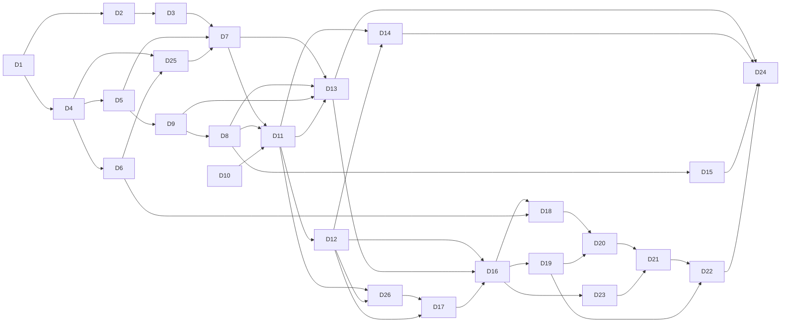

# lain-daemon: 1 per-user Rust daemon for sessions, the phone, headless runs and fast spawning

status: in-progress
base: 7eea39c5e92903ae975887cb5ce268c75926fd2f
commit-mode: orchestrator-commits
language: rust, ruby
panel: Rust (Linus Torvalds, Raph Levien, Andrew Gallant, Frank McSherry, Ashley Williams); Ruby (Jeremy Evans, Sandi Metz, Richard Schneeman, Aaron Patterson)

## Intent

Carry out `planning/lain-daemon-research-2026-11.md`, option 1, all 3 phases, with the user's rulings of 2026-11-16.

1. **Phase 1: routing (D1 to D15, D25).**
   - A per-user `lain-daemon` holds the registry of live chats.
   - It routes review-queue offers and every session's approvals.
   - It runs the phone relay as a confined worker and sends ntfy itself, so you have 1 phone address and 1 buzz per item.
   - The `lain-core` binary retires. Its RPC framework becomes the `lain-rpc` library.
2. **Phase 2: headless runs (D16 to D20, D26).**
   - The daemon starts and supervises headless sessions (an epic, the review poll, a chore drain) from a closed set of run kinds.
   - A run parks its gated calls and questions and routes them to you, instead of refusing them.
   - This works only where the run's bash is sandboxed (user ruling, 2026-11-16).
3. **Phase 3: fast spawning (D21 to D23).** A warmed Ruby parent forks headless sessions, and restarts itself when lain's own install changes. D23 measures exec first, so the fork work starts from a known cost.

**Prerequisite:** `planning/specs/review-queue-hud.md` is `done`. This plan takes over 4 of its pieces, and deletes each once its replacement passes:

- T31's live records (D7);
- T24's input-socket offer and T25's socket delivery (D13);
- the dotfiles poll timer (D19).

The ROADMAP line is under `## Status` as "lain-daemon".

## Grounding

2026-11-16, `main` at `6fd74370`. This plan is written before `review-queue-hud.md` runs; re-read every file that plan touched before starting. Read:

- `CLAUDE.md` and `ARCHITECTURE.md`'s lain-core section;
- the research report, its sources and its spike;
- a code survey of `crates/lain-core`, the relay's Ruby side, `ChatLaunch`, and the headless refusal sites.

A panel (REQUEST-CHANGES, folded in) traced a headless epic's approval from `lain daemon run` to the phone and back.

**Probed or measured:**

- **Forking after `require "lain"`.**
  - Fork-safe: 1 thread, 6 fds, no reactor.
  - A fork takes about 3 ms, where a `require "lain"` takes 0.8 to 1.5 s.
  - With `Process.warmup`, a child keeps 77% of its pages shared after 25 s of a synthetic workload (Journal parsing, `Canonical.dump`, masking). It dirties 30 to 40 MB, nearly all in its first second, with 0 major GCs and +444 old objects.
  - Not measured: `exe/lain`'s Thor parse, config load and registration on top of the fork. D23 measures that.
  - Evidence: `planning/lain-daemon-research-2026-11/zygote.rb` and `gcchild.rb`.
- **macOS check.** `lain-core` and `lain-fence` type-check for `aarch64-apple-darwin` once their Linux-only code is gated (`review-queue-hud.md` T1).

**Read, with paths.** All Rust paths are under `crates/lain-core/` unless named.

- **`src/rpc.rs`** (1,966 lines, tests from 1,061) has no `crate::` dependency. Its parts:
  - `Codec` (`:61`) and the limits (`:81-94, 262-437`);
  - `trait Accept` (`:299`), `trait Session` (`:319`, only `closed()`) and `trait Handler` (`:333-360`), whose `hello` is `async fn hello(&self, params: Vec<Value>) -> Result<(Value, Self::Session), RpcError>`, with `type Session: Session + Default`;
  - `serve` (`:387`).

  Everything is `pub(crate)`. The test support module (`:825`) is `#[cfg(test)]`.
- **`RpcError`** (`:787`) mixes protocol variants with relay ones: `BadToken`, `WireVersion`, `AlreadySettled`, `NotOpen` and `TooLarge`.
- **Pushes.** A `[2, ...]` frame is answered as an invalid request (`:20-23, 679-687`), and `respond_to` (`:651`) sends exactly 1 response per frame. Ruby's `Core::Client#deliver` (`lib/lain/core/client.rb:216-222`) silently drops a frame that is not a response.
- **Ruby client.** `Core::Client` needs an Async reactor (`client.rb:72`). A chat's reactor starts at `Sync do` in `Repl#run` (`cli/repl.rb:122`), inside `ConversationScope#open`'s lifetime. `Wiring#remote_surface` is built before it (`wiring.rb:976-984`).
- **`ping`** returns the holding crate's `CARGO_PKG_VERSION` (`:776`), and Ruby pins `PROTOCOL_VERSION = "0.1.0"` exactly (`client.rb:18`).
- **Lints** are crate attributes in `src/main.rs:13-14`: `#![forbid(unsafe_code)]` and `#![deny(clippy::print_stdout, clippy::print_stderr)]`. `crates/lain-wire/src/lib.rs:6` also has `#![deny(missing_docs)]`. Under `forbid(unsafe_code)`, a child's extra fd needs an `unsafe` `pre_exec`, so sockets go to children as their stdin.
- **The relay** (`src/relay.rs`, `relay/agenda.rs`, `relay/devices.rs`):
  - it binds a Unix side (`agenda.publish`, `answers.next`) and a Tailnet side (`hello`, `agenda.next`, `answer.send`);
  - `listen_rule` (`:69`) accepts loopback or `tailscale0`;
  - devices are reread every 1 s (`devices.rs:154, 217-218`);
  - Landlock confinement (`:214-243`).
- **`lain-core` references** (`rg lain-core`):
  - `Up::Relay::BINARY` (`cli/up.rb:1130`);
  - `spec/support/core_daemon.rb` and `RemoteSurfaceSpecSupport::Relay` (`spec/lain/approval/remote_surface_spec.rb`);
  - `Rakefile:90-95`;
  - `tests/lifecycle.rs`;
  - `.pre-commit-config.yaml:79, 122`;
  - `.github/workflows/main.yml:198`;
  - `apps/lain-remote/src/client.rs:249-313` (its tests spawn the relay);
  - `lib/lain/core/transport/unix.rb:8, 16`;
  - `bin/setup:19`, `bin/spec-census:602`, `deny.toml:45, 59`;
  - `CLAUDE.md`'s `:core` lines, `docs/rust-bindings.md`, `docs/concurrency.md`, `docs/GLOSSARY.md`.
- **`RemoteSurface`** (`lib/lain/approval/remote_surface.rb`):
  - it is per chat, built with `config.remote_relay` and a queue (`:80`);
  - it publishes deltas every 0.25 s from `Remote::Agenda#refresh` (`remote/agenda.rb:89-95`), which polls 3 sources, including `Gates#each` (`:262-271`), which rereads every journal in the project;
  - it rescues `Refused` from a publish (`:213-219`);
  - it treats `Core::Died` as the end (`:34, 104-105`);
  - it filters answers by a random prefix (`:156`), and sends ntfy after 60 s.

  Gate items are project-wide, so 2 chats in 1 root publish the same gate twice.
- **Config.** `remote relay:` and `remote ntfy:` are project-file verbs (`config/builder.rb:148, 201-207`).
- **Headless.** `Wiring#attended?` (`wiring.rb:176-180`) is the 1 reading of `--non-interactive`, threaded to 14 readers. An unattended session gets:
  - no `Parked::Queue` (`cli/switchboard.rb:265-272`);
  - a 1-rung `Unattended` ladder (`:560, 918`);
  - `Judged::Unattended` (`approval/judged.rb:130`);
  - `Parked::Queue::Unattended` (`approval/parked/queue.rb:539`);
  - `Tools::AskHuman::Unattended` (`cli/wiring/askers.rb:83`).

  `ApprovalSurfaces#watch` always starts the terminal surface when there is a queue (`cli/repl/approval_surfaces.rb:77-80`). The refusals are pinned in `spec/lain/cli/switchboard_spec.rb` (206, 286-298, 327, 951-987, 1025), `spec/lain/tools/ask_human/unattended_spec.rb`, `spec/lain/approval/parked/queue_spec.rb:1950` and `spec/lain/approval/judged_spec.rb:1183-1202`.
- **Sandbox.** `Confine::Profile::UNCONFINED = %i[none traced]` and `Profile.confines?` (`confine/profile.rb:39, 213`); `Sandbox#confines?` (`sandbox.rb:55`). Confined profiles grant no daemon or state socket (`profile.rb:162, 466`).
- **Chat lifecycle.** `ChatLaunch#call` (`cli/chat_launch.rb:104-118`) runs `close_session` (`:340`) in `ensure`. A pre-flight run opens no record. The session id is the journal's file name (`journal.rb:160`).
- **The existing fork.** `ChatPreflightFork` (`exe/lain:1706-1800`):
  - `setpgid`;
  - reopen stdio (`:1783-1786`);
  - `Dir.chdir`, `ENV.update`, `Config.forget!`;
  - `LainCLI.start`;
  - `exit!`.
- **Headless chats today.** `Chores::Runner` runs `RbConfig.ruby exe/lain chat --root R --cwd R --non-interactive --approval auto --max-cost N --prompt P` (`chores/runner.rb:162`).
- **The `:core` tier** is excluded by default (`spec/support/tags.rb:218`), and neither CI nor pre-commit runs it.

**Where docs and code disagreed:**

- `lib/lain/core.rb` says the daemon "has no production door today", but the relay is one. **Code wins.** D14 removes the claim.
- The 2026-10-17 ruling kept "the lain-core wire layer". The 2026-11-16 ruling retires the binary and keeps the layer as `lain-rpc`, `lain-wire` and `Core::Client`. **The newer ruling wins.**

**Paths.** A path marked `(new)` is created by the first card that names it. Everything under `crates/lain-daemon/`, `crates/lain-rpc/` and `lib/lain/daemon/` is new in this plan. `lib/lain/live_sessions*`, `lib/lain/review/queue/*` and `lib/lain/cli/exe/*` come from `review-queue-hud.md`.

## Compatibility

| Surface | Verdict | Evidence |
|---|---|---|
| `lain-core` binary, `rake core:build` | free to break (ruling 2026-11-16) | Unpublished. Every reference is listed in Grounding, all in this repo. |
| msgpack-RPC framing | free to extend | Adds server-to-client pushes `[2, method, params]` (D2). Requests and responses are unchanged, and `agenda.publish` stays a request so a refusal still reaches the caller. |
| `PROTOCOL_VERSION` handshake | must keep the exact pin | The daemon answers `ping` with `0.1.0`. A separate `daemon.info` method returns the build id and launch digest (D4, D6). |
| `lain-wire` `WIRE_VERSION` | free to break, goes to 2 (D8) | Its users are the relay (moving), `apps/lain-remote` (D8, D15) and Ruby's `Remote::Wire` mirror. An old app gets `WireVersion`. |
| `remote relay:` and `remote ntfy:` | free to move to the user file (D10) | 1 phone listener per machine. A project file that still sets them is refused, naming the user file. |
| Devices file `state_home/remote/devices` | must keep | Paired phones. Same path and format. |
| `--non-interactive` refusals | must keep without `--human remote` | Every pinned refusal stays (D26, D17). |
| `review-queue-hud.md` pieces | replaced as planned | T31's `live/` files (D7), T24's input-socket offer and T25's socket delivery (D13), and the dotfiles poll timer (D19). Each is deleted after parity, per the 2026-11-10 ruling. |
| herdr CLI 0.9.5 | must keep | External. D20 adds workspace tokens with source `lain-daemon`. |

No must-keep surface, if broken, would remove a card or about 20% of the plan.

## Spike findings

| Question | Result | Evidence |
|---|---|---|
| Is a booted lain parent fork-safe, and what does a fork cost? | Yes. 3 ms against 0.8 to 1.5 s for `require "lain"`. 77% shared after 25 s of a synthetic workload with warmup. | `planning/lain-daemon-research-2026-11/zygote.rb`, `gcchild.rb` |
| Do `lain-core` and `lain-fence` type-check for macOS? | Yes, after `review-queue-hud.md` T1 | `planning/specs/review-queue-hud/mac-cargo-spike.patch` |

Not spiked; each is a stop condition on its card:

- the peer pid on macOS (tokio `UCred::pid`): D1;
- `ureq` with `rustls` under `cargo deny`: D12;
- Landlock on a worker whose socket arrives as stdin: D9;
- exec against fork spawn cost through `exe/lain`: D23.

## Threat model

The daemon's local socket is `runtime_dir/daemon/daemon.sock`, mode 0700, and it checks the peer's uid. Every process running as you passes that check, including the agent's bash children. What each can do:

| Who | Can | Can't |
|---|---|---|
| Any same-uid process | register itself (peer pid must match, D5); publish items stamped with its own registration's project and pid; send an offer, which a chat shows only after your keypress | answer an approval or question (no local method does, D5); start a run with an argv it wrote (D16); register as another process |
| The phone | answer, with a paired device token over loopback or `tailscale0` | anything else |
| The agent's bash, confined profile (Linux) | nothing on the daemon socket; it is not granted | |
| The agent's bash, `traced` or `none` profile (Linux), or any profile on macOS | write the devices file and connect over loopback as a phone | approve its own headless run: `--human remote` refuses to start without containment, and denies any bash call that would run unconfined (D17, ruling 2026-11-16) |

An attended chat keeps today's exposure: a desk chat already answers its own prompts at the terminal.

Ruled during the run (D5 review): "register as another process" holds by the peer pid matching the registered pid. The parent-chain check at registration is not a boundary, since a setsid double fork escapes it; confinement (D17) is the control. The uid check sits at `Daemon::call`'s dispatch, so it covers every method.

## Shared files

Only the main session edits these. Cards hand back 1-line diffs.

- `Cargo.toml` (root): add `./crates/lain-rpc` (D1) and `./crates/lain-daemon` (D4), and remove `./crates/lain-core` (D14).
- `exe/lain`: `subcommand "daemon", Lain::CLI::DaemonCommand` (D18).
- `docs/commands.md`: `lain daemon`, `--human remote`, the `remote` verb in the user file, and the removed `lain-core` notes.
- `ARCHITECTURE.md`: the lain-core section becomes lain-rpc, lain-daemon and the relay worker (D14).
- `CLAUDE.md`: the `:core` lines name `rake daemon:build` (D14).
- `ROADMAP.md`: the Status line.

`lib/lain/cli/wiring.rb` is not shared here. D7, D11, D26 and D17 edit it in that order.

## Rejected options

- **Grow `lain-core` into the daemon.** User ruling: retire it. A future code-mode handle store is its own supervised worker.
- **The phone listener inside the main daemon process.** The relay's Landlock confinement can't hold in a process that spawns runs and makes HTTPS calls. The listener stays a confined worker, `lain-daemon relay`, whose socket arrives as its stdin.
- **A local socket method that answers approvals.** User ruling: answers come only through the phone's device token or the chat's own terminal and nvim.
- **`run.start` with a raw argv, or an unchecked slug or root.** The daemon builds every argv from a closed set of kinds and refuses anything it can't check (D16).
- **`agenda.publish` as a push notification.** A notification has no reply, so a `TooLarge` refusal would be lost (`remote_surface.rb:213-219`). Only answers and offers are pushed.
- **Event-driven agenda sources.** `Remote::Agenda#refresh` polls 3 sources, 1 of them by rereading journals. Making them push is its own work. The 0.25 s publish sweep stays, and only the answers long-poll goes away (D11).
- **Durable state in the daemon.** Chats re-register and republish after a restart, and the journal stays the record.
- **A systemd or launchd unit for the daemon itself.** Ruby starts it on demand under a lock (D6). A login hook runs `lain daemon ensure` so the review count stays fresh after a reboot (E3).
- **Forking interactive chats.** They bind a controlling terminal, raw mode and process signals. herdr and tmux own PTYs.
- **`PR_SET_CHILD_SUBREAPER` for forked runs.** It is Linux-only. The spawner reports its children's exits instead (D21, D22).
- **Wall-clock thresholds in specs.** Ruling 2026-10-27. Ordering is asserted in specs, and timings live in `bin/hot-path-bench` rows (D23).

## Open decisions

- **The input socket still accepts raw `line` frames from any same-uid client.** It predates this plan. D13 moves offers off it. Closing it is a later card.
- **A code-mode handle worker.** It is planned elsewhere, and no card depends on it.
- **Headless remote answers on macOS.** D17 refuses them there until the Mac sandbox can contain bash. This is a later goal (ruling 2026-11-16).

## Dependency graph



D1 and D10 have no dependencies.

## Tasks

### D1: Move the RPC framework out of lain-core into a `lain-rpc` library          [risk: medium]

**Depends on:** none
**Files:**
- `crates/lain-rpc/Cargo.toml` (new), `crates/lain-rpc/src/lib.rs` (new), `crates/lain-rpc/src/support.rs` (new)
- `crates/lain-core/Cargo.toml`, `crates/lain-core/src/main.rs`, `crates/lain-core/src/rpc.rs` (deleted), `crates/lain-core/src/relay.rs`
- `Cargo.lock`

**Reuse:** `src/rpc.rs` whole, with its 27 tests; tokio `UnixStream::peer_cred`; the lint attributes of `src/main.rs:13-14`, plus `#![deny(missing_docs)]` as `lain-wire` has.
**Shared-file wiring:** root `Cargo.toml`: add `"./crates/lain-rpc"` to `members`.
**Reachable from:** `lain-core`'s `main.rs` and `relay.rs` `use lain_rpc::{...}`. The `lain-core` binary still serves `ping` and the relay.

**Acceptance criteria**

```gherkin
Scenario: lain-core behaves the same over the library
  When `cargo test -p lain-core -p lain-rpc` runs
  Then the 27 framework tests pass in lain-rpc, the relay and lifecycle tests pass in lain-core, and the total matches before the move

Scenario: ping keeps the pinned version
  Given a server built with `serve(listener, handler, "0.1.0")`
  Then ping's version is "0.1.0" whatever lain-rpc's own crate version is

Scenario: relay vocabulary leaves the framework
  Then lain-rpc's error enum holds protocol variants plus 1 `Refused { code, message }`
  And the relay maps BadToken, WireVersion, AlreadySettled, NotOpen and TooLarge onto it with the same wire messages

Scenario: every connection knows its peer
  Then a handler's hello and its session see the connecting peer's uid and pid, for Unix connections
```

Spec file: `crates/lain-rpc/src/lib.rs` tests, `crates/lain-core/tests/lifecycle.rs`

**Interface** (final for D2 and D5; later cards add no trait methods)

```rust
pub struct Peer { pub uid: Option<u32>, pub pid: Option<u32> }      // Unix: SO_PEERCRED / getpeereid + LOCAL_PEERPID; TCP: None
pub struct Conn { pub peer: Peer, pub push: Push }                   // Push is inert until D2
pub trait Session: Send + Sync + 'static {
    fn opened(conn: &Conn) -> Self;
    fn closed(&self) -> impl Future<Output = ()> + Send { std::future::pending() }
}
pub trait Handler: Send + Sync + 'static {
    type Session: Session;
    fn requires_hello(&self) -> bool { false }
    fn hello(&self, conn: &Conn, params: Vec<Value>) -> impl Future<Output = Result<(Value, Self::Session), RpcError>> + Send;
    fn call(&self, session: &Self::Session, method: &str, params: Vec<Value>) -> impl Future<Output = Result<Value, RpcError>> + Send;
}
pub async fn serve<A: Accept, H: Handler>(listener: A, handler: H, version: &'static str) -> Infallible;
#[cfg(feature = "test-support")] pub mod support; // start_server, TestClient, request, response_parts
```

**Stop and report if:**
- `peer_cred().pid()` is `None` on macOS under `cargo check --target aarch64-apple-darwin`'s tokio. Report it; D5 then refuses registration there rather than skip the check.
- A relay test needs a framework internal that `test-support` can't expose without making it public API.

### D2: Push frames from the server to 1 connection          [risk: high]

**Depends on:** D1
**Files:** `crates/lain-rpc/src/lib.rs`, `crates/lain-rpc/src/push.rs` (new)
**Reuse:** `write_responses` and its semaphore (`rpc.rs:641-651`); the per-connection writer task.
**Shared-file wiring:** none
**Reachable from:** `serve`. Each connection's `Conn.push` reaches its writer, and a handler keeps it in the session it opens.

**Acceptance criteria**

```gherkin
Scenario: the server pushes to 1 connection
  Given a session holding its Push
  When the handler pushes ("answer", [x])
  Then that client reads [2, "answer", [x]], and other clients read nothing

Scenario: a slow client can't stall the server
  Given a client that never reads
  When 300 pushes are sent to it
  Then the push queue's bound (256) closes that connection, and others keep their responses

Scenario: a push and a response never interleave
  Then both go through the connection's 1 writer, whole frame by whole frame

Scenario: a client can't send pushes
  Then a [2, ...] frame from a client gets the arity or kind error, as rpc.rs did
```

Spec file: `crates/lain-rpc/src/push.rs` tests, `crates/lain-rpc/src/lib.rs` tests

**Interface**

```rust
pub struct Push { /* bounded mpsc (256) to the connection's writer, separate from response permits */ }
impl Push { pub fn send(&self, method: &str, params: Vec<Value>) -> Result<(), Closed>; } // try_send; Closed when full or gone
```

**Stop and report if:**
- A response permit has to be taken for a push to keep frame order. Report the design before changing the permit rule.

### D3: Receive pushed frames in `Core::Client`          [risk: medium]

**Depends on:** D2
**Files:** `lib/lain/core/client.rb`, `spec/lain/core/client_spec.rb`
**Reuse:** `Client#call`'s msgid demux and `drain`/`deliver` (`client.rb:93, 216-222`).
**Shared-file wiring:** none
**Reachable from:** `Lain::Daemon::Registration` (D7), which builds `Core::Client.start(transport:, pushes:)` inside the chat's reactor.

**Acceptance criteria**

```gherkin
Scenario: a pushed frame reaches the subscriber queue
  Given a client started with a pushes queue
  When the server pushes [2, "offer", [r]]
  Then the queue receives ("offer", [r]) once, and pending calls still resolve by msgid

Scenario: no subscriber
  Given a client started without a pushes queue
  Then a pushed frame is dropped, and 1 note says so (today the drop is silent)

Scenario: the reader never blocks on a subscriber
  Then pushes go into an Async::Queue the caller drains; the reader fiber never runs subscriber code
```

Spec file: `spec/lain/core/client_spec.rb` (a mock transport; a `:core` block once D25 lands)

**Stop and report if:**
- A pushed frame's arrival reorders a response that follows it.

### D4: Create the `lain-daemon` binary          [risk: medium]

**Depends on:** D1
**Files:** `crates/lain-daemon/Cargo.toml` (new), `crates/lain-daemon/src/main.rs` (new), `crates/lain-daemon/tests/lifecycle.rs` (new), `Cargo.lock`, `Rakefile`, `spec/rakefile_spec.rb`
**Reuse:** `lain-core`'s `main.rs` (argv, tracing to a file, `shutdown_signal`, exit codes), `relay.rs`'s `clear_stale_socket`, and `lain-rpc::serve`.
**Shared-file wiring:** root `Cargo.toml`: add `"./crates/lain-daemon"` to `members`.
**Reachable from:** `Lain::Daemon.ensure` (D6) runs it through `Daemon::Launch`. `rake daemon:build` builds it.

**Acceptance criteria**

```gherkin
Scenario: the daemon answers on its socket
  When `lain-daemon --socket <0700 dir>/daemon.sock --trace <dir>/daemon.trace --launch-digest abc` starts
  Then ping returns version "0.1.0" and its pid, and daemon.info returns its build id (crate version and git sha) and the launch digest "abc"

Scenario: a second daemon refuses
  Given a live daemon on the socket
  When another starts on the same path
  Then it exits 1 naming the socket in use, and the first keeps serving

Scenario: SIGTERM is clean
  Then the daemon exits 0 and removes its socket

Scenario: it never writes to a terminal
  Then the crate denies clippy print_stdout and print_stderr and missing_docs, and forbids unsafe code
```

Spec file: `crates/lain-daemon/tests/lifecycle.rs`, `spec/rakefile_spec.rb` (`daemon:build`)

**Stop and report if:**
- The binary has to compute its own socket path. Path policy stays in Ruby (`Paths#runtime_dir`).

### D5: Register sessions, checking who is calling          [risk: high]

**Depends on:** D4
**Files:** `crates/lain-daemon/src/main.rs`, `crates/lain-daemon/src/registry.rs` (new), `crates/lain-wire/src/lib.rs`
**Reuse:** `Conn.peer` (D1); `Liveness`'s `pid, start, host` triple, with the start read the same way (`/proc/<pid>/stat` field 22 on Linux, `ps -o lstart=` on macOS).
**Shared-file wiring:** none
**Reachable from:** the daemon's local `Handler`, built in `main.rs`, method `session.register`. The session opened for the connection holds its `Conn`, so the call sees the peer.

**Acceptance criteria**

```gherkin
Scenario: a chat registers itself
  Given a connection from pid 4242
  When it calls session.register with session_id (its journal stem), pid 4242, host, root, cwd, input socket, journal, attended, started_at
  Then the daemon reads pid 4242's start itself, keys the record by session_id, and session.list shows it

Scenario: a process can't register as another
  Given a connection from pid 5000 registering pid 4242
  Then it is refused, and nothing is listed

Scenario: a registered session's children can't register
  Given session A registered by pid 4242
  When pid 4300, whose parent chain reaches 4242, registers
  Then it is refused, naming the parent session

Scenario: items carry the registration's identity, not the payload's
  When a session publishes an item claiming project "other"
  Then the agenda shows the registration's root as its project

Scenario: no local method answers anything
  When a local client calls answer.send, agenda.next or any phone method
  Then it gets UnknownMethod

Scenario: a session ends when its connection does
  Then session.list drops it when the connection closes
```

Spec file: `crates/lain-daemon/src/registry.rs` tests, `crates/lain-daemon/tests/lifecycle.rs`

**Interface**

```rust
// lain-wire
pub struct Register { pub session_id: String, pub pid: u32, pub host: String, pub root: String, pub cwd: String,
                      pub input_socket: Option<String>, pub journal: Option<String>, pub attended: bool, pub started_at: String }
```

**Stop and report if:**
- The parent chain can't be read on macOS without `unsafe` (`kern.proc` via libc). Shell to `ps -o ppid=` instead, and report the cost.

### D6: Start the daemon on demand from Ruby, with 1 launch value          [risk: high]

**Depends on:** D4
**Files:**
- `lib/lain/daemon.rb` (new), `lib/lain/daemon/launch.rb` (new), `lib/lain/paths.rb`
- `spec/lain/daemon_spec.rb` (new), `spec/lain/daemon/launch_spec.rb` (new), `spec/support/lain_daemon.rb` (new)

**Reuse:**
- `Core::Transport::Unix` (0700 directory and peer-uid checks);
- `FileLock`;
- `GcSchedule`'s detached spawn (`cli/gc_schedule.rb:29`);
- `Exec::ChildEnv`'s allowlist idea, with its own list.

**Shared-file wiring:** none
**Reachable from:** `::Lain::Daemon.ensure(paths:)`, called by D7's registration and every `lain daemon` command. Always root-qualified inside `Lain::CLI`.

**Acceptance criteria**

```gherkin
Scenario: no daemon, one is started
  Given no daemon socket
  When Daemon.ensure runs
  Then it starts lain-daemon with setsid, cwd "/", stdio on /dev/null, unsetenv_others and the launch's env allowlist, waits for ping, and returns a connected client

Scenario: 4 callers at once start 1 daemon
  Then exactly 1 daemon runs, and all 4 connect to it

Scenario: a daemon from another launch is replaced when idle
  Given a running daemon whose daemon.info launch digest differs from this launch's
  When ensure runs and the daemon reports no live runs
  Then it is stopped and a new one started
  And with live runs, it is kept, and 1 note says a restart is pending

Scenario: an unbuilt binary degrades loudly
  Then ensure returns Daemon::Absent with a note naming `rake daemon:build`, and Absent's registration is a Null registration

Scenario: specs don't leak daemons
  Then Daemon.ensure returns Absent in specs unless the example opts in with :daemon, and an opted-in example gets its own runtime dir and its daemon is reaped
```

Spec file: `spec/lain/daemon_spec.rb`, `spec/lain/daemon/launch_spec.rb`

**Interface**

```ruby
module Lain::Daemon
  def self.ensure(paths:, launch: Launch.current(paths:), notes: Sink::Null.new) = ... # => Core::Client | Absent
  def self.socket(paths:) = ...                       # runtime_dir/daemon/daemon.sock
  Launch = Data.define(:binary, :socket, :trace, :ruby, :lain, :env, :flags) # flags grow per card: relay (D11), ntfy (D12), runs (D16), poll (D19)
  class Launch; def argv = ...; def digest = ...; end # digest over binary mtime and size, ruby, lain, env names and flags
  class Absent; def registration(...) = Registration::Null.new; end
end
```

**Stop and report if:**
- `Paths#runtime_dir` falls back to `/tmp/lain` (macOS) and the 0700 check fails on an existing directory.
- 2 callers with different `XDG_RUNTIME_DIR` would start 2 daemons. Report it; the socket path is the caller's.

### D25: Run the `:core` tier in CI and pre-commit          [risk: low]

**Depends on:** D4, D6
**Files:** `.github/workflows/main.yml`, `.pre-commit-config.yaml`, `spec/support/tags.rb`, `spec/support/lain_daemon.rb`
**Reuse:** the existing `:core` tag and its skip (`tags.rb:205-225`); the ruby-checks hook (`.pre-commit-config.yaml:122`).
**Shared-file wiring:** none
**Reachable from:** CI's Ruby job, and the pre-commit hook on `crates/lain-(rpc|daemon|wire)/`, `lib/lain/daemon*`, `lib/lain/core/` and `lib/lain/approval/remote_surface.rb`.

**Acceptance criteria**

```gherkin
Scenario: CI runs the daemon tier
  Then CI runs `rake daemon:build && bundle exec rspec --tag core --tag daemon`, and a missing binary fails the job rather than skipping

Scenario: pre-commit runs it on daemon changes
  When a commit stages a file under crates/lain-daemon/
  Then the hook builds the daemon and runs the :core and :daemon tags
```

Spec file: none (CI and hook config); the tags' behaviour is pinned in `spec/support/tags.rb`'s own examples if any, else by the job.

**Stop and report if:**
- The tier's wall time on this box exceeds 60 s. Report it before adding it to every matching commit.

### D7: Register every chat with the daemon          [risk: high]

**Depends on:** D3, D5, D25
**Files:**
- `lib/lain/daemon/registration.rb` (new), `lib/lain/cli/chat_launch.rb`, `lib/lain/cli/repl/conversation_scope.rb`, `lib/lain/cli/wiring.rb`, `lib/lain/live_sessions.rb`, `lib/lain/live_sessions/record.rb`
- `spec/lain/daemon/registration_spec.rb` (new), `spec/lain/cli/chat_launch_spec.rb`, `spec/lain/cli/repl/conversation_scope_spec.rb`, `spec/lain/live_sessions_spec.rb`

**Reuse:** `LiveSessions::Record` (T31) as the payload; `Liveness::Writer.current`; `Core::Client` with a pushes queue (D3).
**Shared-file wiring:** none
**Reachable from:** `ChatLaunch` builds a `Daemon::Registration` value (or `Registration::Null` when `ensure` returns `Absent`) and passes it through `@wiring_factory`. `ConversationScope#open`, inside the chat's reactor, connects it, and `#close` stops it.

**Acceptance criteria**

```gherkin
Scenario: a chat is listed while it runs
  When a chat starts
  Then the daemon's session.list holds its record, keyed by its journal stem, and after it closes, it doesn't

Scenario: the file registry is gone
  Then nothing writes state_home/live/, and LiveSessions#each reads session.list

Scenario: subscribers get pushes by method
  Then Registration#on("answer") and #on("offer") hand each pushed frame to its 1 subscriber

Scenario: a daemon restart re-registers and tells subscribers
  When the daemon is killed and started again
  Then the registration reconnects and re-registers before it delivers anything else, and its subscribers get a :reconnected event

Scenario: no daemon, no crash
  Given Absent
  Then the chat runs, LiveSessions#each is empty, and 1 note says the queue can't find chats
```

Spec file: `spec/lain/daemon/registration_spec.rb` (`:daemon`), `spec/lain/cli/chat_launch_spec.rb`

**Interface**

```ruby
class Lain::Daemon::Registration
  def initialize(record:, ensure:, notes:) = ...
  def open(task) = ...            # connect + register inside the reactor; reconnect loop
  def close = ...
  def call(method, *params) = ... # requests, for example agenda.publish
  def on(method, &handler) = ...  # push subscribers; :reconnected is also delivered here
  class Null; def open(_) = nil; def close = nil; def call(*) = nil; def on(*) = nil; end
end
```

**Stop and report if:**
- Parity fails: a case `review-queue-hud.md` T31's spec covered is not covered here. Keep T31's writer until it passes.

### D9: Run the phone relay as a confined daemon worker          [risk: high]

**Depends on:** D5
**Files:**
- `crates/lain-daemon/src/main.rs`, `crates/lain-daemon/src/relay.rs` (new; moved), `crates/lain-daemon/src/relay/agenda.rs` (new; moved), `crates/lain-daemon/src/relay/devices.rs` (new; moved), `crates/lain-daemon/src/registry.rs`
- `crates/lain-daemon/tests/relay.rs` (new), `crates/lain-daemon/Cargo.toml`

**Reuse:** lain-core's relay code and its 47 tests; `listen_rule`; `confine`; the `Lain` and `Phone` handlers.
**Shared-file wiring:** none
**Reachable from:**
- The daemon starts `lain-daemon relay --listen A --devices-file F` as a child, with its end of a socketpair as the child's stdin, when it was launched with `--relay A --devices-file F`.
- The main daemon forwards each session's `agenda.publish` to the worker, tagged with the session, and pushes each answer back on the owning session's connection.
- `lain-daemon relay --unix S ...` stays as a standalone mode for `apps/lain-remote`'s tests.

**Acceptance criteria**

```gherkin
Scenario: the worker is confined as the relay was
  When the daemon starts its relay worker
  Then the worker applies Landlock to the devices directory and nothing else writable, and exits 3 if the kernel enforces nothing
  And the main daemon keeps running, and daemon.info reports the relay as unavailable

Scenario: answers go only to their session
  Given sessions A and B each publishing 1 parked call
  When the phone answers A's item
  Then only A's connection gets the answer push

Scenario: a gate shared by 2 chats is 1 item
  Given 2 sessions in 1 root publishing the same gate (same artifact digest)
  Then the worker's agenda holds it once, and an answer reaches the newest of the 2

Scenario: the relay's old guarantees hold
  Then the moved tests pass: tailnet-or-loopback only, a revoke closing the device's connection, constant-time token check, a stale cursor getting a reset
```

Spec file: `crates/lain-daemon/tests/relay.rs`, the moved unit tests in `crates/lain-daemon/src/relay.rs`

**Stop and report if:**
- Landlock can't be applied after the worker receives its socket as stdin. Report the ABI behaviour; don't drop the confinement.

### D8: Put sessions on the wire, version 2          [risk: high]

**Depends on:** D9
**Files:**
- `crates/lain-wire/src/lib.rs`, `crates/lain-daemon/src/relay.rs`, `crates/lain-daemon/src/relay/agenda.rs`
- `apps/lain-remote/src/client.rs`, `lib/lain/remote/wire.rb`, `spec/lain/remote/wire_spec.rb`

**Reuse:** lain-wire's map and 1-key-enum encoding; `Remote::Wire`'s declarative mirror.
**Shared-file wiring:** none
**Reachable from:** the relay worker's `Phone` handler; the app's `Session::connect`.

**Acceptance criteria**

```gherkin
Scenario: the phone sees which session an item is from
  Given sessions A and B each publishing 1 item
  When the phone reads agenda.next
  Then each item carries its session and project, from the registration

Scenario: the same bytes in Rust and Ruby
  Then AgendaItem's session and project, and Answer's session, round-trip identically through lain-wire and Remote::Wire

Scenario: an old phone is told
  Given an app sending wire_version 1
  Then hello is refused with WireVersion, naming the app update

Scenario: the app builds
  Then `cargo build` and the app's tests pass in apps/lain-remote against wire 2, with its relay harness using `lain-daemon relay --unix`
```

Spec file: `crates/lain-wire/src/lib.rs` tests, `spec/lain/remote/wire_spec.rb`

**Stop and report if:**
- Ruby's msgpack decodes a field differently from serde. Pin the bytes in both specs.

### D10: Move `remote relay:` and `remote ntfy:` to the user config          [risk: low]

**Depends on:** none
**Files:** `lib/lain/config/builder.rb`, `lib/lain/config.rb`, `lib/lain/cli/up.rb`, `spec/lain/config/builder_spec.rb`, `spec/lain/cli/up_spec.rb`
**Reuse:** `USER_VERBS` (`builder.rb:54`) and the user-file reader; `refuse_project_only`'s wording.
**Shared-file wiring:** `docs/commands.md`: the `remote` verb moves to the user file.
**Reachable from:** `Config.remote(paths:)`, read by `Up::Relay` until D11, and by `Daemon::Launch` after.

**Acceptance criteria**

```gherkin
Scenario: the user file sets the relay
  Given `remote relay: "100.64.0.1:7820", ntfy: "https://ntfy.sh/x"` in the user config
  Then Config.remote(paths:) returns both, and `lain up` starts its relay from them

Scenario: a project file is told where it moved
  Given `remote relay: ...` in a project .lain/config.rb
  Then loading refuses, naming the user config path
```

Spec file: `spec/lain/config/builder_spec.rb`, `spec/lain/cli/up_spec.rb`

**Stop and report if:**
- `spec/docs_config_examples_spec.rb` evaluates the `remote` example as a project verb.

### D11: Publish approvals and receive answers through the registration          [risk: high]

**Depends on:** D7, D8, D10
**Files:**
- `lib/lain/approval/remote_surface.rb`, `lib/lain/daemon/launch.rb`, `lib/lain/cli/up.rb`, `lib/lain/cli/wiring.rb`
- `spec/lain/approval/remote_surface_spec.rb`, `spec/lain/cli/up_spec.rb`, `spec/lain/daemon/launch_spec.rb`

**Reuse:** `Remote::Agenda` and `Agenda::View` unchanged; `RemoteSurface`'s retract and degrade paths; `Registration#call` and `#on` (D7).
**Shared-file wiring:** none
**Reachable from:**
- `Wiring#remote_surface` builds `RemoteSurface.for(config:, registration:, queue:, ...)` over the chat's `Daemon::Registration`, for every chat with a queue, when the user config sets `remote relay:`.
- `Daemon::Launch` adds `--relay` and `--devices-file` from `Config.remote(paths:)`.

**Acceptance criteria**

```gherkin
Scenario: answers arrive as pushes
  Given a chat registered and a paired phone
  When a call parks and the phone approves
  Then the publish goes out on the next 0.25 s sweep as an agenda.publish request, and the answer arrives as a push, with no answers long-poll

Scenario: a refusal still reaches the surface
  Given an item the worker refuses as TooLarge
  Then RemoteSurface sees the refusal, as today

Scenario: after a daemon restart the phone sees everything again
  When the registration delivers :reconnected
  Then the surface republishes its open items from cursor 0, and doesn't degrade

Scenario: the per-project relay and its prefix are gone
  Then `lain up` opens no relay window, Up::Relay is deleted, no code reads remote-<hash>/relay.sock, and the surface keeps no id prefix

Scenario: the phone specs pass against the daemon
  Then remote_surface_spec's built-relay block (approve, masking, desk wins, phone loses as remote_answer_lost, retract on stop, degrade on death) passes against lain-daemon
```

Spec file: `spec/lain/approval/remote_surface_spec.rb` (`:daemon`)

**Stop and report if:**
- A call settled at the desk while the phone answers stops journaling `remote_answer_lost`. That record is pinned.

### D12: Send ntfy from the daemon, once per item          [risk: medium]

**Depends on:** D11
**Files:**
- `crates/lain-daemon/src/main.rs`, `crates/lain-daemon/src/ntfy.rs` (new), `crates/lain-daemon/src/agenda_watch.rs` (new), `crates/lain-daemon/Cargo.toml`, `Cargo.lock`, `deny.toml`
- `lib/lain/remote/ntfy.rb` (deleted), `spec/lain/remote/ntfy_spec.rb` (deleted), `lib/lain/approval/remote_surface.rb`, `lib/lain/daemon/launch.rb`
- `spec/lain/approval/remote_surface_spec.rb`, `spec/lain/cli/wiring_spec.rb`

**Reuse:** `Remote::Ntfy`'s title, sanitising, `Actions` header and 60 s delay, ported; `ureq` with `rustls`.
**Shared-file wiring:** none
**Reachable from:**
- `agenda_watch.rs` keeps each item's open time and fires 1 POST at 60 s with no answer.
- `Daemon::Launch` passes the topic from `Config.remote(paths:)` in the `DAEMON_NTFY_TOPIC` env var, never in argv (argv is world-readable in `/proc`); the launch digest travels the same way, in `DAEMON_LAUNCH_DIGEST`, since a digest over readable inputs let the topic be guessed. (Ruled during the run, D12 reviews 3 and 5.)

**Acceptance criteria**

```gherkin
Scenario: 2 chats, 1 buzz per item
  Given chats A and B, each with 1 call parked over 60 s, and a gate both publish
  Then exactly 3 POSTs go out, 1 per distinct item, and none on a re-publish after a reconnect

Scenario: the buzz carries nothing of the item
  Then the body is "Open lain to answer.", the title is "lain <kind> waiting on <requester>" in ASCII, and the action opens lain-remote://item/<id>

Scenario: ntfy is down
  Then the daemon writes 1 trace line per distinct error, and the agenda is unaffected
```

Spec file: `crates/lain-daemon/src/ntfy.rs` tests (a local HTTP stub), `crates/lain-daemon/src/agenda_watch.rs` tests (paused tokio clock)

**Stop and report if:**
- `cargo deny` refuses `ureq` or `rustls`. Report the licence or advisory before choosing another client.

### D13: Route review-queue offers through the daemon          [risk: high]

**Depends on:** D7, D8, D9, D11
**Files:**
- `crates/lain-daemon/src/registry.rs`, `crates/lain-wire/src/lib.rs`
- `lib/lain/review/queue/delivery.rb`, `lib/lain/cli/input_socket.rb`, `lib/lain/frontend/intake/offer.rb`
- `spec/lain/review/queue/delivery_spec.rb`, `spec/lain/cli/input_socket_spec.rb`, `spec/lain/frontend/intake/offer_spec.rb`

**Reuse:** `Review::Queue::Request` and its `to_h` (T23); `Intake#offer` (T24); newest-attended-in-root (T25); `Registration#on("offer")` (D7).
**Shared-file wiring:** none
**Reachable from:** `lain queue open <id>` → `Delivery` → `Daemon.ensure` → `offer.send { root, request }`. The daemon pushes `offer` to the newest attended session in that root. That chat's registration hands it to `Intake#offer`, which runs `Request.load` before showing anything.

**Acceptance criteria**

```gherkin
Scenario: the offer reaches the chat in its checkout
  Given 2 attended chats registered in /work/api, started 09:00 and 10:00
  When `lain queue open pr:fuze/api#12` runs
  Then the 10:00 chat shows the offer and still needs a keypress, and the command's output names the 09:00 chat

Scenario: the request is opaque to the daemon
  Then lain-wire's Offer is { root: String, request: Map }, the daemon never reads request's fields, and the chat refuses a request that fails Request.load

Scenario: the input socket no longer takes offers
  Then InputSocket has no offer frame, and Delivery never opens an input socket
```

Spec file: `spec/lain/review/queue/delivery_spec.rb` (`:daemon`), `crates/lain-daemon/src/registry.rs` tests

**Stop and report if:**
- Parity fails against T25's spec cases. Keep the socket path until it passes.

### D14: Retire the `lain-core` binary          [risk: medium]

**Depends on:** D11, D12
**Note from D12:** lain-daemon now depends on `ring` (through rustls), so `cargo check -p lain-daemon --target aarch64-apple-darwin` fails on Linux without the macOS SDK. Do not add lain-daemon to the CI cross-check step without an SDK; a native Mac build and the keychain roots are unverified.
**Files:**
- `crates/lain-core/` (deleted), `Rakefile`, `spec/rakefile_spec.rb`, `spec/support/core_daemon.rb` (deleted), `spec/support/tags.rb`
- `lib/lain/core.rb`, `lib/lain/core/client.rb`, `lib/lain/core/transport/unix.rb`, `spec/lain/core/client_spec.rb`
- `.github/workflows/main.yml`, `.pre-commit-config.yaml`, `bin/setup`, `bin/spec-census`, `deny.toml`
- `docs/rust-bindings.md`, `docs/concurrency.md`, `docs/GLOSSARY.md`

**Reuse:** `spec/support/lain_daemon.rb` (D6) in place of `CoreDaemon`.
**Shared-file wiring:** root `Cargo.toml`: remove `"./crates/lain-core"`. `ARCHITECTURE.md`: the lain-core section becomes lain-rpc, lain-daemon and the relay worker. `CLAUDE.md`: the `:core` lines name `rake daemon:build`.
**Reachable from:** not applicable; this card deletes.

**Acceptance criteria**

```gherkin
Scenario: nothing names lain-core
  When the repo is grepped for lain-core or core:build, outside planning/ and references/
  Then there are 0 hits, and `rake daemon:build` builds lain-daemon

Scenario: the :core tier runs against the daemon
  When `bundle exec rspec --tag core` runs
  Then every example that booted lain-core passes against lain-daemon, with the same count
```

Spec file: `spec/rakefile_spec.rb`, `spec/lain/core/client_spec.rb`

**Stop and report if:**
- `review-queue-hud.md` T1's macOS gating in lain-core has no counterpart in lain-daemon's relay worker.

### D15: Group the phone app's agenda by session and open items from ntfy          [risk: medium]

**Depends on:** D8
**Files:** `apps/lain-remote/src/client.rs`, `apps/lain-remote/src/ui/agenda.rs`, `apps/lain-remote/src/main.rs`
**Reuse:** the app's agenda view and `Session` cursor; Dioxus routing.
**Shared-file wiring:** none
**Reachable from:** the app's main view, and its `lain-remote://item/<id>` handler.

**Acceptance criteria**

```gherkin
Scenario: items are grouped
  Given items from 2 sessions in 2 projects
  Then the agenda shows a header per project and session, with each item under it

Scenario: an ntfy link opens its item
  When the app opens lain-remote://item/<id>
  Then it selects that item, or says it is already settled
```

Spec file: `apps/lain-remote` tests (its own workspace, run by CI's lain-remote job)

**Stop and report if:**
- The Android build can't register the `lain-remote://` scheme from Dioxus 0.7 config.

### D26: Replace `attended?` with a `Human` value          [risk: high]

**Depends on:** D11, D12
**Files:**
- `lib/lain/cli/human.rb` (new), `lib/lain/cli/wiring.rb`, `lib/lain/cli/repl/approval_surfaces.rb`, `lib/lain/cli/switchboard.rb`, `lib/lain/cli/wiring/askers.rb`
- `spec/lain/cli/human_spec.rb` (new), `spec/lain/cli/wiring_spec.rb`, `spec/lain/cli/repl/approval_surfaces_spec.rb`, `spec/lain/cli/switchboard_spec.rb`

**Reuse:** `Wiring#attended?`'s 14 readers (`wiring.rb:176-180`), each mapped to the `Human` question it really asks.
**Shared-file wiring:** none
**Reachable from:** `Wiring` builds `Human.from(options)` once and passes it where `attended?` went.

**Acceptance criteria**

```gherkin
Scenario: today's 2 modes keep every behaviour
  Then Human.from without --non-interactive is :terminal, with it is :none, and every existing spec of the 14 readers passes unchanged

Scenario: the questions are named
  Then each reader asks a named question (Human#answers_at_terminal?, #can_be_asked?, #ladder_refuses?) rather than comparing kinds
```

Spec file: `spec/lain/cli/human_spec.rb`, `spec/lain/cli/wiring_spec.rb`

**Interface**

```ruby
class Lain::CLI::Human
  KINDS = %i[terminal remote none].freeze
  def self.from(options) = ...      # :remote arrives in D17
  def answers_at_terminal? = ...
  def can_be_asked? = ...
  def ladder_refuses? = ...
end
```

**Stop and report if:**
- A reader of `attended?` means something none of the 3 questions covers. Name it and add the question; don't compare kinds at the call site.

### D17: Park and route a headless session's asks with `--human remote`          [risk: high]

**Depends on:** D26, D12
**Files:**
- `lib/lain/cli/human.rb`, `lib/lain/cli/wiring.rb`, `lib/lain/cli/repl/approval_surfaces.rb`, `lib/lain/cli/exe/asking_flags.rb`, `lib/lain/cli/chat_launch.rb`, `lib/lain/confine/sandbox.rb`
- `spec/lain/cli/human_spec.rb`, `spec/lain/cli/chat_launch_spec.rb`, `spec/lain/approval/remote_surface_spec.rb`, `spec/lain/cli_spec.rb`

**Reuse:**
- `Approval::Parked::Queue` with its 300 s default and the hold-on-silence rule (ruling 2026-11-03);
- `RemoteSurface` (D11) as the only surface;
- `Tools::AskHuman`'s real path;
- `Confine::Profile.confines?` and `Sandbox#confines?`.

**Shared-file wiring:** none
**Reachable from:** `lain chat --non-interactive --human remote`, as D16's run kinds launch it. `Human.from` returns `:remote`, and `Wiring` builds the queue and asker as for an attended chat, with `RemoteSurface` as their only surface.

**Acceptance criteria**

```gherkin
Scenario: a gated call parks and you answer from the phone
  Given a headless chat with --human remote, a confining sandbox, and a registered daemon with a relay
  When the judge abstains on a call
  Then the call parks, reaches the phone, and your approve runs it, journaled with authority human and surface remote:<device>

Scenario: no terminal surface starts
  Then under :remote, ApprovalSurfaces starts RemoteSurface only, not the terminal policy

Scenario: ask_human waits for you
  Then the agent's question reaches the agenda, and your answer returns to it

Scenario: silence holds
  When nobody answers in 300 s
  Then the call is held, not approved

Scenario: refused without containment (ruling 2026-11-16)
  Given the sandbox can't confine (fence missing, or macOS)
  Then the chat refuses to start, naming the missing containment and the threat it closes

Scenario: no unconfined bash under --human remote
  When an approved bash call would run under the traced or none profile
  Then it is denied, naming --human remote

Scenario: the confined profile can't reach the phone path
  Then a confined bash call can't write state_home/remote/devices, and can't connect to the relay's loopback port

Scenario: without the flag nothing changes
  Then every pinned --non-interactive refusal passes unchanged

Scenario: --human remote needs a relay
  Given the daemon reports no relay
  Then the chat refuses to start, naming `remote relay:` in the user config
```

Spec file: `spec/lain/cli/chat_launch_spec.rb`, `spec/lain/approval/remote_surface_spec.rb` (`:daemon`), `spec/lain/confine/sandbox_spec.rb` (the 2 reach checks, `:seam`)

**Stop and report if:**
- A confined profile can reach the devices file or the relay port. That is a security finding: stop and report it.
- A parked call in a headless session blocks the conductor differently from an attended one.

### D16: Supervise headless runs from a closed set of kinds          [risk: high]

**Depends on:** D12, D13, D17
**Files:** `crates/lain-daemon/src/main.rs`, `crates/lain-daemon/src/supervisor.rs` (new), `crates/lain-wire/src/lib.rs`, `crates/lain-daemon/tests/supervisor.rs` (new), `lib/lain/daemon/launch.rb`, `spec/lain/daemon/launch_spec.rb`
**Reuse:** `Chores::Runner`'s argv (`chores/runner.rb:162`); `std::process::Command` with `process_group(0)`.
**Shared-file wiring:** none
**Reachable from:**
- the daemon's local handler: `run.start { kind, root, args }`, `run.list`, `run.stop`;
- `Daemon::Launch` adds `--ruby`, `--lain`, `--max-cost` (from the user config) and the run env allowlist.

**Acceptance criteria**

```gherkin
Scenario: daemon.info reports live runs
  Then daemon.info carries `live_runs`, the key Daemon.ensure reads (default 0) to keep a busy daemon from another launch, and a :daemon example reads it from the real binary

Scenario: a run kind builds its own argv
  When run.start { kind: "epic", root: R, args: { slug: "research-x" } } arrives
  Then the daemon runs `<ruby> <lain> chat --root R --cwd R --non-interactive --approval auto --human remote --max-cost N --prompt "/implement-epic research-x"` in its own process group, with the allowlisted env and output to state_home/daemon/runs/<id>.log

Scenario: inputs are checked, not trusted
  Then run.start is refused when the kind is unknown, when argv, approval or env keys are passed, when the slug doesn't match [a-z0-9-]+ or names no epic under R, or when R has no lain project marker

Scenario: exits are recorded
  When a run exits 3
  Then run.list shows status 3 and its log, and its session left the registry

Scenario: stopping a run stops its group
  When run.stop runs
  Then the group gets TERM, then KILL after 10 s
```

Spec file: `crates/lain-daemon/tests/supervisor.rs`, `spec/lain/daemon/launch_spec.rb`

**Interface**

```rust
pub enum RunKind { Epic { slug: String }, ReviewPoll, Chores }
pub struct Run { pub id: String, pub kind: RunKind, pub root: PathBuf, pub pid: u32, pub started: SystemTime, pub ended: Option<i32>, pub log: PathBuf }
```

**Stop and report if:**
- Checking that the epic exists needs lain's epic home rules in Rust. Then the slug check is the regex only, and the run's own chat refuses a missing epic. Report it.

### D18: Add `lain daemon` for status, runs and restarts          [risk: medium]

**Depends on:** D16, D6
**Files:** `lib/lain/cli/daemon_command.rb` (new), `spec/lain/cli/daemon_command_spec.rb` (new), `spec/lain/cli_spec.rb`
**Reuse:** `Lain::CLI::HerdrLink` (a Thor class in `lib/`, printing with `say`); `Lain::CLI::Exe::Boundary`.
**Shared-file wiring:** `exe/lain`: `subcommand "daemon", Lain::CLI::DaemonCommand`. `docs/commands.md`: `### lain daemon`.
**Reachable from:** `lain daemon status|runs|ensure|restart|stop RUN` and `lain daemon run epic SLUG|chores`. The run's root is the current project (`Project::Resolver.default_project`).

**Acceptance criteria**

```gherkin
Scenario: status shows sessions and runs
  Then `lain daemon status` prints the daemon's pid, uptime, build, whether the relay is up, each registered session and each run

Scenario: an epic runs with the terminal closed
  When `lain daemon run epic research-x` runs in a project and the terminal closes
  Then the run keeps going, and `lain daemon runs` shows it

Scenario: restart waits for runs
  When `lain daemon restart` runs with 1 live run
  Then it refuses, naming the run, unless --force is given

Scenario: no daemon binary
  Then each command exits 1 naming `rake daemon:build`
```

Spec file: `spec/lain/cli/daemon_command_spec.rb`, `spec/lain/cli_spec.rb`

**Stop and report if:**
- `/implement-epic` in a headless session needs a gesture `--human remote` can't route, for example an nvim review. Report which step.

### D19: Run the review poll as a daemon task          [risk: low]

**Depends on:** D16
**Files:** `crates/lain-daemon/src/supervisor.rs`, `crates/lain-daemon/src/periodic.rs` (new), `crates/lain-daemon/tests/supervisor.rs`, `lib/lain/daemon/launch.rb`, `spec/lain/daemon/launch_spec.rb`
**Reuse:** `RunKind::ReviewPoll`, which runs `lain queue poll` as a process (`review-queue-hud.md` T28).
**Shared-file wiring:** none
**Reachable from:** the daemon's start with `--poll-every 300`, which `Daemon::Launch` adds when the user config has a `github` verb.

**Acceptance criteria**

```gherkin
Scenario: the poll runs every 5 minutes
  Given a daemon started with --poll-every 300 (paused tokio clock)
  Then 1 ReviewPoll run starts at 0 s, 300 s and 600 s

Scenario: a slow poll isn't doubled
  Given a poll still running at the next tick
  Then that tick is skipped, with 1 trace line

Scenario: the gh account reaches the poll
  Given LAIN_GH_ACCOUNT in the launch's env allowlist
  Then the poll run's env has it
```

Spec file: `crates/lain-daemon/tests/supervisor.rs`, `spec/lain/daemon/launch_spec.rb`

**Stop and report if:**
- The review count goes stale after a reboot because nothing ran `lain daemon ensure`. E3 covers it; report if it doesn't.

### D20: Show headless runs in herdr          [risk: low]

**Depends on:** D18, D19
**Files:** `lib/lain/cli/daemon_command.rb`, `crates/lain-daemon/src/supervisor.rs`, `spec/lain/cli/daemon_command_spec.rb`, `crates/lain-daemon/tests/supervisor.rs`
**Reuse:** `Herdr::Workspaces#token` (`review-queue-hud.md` T27).
**Shared-file wiring:** none
**Reachable from:** the supervisor runs `lain daemon herdr-sync` when a run starts, ends, parks or unparks. Parks and unparks are seen from the run session's publishes. The command reads `run.list` and sets the `runs` token on the `lain` workspace.

**Acceptance criteria**

```gherkin
Scenario: the lain workspace lists runs
  Given 1 epic run working and 1 blocked on you
  When herdr-sync runs
  Then the `lain` workspace token reads "epic research-x: blocked; chores: working"

Scenario: no herdr, or no lain workspace
  Then herdr-sync does nothing and exits 0
```

Spec file: `spec/lain/cli/daemon_command_spec.rb`, `crates/lain-daemon/tests/supervisor.rs`

**Stop and report if:**
- herdr-sync runs more than once a second during a busy run. Coalesce in the supervisor.

### D23: Measure run spawning          [risk: low]

**Depends on:** D16
**Files:** `bin/hot-path-bench`, `docs/spec-suite-performance.md`
**Reuse:** `bin/hot-path-bench`'s rows, ceilings and 3-log rule.
**Shared-file wiring:** none
**Reachable from:** `bin/hot-path-bench --record`.

**Acceptance criteria**

```gherkin
Scenario: the exec cost is known before fork work starts
  Then hot-path-bench has a spawn_exec row (run.start to the run's registration), with a ceiling seeded from 3 logs at a load under 2
```

Spec file: none (bench rows; ceilings recorded per CLAUDE.md).

**Stop and report if:**
- spawn_exec is under 300 ms on this box. Report it: phase 3 may not be worth its cost, and the user decides.

### D21: Preload a warmed Ruby spawner          [risk: high]

**Depends on:** D20, D23
**Files:** `lib/lain/cli/daemon_command.rb`, `lib/lain/daemon/spawner.rb` (new), `spec/lain/daemon/spawner_spec.rb` (new)
**Reuse:**
- `ChatPreflightFork`'s child steps (`exe/lain:1706-1800`);
- `Process.warmup`;
- the spike's script;
- the Journal rule: no Journal open in the parent.

**Shared-file wiring:** none
**Reachable from:** `lain daemon spawner`, a hidden command the daemon starts with a socketpair end as its stdin.

**Acceptance criteria**

```gherkin
Scenario: a spawn request forks a session
  Given a spawner booted and warmed
  When it reads {argv, env, cwd, log} on stdin
  Then it forks a child that runs setsid, reopens stdout and stderr onto the run's log, chdir, ENV.replace(env), Config.forget!, re-installs traps, runs LainCLI.start(argv) and leaves with exit!
  And it writes {pid} back, then {pid, status} when the child exits

Scenario: the parent stays a blank slate
  Then after 10 spawns the spawner holds 1 thread, no Journal and no reactor

Scenario: lain's own code changed
  Given the install digest (path, mtime and size of every file under lib/, exe/lain and lib/lain/lain.so) differs from the one taken at boot
  When the next request arrives
  Then the spawner replies :stale and exits, and the daemon restarts it before retrying
```

Spec file: `spec/lain/daemon/spawner_spec.rb` (`:seam`, real fork)

**Stop and report if:**
- A forked child inherits a Rust extension mutex held at fork (`ext/lain/src/nogvl.rs:181, 326`). The spawner must take requests only on its main thread, with no extension call in flight.

### D22: Fork runs from the spawner          [risk: high]

**Depends on:** D21, D19
**Files:** `crates/lain-daemon/src/supervisor.rs`, `crates/lain-daemon/src/spawner.rs` (new), `crates/lain-daemon/tests/supervisor.rs`, `bin/hot-path-bench`
**Reuse:** `Run` and its exit handling (D16), fed from the spawner's `{pid, status}` replies.
**Shared-file wiring:** none
**Reachable from:** `Supervisor::start`, which asks the spawner when it is up and falls back to exec when it isn't.

**Acceptance criteria**

```gherkin
Scenario: a forked run registers before its first turn
  Given a live spawner
  When run.start runs
  Then the run's session registers before its journal records a request

Scenario: the spawner dies
  When the spawner exits
  Then the next run starts by exec, and the daemon restarts the spawner

Scenario: exits are recorded
  Then a forked run's exit status reaches run.list through the spawner

Scenario: the gain is measured
  Then hot-path-bench has spawn_fork and, on Linux, spawn_fork_private_mb rows, seeded per CLAUDE.md
```

Spec file: `crates/lain-daemon/tests/supervisor.rs`

**Stop and report if:**
- spawn_fork isn't at least 5 times faster than spawn_exec. Report it before keeping the spawner on by default.
- A run's process group is the spawner's, so `run.stop` would kill the spawner.

### D24: Write QA scenarios for the daemon          [risk: low]

**Depends on:** D13, D14, D15, D22
**Files:** `planning/qa/scenarios/daemon.md` (new), `planning/qa/scenarios/review-queue.md`, `planning/qa/README.md`
**Reuse:** the scenario format in `planning/qa/scenarios/review-queue.md`.
**Shared-file wiring:** none
**Reachable from:** `/manual-qa`.

**Acceptance criteria**

```gherkin
Scenario: every surface has a happy and an unhappy path
  Then daemon.md drives all of these:
    on-demand start, a launch-digest restart, and killing the daemon mid-session;
    2 chats on 1 phone, with answers reaching the right one and a shared gate shown once;
    ntfy once per item;
    a queue offer to the right chat;
    `lain daemon run epic` with the terminal closed, asking you on the phone;
    silence holding a call;
    the poll as a daemon task, and after a reboot (E3);
    herdr's `lain` workspace;
    a spawner restart after editing lain;
    a fake session registered from inside a chat's bash, which must be refused;
    the agent's bash under the traced profile trying to answer through the daemon or the devices file, which must fail
```

Spec file: none (QA documents).

**Stop and report if:**
- A scenario needs a paired phone and none is available. Mark it manual-only.

### F1: Fix the project_dir_spec governed-path scan's cost          [risk: low]

**Depends on:** none
**Files:** `spec/lain/project_dir_spec.rb`
**Why:** a repeat flake. `Lain::ProjectDir one locator for every governed path is the only place lib/ composes a governed path` hit the 30 s spec watchdog in D9's landing hooks 1 and 2 (12.5 s and 11.3 s CPU, load 23.5 and 33.7). It parses every `lib/` file in 1 example.

```gherkin
Scenario: the scan fits its budget under load
  Then the property is unchanged and the example's cost is cut (a cached parse, or 1 example per file group), with no change to the watchdog budget
```

**Stop and report if:** the only fix found is a looser threshold. That goes to the user.

### F2: Fix the flaky lain-rpc overflow warning test          [risk: low]

**Depends on:** none
**Files:** `crates/lain-rpc/src/lib.rs`
**Why:** a repeat flake. `tests::an_overflow_warns_once_for_its_connection` failed `left: 1, right: 0` in D9's landing hook 1 and D13's landing hook 2, and passed alone each time.

```gherkin
Scenario: the warning count does not depend on timing or on other tests
  Then the test passes under the hook's parallel cargo test at load, 20 runs in a row, and the cause is named in the commit
```

**Stop and report if:** the only fix found is a looser assertion or a sleep. That goes to the user.

### F3: Fix the remote surface's take-back race          [risk: low]

**Depends on:** none
**Files:** `lib/lain/approval/remote_surface.rb`, `spec/lain/approval/remote_surface_spec.rb`
**Why:** a repeat flake. `through the built daemon's relay takes back what it published when it stops, so the phone stops showing it` timed out in the D11 review (2 of 22) and in F1's landing hook 1. The cause was in lib: `show` recorded an item only after the daemon's reply, so a stop in that window took nothing back.

```gherkin
Scenario: a stop while a publish is in flight still takes the item back
  Given the daemon holds the first publish's reply
  When the watch stops before the reply comes back
  Then the item is settled once, with no wall-clock wait in the example

Scenario: a refused first showing is never settled for nothing
  Given the daemon refuses an item's first publish
  When the watch stops
  Then nothing is taken back, while an item the daemon once took and later refused is still taken back
```

**Stop and report if:** the only fix found is a longer timeout. That goes to the user.

## Main-session dotfiles steps

Run after D19 lands, in the dotfiles bare repo (`git --git-dir=$HOME/.cfg --work-tree=$HOME`), staging by explicit path:

- **E1.** Remove `lain-queue-poll.{service,timer}` and run `systemctl --user disable --now lain-queue-poll.timer`. Remove the `com.lain.queue-poll` launchd plist.
- **E2.** Add `remote relay:` and `remote ntfy:` to `~/.config/lain/config.rb`, and run `lain trust --user`.
- **E3.** Add a login hook that runs `lain daemon ensure`. Here that is a oneshot `lain-daemon-ensure.service` wanted by `default.target`. On the Mac it is a launchd agent with `RunAtLoad`. The review count then stays fresh after a reboot.

## Integration checks

- `bundle exec rake pspec` green. Check the example count, not only the failure count.
- `bundle exec rspec --tag core --tag daemon` green against `lain-daemon`.
- `cargo clippy --all-targets -- -D warnings` and `cargo test`.
- `cargo check --target aarch64-apple-darwin --all-targets -p lain-wire -p lain-rpc -p lain-fence` on Linux. Since D12, `-p lain-daemon` needs the macOS SDK (`ring`), so check it on the Mac.
- `pre-commit run --all-files` and `bin/zeitwerk-census --check`.
- `bin/hot-path-bench --check` with the D22 and D23 rows.
- **Manual QA:** `/manual-qa planning/qa/scenarios/daemon.md`, with the paired phone.
- **On the Mac:** add a daemon step to `lain-macos-bringup.md`. `--human remote` is expected to refuse there.

## Execution log

### Setup (2026-11-17)

- **Base:** `main` at `7eea39c5e92903ae975887cb5ce268c75926fd2f`. `review-queue-hud.md` is `done` (head `38d3f560`). Re-checked the grounding the first ready cards touch: `crates/lain-core/src/rpc.rs` (1,966 lines, the `pub(crate)` traits at the cited lines, `main.rs` lint attributes) and `config/builder.rb` (`USER_VERBS`, `remote`, `refuse_project_only`) still match. `Config.github` and `Up::Relay`'s lines moved; later cards re-read their own grounding.
- **Worktrees at start:** the main checkout, `/home/tara/w/ir`, and 82 stale `tmp/worktrees/<id>` from earlier plans. This run uses `tmp/worktrees/ldm-D<n>` and `card/ldm-D<n>`.
- **Pre-staged user work, unstaged for the run:** `.gitmodules`, `references/repos/cliffcompaction` (gitlink `b48d660a`), `references/repos/pi` (gitlink `36be9c61`). Re-stage at close-out with `git add .gitmodules references/repos/cliffcompaction references/repos/pi`, then check `git ls-files -s` against those SHAs.
- **Hook:** unchanged from the review-queue run. `bundle exec rake compile check` (rubocop plus `rake pspec`) on any Ruby or Rust file; cargo fmt, clippy and test on Rust; `remote-test` (the phone app's tests) on `crates/lain-(wire|core)/` and `Cargo.*`; `cargo deny` on `Cargo.*` and `deny.toml`; `yard-lint --staged`; `bin/lint-gherkin-docs` on plan docs; `bin/lint-commit-msg`. The suite cannot run beside other tests; the example count comes from `tmp/parallel_runtime_rspec.log` and the hook log.
- **Ratchet specs:** every top-level `spec/*_spec.rb` plus the 35 nested scanners listed in `~/tmp/lain/ldm-ratchet-scan.txt`, plus `bin/zeitwerk-census --check` for a card that adds a constant.
- **Build outputs copied at cut:** `lib/lain/lain.so`, `target/release/lain-fence`, `tmp/parallel_runtime_rspec.log`; a Rust card also gets a copy of `target/debug`.
- **Quiet wait:** no test runner, load under 4, memory PSI under 5, 7 GB available, 3 readings 10 s apart (the review-queue run's rule).
- **Concurrency cap:** 15 GB RAM, so about 5 agents with a landing counted as 1.
- **Paths that need user approval:** none in the cards; E1 to E3 run in `~/.cfg` after D19.

### Run log

Carried notes, departures and rulings from the run so far (folded from the coordinator's scratch log):

- D2 (from D1 review): `Push(())` is a placeholder. `Conn` is built in the accept loop and `Session::opened(&conn)` runs in `admit`, but the response channel is made later in `serve_connection`. For a `requires_hello` handler, `hello(conn, ..)` runs before admission and the cap slot, so a push there must be a no-op or queue until admission.
- D3: `lib/lain/core/client.rb:11` cites the deleted `rpc.rs`; fix it there.
- D14: `ARCHITECTURE.md:2458` says "`rpc.rs` is the codec and server".
- D6 (from D4 review): build_id's sha is HEAD's, not the tree's (a dirty tree or pre-commit's stashed tree reports the parent), so it is a label, never identity. LAIN_GIT_SHA via option_env! makes every commit recompile and relink the daemon, so a launch digest over binary mtime and size restarts the daemon after every `rake daemon:build` on a new commit. Prefer a hash of the binary's content in the digest.
- D25 (from D4 review): `.pre-commit-config.yaml:122` excludes only `crates/lain-core/` from the Ruby suite hook; add `crates/lain-daemon/` (and lain-rpc) the same way. Pre-commit builds against a stashed tree, so its build_id sha names HEAD.
- D9/D14 (from D4 review): clear_stale_socket is check-then-remove; 2 daemons seeing a stale socket can each remove the other's fresh one. D6's start lock covers lain's own callers; note only.
- D3, D7, D11 (from D2 review, ruling): pushes are ordered among themselves but not against responses; a push sent before a handler returns can arrive after its response, and an answer push can arrive before the session.register response. Clients must not infer cause and effect across the 2.
- D9 (ruling, from D5): D5's scenario "items carry the registration's identity, not the payload's" moved to D9. D9 stamps each forwarded agenda.publish with the publishing session's registry record (project = its root, its session_id), never the payload's fields.
- D7 (from D6): Registration::Null lives in lib/lain/daemon.rb for now; D7 moves it to lib/lain/daemon/registration.rb. Daemon.ensure and Launch.current take an env: keyword.
- D16 (from D6): Daemon.ensure's launch-digest replacement asks the daemon for live runs; D16's daemon must report live_runs where D6 reads it (see lib/lain/daemon.rb).
- D9 (from D5): the registry record keeps the identity taken at registration; D9 adds its accessor (one with no reader fails clippy as dead code).
- D7 (from D5 review): a chat registers with the daemon before it spawns any child (bash, subagents, tools). The parent-chain refusal only catches a process still attached to a registered session; a setsid double-forked descendant, or one started before the chat registered, registers freely. Refusal codes do not reach the client: D7 matches message text.
- Threat model (plan edit, main session, at the next checkpoint): the "register as another process" row holds by pid match; the parent-chain check is not a boundary (setsid double-fork escapes it); confinement (D17) is the control. The uid check is at dispatch for every method.
- D16 (plan edit, from D6 review): add to D16's criteria that daemon.info reports `live_runs` (the key D6 reads with a default of 0), with a :daemon example that reads it from the real binary.
- D7 (from D6 review): Daemon.ensure raises the reactor error only after the daemon started when called outside a reactor; D7 calls it inside the chat's reactor.
- D16 (from D6 second review): the daemon's env (Launch::KEEP) is narrow: GEM_HOME, HOME, LANG, LOGNAME, PATH, SSL_CERT_FILE, TMPDIR, USER, the 4 XDG homes. A run the daemon starts needs its own run env allowlist (the card says so): ANTHROPIC_API_KEY (withheld by ChildEnv::SECRET), GH_TOKEN and LAIN_GH_ACCOUNT, SSH_AUTH_SOCK, LD_LIBRARY_PATH on this box, PaneCommand::RUNTIME_ENV's LAIN_* names, SHELL, OLLAMA_HOST, LC_*. Decide how a provider key reaches a headless run without the daemon's own env carrying it.
- Plan edit (D6 departs from its interface): Launch#digest hashes the binary's content, ruby, lain, the KEEP pattern and the flags; not env names (they flip between a shell inside the repo and outside it).
- D11 (RULING from D9 review): the relay worker keys items by (session, local id) and mints its own phone-facing id; gates merge only through an explicit gate key (the artifact digest) in the publish. The Ruby surface must send that gate key for gate items (today Remote::Agenda mints 1, 2, 3 per chat for gates too). Dropping remote_surface's random id prefix is safe only because of this.
- D8 (from D9 review): D5's moved scenario "the agenda shows the registration's root" is checked at forwarding only; D8's "items carry session and project" test must cover it end to end on the phone side. The phone answers by the worker-minted id.
- Follow-ups (named, no card yet): restart the relay worker after it exits (today daemon.info reports unavailable and the daemon keeps serving); a seccomp deny of socket(AF_UNIX) in the worker after setup, since Landlock cannot stop a connect to a pathname Unix socket such as daemon.sock.
- FLAKES to record in docs/toolchain-traps.md (own commit): lain-rpc `tests::an_overflow_warns_once_for_its_connection` (left 1, right 0) and `Lain::ProjectDir one locator for every governed path is the only place lib/ composes a governed path` (watchdog STUCK 30.4 s, 12.5 s CPU), both in D9's landing hook 1 at load1 23.5/16, both green alone and 3/3 on base. A repeat of either becomes an F-card.
- D11 (from D7 review): during a reconnect, Registration#call returns nil silently (after the client is dropped, and after Gone); a publish is dropped, not raised. D11's RemoteSurface must republish on :reconnected and not rely on a raise.
- D16 (from D7 ruling): Daemon.ensure keeps a daemon that has any registered session or live run (pending-restart note); a daemon from another launch is replaced only when idle. D16's live_runs and this busy rule must agree.
- F1 (repeat flake, fix card at the end of this plan): `Lain::ProjectDir one locator for every governed path is the only place lib/ composes a governed path` hit the 30 s spec watchdog in D9's landing hooks 1 and 2 (12.5 s and 11.3 s CPU at load1 23.5 and 33.7). It parses every lib/ file in 1 example (file about 31.8 s in the last pspec). Fix the cost or the shape (for example 1 example per file group, or a cached parse), not the watchdog budget; a looser threshold goes to the user.
- Plan edit (D8 departs): Answer carries no session in wire 2; the worker-minted phone id routes it. AgendaItem's session and project are required. lain-core's relay fills them with a placeholder until D14 deletes it.
- D15 (from D8): the phone groups by AgendaItem's session and project (required fields) and opens items by the worker-minted id.
- census: seed 575378 fails Lain::Exec::ChildEnv, lib/lain/listed.rb uses compact_blank with no active_support/core_ext/enumerable require; latent, exposed by D7's new file. Fix as 1-line require (active_support first) with D7 or right after it lands.
- D15: a gate shared by 2 sessions shows the newest publisher's session; after that holder leaves the phone shows the departed session until a republish. Consider leave re-emitting the item. D11: replace remote_surface's placeholder session with the registration id.
- follow-up (no card): Registration keeps reconnecting during the chat's shutdown grace (about 1 min after HUP), so a daemon that dies then gets restarted. Stop reconnects once shutdown starts.
- spec-census --check: 213/184 and 63/49 over ceiling (reviewer, not D8's); compare at base at close-out.
- Plan edit (D15 departs): Android/Linux lain-remote:// registration is a follow-up (custom manifest intent-filter + platform code); D12's ntfy action URL still names lain-remote://item/<id> and works on iOS/macOS only until then. Follow-up list: add it.
- Follow-up (from D15): iOS/macOS need CFBundleURLTypes in the bundle (no Dioxus.toml key) before Event::Opened fires; add with the Android/Linux scheme follow-up.
- D12 (from D15 review): the relay worker's phone ids are counters that restart with the daemon, so a stale ntfy link (lain-remote://item/<n>) after a restart can select a different, newer item. Consider an epoch or random component in the minted id, or say why not.
- D17 (from D11 review): Registration#on allows 1 subscriber per method; RemoteSurface takes :reconnected. A headless park subscribing too raises Taken: let Registration fan RECONNECTED out to several subscribers.
- D14 (from D11 review): lib/lain/core/transport/unix.rb:8-9 says "the relay lain up runs in its own pane"; ARCHITECTURE.md:43 and :2416 name lain-core relay.
- D18 (from D11 review): `lain daemon status` names the relay state and the worker's exit reason (non-tailnet address, unbuilt binary, unsafe devices file); today the cause is only in the daemon trace.
- D12 (from D11): ntfy announces under the chat's local agenda id until D12 moves ntfy to the daemon with the phone id.
- Watch (possible flake, D11 review): remote_surface_spec "takes back what it published when it stops" failed 2 of about 22 runs in the reviewer's copy beside launch_spec; not reproduced in 10 more. A repeat by name becomes an F-card.
- D18 (from D11 second review): carry the relay worker's own exit reason through daemon.info / lain daemon status; the chat notice now only points at the daemon trace.
- Plan edit (D13 departs): Offer carries row; new chat-to-daemon offer.reply method returns the chat's outcome to offer.send (parity with T25: crowded/repeat/refused/silent shown by lain queue open).
- Tell user at checkpoint: deny.toml gains a per-crate exception, webpki-roots allowed CDLA-Permissive-2.0 (Mozilla CA data), for ntfy over https from the daemon. Reversible; alternative is ureq platform-verifier.
- Plan edit: D12 card line 739 '--ntfy URL' -> topic via DAEMON_NTFY_TOPIC env set by Launch, digest holds its hash (security ruling, argv is world-readable).
- F2 (repeat flake): lain-rpc tests::an_overflow_warns_once_for_its_connection (left 1, right 0) red in D9 landing 1 and D13 landing 2; green alone each time. Fix the cause (likely a shared global counter or a timing-dependent warn), not by loosening.

- 04:33 D1 (rust, sonnet) and D10 (sonnet) cut at a2e21fe8
- 04:33 D1 (rust-implementer, sonnet) and D10 (ruby-implementer, sonnet) started
- 04:41 D10 implemented; scope ruling: wiring.rb, config_spec, wiring_spec join (wiring read the project relay, now always nil); project Config remote members deleted. Fix round sent.
- 04:42 D1 implemented (84 Rust tests, 4 new); medium review started. Note for D3: lib/lain/core/client.rb:11 cites the deleted rpc.rs.
- 04:44 D1 review APPROVE-WITH-FIXES, mechanical (relay VERSION unpinned, clip leaves lain-rpc, FlakyOnce forwards peer, 1 doc); sent. Carried to D2, D3, D14 (ldm-carry.md).
- 04:46 D1 landing 1 stopped at the staged-list check: rename detection hid the rpc.rs deletion. Script fixed (--no-renames); main clean.
- 04:50 D1 landed f6fc975b
- 04:51 D1 landed f6fc975b (hook green: cargo, lain-remote, pspec). D2 (opus) and D4 (sonnet) cut at f6fc975b; D10 medium review started.
- 04:51 D2 (rust, opus) and D4 (rust, sonnet) started; D10 review running
- 04:53 D10 review APPROVE-WITH-FIXES, mechanical (QA scenario remote-phone.md joins by scope ruling; memo-key pin; 1 refactor; 1 comment); sent.
- 04:58 D4 implemented (lifecycle 4, rakefile_spec green); review waits on D10 landing.
- 05:00 D2 implemented (lain-rpc 41 tests, 10 new); high review waits on D10 landing.
- 05:03 D10 landed 4daa39e5
- 05:04 D10 landed 4daa39e5 (hook green). D2 high review (opus) and D4 medium review started.
- 05:07 D4 review APPROVE-WITH-FIXES, 1 substantive (stale-socket path untested) plus 4 mechanical (empty sha, argv shapes, test-util, 1 comment); fix round sent, second review owed. Carried to D6, D25, D9 (ldm-carry.md).
- 05:10 D2 review APPROVE-WITH-FIXES: half-closed peer holds its slot forever (fix with a test), 256 bound unpinned, per-push log flood, EOF drain, comments. Ruling: no single ordered queue; order documented and carried to D3, D7, D11. Fix round sent; narrow re-check by the same reviewer.
- 05:14 D2 fixes done (lain-rpc 44, 3 reds recorded); narrow re-check by the same reviewer.
- 05:15 D2 re-check CONFIRMED, APPROVE; landing.
- 05:20 D2 landed 5396a3d6
- 05:20 D2 landed 5396a3d6 (hook green). D3 cut at 5396a3d6, started (ruby, sonnet).
- 05:20 D4 fixes done (1 unit + 6 lifecycle, rakefile_spec 5). 2 stray lain-daemon from the D4 reviewer's mutant runs stopped by pid. Second review by the same reviewer.
- 05:23 D4 second review REQUEST-CHANGES, 1 mechanical (unbounded wait in a_bad_invocation_exits_2 hangs on a mutant); sent; main session verifies the diff.
- 05:23 D3 implemented (client_spec 10, 4 red first); medium review started.
- 05:24 D4 hang fix verified by the main session (bounded wait, kill_on_drop; red in 5.00s on the mutant); landing.
- 05:27 D4 landed 60732739
- 05:28 D4 landed 60732739 (hook green). D5 (rust, opus) and D6 (ruby, opus) cut at 60732739 and started. Ruling for D6: launch digest hashes binary content, not mtime and size.
- 05:30 D3 review APPROVE-WITH-FIXES, 2 substantive (malformed pushes reach the subscriber; a closed queue kills the reader) plus doc and 1 nit; fix round sent, second review owed. Real lain-rpc server not driven (the :core example arrives with D25).
- 05:30 D5 stopped before code: lain-wire dependency outside its Files, and the identity-stamping scenario has no agenda before D9. Rulings: Cargo.toml and Cargo.lock join; the stamping scenario moves to D9 (carried); the peer-uid check from the Threat model joins D5 (no card built it). Continued.
- 05:33 D3 fixes done (client_spec 11, 2 red first); second review by the same reviewer.
- 05:35 D3 second review APPROVE; landing.
- 05:40 D5 agent idle on its own background work (likely a run blocked on the lock during D3's landing); check on its report.
- 05:42 D3 landed ba8cca11
- 05:42 D3 landed ba8cca11 (hook green); worktree removed.
- 05:43 D6 implemented (28 examples, 6 :daemon against the real binary). Stop: LAIN_DAEMON needs PaneCommand::RUNTIME_ENV; ruling: pane_command.rb joins. Carried to D7, D16.
- 05:44 D5 implemented (lifecycle 15, 5 red first; uid refused at register, unit-pinned). High review (opus) started.
- 05:46 D6 done (pane_command joined; 2774 examples green). High review (opus) started.
- 05:53 D5 review REQUEST-CHANGES: blocker a lifecycle flake the card widens (4/80 vs 0/80 at HEAD); uid check to dispatch; parent-chain comment overclaims (setsid escape); 4 mechanical. Fix round sent; second review owed. Threat-model edit and D7 rule carried.
- 05:56 D5 fixes done (flake 0/80 after 4/80; uid at dispatch; daemon 17, lifecycle 12); second review by the same reviewer.
- 05:58 D6 review APPROVE-WITH-FIXES, substantive: reaping untested (4 daemons leak), digest flaps across login contexts, daemon env disagrees with its paths; plus fd leak, secret-shaped XDG name, e2e sandbox drops LAIN_DAEMON (sandbox.rb joins), 6 mechanical. Earlier digest ruling corrected: the sha is stamped in the bytes, so content hashing does not survive commits; an idle daemon restarting after a rebuild is accepted. Fix round sent; second review owed. Carried to D16 (live_runs in its criteria) and D7.
- 05:59 D5 second review APPROVE-WITH-FIXES, 2 mechanical (trace injection via %message; duplicated test client); sent; main session verifies.
- 05:59 D5 nits verified by the main session; landing.
- 06:03 D5 landed 38367ddc
- 06:04 D5 landed 38367ddc (hook green). D9 cut at 38367ddc, started (rust, opus).
- 06:09 D6 fixes done (26 examples, 9 red first; a test daemon had inherited this run's tmp/suite.lock fd, now closed). Second review by the same reviewer.
- 06:18 D6 second review APPROVE-WITH-FIXES, mechanical: digest flips on optional env names (ruling: hash KEEP, not names), a failing fork child runs the parent's at_exit (exit! on any exception), 4 nits. Sent; main session verifies. Run-env needs carried to D16.
- 06:23 D6 final fixes verified by the main session (fork exit!, digest without env names, suite-end leak check); landing. D9 implemented; review waits on the landing.
- 06:28 D6 landed 1b6d39e5
- 06:29 D6 landed 1b6d39e5 (hook green). D9 high review (opus) started. D25 cut at 1b6d39e5, started (sonnet).
- 06:32 D25 stop fired: :core+:daemon tier 65 s wall (28 examples) plus 10 s build. Asked for a profile and a 4-worker wall before ruling.
- 06:35 D25 profile: 51 of 52 s are 5 remote_surface_spec ntfy examples waiting out a 10 s Parked::Queue timeout; 4 workers give 54 s (1 file). Ruling: keep the tier in the hook; remote_surface_spec joins D25 to end those examples without the timeout.
- 06:35 D25 notice was the measurement round; ruling sent after it, fix round pending.
- 06:42 D25 fix done: tier 11.4 s rspec, about 22 s with build; 5 ntfy examples settle their parked call (mutations each red). Medium review started (hook config).
- 06:44 D9 review REQUEST-CHANGES: a worker unit test flakes 4/25 (paused clock vs real EOF); a gone session's items stay open forever; colliding item ids route an approval to another chat's command (RULING: key by (session, id), worker-minted phone id, gates merge only on an explicit digest key); worker reaches network, signals and the full env (env_clear, net deny, scopes); 3 untested guarantees; 4 nits. Suspected flake a_phone_without_the_token_is_refused_and_closed_before_any_item (1/15). Fix round sent; second review owed. Carried to D8, D11 and 2 named follow-ups.
- 06:49 D25 review APPROVE-WITH-FIXES: hook files regex misses crates/lain-core/ and the specs, Cargo files, Rakefile (substantive); 2 mechanical. Fix round sent; narrow re-check by the same reviewer. The D6 and D25 review briefs named D3's copy path (template sed missed ldm-review-D3); fixed for D25.
- 06:51 D25 fixes verified by the main session (regex covers lain-core, specs, Cargo files, Rakefile); landing.
- 06:57 D25 landed e215c1e3
- 06:57 D25 landed e215c1e3 (hook green, daemon tier ran). D7 cut at e215c1e3, started (ruby, opus).
- 06:59 D7 stopped before editing: ConversationScope is built in Repl, not Wiring. Ruling: lib/lain/cli/repl.rb joins for 1 registration: keyword. Continued.
- 07:01 D9 fixes done (25/25 --bins after real-time fixes to 3 tests; a_revoked_device_is_closed_and_refused_while_another_keeps_answering also flaked 2/25 on the paused clock, fixed in the card). Second review by the same reviewer.
- 07:02 D7 stopped again: queue specs build fixtures with the deleted file writer; Daemon.ensure drops pushes; no public dead-connection signal. Rulings: delivery_spec and queue_spec join with an injected daemon source (queue.rb joins only if injection is a line or two); daemon.rb and daemon_spec join for pushes:; client.rb and client_spec join for a wait-until-closed method (no ping loop). Continued.
- 07:10 D9 second review APPROVE-WITH-FIXES, mechanical: holder-order test gap, a 4th paused-clock flake (a_confined_relay_rereads_its_devices_after_a_pair_and_a_revoke, ~1/65), untested registration-number check. Sent with a sweep of real-socket waits off the paused clock and 50 runs; main session verifies.
- 07:16 D7 implemented (8593 examples over 159 files, daemon tier 36, e2e 50; real chat listed then gone). queue.rb comment wiring applied; high review (opus) started.
- 07:17 D9 round 3 done (50/50 --bins; 29 tests off the paused clock). Narrow re-check by the same reviewer.
- 07:21 D9 round 3 CONFIRMED (40/40 --bins; 1 optional nit skipped: an over-the-wire empty long-poll page would cost 30 s real time); landing.
- 07:38 D9 landing 1 RED: lain-rpc tests::an_overflow_warns_once_for_its_connection (left 1 right 0) and project_dir_spec 'is the only place lib/ composes a governed path' (watchdog STUCK 30.4 s, 12.5 s CPU, load1 23.5/16). Neither file is D9's. Main restored. Running each alone on base under the gate.
- 07:43 D9 reds alone on base: both green once alone, then 3/3 each on base. Neither reproduces: record both by name in docs/toolchain-traps.md (own commit after D9), land D9 attempt 2.
- 07:48 D7 review REQUEST-CHANGES: blocker livelock between 2 checkouts sharing a runtime dir (RULING: kept? counts registered sessions as busy; reconnect only attaches); non-Lain errors crash the chat; reconnect has no backoff; the no-daemon note paints only at exit; 6 surviving mutants; lain queue crashes without a daemon; 4 mechanical. Fix round sent; second review owed. Carried to D11, D16.
- 07:52 D9 landing 2 RED: the same project_dir_spec example STUCK again (load1 33.7). Repeat in this run: F1 at the end of the plan. The landing still goes: attempt 3.
- 07:58 D9 landed d89f6880
- 07:59 D9 landed d89f6880 on attempt 3 (hook green at load 2.8). D8 cut at d89f6880, started (rust+ruby, opus).
- 07:59 flake record committed 3a7280f5.
- 08:01 D8 stopped before editing: exhaustive Rust literals reach lain-core relay.rs, lain-daemon main.rs, apps ui/item.rs and ui/agenda.rs. Rulings: those 4 join; session and project required on AgendaItem; Answer gets no session (worker id routes it; departs from the card's criterion). Continued.
- 08:09 D7 round 2 handed back (all 10 items, red runs recorded). Second review sent to a90c18986e1b3c22d.
- 08:21 D8 stop 2: 6 files outside scope. Ruled all join: tests/relay.rs literal, lain-core relay version test, remote_surface.rb (root as project, placeholder session until D11; no wiring.rb since D7 holds it), main.rs e2e test, pre-commit+CI app hook builds lain-daemon, apps/lain-remote/CLAUDE.md.
- 08:23 D7 second review APPROVE (23 of 25 mutants killed; the 2 single-half survivors are pinned separately). Small round: NIT 1 PENDING-note wording, plus the listed.rb require. NIT 2 carried.
- 08:24 D7 round 3 done (note wording, listed.rb require). Landing attempt 1.
- 08:32 D7 landing 1 RED: daemon_spec 'hangs up on it when its answer about its launch is refused' (seed 50841). Alone green, base 3 of 3 green -> card's; back to implementer. D8 finished; review next.
- 08:32 D8 finished (wire 2, daemon tier 28/0). Review spawned: panel-reviewer opus ab3e1ee3d79f32dfb.
- 08:38 D7 flake cause: the spec stand-in pushed after every daemon.info; on the refused path the client's close raced the push write (EPIPE, no :hangup recorded). Push now only in the push example. Red 1 of 12 under 16 hogs; green 12 of 12 and file 5 of 5 under load. Landing attempt 2.
- 08:43 D7 landed a28aea1f
- 08:43 D7 landed a28aea1f (hook: ruby checks and daemon tier Passed). Worktree removed. Next ready: none until D8 lands (then D11, D15).
- 08:47 D8 review APPROVE-WITH-FIXES (2 SHOULD-FIX: Ruby session/project untested, wrong placeholder comment; 5 NITs). All 7 sent to implementer.
- 08:56 D8 fix round done (7 items, daemon tier 29/0). Second review sent to ab3e1ee3d79f32dfb, including the /home/ path spec question (project root now on the wire).
- 09:00 D8 second review APPROVE (all mutants red; /home/ spec change sound: ntfy never carries project; cwd already on the wire). Landing attempt 1.
- 09:04 D8 landed acac6196
- 09:04 D8 landed acac6196 (all hooks Passed). Worktree removed.
- 09:05 D11 started (ruby-implementer opus, a387c404863a5bba8); D15 started (rust-implementer sonnet, abeb22bba680318e1). Both cut at acac6196.
- 09:06 D15 STOP (Dioxus 0.7 cannot register lain-remote:// on Android; no dx or Android SDK here). Ruling: grouping in full; open-item handler plus 1 URL parser, wired to Event::Opened on iOS/macOS; Android/Linux scheme registration -> named follow-up for the manual pass (matches apps/lain-remote/CLAUDE.md:45).
- 09:08 D15 handed back (36 app tests, relay tests running). Review spawned: panel-reviewer sonnet ad6a147881a9e7423.
- 09:09 D15 review REQUEST-CHANGES (4 SHOULD-FIX: same-project grouping untested, cold-start link reads settled, open_link strictness, empty id). 7 items sent to implementer.
- 09:11 D15 fix round done (41 tests). Second review sent to ad6a147881a9e7423.
- 09:12 D15 last test fix done (42 tests). Landing attempt 1.
- 09:13 D15 landed 3c89a083
- 09:13 D15 landed 3c89a083. Worktree removed.
- 09:18 User: a separate session is making the Android app build. No remaining card touches apps/lain-remote. The Android/Linux scheme follow-up (intent-filter + platform code) and the iOS/macOS CFBundleURLTypes entry are natural for that session; mention at close-out.
- 09:27 D11 handed back (card specs 303/0, daemon tier 32/0, real probe ok). Doc wiring applied in its worktree (commands.md, ARCHITECTURE.md). High review spawned (opus).
- 09:54 D11 review REQUEST-CHANGES. BLOCKER: gate key from masked view with min asked_at collides on a partial re-ask; with 2 chats an old phone answer approved the re-asked revision. Fix: digests on GateQuestion, key from unmasked digests. Plus 4 SHOULD-FIX (refusal path mask unpinned, wiring untested, silent misconfigured relay -> Observers notice, ARCHITECTURE answer wording), NITs, qa scenario. Joined: agenda.rb, ntfy_spec, view_spec, agenda_spec, wiring_spec, observers.rb + spec, remote-phone.md.
- 09:59 D11: added to the blocker fix a committed :daemon regression spec of the 2-chat exploit (red first), after the user asked about regression coverage.
- 10:08 D11 round 2 done (digests on GateQuestion; committed 2-chat :daemon regression spec, red by back-out; Observers::PhoneSurface notice). Second review sent to a16e21b5a244ed33d.
- 10:27 D11 second review APPROVE (blocker proven fixed; all survivors red except M9). Last round: notice names the trace path, project-scoped key spec (M9), regression spec deterministic (10/10 red in a copy).
- 10:32 D11 round 3 done (notice names trace path; M9 pinned; regression red 10/10 old, green 10/10 fix, in a copy). Landing attempt 1.
- 10:47 D11 landing 1 RED at rubocop: wiring.rb wire_agent AbcSize 22.23/22 (round-2 'say: told'). No suite run. Back to implementer to extract.
- 10:48 D11 AbcSize fixed (register_observers extracted); I linted 13 files clean. Landing attempt 2.
- 10:52 D11 landed 1bd0af69
- 10:52 D11 landed 1bd0af69. Worktree removed.
- 10:53 D12 started (rust-implementer sonnet, accbc9cff6fc5352e); D13 started (ruby-implementer opus, a03d0d6f0169b4f96). Both cut at 1bd0af69. D13 told to stop rather than edit main.rs (D12 holds it).
- 10:54 D12 STOP: phone id minted in the confined worker; main daemon cannot learn ids/kind/requester/settle. Ruling: relay/agenda.rs and relay.rs join; worker reports opened(id, kind, requester)/settled(id) over Upstream; main daemon POSTs. D15 note retracted: minted ids are random per-process hashes, no counters.
- 10:55 D13 STOP x3. Rulings: input_producer.rb, wiring.rb (+specs), chat_launch.rb if needed join; parity option (b): Offer {root, request, row}, new offer.reply keyed by offer_id from the offered session only, silent on bound/leave, bounded registry state; D13 edits main.rs in its own hunks, lands by 3-way apply after D12.
- 10:57 D12 STOP (cargo deny: webpki-roots CDLA-Permissive-2.0). Ruling: per-crate licence exception for webpki-roots only in deny.toml. Restart re-buzz once accepted; plain reconnect must not re-buzz. Restated tests-first (agenda_watch red came after a draft).
- 11:01 D13 Rust half done (141 tests). Stop: queue.rb and queue_spec.rb join (Delivery construction; open block moves to the daemon path, every case kept).
- 11:15 D12 done (worker item push with twin key; 3 POSTs for 2 chats + shared gate; deny exception). wiring.rb joined (1 call site). Sent back for docs: ARCHITECTURE, commands.md, remote-phone.md §5 (join, docs only). Then review.
- 11:16 D12 docs done. High review spawned (opus).
- 11:25 D13 both halves built (card specs green, 6 parity cases). Stop: 4 seam specs pass log: (join); input_pane_socket_spec 3 offer draft cases must be rehomed or mapped; offer Thread in input_producer: try Async first, allowlist only if forced. Running lain-daemons are D12 reviewer's live probes (4 s old).
- 11:34 D12 review REQUEST-CHANGES (QA §5 wrong; 4 untested lines: no-watch, pid 0, timer abort, ntfy timeout; worker can drive unbounded POSTs -> caps + requester truncation; NITs). Sent.
- 11:39 D13 done (drive delivered; Async task, no Thread; daemon tier 43/0). High review spawned (opus).
- 11:43 D12 fix round done (caps 512 live / 30 per 60 s / 64-char requester; 5 survivors now pinned). Second review sent to a679eca0945608c21.
- 11:53 D12 second review REQUEST-CHANGES: worker Opened id/twin unbounded (shape check), shared gate double buzz on 2-chat reconnect (gate twin from gate key), cap drops silent (ruling: 1 summary notice per window that dropped). Third review follows (memory: third review after failed second).
- 11:57 D12 round 3 done (shape checks, gate twin from gate key, summary notice). Third review (fresh panel, opus) spawned.
- 12:17 D13 review REQUEST-CHANGES (failed offer task skips producer stop; registration wiring untested; daemon silent untested; queue_spec seed 56829 red on IO::Buffer warning; LiveSessions listing dead). Plus NITs (opaque rmpv maps etc). Sent.
- 12:29 D12 third review REQUEST-CHANGES: uppercase scheme kills daemon; intake cut untested; 4 unpinned claims; stale gate comment/test; QA trace text; RULING topic out of argv into env (digest keeps a hash); worktree target/debug held a mutant build (mutate.py mtime). NITs incl. timer generation, settled gate re-ask must buzz. Reviewer also posted 1 test message to a real ntfy.sh topic (random name) for the https check; not asked for; tell user.
- 12:30 D13 fix round done (LiveSessions listing deleted; rmpv maps add serde_bytes to wire + both lockfiles; joined: crates/lain-wire/Cargo.toml, Cargo.lock, apps/lain-remote/Cargo.lock, spec/support/experimental_warnings.rb). I unstaged its stray git rm --cached in the worktree index. Second review sent to a89baaf3735c832d2.
- 12:42 D13 second review APPROVE (review file .review-D13-2.md; handback was refused by harness, read from file). Last NITs: drop unreachable rescue, docstring, failed offer replies refused at once.
- 12:43 D13 last NITs done; I linted 17 files clean; main clean on its paths. Landing attempt 1.
- 12:52 D13 landing 1 RED: 13 :daemon examples (input_pane_socket, delivery) refused 'unknown method offer.send' -- ruby-checks ran against main's stale target/release/lain-daemon (only daemon-tier builds it, and it runs after). Hook gap from D25. Fix in D13: ruby-checks entry builds daemon:build too (.pre-commit-config.yaml joins, main-session wiring). Not a flake.
- 12:53 D12 round 4 done (topic in env DAEMON_NTFY_TOPIC, hash in digest; settled vs left twins; generations; honest rebuild, bin 144). Fourth review (fresh panel) waits until D13's landing finishes.
- 12:58 D13 landing 2 RED: lain-rpc tests::an_overflow_warns_once_for_its_connection (left 1, right 0) at load 2.79. Green alone. REPEAT of the D9 flake (recorded in toolchain-traps) -> F2 card at the end of the plan; landing goes on (attempt 3). Ruby suite in attempt 2 not reached past cargo? (cargo test failed first).
- 13:02 D13 landed 41f8b82f
- 13:03 D13 landed 41f8b82f. Worktree removed.
- 13:03 D12 fourth review (fresh panel, opus) spawned. Nothing else ready: D14, D26, D17 all wait on D12.

Carried notes and rulings after the 54bafabe checkpoint:

- D12 (review 5): the launch digest left argv for `DAEMON_LAUNCH_DIGEST`; the reviewer recovered a test topic from the argv digest in 12 guesses.
- D12 (review 5, ruling): TLS roots from the system store, not webpki-roots; the per-crate licence exception left deny.toml with it. A test-only `server.key` is committed under `crates/lain-daemon/src/test_tls/`; its CA key is deleted.
- D12 (review 6, ruling): port parity with OpenSSL on Unix other than macOS: `SSL_CERT_FILE` replaces only the default file and `SSL_CERT_DIR` only the default dirs. macOS keeps the native loader, where a set variable replaces the keychain.
- D12 (review 7): redirects are refused (a 302 to https panicked inside ureq); a panicked send maps to 1 fixed trace string. Ruling: the proxy variables are honoured.
- D12 (review 8, ruling): ureq's proxy selection is kept and documented (ALL_PROXY, then HTTPS_PROXY, then HTTP_PROXY, for either scheme; an http topic is tunnelled). Ruby read only http_proxy; a proxy that refuses CONNECT to port 80 now fails an http topic.
- D12 landed after 8 reviews. Its worktree was merged up to main by hand (F3 touched remote_surface.rb), and the landing copied files with `LDM_CUT=HEAD`.
- F3: the take-back flake was a real race in `RemoteSurface#show`; fixed in lib. Its landing also fixed the D11 example "sends the phone no artifact digest", which matched "d1" in a random tmpdir name.
- Environment: F3's landing 3 failed with 64 examples when a game started mid-suite (load 97, memory stalled 95%). The quiet check only runs at the start of a landing.
- Process: the fifth D12 reviewer ran `pkill -f` and killed 4 stale wait shells of finished agents. Review briefs now forbid `pkill -f` and `pgrep -f`.

Run log after the 54bafabe checkpoint:

- 13:04 F1 and F2 started, cut at 54bafabe.
- 13:16 F2 landed 58a04dbc. 13:37 F1 landed 4c6dd02a (landing 1 red on the remote_surface take-back example, a repeat, so F3).
- 13:38 docs commit 98dc35e5. F3 started.
- 13:43 to 16:48 D12 reviews 4 to 8 (fresh panel each, opus); review 8 approved with 6 NITs, closed.
- 14:28 to 16:53 F3 landing: 1 refused on subject length, 2 red on the digest substring example, 3 red on a starved box, 4 landed 1ba2fa90.
- 17:05 D12 landed 19bf9b36.
- Checkpoint after D12: no agents in flight. Ready next: D14 and D26.
