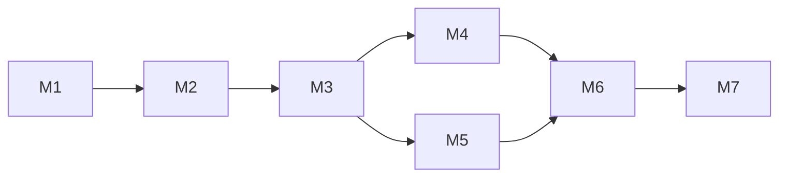

# Bring lain up on the work MacBook

status: draft
commit-mode: branch-queue (branch `mac/bringup`, pushed; the user merges it from the Linux box)
language: ruby, rust
panel: Ruby (Linus Torvalds, Jeremy Evans, Sandi Metz, Richard Schneeman, Aaron Patterson); Rust seats (Raph Levien, Andrew Gallant)

## Intent

Get lain running on the user's work MacBook (Apple Silicon) in `~/src/lain`, with the review queue from `planning/specs/review-queue-hud.md`. Then run a short QA pass.

Claude on the Mac runs this plan. Most cards are setup steps the main session does itself, marked **[main session]**. Code fixes for what breaks on macOS go on branch `mac/bringup`, 1 commit per fix with its spec, pushed for the user to merge (ruling 2026-11-16).

**Prerequisite:** `review-queue-hud.md` is `done`, and `main` is pushed to `origin` from the Linux box.

## Grounding

Written 2026-11-16 on the Linux box at `main` `6c9f57b1`, from a code read. No Mac has run lain. The facts below are from `planning/review-hud-research-2026-11.md` § "The Mac plan" and a 2026-11-16 survey. Re-check each one on the Mac before relying on it.

- **No macOS CI.** CI is Ubuntu only (`.github/workflows/main.yml`).
- **Rust.** `rake compile` builds `ext/lain` and skips lain-fence off Linux (`Rakefile:128-134`). After `review-queue-hud.md` T1, `lain-core` and `lain-fence` type-check for macOS: verified from Linux by `cargo check --target aarch64-apple-darwin`. `ext/lain` was not checkable from Linux (tree-sitter's build script needs the macOS SDK).
- **No sandbox.** bwrap and Landlock are absent, so `Confine::Sandbox#wrap` runs commands uncontained and journals `CapabilityDegraded` (`lib/lain/confine/sandbox.rb:131-143`).
  - An automatic allow of a command that reads a secret is held for the human (`lib/lain/approval/escalation.rb:371-382`).
  - A human approval of a contained call is denied with a liftable reason (`:1011-1023`).
  - Expect more parked approvals than on Linux.
- **Liveness** falls back from `/proc` to `ps -o lstart=` (`lib/lain/liveness.rb:62-110`).
- **Sockets** go in `/tmp/lain` when `XDG_RUNTIME_DIR` is unset (`lib/lain/paths.rb:238-241`). The input socket's directory is created 0700 and the socket 0600 (`cli/input_socket.rb:184`).
- **Input pane termios** is skipped off Linux (`lib/lain/frontend/input_pane/uncooked.rb:115`).
- **No junk-drawer here.** Without `notify-feed`, feed notices are a no-op by design (`lib/lain/notices.rb:34-37`).
- **`LD_LIBRARY_PATH`** to linuxbrew is a Linux-box fix only. Leave it out on the Mac.
- **Ruby 4.0.9 through mise** on Apple Silicon:
  - install `openssl@3 libyaml gmp` from brew first;
  - if openssl fails in a compiled Ruby, `mise settings ruby.compile=false` and reinstall ([mise discussion 7268](https://github.com/jdx/mise/discussions/7268), read 2026-11-16).
- **gh.** The work account is `joel-fuze`. lain picks the account from `LAIN_GH_ACCOUNT`, the project `.lain/config.rb` or the user `config.rb` (`review-queue-hud.md` T5).

## Compatibility

| Surface | Verdict | Evidence |
|---|---|---|
| Linux behaviour | must keep | Every fix on `mac/bringup` keeps `bundle exec rake pspec` and `cargo test` green on Linux. The user checks this when merging. |
| Specs that are Linux-only by nature (lain-fence tests, bwrap seams, `/proc` readers) | free to tag | A fix may tag a spec `:linux` and skip it on Darwin, with the reason in the tag's definition. It never deletes the spec. |

## Spike findings

None. Each card's acceptance is observed on the Mac.

## Shared files

None. This plan runs in 1 session on 1 machine.

## Rejected options

- **A macOS sandbox through `sandbox-exec` in this plan.** It is deprecated, and it has no seccomp or netns equivalent. It is a research topic of its own, so this plan records the gap and builds nothing.
- **Fixing on `main` from the Mac.** 2 machines would commit to `main` at once (user ruling: branch).

## Open decisions

- **A macOS sandbox.** The user accepts less sandboxing on macOS for now and keeps it as a goal to improve over time (ruling 2026-11-16). M6's counts of parked approvals, and what the agent's bash could reach, are the input to that later work. No card here builds one.

## Dependency graph



## Tasks

### M1: Install the toolchain          [risk: low] [main session]

**Depends on:** none
**Files:** none in the repo.
**Reuse:** `.ruby-version` (4.0.9); the user's dotfiles (`~/.config/mise/config.toml`).
**Shared-file wiring:** none
**Reachable from:** the Mac's shell.

**Acceptance criteria**

```gherkin
Scenario: every tool answers
  When `xcode-select -p`, `brew --version`, `mise --version`, `rustup --version`, `cargo --version`, `tmux -V`, `nvim --version`, `gh --version`, `fzf --version` and `herdr --version` run
  Then each prints a version
  And `mise exec ruby@4.0.9 -- ruby -v` prints 4.0.9
  And `mise exec ruby@4.0.9 -- ruby -ropenssl -ryaml -e 'puts OpenSSL::VERSION'` prints a version
```

Spec file: none (setup). Record the output in the Execution log.

**Stop and report if:**
- Ruby 4.0.9 won't build or install from mise after the openssl fallback.

### M2: Clone lain and build it          [risk: low] [main session]

**Depends on:** M1
**Files:** none
**Reuse:** `bin/install-shim`.
**Shared-file wiring:** none
**Reachable from:** `~/src/lain`.

**Acceptance criteria**

```gherkin
Scenario: lain builds and starts
  Given `git clone git@github.com:liaden/lain ~/src/lain` and `git switch -c mac/bringup`
  When `bundle install`, `bundle exec rake compile` and `bin/install-shim` run under ruby 4.0.9
  Then `lain help` lists `queue` and not `review`, and `bin/qa-lain help` lists review, survey, bench, verify, usage and friction
  And rake compile printed that lain-fence is Linux-only

Scenario: the Rust workspace builds
  When `cargo build` and `cargo clippy --all-targets -- -D warnings` run
  Then both pass
  And `cargo build --release -p lain-fence && target/release/lain-fence` prints "Linux only" and exits 2
```

Spec file: none (setup). Record any failure as a finding in `planning/qa/findings-macos-bringup.md`.

**Stop and report if:**
- `rake compile` fails in `ext/lain`. Paste the first error. That is the 1 build Linux could not check.

### M3: Record the macOS suite baseline          [risk: medium] [main session]

**Depends on:** M2
**Files:** `planning/qa/findings-macos-bringup.md` (new)
**Reuse:** `bundle exec rspec` (the quick loop; no `:slow`); `cargo test`.
**Shared-file wiring:** none
**Reachable from:** the repo's spec suite.

**Acceptance criteria**

```gherkin
Scenario: every failure is named and sorted
  When `bundle exec rake pspec` and `cargo test` run on the Mac
  Then the findings file lists every failing example by name (not by line) with its first error line
  And sorts each into: Linux-only by nature, a real macOS bug, or a toolchain problem
  And states the example count alongside the failure count
```

Spec file: none (this card produces the findings). Set `LAIN_SPEC_WORKERS` to physical cores minus 2 and say which count was used. If the box is needed for other work, `bundle exec rspec` (serial, no `:slow`) is the lighter fallback.

**Stop and report if:**
- The run truncates (a `SystemExit`, or an example count far below Linux's). Find the file that ended it before going on.

### M4: Fix what blocks a chat and the cockpit          [risk: medium]

**Depends on:** M3
**Files:** decided by M3's "real macOS bug" list. Each fix is its own commit on `mac/bringup`, with a failing spec first.
**Reuse:** the `:linux` tag pattern from Compatibility for specs that are Linux-only by nature.
**Shared-file wiring:** none
**Reachable from:** `lain chat` and `lain up --nvim`.

**Acceptance criteria**

```gherkin
Scenario: a plain chat works
  When `lain chat` starts in ~/src/lain against the user's provider
  Then a 1-turn exchange completes, and the HUD shows that the sandbox is off

Scenario: the cockpit works
  When `lain up --nvim` starts
  Then the chat, input and nvim panes appear, a typed line reaches the chat, and Ctrl-C and paste work in the input pane
```

Spec file: the spec each fix adds, named in its commit.

**Stop and report if:**
- A fix would change behaviour on Linux. Don't commit it; record it as a finding for the user.
- More than 5 distinct bugs block these 2 scenarios. Stop and hand back the list.

### M5: Configure GitHub and the review queue          [risk: low] [main session]

**Depends on:** M3
**Files:** none in the repo. The user config is `~/.config/lain/config.rb`, and `lain trust --user` records it.
**Reuse:** `github` verb (`review-queue-hud.md` T5).
**Shared-file wiring:** none
**Reachable from:** `lain queue prs`.

**Acceptance criteria**

```gherkin
Scenario: the work account answers
  Given `github account: "joel-fuze", orgs: [<work org>], keywords: %w[perf sql migration optimization], paths: [%r{\Adb/migrate/}, /\.sql\z/, %r{\Adb/(schema\.rb|structure\.sql)\z}]` in the user config, trusted
  When `lain queue prs` runs in a work repository
  Then it lists the PRs requested of joel-fuze, direct ones first
  And with `LAIN_GH_ACCOUNT=liaden` it lists the personal account's instead

Scenario: the poll writes the count
  When `lain queue poll` runs
  Then ~/.local/state/lain/reviews.json holds the counts
```

Spec file: none (configuration). Ask the user for the work org's name.

**Stop and report if:**
- `gh auth token --user joel-fuze` fails. The user must run `gh auth login` for that account.

### M6: Run the QA scenarios          [risk: medium] [main session]

**Depends on:** M4, M5
**Files:** `planning/qa/findings-macos-bringup.md`
**Reuse:** `/manual-qa` with `planning/qa/scenarios/review-queue.md`, `changeset-review.md`, and the approval scenarios in `planning/qa/scenarios/`.
**Shared-file wiring:** none
**Reachable from:** the QA sandbox (`.claude/skills/manual-qa/scripts/qa-sandbox.sh`).

**Acceptance criteria**

```gherkin
Scenario: the review flow works end to end
  Then these pass, or are recorded as findings:
    lain queue pick prs, with ctrl-t and ctrl-k;
    opening a work PR into a running lain up --nvim;
    /critique placing findings;
    /review-submit to a throwaway PR in a personal repo

Scenario: the sandbox gap is visible and fails safe
  When the agent runs a command that reads a secret under auto approval
  Then the call is parked for the human, not run
  And the count of parked approvals over the QA pass is recorded in the findings

Scenario: what the agent's bash can reach is recorded
  When the agent's bash writes an offer frame to the chat's input socket, and writes a pending review file
  Then each reaches the human as an offer that needs a keypress, and never runs on its own
  And whether bash could connect to the socket at all is recorded as a finding for the later sandbox work
```

Spec file: none (manual QA). Findings in the `/manual-qa` format.

**Stop and report if:**
- A command that reads a secret runs without being parked. That is a security finding: stop at once and report it.

### M7: Set up the Mac's dotfiles for the queue          [risk: low] [main session]

**Depends on:** M6
**Files:** none. The plist `Library/LaunchAgents/com.lain.queue-poll.plist` is already in the dotfiles (D3 in `review-queue-hud.md`); pull the dotfiles first.
**Reuse:** D1 and D3 in `review-queue-hud.md`.
**Shared-file wiring:** none
**Reachable from:** launchd.

**Acceptance criteria**

```gherkin
Scenario: the poll runs on its own
  When `launchctl bootstrap gui/$(id -u) ~/Library/LaunchAgents/com.lain.queue-poll.plist` runs
  Then reviews.json's polled_at advances every 5 minutes, and the herdr `reviews` workspace shows the count

Scenario: the keys work
  When prefix+p is pressed in herdr
  Then the PR picker opens
```

Spec file: none (dotfiles).

**Stop and report if:**
- launchd runs the job without the user's PATH, so it can't find `gh` or `lain`. Set `EnvironmentVariables` in the plist, and record it.

## Integration checks

- `mac/bringup` pushed, with 1 commit per fix, each with its spec.
- `planning/qa/findings-macos-bringup.md` committed on the branch, listing every finding with a disposition: fixed, Linux-only, or open.
- **The user's job, on the Linux box:**
  1. Merge `mac/bringup`.
  2. Run `bundle exec rake pspec` and `cargo test`.
  3. File the open findings as cards.

## Execution log
