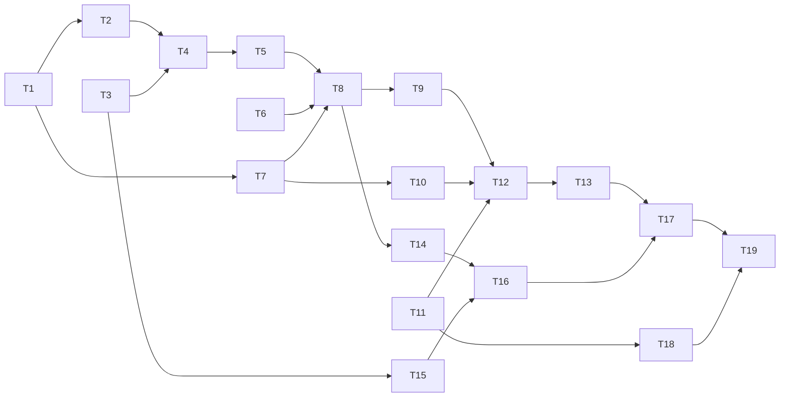

# Merge coordinator: one merger per branch, the full suite once per batch

status: in-progress
commit-mode: orchestrator-commits
language: ruby
panel: Linus Torvalds, Jeremy Evans, Sandi Metz, Richard Schneeman, Aaron Patterson

## Intent

Several agents in parallel worktrees each run the expensive full suite today, and 2 suites at once
give false reds here by construction (`docs/toolchain-traps.md:26-33`). This plan gives lain 1
merger per (repository, branch).

- Workers run a fast tier first: their changed specs, the mirror specs of their changed sources, and
  a lint command.
- Then they enqueue.
- A detached drainer builds a candidate commit with git plumbing, never touching any checkout, and
  verifies it once per batch behind a machine-wide suite lock.
- It bisects a failing batch, and fast-forwards the branch only on green.

The verifier is a swappable strategy: a local command now, forge CI later. The batch record makes
the strategies comparable on the bench. Sources:
- `planning/merge-coordinator-research-2026-10.md`
- `planning/merge-coordinator-followup-research-2026-10.md` (authoritative where they differ)

## Grounding

**Verified 2026-10-08 against `main` at `138656ac`.**
- 3 read-only grounding passes.
- 2 spikes on throwaway repositories in the session scratchpad.
- No suite run, because another session was executing `planning/specs/greenfield-trial-fixes.md` in
  this checkout.

Runtime premises were probed, not read. The probes live in the follow-up report's spikes:
- the plumbing chain;
- `--ff-only` and compare-and-swap refusals;
- `update-ref` on a checked-out branch;
- drainer stranding;
- `flock` across worktrees;
- spawn versus fork inheritance.

**Landing today.**
- `Isolation::LandingQueue` (`lib/lain/isolation/landing_queue.rb`, 412 lines) hard-builds its
  `Desk` (`:110`) and holds `ParentLock` for the whole run (`:112,126`).
- `Desk` merges into the parent checkout through `Worktree::Handback::Merge` (`:243,265`).
- `ensure_on_branch!` (`:256-262`) refuses a parent off the branch.
- Verification runs after the merges, and only once (`:182-189`). The default `Verify` answers
  `:skipped` (`:86-89`).
- Both production sites leave `verify:` and `resolver:` at their defaults:
  - `lib/lain/cli/epic_land.rb:148-152`;
  - `lib/lain/cli/epic_driver/factory.rb:215-218`.
  So no production resolver is ever spawned by the queue.
- `Probe` (`:195-229`) touches only objects and refs, and is reusable unchanged.
- The de facto desk interface is `repo_root`, `branch`, `tip`, `ensure_on_branch!`, `merge`,
  `continue`, `abandon`, `landed`, `already`, `failed`, `stand` and `resynced` (`:250-295`).

**Resume reads the handback record.**
- `Forge::LocalLanding` reads `handback` records with `outcome: "merged"` and `worker_key ==
  "<slug>/<issue>"` to resume (`lib/lain/forge/local_landing.rb:30,128,267`).
- So a candidate desk must journal those records, and only after the branch moves.

**The branch is always checked out somewhere when the epic queue runs.** `epic land` lands in the
parent or in the `landings/<slug>` worktree (`epic_land.rb:128-136`, `factory.rb:239-330,587-590`).
`WorkingBranch#current_in?` (`working_branch.rb:160`) only checks the checkout it is given.

**Plumbing precedent.** `lib/lain/forge/local_finish.rb:81-112` (landed today in `55eb076f`) already
builds a merge with `merge-tree --write-tree` plus `commit-tree`, then runs `merge --ff-only` behind
clean and unshadowed checks. `Isolation::Worktree::Registry#add` (`registry.rb:42`) runs `worktree
add --lock --reason --detach`.

**Locks.**
- `ParentLock` (`parent_lock.rb`, 135 lines) and `Memory::ProjectStore` (`project_store.rb:~310-350`)
  carry near-identical poll-`flock` loops: holder file, `notice` after `PATIENCE`, injected
  `sleeper`.
- `cli/worktrees.rb:65-72` and `cli/gc_schedule.rb:96-100` are try-once copies.
- There is no shared lock and no machine-wide lock.

**Detached spawn precedent.** `CLI::GcSchedule`:
- `Process.detach(Process.spawn(...))` with `pgroup: true` and output redirected to a log;
- `[RbConfig.ruby, File.expand_path($PROGRAM_NAME), ...]` as the command;
- a `lain?` guard, so nothing spawns under rspec;
- an injected spawner (`gc_schedule.rb:30-44,78,107`).

**Config.** `.lain/config.rb` is instance-evaluated by `Config::Builder`.
- `Config::Isolation` (`config/isolation.rb`, 101 lines) is a strict table with `Whole` and `OneOf`
  rules, `DEFAULTS`, `KEYS`, `.from` and `.check!`.
- New keys in this table change only `config/isolation.rb`. `config.rb` and `config/builder.rb` stay
  untouched.
- `Shell::Exclusions.from` (`shell/exclusions.rb`) is the precedent for validating an Array of
  Strings in one pass.

**`Shell::Out`.**
- It runs argv, never a shell.
- `environment:` merges, and a nil value unsets.
- Its `timeout:` raises `Shell::Out::Timeout` after a TERM then KILL of the process group.
- Output is buffered in memory.

**Telemetry.**
- `Journalable#journal_type` is the short class name, underscored (`telemetry.rb:37-39`). So a
  `Telemetry::LandingBatch` journals as `landing_batch`, and that name must be unique
  (`spec/journalable_surface_spec.rb`).
- CLI processes journal with `Journal.open(paths:)` into `Paths#sessions_dir`, closed in `ensure`
  (`epic_land.rb:117`).

**Fast tier.**
- `TestLayout#mapping` gives `test_file?`, `levels` and `test_path(source, level:)`
  (`test_layout/mapping.rb`).
- `TestLayout::None#mapping.test_file?` answers true for every path, so callers must check
  `in_force?` first.
- Layout enforcement is opt-in (the implement-epic T8 ruling).
- `Grader::TestHarness` runs a detected adapter, not a configured command.
- No lint runner exists in `lib/`.
- `SelfSync` (`self_sync.rb`) is the template for asking a live worker: `ASK`, `Asking` and
  `Unaskable`, measured after each ask, `rescue` to `:failed`.
- `Leases#hold` calls the sync duck as `@sync.call(lease, worker:, worker_id:)` and
  `@sync.editorless(env)` (`leases.rb:207-215`).
- `Retirement.over` builds its own `SelfSync` (`retirement.rb:165-169`).

**Chat handback.**
- `CLI::Wiring::Handback = Data.define(:handoff, :sync)` (`wiring.rb:52-78`) is assembled in
  `#handback_over` (`:865-880`).
- `WorkerHandoff#reclaim` merges into the parent under `ParentLock`, held through the resolver's
  model call (`worker_handoff.rb:270-292`).
- `Held#delivered` is the only place a handback's words reach the model (`leases.rb:~55-62`).

**Names taken.**
- `Lain::Landing` is the real-path resolver (`lib/lain/landing.rb`).
- `LandingQueue` is today's queue.
- `handback` is a journal type.
- So the new namespace is `Lain::Isolation::MergeCoordinator`, and the new journal type is
  `landing_batch`.

**Disagreements, and which won.**
- `docs/commands.md:134-136` says a chat's merge into the parent is serialized against `epic land`.
  That stays true until T17, which rewrites it (T19).
- The first research report said "wrap the existing queue". The code won: the follow-up report and
  the panel showed `Desk` merges first and verifies after.

**Sequencing.** `greenfield-trial-fixes.md` is in progress and edits `config.rb`, `epic_finish.rb`,
`exe/lain` and `docs/commands.md`. This plan touches none of `config.rb` or `epic_finish.rb`. Its
`exe/lain` and `docs/commands.md` edits come late (T13, T19). **Start this plan once that one reads
`status: done`.**

## Compatibility

| Surface | Verdict | Evidence |
|---|---|---|
| `LandingQueue.new` keywords and `verify:` signature | free to break | Gem `0.1.0`, never published (no tags). 2 callers in `lib/` (`epic_land.rb`, `factory.rb`). No consumer under `~/dev` outside this repo. Memory: no back-compat owed. |
| `.lain/config.rb` `isolation` table | must keep existing keys; new keys are additive | Users' trusted config files exist on disk outside the repo. `docs/commands.md:917-938` documents the 4 keys. |
| `handback` journal record | must keep shape, may gain optional fields | Resume reads it (`local_landing.rb:267`); replay fixtures and `DryReplay` specs read journals. |
| `WorkerHandoff::Report` kinds | free to widen | Internal. Consumers: `Held#delivered`, `LocalLanding`, `Retirement`, the epic driver's `NOT_LANDED`. All are in this repo, and T17 lists them. |
| Chat handback behaviour (merges into the parent) | free to break | Internal; ruled by the user 2026-10-08: always enqueue, return queued. |
| `lain land` CLI group | new | No `land` top-level command exists (`exe/lain:579-588` is `epic land`). |
| `refs/lain/candidate/*` namespace | new | Protected by gc as anything under `refs/lain/` (`gc.rb:160`). T8 deletes the ref after each batch. |
| `docs/commands.md` sentences on chat handback | free to break | Documentation; T19 rewrites them. |

No trade report: no must-keep surface blocks a simplification.

## Spike findings

| Question | Result | Evidence |
|---|---|---|
| Does a `merge-tree`/`commit-tree` chain match a sequential porcelain merge with lain's flags? | Yes. Same tree OID. 1 to 2 ms per step on 1,000 files. | Follow-up report, finding 1; scratchpad `spike-candidate/` |
| Can the chain skip a conflicting worker and continue? | Yes. Exit 1, tree OID, paths; later workers merge to the same tree. | Same, q2 |
| Does a resolver in a detached scratch worktree reproduce the conflict? | Yes, with zdiff3 markers. `merge-tree`'s own markers carry raw SHA labels and no base. | Same, q2 |
| `merge --ff-only` safety on a checked-out branch | Refuses on a dirty touched file, an untracked file that would be overwritten, or a moved tip. Keeps an unrelated dirty file. | Same, q3b and q3c |
| `update-ref` CAS on a branch not checked out | Works; fails on a stale old value. | Same, q3a |
| `update-ref` on a checked-out branch | Unsafe: the worktree goes out of sync, showing reversed changes. | Same, q3b |
| Reused scratch worktree reset cost | 12 ms (`checkout -f --detach` plus `clean -ffdx -e target/`) against 31 ms fresh. Caches kept. | Same, q5 |
| Does the naive drainer strand entries? Does recheck plus a detached drainer fix it? | Naive: 1 stranded in the forced window. Recheck and detached: 0 in 9 runs of 200 from 16 processes. | Follow-up report, finding 2; `spike-drainer/` |
| `kill -9`, Ctrl-C, inheritance | The lock is freed on kill. The drainer survives SIGINT in its own process group. `Process.spawn` does not inherit the lock; a fork without exec does. | Same, `crash.sh`, `inh.rb` |
| Polling cost of `wait` | About 0.15% CPU at 50 ms | Same |
| Can a Ractor host the coordinator? | It can run git and `flock`, but it serializes only within 1 process. Rejected. | First report |

No spike worktree was created under `tmp/worktrees/`. Both spikes needed no repo code and ran in
the scratchpad, so there is nothing to remove.

## Shared files

The main session owns these, and cards hand back 1-line diffs for them:
- `exe/lain`
- `.rubocop.yml`
- `spec/spec_helper.rb`
- `spec/support/**`
- `ROADMAP.md`

`lib/lain/isolation.rb` and `lib/lain/telemetry.rb` are namespace docstring files. No card needs
them, because Zeitwerk finds new units by path.

## Rejected options

- **A Ractor as the coordinator:** it serializes within 1 process, while the contention is between
  processes. `docs/concurrency.md:87` rules Ractors out for now.
- **A resident daemon** (a new `lain-core` RPC or a Ruby server): the lock-held drainer gives the
  same liveness with no lifecycle to manage (spike P3).
- **A heap or priority queue:** no caller needs priorities. FIFO matches `LandingQueue`'s order.
- **A separate `land` config verb:** it would edit `config.rb` and `config/builder.rb`, which the
  in-progress plan also edits. The `isolation` table already owns `rebase_retries`.
- **The candidate path as a wrapper around today's `Desk`:** `Desk` merges into the parent before
  verifying.
- **A fourth copy of the poll-`flock` loop:** T1 extracts `FileLock`. `ProjectStore` keeps its copy
  for now; see Open decisions.
- **A Rakefile suite lock for lain's own development:** ruled by the user. The lock is a lib feature
  for the projects lain drives.
- **A spawned `merge_resolver` in the drainer:** a detached drainer has no provider wiring. No
  production queue spawns a resolver today, so `Resolver::Standing` keeps current behaviour.
- **Speculative parallel candidates:** they need more than 1 heavy slot, which the suite lock forbids
  on purpose.

## Open decisions

None of these gate a card.

- **The `Forge` verifier strategy.** T4 defines the strategy seam, and T4's spec proves a third
  strategy substitutes through `Verifier.from`. The CI-backed strategy waits until lain's own CI is
  green and running. Today 33 of the last 57 runs failed, and none has run since 2026-09-30. Its
  shape is sketched under T4.
- **A spawned resolver in the drainer.** It needs out-of-chat provider wiring (`cli/improve.rb`'s
  precedent). Until then conflicts stand and are reported.
- **`ProjectStore` adopting `FileLock`.** It needs a shared (`LOCK_SH`) mode. `FileLock` takes a mode
  from T1, so the adoption is a 1-file card later.
- **Bench arms over landing strategies.** T18 adds the fold. Arms need a landing workload fixture
  that does not exist yet.
- **Dogfooding on lain itself** (a committed `.lain/config.rb` and a fast-tier commit hook): ruled
  out of this plan by the user.

## Dependency graph



Waves:
- 1: T1, T3, T6, T11
- 2: T2, T7, T15, T18
- 3: T4, T10
- 4: T5
- 5: T8
- 6: T9, T14
- 7: T12, T16
- 8: T13
- 9: T17
- 10: T19

Same-file ordering:
- `factory.rb`: T14 then T16.
- `wiring.rb`: T16 then T17.
- `telemetry/handback.rb`: T16 then T17.
- `landing_queue.rb`: T5 then T8.

## Tasks

### T1: Extract the poll-flock loop into `FileLock`, and have `ParentLock` use it          [risk: medium]

**Depends on:** none
**Files:** `lib/lain/file_lock.rb` (new), `spec/lain/file_lock_spec.rb` (new), `lib/lain/isolation/parent_lock.rb`, `spec/lain/isolation/parent_lock_spec.rb`
**Reuse:**
- `ParentLock#waited`, `#claimed` and `#waiting_on` (`parent_lock.rb:97-125`);
- the holder-file format `pid=... command=...`;
- `PATIENCE`, `INTERVAL`, the injected `sleeper:`.

**Shared-file wiring:** none
**Reachable from:** `Isolation::ParentLock#hold` → `FileLock#hold`, on every `WorkerHandoff#reclaim` and `LandingQueue#call`

`FileLock` owns 1 path's cross-process `flock`, with the holder named in the file:
- `hold` polls and tells `notice` once after `patience`;
- `try` attempts once and never waits;
- `holder` reads the file back.

`ParentLock` keeps its in-process `Monitor`, its `REGISTRY` and its public API, and delegates the
file half.

**Acceptance criteria**

```gherkin
Scenario: a held lock makes a second process wait, and names its holder once
  Given a FileLock on a path held by another process
  When this process calls hold with a notice
  Then it waits, the notice is told once naming the holder's pid and command, and the block runs after the release

Scenario: try never waits
  Given a FileLock held by another process
  When this process calls try
  Then it answers false at once, and runs nothing

Scenario: the parent checkout's lock behaves exactly as before
  Given the existing parent_lock_spec examples
  When they run against ParentLock built on FileLock
  Then every one passes unchanged
```
Spec files: `spec/lain/file_lock_spec.rb`, `spec/lain/isolation/parent_lock_spec.rb`

**Interface**

```ruby
module Lain
  class FileLock
    def initialize(path, mode: File::LOCK_EX, sleeper: Kernel.method(:sleep), interval: 0.05, patience: 5)
    def hold(notice: Isolation::ParentLock::Silent) # yields; reentrant per instance is NOT promised
    def try                                         # yields and answers true, or answers false without yielding
    def holder                                      # => String, "" when free
  end
end
```

**Stop and report if:**
- `spec/support/held_parent_lock.rb` relies on a private `ParentLock` method that the extraction removes.
- A `parent_lock_spec.rb` example needs a change to its assertions rather than its setup.

### T2: A machine-wide suite lock serializes expensive verify runs          [risk: medium]

**Depends on:** T1
**Files:** `lib/lain/isolation/suite_lock.rb` (new), `spec/lain/isolation/suite_lock_spec.rb` (new)
**Reuse:** `FileLock` (T1); `Paths#state_home` (`paths.rb:236`); `Paths#ensure_dir` (`:318`)
**Shared-file wiring:** none
**Reachable from:** `Isolation::Verifier::Command#call` (T4) → `SuiteLock.for(paths:).hold`, built by `Verifier.from` in `MergeCoordinator::Drain` (T12) and `CLI::EpicLand` (T14)

One lock file per user per machine, at `<state_home>/locks/suite.lock`, held for the whole of 1
verify run in any repository. It sits under `state_home` because specs already isolate that per
worker (`spec/support/isolated_state_home.rb`), and `runtime_dir` is not isolated.

**Acceptance criteria**

```gherkin
Scenario: two repositories' verify runs never overlap
  Given SuiteLock.for(paths:) obtained in two processes with the same state home
  When both hold it around a run that records its start and end times
  Then the two intervals do not overlap

Scenario: the lock lives under the state home and is created on demand
  Given a fresh state home
  When SuiteLock.for(paths:) is held once
  Then <state_home>/locks/suite.lock exists and names no holder after the release
```
Spec file: `spec/lain/isolation/suite_lock_spec.rb`

**Interface**

```ruby
module Lain::Isolation
  module SuiteLock
    def self.for(paths:) # => FileLock
  end
end
```

**Stop and report if:**
- `Paths#state_home` is not writable in the spec process, which would mean `isolated_state_home.rb` does not load for this spec.

### T3: The `isolation` table names the verify, fast-tier and batch settings          [risk: medium]

**Depends on:** none
**Files:** `lib/lain/config/isolation.rb`, `spec/lain/config/isolation_spec.rb`
**Reuse:** `Whole`, `OneOf`, `DEFAULTS`, `KEYS`, `RULES`, `.from` and `.check!` (`config/isolation.rb:16-74`); the one-pass Array validation of `Shell::Exclusions.from`
**Shared-file wiring:** none
**Reachable from:** `Config.load(root:).isolation`, read by `CLI::EpicLand` (`epic_land.rb:148`), `CLI::Wiring#isolation_settings` (`wiring.rb:882`), `EpicDriver::Factory#settings`, and `MergeCoordinator::Drain` (T12)

New keys, with their defaults:

| Key | Default | Rule |
|---|---|---|
| `verifier` | `"command"` | `OneOf(%w[command])` (a strategy name; `forge` joins when built) |
| `verify` | `[]` | an Array of non-empty Strings, argv for the full suite. `[]` means skipped. |
| `verify_timeout` | `1800` | `Whole(floor: 1, unit: "seconds")` |
| `verify_keep` | `["target/"]` | an Array of relative paths the scratch reset keeps |
| `batch_cap` | `8` | `Whole(floor: 1)` |
| `rebuild_cap` | `3` | `Whole(floor: 0)` |
| `check` | `[]` | argv for the fast-tier test command; changed and mirror test paths are appended |
| `lint` | `[]` | argv for the fast-tier lint command; changed files are appended |
| `check_retries` | `1` | `Whole(floor: 0)` |

**Acceptance criteria**

```gherkin
Scenario: an absent table keeps every old default and adds the new ones
  Given a .lain/config.rb with no isolation verb
  When the config loads
  Then retain_days is 7 and rebase_retries 1 as before, verify is empty, batch_cap is 8 and rebuild_cap is 3

Scenario: a bad argv names every bad entry in one refusal
  Given isolation verify: ["bundle", "", 3]
  When the config loads
  Then one Config::Refusal names the file, the isolation table, the verify key, and both bad entries

Scenario: an unknown verifier strategy is refused by name
  Given isolation verifier: "jenkins"
  When the config loads
  Then the refusal names verifier and lists command as the accepted value
```
Spec file: `spec/lain/config/isolation_spec.rb`

**Stop and report if:**
- Adding Data members to `Config::Isolation` breaks `Config#==` or `#hash` specs in `spec/lain/config_spec.rb`. Those specs belong to `config.rb`, which this plan must not edit while `greenfield-trial-fixes` is in flight.
- `spec/docs_config_examples_spec.rb` fails on the current docs' `isolation` example.

### T4: A verifier is a strategy: skipped, or a command run behind the suite lock          [risk: high]

**Depends on:** T2, T3
**Files:** `lib/lain/isolation/verifier.rb` (new), `lib/lain/isolation/verifier/skipped.rb` (new), `lib/lain/isolation/verifier/command.rb` (new), `lib/lain/isolation/candidate.rb` (new), `spec/lain/isolation/verifier_spec.rb` (new), `spec/lain/isolation/verifier/command_spec.rb` (new, `:seam`)
**Reuse:**
- `LandingQueue::Verification` (`landing_queue.rb:61-65`);
- `Shell::Out`'s `timeout:` and `environment:`;
- `Worktree::GIT_CONTEXT_SCRUB`;
- `Exec.child_env`, as `Grader::TestHarness#run` uses it;
- `SuiteLock` (T2).

**Shared-file wiring:** none
**Reachable from:** `Verifier.from(isolation, paths:)`, called by `MergeCoordinator::Drain#queue` (T12) and `CLI::EpicLand#queue` (T14)

`Candidate` is what a verifier judges: a commit and a checkout standing on it.

`Command#call` does the following:
1. Holds the suite lock.
2. Runs the argv in the checkout with `TMPDIR=<checkout>/tmp/lain-verify-<sha12>` (created, then
   removed). Same filesystem as the repo, per `docs/toolchain-traps.md:21-24`.
3. Scrubs `GIT_*`.
4. Answers `passed` on exit 0. Anything else is `failed`, with the last 40 lines of output, or with
   the timeout's message.

**Acceptance criteria**

```gherkin
Scenario: a passing command verifies the candidate it was given
  Given a scratch git checkout at commit C and isolation verify: ["sh", "-c", "test -f ok"] with ok committed
  When Verifier.from builds the verifier and it is called with Candidate(sha: C, path: checkout)
  Then the verification is passed with tip C

Scenario: a failing command reports its output tail
  Given a verify command that prints 100 lines and exits 1
  When it is called
  Then the verification is failed and its detail holds the last 40 lines

Scenario: a command over its timeout is failed, not raised
  Given verify_timeout 1 and a command that sleeps 5
  When it is called
  Then the verification is failed naming the timeout, and no process from it is left running

Scenario: the command sees its own TMPDIR and no GIT_ context
  Given GIT_INDEX_FILE set in the calling environment
  When a verify command prints its environment
  Then TMPDIR is under the checkout and GIT_INDEX_FILE is absent

Scenario: an empty verify argv is skipped
  Given isolation verify: []
  When Verifier.from builds the verifier and it is called
  Then the verification is skipped with "no verification is configured"

Scenario: a third strategy substitutes through the same door
  Given a strategy registered under a test name that answers passed
  When Verifier.from is called with that name
  Then it builds that strategy, and the landing queue accepts it as its verify
```
Spec files: `spec/lain/isolation/verifier_spec.rb`, `spec/lain/isolation/verifier/command_spec.rb`

**Interface**

```ruby
module Lain::Isolation
  Candidate = Data.define(:sha, :path)          # path: a checkout standing on sha

  module Verifier
    STRATEGIES = { "command" => ->(isolation, paths:, shell_out_factory:) { ... } }.freeze
    def self.from(isolation, paths:, shell_out_factory: Shell::Out.public_method(:new), strategies: STRATEGIES)
    # every strategy: call(candidate) => LandingQueue::Verification
  end

  # Not built here: Verifier::Forge#call(candidate) pushes candidate.sha to
  # refs/heads/lain-queue/<branch>/<sha12>, polls check runs for that sha through
  # Forge::Gh, deletes the ref, and answers passed/failed. It needs no other seam.
end
```

**Stop and report if:**
- `Shell::Out::Timeout` leaves a child of the process group alive in the timeout scenario.
- A spec needs `XDG_RUNTIME_DIR` isolation, which no spec support provides.

### T5: `LandingQueue` takes its desk, the desk owns its lock, and verification judges a `Candidate`          [risk: high]

**Depends on:** T4
**Files:** `lib/lain/isolation/landing_queue.rb`, `spec/lain/isolation/landing_queue_spec.rb`
**Reuse:** the existing `Desk`, renamed in place to `ParentDesk`; `Verifier::Skipped` (T4) in place of `LandingQueue::Verify`
**Shared-file wiring:** none
**Reachable from:** `CLI::EpicLand#queue` and `EpicDriver::Factory::Landing#queue`, both still building `LandingQueue.new(...)` with its default desk

This is a refactor that keeps behaviour.

1. `desk:` defaults to a `ParentDesk` built from the same keywords.
2. The queue holds `@desk.lock` in place of a hard-built `ParentLock`. `ParentDesk#lock` is that
   `ParentLock`.
3. The queue calls `@desk.ready!` in place of `ensure_on_branch!`.
4. After resolving, the queue verifies `@desk.candidate` and passes the verification and outcomes to
   `@desk.conclude`. That answers the `Result`.
5. `ParentDesk#candidate` is `Candidate(sha: tip, path: repo_root)`. `ParentDesk#conclude` returns
   the outcomes unchanged, because its merges already landed.

**Acceptance criteria**

```gherkin
Scenario: every existing landing behaviour holds with the default desk
  Given the landing_queue_spec examples, with each verify lambda now taking a Candidate
  When they run
  Then each passes with its original expectations about the parent, the reports and the journal

Scenario: a verifier sees the parent's tip after landing
  Given w1 and w2 landing cleanly through the default desk
  When the queue runs with a recording verifier
  Then the verifier was called once with a Candidate whose sha is the branch tip and whose path is the parent

Scenario: the epic command still lands through the production construction
  Given the epic_land_spec "lands the commit onto epic/demo" example
  When it runs with no verify configured
  Then it passes unchanged and its result's verification is skipped
```
Spec files: `spec/lain/isolation/landing_queue_spec.rb`, `spec/lain/cli/epic_land_spec.rb` (unchanged; it must stay green)

**Interface**

```ruby
# the desk duck the queue and its resolvers use, both desks
#   lock -> #hold(notice:)          ready!            tip -> String
#   candidate -> Candidate          branch, repo_root
#   merge(worker) continue(worker) abandon(worker) resynced(worker, commit)
#   landed(worker, outcome) already(worker) failed(worker, detail) stand(worker, paths, detail)
#   conclude(verification, outcomes) -> Result
LandingQueue.new(repo_root:, base:, desk: nil, journal:, strategy:, retries:, resolver:, verify:, notice:, shell_out_factory:)
```

**Stop and report if:**
- `spec/lain/forge/local_landing_spec.rb` or `spec/lain/cli/epic_driver/factory_spec.rb` reads `LandingQueue::Verify` or `Desk` by name.
- Holding the lock through `@desk.lock` changes the timing that the lock examples (`landing_queue_spec.rb:271-308`) assert.

### T6: A reused scratch worktree per coordinated branch          [risk: medium]

**Depends on:** none
**Files:** `lib/lain/isolation/verify_checkout.rb` (new), `spec/lain/isolation/verify_checkout_spec.rb` (new, `:seam`)
**Reuse:** `Worktree::Registry#add`, `#lock`, `#claim` and `#remove` (`registry.rb:42-63`); `CLI::IsolationBackend.worktree_root(root, paths:)`; `Factory::LandingCheckout`'s reuse-if-standing logic (`factory.rb:239-330`)
**Shared-file wiring:** none
**Reachable from:** `Isolation::CandidateDesk.new(checkout: VerifyCheckout.for(...))` (T8), built by `MergeCoordinator::Drain` (T12) and `CLI::EpicLand` (T14)

The scratch worktree is a locked, detached worktree at `<worktree_root>/verify/<branch key>`.
- `#at(sha)` resets it with `checkout -f --detach <sha>`, then `clean -ffdx` with `-e` for each
  `verify_keep` path.
- It never checks out a branch name.

**Acceptance criteria**

```gherkin
Scenario: the first use adds a detached, locked worktree; later uses reuse it
  Given a repository with branch main and no verify worktree
  When VerifyCheckout.for(...).at(C1) and then .at(C2) are called
  Then one worktree exists at the verify path, locked, detached at C2, and git worktree list never showed it holding main

Scenario: a reset removes untracked files and keeps the cache paths
  Given the verify worktree holding an untracked junk.log and a target/ directory
  When at(C2) is called with verify_keep ["target/"]
  Then junk.log is gone and target/ is intact

Scenario: a dirty tracked file in the scratch worktree does not block the reset
  Given a tracked file edited in the verify worktree
  When at(C2) is called
  Then the worktree stands clean at C2
```
Spec file: `spec/lain/isolation/verify_checkout_spec.rb`

**Interface**

```ruby
module Lain::Isolation
  class VerifyCheckout
    def self.for(repo_root:, branch:, paths:, keep:, shell_out_factory: Shell::Out.public_method(:new))
    def at(sha)   # => Candidate standing on sha
    def path
  end
end
```

**Stop and report if:**
- `Registry#add` refuses a path under `worktree_root/verify/`, because a gc rule reserves that root.
- `gc.rb` would reap a locked verify worktree. Name the rule.

### T7: The coordinator's home: one directory and one drain lock per (repository, branch)          [risk: medium]

**Depends on:** T1
**Files:** `lib/lain/isolation/merge_coordinator.rb` (new, namespace docstring and `Home`), `spec/lain/isolation/merge_coordinator_spec.rb` (new)
**Reuse:** `ParentLock.for`'s `git rev-parse --path-format=absolute --git-common-dir` lookup (`parent_lock.rb:57-68`); `Worktree::Handback::Naming`'s slug-plus-fingerprint key (`handback.rb:99-163`); `FileLock` (T1)
**Shared-file wiring:** none
**Reachable from:** `MergeCoordinator::Home.for(repo_root:, branch:)`, called by `CandidateDesk#lock` (T8), `Spool` (T10) and `CLI::Land` (T13)

The home is `<git-common-dir>/lain-coordinator/<branch key>/`, holding `entries/`, `results/` and
`drain.lock`. Every worktree of a repository resolves the same home.

**Acceptance criteria**

```gherkin
Scenario: two worktrees of one repository share a home and a lock
  Given a repository and a linked worktree of it
  When Home.for is resolved from each for branch main
  Then both name the same directory, and while one holds drain_lock the other's try answers false

Scenario: two branches get two homes
  Given branches main and epic/demo
  When Home.for is resolved for each
  Then the directories differ and neither name contains a slash from the branch
```
Spec file: `spec/lain/isolation/merge_coordinator_spec.rb`

**Interface**

```ruby
module Lain::Isolation
  module MergeCoordinator
    Home = Data.define(:dir) do
      def self.for(repo_root:, branch:, shell_out_factory: Shell::Out.public_method(:new))
      def entries = File.join(dir, "entries")
      def results = File.join(dir, "results")
      def drain_lock # => FileLock
    end
  end
end
```

**Stop and report if:**
- A directory in no repository reaches `Home.for`. Refuse it with `Lain::Error` naming the directory, and never fall back to a temp dir.

### T8: A candidate desk builds the batch with plumbing and moves the branch only on green          [risk: high]

**Depends on:** T5, T6, T7
**Files:** `lib/lain/isolation/candidate_desk.rb` (new), `spec/lain/isolation/candidate_desk_spec.rb` (new, `:seam`), `lib/lain/isolation/landing_queue.rb` (the `Result` gains `stale_tip`), `spec/lain/isolation/landing_queue_spec.rb`
**Reuse:**
- `LocalFinish`'s plumbing and fast-forward (`forge/local_finish.rb:81-112`);
- `MergeStrategy#probe` and `#merge`;
- `Checkout#update_ref` CAS (`checkout.rb:90`);
- `WorkerHandoff::Report`;
- `Worktree::Handback#continue` and `#abandon` run against the scratch checkout;
- `Telemetry::Handback` with `Naming#key`.

**Shared-file wiring:** none
**Reachable from:** `MergeCoordinator::Batch` (T9) → `LandingQueue.new(desk: CandidateDesk.new(...))`, built by `MergeCoordinator::Drain` (T12) and `CLI::EpicLand` (T14)

**The desk's state:**
- `tip` is the candidate's head. It starts at the branch tip, read once.
- `merge` advances it with `merge-tree --write-tree` plus `commit-tree`, or takes the worker's commit
  when the candidate is its ancestor.
- A conflict answers `:conflicted` with its paths and leaves the candidate where it was.
- `continue` and `abandon` act on the scratch checkout, where a resolver works after the desk
  replays that worker's merge there.

**`conclude(verification, outcomes)`:**
- **Passed:** it moves the branch.
  - In the worktree that has the branch checked out (found with `git worktree list --porcelain`), it
    runs `merge --ff-only` under that checkout's `ParentLock`.
  - When no worktree has the branch, it runs `update-ref refs/heads/<b> <candidate> <old tip>`.
  - Only then does it journal one `handback` record per moved worker.
- **Failed or skipped-with-nothing-moved:** it journals nothing, and the reports say the batch did
  not land.
- **A refused fast-forward because the tip moved:** it answers a `Result` with `stale_tip: true` and
  journals nothing.
- In every case it deletes `refs/lain/candidate/<key>`.

The desk's `lock` is the home's `drain_lock`, so the order is always drain lock, then
`ParentLock`.

**Acceptance criteria**

```gherkin
Scenario: a green batch lands as one fast-forward and the parent never merged
  Given branch main checked out in the parent at T, and workers w1 and w2 cut from an older tip
  When a LandingQueue with a CandidateDesk and a passing verifier runs [w1, w2]
  Then main fast-forwarded to a commit containing both, the parent never had MERGE_HEAD, and two handback records say merged

Scenario: a red batch leaves the branch and the journal untouched
  Given the same workers and a failing verifier
  When the queue runs
  Then main is still at T, no handback record was written, and both reports say the batch failed verification with the verifier's detail

Scenario: a commit landing during verification is caught, not overwritten
  Given a verifier that commits to main in the parent before answering passed
  When the queue runs
  Then main holds the parent's commit and not the candidate, and the result says stale_tip

Scenario: a branch checked out in another worktree is fast-forwarded there
  Given epic/demo checked out in a landings/demo worktree and the parent on main
  When a green batch concludes for epic/demo
  Then the landings/demo worktree stands clean at the candidate and the parent's HEAD and index are unchanged

Scenario: a branch checked out nowhere moves by compare-and-swap
  Given branch side checked out in no worktree
  When a green batch concludes for side
  Then refs/heads/side is the candidate

Scenario: a conflicting worker is skipped and the rest still land
  Given w1 conflicting with the tip on f and w2 clean
  When the queue runs with the standing resolver and a passing verifier
  Then main holds w2 and not w1, and w1's report is conflicted on f with its work still on its ref

Scenario: the candidate ref never outlives its batch
  Given any of the batches above
  When the queue returns
  Then no ref under refs/lain/candidate/ exists
```
Spec file: `spec/lain/isolation/candidate_desk_spec.rb`

**Interface**

```ruby
module Lain::Isolation
  class CandidateDesk
    def initialize(repo_root:, base:, home:, checkout:, journal:, strategy:, shell_out_factory:)
    # the desk duck from T5
  end
  # LandingQueue::Result gains stale_tip: false
end
```

**Stop and report if:**
- `local_landing.rb`'s `Landings#merged?` cannot find a record written by the candidate desk. The `worker_key` must equal `Naming.new(worker.id).key`.
- `git worktree list --porcelain` reports a branch as checked out in a worktree that is prunable. Decide with the human whether that counts.
- A dirty parent file touched by the candidate makes `merge --ff-only` refuse. The desk must answer that as a declined batch naming the files, never raise.

### T9: A batch bisects on red and rebuilds on a moved tip          [risk: high]

**Depends on:** T8
**Files:** `lib/lain/isolation/merge_coordinator/batch.rb` (new), `spec/lain/isolation/merge_coordinator/batch_spec.rb` (new)
**Reuse:** `LandingQueue#call` with a `CandidateDesk` (T8); `LandingQueue::Result#report`
**Shared-file wiring:** none
**Reachable from:** `MergeCoordinator::Drain#land` (T12) → `Batch.new(queue_for:, rebuild_cap:).call(workers)`

**`call(workers)`:**
1. Runs a fresh queue over the workers.
2. On `stale_tip` it runs again, up to `rebuild_cap` times. Past the cap, every worker is declined
   with "the branch moved N times during verification".
3. On a failed verification of more than 1 worker, it splits the list in half, keeping order, and
   lands the first half, then the second, recursively.
4. A single failing worker is ejected with the verifier's detail.

It answers 1 report per worker, in the order given, and counts verifies and rebuilds for the batch
record.

**Acceptance criteria**

```gherkin
Scenario: one bad commit in four is found and the other three land
  Given workers w1 to w4 where only w3 breaks the verify command
  When the batch runs
  Then w1, w2 and w4 are on the branch, w3 is ejected with the verifier's output, and the batch counted at most 5 verifies

Scenario: a green batch verifies once
  Given four clean workers
  When the batch runs
  Then all four land and the batch counted 1 verify and 0 rebuilds

Scenario: a moving branch is retried, then given up on
  Given rebuild_cap 2 and a verifier that commits to the branch every time it runs
  When the batch runs
  Then it ran 3 times, every worker is declined naming the moving branch, and every worker's commit is still on its ref
```
Spec file: `spec/lain/isolation/merge_coordinator/batch_spec.rb`

**Interface**

```ruby
module Lain::Isolation::MergeCoordinator
  class Batch
    Outcome = Data.define(:reports, :verifies, :rebuilds)
    def initialize(queue_for:, rebuild_cap:) # queue_for: -> { LandingQueue }
    def call(workers) # => Outcome
  end
end
```

**Stop and report if:**
- A half that landed changes the second half's outcome in a way the order rule does not explain. The second half is rebuilt on the new tip by construction.

### T10: The spool: entries and results on disk, written whole          [risk: high]

**Depends on:** T7
**Files:** `lib/lain/isolation/merge_coordinator/spool.rb` (new), `spec/lain/isolation/merge_coordinator/spool_spec.rb` (new)
**Reuse:** `Home` (T7); `LandingQueue::Worker` (`landing_queue.rb:37`); `Journal`'s whole-record write discipline
**Shared-file wiring:** none
**Reachable from:** `CLI::Land#enqueue` (T13) and `MergeCoordinator::Drain` (T12) → `Spool.new(home)`

**Entries.**
- 1 JSON file per entry in `entries/`, named `<monotonic ns>-<pid>-<4 hex>`, so the names sort in
  enqueue order.
- Each entry holds the worker's id, ref and sha, and the enqueue time.

**Results.**
- `results/<id>.json`, written to a temp name and renamed into place.
- `complete(id, result)` writes the result, then deletes the entry.
- An entry whose result already exists is skipped by `pending`, so a crash between the 2 writes
  costs no second landing.

**Acceptance criteria**

```gherkin
Scenario: entries come back in enqueue order, from many processes
  Given 8 processes each enqueueing 25 workers
  When pending is read
  Then it holds 200 entries, each process's entries in the order it wrote them

Scenario: a completed entry leaves a result and no entry
  Given an enqueued worker
  When complete is called with its result
  Then result(id) answers it and pending no longer lists it

Scenario: a crash between the result and the delete does not land twice
  Given a result file for an entry whose entry file still exists
  When pending is read
  Then the entry is not listed

Scenario: a reader never sees half a result
  Given a result being written while another process polls result(id)
  When the writer finishes
  Then every read answered nil or the whole result
```
Spec file: `spec/lain/isolation/merge_coordinator/spool_spec.rb`

**Interface**

```ruby
module Lain::Isolation::MergeCoordinator
  class Spool
    Entry  = Data.define(:id, :worker, :enqueued_at)
    Result = Data.define(:id, :kind, :sha, :paths, :detail, :verification, :batch)
    def initialize(home, clock: Process.method(:clock_gettime))
    def enqueue(worker) # => Entry
    def pending         # => Array<Entry>, oldest first
    def complete(id, result)
    def result(id)      # => Result | nil
  end
end
```

**Stop and report if:**
- `File.rename` across `entries/` and `results/` is not atomic on the git common dir's filesystem. Check `stat -f`, and stop if it is a network filesystem.

### T11: A `landing_batch` record says what each batch did          [risk: low]

**Depends on:** none
**Files:** `lib/lain/telemetry/landing_batch.rb` (new), `spec/lain/telemetry/landing_batch_spec.rb` (new)
**Reuse:** the `Telemetry::Handback` shape: `Declarative::Carrier` validation, `Journalable`, and `Freezable::Fields` (`telemetry/handback.rb:12-69`)
**Shared-file wiring:** none
**Reachable from:** `MergeCoordinator::Drain#land` (T12) → `journal << Telemetry::LandingBatch.new(...)`

Fields:
- `branch`, `desk` (`parent` or `candidate`), `verifier`, `members` (worker keys, in order);
- `landed`, `ejected`, `declined` (worker keys);
- `verifies`, `rebuilds`, `verify_wall_s`;
- `queue_wait_s` (per member);
- `outcome` (`landed`, `partial`, `none`).

**Acceptance criteria**

```gherkin
Scenario: the record journals under its own short name and is deeply frozen
  Given a LandingBatch with two members
  When it is journaled
  Then its type is landing_batch, Ractor.shareable? is true, and no other Journalable answers landing_batch

Scenario: a malformed record is refused before it is written
  Given a LandingBatch whose outcome is "maybe"
  When it is built
  Then it raises naming outcome and the accepted values
```
Spec file: `spec/lain/telemetry/landing_batch_spec.rb`

**Stop and report if:**
- `spec/journalable_surface_spec.rb` already lists `landing_batch` for another class.

### T12: The drainer lands every queued entry, then checks again before it exits          [risk: high]

**Depends on:** T9, T10, T11
**Files:** `lib/lain/isolation/merge_coordinator/drain.rb` (new), `spec/lain/isolation/merge_coordinator/drain_spec.rb` (new, `:seam`)
**Reuse:** `Home#drain_lock#try` (T7); `Spool` (T10); `Batch` (T9); `Verifier.from` (T4); `VerifyCheckout.for` (T6); `CandidateDesk` (T8); `Journal.open(paths:)` as `CLI::EpicLand#journaled` uses it (`epic_land.rb:117`)
**Shared-file wiring:** none
**Reachable from:** `CLI::Land#drain` (T13), run by the detached `lain land drain` process

**`call`:**
1. Tries the drain lock. If another process holds it, it answers at once.
2. While the spool has entries, it takes up to `batch_cap`, runs a `Batch`, completes each entry
   with its result, and journals 1 `landing_batch`.
3. It releases the lock, reads the spool again, and retakes the lock if any entry arrived. This is
   spike P2, which stranded 0.
4. The journal is opened at the start and closed in `ensure`.

**Acceptance criteria**

```gherkin
Scenario: an entry enqueued while the drainer finishes is not stranded
  Given a drainer whose last batch completes while another process enqueues one more entry and fails to take the lock
  When the drainer exits
  Then the late entry has a result

Scenario: the production construction lands a queued worker
  Given a repository with .lain/config.rb isolation verify: ["sh", "-c", "exit 0"], and one enqueued worker
  When Drain.for(repo_root:, branch:, paths:) is called
  Then the branch holds the worker's commit, its result says merged, and one landing_batch record was journaled under the project's sessions dir

Scenario: a drainer killed mid-batch leaves work another drainer finishes
  Given a drainer killed with SIGKILL while verifying
  When a second drainer runs
  Then every entry has exactly one result and the branch holds each landed commit once

Scenario: batches respect batch_cap
  Given batch_cap 2 and five entries
  When the drainer runs with a passing verifier
  Then three landing_batch records were journaled with 2, 2 and 1 members
```
Spec file: `spec/lain/isolation/merge_coordinator/drain_spec.rb`

**Interface**

```ruby
module Lain::Isolation::MergeCoordinator
  class Drain
    def self.for(repo_root:, branch:, paths:, config: Config.load(root: repo_root), shell_out_factory: ...)
    def call # => Integer, batches landed this run
  end
end
```

**Stop and report if:**
- The killed-drainer scenario lands a commit twice. That would mean the landing step is not idempotent as the follow-up report found.
- The drainer's `Journal.open(paths:)` resolves a project hash other than the repository's, because a drainer cwd under `.git` changes `Paths#project_hash`.

### T13: `lain land enqueue | drain | wait | status`          [risk: medium]

**Depends on:** T12
**Files:** `lib/lain/cli/land.rb` (new), `lib/lain/isolation/merge_coordinator/spawner.rb` (new), `spec/lain/cli/land_spec.rb` (new), `spec/lain/isolation/merge_coordinator/spawner_spec.rb` (new)
**Reuse:**
- `CLI::GcSchedule`'s `SPAWN`, `lain?` guard and command shape (`gc_schedule.rb:30-44,78,107`);
- `Worktree::Handback#anchor`, or `Naming` plus `Checkout#update_ref`, to anchor a ref;
- `WorkingBranch.checked_out`;
- `ParentLock#waiting_on`'s holder text.

**Shared-file wiring:** `exe/lain`:
- a `class Land < Thor` with `include Boundary`;
- 4 commands, each calling `render { Lain::CLI::Land.new.<verb>(...) }`. `wait` uses `exit_status`.
- `desc "land SUBCOMMAND ...ARGS", "queue commits for the merge coordinator"` and `subcommand "land", Land`.

**Reachable from:** `exe/lain` → `LainCLI::Land` → `Lain::CLI::Land`

**The 4 verbs:**
- **`enqueue [REF] [--branch B] [--id NAME]`.**
  - It anchors `REF` (default `HEAD` in the cwd) under `refs/lain/worker/<id>`. The id defaults to
    the worktree's directory name.
  - It enqueues the worker and spawns `lain land drain --branch B` detached, after releasing every
    lock.
  - It prints the entry id and the queue position.
  - The branch defaults to the branch the main worktree has checked out, and is refused when that
    is detached.
- **`drain --branch B`** runs `Drain.for(...)`.
- **`wait ID [--branch B] [--timeout S]`** polls every 50 ms and prints the result. It exits 0 when
  the work landed, 1 when it did not, and 2 on timeout.
- **`status [--branch B]`** lists the pending entries, and the drain lock's holder with how long it
  has held it.

**Acceptance criteria**

```gherkin
Scenario: enqueue anchors, queues and starts a drainer without waiting for it
  Given a worktree whose HEAD is commit C and a recording spawner
  When "lain land enqueue --branch main" runs
  Then refs/lain/worker/<worktree name> is C, the spool holds one entry for C, the spawner was asked for "land drain --branch main" with pgroup true, and the command printed the entry id

Scenario: the spawned drainer holds no lock the submitter held
  Given the submitter holds no FileLock when it spawns
  When the spawner runs
  Then the spawn happens after every lock this process took is released

Scenario: wait reports a landing and its exit status
  Given a result file saying merged for entry E
  When "lain land wait E" runs through LainCLI.start with debug true
  Then it prints the landed sha and exits 0

Scenario: wait times out distinctly
  Given no result for entry E and --timeout 1
  When "lain land wait E --timeout 1" runs
  Then it exits 2 naming E as still queued

Scenario: status names the holder
  Given a drain lock held by another process
  When "lain land status --branch main" runs
  Then it prints the pending entries and the holder's pid and command
```
Spec files: `spec/lain/cli/land_spec.rb`, `spec/lain/isolation/merge_coordinator/spawner_spec.rb`

**Stop and report if:**
- A Thor method name (`status`, `wait`) collides with a Thor internal in this Thor version.
- The spawner can only find `exe/lain` by `PATH` lookup. The gc_schedule header explains why that is wrong under `bundle exec`.

### T14: `lain epic land` and the epic driver land through the candidate desk          [risk: high]

**Depends on:** T8
**Files:** `lib/lain/cli/epic_land.rb`, `lib/lain/cli/epic_driver/factory.rb`, `spec/lain/cli/epic_land_spec.rb`, `spec/lain/cli/epic_driver/factory_spec.rb`
**Reuse:** `CandidateDesk` (T8); `VerifyCheckout.for` (T6); `Verifier.from` (T4); `MergeCoordinator::Home.for` (T7)
**Shared-file wiring:** none
**Reachable from:** `CLI::EpicLand#queue` (`epic_land.rb:148`) and `EpicDriver::Factory::Landing#queue` (`factory.rb:215`)

Both sites build `LandingQueue.new(desk: CandidateDesk.new(...), verify: Verifier.from(...))`, so
the epic branch moves only on green and only by fast-forward. Holding the branch's drain lock makes
`epic land` and a drainer mutually exclusive on that branch. `Told` prints the verification line.

**Acceptance criteria**

```gherkin
Scenario: an approved issue lands only after its verify command passes
  Given issue a in flight with an approved implementation gate over S, and isolation verify: ["sh", "-c", "exit 0"]
  When "lain epic land a demo" runs
  Then epic/demo contains S, a is done, the output says verification passed, and the parent never merged

Scenario: a failing verify keeps the issue in flight and the branch where it was
  Given the same issue and isolation verify: ["sh", "-c", "exit 1"]
  When "lain epic land a demo" runs
  Then epic/demo is unchanged, a is still in_flight, and the output names the failed verification

Scenario: resume still recognises a candidate landing
  Given a landing that moved epic/demo and crashed before the issue transition
  When "lain epic land a demo --resume" runs
  Then a is done and nothing merges again

Scenario: epic land waits while a drainer holds the branch
  Given a drainer holding epic/demo's drain lock
  When "lain epic land a demo" runs
  Then it waits, its notice names the drainer, and it lands after the release
```
Spec files: `spec/lain/cli/epic_land_spec.rb`, `spec/lain/cli/epic_driver/factory_spec.rb`

**Stop and report if:**
- `spec/lain/cli/epic_land_spec.rb:214-278` (parent on another branch) needs its assertions changed rather than gaining a verify config.
- `Factory::Landing` is rebuilt per issue (`factory.rb:163-164`), and the verify checkout's lock refuses the second build.

### T15: A worker's fast tier: changed and mirror specs, then lint, with the live worker asked to fix          [risk: high]

**Depends on:** T3
**Files:** `lib/lain/isolation/worker_checks.rb` (new), `spec/lain/isolation/worker_checks_spec.rb` (new, `:seam`)
**Reuse:**
- `SelfSync`'s `Asking` and `Unaskable` (`self_sync.rb:121`), its `ASK` and `Run#ask` shape
  (`:55-65,277-283`), and its measure-after-ask rule;
- `TestLayout#mapping` (`test_file?`, `levels`, `test_path`), and `in_force?`;
- the changed-files diff of `LocalLanding#changed` (`local_landing.rb:383-388`);
- `Shell::Out`.

**Shared-file wiring:** none
**Reachable from:** `Isolation::Checked` (T16), built in `CLI::Wiring#handback_over` and `Retirement.over`

**Inputs:**
- The changed files are `git diff --name-only -z --no-renames --diff-filter=d <base tip>...HEAD` in
  the worktree.
- The tests are the changed files that are tests, plus each changed source's existing mirror test
  at every mirrored level. This applies only when the layout is in force.

**What runs:**
- `check` + tests, when `check` is set and any test was found.
- `lint` + the changed files, when `lint` is set.
- Each runs in the worktree with `TMPDIR` under it.

**On failure:**
- The worker, when askable, is told the command and the last 40 lines, and is asked to fix and
  commit. That is retried up to `check_retries` times.
- The result is measured again after each ask.

**Outcomes:** `passed`, `fixed`, `failed`, `skipped` (nothing configured or nothing to run),
`dirty`.

**Acceptance criteria**

```gherkin
Scenario: a failing mirror spec is shown to the worker, who fixes it
  Given a tests layout in force, a worker that changed lib/foo.rb, a failing spec/unit/foo_spec.rb, and check ["rspec"]
  When the checks run with an askable worker that fixes and commits
  Then the worker was asked once with the failing output, the checks ran twice, and the outcome is fixed

Scenario: no layout means only lint runs
  Given no tests table and lint ["rubocop"]
  When the checks run for a worker that changed lib/foo.rb
  Then rspec never ran, rubocop ran with lib/foo.rb, and test_file? was never consulted

Scenario: a worker without bash is reported, not asked
  Given a failing check and an unaskable worker
  When the checks run
  Then the outcome is failed with the output and no ask was made

Scenario: nothing configured costs nothing
  Given check and lint both empty
  When the checks run
  Then the outcome is skipped and no process was spawned
```
Spec file: `spec/lain/isolation/worker_checks_spec.rb`

**Interface**

```ruby
module Lain::Isolation
  class WorkerChecks
    Result = Data.define(:outcome, :attempts, :detail) # to_record => { checks: {...} }
    def initialize(base:, layout:, check:, lint:, retries:, shell_out_factory: Shell::Out.public_method(:new))
    def call(lease, worker:, worker_id:) # => Result
  end
end
```

**Stop and report if:**
- `TestLayout#mapping.test_path` raises `Unplaceable` for a changed file under a source root. That would contradict `test_layout/mapping.rb`.
- Asking re-enters an `Agent::Budget` that is already spent. Stop, and don't raise the budget silently, as the T7 ruling of the implement-epic plan says.

### T16: Checks run before self-sync on both lanes, and ride the handback record          [risk: high]

**Depends on:** T14, T15
**Files:** `lib/lain/isolation/checked.rb` (new), `spec/lain/isolation/checked_spec.rb` (new), `lib/lain/cli/wiring.rb`, `lib/lain/isolation/worktree/handback/retirement.rb`, `lib/lain/cli/epic_driver/factory.rb`, `lib/lain/telemetry/handback.rb`, `spec/lain/telemetry/handback_spec.rb`, `spec/lain/cli/wiring_spec.rb`, `spec/lain/isolation/worktree_handback_retirement_spec.rb`
**Reuse:** the sync duck `call(lease, worker:, worker_id:)` and `editorless` (`leases.rb:207-215`); `SelfSync::Result#to_record` and `#note`
**Shared-file wiring:** none
**Reachable from:**
- `CLI::Wiring#handback_over` (`wiring.rb:865-880`) → `Handback.new(handoff:, sync: Isolation::Checked.new(checks:, sync:))`;
- `EpicDriver::Factory#retirement` (`factory.rb:468-471`) → `Retirement.over(..., checks:)`.

**What `Checked` does:**
- It runs `WorkerChecks`, then `SelfSync`.
- It answers a result whose `to_record` merges `checks:` into the sync's record.
- Its `note` adds "checks failed: <detail>" when the checks failed.

`Telemetry::Handback` gains an optional `checks` field (default nil), validated as a Hash with an
`outcome` from `WorkerChecks::Result`'s outcomes.

**Acceptance criteria**

```gherkin
Scenario: a chat child's checks run before its rebase and are journaled
  Given lain chat --isolation worktree wired by CLI::Wiring with isolation lint ["sh", "-c", "exit 0"]
  When a dev child commits and returns
  Then the lint ran in the child's worktree before the self-sync's rebase, and the handback record carries checks with outcome passed

Scenario: an old journal with no checks field still replays
  Given a recorded journal fixture whose handback records carry no checks field
  When it is read back
  Then every record loads with checks nil

Scenario: an actor's checks ride its retirement record
  Given the epic driver's retirement with isolation lint configured
  When an actor settles
  Then the retirement's handback record carries checks
```
Spec files: `spec/lain/isolation/checked_spec.rb`, `spec/lain/cli/wiring_spec.rb`, `spec/lain/isolation/worktree_handback_retirement_spec.rb`, `spec/lain/telemetry/handback_spec.rb`

**Stop and report if:**
- `Wiring` crosses `Metrics/ClassLength` 300. It has about 28 lines of headroom. Extract a builder, never raise the limit.
- `spec/lain/seams/one_shot_handback_spec.rb` changes its result with no checks configured.

### T17: A chat's handback anchors, enqueues and returns queued          [risk: high]

**Depends on:** T13, T16
**Files:**
- `lib/lain/isolation/merge_coordinator/handoff.rb` (new), `spec/lain/isolation/merge_coordinator/handoff_spec.rb` (new)
- `lib/lain/cli/wiring.rb`
- `lib/lain/isolation/worker_handoff.rb` (`Report::KINDS` gains `:queued` and its `summary`)
- `lib/lain/telemetry/handback.rb` (outcome inclusion gains `queued`)
- `spec/lain/seams/one_shot_handback_spec.rb`
- `spec/lain/cli/wiring_spec.rb`
- `spec/lain/isolation/worker_handoff_spec.rb`

**Reuse:**
- `Worktree::Handback#anchor` (`handback.rb:422`);
- `Spool#enqueue` (T10);
- `Spawner` (T13);
- the `WorkerHandoff` duck: `reclaim(lease, worker_id:, sync:)` and `surrender(lease, worker_id:, sync:)`.

**Shared-file wiring:** none
**Reachable from:** `CLI::Wiring#handback_over` → `Handback.new(handoff: MergeCoordinator::Handoff.new(...))`, on every `lain chat --isolation worktree` with a named branch

**`MergeCoordinator::Handoff`:**
1. Anchors the worker's commits.
2. Releases the lease.
3. Enqueues the anchored ref, unless the checks failed after their retries. In that case it is
   anchored and declined, naming the checks.
4. Spawns a drainer.
5. Answers `Report(kind: :queued, ref:, detail: "queued as <id>; lain land wait <id>")`.

`surrender` anchors and enqueues, and spawns nothing. The parent checkout is never merged into.

**Acceptance criteria**

```gherkin
Scenario: a child's commit is queued, not merged, and the model is told how to wait
  Given lain chat --isolation worktree on branch feat, wired by CLI::Wiring
  When a dev child commits c1 and returns
  Then feat is unchanged, c1 is on refs/lain/worker/<key>, the spool holds one entry for c1, a drainer spawn was requested, and the child's result names the entry id and "lain land wait"

Scenario: a drained entry lands on the chat's branch
  Given that queued entry and isolation verify: ["sh", "-c", "exit 0"]
  When the drainer runs
  Then feat contains c1 and lain land wait for the id exits 0

Scenario: a child whose checks still fail is anchored and not queued
  Given checks that fail after check_retries
  When the child returns
  Then c1 is on its ref, the spool is empty, and the result says checks failed with the output

Scenario: a dirty parent no longer blocks a handback
  Given uncommitted human edits in the parent touching f
  When a child that changed f returns
  Then the handback is queued, and the human's edits are intact
```
Spec files: `spec/lain/isolation/merge_coordinator/handoff_spec.rb`, `spec/lain/seams/one_shot_handback_spec.rb`, `spec/lain/cli/wiring_spec.rb`

**Stop and report if:**
- Any consumer of `WorkerHandoff::Report` cases on kinds with no `else`: `Held#delivered`, `Forge::LocalLanding#landed?`, `Retirement`, or the epic driver's `NOT_LANDED` text (`factory.rb:763,1260`).
- `spec/lain/cli/wiring_spec.rb:4182-4229` reads `@repo_root` off `WorkerHandoff` by `instance_variable_get`. Replace that pin with a public reader on the new handoff, never another ivar read.
- A fan-out of 2 children enqueues 2 entries and spawns 2 drainers. That is fine, since the loser exits at once. Stop only if both drainers land the same entry.

### T18: A fold measures landings from `landing_batch` records          [risk: low]

**Depends on:** T11
**Files:** `lib/lain/bench/landing_metrics.rb` (new), `spec/lain/bench/landing_metrics_spec.rb` (new)
**Reuse:** the pure-fold shape of `lib/lain/bench/epic_metrics.rb`; `Journal.records(entries, type:)`
**Shared-file wiring:** none
**Reachable from:** deferred. No bench arm drives landings yet (Open decisions). The fold is pure, and its spec runs it over recorded records.

The fold reports:
- verifies per landed commit;
- enqueue-to-landed latency, p50 and p95, from `queue_wait_s`;
- rebuilds per batch;
- the ejected share;
- verify wall time per landed commit.

**Acceptance criteria**

```gherkin
Scenario: per-commit cost falls with batching
  Given landing_batch records for 4 batches of 1 and 1 batch of 4, all landed, each with one verify
  When the fold runs
  Then verifies per landed commit is 1.0 for the first set and 0.25 for the second

Scenario: an empty journal folds to absent figures, not zeros
  Given no landing_batch records
  When the fold runs
  Then every figure is reported as not measured
```
Spec file: `spec/lain/bench/landing_metrics_spec.rb`

**Stop and report if:**
- `bench/epic_metrics.rb` references a constant from another tier at class-body time, which this fold would copy. Check `bin/zeitwerk-census`'s rule.

### T19: Docs and a QA scenario describe the coordinator          [risk: low]

**Depends on:** T17, T18
**Files:** `docs/commands.md`, `planning/qa/scenarios/merge-coordinator.md` (new), `planning/qa/scenarios/epic-tier.md`
**Reuse:** `docs/commands.md:123-143` (Isolation flag), `:295-351` (epic, worktrees gc), `:795-938` (configuration and `isolation`); the scenario format in `planning/qa/method.md`
**Shared-file wiring:** none
**Reachable from:** documentation; `spec/docs_config_examples_spec.rb` evaluates every `ruby` block in the configuration section

**What changes:**
- `docs/commands.md`:
  - a `### lain land` section;
  - the `isolation` key table gains T3's keys, with 1 example that evaluates;
  - the Isolation flag paragraph says a chat's workers run their checks, then queue for the
    coordinator, and that the parent checkout is never merged into.
- The new QA scenario drives:
  - enqueue, then wait;
  - a red batch with bisection;
  - a moved tip;
  - a killed drainer, with `failure-injection.md`'s pattern;
  - 2 repositories under 1 suite lock.
- `epic-tier.md` §12 notes the verify line.

**Acceptance criteria**

```gherkin
Scenario: every configuration example still evaluates
  Given the edited docs/commands.md
  When spec/docs_config_examples_spec.rb runs
  Then it passes, and the isolation example names verify and batch_cap

Scenario: no living doc says a chat merges into the parent
  Given docs/commands.md and README.md
  When they are searched for the sentence about a chat's merge into the parent checkout
  Then it is gone, and the land section names lain land wait
```
Spec file: `spec/docs_config_examples_spec.rb` (existing)

**Stop and report if:**
- `docs/commands.md` changed under `greenfield-trial-fixes` T42 after this plan's grounding. Re-read the anchors before editing.

## Integration checks

After T19 lands, with no other `parallel_rspec` or `pre-commit` live (CLAUDE.md's `pgrep` checks):
- `bundle exec rake pspec`. Check the example COUNT against the base recorded at the start, not
  just the failures.
- `bundle exec rubocop`.
- `bin/zeitwerk-census --check`.
- `bin/comment-census --check-tickets` and `bin/comment-census --check-load-order`.
- `bin/spec-census --check`.

Manual pass, owed by the human: run `planning/qa/scenarios/merge-coordinator.md` against a
throwaway project with 2 chats in worktrees on 1 branch, and confirm these by hand:
- 1 drainer;
- 1 verify per batch;
- a fast-forward only;
- `lain land wait` exit codes.

## Execution log

- 2026-10-09 start. Base `main` at `47902e7c`. `greenfield-trial-fixes` reads `status: done`.
  Worktrees at start: `/home/tara/dev/lain` (main), `tmp/worktrees/T26` (card/T26, another
  session's `qa-round-23-fixes` run), `/home/tara/tmp/lain-qa-2026-10-08-tree` (detached).
- Grounding re-checked: no file wave 1 touches changed since `138656ac`. Drifted since then, recheck
  before their cards: `factory.rb`, `wiring.rb`, `local_landing.rb`, `exe/lain`, `docs/commands.md`,
  `.rubocop.yml`, `spec/support/**`. `Shell::Out`'s kill moved into an `ensure`, same behaviour.
- Plan left uncommitted at start: the user asked to hold all landings until the other session
  finishes, and a commit's hook autostashes that session's work. Agents read it by absolute path.
- Hook checks, as commands on an agent's own paths: `bundle exec rubocop <files>`;
  `bundle exec yard-lint <file>`; `bin/lint-gherkin-docs <plan.md>`; trailing whitespace and EOF
  fixers; `bin/lint-commit-msg`. Any Ruby commit runs `rake compile check` (rubocop whole repo plus
  `pspec`, about 60s), so a landing is the full suite and needs a quiet box. Paths needing user
  approval: none known.
- T1, T3, T6, T11 started, in `tmp/worktrees/mc-T<id>` on `card/mc-T<id>` from `47902e7c` (prefix
  `mc-` keeps clear of the other session's `T<id>` worktrees). Each agent has its own `TMPDIR`.
- User ruling 2026-10-09: while landings are held, a dependent card may start from an approved but
  unlanded card. Method: cut its worktree from HEAD and copy the approved cards' files in as
  uncommitted changes, so no hook runs and nothing commits before landings resume.
- T11: field `members` renamed `worker_keys` (it overrode `Data#members`). T18 reads `worker_keys`. `plan-gap`.
- T6 now owns `lib/lain/isolation/candidate.rb` (T4's `Candidate`), so `VerifyCheckout#at` returns
  it without a stand-in type. T4 depends on T6 and no longer creates that file. Noted for review:
  gc may reap a clean verify worktree whose lock holder is dead; the next `VerifyCheckout.for`
  re-adds it.
- T11 finished, in review (low). T1 finished, in review (medium). T6 in a fix round (Candidate). T3 running.
- T3 also edits `spec/lain/config_spec.rb` (exact defaults pin) and the `isolation` key table in `docs/commands.md` (`spec/docs_naming_spec.rb` requires every key documented). T19 keeps the land section and prose. `plan-gap`.
- T11 approved (low; 2 mechanical fixes applied). Awaiting landing. T18 started in `mc-T18` from `47902e7c` with T11's 2 files copied in, uncommitted.
- T6 review 1: REQUEST-CHANGES (gc reaps a reused verify worktree under a live drainer; a hand-deleted locked tree wedges; Candidate not shareable; prune untested). Fix round started.
- T18 approved (low; fixes applied: fetch per landed key, WHAT comments dropped). Awaiting landing after T11.
- T6 review 2: APPROVE-WITH-FIXES (mechanical). Note for T8 and T12: `VerifyCheckout#at` takes over whatever lock it finds, so only the drain lock keeps 2 drainers off one verify tree; every caller of `at` must hold it.
- T6 approved. Awaiting landing.
- T1 review 1: APPROVE-WITH-FIXES with substantive fixes (try truthiness, holder write under LOCK_SH, `label:` keyword added to keep the parent lock's notice text). Fix round started.
- T1 approved (review 2). T2 and T7 started in `mc-T2`, `mc-T7` from `47902e7c` with T1's 4 files copied in, uncommitted.
- T2 finished, in review (medium). T7 finished, in review (medium).
- T2 review: APPROVE-WITH-FIXES (mechanical; unwritable state home raises `Paths::Unwritable`). Follow-up, not in any card: `FileLock` lets an Errno escape when the lock file cannot be opened. `ParentLock` behaved the same before T1, so it is not a regression; candidate for a later 1-file card.
- T7 approved (mechanical fixes applied). T10 started in `mc-T10` from `47902e7c` with T1's and T7's files copied in, uncommitted.
- T2 approved (fix matches `shadow_git/repository.rb:146`). T4 waits on T3's review.
- T3 approved (`..` segments refused in `verify_keep`). T4 started in `mc-T4` with T1, T2, T3, T6 copied in; T15 started in `mc-T15` with T3 copied in. Both from `47902e7c`, uncommitted.
- T4 review 1: REQUEST-CHANGES (a missing verify program raised and lost the landing's Result; output tail and timeout detail; 2 untested branches). Fix round started.
- New follow-up card, not yet written, outside T4's files: `Shell::Out#terminate` sends KILL only when
  the group leader outlives the grace period. A grandchild that ignores TERM survives a verify
  timeout after the suite lock is free, so 2 suites can overlap. Fix: after reaping the leader, poll
  the group until the grace ends, then KILL it. Also open: `GIT_CONTEXT_SCRUB` misses
  `GIT_OBJECT_DIRECTORY` and other `GIT_*` names the card's prose meant to scrub.
- For T5's reviewer: `LandingQueue::Verify` must be gone, and `Verifier::Skipped` is its only copy.
- T10 review 1: REQUEST-CHANGES (locale-dependent reads, unencodable detail, lossy JSON). Rulings that
  change the interface T12 and T13 read: `Spool::Result = Data(:id, :report, :verification, :batch)`;
  `report` is a `WorkerHandoff::Report` (so `moved?`, `summary`, `ref` come with it), `verification`
  a `LandingQueue::Verification` or nil, `batch` an Integer or nil. `pending` deletes an entry whose
  result exists. Follow-up card, not yet written: nothing removes `results/*.json` or `.partial` files.
- T15 review 1: REQUEST-CHANGES (non-ASCII output wiped the failure; an untestable criterion; 7
  named behaviours unspecced; lint handed non-Ruby files; check artifacts blamed as dirty). Rulings:
  `call(lease, worker:, **)` accepted; the check's own new untracked files are removed and named.
- T3 reopened: new `isolation` key `lint_files` (Array of globs, `[]` = every changed file), so a
  lint is never handed a file it cannot parse (rubocop rewrites a named `.toml`). `plan-gap`.
- For T16: with nothing configured every handback record would gain `checks: {outcome: :skipped}`;
  T16 decides whether that adds no field. `to_record` reads back with String keys after a journal
  round trip, so T16's validator must accept both.
- T3 `lint_files` addition checked by the main session (default, rule, pin, docs row) and approved. Copied into `mc-T15`; `mc-T4` gets it after T4's review.
- T4 approved (review 2; tmp-is-a-file fix applied). T3's `lint_files` copied into `mc-T4`. T5 started in `mc-T5` from `47902e7c` with T1, T2, T3, T4, T6 copied in (via `mc-T4`), uncommitted.
- T15 approved (review 2; dead snapshot removed, `lint_files:` required, dot paths match). Waits for T14 before T16 can start.
- T10 approved (review 2; 5 mechanical fixes; the 3 new specs for existing code pass first by design, as the reviewer's surviving mutants are what they now kill).
- T5 review: APPROVE-WITH-FIXES (mechanical; default verification pinned). For T8: a mutant that
  ignores `desk:` survives every spec today, so a T8 example must go red under it; with `desk:` given
  the queue still takes `journal:` (dropped) and `strategy:` (used by `Probe` only), so T8 decides
  whether to refuse those or take the strategy from the desk. T8's other cited files are unchanged
  since grounding; `local_landing.rb` changed only in its refusal messages.
- T5 approved (review 1 fixes applied). T8 started in `mc-T8` from `47902e7c` with T1-T7 copied in (via `mc-T5` and `mc-T7`), uncommitted.
- The other session finished: `qa-round-23-fixes` reads done, `main` moved to `f66e073e`. Its
  `docs/commands.md` edits overlapped T3's file. Worktrees cut after the move (`mc-T4`, `mc-T5`,
  `mc-T8`, `mc-T15`) had T3's whole file copied over them, which reverted those edits; restored and
  T3's 10-line table change re-applied as a patch in each. At landing, T3's docs change goes in as a
  patch, never a whole-file copy.
- T8 stop condition fired (git lists a deleted worktree as `prunable` but still holding the branch). Human ruling: a prunable worktree does not count; the branch moves by `update-ref` CAS. T8 resumed. Human approved landing: the other session is done.
- T1 landed e27b72d2.
- Landed on `main`: T1 `e27b72d2`, T2 `203eef16`, T3 `e64e82ed`, T6 `1094d341`, T7 `8ad5d983`,
  T11 `6d137731`, T18 `5219dd7a`, T4 `16a644c1`, T5 `36cc9f1e`. Plan committed `cb46c236`. A known
  flake was recorded in `480ea115` (Shift+Enter line editor example, red in T2's first hook run).
- T10's landing hook went red on `spec/lain/run_clock_spec.rb`: `spool.rb` named `CLOCK_MONOTONIC`,
  which only `RunClock::MONOTONIC` may. Back to T10's implementer. Later briefs name every spec that
  scans `lib/` source (`run_clock_spec`, `error_taxonomy_discipline_spec`, `lib_null_defaults_spec`,
  `project_dir_spec`, `output_discipline_spec`, `zeitwerk_spec`).
- User 2026-10-09: parallelize the rest. Agents keep running their own spec files during landings;
  a red hook goes through the flaky-test procedure rather than waiting for an idle box.

### T20: A timeout kills the whole process group, and a verify run sees no GIT_ context          [risk: medium]

**Depends on:** none (T4 landed)
**Files:** `lib/lain/shell/out.rb`, `spec/lain/shell/out_spec.rb`, `lib/lain/isolation/worktree.rb` (`GIT_CONTEXT_SCRUB` only), and the spec that pins that constant
**Reachable from:** `Isolation::Verifier::Command#call` → `Shell::Out#run_command` on timeout; every `Shell::Out` caller with `timeout:`

`Shell::Out#terminate` sends KILL only when the group leader outlives the grace period, so a
grandchild that ignores TERM survives a timeout after the suite lock is free, and 2 suites overlap.
After reaping the leader, poll the group (`Process.kill(0, -pgid)`) until the grace ends, then KILL
the group. A grandchild that called `setsid` is out of reach and out of scope.
`GIT_CONTEXT_SCRUB` gains the remaining repository-locating variables (`GIT_OBJECT_DIRECTORY`,
`GIT_ALTERNATE_OBJECT_DIRECTORIES`, `GIT_COMMON_DIR`, `GIT_NAMESPACE`, `GIT_CEILING_DIRECTORIES`,
`GIT_DISCOVERY_ACROSS_FILESYSTEM`, and any others git documents as changing which repository a
command sees). Never a blanket `GIT_*` scrub: `GIT_CONFIG_GLOBAL` is set on purpose in specs.

```gherkin
Scenario: a grandchild that ignores TERM does not outlive a timeout
  Given a command that starts a background child trapping TERM and sleeping 30, then waits
  When it runs with timeout 1
  Then Shell::Out::Timeout is raised and no process of that group is alive afterwards

Scenario: a verify command cannot see another repository's objects
  Given GIT_OBJECT_DIRECTORY set in the caller's environment
  When a verify command runs git cat-file in its checkout
  Then it succeeds against the checkout's own objects
```

### T21: FileLock refuses an unopenable lock file by name          [risk: low]

**Depends on:** none (T1 landed)
**Files:** `lib/lain/file_lock.rb`, `spec/lain/file_lock_spec.rb`

A lock file that cannot be opened (a read-only directory, a directory where the file should be)
raises `Paths::Unwritable` naming the path, as `SuiteLock.for` does for its directory, rather than
a bare `Errno` that skips `exe/lain`'s `Lain::Error` rescues.

```gherkin
Scenario: a lock path that is a directory is refused by name
  Given a FileLock whose path is an existing directory
  When hold is called
  Then Paths::Unwritable is raised naming the path, and the block never ran
```
- T10 landed `f9f56d29`.
- T15 landed `2ea0896a`. T21 finished, in review (low). T20 and T8 implementing.
- T21 approved (low) and landed `15d4ff06`.
- T20 finished, in review (medium). Its implementer ran `pgrep -x sleep | xargs kill` once, which can kill sleeps it did not start; reviewer briefs now forbid killing any pid a probe did not record.
- T20 approved (review 2) and landed `faaeaf86`. A second known flake recorded in `a316de70`
  (typed-during-ask seam example, red under load 11 with a reviewer's probes running).
- T8 review 1: REQUEST-CHANGES (the fast-forward obeyed user merge config: `mergeOptions=--squash`
  journaled merged with the branch unmoved; a backward-moved branch re-landed). Rulings: desk: with
  journal:/strategy: raising, skipped verification landing, and only landed workers journaled are all
  upheld. Follow-up after T14: delete `ParentDesk` once no production code builds it, rather than
  sharing its 6 methods with `CandidateDesk`.
- T9 and T14 started on T8's unreviewed working copy to save a wave; T8's final files are recopied
  into both before their reviews.
- T8 fix round done; merge_strategy.rb and its spec joined T8 (MergeStrategy#fast_forward, the one home for the merge hardening). In second review. T9 finished; review waits on T8's final files.
- T14 stop condition fired (epic_land_spec's parent-on-another-branch examples saw the verify worktree's lock). Main-session ruling: narrow the assertion to the landings worktree, plus assert the verify worktree is detached and holds no branch; the verify lock outliving a batch is by design.
- T8 approved (review 2; one WHAT comment line dropped by the main session) and landed `a4888bee`.
  `merge_strategy.rb` gained `#fast_forward`, the one home for the merge-config hardening.
- T9 and T14 moved onto `a4888bee`; both in review (high). T14 found the verify tree was keyed by
  whichever checkout ran the landing and added `project_root:`; T12 keys it the same way.
- T12 started on T9's unreviewed files; T16 started on T14's unreviewed files (same-file order on
  `factory.rb`: T16's diff is re-applied as a patch if T14 changes in review).
