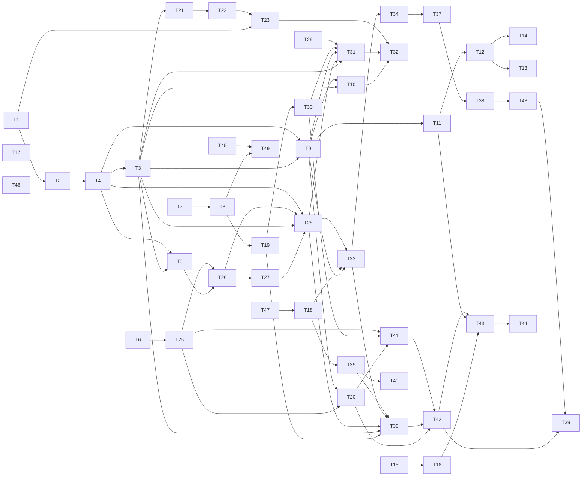

# nyotes round 2 fixes, by shape

status: in-progress
commit-mode: orchestrator-commits
language: ruby (plus the nvim Lua runtime under `lib/lain/frontend/neovim/runtime/` and `plugin/nvim/`)
panel: Linus Torvalds, Jeremy Evans, Sandi Metz, Richard Schneeman, Aaron Patterson

## Intent

Round 2 of the nyotes trial (`nyotes-notes.md`, `## Round 2`) logged about 60 findings. `planning/nyotes-round2-research-2026-11.md` traced them to 10 shapes.

This plan lands all 5 waves of that research's Option 2:
- A, epic correctness
- B, the approval wall
- C, the epic flow
- D, the cockpit
- E, cost

Each card fixes a shape at every site that has it, using a type lain already has, and deletes what back-compat no longer protects.

Wave A comes first because `/implement-epic` today never shows the implementer the issue file it was approved on. Round 3 of the trial should not run before it lands. Roadmap: `ROADMAP.md`, the planned item that follows `planning/specs/nyotes-trial-fixes.md`.

## Grounding

Date 2026-11-01, SHA `37121062`. The research's 5 agents read these, and 5 more agents grounded every card on the production path:
- `lib/lain/epic/`
- `lib/lain/cli/epic*.rb` and `lib/lain/cli/epic_driver/`
- `lib/lain/tools/epic_*.rb` and `lib/lain/tools/subagent*`
- `lib/lain/sensitivity*`, `lib/lain/approval/` and `lib/lain/shell/named.rb`
- `lib/lain/tool/bounds.rb`, `lib/lain/budget*`, `lib/lain/output_ceiling.rb` and `lib/lain/provider/`
- `lib/lain/compaction/`
- `lib/lain/frontend/` and `plugin/nvim/`
- `lib/lain/status_feed*`
- the skill templates in `lib/lain/prompt/templates/skill/`

The main session re-read 16 claims.

**Where the research and the code disagreed (the code won):**
- `Ceilings#meet` takes the minimum (`budget/ceilings.rb:12-13`), so it cannot raise the chat's iterations. The chat's budget is fixed when `Agent` is built (`cli/wiring.rb:596`, `agent.rb:95`).
- The HUD already shows ` run:N` (`status_feed/reading.rb:179`). The research's token-display card is dropped.
- `Tripwire::Resolution#toolchain?` is `ran?` with an extra condition (`tripwire/resolution.rb:15,19`), so adding it to `unresolved_exec` changes nothing. T17 adds a new predicate.
- `Review::Source` is a module of git-diff constructs. The document seam is `Review::Source::Corpus` (`review/source/corpus.rb:41`).
- `/critique` is a REPL line middleware (`middleware/skill_dispatch.rb`), so a skill cannot call it. T31 adds a tool.
- `Epic::Revision` is a private constant whose `inherit` unions edges back (`epic/graph.rb:30,73`), so an unlink cannot be built on it.
- `Bash` keeps only `ceiling + 1` bytes (`exec/capture.rb:43`), so spilling the whole output needs a file-backed capture.
- The `/api/show` probe is off for cloud (`provider/ollama/deployment.rb:316`). The trial saw ollama.com answer it for glm-5.3 with `thinking: {values: [low, high, max], default: max}` (`nyotes-notes.md` Round 2, step 5).
- `Agent`, `CLI::Backend` and `CLI::Wiring` are each at ClassLength 302 of 302, and `Frontend::InputPane` is at 287 (measured by the panel with a lowered limit). Every card that touches them says how it stays under.
- `GateParked` has a reader: `cli/epic_queue.rb:66,394` builds the overnight signoff queue from the `gate_parked` type string.
- E490 was not reproduced. Every fold command in `10_folds.lua` is `silent!`. The one unguarded command is `normal! zv` at `runtime/47_diff.lua:665`.

**Premises probed at runtime:**
- The research's agents ran `Shell::Named.of` and `Sensitivity::Regions.detect` on the trial's commands and digests (results in the research's Spike findings).
- The trial itself is the probe for the `/api/show` answer, the 429 body, the iteration stops and the compaction records.

## Compatibility

| Surface | Verdict | Evidence |
|---|---|---|
| Session journal records (`run_interrupted`, `approval_pending`, `gate_parked`, `compaction_decision`, `oracle_failed`) | free to break | Ruling 2026-10-28: old sessions are disposable (memory `old-sessions-disposable.md`). Each reader in `lib/` (`cli/epic_queue.rb`, `status_feed.rb`, `bench/session/`) migrates in the same card. |
| Epic home layout (`plans/`, `issues/<id>.md`, `epic.md` link grammar) | free to break | The only epic home on this box is `~/.local/state/lain/epics/9d832bf6a4ad/nyotes`, which is trial state; round 3 re-runs from `/research-epic`. |
| Gate digests (`issue_plan`, `epic_plan`) | free to break | They are recomputed from the artifact; standing approvals in old journals are disposable with them. |
| Tool input schemas (`epic_write`, `epic_graph`, `epic_submit`, `subagent`) | free to break | Model-facing and internal. VCR cassettes under `spec/fixtures/vcr_cassettes/e2e/` that record a schema are re-recorded (Integration checks). |
| `.lain/config.rb` keys | must keep (additive only) | Consumers `~/dev/nyotes/.lain/config.rb` and `~/dev/frugirl/.lain/config.rb`. New keys: `approval judge_timeout:` (T19), `review model:` (T30), `think` (T8), `budget iterations:` (T41). No key is renamed or removed. |
| The nvim plugin (`:LainStart`, `config.layout` in `plugin/nvim/lua/lain/config.lua`) | must keep | It is the user's own plugin. `:LainStart` keeps its name and `config.layout` keeps its shape (columns of buffer names). |
| The gem (`lain.gemspec`) | free to break | No release tags (`git tag` shows only a backup tag); not published. |
| CLI flags | must keep | No flag is removed. `--compact-bytes` stays as an override (T49, with a criterion). `--think` is new (T8). |

No must-keep surface blocks a large simplification, so no trade report was needed.

## Spike findings

| Question | Result | Evidence |
|---|---|---|
| Which trial commands does `Shell::Named` call opaque? | `$?` inside double quotes, `git -C X remote` and `branch`, bare `env`, `for`, inline awk. `;` and `2>&1 \| head` are not opaque. | research Spike findings, measured with `Shell::Named.of` |
| Do digests trip the secret detector? | sha256, md5, the ollama `digest` field, git commit, `commit-hash:` and lain's own `blake3:<64hex>` each give 1 region | research Spike findings, measured with `Regions.detect` |
| Does ollama.com answer `/api/show` for a cloud model? | yes, with `thinking.values` and `default` | `nyotes-notes.md` Round 2, the 17:48 step 5 entry |

No spike worktree was created.

## Shared files

Only the main session edits these. Cards hand back 1-line diffs.
- `.rubocop.yml`: any limit raise, in its own commit with the reason.
- `spec/support/slow_files.rb`: a new seam or e2e file.
- `spec/lain/telemetry/round_trip_spec.rb`: the list of journaled types (T6, T16, T33, T44).
- `spec/journalable_surface_spec.rb`: the same.
- `ARCHITECTURE.md` and `docs/commands.md`: a sentence per changed subsystem.
- `ROADMAP.md`

## Rejected options

- **Patch each finding where it occurred.** It leaves about 50 same-shape sites live and the hand lists drifting (research Option 1).
- **Replace the secret detector with detect-secrets or gitleaks rules.** They flag hex too, and the 2026-10-27 ruling adds no gem.
- **A `Role#max_iterations` lambda.** The ceiling table (T41) computes the allowance where the issue count is known.
- **Route opaque commands through the judge's `Overruled` bar.** A barred approve still goes to a human.
- **A new `epic_check` verify tool.** T2 removes what it would check.
- **Make the epic home a config `related` directory.** `related` means "flagged regions are masked silently" (`sensitivity.rb:528-532`). T9 adds a read root instead, so a secret in the home still parks.
- **Make the sessions dir a read root.** Stored tool output can hold secrets.
- **Key the output bar on region digests.** `Bar#include?` runs before the call, when no regions exist (`middleware/withhold_automatic_output.rb`). T16 names the shape instead.
- **One wave partition in `SignoffQueue`.** Per-issue partitions stay. A nil issue is refused for `issue_plan` (`epic/stage.rb:139`), and `ensure_approved!` stays per issue (T28).
- **Carry `hold` as a `Lain::Stopped` raise.** That cancels the tool call. T25 carries it on the result instead.
- **Place the compose windows (55, 52) through the placement policy.** They take focus and split under the cursor on purpose (`runtime/52_note_compose.lua:162`).
- **Resume a stopped child as a live actor.** A one-shot resume from the stopped head needs no live fiber (T42).
- **A token-total HUD card.** Already shipped (`status_feed/reading.rb:179`).

## Open decisions

None block a card.
- **T8's default thinking level.** It ships with no default, so the model's own default still applies. A later default (for example `high` for loops) is a bench question.
- **T41's numbers** (default 25, `plan-epic` 60, 25 plus 3 per issue for the other epic skills) are config values. Tune them from round 3.

## Dependency graph



Ids are global. T24 is unused; T47, T48 and T49 were split out of T14, T38 and T45 at review. Edges also order cards that share a file.

## Tasks

### Wave A: epic correctness

### T1: Carry each issue's test subject and level on `Epic::Issue`          [risk: medium]

**Depends on:** none

**Files:**
- `lib/lain/epic/issue.rb`
- `lib/lain/epic/document.rb`
- `lib/lain/epic/intake.rb`
- `lib/lain/epic/graph_fiber.rb`
- `lib/lain/cli/epic.rb`
- `lib/lain/cli/epic_driver/plan_subject.rb`
- `lib/lain/cli/epic_driver/factory.rb`
- `lib/lain/arm/plan_only.rb`
- `lib/lain/prompt/templates/skill/plan-epic/skill.md`
- specs:
  - `spec/lain/epic/issue_spec.rb`
  - `spec/lain/epic/document_spec.rb`
  - `spec/lain/epic/intake_spec.rb`
  - `spec/lain/epic/graph_laws_spec.rb`
  - `spec/lain/cli/epic_spec.rb`
  - `spec/lain/cli/epic_driver/plan_subject_spec.rb`
  - `spec/lain/cli/epic_driver/factory_spec.rb`
  - `spec/lain/skill/shipped_skills_spec.rb`

**Reuse:**
- `Document::LINK_FIELDS`, `SINGULAR_LINKS` and `WRITABLE_LINKS` (`epic/document.rb:56-67`)
- the `Writer#links` emitter
- `Issue#canonical` and `Issue#digest`
- `PlanSubject`'s layout checks (`placed`, `known`, `canonical!`), which stay in the factory

**Shared-file wiring:** none

**Reachable from:** `Epic::Home#read_epic -> Document.parse_markdown -> Draft#to_issue`. `CLI::EpicDriver::Factory#plan_for` (`cli/epic_driver/factory.rb:615`) reads `PlanSubject.of(issue)`.

`plan-epic` writes `Subject:` and `Level:` link lines in epic.md. `PlanSubject` reads them from the issue; the text path stays for `Arm::PlanOnly`, which has no Issue. Split copies no subject: each part must name its own, and the write refuses a part with none. Merge keeps the first issue's subject.

**Acceptance criteria**

```gherkin
Scenario: an issue's test subject rides in epic.md
  Given an epic.md whose issue "store-layout" carries "Subject: `src/store/layout.rs`" and "Level: unit"
  When the epic is read
  Then the issue's subject is "src/store/layout.rs" and its level is "unit"
  And writing the graph back emits both lines unchanged

Scenario: the epic driver reads the subject from the issue
  Given a mounted epic whose issue carries a subject and no plans/ directory exists
  When the epic driver plans that issue's failing tests
  Then the tests are generated against that subject

Scenario: a split part must name its own subject
  Given an issue with a subject
  When it is split into 2 parts with no subjects given
  Then the split is refused, naming the parts that need a subject
```

Spec files: `spec/lain/epic/document_spec.rb`, `spec/lain/cli/epic_driver/factory_spec.rb`, `spec/lain/cli/epic_spec.rb`

**Interface**

```ruby
Lain::Epic::Issue.new(id:, title:, ..., subject: nil, level: nil)
Lain::CLI::EpicDriver::PlanSubject.of(issue, layout:) # => PlanSubject
```

**Stop and report if:**
- `spec/lain/epic/graph_laws_spec.rb`'s round-trip law (`parse(to_markdown(g)) == g`) needs an exception for the new lines.
- `Issue#initialize` passes AbcSize 22. Extract the field cleaning first.

### T2: Render the issue file from the issue, the graph and the authored file          [risk: high]

**Depends on:** T1

**Files:**
- `lib/lain/epic/issue_view.rb` (new)
- `lib/lain/tools/epic_write.rb`
- `lib/lain/epic/home.rb`
- `lib/lain/frontend/neovim/epic_doc_view.rb`
- `lib/lain/cli/epic.rb`
- `lib/lain/prompt/templates/skill/create-epic-issues/skill.md`
- `lib/lain/prompt/templates/skill/create-epic-issues/conventions.md`
- specs:
  - `spec/lain/epic/issue_view_spec.rb` (new)
  - `spec/lain/tools/epic_write_spec.rb`
  - `spec/lain/frontend/neovim/epic_doc_view_spec.rb`
  - `spec/lain/cli/epic_spec.rb`
  - `spec/lain/skill/shipped_skills_spec.rb`

**Reuse:**
- `Epic::Document::Writer` (the pattern) and `Epic::Mermaid`
- `Graph#blocked_by`
- `Gherkin::Criteria.parse` (Enumerable over Data scenarios)
- `Home::Journaled` byte digests

**Shared-file wiring:** none

**Reachable from:** `CLI::EpicMount` builds `Tools::EpicWrite.new(homes:)` (`cli/epic_mount.rb:314`). `Frontend::Neovim::EpicDocView#update` and `CLI::Epic#document` (`cli/epic.rb:415`) build the view.

The file on disk, `issues/<id>.md`, holds only authored sections: prose, added scenarios and references. `IssueView` composes the full view on read:
1. the `# id -- title` header
2. the authored prose
3. `Issue#criteria` verbatim, then the added scenarios
4. the references
5. Links from the graph

`epic_write` with `artifact: issue` refuses an authored file that carries a link line, or that restates an epic scenario by name. Its message says that lain renders those.

**Acceptance criteria**

```gherkin
Scenario: the epic's scenarios are carried verbatim by construction
  Given an issue whose epic criteria hold 2 scenarios and an authored file adding 1
  When the issue view is rendered
  Then it holds the 2 epic scenarios byte for byte, then the added one
  And its Links list Blocks and Blocked by from the graph

Scenario: an authored file cannot carry derived lines
  Given an authored issue file with a "Blocked by:" line
  When epic_write writes it
  Then the write is refused with a message naming the graph as the source

Scenario: a graph change shows in the view with no rewrite
  Given an issue view rendered once
  When an edge is added to the graph
  Then the next render lists the new edge
```

Spec files: `spec/lain/epic/issue_view_spec.rb`, `spec/lain/tools/epic_write_spec.rb`

**Interface**

```ruby
Lain::Epic::IssueView.new(issue:, graph:, authored:)  # authored: String
  #to_markdown # => String
  #digest      # => "blake3:..."
```

**Stop and report if:**
- `Epic::Review` (`lib/lain/epic/review.rb`) edits the issue file through a path that writes the full view back to disk. The review flow must edit the authored file only.
- `spec/lain/epic/review_spec.rb` pins a full-file edit.

### T4: Gate, show and build from the issue view          [risk: high]

**Depends on:** T2

**Files:**
- `lib/lain/epic/submission.rb`
- `lib/lain/cli/epic_submit.rb`
- `lib/lain/cli/epic_driver/issue_actor.rb`
- `lib/lain/tools/request_review.rb`
- `lib/lain/tools/epic_submit.rb`
- specs:
  - `spec/lain/epic/submission_spec.rb`
  - `spec/lain/cli/epic_submit_spec.rb`
  - `spec/lain/cli/epic_driver/issue_actor_spec.rb`
  - `spec/lain/tools/request_review_spec.rb`
  - `spec/lain/tools/epic_submit_spec.rb`
  - `spec/lain/epic/gate/adjudicator_spec.rb`
  - `spec/lain/cli/epic_driver/factory_spec.rb`
  - `spec/lain/cli/epic_land_spec.rb`

**Reuse:**
- `Submission.issue_plan` and `Canonical.digest`
- `Contracts::Prose.check!`
- `IssueActor::Brief` sections
- the adjudicator `Brief#sources`

**Shared-file wiring:** none

**Reachable from:**
- Tool `epic_submit -> CLI::EpicSubmit::InChat#submit -> Artifacts#submission -> Submission.issue_plan`.
- `CLI::EpicDriver::Factory#actors -> IssueActor.new -> Brief.new` (`issue_actor.rb:440`).

**Changes:**
- **Digest:** the issue_plan digest is `Canonical.digest` over the issue's digest and `IssueView#digest`.
- **Gate prompt:** it carries the issue title, its Blocked by ids, its scenario names and the path `lain://epic/<slug>/issues/<id>`, in place of "N bytes".
- **Implementer brief:** `IssueActor#call` (`issue_actor.rb:356`) renders the view once, checks that view's digest against the issue_plan approval, and hands that same view to `Brief` and to the failing tests. An edit between the approval check and the brief therefore cannot reach the implementer. The `planned` section is replaced by the view under "## The issue". The brief no longer names `plans/`.
- **Failing tests:** `criteria_of` (`issue_actor.rb:415`) parses the view's whole criteria block (the epic scenarios and the added ones), so every scenario the brief shows has a red test.
- **Re-checks:** `ensure_plan_approved!` (`cli/epic_submit.rb:665`) rebuilds the same digest.

**Acceptance criteria**

```gherkin
Scenario: editing the authored issue file reopens its gate
  Given issue "ingest-cmd" approved at the issue_plan stage
  When its authored file gains a scenario
  Then ensure_plan_approved! for "ingest-cmd" refuses, naming the gate

Scenario: the implementer is handed the issue it was approved on
  Given an approved issue with authored prose "writes meta.json with the end time"
  When the epic driver seeds that issue's implementer
  Then the brief holds that sentence and the issue's added scenarios
  And it names no plans/ path
  And a failing test exists for each added scenario

Scenario: an edit after approval does not reach the implementer
  Given an approved issue whose authored file is edited after approval
  When the epic driver seeds that issue's implementer
  Then it refuses, naming the issue_plan gate

Scenario: the gate prompt shows what is judged
  Given an issue_plan submission for "list-cmd"
  When the gate question is built
  Then it names the issue's title, its blockers, its scenario names and its view path
```

Spec files: `spec/lain/cli/epic_submit_spec.rb`, `spec/lain/cli/epic_driver/issue_actor_spec.rb`, `spec/lain/epic/submission_spec.rb`

**Interface**

```ruby
Lain::Epic::Submission.issue_plan(view:, slug:, issue_id:) # view: Epic::IssueView
```

**Stop and report if:**
- `GateDecision` readers (`lib/lain/epic/signoff_queue.rb`, `lib/lain/cli/epic_queue.rb`) key on `criteria_digest`, and dropping it from `Submission` breaks `spec/lain/epic/signoff_queue_spec.rb`.
- The render is not deterministic across two reads of one home (the digest must match in `ensure_plan_approved!`).

### T3: Delete `plans/` and every path that reads it          [risk: medium]

**Depends on:** T4

**Files:**
- `lib/lain/epic/home.rb`
- `lib/lain/epic/home/journaled.rb`
- `lib/lain/epic.rb`
- `lib/lain/tools/epic_write.rb`
- `lib/lain/tools/request_review.rb`
- `lib/lain/cli/epic.rb`
- `lib/lain/frontend/neovim/epic_doc_view.rb`
- skills:
  - `lib/lain/prompt/templates/skill/create-epic-issues/skill.md`
  - `lib/lain/prompt/templates/skill/implement-issue/skill.md`
  - `lib/lain/prompt/templates/skill/research-epic/skill.md`
  - `lib/lain/prompt/templates/skill/plan-epic/skill.md` (Phase 5 at `:132-134`, if T1 left any `plans/` mention)
- `lib/lain/arm/plan_only.rb` (the comments at `:17,30` that cite `plans/`)
- fixtures: `spec/fixtures/altitude/epic/demo/plans/ledger.md`, `spec/fixtures/altitude/epic/demo/plans/report.md`
- specs:
  - `spec/lain/epic/home_spec.rb`
  - `spec/lain/epic/home/journaled_spec.rb`
  - `spec/lain/tools/epic_write_spec.rb`
  - `spec/lain/cli/epic_spec.rb`
  - `spec/lain/cli/epic_land_spec.rb`
  - `spec/lain/cli/epic_submit_spec.rb`
  - `spec/lain/cli/epic_driver/issue_actor_spec.rb`
  - `spec/lain/frontend/neovim/epic_doc_view_spec.rb`
  - `spec/lain/frontend/neovim/runtime/63_epic_doc_spec.rb`
  - `spec/lain/bench/altitude_spec.rb`
  - `spec/lain/skill/shipped_skills_spec.rb`

**Reuse:** `Epic::DOC_KINDS` (`lib/lain/epic.rb:45`)

**Shared-file wiring:** none

**Reachable from:** `CLI::EpicMount -> Tools::EpicWrite` and `Epic::Home` (the deletion is reached by every caller listed under Files).

**Changes:**
- `epic_write` refuses `artifact: plan` with a message naming the `Subject:` line.
- `DOC_KINDS` drops `plan`. A journaled `doc_written` of kind `plan` from an old session is read as `Untyped`, the 2026-10-29 rule for unknown records.
- The altitude fixtures move their subjects into the fixture's epic.md.

**Acceptance criteria**

```gherkin
Scenario: a plan file can no longer be written
  Given a mounted epic
  When epic_write is called with artifact plan
  Then it is refused, naming the Subject line in epic.md as the place for a test subject

Scenario: the shipped skills never mention plans/
  When every shipped skill template is rendered
  Then none contains "plans/"
```

Spec files: `spec/lain/tools/epic_write_spec.rb`, `spec/lain/skill/shipped_skills_spec.rb`

**Stop and report if:**
- `spec/lain/bench/altitude_spec.rb` or `spec/lain/bench/plan_sweep_spec.rb` scores against the plan file bytes, so moving the subject changes a recorded score.

### T5: Carry a gate reason whole, its lines indented under the verdict          [risk: medium]

**Depends on:** T4, T3

**Files:**
- `lib/lain/epic/submission.rb`
- `lib/lain/cli/epic_submit.rb`
- `spec/lain/epic/submission_spec.rb`
- `spec/lain/cli/epic_submit_spec.rb`

**Reuse:**
- `Tool::Bounds::RESULT_BYTES` and the `Handback` overrun notice (`lib/lain/tool/bounds.rb`)
- `Utf8.escaped`

**Shared-file wiring:** none

**Reachable from:** `CLI::EpicSubmit::Prompt#answer` and `Hearing#verdict -> Epic::GateReply.answer -> Verdict#denied`.

**Changes:**
- `REASON_LIMIT = 300` goes. A reason keeps its newlines.
- `Verdict#denied` indents every continuation line by 4 spaces under `reason:`, so a line reading "approved abc" cannot pose as a verdict.
- A reason over `RESULT_BYTES` is cut with "[reason cut at N of M bytes]".
- The `unrecognised` branch keeps a 300-byte clip of the unrecognised reply.

**Acceptance criteria**

```gherkin
Scenario: a long, numbered human reason reaches the agent whole
  Given a gate denied with a 700-character reason of 4 numbered lines
  When the epic_submit result is built
  Then it holds all 700 characters, each line indented under "reason:"

Scenario: a reason line cannot pose as a verdict
  Given a denial whose reason contains a line "approved blake3:abc"
  When the result is built
  Then that line is indented and no unindented line says approved
```

Spec files: `spec/lain/epic/submission_spec.rb`, `spec/lain/cli/epic_submit_spec.rb`

**Stop and report if:**
- `spec/lain/epic/submission_spec.rb:244-245` (newlines fold) guards a reader other than `Verdict#denied`. Grep `GateReply` callers first.

### T6: Stop on a provider quota with the provider's words, and never retry it          [risk: medium]

**Depends on:** none

**Files:**
- `lib/lain/provider/http/quota_error.rb` (new)
- `lib/lain/provider/http/error_middleware.rb`
- `lib/lain/provider/http/connection/middleware_stack.rb`
- `lib/lain/agent/stop_reason.rb`
- `lib/lain/telemetry/run_interrupted.rb`
- `lib/lain/telemetry/provider_retry.rb`
- `lib/lain/cli/repl/ask.rb`
- `lib/lain/session_record/scribe.rb`
- `lib/lain/cli/chronicle.rb`
- specs:
  - `spec/lain/provider/http/error_middleware_spec.rb`
  - `spec/lain/provider/http/connection/middleware_stack_spec.rb`
  - `spec/lain/agent/stop_reason_spec.rb`
  - `spec/lain/telemetry/run_interrupted_spec.rb`
  - `spec/lain/cli/chronicle_spec.rb`

**Reuse:**
- the body-regex selection that `context_length_exceeded?` uses (`error_middleware.rb:47-49`)
- the closed `RunInterrupted::REASONS` and the `StopReason::RULES` ladder
- `AnthropicWire::RESET_HEADER_PARSER` for `Retry-After`

**Shared-file wiring:** `spec/lain/telemetry/round_trip_spec.rb`: the `run_interrupted` example gains `detail` and `reset_at`.

**Reachable from:**
- `Backend#provider` (`cli/backend/ollama_tier.rb:208`) `-> Provider::Ollama.cloud -> build_config -> HTTP::MiddlewareStack`.
- `Backend#anthropic_provider -> Provider::Anthropic.new`.

**Changes:**
- **Classification:** a 429 whose body says usage, quota, limit reached or credits is a `QuotaError`. It is a sibling of `RateLimitError`, not a subclass, so faraday-retry does not match it. It is checked before the context-length patterns.
- **Stop reason:** a `quota` rule sits before `transport` and tests the whole error chain, because `Wrapping#wrap_error` keeps the response only on `#cause`.
- **Records:** `run_interrupted` carries `detail` (the provider's message, bounded) and `reset_at` when a reset header is present.
- **Unchanged:** a concurrency 429 stays a retried `RateLimitError`, so `RetryTap` still narrows on it.

**Acceptance criteria**

```gherkin
Scenario: a usage-quota 429 stops at once and says so
  Given ollama cloud answers 429 with "you have reached your session usage limit"
  When a chat turn runs
  Then exactly 1 request is sent
  And the journal records run_interrupted with reason quota and the provider's message as detail

Scenario: a per-minute rate limit is still retried
  Given Anthropic answers 429 "rate limit: input tokens per minute" then 200
  When a chat turn runs
  Then the turn completes after 1 retry
```

Spec files: `spec/lain/provider/http/error_middleware_spec.rb`, `spec/lain/agent/stop_reason_spec.rb`, `spec/lain/provider/http/connection/middleware_stack_spec.rb`

**Interface**

```ruby
class Lain::Provider::HTTP::QuotaError < Lain::Provider::HTTP::Error; end
Lain::Telemetry::RunInterrupted.new(..., detail: nil, reset_at: nil)
```

**Stop and report if:**
- `spec/lain/provider/ollama/streamed_failure_spec.rb` shows the streaming path (`ollama/streamed_failure.rb:59`) parses errors without `ErrorMiddleware.parse_error`, so the body never reaches the classifier.

### T7: Size the output ceiling from a published window, capped          [risk: low]

**Depends on:** none

**Files:** `lib/lain/output_ceiling.rb`, `spec/lain/output_ceiling_spec.rb`, `spec/lain/cli/backend_spec.rb`

**Reuse:** `ContextWindow#authoritative?` (`lib/lain/context_window.rb:373`), `OutputCeiling::PerModel`

**Shared-file wiring:** none

**Reachable from:** `CLI::Backend#max_tokens` (`cli/backend.rb:899-906`) `-> OutputCeiling::PerModel -> Context#initialize -> OutputCeiling.for`

A `PUBLISHED` or `PROBED` window gives `min(window, PUBLISHED_CAP)` with `PUBLISHED_CAP = 131_072` and source `:published_window`. A guessed window keeps `FALLBACK_TOKENS`. A table row still wins.

**Acceptance criteria**

```gherkin
Scenario: glm-5.3 on ollama cloud is not cut at 32,768
  Given ollama-cloud model glm-5.3 with its published 1,000,000-token window
  When the chat's output ceiling is resolved
  Then it is 131072 with source published_window
```

Spec file: `spec/lain/output_ceiling_spec.rb`

**Stop and report if:**
- `spec/lain/cli/resume/mismatch_notices_spec.rb` treats a new `max_tokens_source` value as a mismatch.

### T8: Send a configured thinking level that the model reports it accepts          [risk: medium]

**Depends on:** T7

**Files:**
- `lib/lain/cli/backend/thinking.rb` (new)
- `lib/lain/cli/backend.rb`
- `lib/lain/provider/ollama/deployment.rb`
- `lib/lain/provider/ollama.rb`
- `lib/lain/config.rb`
- `lib/lain/config/builder.rb`
- specs:
  - `spec/lain/cli/backend/thinking_spec.rb` (new)
  - `spec/lain/provider/ollama/deployment_spec.rb`
  - `spec/lain/config_spec.rb`
  - `spec/lain/config/builder_spec.rb`

**Reuse:**
- `Request#extra` with `THINK_KEY` (`provider/ollama/encoding.rb:48`)
- the `/api/show` probe in `Provider::Ollama#model_capabilities`
- `OutputCeiling::PerModel`, the per-model slot pattern

**Shared-file wiring:** none

**Reachable from:** `CLI::Backend#context` (`cli/backend.rb:451`) `-> sampler_extra -> Backend::Thinking#extra_for(model)`

**Changes:**
- A `think "low"` config key, also accepted as `--think`.
- The value is checked against the model's `thinking.values` from `/api/show`. The cloud deployment turns the metadata probe on (the trial saw ollama.com answer it).
- An unknown level is refused at launch, naming the accepted ones.
- No key means nothing is sent, which is today's behaviour.
- The new code lives in `backend/thinking.rb`, because `Backend` is at its ClassLength limit.

**Acceptance criteria**

```gherkin
Scenario: a configured level the model accepts is sent
  Given config think "low" and a model whose /api/show lists thinking values low, high, max
  When a chat request is encoded
  Then its body carries think "low"

Scenario: a level the model does not accept is refused at launch
  Given config think "medium" and the same model
  When lain starts
  Then it exits naming low, high and max
```

Spec files: `spec/lain/cli/backend/thinking_spec.rb`, `spec/lain/config/builder_spec.rb`

**Stop and report if:**
- Turning the probe on for cloud changes `spec/support/shared_examples/ollama_deployment.rb`'s request count for a plain chat. The cloud probe must then be lazy.

### Wave B: the approval wall

### T9: Build one read-roots value per session and lend the epic home to every agent          [risk: high]

**Depends on:** T4, T3

**Files:**
- `lib/lain/cli/wiring/board_build.rb`
- `lib/lain/sensitivity/policy.rb`
- `lib/lain/cli/tool_guard.rb`
- `lib/lain/cli/epic_driver/issue_actor.rb`
- `lib/lain/confine/profiles.rb`
- `lib/lain/confine/mask_list.rb`
- `lib/lain/approval/escalation.rb`
- `lib/lain/middleware/gate.rb`
- specs:
  - `spec/lain/sensitivity/policy_spec.rb`
  - `spec/lain/middleware/gate_spec.rb`
  - `spec/support/shared_examples/sensitivity_policy.rb`
  - `spec/lain/cli/wiring/board_build_spec.rb`
  - `spec/lain/cli/tool_guard_spec.rb`
  - `spec/lain/cli/epic_driver/issue_actor_spec.rb`
  - `spec/lain/confine/profiles_spec.rb`
  - `spec/lain/approval/escalation_spec.rb`
  - `spec/lain/seams/epic_home_read_spec.rb` (new, `:seam`)

**Reuse:**
- `Sensitivity::Roots` (`|`, `held?`)
- `Policy::Confined`
- `WorkerEnv#read_roots`
- `Tools::Subagent::Spill.home`, the answers dir already lent at `board_build.rb:88`
- `Epic::Home.container`

**Shared-file wiring:** `spec/support/slow_files.rb` gains `spec/lain/seams/epic_home_read_spec.rb` if it runs over the threshold.

**Reachable from:** `CLI::Wiring` (`cli/wiring.rb:921`) `-> BoardBuild.for` builds the session's `Roots` and passes it to `Sensitivity::Policy.new(read_roots:)`. Children get it through `ToolGuard.confined`.

**Changes:**
- **Read roots:** the project root, the answers dir and, when `epics_home` is `:xdg`, the epic home container.
- **Write roots:** the project root only.
- **`Confined`:** it gains a separate `write_roots`. `Gate#writes_outside?` reads write roots, and `Triage#project` and the read gates read read roots.
- **The OS sandbox:** `Confine::Profiles#reader` mounts the read roots read-only. Config `related` keeps its masking meaning.
- **Sealed and unattended roles** (`court_clerk`, `meta_*`, `evidence_researcher`) get the same read roots, so their reads of the epic home stop being refusals. Their writes are unchanged.
- **Cleanup:** `IssueActor::Lanes#reading` (`issue_actor.rb:216`, called at `:378`) loses its special lending, because it is now the default.

**Acceptance criteria**

```gherkin
Scenario: a chat-spawned child reads the epic home without a human
  Given a mounted epic in the XDG epic home and a researcher child
  When the child reads epic.md with read_file and with bash cat
  Then both reads succeed with no approval asked

Scenario: the epic home is still not writable by a raw write
  Given the same child
  When it calls write_file on a path in the epic home
  Then the write is gated as outside the project

Scenario: a shell write into the epic home is still gated
  Given the same child
  When it runs each of: echo x >> <home>/epic.md / sed -i s/a/b/ <home>/epic.md / rm <home>/issues/a.md / cp /tmp/x <home>/issues/a.md
  Then each is gated as a write outside the project, by Gate#writes_outside? and by Escalation#project

Scenario: the sandbox mount of the epic home is read-only
  Given a sandboxed bash call that a rule approved
  When it writes into the epic home
  Then the write fails inside the sandbox and the file is unchanged

Scenario: a secret in the epic home still parks
  Given research.md in the epic home holds a credential-shaped token
  When the child reads it
  Then the read parks for a human, the same as in the project
```

Spec files: `spec/lain/seams/epic_home_read_spec.rb`, `spec/lain/sensitivity/policy_spec.rb`

**Interface**

```ruby
Lain::Sensitivity::Policy.new(..., read_roots: Lain::Sensitivity::Roots.none)
Lain::Sensitivity::Policy::Confined.new(roots:, write_roots:, policy:, anchors:)
```

**Stop and report if:**
- `spec/lain/confine/profiles_spec.rb` shows that the bwrap reader cannot mount a second read-only tree without the `related` mask list.
- `cli/gateway.rb:99` or `bench/approval_replay/stack.rb:163` needs the new keyword, beyond its default.

### T10: Refuse a raw write into the epic home, naming `epic_write` and `epic_graph`          [risk: medium]

**Depends on:** T9, T3

**Files:**
- `lib/lain/sensitivity/policy.rb`
- `lib/lain/middleware/confine_to_scope.rb`
- `lib/lain/tools/epic_write.rb`
- `spec/lain/sensitivity/policy_spec.rb`
- `spec/lain/middleware/confine_to_scope_spec.rb`

**Reuse:** the `Policy#denial` and `own_denial` mechanism that the account-file refusals use

**Shared-file wiring:** none

**Reachable from:** `BoardBuild.for -> Sensitivity::Policy.new(epic_home:)`, the same construction site as T9

**Changes:**
- `edit_file` and `write_file` landing in the XDG epic home are refused outright. The message is "the epic home changes through epic_write and epic_graph".
- The in-repo layout (`epics_home :repo`) is unaffected.
- The `ConfineToScope` comment about `epic_write` is reworded to point at this rule.

**Acceptance criteria**

```gherkin
Scenario: the parent edits epic.md by hand
  Given a chat with a mounted XDG epic
  When the agent calls edit_file on epic.md
  Then the call is refused at once with a message naming epic_write and epic_graph
  And no approval is parked
```

Spec file: `spec/lain/sensitivity/policy_spec.rb`

**Stop and report if:**
- `Epic::Review`'s human edit path writes through `edit_file` on the agent's behalf (`spec/lain/epic/review_spec.rb`).

### T11: Decide `ComposedTerm`'s confinement and the judge's reach from the session roots          [risk: high]

**Depends on:** T9

**Files:**
- `lib/lain/approval/root.rb`
- `lib/lain/approval/composed_term.rb`
- `lib/lain/cli/wiring/board_build.rb`
- `lib/lain/approval/judged.rb`
- specs:
  - `spec/lain/approval/root_spec.rb`
  - `spec/lain/approval/composed_term_spec.rb`
  - `spec/lain/approval/judged_spec.rb`
  - `spec/lain/cli/wiring/board_build_spec.rb`

**Reuse:** `Sensitivity::Roots#held?`, `Approval::Root`'s guards (tilde, NUL, relative, `Nowhere`)

**Shared-file wiring:** none

**Reachable from:** `BoardBuild.confinement` (`board_build.rb:267`) `-> ComposedTerm`, and `Judged#outside`

**Changes:**
- **`Approval::Root`** wraps the session read roots and keeps its lexical guards in front of `Roots#held?`. A read under the epic home now passes predicate 7.
- **Tilde:** `~/` expands from the session's own home value, the way `Shell::Named::HOMED` does (`named.rb:55,118`). So no `getpwnam` lookup ever runs, which is why `Root` refuses tilde today (`root.rb:54-61`). `~user`, and any other word starting with `~`, stays refused before expansion.
- **Reads and writes:** predicate 7 takes the read roots. A word that the command writes is checked against the write roots, so a write into the epic home still fails it.
- **`Judged`:** `held_to` and `within?` are deleted in favour of the session roots. `Judged#outside` keeps its split (writable paths on the write roots, readable paths on the read roots). `Judged#place_for`'s `human_checkout` tree reads the same roots.

**Acceptance criteria**

```gherkin
Scenario: a composed read of the epic home is approved with no model
  Given a mounted XDG epic
  When the agent runs "grep -n Blocked ~/.local/state/lain/epics/<key>/nyotes/epic.md"
  Then ComposedTerm approves it and the judge is not asked

Scenario: another user's home is still refused before expansion
  When the agent runs each of: cat ~other/secret / cat ~root/x / cat ~
  Then predicate 7 fails for each, with no user lookup

Scenario: a home-relative path that climbs out is not approved
  When the agent runs "cat ~/../../etc/passwd"
  Then predicate 7 fails

Scenario: a composed write into the epic home is not approved
  When the agent runs "sed -i s/a/b/ ~/.local/state/lain/epics/<key>/nyotes/epic.md"
  Then ComposedTerm does not approve it and the call goes to the judge or a human
```

Spec files: `spec/lain/approval/composed_term_spec.rb`, `spec/lain/approval/root_spec.rb`

**Stop and report if:**
- `spec/lain/approval/root_spec.rb`'s `Nowhere` cases (root is `$HOME`) cannot be kept with a roots value that includes a path under `$HOME`.

### T12: Read more of a shell command before calling it opaque          [risk: high]

**Depends on:** T11

**Files:**
- `lib/lain/shell/named.rb`
- `lib/lain/shell/named/loop_reading.rb` (new)
- `lib/lain/shell/programs.rb`
- `spec/lain/shell/named_spec.rb`
- `spec/lain/approval/judged_spec.rb`

**Reuse:**
- `Shell::Named::Walk#stages`
- the `-C` position test already at `named.rb:722`
- `Programs::WRAPPERS`
- `runs_code?`

**Shared-file wiring:** none

**Reachable from:** `Approval::Judged#unlooked` (`judged.rb:323`) `-> Shell::Named.of`, built per call by the judge path in `BoardBuild`

**New readings, each with abuse cases in a new `describe "what stays opaque"` group:**
- `$?`, `$$` and `$#` inside double quotes are integers that name no path.
- A git `-C` before the subcommand is git's own, whatever the subcommand.
- A bare `env` with no command after it is a reader.
- An awk program with no `system`, `getline`, pipe, `print >` or `printf >` is readable.
- A `for x in <words>; do <readers>; done` loop is readable when its words are literal paths. It goes in its own class, because `Walk` is near the limit.

**Acceptance criteria**

```gherkin
Scenario: the trial's probes are no longer opaque
  Given each of: ls src; echo "exit=$?" / git -C /p/n remote -v / env | grep XDG / awk '/Blocked/ {print FILENAME}' issues/a.md / for f in a.md b.md; do cat $f; done
  When Shell::Named reads it
  Then it is not opaque and names its paths

Scenario: what can run code stays opaque
  Given each of: awk 'BEGIN{system("id")}' / awk -f prog.awk a.md / gawk '@load "x"; {print}' a.md / gawk '@include "x"' / env sh -c id / for f in $(ls); do cat $f; done / echo "$(id)"
  When Shell::Named reads it
  Then it is opaque

Scenario: git -C still names the write at its directory
  When Shell::Named reads git -C /outside commit -m x
  Then it names a write at /outside
```

Spec file: `spec/lain/shell/named_spec.rb`

**Stop and report if:**
- `Named::Program` or `Named::Walk` passes ClassLength 302. Extract a reading class first.
- `spec/lain/middleware/parsed_command_spec.rb` relies on `env` being a wrapper.

### T14: Read program data options as data, keeping every `@file` a path          [risk: high]

**Depends on:** T12

**Files:** `lib/lain/shell/named.rb` (the `Argv` class), `spec/lain/shell/named_spec.rb`

**Reuse:** the `VALUES` table in `Argv` (`named.rb:253`)

**Shared-file wiring:** none

**Reachable from:** `Approval::Judged#unlooked -> Shell::Named.of`

**Changes:**
- A `DATA_OPTIONS` table beside `VALUES` in `Argv` covers:
  - curl: `-d`, `--data`, `--data-raw`, `--data-binary`, `--data-urlencode`, `--json`, `-F`, `--form`, `-H`, `-X`, `-A`, `-u` and `-e`
  - `git commit -m`
  - `gh api -f`
- Their values are data, not paths.
- An `@`-prefixed value of any of them is still a path: `-d @f`, `--data-binary @f`, `--json @f`, `-H @f`, `-F x=@f`, `--data-urlencode n@f`. A secret-path gate therefore still sees the file read.

**Acceptance criteria**

```gherkin
Scenario: a curl JSON body is not a path
  When Shell::Named reads curl -X POST 127.0.0.1:11434/api/chat -d '{"model":"x"}'
  Then it names no path under the cwd for the body

Scenario: every curl file read is still named
  When Shell::Named reads each of: curl -d @a.json u / curl --data-binary @a u / curl --json @a u / curl -H @h u / curl -F x=@a u / curl --data-urlencode n@a u
  Then each names the file after the @ as a read path
```

Spec file: `spec/lain/shell/named_spec.rb`

**Stop and report if:**
- An existing `curl` case in `spec/lain/shell/named_spec.rb` expects a data value to be named as a path.

### T47: Bound a park reason, pointing at the full call          [risk: low]

**Depends on:** none

**Files:** `lib/lain/approval/parked/queue.rb`, `spec/lain/approval/parked/queue_spec.rb`

**Reuse:** `Tool::Bounds` notice wording

**Shared-file wiring:** none

**Reachable from:** `Approval::Parked::Queue#park` builds `Reason` (`queue.rb:64`); `CLI::Switchboard` builds the queue (`cli/switchboard.rb:492`)

`Parked::Queue::Reason` bounds its text at 400 characters, keeping the start, with "[cut at 400 of N characters; the full call is in lain://approval]".

**Acceptance criteria**

```gherkin
Scenario: a park reason stays readable
  Given a park reason of 900 characters
  When the approval prompt is built
  Then the reason shows its first 400 characters and says it was cut at 400 of 900
```

Spec file: `spec/lain/approval/parked/queue_spec.rb`

**Stop and report if:**
- `Reason` is compared by value in `spec/lain/approval/parked/policy_switch_spec.rb`, so a bounded copy breaks equality.

### T13: Approve lain's own read-only subcommands with no model          [risk: low]

**Depends on:** T12

**Files:**
- `lib/lain/approval/composed_term.rb` (the `PROGRAMS` table)
- `spec/lain/approval/composed_term_spec.rb`

**Reuse:** `ComposedTerm::PROGRAMS` entries with subcommand allowlists

**Shared-file wiring:** none

**Reachable from:** `BoardBuild.confinement -> ComposedTerm`

`lain epic status`, `lain epic show`, `lain epic graph` and `lain --version` are readers. `lain watch` is left out: it reads session journals, which the plan keeps out of read roots because stored output can hold secrets.

**Acceptance criteria**

```gherkin
Scenario: lain's own status command needs no human
  When the agent runs "lain epic status nyotes"
  Then ComposedTerm approves it

Scenario: a writing subcommand still asks
  When the agent runs "lain epic submit nyotes"
  Then ComposedTerm does not approve it
```

Spec file: `spec/lain/approval/composed_term_spec.rb`

**Stop and report if:**
- `lain` resolves through `Programs::RUNNERS` (a binstub), so the table entry never matches.

### T15: Treat exact-width hex and lain's own digests as digests, not secrets          [risk: high]

**Depends on:** none

**Files:**
- `lib/lain/sensitivity/entropy.rb`
- `lib/lain/sensitivity/regions.rb`
- `spec/lain/sensitivity/entropy_spec.rb`
- `spec/lain/sensitivity/regions_spec.rb`
- `spec/fixtures/sensitivity/digest_corpus.yml` (new)

**Reuse:** `Entropy.predictable?`, `ORDINARY_VALUE`, `CHECKSUM_WORD`

**Shared-file wiring:** none

**Reachable from:** `Sensitivity::Regions.detect`, used by `Middleware::RedactSecretReads`, `Middleware::WithholdAutomaticOutput` and `Sensitivity::Display`, all built in `BoardBuild`

**Changes:**
- Lowercase hex of exactly 32, 40, 64 or 128 characters is predictable. The case is explicit, because `HEX` is `/i` today.
- `blake3:`, `sha256:`, `sha1:` and `md5:` prefixes with any of those widths are ordinary (`ORDINARY_VALUE` goes up to 128).
- `CHECKSUM_WORD` gains `digest`, `sha1`, `md5` and `commit`.
- A corpus fixture holds both kinds of case:
  - the trial's lines, as digests: sha256sum, md5sum, the ollama digest, git commit, `commit-hash:` and lain's `blake3:`;
  - real secret shapes that must still match: an AWS key, a GitHub token, a mixed-case 40-character key, and lowercase hex behind a hinted name, as each of `api_key = "<64hex>"`, `export GITHUB_WEBHOOK_SECRET=<64hex>`, `"client_secret": "<32hex>"` and `Authorization: Bearer <64hex>`;
  - the known miss, recorded as one: a `.env` line `X=<64hex>` whose name carries no hint.
- `Entropy.hinted?` (`entropy.rb:62`) returns early on `predictable?`. The hinted path must still flag hex behind a hint, so the exact-width rule applies only when no hint is present.

**Acceptance criteria**

```gherkin
Scenario: a digest list reads with no region
  Given "b56e5bab...7a1d43  downloads/ami.zip" and '{"digest":"<64 lowercase hex>"}' and "turn: blake3:<64 hex>"
  When regions are detected
  Then none is found

Scenario: a keyed 64-hex secret still matches
  Given 'api_key = "<64 lowercase hex>"'
  When regions are detected
  Then 1 region is found
```

Spec files: `spec/lain/sensitivity/regions_spec.rb`, `spec/lain/sensitivity/entropy_spec.rb`

**Stop and report if:**
- `spec/lain/sensitivity/literals_spec.rb`'s hinted corpus (`spec/fixtures/sensitivity/hinted_corpus.yml`) loses a labelled true positive.

### T16: Say which shape withheld an automatically approved output          [risk: low]

**Depends on:** T15

**Files:**
- `lib/lain/middleware/withhold_automatic_output.rb` (its nested `AutomaticOutputWithheld` record, `:62`)
- `spec/lain/middleware/withhold_automatic_output_spec.rb`

**Reuse:** `Regions` match kinds, the `AutomaticOutputWithheld` Data record

**Shared-file wiring:** none (`AutomaticOutputWithheld` is a middleware record, not in the telemetry round trip)

**Reachable from:** `BoardBuild` installs `WithholdAutomaticOutput` in the tool stack

The withheld message names the matched shape kinds (for example "1 high-entropy token") and says that a human approval shows the output masked, so a respelling does not help. The bar stays keyed on the command.

**Acceptance criteria**

```gherkin
Scenario: the agent is told what it hit
  Given a judge-approved command whose output holds 1 credential-shaped token
  When the output is withheld
  Then the tool result names the shape and says a human approval shows it masked
```

Spec file: `spec/lain/middleware/withhold_automatic_output_spec.rb`

**Stop and report if:**
- `spec/refusal_width_discipline_spec.rb` bounds the message below what the shape list needs.

### T17: Excuse a granted launcher's exec into its own toolchain root          [risk: medium]

**Depends on:** none

**Files:**
- `lib/lain/tripwire/resolution.rb`
- `lib/lain/tripwire/hit.rb`
- `spec/lain/tripwire/hit_spec.rb`
- `spec/lain/tripwire/ledger_spec.rb`

**Reuse:**
- `Resolution#unchanged?`
- `Confine::Profile::GRANTED_CLASSES`
- `Confine::Profiles#install_bins`, which knows toolchain roots

**Shared-file wiring:** none

**Reachable from:** `Tripwire::Ledger -> Hit.of_exec_record`

A new `Resolution#launched_from_toolchain?(path)` holds only when all 3 of these do:
1. The stage's program is an unchanged granted launcher.
2. The exec'd path's real path lies under the real path of that launcher's toolchain root (`~/.rustup/toolchains`, the mise installs root).
3. The exec'd target is itself unchanged in the exec record, not fresh.

`unresolved_exec` rejects such a path. A toolchain symlinked into the root (`rustup toolchain link`) resolves outside it, so it still scores.

**Acceptance criteria**

```gherkin
Scenario: rustc --version through the rustup proxy scores nothing
  Given an exec record where ~/.cargo/bin/rustc execs ~/.rustup/toolchains/stable-x86_64-unknown-linux-gnu/bin/rustc
  When the tripwire scores it
  Then no unresolved_exec hit is raised

Scenario: a launcher exec'ing outside its root still scores
  Given ~/.cargo/bin/rustc execs /tmp/x
  When the tripwire scores it
  Then an unresolved_exec hit is raised

Scenario: a linked or freshly planted toolchain still scores
  Given ~/.rustup/toolchains/evil is a symlink to /tmp/evil, or a rustc under the root is fresh this session
  When the rustup proxy execs it
  Then an unresolved_exec hit is raised
```

Spec file: `spec/lain/tripwire/hit_spec.rb`

**Stop and report if:**
- the exec record (`spec/lain/tripwire/ledger_spec.rb:99,273`) does not carry the launcher's class, so "granted launcher" cannot be told from a planted file.

### T18: Show the working directory on an approval whose call names a relative path          [risk: low]

**Depends on:** T47

**Files:**
- `lib/lain/approval/parked/queue.rb`
- `lib/lain/frontend/approval_policy.rb`
- `lib/lain/frontend/neovim/approval_view.rb`
- `lib/lain/cli/repl/approval_surfaces.rb`
- specs:
  - `spec/lain/approval/parked/queue_spec.rb`
  - `spec/lain/frontend/approval_policy_spec.rb`
  - `spec/lain/frontend/neovim/approval_view_spec.rb`

**Reuse:** `Pending#cwd` (`queue.rb:160-195`), `Named::Path#absolute?`

**Shared-file wiring:** none

**Reachable from:** `CLI::Switchboard` builds `Parked::Queue` (`cli/switchboard.rb:492`). `ApprovalPolicy#prompt_for` and `ApprovalView` render `Pending`.

`Pending#cwd_face` returns `in <cwd>` (inspected) when the call has a relative path word, and nil otherwise. Every surface that shows `call_face` shows it.

**Acceptance criteria**

```gherkin
Scenario: a relative mkdir says where it lands
  Given a parked bash call "mkdir downloads" from a child whose cwd is the research scratch
  When the approval is shown in the terminal and in lain://approval
  Then both name the research scratch directory
```

Spec files: `spec/lain/frontend/approval_policy_spec.rb`, `spec/lain/frontend/neovim/approval_view_spec.rb`

**Stop and report if:**
- `Pending` for a `Kind` subclass (`queue.rb:389`) has no cwd and the surfaces branch on it.

### T19: Configure the judge's timeout          [risk: low]

**Depends on:** T8

**Files:**
- `lib/lain/config.rb`
- `lib/lain/config/builder.rb`
- `lib/lain/cli/wiring/judge_source.rb`
- `lib/lain/cli/wiring.rb`
- specs:
  - `spec/lain/config_spec.rb`
  - `spec/lain/config/builder_spec.rb`
  - `spec/lain/cli/wiring/judge_source_spec.rb`

**Reuse:** `approval timeout:` in `Config::Builder#approval`, `Approval::Judge.new(timeout:)`

**Shared-file wiring:** none

**Reachable from:** `CLI::Wiring` (`cli/wiring.rb:923`) `-> JudgeSource.new(..., timeout: config.judge_timeout) -> Approval::Judge.new`

`approval judge_timeout: 90` defaults to 30. `Config#==` and `hash` include it. The change to `cli/wiring.rb:923` is one keyword on an existing call, because `CLI::Wiring` is at ClassLength 302 of 302.

**Acceptance criteria**

```gherkin
Scenario: a project gives a thinking judge longer
  Given .lain/config.rb with approval judge_timeout: 90
  When the judge is built for a session
  Then its timeout is 90 seconds
```

Spec file: `spec/lain/cli/wiring/judge_source_spec.rb`

**Stop and report if:**
- `Config#==` passes AbcSize 22. Compare `to_h` instead.

### T20: Let the chat spawn a read-only reviewer child          [risk: medium]

**Depends on:** T9, T25

**Files:**
- `lib/lain/cli/wiring/toolset_build.rb`
- `lib/lain/tools/subagent.rb` (the `Choice` description only)
- `spec/lain/cli/wiring/toolset_build_spec.rb`
- `spec/lain/tools/subagent_spec.rb`

**Reuse:**
- `Tools::Subagent::Choice` (`subagent.rb:896`)
- the `:reviewer_code` role (`role/catalog.rb:32`)
- `research_subagent`

**Shared-file wiring:** none

**Reachable from:** `ToolsetBuild#build` (`toolset_build.rb:292`) builds the chat's `subagent` as a `Choice` of `researcher` and `reviewer_code`

The reviewer gets no lease. It reads the working tree and the session read roots from T9, not the committed tip. `Choice#description` gets chat wording.

**Acceptance criteria**

```gherkin
Scenario: a chat review child cannot write
  Given the chat's subagent tool
  When the model spawns role reviewer_code to review issues/a.md in the epic home
  Then the child's tools are read_file, list_files, glob and grep
  And it reads the file with no approval asked
```

Spec file: `spec/lain/cli/wiring/toolset_build_spec.rb`

**Stop and report if:**
- `spec/lain/tools/subagent_posture_equivalence_spec.rb` pins one role for the chat's subagent.

### Wave C: the epic flow

### T21: Add edge and text verbs to `epic_graph`          [risk: medium]

**Depends on:** T3

**Files:**
- `lib/lain/tools/epic_graph.rb`
- `lib/lain/cli/epic.rb`
- `lib/lain/epic/graph.rb`
- `lib/lain/epic/graph_fiber.rb`
- `lib/lain/epic.rb`
- `lib/lain/prompt/templates/skill/iterate-epic/skill.md`
- specs:
  - `spec/lain/tools/epic_graph_spec.rb`
  - `spec/lain/epic/graph_ops_spec.rb`
  - `spec/lain/epic/graph_revision_spec.rb`
  - `spec/lain/cli/epic_spec.rb`

**Reuse:**
- `Graph.new`, which refuses cycles and dangling edges
- `Issue#with`
- `CLI::Epic#apply` and `journal_revision`
- `Epic::REVISION_OPS` and `Contracts::GraphRevision`

**Shared-file wiring:** none

**Reachable from:** `CLI::EpicMount` (`cli/epic_mount.rb:316`) `-> Tools::EpicGraph.new(epics:)`

**New verbs:** `link` and `unlink` (kind `blocks` or `related`, `from`, `to`), `retitle`, `describe` and `subject`.
- Each is a `Graph` op built with `issue.with(...)` through `Graph.new`, not through `Revision`.
- `link`/`unlink` gate both ends' issue_plan gates.
- `epic_graph#edit` becomes a dispatch table.
- `Applied#to_s` prints "linked `a` blocks `b`".

**Acceptance criteria**

```gherkin
Scenario: an edge is added without rewriting epic.md
  Given an epic where "resample-16k" does not block on "store-layout"
  When epic_graph link blocks from store-layout to resample-16k runs
  Then epic.md lists the edge, a graph_revision is journaled, and no other line changed

Scenario: a link that makes a cycle is refused
  When a link would make store-layout block itself through 2 hops
  Then it is refused naming the cycle
```

Spec files: `spec/lain/tools/epic_graph_spec.rb`, `spec/lain/cli/epic_spec.rb`

**Stop and report if:**
- `GraphFiber`'s replay (`epic/graph_fiber.rb:96`, `moved_as_recorded?`) cannot prove an edge op with `preimage == results`, and replay needs a new record shape.
- `CLI::Epic` passes ClassLength 302.

### T22: Refuse a Related edge that is also a Blocks edge          [risk: medium]

**Depends on:** T21

**Files:**
- `lib/lain/epic/issue.rb`
- `lib/lain/epic/graph.rb`
- `lib/lain/epic/document.rb`
- `spec/lain/epic/issue_spec.rb`
- `spec/lain/epic/graph_ops_spec.rb`
- `spec/lain/epic/document_spec.rb`

**Reuse:** `Issue#clean_edges`, `Revision#inherit` and `substitute`, `MalformedDocument` with a line number

**Shared-file wiring:** none

**Reachable from:** `Document::Draft#to_issue -> Issue.new`; `Graph` ops

**Changes:**
- `Issue.new` refuses `related & blocks`, naming the id.
- `Revision#inherit` and `substitute` drop a related edge that a rewrite would make equal to a blocks edge, so a legal merge stays legal.
- Parsing an epic.md that has the overlap fails with "issue X lists Y under both Blocks and Related; remove the Related line".

**Acceptance criteria**

```gherkin
Scenario: a duplicate edge is refused on write
  When an issue is built with blocks ["b"] and related ["b"]
  Then it is refused naming "b"

Scenario: a merge that would create the overlap still succeeds
  Given A blocks N and A is related to M
  When M and N are merged
  Then A blocks the merged issue and is not related to it
```

Spec files: `spec/lain/epic/issue_spec.rb`, `spec/lain/epic/graph_ops_spec.rb`

**Stop and report if:**
- `spec/lain/epic/graph_laws_spec.rb`'s generators produce the overlap, so the property tests need a filter.

### T23: Count link lines only in an issue's trailing link block          [risk: medium]

**Depends on:** T22, T1

**Files:**
- `lib/lain/epic/document.rb`
- `spec/lain/epic/document_spec.rb`
- `spec/lain/epic/graph_laws_spec.rb`

**Reuse:** `Document::Writer` (it already emits links after a blank line), `LINK_LINE`, `DESCRIPTION_RULES`

**Shared-file wiring:** none

**Reachable from:** `Epic::Home#read_epic -> Document.parse_markdown`; `Issue#emittable_failures -> Document.grammar_failures`

**Changes:**
- A `Kind: value` line counts as a link only in the contiguous run of link-shaped lines before the criteria fence. Elsewhere it is prose.
- The description rule refuses only a final link-shaped run that a parse would absorb.
- The round trip gains the witness: a description ending "Note: x" with no links.

**Acceptance criteria**

```gherkin
Scenario: a prose line ending in a colon is prose
  Given an issue whose description has the line "Measure records per candidate: rows, bytes"
  When the epic is read
  Then it parses with that line in the description

Scenario: an unknown kind in the link block is still refused
  Given an issue whose link block has "Blockd by: `a`"
  When the epic is read
  Then it is refused naming the line
```

Spec file: `spec/lain/epic/document_spec.rb`

**Stop and report if:**
- `Document::Draft` (`document.rb:330-373`) joins prose across the criteria fence, so "contiguous run" has no single definition.

### T25: Let a tool result end the agent's turn          [risk: high]

**Depends on:** T6

**Files:**
- `lib/lain/tool.rb`
- `lib/lain/tool/result_block.rb`
- `lib/lain/agent/tool_runner.rb`
- `lib/lain/agent/tool_delivery.rb`
- `lib/lain/agent.rb`
- `lib/lain/agent/transition.rb` (new)
- `lib/lain/agent/loop_machine.rb`
- `lib/lain/middleware/redact_secret_reads.rb`
- `lib/lain/cli/repl/outcome.rb`
- `lib/lain/cli/repl/ask.rb`
- `lib/lain/tools/subagent.rb` (how a child's held answer is handed back)
- `docs/agent-state-machine.md`
- specs:
  - `spec/lain/agent_spec.rb`
  - `spec/lain/agent/loop_machine_spec.rb`
  - `spec/lain/agent_state_machine_spec.rb`
  - `spec/lain/agent_state_machine_diagram_spec.rb`
  - `spec/lain/cli/repl/outcome_spec.rb`
  - `spec/lain/agent/tool_runner_spec.rb`
  - `spec/lain/tool/result_block_spec.rb`
  - `spec/lain/middleware/redact_secret_reads_spec.rb`

**Reuse:** `Tool::Result.ok` and `.error`, `ToolRunner::Answers`, `LoopMachine` events

**Shared-file wiring:** none

**Reachable from:** `Agent#transition`, on every turn, for every agent built by `CLI::Wiring#agent_over`

**Changes:**
- **Make room first:** extract `Agent#transition` and `perform_tools` into `Agent::Transition`, because `Agent` is at ClassLength 302 of 302.
- **The flag:** `Tool::Result` gains `ends_turn: false`. `Tool::Result.held(text)` sets it. `ResultBlock` and `ToolRunner#answer` carry it.
- **The loop:** after tools, a held answer fires a new `hold` event (`awaiting_tools => :done`) and the run settles with the tool results appended. The next human line starts a new ask.
- **What a held ask returns:** `run_loop` returns the step's `Response` with a new `stop_reason: :held`.
  - `Outcome::SETTLED` includes `:held`, so a held run counts as finished: `lain -p` exits 0 and prints the held tool text.
  - `AskSettled` journals `held`.
  - A child whose tool holds hands back its last text, with the held tool text appended, as its answer.
- **The diagram:** `docs/agent-state-machine.md` is regenerated for the `hold` event, which `spec/lain/agent_state_machine_diagram_spec.rb` checks.
- **Middleware:** a middleware that rebuilds a `Result` (`RedactSecretReads`) forwards the flag.

**Acceptance criteria**

```gherkin
Scenario: a held result ends the turn
  Given a scripted provider whose first reply calls a tool that returns Result.held("waiting for the human")
  When the agent runs
  Then exactly 1 provider request is sent
  And the run ends with the tool result as the head

Scenario: the next human line continues the same conversation
  Given that ended run
  When the human sends "go on"
  Then the next request holds the held tool result followed by the human line

Scenario: a held print-mode run is finished, not unfinished
  Given lain -p with a tool that holds
  When the run ends
  Then lain exits 0 and the journal's ask_settled says held
```

Spec files: `spec/lain/agent_spec.rb`, `spec/lain/agent/loop_machine_spec.rb`

**Interface**

```ruby
Lain::Tool::Result.held(content) # => Result with ends_turn: true
```

**Stop and report if:**
- `Context#render` refuses or merges a head where a user tool_result is followed by a user text message, which `spec/lain/context_spec.rb` would show.
- Any other `Result.new` site under `lib/` drops the flag. Grep `Result.new(`.

### T26: Give a gate a `hold` reply that ends the agent's turn          [risk: high]

**Depends on:** T25, T5

**Files:**
- `lib/lain/epic/submission.rb`
- `lib/lain/epic/gate.rb`
- `lib/lain/epic/signoff_queue.rb`
- `lib/lain/cli/epic_submit.rb`
- `lib/lain/tools/epic_submit.rb`
- specs:
  - `spec/lain/epic/submission_spec.rb`
  - `spec/lain/epic/gate_spec.rb`
  - `spec/lain/epic/signoff_queue_spec.rb`
  - `spec/lain/cli/epic_submit_spec.rb`
  - `spec/lain/tools/epic_submit_spec.rb`

**Reuse:**
- `GateReply`'s word lists
- the `GateDecision` `surface` constants (the UNRECOGNISED and EOF precedent)
- `Verdict#refused` branching on `answered_by`
- `Tool::Result.held` (T25)

**Shared-file wiring:** none

**Reachable from:** `Tools::EpicSubmit -> CLI::EpicSubmit::InChat#submit -> Gate#call -> Hearing#verdict -> GateReply.answer`

**Changes:**
- `hold`, `wait` and `stop` (optionally followed by a note) are a held answer, journaled with surface `held`.
- `SignoffQueue.apply` skips a held decision, so a standing approval survives.
- The tool returns `Result.held("the human asked you to wait: <note>")`.
- `GateReply::INSTRUCTION` names the word.

**Acceptance criteria**

```gherkin
Scenario: hold stops the agent until the human speaks
  Given the parent submits the epic_plan gate and the human replies "hold, I'll run the review myself"
  When the reply lands
  Then the agent's turn ends with no further provider request
  And the gate_decision records surface held, not a denial

Scenario: a hold does not revoke a standing approval
  Given issue a approved at issue_plan
  When a later issue_plan gate for a is answered hold
  Then a is still approved
```

Spec files: `spec/lain/cli/epic_submit_spec.rb`, `spec/lain/epic/signoff_queue_spec.rb`

**Stop and report if:**
- `CLI::EpicSubmit::InChat#submit` returns only text (`epic_submit.rb:581`) and the held flag cannot reach the tool without a `Said` result type. If so, add the type in this card and say so.

### T27: Tell the agent what to do when a gate goes unanswered          [risk: low]

**Depends on:** T26

**Files:**
- `lib/lain/cli/epic_submit.rb`
- `lib/lain/epic/remedy.rb`
- `spec/lain/cli/epic_submit_spec.rb`
- `spec/lain/epic/remedy_spec.rb`

**Reuse:** `Remedy`, `Verdict#deferred`'s use of `Remedy.queue`

**Shared-file wiring:** none

**Reachable from:** `Verdict#refused -> unanswered(window)`

The timeout text says:
- the human was asked and did not answer in N seconds;
- calling epic_submit again with the same artifact reopens the gate;
- stop and tell the user rather than read lain's state.

It is returned with `Result.held`, so the agent waits for the user.

**Acceptance criteria**

```gherkin
Scenario: an unanswered gate hands the agent a next step and waits
  Given an issue_plan gate whose 900 s window passes unanswered
  When the result reaches the agent
  Then it names the resubmit, says to tell the user, and the turn ends
```

Spec file: `spec/lain/cli/epic_submit_spec.rb`

**Stop and report if:**
- The CLI path (`lain epic submit` in a shell) shares `unanswered` and must keep the shell remedy. Then branch on surface.

### T28: Gate the issue plans one wave at a time          [risk: high]

**Depends on:** T4, T26, T3, T27

**Files:**
- `lib/lain/epic/submission.rb`
- `lib/lain/epic/gate.rb`
- `lib/lain/epic/gate/policy.rb`
- `lib/lain/epic/gate/adjudicator.rb`
- `lib/lain/cli/epic_submit.rb`
- `lib/lain/tools/epic_submit.rb`
- `lib/lain/prompt/templates/skill/create-epic-issues/skill.md`
- specs:
  - `spec/lain/epic/submission_spec.rb`
  - `spec/lain/epic/gate_spec.rb`
  - `spec/lain/epic/gate/policies_spec.rb`
  - `spec/lain/epic/gate/adjudicator_spec.rb`
  - `spec/lain/cli/epic_submit_spec.rb`
  - `spec/lain/tools/epic_submit_spec.rb`
  - `spec/lain/epic/signoff_queue_spec.rb`
  - `spec/lain/skill/shipped_skills_spec.rb`

**Reuse:**
- `Graph#waves` (`epic/graph.rb:141`)
- the per-issue `Submission.issue_plan` digests (T4)
- `SignoffQueue::Partition` (unchanged)
- `GateReply`

**Shared-file wiring:** none

**Reachable from:** `Tools::EpicSubmit` (`wave: n` for stage issue_plan) `-> CLI::EpicSubmit -> Submission.wave -> Gate#call`

**Changes:**
- **The submission:** `Submission.wave(views:)` holds the per-issue submissions.
- **The question:** it lists each issue's title, blockers and view path.
- **The reply grammar,** parsed after `Gate#call` has the wave's ids:
  - `approve` approves every issue in the wave.
  - A bare `deny` (with or without a reason) denies every issue in the wave.
  - `deny <id>: reason` names issues to deny. A new clause starts only at `; <id>:` or at a line beginning `<id>:`, where `<id>` is an id in this wave. Any other `;` or newline belongs to the reason (with T5's newline rule).
  - The ids the reply does not name are approved.
  - A reply that names an id outside the wave is unrecognised and denies the whole wave, saying which id was not in it. So a typo can never approve the issue it meant to deny.
  - `hold` holds the whole wave (T26).
- **The record:** `Gate#call` journals 1 `gate_decision` per issue, each with that issue's own digest, so `ensure_approved!` and the per-issue partitions are unchanged.
- **Policies:** each returns a `Gate::Outcome` (approved ids, denied ids with reasons, held). `Deferred` parks one item per issue. `Adjudicated` runs 1 evidence spike per issue.
- **The skill:** `create-epic-issues` submits wave by wave.

**Acceptance criteria**

```gherkin
Scenario: a wave is approved but for one issue
  Given wave 2 holds issues b, c and d
  When the human answers "deny c: the end time is missing"
  Then b and d are approved at issue_plan, c is denied with that reason
  And the tool result names all 3 outcomes

Scenario: implementation still needs each issue's own approval
  Given that wave answer
  When the epic driver starts c
  Then it refuses, naming c's issue_plan gate

Scenario: a mistyped id denies the whole wave
  Given wave 2 holds issues b, c and d
  When the human answers "deny cc: the end time is missing"
  Then b, c and d are all denied, and the result says cc is not in wave 2

Scenario: a bare deny denies everything
  When the human answers "deny: not yet"
  Then b, c and d are all denied with that reason

Scenario: a semicolon inside a reason is not a new clause
  When the human answers "deny c: keep the WAV; add the end time; d: rename it"
  Then c is denied with "keep the WAV; add the end time" and d with "rename it"
```

Spec files: `spec/lain/cli/epic_submit_spec.rb`, `spec/lain/epic/gate_spec.rb`

**Interface**

```ruby
Lain::Epic::Submission.wave(slug:, views:)  # views: Array<Epic::IssueView>
Lain::Epic::Gate::Outcome = Data.define(:approved, :denied, :held)
```

**Stop and report if:**
- `Stage#ensure_open!` (`epic/stage.rb`) refuses a wave whose earlier waves are not yet approved, and the epic needs an order rule.
- `CLI::EpicSubmit#settled` passes AbcSize 22.

### T29: Review a set of documents with `Review::Critique`          [risk: high]

**Depends on:** none

**Files:**
- `lib/lain/review/critique.rb`
- `lib/lain/review/critique/documents.rb` (new)
- `lib/lain/review/source/corpus.rb`
- `spec/lain/review/critique_spec.rb`
- `spec/lain/review/critique/documents_spec.rb` (new)
- `spec/lain/review/source/corpus_spec.rb`

**Reuse:**
- the `Review::Critique` spawn, record and merge loop (`critique.rb:204-258`)
- `Review::Source::Corpus`
- `Tools::Subagent::ModelChoice`
- `HomedGuard.within(home)`, which already lends roots to the adjudicated gate

**Shared-file wiring:** none

**Reachable from:** `Review::Critique.new(changeset:)` is built by `SkillDispatch#report_critique` today; T31 adds the tool that builds it over documents.

**Changes:**
- `Critique` takes a `Documents` changeset: a list of (label, paths) clusters, a read root and a brief. This relaxes `NO_REVISION` and replaces `Checkouts#hold` with lent read roots.
- `Packing` chunks by cluster.
- `Brief` gets document wording.
- The children use the read-only `:reviewer_code` role.

**Acceptance criteria**

```gherkin
Scenario: 3 clusters of issue files are reviewed by 3 fresh children
  Given an epic home with 9 issue views in 3 clusters and epic.md as shared context
  When a document critique runs
  Then 3 children are spawned, each reading only its cluster and the shared files
  And their findings are merged in cluster order
```

Spec file: `spec/lain/review/critique/documents_spec.rb`

**Stop and report if:**
- `Review::Critique`'s journal contract (`CritiqueChunk.head_ref`, required) cannot be satisfied without a revision; a contract change then lands here with its reader.

### T30: Add a configured review model          [risk: low]

**Depends on:** T19

**Files:**
- `lib/lain/config.rb`
- `lib/lain/config/builder.rb`
- `lib/lain/config/review.rb` (new)
- `spec/lain/config_spec.rb`
- `spec/lain/config/builder_spec.rb`

**Reuse:** `Config::Builder` tables, `ModelChoice.of`

**Shared-file wiring:** none

**Reachable from:** `Config.load -> Config#review`; read by T31's tool

`review model: "claude-sonnet-5-5"` is used when it differs from the author's model; otherwise the author's model runs fresh. Both models are recorded in the critique's journal entries.

**Acceptance criteria**

```gherkin
Scenario: a configured reviewer model is used for a document review
  Given .lain/config.rb with review model: "claude-sonnet-5-5" and a chat on glm-5.3
  When the review model is resolved for a document review
  Then it is claude-sonnet-5-5 and the author model glm-5.3 is recorded beside it
```

Spec file: `spec/lain/config/builder_spec.rb`

**Stop and report if:**
- `Config::Builder#built` passes AbcSize 22. Group the tables first.

### T31: Give the epic skills an `epic_review` tool before their gates          [risk: medium]

**Depends on:** T29, T30, T9, T28, T3

**Files:**
- `lib/lain/tools/epic_review.rb` (new)
- `lib/lain/cli/epic_mount.rb`
- `lib/lain/prompt/templates/skill/plan-epic/skill.md`
- `lib/lain/prompt/templates/skill/create-epic-issues/skill.md`
- `spec/lain/tools/epic_review_spec.rb` (new)
- `spec/lain/cli/epic_mount_spec.rb`
- `spec/lain/skill/shipped_skills_spec.rb`

**Reuse:**
- `Review::Critique` over `Documents` (T29)
- `Graph#waves` for clusters
- `Config#review` (T30)

**Shared-file wiring:** `spec/support/tool_registry.rb` gains `epic_review`.

**Reachable from:** `CLI::EpicMount` builds `Tools::EpicReview.new(homes:, critique:)` beside `epic_write` (`cli/epic_mount.rb:314`)

**Changes:**
- `epic_review stage: epic_plan | issue_plan` clusters by wave.
- It passes epic.md, research.md and SPEC as shared context.
- It returns the merged findings.
- `/plan-epic` and `/create-epic-issues` call it before `epic_submit`, and quote its verdict in the gate summary.

**Acceptance criteria**

```gherkin
Scenario: create-epic-issues reviews before it gates
  Given the create-epic-issues skill on an epic with 2 waves
  When the agent reaches its gate phase
  Then it calls epic_review once per wave before epic_submit
  And the gate question quotes the review's verdict
```

Spec files: `spec/lain/tools/epic_review_spec.rb`, `spec/lain/skill/shipped_skills_spec.rb`

**Stop and report if:**
- The tool's child spawn needs the chat's subagent seam rather than `role_spawn_seam` (`cli/wiring/toolset_build.rb:466`), and `EpicMount` cannot reach it.

### T32: Keep research sources in the epic home          [risk: low]

**Depends on:** T23, T31, T10

**Files:**
- `lib/lain/epic/home.rb`
- `lib/lain/epic/home/journaled.rb`
- `lib/lain/epic.rb`
- `lib/lain/tools/epic_write.rb`
- `lib/lain/cli/epic.rb`
- `lib/lain/prompt/templates/skill/research-epic/skill.md`
- specs:
  - `spec/lain/epic/home_spec.rb`
  - `spec/lain/tools/epic_write_spec.rb`
  - `spec/lain/skill/shipped_skills_spec.rb`

**Reuse:** `Home.checked_name`, `Home::Journaled` byte digests, `DOC_KINDS`

**Shared-file wiring:** none

**Reachable from:** `CLI::EpicMount -> Tools::EpicWrite`

**Changes:**
- A `source` artifact (`sources/<name>.md`) gets its own `name` field. The name `evidence` already means gate evidence (`evidence_digest`), so it is not used.
- `research-epic` tells researchers to write the facts they cite there.
- `research.md` cites `sources/<name>.md`.

**Acceptance criteria**

```gherkin
Scenario: a research citation outlives its session scratch
  Given a researcher writes sources/asr-ecosystem.md through epic_write
  When the session's research scratch is deleted
  Then lain epic show nyotes sources/asr-ecosystem.md prints it
```

Spec file: `spec/lain/tools/epic_write_spec.rb`

**Stop and report if:**
- The research gate's digest (`Submission.research`) must cover sources and does not.

### Wave D: the cockpit

### T33: Record every wait on a human when it opens          [risk: high]

**Depends on:** T28, T18, T9

**Files:**
- `lib/lain/telemetry/awaiting_human.rb` (new)
- `lib/lain/telemetry/approval_pending.rb` (delete)
- `lib/lain/telemetry/gate_parked.rb` (delete)
- `lib/lain/approval/parked/queue.rb`
- `lib/lain/epic/gate.rb`
- `lib/lain/epic/gate/policy.rb`
- `lib/lain/tools/ask_human.rb`
- `lib/lain/status_feed.rb`
- `lib/lain/cli/epic_queue.rb`
- specs:
  - `spec/lain/telemetry/awaiting_human_spec.rb` (new)
  - `spec/lain/approval/parked/queue_spec.rb`
  - `spec/lain/epic/gate_spec.rb`
  - `spec/lain/tools/ask_human_spec.rb`
  - `spec/lain/status_feed_spec.rb`
  - `spec/lain/cli/epic_queue_spec.rb`
  - `spec/lain/cli/wiring_spec.rb`
  - `spec/lain/approval/parked/policy_switch_spec.rb`
  - `spec/lain/telemetry/approval_pending_spec.rb` (delete)
  - `spec/lain/telemetry/gate_parked_spec.rb` (delete)
  - `spec/lain/epic/gate/policy_spec.rb`
  - `spec/lain/epic/gate/policies_spec.rb`
  - `spec/lain/approval/escalation_spec.rb`
  - `spec/lain/cli/tool_guard_spec.rb`
  - `spec/lain/middleware/gate_spec.rb`
  - `spec/lain/middleware/redact_secret_reads_spec.rb`
  - `spec/lain/session_record/replay_spec.rb`
  - `spec/lain/seams/judged_approval_spec.rb`
  - `spec/lain/seams/related_read_spec.rb`
  - `spec/lain/seams/research_lease_spec.rb`
  - `spec/lain/seams/symlink_boundary_spec.rb`
- fixtures: `spec/fixtures/sessions/approval_replay/ask.ndjson`, `spec/fixtures/sessions/approval_replay/auto.ndjson`, re-recorded with `awaiting_human`

**Reuse:** `Declarative` carriers, `Journalable`, the closing records (`approval_decision`, `gate_decision`, `QuestionsConsumed`)

**Shared-file wiring:**
- `spec/lain/telemetry/round_trip_spec.rb`: replace `approval_pending` and `gate_parked` with `awaiting_human`.
- `spec/journalable_surface_spec.rb`: the same.

**Reachable from:**
- `CLI::Switchboard` (`cli/switchboard.rb:492`) `-> Parked::Queue`
- `CLI::EpicSubmit` builds the gate with `Epic::Gate.from_journal` (`cli/epic_submit.rb:700`)
- `ToolsetBuild -> Tools::AskHuman`

**The record:** `awaiting_human(kind: approval | gate | question, ref:, deadline:, summary:, requester:, tool:, tool_use_id:, humans_only:, notes:, input_digest:, deferred:)`. The deadline is nil for a question.

**Who writes it:**
- `Parked::Queue` writes it in place of `approval_pending`.
- `Gate#call` writes it before it asks. `Gate::Policy#journal_park` writes it with `deferred: true`.
- `AskHuman#perform` writes it for the model's own asks only. The gate asks through `AskHuman#ask`, so it is not written twice.

**Readers:** `StatusFeed` folds `awaiting_human` against its 3 closing records into one `waiting` count. `cli/epic_queue.rb` reads `kind: gate, deferred: true`.

**Acceptance criteria**

```gherkin
Scenario: a gate opening is journaled with its deadline
  Given an interactive issue_plan gate with a 900 s window
  When it asks the human
  Then an awaiting_human record of kind gate with the deadline is journaled before the answer

Scenario: the overnight queue still finds parked gates
  Given a deferred gate parked by the hands-off policy
  When lain epic queue reads the journal
  Then it lists the parked gate

Scenario: the waiting count falls when each wait closes
  Given 1 open approval, 1 open gate and 1 open question
  When each is answered
  Then the status feed's waiting count goes 3, 2, 1, 0
```

Spec files: `spec/lain/epic/gate_spec.rb`, `spec/lain/cli/epic_queue_spec.rb`, `spec/lain/status_feed_spec.rb`

**Interface**

```ruby
Lain::Telemetry::AwaitingHuman.new(kind:, ref:, deadline: nil, summary:, **optional)
```

**Stop and report if:**
- The gate's asker in the chat is not `AskHuman#ask` (`cli/epic_driver/factory.rb:416`, `cli/wiring/askers.rb:80`), so the record would be written twice.
- `StatusFeed`'s degraded-record arm (`status_feed.rb:569`) has no closing record for one of the kinds.

### T34: Ring for a blocking wait by default          [risk: low]

**Depends on:** T33

**Files:**
- `lib/lain/frontend/tty.rb`
- `lib/lain/mode/layer.rb`
- `spec/lain/frontend/tty_spec.rb`
- `spec/lain/mode/layer_spec.rb`

**Reuse:** `TTY::Bell`, the `notify` layer, `render_summons`

**Shared-file wiring:** none

**Reachable from:** `Frontend::TTY#render_summons` and `render_arrival`, on every gate and parked approval

A gate or a parked approval rings unless the human turned `notify` off. Informational arrivals keep today's opt-in.

**Acceptance criteria**

```gherkin
Scenario: a gate rings with no layer set
  Given a cockpit with default layers
  When a gate opens
  Then the bell rings once and a tmux message names the gate
```

Spec file: `spec/lain/frontend/tty_spec.rb`

**Stop and report if:**
- `notify` is a scope-by-approval lattice element whose default is pinned by `spec/lain/mode/layer_spec.rb` as off for every kind.

### T35: Place every lain window through one policy          [risk: high]

**Depends on:** T18

**Files:**
- `lib/lain/frontend/neovim/runtime/41_layout.lua`
- `lib/lain/frontend/neovim/runtime/46_sidebar.lua`
- `lib/lain/frontend/neovim/runtime/47_diff.lua`
- `lib/lain/frontend/neovim/runtime/60_question.lua`
- `lib/lain/frontend/neovim/runtime/62_approval.lua`
- `lib/lain/frontend/neovim/runtime/65_review.lua`
- `lib/lain/frontend/neovim/runtime/51_thread.lua` (reads `lain_review_slot` at `:415`)
- `plugin/nvim/lua/lain/init.lua`
- specs:
  - `spec/plugin/nvim_plugin_spec.rb`
  - `spec/lain/frontend/neovim/layout_spec.rb`
  - `spec/lain/frontend/neovim/approval_view_spec.rb`
  - `spec/lain/frontend/neovim/runtime/60_question_spec.rb`
  - `spec/lain/frontend/neovim/runtime/62_approval_spec.rb`
  - `spec/lain/frontend/neovim/runtime/46_sidebar_spec.rb`
  - `spec/lain/frontend/neovim/runtime/65_review_spec.rb`

**Reuse:**
- `review_panes` (`41_layout.lua:48`): tab variables, the slot vocabulary, `ensure` and `nvim_open_win{split, win}`
- `named_buf`

**Shared-file wiring:** none

**Reachable from:**
- `Frontend::Neovim::RpcThread`'s runtime chunk (`frontend/neovim/rpc_thread.rb:1097`) loads `41_layout.lua`.
- `_G.__lain.place(kind, buf)` is exported for `set_approval`, `set_question`, `open_review` and the plugin's `M.start`.

**Changes:**
- **The policy:** `review_panes` generalises to `tab_layout{ var, slots, anchor }`.
  - The session layout is an instance whose slots are `config.layout` names.
  - `M.start` calls `_G.__lain.place("session")` on every `LainRender`, so a late-primed buffer gets its window.
  - `:LainStart` before the runtime is injected warns once, and only when typed by hand.
- **Window marks:** `vim.w[win].lain_slot` replaces `lain_approval_opened`, `lain_question_opened` and `lain_review_slot`. The copy-on-`:vsplit` hazard (`62_approval.lua:81-103`) is handled by checking the window's buffer.
- **Closed stays closed:** a WinClosed on a lain slot marks that buffer closed on the tab variable, so it is not reopened until the tab is rebuilt. A grace-timer close by lain is not a human close.
- **Unchanged:** compose (55) and note compose (52) keep their own placement.

**Acceptance criteria**

```gherkin
Scenario: the session layout fills in as buffers arrive
  Given :LainStart runs before the attach
  When journal, then timeline, then inbox, then request are primed in 4 separate batches
  Then the session tab ends with all 4 windows in the configured columns

Scenario: a window the human closed stays closed
  Given an approval window open in the session tab
  When the human closes it and a new approval renders into the same buffer
  Then no window opens for it
  And closing and reopening the session tab shows it again
```

Spec files: `spec/plugin/nvim_plugin_spec.rb`, `spec/lain/frontend/neovim/layout_spec.rb`

**Stop and report if:**
- The plugin (`plugin/nvim/lua/lain/init.lua`) can run in an nvim where the lain runtime is never injected, so `M.start` needs a fallback layout.
- The `62_approval.lua` grace close (`:100-125`) cannot be told from a human close by WinClosed alone.

### T36: Open epic documents in a planning tab with a roadmap sidebar          [risk: medium]

**Depends on:** T35, T33, T28, T3, T19

**Files:**
- `lib/lain/frontend/neovim/runtime/63_epic_doc.lua`
- `lib/lain/frontend/neovim/runtime/45_views.lua`
- `lib/lain/frontend/neovim/status_view.rb`
- `lib/lain/frontend/neovim/planning_view.rb` (new)
- `lib/lain/frontend/neovim/surfaces.rb`
- `lib/lain/cli/wiring.rb`
- `lib/lain/cli/wiring/planning_build.rb` (new)
- specs:
  - `spec/lain/frontend/neovim/runtime/63_epic_doc_spec.rb`
  - `spec/lain/frontend/neovim/planning_view_spec.rb` (new)
  - `spec/lain/frontend/neovim/status_view_spec.rb`
  - `spec/lain/frontend/neovim/surfaces_spec.rb`

**Reuse:**
- `StatusView::Mounted#lines`, which folds the epic in graph order with status and blockage
- the `GateDecision` refold trigger
- `46_sidebar.lua`'s row-to-open gesture
- T35's `tab_layout`

**Shared-file wiring:** none

**Size:** `CLI::Wiring` is at ClassLength 302 of 302, so `PlanningView` is built in a new `lib/lain/cli/wiring/planning_build.rb` and `cli/wiring.rb` gains one call.

**Reachable from:** `CLI::Wiring` (`cli/wiring.rb:~884`) builds `PlanningView` beside `StatusView::Mounted` and passes it to `Frontend::Neovim` as `planning:`

**Changes:**
- **Placement:** epic documents open in a `planning` tab, in 1 main window switched with `nvim_win_set_buf`, never in the human's tab.
- **The sidebar:** `lain://planning` lists the issues in graph order, each with:
  - its stage;
  - its gate state, from `gate_decision` and T33's `awaiting_human`: draft, waiting, approved, denied with the first line of the reason, or held;
  - its blockers.
- **Opening a row:** `<CR>` on a row opens that issue's view in the main window.

**Acceptance criteria**

```gherkin
Scenario: 33 issue writes open no new windows in the human's tab
  Given the human's cursor in the session tab
  When epic_write writes epic.md and 33 issue files
  Then the session tab's window count is unchanged
  And the planning tab has 2 windows, the sidebar and the main window

Scenario: the roadmap shows the gate round at a glance
  Given 18 issues approved, 1 denied with a reason and 1 gate waiting
  When lain://planning renders
  Then each row shows its state and the denied row shows its reason's first line
```

Spec files: `spec/lain/frontend/neovim/planning_view_spec.rb`, `spec/lain/frontend/neovim/runtime/63_epic_doc_spec.rb`

**Stop and report if:**
- `StatusView::Mounted` has no journal handle in its constructor (`status_view.rb:52`) and the gate fold needs one from `CLI::Wiring`. Then add it, and say so.

### T37: Render each asked question as its own row group          [risk: medium]

**Depends on:** T34

**Files:**
- `lib/lain/frontend/neovim/inbox_view/row.rb`
- `lib/lain/frontend/neovim/inbox_view.rb`
- `lib/lain/frontend/neovim/fold.rb`
- `lib/lain/tools/ask_human.rb`
- `lib/lain/frontend/tty.rb`
- `lib/lain/frontend/neovim/runtime/70_inbox.lua`
- specs:
  - `spec/lain/frontend/neovim/inbox_view_spec.rb`
  - `spec/lain/frontend/neovim/fold_spec.rb`
  - `spec/lain/tools/ask_human_spec.rb`
  - `spec/lain/frontend/tty_spec.rb`

**Reuse:**
- `Fold::INDENT` continuation lines
- `Frontend::Wrap` for words
- `Question::Set` ids

**Shared-file wiring:** none

**Reachable from:** `StatusFeed` inbox `-> Frontend::Neovim::InboxView`; `Frontend::TTY#render_arrival` (`frontend/tty.rb:352`)

**Changes:**
- **The inbox row:** under its summary line, the row shows one group per question: `  <id>. <headline>`, word-wrapped by a new `Fold.prose_wrap`. `Fold::BODY` stays for commands.
- **The cockpit chat:** it prints each question's headline, capped at 6 lines, in place of "(+N more)".
- **Deleted:** the `Row#whole` prefix invariant and its comment.

**Acceptance criteria**

```gherkin
Scenario: a 5-question ask reads question by question
  Given an ask_human set of 5 questions with ids
  When lain://inbox renders it
  Then 5 indented groups show each id and question, no word broken across lines
  And the cockpit chat lists the 5 headlines
```

Spec files: `spec/lain/frontend/neovim/inbox_view_spec.rb`, `spec/lain/frontend/tty_spec.rb`

**Stop and report if:**
- `70_inbox.lua`'s `<CR>` record walk (`RECORD_START`) cannot tell a question group from the next record.

### T38: Keep an approval prompt's answer visible, and retract a dead one          [risk: medium]

**Depends on:** T37

**Files:**
- `lib/lain/frontend/approval_policy.rb`
- `lib/lain/cli/input_socket.rb`
- `lib/lain/frontend/input_pane.rb`
- specs:
  - `spec/lain/frontend/approval_policy_spec.rb`
  - `spec/lain/cli/input_socket_spec.rb`
  - `spec/lain/frontend/input_pane_spec.rb`
  - `spec/lain/seams/input_pane_socket_spec.rb`

**Reuse:**
- `InputPane`'s row arithmetic (`HeaderRows`) and its `retracted` escape
- `Asked::CLOSED`

**Shared-file wiring:** none

**Reachable from:** `ApprovalPolicy#prompt_for -> CLI::InputSocket#drawn -> Frontend::InputPane#received`

**Changes:**
- **The prompt frame:** it carries structured parts: `lead`, `call`, `reasons` and `tail`, where `tail` holds `[y/N]` and the deadline.
- **Fitting:** the pane fits them to its rows. It keeps both ends of `call` and `reasons` and cuts the middle, and the row above the tail says "N bytes of the call are hidden; the full call is in lain://approval". The tail always shows.
- **Size:** the fitting lives in a new `frontend/input_pane/prompt_fit.rb`, because `InputPane` is at 287 of 302.

**Acceptance criteria**

```gherkin
Scenario: a 2,600-character call at 26 rows still shows [y/N]
  Given an input pane of 26 rows and an approval whose call is 2,600 characters
  When the prompt is drawn
  Then its last row holds [y/N] and the deadline
  And the row above it says how many bytes are hidden and points at lain://approval
  And the call's first and last words are both shown
```

Spec files: `spec/lain/seams/input_pane_socket_spec.rb`, `spec/lain/frontend/input_pane/prompt_fit_spec.rb` (new)

**Stop and report if:**
- `spec/lain/cli/input_socket_spec.rb` pins the prompt frame as a single `text` string that other readers (`frontend/stdin_pump.rb`) parse.

### T48: Retract a pane prompt that another surface answered          [risk: medium]

**Depends on:** T38

**Files:**
- `lib/lain/cli/input_socket.rb`
- `lib/lain/frontend/input_pane.rb`
- `lib/lain/frontend/approval_policy.rb`
- `spec/lain/cli/input_socket_spec.rb`
- `spec/lain/frontend/input_pane_spec.rb`
- `spec/lain/seams/input_pane_socket_spec.rb`

**Reuse:** `InputPane`'s `retracted` escape, `Asked::CLOSED`

**Shared-file wiring:** none

**Reachable from:** `CLI::InputSocket#drawn` and the `unpublished` frame `-> Frontend::InputPane#received` (`input_pane.rb:259`)

The `unpublished` frame carries `closed:` with the decided-by sentence when another surface answered. The pane then retracts the drawn prompt rows and prints that sentence. A prompt answered in the pane itself, or withdrawn with no answer, sends no `closed:`.

**Acceptance criteria**

```gherkin
Scenario: a prompt answered in nvim does not linger
  Given an approval prompt drawn in the input pane
  When the call is denied in lain://approval
  Then the pane's prompt rows are replaced by "decided by editor: denied"

Scenario: a prompt answered in the pane is left as typed
  Given the same prompt
  When the human types y in the pane
  Then no retraction happens
```

Spec file: `spec/lain/seams/input_pane_socket_spec.rb`

**Stop and report if:**
- `unpublished` cannot tell "answered here" from "closed elsewhere" without a sender field that `spec/lain/cli/input_socket_spec.rb` pins.

### T39: Give each typed line one of 4 dispositions, and show held lines          [risk: medium]

**Depends on:** T48, T42

**Files:**
- `lib/lain/frontend/intake.rb`
- `lib/lain/frontend/intake/disposition.rb` (new)
- `lib/lain/cli/command/registry.rb`
- `lib/lain/cli/command/held.rb` (new)
- `lib/lain/cli/human_replies.rb`
- `lib/lain/frontend/tty.rb`
- `lib/lain/cli/wiring.rb` (or a new `lib/lain/cli/wiring/intake_build.rb`, because `CLI::Wiring` is at 302 of 302)
- specs:
  - `spec/lain/frontend/intake_spec.rb`
  - `spec/lain/cli/command/registry_spec.rb`
  - `spec/lain/cli/command/held_spec.rb` (new)
  - `spec/lain/cli/human_replies_spec.rb`
  - `spec/lain/seams/typed_during_ask_spec.rb`

**Reuse:**
- `Registry`'s `serves_replies?` probe
- `HumanNotes#take?`, the collaborator slot
- `HumanNotes::Null`
- `render_held`

**Shared-file wiring:** none

**Reachable from:** `CLI::Wiring` builds the chat's one `Frontend::Intake` (`cli/wiring.rb:285`) and passes it the registry probe as `commands:`. The pane's own Intake (`input_pane.rb:93`) gets the same probe over the socket hello. `cli/conductor.rb` and `frontend/stdin_pump.rb` call `hold`.

**Changes:**
- A line is one of:
  - `:note`
  - `:run_now`: a command whose `perishable?` is true, posted to the command rail
  - `:refuse`: a perishable command with nothing to answer, which says so
  - `:hold`: prose and skills
- `/held` lists held lines and `/held clear` drops them.
- `Intake::STOP` keeps its readers. `lifts?` asks the probe and still checks `ask_in_flight?`.

**Acceptance criteria**

```gherkin
Scenario: /approve with nothing to approve is refused, not held
  Given no approval pending and a run in flight
  When the human types "/approve" 13 times
  Then 13 refusals are shown and 0 lines are held

Scenario: held lines can be seen and cleared
  Given 2 prose lines held during a run
  When the human types "/held" then "/held clear"
  Then the 2 lines are listed, then none are held
```

Spec files: `spec/lain/frontend/intake_spec.rb`, `spec/lain/cli/command/held_spec.rb`

**Stop and report if:**
- `Intake` passes ClassLength 302.
- The pane process cannot see the chat's command registry, so the probe must cross the socket and `spec/lain/cli/input_socket_spec.rb` pins the hello frame.
- A `run_now` post deadlocks the Intake lock in `spec/lain/seams/typed_during_ask_spec.rb`.

### T40: Reproduce the E490 fold error, then guard its source          [risk: low]

**Depends on:** T35

**Files:**
- `lib/lain/frontend/neovim/runtime/47_diff.lua`
- `lib/lain/frontend/neovim/runtime/10_folds.lua`
- `spec/lain/frontend/neovim/runtime/10_folds_spec.rb`

**Reuse:** the `silent!` and `pcall` pattern in `10_folds.lua`

**Shared-file wiring:** none

**Reachable from:** the `BufWinEnter` autocmd in `10_folds.lua` and the diff view's `normal! zv` (`47_diff.lua:665`)

First write a failing spec that runs `:LainStart` over a just-primed buffer and reads `v:errmsg`. Then guard whichever site raised it, and reset `v:errmsg` after a `silent!` fold command that failed.

**Acceptance criteria**

```gherkin
Scenario: laying out a just-primed buffer leaves no fold error
  Given a freshly primed lain://journal
  When :LainStart lays out the session tab
  Then v:errmsg is empty
```

Spec file: `spec/lain/frontend/neovim/runtime/10_folds_spec.rb`

**Stop and report if:**
- E490 does not reproduce from lain's runtime. Then it comes from the user's config; record that in `nyotes-notes.md` and close the card with no code change.

### Wave E: cost

### T41: Let an ask raise its own iteration ceiling, scaled to the epic          [risk: medium]

**Depends on:** T25, T30, T20

**Files:**
- `lib/lain/budget/table.rb` (new)
- `lib/lain/budget.rb`
- `lib/lain/agent.rb`
- `lib/lain/role.rb`
- `lib/lain/role/catalog.rb`
- `lib/lain/agent/transition.rb` (where T25 moved the per-turn work; the per-ask ledger goes here, not in `Agent`)
- `lib/lain/cli/wiring/toolset_build.rb`
- `lib/lain/middleware/skill_dispatch.rb`
- `lib/lain/cli/repl/ask.rb`
- `lib/lain/cli/repl_middleware.rb`
- `lib/lain/cli/command/surface.rb`
- `lib/lain/config.rb`
- `lib/lain/config/builder.rb`
- specs:
  - `spec/lain/budget/table_spec.rb` (new)
  - `spec/lain/agent_spec.rb`
  - `spec/lain/role_spec.rb`
  - `spec/lain/middleware/skill_dispatch_spec.rb`
  - `spec/lain/cli/repl/ask_spec.rb`
  - `spec/lain/cli/command/surface_spec.rb`
  - `spec/lain/cli/wiring/toolset_build_spec.rb`
  - `spec/lain/config/builder_spec.rb`

**Reuse:**
- `Budget::Ceilings` (`with`, `meet`)
- `Role#max_iterations`
- `ORCHESTRATOR_BUDGET` (`toolset_build.rb:50`)
- the mounted epic's `Epic::Home#read_epic` graph

**Shared-file wiring:** none

**Reachable from:**
- `CLI::Command::Surface` (`cli/command/surface.rb:93`) builds a `Budget::Allowance` from the `Budget::Table` and the epic mount.
- `Middleware::SkillDispatch` (built in `CLI::ReplMiddleware.build`) marks the expanded line's env with the skill name.
- `CLI::Repl::Ask#attempt` (`cli/repl/ask.rb:54`) asks the allowance for that line's iterations and passes them to `Agent#ask`.
- `CLI::Wiring#agent_over` builds the chat `Agent`.

**Changes:**
- **The table:** `Budget::Table` holds the iteration rows: `default` 25, the `researcher` role 60, `issue_orchestrator` 200, `plan-epic` 60, and `create-epic-issues`, `iterate-epic` and `implement-epic` at 25 plus 3 per issue.
- **Epic skills:** `issues` is the mounted epic's issue count when the skill starts. `plan-epic` has no issues yet, so its row is a flat 60.
- **Config:** the numbers come from a `budget iterations:` config table, with those defaults.
- **The ask:** `Agent#ask(text, iterations: nil)` uses `@budget.with(iterations:)` for that ask only. The token and dollar ceilings are kept, and the agent's own budget is untouched.

**Acceptance criteria**

```gherkin
Scenario: create-epic-issues on a 33-issue epic gets room for its plan
  Given a mounted epic with 33 issues and the default table (create-epic-issues: 25 + 3 per issue)
  When /create-epic-issues starts
  Then that ask's iteration ceiling is 124
  And its dollar and token ceilings are the chat's own
  And the next plain chat line's ceiling is 25
```

Spec files: `spec/lain/cli/repl/ask_spec.rb`, `spec/lain/budget/table_spec.rb`

**Interface**

```ruby
Lain::Budget::Table.new(rows:).iterations(role: nil, skill: nil, issues: 0) # => Integer
Lain::Agent#ask(text, iterations: nil)
```

**Stop and report if:**
- `Agent#room` (`agent.rb:383`) reads `@budget` in a way that a per-ask ceiling would not update, and child room then exceeds the parent's.
- `Agent` would pass ClassLength 302 even after T25's extraction.

### T42: Warn any agent at a fraction of its iteration ceiling          [risk: low]

**Depends on:** T41, T36, T20

**Files:**
- `lib/lain/middleware/wrap_up.rb` (moved from `lib/lain/tools/subagent/wrap_up.rb`)
- `lib/lain/tools/subagent.rb`
- `lib/lain/cli/wiring.rb` (one line in `turn_phase`; `CLI::Wiring` is at 302 of 302, so build the middleware in `lib/lain/cli/wiring/turn_phase_build.rb`, new, if the line does not fit)
- `spec/lain/middleware/wrap_up_spec.rb` (moved)
- `spec/lain/cli/wiring_spec.rb`

**Reuse:** `WrapUp` (a turn-phase `Middleware::Base`), `Context::Mailbox::Live#post`

**Shared-file wiring:** none

**Reachable from:**
- `CLI::Wiring#turn_phase` (`cli/wiring.rb:~698`) installs it on the chat.
- `Tools::Subagent::ChildBuilder#recorded_turns` (`subagent.rb:1870`) installs it on children.

**Changes:**
- **Timing:** `WrapUp` fires at `max(ceiling * 0.2, 3)` iterations left.
- **The ceiling:** it reads it through a thunk, so T41's per-ask ceiling counts.
- **Wording:** the parent's note says to finish the step and report, and the child's keeps today's text.

**Acceptance criteria**

```gherkin
Scenario: the parent is warned before its ceiling
  Given a chat ask with an iteration ceiling of 25
  When its 20th iteration starts
  Then the mailbox holds 1 note saying 5 iterations remain
```

Spec file: `spec/lain/middleware/wrap_up_spec.rb`

**Stop and report if:**
- The chat's mailbox is not built when `turn_phase` runs (`cli/wiring.rb:~655`), so the thunk has no target.

### T43: Spill over-ceiling tool output to a file and hand back a pointer          [risk: high]

**Depends on:** T42, T11, T16

**Files:**
- `lib/lain/tool/bounds.rb`
- `lib/lain/tool/spill.rb` (moved from `lib/lain/tools/subagent/spill.rb`)
- `lib/lain/tools/bash.rb`
- `lib/lain/exec/capture.rb`
- `lib/lain/tools/web_fetch.rb`
- `lib/lain/tools/subagent.rb`
- `lib/lain/cli/wiring/toolset_build.rb`
- `lib/lain/cli/wiring/board_build.rb`
- `lib/lain/middleware/withhold_automatic_output.rb`
- specs:
  - `spec/lain/tool/bounds_spec.rb`
  - `spec/lain/tool/spill_spec.rb` (moved)
  - `spec/lain/tools/bash_spec.rb`
  - `spec/lain/tools/web_fetch_spec.rb`
  - `spec/lain/tools/subagent_spec.rb`
  - `spec/lain/middleware/withhold_automatic_output_spec.rb`
  - `spec/lain/cli/tool_guard_spec.rb`
  - `spec/lain/cli/wiring/board_build_spec.rb`
  - `spec/lain/cli/wiring/toolset_build_spec.rb`
  - `spec/lain/skill/role_spawn_spec.rb`
  - `spec/tool_bounds_discipline_spec.rb`

**Reuse:**
- `Tools::Subagent::Spill`: `CREAT|EXCL` mode 0600 files under `paths.container("answers")`
- `Tool::Bounds::CEILINGS`
- `Exec::Capture`
- `RedactSecretReads` on `read_file` read-back

**Shared-file wiring:** none

**Reachable from:** `ToolsetBuild` builds `Tool::Spill.home(paths, root)` (`toolset_build.rb:571`) and passes it to `Tools::Bash`, `Tools::WebFetch` and `Tools::Subagent`. `BoardBuild` keeps the answers dir as a read root (T9).

**Changes:**
- **The new member:** `Bounds::Spilled(limit:)` returns "N of M bytes; the full output is at <path>; read it in slices with read_file".
- **Spill only after the withhold decision:**
  - The tool tees the whole output to a `.pending` file (mode 0600) in the answers dir. The result block carries that pending path.
  - `WithholdAutomaticOutput` scans the whole pending file, not only the first 16 KiB.
  - When it withholds the output, it deletes the pending file, so nothing readable is left and the retry still goes to a human.
  - Otherwise the pending file is renamed to its final name, and only then does the result name it.
  - A spill therefore never gets around the withhold layer, and a withheld credential never stays on disk.
- **Lifetime:** spill files live under `answers/<project-hash>`, as round 1's answer spills do. `Tool::Spill` removes files older than 7 days, and any `.pending` file, when a session starts.
- **bash:** it gets a file-backed capture that tees the stream, capped at 5 MiB like `web_fetch`'s stream cap.
- **web_fetch:** it spills at 16 KiB.
- **The subagent answer:** it keeps its summary half.
- **The failure text:** `MAX_FAILURE_REASON` uses the same notice in place of a silent `[0, 500]`.
- **bounds.rb:** its header's refusal argument is rewritten, because a pointer to the whole payload never reads as complete.

**Acceptance criteria**

```gherkin
Scenario: a 20,028-byte script output is kept
  Given a bash command that exits 0 and prints 20,028 bytes
  When the tool result is built
  Then it names a spill file holding all 20,028 bytes and says "16384 of 20028 bytes"
  And read_file on that path returns the bytes through secret redaction

Scenario: a withheld output leaves no readable spill
  Given an automatically approved command whose 20,000-byte output holds a token at byte 18,000
  When the tool result is built
  Then the output is withheld and no spill file or pending file remains in the answers dir

Scenario: old spills are swept
  Given a spill file 8 days old and a leftover pending file
  When a session starts
  Then both are gone
```

Spec files: `spec/lain/tools/bash_spec.rb`, `spec/lain/tool/bounds_spec.rb`

**Interface**

```ruby
Lain::Tool::Bounds::Spilled.new(limit:, spill:) # spill: Tool::Spill
```

**Stop and report if:**
- The sandboxed exec arm (`lib/lain/exec/sandboxed.rb`) cannot write the spill file from inside the sandbox; the tee then belongs in the parent process.
- `spec/tool_bounds_discipline_spec.rb` requires every tool to name one of the 4 existing members.

### T44: Resume a child stopped at its ceiling from where it stopped          [risk: high]

**Depends on:** T43

**Files:**
- `lib/lain/tools/subagent.rb`
- `lib/lain/tools/subagent/lineage.rb` (the spawn payload, `:77`)
- `lib/lain/budget/shared.rb`
- specs:
  - `spec/lain/tools/subagent_spec.rb`
  - `spec/lain/tools/subagent/lineage_spec.rb`
  - `spec/lain/budget/shared_spec.rb`
  - `spec/lain/journal/projection/lineage_spec.rb`
  - `spec/lain/bench/session/lineages_spec.rb`

**Reuse:**
- the stopped child's `final` head in its lineage record
- `ChildBuilder#own_chain` with a base head
- `granted(builder)`
- a fresh `Budget::Shared` reservation
- `Journal::Projection::Lineage`

**Shared-file wiring:** none

**The lineage:** the resumed child's `:spawn` event names the stopped head as `spawned_from` and carries `resumed_from: <stopped child's spawn digest>`. Its chain starts at that head, not at a fresh root. Each lineage reader shows the resumed child as a continuation of the stopped one, not as a new fresh child:
- `Journal::Projection::Lineage`
- `Bench::Session::Lineages`
- `lain watch`'s `LineageFilter`
- `StatusFeed`'s fleet rows

**Reachable from:** `ToolsetBuild` builds the chat's `Tools::Subagent`; `Subagent::Input` gains `resume:`

**Changes:**
- **The stop result:** a ceiling-stopped one-shot child's partial answer names its label and says it can be resumed.
- **The resume:** `subagent resume: <label>, iterations: n` builds a new child from the stopped head, with the same role, a fresh reservation and the raised ceiling. Nothing already in its conversation is re-sent as new work.
- **Kept leases:** a kept lease (`extends`) is re-acquired, and a released worktree is refused with a message.

**Acceptance criteria**

```gherkin
Scenario: a researcher stopped one step before its report finishes it
  Given a researcher child stopped at 60 iterations whose last text was "let me firm up the license notes"
  When the parent calls subagent with resume the child's label and iterations 10
  Then the child's next request starts from its stopped conversation
  And it hands back an answer

Scenario: the lineage shows the resume as a continuation
  Given that resumed child
  When the session's lineages are folded
  Then the resumed spawn names the stopped child's spawn and starts at its final head
```

Spec files: `spec/lain/tools/subagent_spec.rb`, `spec/lain/journal/projection/lineage_spec.rb`

**Interface**

```ruby
Lain::Tools::Subagent::Input # + resume: String (a child label), iterations: Integer
```

**Stop and report if:**
- The stopped head cannot be loaded from the Store after the child's `Child#answered` cleanup (`subagent.rb:1504`).
- A resume breaks the cache-sibling prefix policy (`PrefixStrategy`) in `spec/lain/tools/subagent_sibling_template_spec.rb`.

### T45: Compact only when the saving pays for itself          [risk: high]

**Depends on:** none

**Files:**
- `lib/lain/compaction/scheduler.rb`
- `lib/lain/compaction/source.rb`
- `lib/lain/compaction/need.rb`
- `lib/lain/compaction/worth.rb` (new)
- `lib/lain/cache_profile.rb`
- `lib/lain/bench/compaction_sweep.rb`
- `lib/lain/bench/plan_sweep/driver.rb`
- specs:
  - `spec/lain/compaction/scheduler_spec.rb`
  - `spec/lain/compaction/source_spec.rb`
  - `spec/lain/compaction/need_spec.rb`
  - `spec/lain/compaction/worth_spec.rb` (new)
  - `spec/lain/telemetry/compaction_spec.rb`
  - `spec/lain/compare/compaction_tally_spec.rb`
  - `spec/lain/bench/compaction_sweep_command_spec.rb`

**Reuse:**
- `Need#check`, which is already pure
- `Scheduler::Rewrite`
- `CacheProfile` (ttl, `min_prefix_tokens`)
- `PriceBook` per-model `cache_read` and `cache_creation` prices
- `need_for`'s withdrawal on a guessed window

**Shared-file wiring:** none

**Reachable from:** `CLI::Backend#compaction_source` builds `Compaction::Source`, whose `#weigh` calls `Compaction::Worth#call` after the derivation is measured

**Changes:**
- **A second gate after the derivation:** `Worth` is a pure function of (window tokens, cache profile, measured `Rewrite`, prices) that answers `compact` or a refusal reason.
  - Below a 10% saving it refuses with `:below_floor`.
  - With a cache, it requires the dropped tokens times the read price times the steps left to exceed the remaining tokens times the write price; otherwise it refuses with `:cache_break_unpaid`.
  - An unlisted model uses the floor only.
- **The record:** `CompactionDecision`'s `would_not_shrink` becomes `refused: nil | inflates | below_floor | cache_break_unpaid`.
- **Plan steps:** `PlanStepCompletion` stays a timing signal and is subject to `Worth`.
- **The control arm:** a `today` arm in `bench/compaction_sweep.rb` keeps the old policy for comparison.

**Acceptance criteria**

```gherkin
Scenario: the trial's low-saving compactions are refused
  Given the 6 recorded rewrites that saved 0, 1, 1, 1, 1 and 3 percent on a no-cache provider
  When each is weighed
  Then each is refused with below_floor

Scenario: a cached provider keeps its cache when the break does not pay
  Given an Anthropic model, a 20% saving and 2 steps left
  When the rewrite is weighed
  Then it is refused with cache_break_unpaid
```

Spec files: `spec/lain/compaction/worth_spec.rb`, `spec/lain/compaction/source_spec.rb`

**Interface**

```ruby
Lain::Compaction::Worth.new(floor: 0.10).call(rewrite:, window:, profile:, prices:, steps_left:) # => :compact | Symbol
```

**Stop and report if:**
- `spec/lain/session_record/replay_spec.rb` replays a recorded `would_not_shrink` and cannot move to the enum.
- `Compaction::Source#weigh` passes AbcSize 22. Move the floor call into `Worth`.

### T49: Derive the compaction byte threshold from the model's window          [risk: medium]

**Depends on:** T45, T8

**Files:**
- `lib/lain/cli/compaction_profile.rb`
- `lib/lain/cli/backend.rb` (only the call at `:926`; `CLI::Backend` is at 302 of 302, so the derivation lives in `CompactionProfile`)
- `lib/lain/bench/plan_sweep/driver.rb`
- specs:
  - `spec/lain/cli/compaction_profile_spec.rb`
  - `spec/lain/cli/backend_spec.rb`
  - `spec/lain/bench/compaction_sweep_command_spec.rb`

**Reuse:** `ContextWindow` provenance (`authoritative?`), `CompactionProfile#need`, `need_for`'s withdrawal on a guessed window

**Shared-file wiring:** none

**Reachable from:** `CLI::Backend` (`cli/backend.rb:926`) `-> CompactionProfile#need(window:)`

**Changes:**
- The byte threshold is 25% of the window's tokens, as proxy bytes, when the window is authoritative.
- `DEFAULT_BYTE_THRESHOLD` stays for a guessed window.
- `--compact-bytes N` still wins over both.

**Acceptance criteria**

```gherkin
Scenario: a 1M-window model compacts later than a 128k one
  Given glm-5.3 with a published 1,000,000-token window
  When the compaction need is built
  Then its byte threshold is derived from 250,000 tokens

Scenario: the flag still wins
  Given the same model and --compact-bytes 262144
  When the compaction need is built
  Then its byte threshold is 262144
```

Spec file: `spec/lain/cli/compaction_profile_spec.rb`

**Stop and report if:**
- `spec/lain/cli/compaction_profile_spec.rb` does not exist and `CompactionProfile` is only specced through `spec/lain/cli/backend_spec.rb`. Then spec it there.

### T46: Record an oracle that was too busy as a decline, not a failure          [risk: low]

**Depends on:** none

**Files:**
- `lib/lain/oracle/recorded.rb`
- `lib/lain/telemetry/oracle_declined.rb` (new)
- `spec/lain/oracle/recorded_spec.rb`
- `spec/lain/telemetry/oracle_declined_spec.rb` (new)

**Reuse:** the `OracleFailed` carrier pattern, `Provider::Admission::Busy`

**Shared-file wiring:**
- `spec/lain/telemetry/round_trip_spec.rb` gains `oracle_declined`.
- `spec/journalable_surface_spec.rb`: the same.

**Reachable from:** `CLI::Backend` builds the oracle stack `-> Oracle::Recorded::Journaling#ask`

`rescue Provider::Admission::Busy` before the blanket rescue journals `oracle_declined(tier:, oracle_digest:, reason: "busy")`.

**Acceptance criteria**

```gherkin
Scenario: a busy local model is a decline
  Given the local model's 1 slot is taken
  When a tool result is offered to the oracle
  Then oracle_declined with reason busy is journaled and no oracle_failed
```

Spec file: `spec/lain/oracle/recorded_spec.rb`

**Stop and report if:**
- `Admission::Journal#enter` already journals `kind: :refused` for the same event (`provider/admission/journal.rb:83`), so the decline would be recorded twice.

## Integration checks

Run after the last card lands:
1. `direnv exec . bundle exec rake pspec`, with the example count compared to the run before T1.
2. `bundle exec rubocop`.
3. `bin/zeitwerk-census --check`.
4. `bin/comment-census --check-tickets` and `--check-load-order`.
5. `bin/spec-census --check`.
6. `bin/hot-path-bench --check`. T25 and T41 touch the chat-turn path.
7. `cargo test`.
8. The e2e cassette fingerprint matches tool names and option keys, not schemas (`spec/support/e2e/cassette.rb:83-90`). So re-record, per the CLAUDE.md recipe, only a journey whose toolset gains a new tool name (`epic_review`, T31) or a new option key.
9. **Manual: nyotes round 3.** It runs `/research-epic` to `/implement-epic` from scratch on `~/dev/nyotes` with `lain up`. The human checks:
   - The implementer brief holds the issue view.
   - Issue gates come one per wave.
   - No "paths cannot be named" park for the env-probe commands.
   - No park on digest lists.
   - The planning tab holds the epic docs.
   - A quota 429 stops with its message.

## Execution log

Run start 2026-11-01: base `main` at `7184d6b9`. `git worktree list` at start: the main checkout plus 82 stale
`card/*` worktrees from earlier plans under `tmp/worktrees/` (BD, EXT, FLK, HARNESS, T4 to T89, TIM), all merged; they
reuse this plan's card names, so this run cuts `tmp/worktrees/r2-T<n>` on branch `card/r2-T<n>` and leaves those alone.
Extra branches at start: `flake/review`, `spike/combined`, `spike/combined2`. The 3 staged submodule entries in the main
index (`.gitmodules`, `references/repos/cliffcompaction`, `references/repos/pi`) were unstaged so no commit sweeps them
in; they are re-staged at close. Code has not moved since the Grounding sha: `37121062..7184d6b9` touches only this plan
and `ROADMAP.md`.

Hook (`.pre-commit-config.yaml`), as commands an agent can run on its own paths:
- whitespace, end of file, shebang, yaml and merge-conflict checks on staged files
- `bundle exec rubocop <paths>` and the full suite: the hook runs `bundle exec rake compile check`, which is
  `rake pspec` (about 74s at 12 workers, takes the suite lock) beside a whole-repo rubocop
- `bundle exec yard-lint <lib paths>` (the hook runs `--staged`)
- `bin/lint-gherkin-docs <plan>` for a staged plan doc; `bin/lint-commit-msg` at commit-msg
- Rust (fmt, clippy, cargo test) only when a `.rs` file is staged
- repo ratchet specs an agent runs by path: `bundle exec rspec spec/*_spec.rb`
A commit takes about 90s. The suite takes `$XDG_STATE_HOME/lain/locks/suite.lock` and must run alone on the box;
agent spec runs by path are not locked, so landings happen in quiet windows. No path needs user approval.
Each worktree gets its own `TMPDIR` under `$HOME/tmp/lain/r2-T<n>`.
