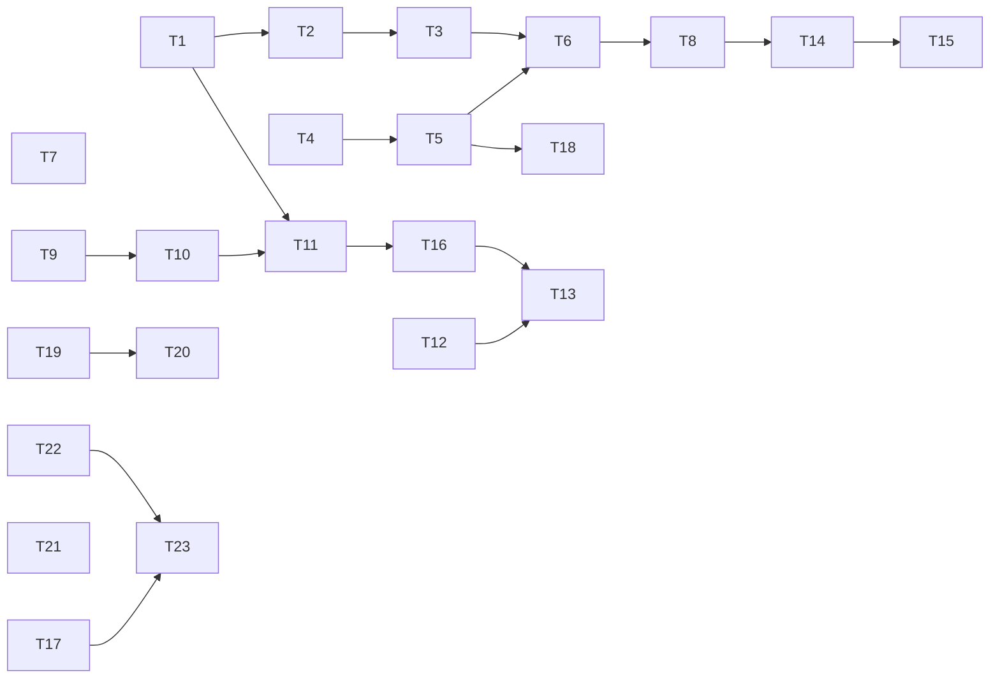

# nyotes trial fixes: wave 1, cargo epics and cockpit

status: draft
commit-mode: orchestrator-commits
language: ruby
panel: Ruby (Linus Torvalds, Jeremy Evans, Sandi Metz, Richard Schneeman, Aaron Patterson)

## Intent

The 2026-10-30 nyotes trial (`lain up` on a greenfield Rust project, ollama-cloud `glm-5.3`, `--approval auto`) reached the research gate and stopped there. This plan has 2 streams. Wave 1 fixes what blocks trial steps 4 to 7 (T1 to T8). Today the gate denies after 300s whatever `approval timeout:` says, and it cannot hear a reason. A researcher's answer that is still over 16 KiB after its own summary is lost. Children learn their answer ceiling only after they break it. The judge's 30s runs while it queues for a cloud slot. The research skill fans out blind to the provider's width, and the shipped conventions cite lain's own workflow. The cargo stream (T9 to T16) makes `/implement-epic` drive a cargo project, which trial step 8 needs. The cockpit stream (T17 to T23, added at the user's request on 2026-10-31) takes the cheaper cockpit findings: fleet rows out of the input pane (the tmux status bar already counts the fleet), the spawn's label on a fleet row, pane titles, a status bar long enough for the HUD, approval and question splits that stop taking the cursor, and Tab completion of commands and skills in both prompts. Source: `planning/nyotes-trial-findings-research-2026-10.md`, findings A1, A2, A3, A5, B1, B2, C5, C7, E1, E4, E5, F1, F2, F3 and F5. ROADMAP item 72.

## Grounding

2026-10-31, `fbc16185` on `main`. 4 read-only Explore agents traced the production paths, and Claude re-read the sites each card names:

- Gate: `lib/lain/cli/epic_submit.rb:406-445` (Verdict), `:690` (the only production `Epic::Gate` construction), `:714-718` (`gate_timeout`); `lib/lain/epic/submission.rb:118-150` (`GateReply`); `lib/lain/epic/gate.rb:184`; `lib/lain/cli/epic_driver/issue_actor.rb:83,146`; `lib/lain/cli/epic_driver/factory.rb:624`; `lib/lain/config/builder.rb:12,108`.
- Handback: `lib/lain/tools/subagent.rb:597,651-840,1054,1827`; `lib/lain/tools/subagent/wrap_up.rb`; `lib/lain/tools/subagent/actor.rb:205`; `lib/lain/isolation/leases.rb:66`; `lib/lain/role.rb:70-85`; `lib/lain/cli/wiring/toolset_build.rb:323,514,525,562`; `lib/lain/cli/tool_guard.rb:582`.
- Width and rendering: `lib/lain/cli/backend.rb:719,751,858`; `lib/lain/cli/backend/ollama_tier.rb`; `lib/lain/skill/library.rb:33-49`; `lib/lain/prompt/locked_binding.rb:80-115`.
- Judge: `lib/lain/approval/judge.rb:18,117-150`; `lib/lain/provider/admitted.rb:69-78`; `lib/lain/provider/admission/journal.rb:73-83`; `lib/lain/provider/admission.rb:53-61,330-345`.
- Conventions: the 6 `lib/lain/prompt/templates/skill/*/conventions.md`; `spec/lain/skill/shipped_skills_spec.rb:123-133`; `dogfood/lain/slots/skill/`; commit `fc362551`.
- Cockpit: `lib/lain/status_feed/reading.rb:81-88,181-188`; `lib/lain/cli/input_socket.rb:47,364-403`; `lib/lain/frontend/input_pane.rb:109-112,260`; `lib/lain/cli/wiring.rb:369-374,436-455`; `lib/lain/tools/subagent.rb:249,312-353`; `lib/lain/tools/subagent/progress.rb:51`; `lib/lain/status_feed/fleet.rb:252-263`; `lib/lain/cli/up.rb:1228,1286-1297,1331,1352,1387,1408-1414`; `lib/lain/frontend/neovim/runtime/62_approval.lua:91-168`; `lib/lain/frontend/neovim/runtime/60_question.lua:157-200`; `lib/lain/frontend/completion.rb:14,73-80`; `lib/lain/frontend/completion/sources.rb:33`; `lib/lain/frontend/line_editor.rb:476-558`; `lib/lain/cli/human_replies.rb:763-858`.
- Cargo: `lib/lain/grader/test_harness.rb:41,92-119`; `lib/lain/grader/test_harness/adapter.rb:20-189`; `lib/lain/cli/epic_driver/factory.rb:1325-1505`; `lib/lain/test_layout.rb:30-114`; `lib/lain/test_layout/mapping.rb:59-65`; `lib/lain/cli/epic_driver/issue_actor.rb:25,232-302`; `lib/lain/gherkin/test_generation.rb:106`.

Where docs and code disagree, and which won:

- The report said `GateReply::INSTRUCTION` is the agent's "nothing advanced" text. It is the reply instruction appended to the human's question; the agent's text is `Verdict` in `cli/epic_submit.rb`. Code won.
- The report said the wrap-up note gives no iteration number. It says "N of M iterations remain" (`wrap_up.rb`); only the byte ceiling is missing. Code won, and T5 is narrower for it.
- `docs/commands.md:1243-1251` and `lib/lain/config.rb:69` scope `approval timeout:` to parked tool calls. T1 widens the code, and the main session updates both docs.
- ROADMAP item 41 and `planning/specs/chunk-qa-round16-identity-and-what-a-tool-may-return.md:29,868` rule "not to truncate and not to refuse" an oversized handback; the code's `floor` refuses. T4 brings the code back to the ruling: it neither truncates nor refuses.
- The user read the fleet status as showing up "in the chat pane". No code writes fleet rows into the chat transcript: they are the input pane's header (`Reading#header`, 2 rows and `+N more`). The pane rewrites the header in place on every child turn, and reprints it whole (`InputPane#redrawn_whole`, `input_pane.rb:307,380,408`) whenever its row count changes, as when a child starts or ends or `+N more` appears. That whole reprint is the periodic block the user saw. T17 removes the rows.
- There is no `/fleet` command (the nyotes notes typed one, and it was held as a prompt). The fleet is read through the tmux status bar, `lain://status` and `lain watch`.
- Completion exists: fuzzy `/command` and `@path` on C-x (`completion.rb:14`), drawn by lain, not Reline. Tab is unbound and Reline offers nothing on it, because no `completion_proc` is set. Plain chat passes no command or skill names (`wiring.rb:369`), and the pane receives command names only (`wiring.rb:452`).
- mempalace: the MCP server failed to connect and the CLI search for "cargo test adapter rust epic implement grader" and "epic gate timeout deny reason" returned nothing. The round-16 ruling was found in ROADMAP instead.

## Compatibility

Gem `lain` 0.1.0 has no release tag and an empty `[Unreleased]` in `CHANGELOG.md`. A grep of `~/dev` for the touched constants finds only `~/dev/lain-t32a`, a stale copy of this repo. Old session files are disposable (ruling 2026-10-28).

| Surface | Verdict | Evidence |
|---|---|---|
| `approval timeout:` config key | must keep; its meaning widens to also bound an epic gate | nyotes `.lain/config.rb` sets 900; `spec/lain/config_spec.rb:113-160` |
| Gate reply grammar (`approve`, `deny` and their synonyms) | must keep every word that works today; `deny <reason>` is added, and it denied before too (as `unrecognised`) | `epic/submission.rb:118-150` |
| `epic_submit` tool result text | free to break | agent-facing only; pinned by `spec/lain/tools/epic_submit_spec.rb`, `spec/lain/cli/epic_submit_spec.rb` |
| `answer_bounded` journal record | free to break; adds the `spilled` outcome | session files are disposable |
| `Grader::TestHarness::Adapter` interface | free to break | internal; callers are `TestHarness#initialize` and `DeclaredHarness` only |
| `tests` table in `.lain/config.rb` | must keep; adds a `timeout:` key, 300 by default | `lib/lain/test_layout.rb:114` |
| Shipped skill templates and their slot defaults | free to break | a project override in `.lain/slots/skill/` wins over a default; lain's own dogfood overrides are added where a default changes (T8) |
| Skill seeded into an epic issue actor | free to break | `issue_actor.rb:25`; no spec asserts the `execute-plan` text there |

No surface needed a trade report.

## Spike findings

Both spikes ran in Claude's scratchpad, not in a worktree, because neither touched lain's tree. The scratch crate is deleted.

| Question | Result | Evidence |
|---|---|---|
| On stable Rust, does `cargo test --no-fail-fast --message-format=json` give machine-readable results without nightly flags? | Yes, mixed on stdout. Compiler messages are JSON lines (`reason: "compiler-message"`) with `level`, `code.code` (E0425, E0433, E0599) and a primary span's `file_name`. libtest prints text lines `test tests::fails ... FAILED` and `test tests::passes ... ok`. Exit 101 on a failure or a compile error. stderr holds only cargo's progress. A positional argument is a name filter, never a file. `--test <name>` picks a `tests/` file. | `cargo +stable` (1.95) on a 3-test scratch crate, 2026-10-31 |
| Can the judge pause its 30s while its child queues for a slot? | Yes. `Async::Task#with_timeout` yields an `Async::Timeout` with `duration=` and `adjust` (async 2.46.0, `@public Since v2.24`), and Fiber storage set in a `Sync` block reaches nested `Async` tasks. | `bundle exec ruby -e` probe: `{inner: :set, nested: :set}`, and an adjusted timer outlived its first deadline |

## Shared files

Only the main session edits these. Cards hand back 1-line diffs.

- `ROADMAP.md`: item 41 gets a 1-line note that an unsummarizable answer is now spilled to a file (from T4). Item 72 is added when this plan is committed. The user keeps uncommitted edits in this file, so the main session commits only its own hunks (`git apply --cached`).
- `ARCHITECTURE.md`: 1 paragraph on the answer path (from T4), after the CEILINGS paragraph near line 836.
- `README.md` (380-455), `docs/commands.md` (723-731) and `ARCHITECTURE.md` (about 1472): the input pane's header no longer shows fleet rows (from T17); a row names the spawn's label (from T18).
- `docs/commands.md`: Tab completes a `/` or `@` word, as C-x does (from T22).
- `plugin/tmux/README.md`: tell a plugin user to raise `status-right-length` for the HUD (from T20).
- `docs/commands.md`: `approval timeout:` also bounds an epic gate (from T1); the kept research table names the answers dir (from T4); the `tests` table's `timeout:` key (from T13).
- `.rubocop.yml`: any limit a card asks to raise, with the reason.

## Rejected options

- **A separate `gate timeout:` key.** The user ruled that a gate inherits `approval timeout:` (2026-10-31).
- **An approve reason.** A reply that starts with an approval word and goes on (`yes but change the scope`) stays `unrecognised` and denies, as today. Approval stays exact and fail-closed; only a denial gains free text.
- **Hand back a clipped head of an oversized answer.** Round 16 ruled "not to truncate": a clipped head reads as complete. T4 hands back a pointer and the sizes, with no partial text.
- **Raise the 16 KiB ceiling.** Round 16 sized it to the smallest local window.
- **Route the judge to the local model.** The user chose the clock fix (2026-10-31); a local judge needs a calibration run first.
- **Thread an `on_admitted:` observer through `RoleSpawn#call`, `Subagent#run`, `Agent#ask` and both providers.** That is 5 signatures, and Ollama does not take `on_stream_started:` today. Fiber storage scoped to the judge's block reaches the same admission with 1 setter and 1 reader (spiked).
- **A cargo adapter on `cargo nextest` or libtest's JSON format.** nextest is a separate install, and `--format json` needs `-Z unstable-options`, which a pinned stable toolchain refuses. The spike shows stable output parses.
- **Wrap `cargo test` in `sh -c '... > out'`.** T9 lets an adapter read the child's stdout instead, so no shell is spawned.
- **Render the iteration ceiling into the role prompt.** The live ceiling is `ChildBuilder`'s clamped `@budget.iterations`, not the role's 60, and the wrap-up note already states it. The prompt states only the byte ceiling, which is fixed.
- **A templated branch per framework in `gherkin-tests`.** `Purity.check!` allows only `render` and bare locals, so T14 states both rules in prose under the framework name the prompt already carries.

- **Draw a `command>` prompt after every answered approval (E9).** The missing prompt is the design in `human_replies.rb:763-780`: a read is open only while something is outstanding. Changing it is a product call for wave 2.
- **A switch to keep fleet rows in the input pane.** No caller wants them back; the status bar has the count and `lain://status` has the tree.
- **Complete `@role` and `@role/skill`.** `@` already completes paths, so a role source needs a rule for which sigil wins. It's wave 2.
- **Set `status-right-length` globally from the tmux plugin.** That changes the user's own tmux config; the plugin README says how instead.
- **nvim tab labels (E10).** They need a lain tabline; wave 2.

## Open decisions

- Option 2 of the research report (let `auto` run a researcher's confined, network-only commands without a judge) waits on a user ruling. No card depends on it.
- Wave 2 of the research report (the rest of B, C, D, E and F4 to F9) is a later plan. No card here depends on it.

## Dependency graph



T3, T6, T8, T14 and T15 are chained because each adds examples to `spec/lain/skill/shipped_skills_spec.rb`. T1, T11, T16 and T13 share `lib/lain/cli/epic_driver/factory.rb`; T12 and T13 share `spec/lain/test_layout_spec.rb`. T2 and T1 share `lib/lain/cli/epic_submit.rb`. T4, T5 and T18 share `lib/lain/tools/subagent.rb`. T19 and T20 share `lib/lain/cli/up.rb` and its spec. T23's scenarios press Tab, so it follows T22; T17 and T23 share `lib/lain/cli/wiring.rb`, its spec and the input pane seam spec. T3 and T6 share `lib/lain/cli/backend.rb`.

## Tasks

### T1: Bound the interactive epic gate by `approval timeout:`          [risk: medium]

**Depends on:** none
**Files:** `lib/lain/cli/epic_submit.rb`, `lib/lain/cli/epic_driver/factory.rb`, `lib/lain/epic/gate.rb` (the `DEFAULT_TIMEOUT` comment), `spec/lain/cli/epic_submit_spec.rb`, `spec/lain/tools/epic_submit_spec.rb`, `spec/lain/cli/epic_driver/issue_actor_spec.rb`, `spec/lain/cli/epic_driver/factory_spec.rb`
**Reuse:** `Config#approval_timeout` (already a member, default 300 from `Approval::Parked::Queue::DEFAULT_TIMEOUT`); the `@config` every `EpicSubmit` already holds; `Verdict`'s existing window formatting
**Shared-file wiring:** `docs/commands.md`: add "It also bounds how long an interactive epic gate waits for a sign-off." to the `approval` entry. `lib/lain/config.rb:69` is in no card's Files, so the main session also rewords that doc comment to "parked call or epic gate".
**Reachable from:** `CLI::Wiring::ToolsetBuild#build` (`toolset_build.rb:291`) -> `EpicSubmit.in_chat(config:)` (`epic_submit.rb:563`) -> `EpicSubmit#gate_timeout` -> `Epic::Gate.from_journal(timeout:)`; and `EpicDriver::Factory` (`factory.rb:581-583`) -> `IssueActor::Earlier.new(timeout:)`, which asks the keep-or-delete question

**Acceptance criteria**

```gherkin
Scenario: A chat gate waits as long as the project's approval timeout
  Given a project whose .lain/config.rb says approval timeout: 0.3
  And a chat asker that never answers
  When epic_submit asks the research gate
  Then the result says nobody answered the research gate within 0.3 seconds
  And nothing advanced

Scenario: A project with no approval timeout keeps 300 seconds
  Given a project with no approval block
  When EpicSubmit builds its gate for a chat asker
  Then the gate's window is 300 seconds

Scenario: The shell prompt keeps no timeout
  Given `lain epic submit` answering through its own y/N prompt
  When the read outlasts the project's approval timeout
  Then the gate still takes the answer

Scenario: The earlier-branches question waits as long as the gate
  Given a project whose approval timeout is 0.2
  When the factory builds IssueActor::Earlier for branches an earlier run left
  Then an unanswered keep-or-delete question keeps the branches after 0.2 seconds
```
Spec files: `spec/lain/cli/epic_submit_spec.rb`, `spec/lain/tools/epic_submit_spec.rb`, `spec/lain/cli/epic_driver/factory_spec.rb`, `spec/lain/cli/epic_driver/issue_actor_spec.rb`

**Interface**

```ruby
# lib/lain/cli/epic_submit.rb
def gate_timeout(policy) # => Numeric | Gate::Window::Unbounded
  # the Prompt's #window first, then @config.approval_timeout
end
```

**Stop and report if:**
- `Epic::Gate::DEFAULT_TIMEOUT` has a reader outside `cli/epic_submit.rb`, `issue_actor.rb` and specs (grep `lib/` and `bench/`); deleting or keeping it is then a design call.
- The 4 examples that `stub_const("Lain::Epic::Gate::DEFAULT_TIMEOUT", ...)` (`spec/lain/tools/epic_submit_spec.rb:148`, `spec/lain/cli/epic_submit_spec.rb:905,970,1301`) cannot be rewritten to set the timeout through a config file; that would mean the config is not on the path.
- The non-interactive policies (hands_off, deferred, adjudicated) start reading a human-sized window.

### T2: Let a gate denial carry the human's reason to the agent          [risk: medium]

**Depends on:** T1
**Files:** `lib/lain/epic/submission.rb`, `lib/lain/cli/epic_submit.rb`, `spec/lain/epic/submission_spec.rb`, `spec/lain/cli/epic_submit_spec.rb`, `spec/lain/tools/epic_submit_spec.rb`
**Reuse:** `Epic::Gate::Answer#reason` (already carried and journaled by `Gate#record`); `ReadBack#latest(digest)`; `GateReply::TRAILING_PUNCTUATION`
**Shared-file wiring:** none
**Reachable from:** `CLI::EpicSubmit::Hearing#verdict` -> `Epic::GateReply.answer`; `CLI::EpicSubmit::Verdict#denied` via `InChat#submit` -> `Tools::EpicSubmit#perform`

**Acceptance criteria**

```gherkin
Scenario: A denial with words after it is a denial with that reason
  Given the research gate is waiting in chat
  When the human replies "deny: the summarizer question needs a benchmark first"
  Then the gate decision is a denial answered by the human
  And its reason is "the summarizer question needs a benchmark first"
  And the agent's epic_submit result shows that reason under "denied"

Scenario: Every denial word takes a reason
  When the human replies "no, too broad" or "n - split M3" or "denied because X"
  Then each is a denial with the words after the denial word as its reason

Scenario: An approval word followed by words is still unrecognised
  When the human replies "yes but trim the scope"
  Then the gate denies it as unrecognised, carrying the reply in its reason

Scenario: The question tells the human how to give a reason
  When the gate asks the human
  Then its instruction says a reason may follow a denial word
```
Spec files: `spec/lain/epic/submission_spec.rb`, `spec/lain/cli/epic_submit_spec.rb`, `spec/lain/tools/epic_submit_spec.rb`

**Interface**

```ruby
# lib/lain/epic/submission.rb
module GateReply
  def self.answer(words, surface:) # => Epic::Gate::Answer, reason: nil | String
end
```

**Stop and report if:**
- A reply surface strips text after the first word before it reaches `GateReply.answer` (nvim `lain://question`, `/inbox`, `:LainReply`, `cli/human_replies.rb:400`).
- `Gate#record`'s rule that `answer.reason` wins over a caller's reason would hide an adjudicator's reason on a non-interactive path (`spec/lain/epic/gate/policy_spec.rb`).

### T3: Name the gate window and the denial form in the epic skills          [risk: low]

**Depends on:** T2
**Files:** `lib/lain/cli/backend.rb`, `lib/lain/prompt/templates/skill/research-epic/skill.md`, `lib/lain/prompt/templates/skill/plan-epic/skill.md`, `lib/lain/prompt/templates/skill/create-epic-issues/skill.md`, `spec/lain/skill/shipped_skills_spec.rb`, `spec/lain/dogfood_config_spec.rb`, `spec/lain/cli/backend_spec.rb`
**Reuse:** the `epic_home: method(:epic_home)` local at `backend.rb:719`; `Verdict`'s "%g seconds" formatting
**Shared-file wiring:** none
**Reachable from:** `CLI::Backend#library` -> `Skill::Library.load(locals: { epic_home:, gate_window: })` -> `Skill::Renderer`

**Acceptance criteria**

```gherkin
Scenario: research-epic tells the agent to warn the human before it submits
  Given a project whose approval timeout is 900
  When the research-epic skill renders through the backend's library
  Then it tells the agent to tell the user, before calling epic_submit, that the gate waits 900 seconds
  And that a reply of deny with a reason sends the reason back

Scenario: plan-epic and create-epic-issues say the same
  When either renders through the backend's library
  Then it names the same window and the same denial form
```
Spec files: `spec/lain/skill/shipped_skills_spec.rb`, `spec/lain/cli/backend_spec.rb`

**Interface**

```ruby
# lib/lain/cli/backend.rb
def gate_window # => String, e.g. "900 seconds"; lazy, so a config refusal does not fire at library load
```

**Stop and report if:**
- `Library.load` is reached on a path with no project config (the bench, `lain --btw`), where `Config.load` raises rather than defaulting.
- The rendered sentence lands outside the phase that calls `epic_submit` in any of the 3 skills.

### T4: Spill an answer that stays over the ceiling to a file          [risk: high]

**Depends on:** none
**Files:** `lib/lain/tools/subagent.rb`, `lib/lain/tools/subagent/spill.rb` (new), `lib/lain/cli/wiring/toolset_build.rb`, `lib/lain/skill/role_spawn.rb`, `lib/lain/cli/tool_guard.rb`, `spec/lain/tools/subagent_spec.rb`, `spec/lain/skill/role_spawn_spec.rb`, `spec/lain/tools/subagent/spill_spec.rb` (new), `spec/lain/cli/tool_guard_spec.rb`, `spec/tool_bounds_discipline_spec.rb`
**Reuse:** `Answer#condensed`, `#undeliverable`, `#floor`; `AnswerBounded`; `Paths#container` and `#project_hash` (as `Kept.home` uses them); the `files written:` listing in `Kept::Written#summary`
**Shared-file wiring:** ROADMAP item 41: append "An answer whose summary is still over the ceiling is written whole to `$XDG_STATE_HOME/lain/answers/<project>/` and handed back as a pointer (2026-10-31)." `ARCHITECTURE.md`: 1 paragraph on the answer path after the CEILINGS paragraph. `docs/commands.md`: add the answers dir to the kept-research table.
**Reachable from:** all 4 production `Tools::Subagent.new` sites: the 3 in `CLI::Wiring::ToolsetBuild` (`toolset_build.rb:323,514,562`) and `Skill::RoleSpawn#build_subagent` (`role_spawn.rb:151`), whose RoleSpawn `toolset_build.rb:465-468` builds and which every `@researcher[/skill]` fan-out reaches through `Middleware::SkillDispatch`. Each passes `answer: Subagent::Answer.new(bounds:, spill: Subagent::Spill.new(dir:))`; RoleSpawn takes the Answer at construction and keeps it through `within` and `never_parking`.

**Acceptance criteria**

```gherkin
Scenario: An answer whose summary is still over the ceiling is kept whole
  Given a researcher whose answer is 30000 bytes
  And whose summarizing ask answers 20000 bytes
  When the parent receives the handback
  Then the full 30000-byte answer is in a file under the project's answers dir
  And the 20000-byte summary is in a second file beside it
  And the parent's text names both paths and sizes and says neither is shown
  And the handback is under 16 KiB
  And an answer_bounded record has outcome "spilled" and the path

Scenario: A researcher fanned out with @researcher[/skill] spills too
  Given research-epic fanning out a researcher through RoleSpawn
  And that researcher's answer and summary both stay over the ceiling
  Then the parent gets the pointer, not the floor's refusal

Scenario: The parent can read the spilled file
  Given a spilled answer
  When the main chat calls read_file on its path with an offset and a limit
  Then it reads the slice without parking

Scenario: A confined parent can read its child's spill
  Given an issue orchestrator, a leased child, that spawned a dev child
  And the dev child's answer was spilled
  When the orchestrator calls read_file on that path
  Then the read is not refused as outside the project

Scenario: A summarizing ask that fails still keeps the answer
  When the child's summarizing ask raises
  Then the full answer is spilled and its path handed back

Scenario: An actor's oversized reply is spilled the same way
  Given an actor child whose reply stays over the ceiling after its summary
  Then its reply to the parent is the pointer, not a refusal

Scenario: A spill that cannot be written falls back to today's floor
  Given an answers dir that cannot be created
  Then the parent gets the floor's refusal text, naming why the spill failed
```
Spec files: `spec/lain/tools/subagent_spec.rb`, `spec/lain/tools/subagent/spill_spec.rb`, `spec/lain/skill/role_spawn_spec.rb`, `spec/lain/cli/tool_guard_spec.rb`

**Interface**

```ruby
# lib/lain/tools/subagent/spill.rb
class Lain::Tools::Subagent::Spill
  def initialize(dir:)
  # @return [Array<String>] the paths written, full answer first
  # @raise [Spill::Unwritable]
  def call(answer:, summary: nil)
  Null = ... # raises Unwritable, so Answer floors as it does today
end

# lib/lain/tools/subagent.rb
Answer = Data.define(:bounds, :spill)
```

**Stop and report if:**
- `spec/lain/tools/subagent_spec.rb:1250` ("clamps a failure's own message, so the floor cannot blow through the ceiling") or any example in `describe "a child answer over the ceiling"` (about lines 957-1260) needs its assertion weakened, beyond changing floor-to-spill expectations where a spill dir is injected.
- `spec/tool_bounds_discipline_spec.rb` (its subagent delivery-variant examples near line 514) cannot hold the pointer text under the declared 16 KiB bound.
- A confined read root for the answers dir would also let a leased child read another project's answers: the dir must be keyed by project.
- `Answer` must hold the spawn's `worker_env` to name a file; the design keys the file by time and a random suffix, not by lease.

### T5: Tell a child its answer ceiling before it answers          [risk: low]

**Depends on:** T4
**Files:** `lib/lain/role.rb`, `lib/lain/tools/subagent/wrap_up.rb`, `lib/lain/tools/subagent.rb` (the `WrapUp.new` line near 1827), `lib/lain/prompt/templates/role/researcher.md`, `spec/lain/role_spec.rb`, `spec/lain/tools/subagent/wrap_up_spec.rb`, `spec/lain/prompt/slots_spec.rb`, `spec/lain/role_prelude_wiring_spec.rb`
**Reuse:** `Role#placed_tail`; `Subagent::ANSWER_BOUND.limit`; `WrapUp#note`
**Shared-file wiring:** none
**Reachable from:** `Tools::Subagent::ChildBuilder` -> `WrapUp.new(mailbox:, ceiling:, answer_limit:)`; `Role#child_context` via `Role::Persona` (`toolset_build.rb:569`)

**Acceptance criteria**

```gherkin
Scenario: A placed child's system tail states the answer ceiling
  When a researcher is spawned in its scratch dir
  Then its system tail names its working directory
  And says its final answer must stay under 16384 bytes, or it is summarized and then saved to a file

Scenario: The wrap-up note names both ceilings
  Given a child 5 iterations from its ceiling of 60
  Then the note says 5 of 60 iterations remain
  And that its final answer must stay under 16384 bytes

Scenario: researcher.md points at the limits
  When the researcher role renders
  Then it tells the researcher to keep its final answer short and to write long findings to a file in its scratch dir
```
Spec files: `spec/lain/role_spec.rb`, `spec/lain/tools/subagent/wrap_up_spec.rb`, `spec/lain/prompt/slots_spec.rb`

**Stop and report if:**
- The tail change breaks the cache split in `Role#child_context`: the limit line must sit after the cache breakpoint (`spec/lain/role_spec.rb:199`).
- The `researcher` digest at `spec/lain/prompt/slots_spec.rb:285-320` moves on purpose; update it, and that spec's "stop if any of these move" comment does not apply to this card. Stop only if the digest is pinned elsewhere too (grep for `f054c828`) or another role's digest moves.

### T6: Size research-epic's fan-out to the provider's width          [risk: low]

**Depends on:** T3, T5
**Files:** `lib/lain/cli/backend.rb`, `lib/lain/prompt/templates/skill/research-epic/skill.md`, `spec/lain/skill/shipped_skills_spec.rb`, `spec/lain/dogfood_config_spec.rb`, `spec/lain/cli/backend_spec.rb`
**Reuse:** `CLI::Backend::OllamaTier` (`gate.width`, and the infinite and loopback cases `#startup_notices` already handles); `Role::Catalog.fetch(:researcher).max_iterations`; `Subagent::ANSWER_BOUND.limit`
**Shared-file wiring:** none
**Reachable from:** `CLI::Backend#library` -> `Skill::Library.load(locals: { epic_home:, gate_window:, provider_width:, researcher_limits: })`

**Acceptance criteria**

```gherkin
Scenario: On ollama-cloud the skill names 3 concurrent requests
  Given the chat provider is ollama-cloud with the default width
  When research-epic renders
  Then Phase 2 says the provider runs 3 requests at once, so spawn at most 3 researchers at a time
  And that each researcher has 60 iterations and a 16384-byte answer

Scenario: An unbounded provider says so
  Given a provider with no declared width
  Then Phase 2 says there is no concurrency limit

Scenario: A narrowed width is read when the skill renders
  Given the cloud width narrowed to 2 after a 429
  When research-epic renders next
  Then it says 2
```
Spec files: `spec/lain/skill/shipped_skills_spec.rb`, `spec/lain/cli/backend_spec.rb`

**Stop and report if:**
- The skill is rendered once per session and cached (`Skill::Renderer` or `Backend`); a narrowed width would then never show, and the third scenario is unmeetable.
- The width local would need a provider built at library load, which `Backend` builds only for the chat.

### T7: Pause the judge's clock while its child queues for a slot          [risk: high]

**Depends on:** none
**Files:** `lib/lain/provider/admission/listener.rb` (new), `lib/lain/provider/admission/journal.rb`, `lib/lain/approval/judge.rb`, `spec/lain/provider/admission/listener_spec.rb` (new), `spec/lain/provider/admission/journal_spec.rb`, `spec/lain/approval/judge_spec.rb`, `spec/lain/approval/judged_spec.rb`
**Reuse:** `Async::Timeout#duration=` (async 2.46, public since 2.24); `Admission::Journal#enter`, which every admitted provider call passes through; `Admission::DEFAULT_DEADLINE`
**Shared-file wiring:** none
**Reachable from:** `CLI::Wiring::JudgeSource` (`judge_source.rb:22`) -> `Approval::Judge.new` -> `Judge#bounded` installs the listener; `Provider::Admitted#admitted` -> `Admission::Journal#enter` calls it

**Acceptance criteria**

```gherkin
Scenario: Time queued for a slot does not count against the judge
  Given a width-1 endpoint held by another caller for 3 times the judge's timeout
  And a judge whose child answers at once when admitted
  When the judge is asked
  Then it returns the child's verdict, not a fault

Scenario: Time holding a slot still counts
  Given a judge whose child never answers once admitted
  Then the judge faults after its timeout

Scenario: The listener is scoped to the judge's block
  Given a judge running beside an ordinary chat request on the same endpoint
  Then the chat request's admission calls no judge listener

Scenario: A listener outliving its judge does nothing
  Given a task spawned inside the judge's block that makes a provider call after the judge returned
  Then that call is admitted normally and raises no Async::Timeout::CancelledError

Scenario: An admission with no listener behaves as today
  When a provider call is admitted outside any judge
  Then Admission::Journal journals the same provider_wait records as before
```
Spec files: `spec/lain/approval/judge_spec.rb`, `spec/lain/provider/admission/journal_spec.rb`, `spec/lain/provider/admission/listener_spec.rb`

**Interface**

```ruby
# lib/lain/provider/admission/listener.rb
module Lain::Provider::Admission::Listener
  def self.current          # => #entering/#admitted; Null when none is set
  def self.with(listener)   # sets it in Fiber storage for the block, restores after
  Null = ...                # entering and admitted do nothing
end

# Admission::Journal#enter: Listener.current.entering before @admission.enter,
# Listener.current.admitted(waited) inside its block.
# Judge#bounded: entering sets the timer's duration past Admission::DEFAULT_DEADLINE,
# admitted restores the remaining duration. The judge closes its listener in an
# ensure when the block exits, and a closed listener does nothing.
```

**Stop and report if:**
- A judge child's provider call runs on a different thread or a fiber that does not inherit Fiber storage (`Provider::Ollama`'s transport, `lain-core` relay); the listener would then never fire.
- `Admission::Busy` after `DEFAULT_DEADLINE` (300s) would leave the judge waiting longer than a parked human expects: say how long the worst case is.
- A new example needs a wall-clock threshold to pass; the repo bans them, so assert the verdict, not elapsed time. The 2 existing `be < 1` examples (`spec/lain/approval/judge_spec.rb:251,260`) may stay as they are.

### T8: Ship conventions defaults with no lain workflow in them          [risk: low]

**Depends on:** T6
**Files:** the 6 `lib/lain/prompt/templates/skill/{create-epic-issues,create-plan,execute-plan,iterate-epic,plan-epic,research-epic}/conventions.md`, `dogfood/lain/slots/skill/{research-epic,plan-epic,create-epic-issues,iterate-epic}/conventions.md` (new), `spec/lain/skill/shipped_skills_spec.rb`, `spec/lain/dogfood_config_spec.rb`
**Reuse:** the leak guard at `shipped_skills_spec.rb:123-133`; the existing `dogfood/lain/slots/skill/{create-plan,execute-plan}/conventions.md`
**Shared-file wiring:** none
**Reachable from:** `Prompt::SkillSlots#source` resolves the shipped default when a project has no override; `Skill::Renderer` splices it via `render("conventions")`

**Acceptance criteria**

```gherkin
Scenario: A project with no overrides gets neutral conventions
  When any of the 6 epic and plan skills renders for a project with no .lain/slots
  Then its conventions name the project's own contributor or agent guide, if it has one
  And never mention a design plan, commit-grouping traps, a lib file and its spec, or pre-commit stashing

Scenario: The leak guard catches lain idioms in a conventions default
  When the shipped templates are scanned
  Then no conventions.md matches lain's idioms (design plan, commit-grouping, lib file and its spec, pre-commit stash)

Scenario: lain's own epics keep lain's rules
  When the dogfood config renders research-epic, plan-epic, create-epic-issues and iterate-epic
  Then each conventions slot still defers to lain's CLAUDE.md and the design plan it names
```
Spec files: `spec/lain/skill/shipped_skills_spec.rb`, `spec/lain/dogfood_config_spec.rb`

**Stop and report if:**
- lain's own `.lain/` does not read `dogfood/lain/slots/` (check how `dogfood_config_spec.rb:73-88` reaches it); the new overrides would then be dead.
- Extending the guard to every template (not only `conventions.md`) fails on `create-plan/skill.md` or `research/skill.md`: those are wave 2 (F4, F6), so scope the idiom check to `conventions.md`.

### T9: Let a test adapter read its result from the child's stdout          [risk: low]

**Depends on:** none
**Files:** `lib/lain/grader/test_harness.rb`, `lib/lain/grader/test_harness/adapter.rb` (the interface comment, `Rspec` and `Command`), `spec/lain/grader/test_harness_spec.rb`, `spec/lain/grader/test_harness/adapter_spec.rb`
**Reuse:** `TestHarness#outcome`; the shell-out's captured `stdout`
**Shared-file wiring:** none
**Reachable from:** `EpicDriver::Factory::DeclaredHarness.for` -> `Grader::TestHarness.new(root, adapter:)` -> `#run`

**Acceptance criteria**

```gherkin
Scenario: An adapter that reports on stdout is parsed from stdout
  Given an adapter that declares its result is on stdout
  When the harness runs it
  Then parse receives the child's stdout and exit status

Scenario: A file adapter is unchanged
  Given the rspec adapter
  When the harness runs it
  Then parse receives the result file's contents
```
Spec file: `spec/lain/grader/test_harness_spec.rb`

**Interface**

```ruby
# an adapter answers one of:
def command(out_path:, paths:) # => argv
def stdout?                     # => true: parse the child's stdout; false: parse out_path
# Rspec and Command answer false; every adapter answers, so the harness never probes with respond_to?
```

**Stop and report if:**
- The spec's `shell_out_factory` double does not expose `stdout` the way the production shell-out does (`test_harness.rb:60`); then the first scenario needs a real child process.

### T10: Add a cargo test adapter that parses stable cargo output          [risk: medium]

**Depends on:** T9
**Files:** `lib/lain/grader/test_harness/adapter.rb` (the `PROBES` row), `lib/lain/grader/test_harness/adapter/cargo.rb` (new), `spec/lain/grader/test_harness/adapter_spec.rb`, `spec/lain/grader/test_harness/adapter/cargo_spec.rb` (new), `spec/fixtures/cargo/` (new: captured stdout for pass and fail, compile errors, and a 2-crate workspace)
**Reuse:** `Adapter::Rspec`'s shape; `Probe`; `JSON` from stdlib; `cargo metadata --no-deps --format-version 1` for package names and manifest paths (no TOML gem is in the bundle)
**Shared-file wiring:** none
**Reachable from:** `DeclaredHarness.for(layout)` -> `Adapter.for("cargo")` for a project whose `.lain/config.rb` says `tests preset: :cargo`

**Acceptance criteria**

```gherkin
Scenario: Passing and failing tests are named
  Given cargo's stdout with "test tests::passes ... ok" and "test tests::fails ... FAILED"
  When the cargo adapter parses it with exit status 101
  Then passed is ["tests::passes"] and failed is ["tests::fails"]

Scenario: A compile error is an error naming its code and file
  Given cargo's stdout with an error-level compiler-message E0425 in src/lib.rs
  Then errors holds 1 entry carrying "E0425", "src/lib.rs" and the message
  And failure-note messages are not counted

Scenario: A path picks its package and module
  Given a workspace whose crates/capture/Cargo.toml names the package nyotes-capture
  And cargo metadata reporting that package's manifest path
  When the adapter builds its command for crates/capture/src/pipewire.rs
  Then it runs cargo test -p nyotes-capture --no-fail-fast --message-format=json with the filter "pipewire::"

Scenario: A crate root file runs its whole package
  When the adapter builds its command for crates/capture/src/lib.rs
  Then it runs cargo test -p nyotes-capture with no filter

Scenario: A tests/ file picks its test target
  Given crates/capture/tests/end_to_end.rs
  Then the command runs cargo test -p nyotes-capture --test end_to_end

Scenario: No paths runs the whole workspace
  When the adapter builds its command with no paths, as TipTests does
  Then it runs cargo test --workspace --no-fail-fast --message-format=json

Scenario: The adapter runs real cargo (tagged :seam)
  Given cargo is on PATH
  And a scratch crate with 1 passing and 1 failing test
  When the harness runs the cargo adapter there
  Then the run has 1 passed and 1 failed
```
Spec files: `spec/lain/grader/test_harness/adapter/cargo_spec.rb`, `spec/lain/grader/test_harness/adapter_spec.rb`

**Stop and report if:**
- The real-cargo example cannot run without network (a fixture crate must have no dependencies). Check its runtime under 12 workers against the threshold in `spec/support/slow_files.rb`'s header, and list the file there if it crosses it.
- `Adapter.for` cannot dispatch to a class outside `adapter.rb` without a `PROBES` change other specs pin (`adapter_spec.rb`, "raises naming a preset no probe knows").
- A `lib.rs` or `main.rs` path cannot be told apart from a module path in a workspace member.

### T11: Ask the adapter what a red run for an unwritten subject looks like          [risk: medium]

**Depends on:** T10, T1
**Files:** `lib/lain/cli/epic_driver/factory.rb` (`IssueTests`: `LOCKFILES`, `awaiting_subject?`, `missing_constants`, `stray!`), `lib/lain/grader/test_harness/adapter.rb` (`Rspec`, `Command`), `lib/lain/grader/test_harness/adapter/cargo.rb`, `lib/lain/grader/test_harness.rb` (expose the adapter), `spec/lain/cli/epic_driver/issue_tests_spec.rb`, `spec/lain/grader/test_harness/adapter_spec.rb`, `spec/lain/grader/test_harness/adapter/cargo_spec.rb`
**Reuse:** the `uninitialized constant` logic at `factory.rb:1477-1486`, moved into `Adapter::Rspec`; `LOCKFILES` at `factory.rb:1360`, moved onto each adapter; `dirty`'s `--untracked-files=all` listing (`factory.rb:1510`)
**Shared-file wiring:** none
**Reachable from:** `EpicDriver::Factory#issue_tests` -> `IssueTests#failing` -> `@harness.call(cwd).adapter.awaiting_subject?`

**Acceptance criteria**

```gherkin
Scenario: rspec keeps today's rule
  Given the rspec preset
  Then every example in issue_tests_spec's "when the described constant is the subject's own" context passes unchanged

Scenario: A cargo test calling a function the subject does not have yet is red
  Given the cargo preset and an inline target src/meeting.rs
  And the run's only errors are E0425, E0432, E0433, E0412 or E0599 in src/meeting.rs
  When the red step runs
  Then it commits the tests as red

Scenario: A cargo compile error of another kind is not red
  Given the run's errors include E0308 or a syntax error
  Then the red step refuses as "did not load" and commits nothing

Scenario: A missing item in another file is not red
  Given an E0425 whose primary span is in src/other.rs
  Then the red step refuses and commits nothing

Scenario: Cargo.lock is not a stray write
  Given cargo test rewrote the tracked Cargo.lock
  Then the red step commits only the target

Scenario: A build dir is not a stray write
  Given a checkout with no .gitignore entry for target/
  And the test_engineer child ran cargo test, which wrote target/**
  Then the red step does not refuse for target/ and commits only the target
```
Spec files: `spec/lain/cli/epic_driver/issue_tests_spec.rb`, `spec/lain/grader/test_harness/adapter/cargo_spec.rb`

**Interface**

```ruby
# every adapter
def awaiting_subject?(errors, subject:, target:, root:) # => Boolean
def lockfile  # => String | nil
def build_dir # => String | nil; "target/" for cargo, nil for rspec and Command
```

**Stop and report if:**
- `IssueTests` holds the harness factory, not an adapter, at the point it classifies; reaching the adapter must not build a second harness.
- The cargo missing-item rule would accept a red where the test file itself fails to parse (E0425 caused by a typo in a test-local name); say whether the primary span's file is enough to tell them apart.

### T12: Default a layout with no mirrored level to its inline level          [risk: low]

**Depends on:** none
**Files:** `lib/lain/test_layout/mapping.rb`, `spec/lain/test_layout/mapping_spec.rb`, `spec/lain/test_layout_spec.rb`
**Reuse:** `Mapping#default_level`; `TestLayout::INLINE`
**Shared-file wiring:** none
**Reachable from:** `EpicDriver::Factory::IssueTests#default_level` (`factory.rb:1438`) -> `layout.mapping.default_level`

**Acceptance criteria**

```gherkin
Scenario: A cargo plan with no Level line places its tests inline
  Given the cargo preset
  And an issue plan with Subject: src/meeting.rs and no Level line
  When the red step places its tests
  Then the target is src/meeting.rs

Scenario: A cargo layout that declares default_level unit gets the inline level
  Given the cargo preset with default_level "unit"
  Then default_level is the inline unit level

Scenario: A mirrored preset keeps its rule
  Given the rspec preset
  Then default_level is the unit level, as today
```
Spec file: `spec/lain/test_layout/mapping_spec.rb`

**Stop and report if:**
- Another caller of `Mapping#default_level` relies on it being nil for cargo: `TestLayout`'s load check (`test_layout.rb:179`) and `TestLayout::Guard` (`test_layout/guard.rb:367`). Add `lib/lain/test_layout/guard.rb` to Files if its behavior changes.

### T16: Declare a new cargo subject's module before its red run          [risk: medium]

**Depends on:** T11
**Files:** `lib/lain/cli/epic_driver/factory.rb` (`IssueTests`), `lib/lain/grader/test_harness/adapter.rb` (`Rspec`, `Command`), `lib/lain/grader/test_harness/adapter/cargo.rb`, `spec/lain/cli/epic_driver/issue_tests_spec.rb`, `spec/lain/grader/test_harness/adapter/cargo_spec.rb`
**Reuse:** `IssueTests#commit` (adds paths with `--no-verify`); `IssueTests#stray!`; `cargo metadata` from T10 for the crate root
**Shared-file wiring:** none
**Reachable from:** `EpicDriver::Factory#issue_tests` -> `IssueTests#call` -> `adapter.registration(subject:, root:)`, applied by the harness, never by the test_engineer child

A new `src/meeting.rs` is not compiled until its parent declares `mod meeting;`, so a filtered run prints `running 0 tests` and the red step refuses (panel probe, cargo 1.95). The red step itself writes that 1 line, so the child still writes only the target.

**Acceptance criteria**

```gherkin
Scenario: A new subject file is declared and goes red
  Given the cargo preset and a plan with Subject: src/meeting.rs that does not exist
  And src/lib.rs declares no meeting module
  When the red step runs
  Then src/lib.rs gains the line "pub mod meeting;"
  And the test_engineer's tests in src/meeting.rs fail on a missing item
  And the red commit holds src/meeting.rs and src/lib.rs

Scenario: A nested subject is declared in its parent module file
  Given Subject: src/capture/pipewire.rs and an existing src/capture/mod.rs
  Then src/capture/mod.rs gains "pub mod pipewire;"

Scenario: An already declared module is left alone
  Given src/lib.rs already declares mod meeting
  Then the red step changes no file but the target

Scenario: A subject whose parent file does not exist is refused
  Given Subject: src/capture/pipewire.rs with neither src/capture.rs nor src/capture/mod.rs
  Then the red step refuses, naming the missing parent module, and commits nothing

Scenario: rspec registers nothing
  Given the rspec preset
  Then registration is empty and the red step is unchanged
```
Spec files: `spec/lain/cli/epic_driver/issue_tests_spec.rb`, `spec/lain/grader/test_harness/adapter/cargo_spec.rb`

**Interface**

```ruby
# every adapter
# @return [Array<Registration>] edits the red step makes before its run; [] for rspec and Command
def registration(subject:, root:)
Registration = Data.define(:path, :line)
```

**Stop and report if:**
- A `pub mod` line would change the crate's public surface in a way an issue's plan forbids; say whether `mod` (private) is enough for the crate's own tests.
- `stray!` would have to exempt the parent file by name; the registration's paths must be the exemption, so nothing else slips through.

### T13: Let the tests table bound how long a suite may run          [risk: low]

**Depends on:** T16, T12
**Files:** `lib/lain/test_layout.rb` (`KEYS` at line 38 and the `TestLayout` members), `lib/lain/cli/epic_driver/factory.rb` (`DeclaredHarness.for`), `spec/lain/test_layout_spec.rb`, `spec/lain/config_spec.rb`, `spec/lain/cli/epic_driver/factory_spec.rb`
**Reuse:** `Grader::TestHarness.new(timeout:)`; `Config::Builder#timeout_from` validation
**Shared-file wiring:** `docs/commands.md`: the `tests` table's `timeout:` key, 300 by default.
**Reachable from:** `DeclaredHarness.for(layout)` -> `Grader::TestHarness.new(root, adapter:, timeout: layout.timeout)`, used by `IssueTests` and `TipTests`

**Acceptance criteria**

```gherkin
Scenario: A project gives its first cargo build longer than 300 seconds
  Given .lain/config.rb says tests preset: :cargo, timeout: 1800
  When the red step runs the suite
  Then the harness timeout is 1800

Scenario: No timeout key keeps 300
  Given a tests table with no timeout
  Then the harness timeout is 300

Scenario: A bad timeout is refused at load
  Given tests timeout: 0
  Then loading the config raises a refusal naming the tests table and the timeout key
```
Spec files: `spec/lain/test_layout_spec.rb`, `spec/lain/config_spec.rb`

**Stop and report if:**
- `TestLayout::TABLE`'s key list is pinned by a spec that enumerates keys (grep `spec/` for the table's keys).

### T14: State each framework's red rule in gherkin-tests          [risk: low]

**Depends on:** T8
**Files:** `lib/lain/prompt/templates/skill/gherkin-tests/skill.md`, `lib/lain/gherkin/test_generation.rb` (the target sentence near line 110), `spec/lain/skill/shipped_skills_spec.rb`, `spec/lain/gherkin/test_generation_spec.rb`
**Reuse:** the `## Framework` section `Gherkin::TestGeneration#prompt` already writes (`test_generation.rb:106`)
**Shared-file wiring:** none
**Reachable from:** `Gherkin::TestGeneration` -> the `test_engineer` child seeded with `gherkin-tests`, from `IssueTests#call`

**Acceptance criteria**

```gherkin
Scenario: The skill states the rspec and cargo exceptions by framework name
  When gherkin-tests renders
  Then it says, for rspec, that `uninitialized constant` for the subject's own constant counts as red
  And, for cargo, that a test calling or importing a function, type or method the subject does not define yet counts as red when the compiler error is in the target file
  And that every other load or compile error is not red

Scenario: The test engineer is told where an inline test goes
  Given the cargo preset and the subject src/meeting.rs
  When TestGeneration writes its prompt
  Then it says the tests go in a #[cfg(test)] module inside src/meeting.rs, not in a mirrored file
```
Spec files: `spec/lain/skill/shipped_skills_spec.rb`, `spec/lain/gherkin/test_generation_spec.rb`

**Stop and report if:**
- `spec/lain/gherkin/test_generation_spec.rb` pins the mirrored-file sentence for every preset (`:123`, `:135`, `:163`) in a way an inline wording breaks for rspec too.

### T15: Seed an epic issue actor with an epic-shaped skill          [risk: medium]

**Depends on:** T14
**Files:** `lib/lain/prompt/templates/skill/implement-issue/skill.md` (new), `lib/lain/cli/epic_driver/issue_actor.rb`, `spec/lain/cli/epic_driver/issue_actor_spec.rb`, `spec/lain/skill/shipped_skills_spec.rb`
**Reuse:** `IssueActor::Brief`'s sections (carrying, planned, satisfying, failing, settling); the `dev` and `reviewer_code` roles
**Shared-file wiring:** none
**Reachable from:** `EpicDriver::Factory` (`factory.rb:624`) -> `IssueActor.new(renderer:)` -> `Brief#to_s` -> `renderer.render(:"implement-issue")`

**Acceptance criteria**

```gherkin
Scenario: The actor's first prompt is the epic skill, not execute-plan
  When an issue actor starts
  Then its first prompt opens with the implement-issue skill
  And it never mentions commit-mode, a panel roster, task cards, `lain land` or a handback file

Scenario: The skill matches the brief
  When implement-issue renders
  Then it says the failing tests are already committed and must not be weakened
  And that plans/<id>.md is approved and read-only
  And that the actor makes the tests pass with the project's own test command, commits on its branch, rebases, and leaves merging to the harness
  And it names the dev and reviewer_code roles for help

Scenario: No lain idioms ship in it
  When the leak guard scans the templates
  Then implement-issue passes, including T8's idiom check
```
Spec files: `spec/lain/cli/epic_driver/issue_actor_spec.rb`, `spec/lain/skill/shipped_skills_spec.rb`

**Stop and report if:**
- A shipped skill directory is also listed as a user slash command, and `implement-issue` would appear in `/help`; say whether the catalog has a way to hide one.
- `execute-plan` is seeded anywhere else as an actor brief (grep `SKILL` and `render(:"execute-plan")`).

### T17: Draw only the HUD line in the input pane's header          [risk: low]

**Depends on:** none
**Files:** `lib/lain/status_feed/reading.rb` (delete `#header`, `fleet_rows`, `shown`, `admit`, `ancestors`, `parent_index`, `HEADER_ROWS`, `LEAD`, `.fitted`), `lib/lain/status_feed/fleet.rb` (delete `Row.undated` and `Row::PUBLISHED`, whose only reader is `fleet_rows`), `lib/lain/cli/wiring.rb` (`hud_line` calls `hud(now:)`, and its comment at 441-446), `lib/lain/frontend/input_pane.rb` (drop the `Reading.fitted` call near 251), `spec/lain/status_feed/reading_spec.rb` (the header examples near 286-392 go), `spec/lain/status_feed/fleet_spec.rb`, `spec/lain/frontend/input_pane_spec.rb`, `spec/lain/cli/wiring_spec.rb`, `spec/lain/seams/input_pane_socket_spec.rb`
**Reuse:** `Reading#hud`; the `fleet:N` segment the tmux status bar already draws
**Shared-file wiring:** `README.md:384-408,447-455`, `docs/commands.md:723-731`, `ARCHITECTURE.md:1472`: the input pane's header is the HUD line only; the tree is in `lain://status` and `lain watch`.
**Reachable from:** `CLI::Wiring#hud_line` (`wiring.rb:446`) -> `StatusFeed::Reading#hud` -> `InputSocket#publishing`, every 0.25s while a pane is connected

**Acceptance criteria**

```gherkin
Scenario: The header is the HUD alone while children run
  Given a status feed with 3 running children
  When the wiring composes the input pane's header
  Then it is 1 line, starting with the HUD and holding fleet:3
  And no row names a child

Scenario: A child starting or ending no longer reprints the header
  Given a pane connected while children run
  When a child ends and another starts
  Then the header's row count stays at 1
  And the pane rewrites the line in place and never takes redrawn_whole

Scenario: lain://status keeps the tree
  When the nvim status view draws the same feed
  Then it still lists each child with its state and turns
```
Spec files: `spec/lain/status_feed/reading_spec.rb`, `spec/lain/cli/wiring_spec.rb`, `spec/lain/frontend/input_pane_spec.rb`

**Stop and report if:**
- `Fleet::Row.undated` or `Row::PUBLISHED` has a reader outside `Reading` (grep `lib/` and `bench/`); keep it then.
- The pane's height (`INPUT_PANE_HEIGHT = 6`, `up.rb:124`) was sized for the rows and leaves blank lines; report it, since shrinking the pane is T19's file.
- `input_pane.rb`'s header handling still needs a multi-line header for something other than fleet rows (a hint row, the mode line); keep the multi-line path then and say what uses it.

### T18: Show the spawn's label on its fleet row          [risk: low]

**Depends on:** T5
**Files:** `lib/lain/tools/subagent.rb` (`builder_for`, `dispatched`, `spawn_one_shot`, `leased`, `reporting`), `spec/lain/tools/subagent_spec.rb`, `spec/lain/status_feed/fleet_spec.rb`
**Reuse:** the per-call `Requester` `builder_for` already builds (`subagent.rb:312-316`); `Progress#dispatched(who:)`, which already writes `label:`; `Fleet::Entry#shown`, which already prefers the label
**Shared-file wiring:** `ARCHITECTURE.md` about line 1480: a fleet row's `role` cell carries the spawn's label when the parent gave one.
**Reachable from:** `Tools::Subagent#perform` (`subagent.rb:249`) -> `builder_for(input.name)` -> `reporting(who:)` -> `Progress#dispatched` -> `Telemetry::ChildProgress(label:)` -> `StatusFeed::Fleet`

**Acceptance criteria**

```gherkin
Scenario: A named spawn's row shows its name
  Given the parent spawns a researcher named "asr-vad"
  When the fleet tree is published
  Then that child's row reads "asr-vad (researcher)"

Scenario: 2 researchers with the same task are told apart
  Given researchers named "capture" and "diarization" with the same task prefix
  Then their rows differ by label

Scenario: An unnamed spawn keeps its role
  Given a spawn with no name
  Then its row reads "researcher", as today
```
Spec files: `spec/lain/tools/subagent_spec.rb`, `spec/lain/status_feed/fleet_spec.rb`

**Stop and report if:**
- The denial key changes: approvals must keep keying deny memory on the wired name (`spec/lain/tools/subagent_spec.rb` near 385-420, "keeping the wired name as the denial key").
- The fan-out and skill paths (`subagent.rb:162,195`) also take a name the card does not see.

### T19: Title each cockpit pane          [risk: low]

**Depends on:** none
**Files:** `lib/lain/cli/up.rb` (`configure_session`), `spec/lain/cli/up_spec.rb`
**Reuse:** the 3 ids `Panes#record` already holds (`@lain_chat_pane`, `@lain_input_pane`, `@lain_editor_pane`); `set_option`
**Shared-file wiring:** none
**Reachable from:** `CLI::Up#configure_session`, which runs on both create and reattach (`up.rb:1103-1104`), using the ids `Panes` recorded

**Acceptance criteria**

```gherkin
Scenario: A new cockpit titles its panes
  When lain up creates a session
  Then the chat window draws pane titles on the top border
  And the panes are titled "chat", "input" and "editor"

Scenario: A cockpit without nvim titles the 2 panes it has
  When lain up runs with --no-nvim
  Then the panes are titled "chat" and "input"

Scenario: Reattaching keeps the titles
  Given a running cockpit whose titles were cleared
  When lain up reattaches
  Then the titles are set again

Scenario: A program cannot rename a pane
  When nvim sets its terminal title
  Then the editor pane is still titled "editor"
```
Spec file: `spec/lain/cli/up_spec.rb`

**Stop and report if:**
- `pane-border-status` costs a row in the input pane (6 rows high) that the prompt needs; say how many rows the prompt has left.
- `allow-rename` or `allow-set-title` off would also stop nvim's own title, which the user's tmux config may rely on; they must be set on the chat window only.

### T20: Give the status bar room for the whole HUD          [risk: low]

**Depends on:** T19
**Files:** `lib/lain/cli/up.rb` (`configure_session`), `spec/lain/cli/up_spec.rb`
**Reuse:** `set_option`; `Hud#status_right`
**Shared-file wiring:** `plugin/tmux/README.md`: a plugin user sets `status-right-length` (120 is enough for the HUD) themselves.
**Reachable from:** `CLI::Up#configure_session` (`up.rb:1408`), on create and on reattach

**Acceptance criteria**

```gherkin
Scenario: The cockpit's status-right is long enough for the HUD
  When lain up configures a session
  Then the session's status-right-length is 120
  And the user's global status-right-length is unchanged
```
Spec file: `spec/lain/cli/up_spec.rb`

**Stop and report if:**
- The HUD can grow past 120 characters (`StatusFeed::Reading#hud` with every segment present); size the length from the longest HUD instead.

### T21: Open the approval and question splits without taking the cursor          [risk: medium]

**Depends on:** none
**Files:** `lib/lain/frontend/neovim/runtime/62_approval.lua` (`set_approval` and the comments at 120-147), `lib/lain/frontend/neovim/runtime/60_question.lua` (`set_question` and the comment at 130-139), `spec/lain/frontend/neovim/runtime/62_approval_spec.rb`, `spec/lain/frontend/neovim/runtime/60_question_spec.rb`, `spec/lain/frontend/neovim/approval_view_spec.rb`, `spec/lain/frontend/neovim/buffers_spec.rb`, `spec/lain/frontend/neovim_buffers_spec.rb`
**Reuse:** `close_opened_windows` and `last_in_its_tab`; `vim.uv.new_timer`
**Shared-file wiring:** `docs/neovim-protocol-history.md:86-112`: `set_approval` and `set_question` open below without entering, and an emptied approval split closes after a 5-second grace.
**Reachable from:** `Frontend::Neovim::ApprovalView` -> `__lain.set_approval`; `Frontend::Neovim::QuestionView` -> `__lain.set_question`

The decision: lain's windows are shown, never entered. The old reason for entering was that a parked call has a clock running and an editor showing nothing was the defect (`62_approval.lua:120-147`). A split that opens below keeps it visible, and the input pane answers the same call, which is where tmux focus usually is. The `y` and `n` keymaps stay buffer-local, so answering inside nvim means moving into the split, as for any other window. Both comments are rewritten to say this.

"Cursor" here means the current window. Inside lain's own split, the line is set to 1 without entering it (`nvim_win_set_cursor` on that window id).

**Acceptance criteria**

```gherkin
Scenario: An arriving approval does not change the current window
  Given the human's current window is the journal
  When an approval parks
  Then the approval split opens below, showing the call on its line 1
  And the current window is still the journal

Scenario: A stream of short approvals does not flap the split
  Given an approval split showing 1 call
  When that call settles and another parks within the grace
  Then the same window shows the new call and no window was closed

Scenario: An emptied split closes after its grace
  When the last call settles and nothing parks for the grace
  Then the window lain opened is closed

Scenario: Only the latest empty starts the clock
  Given the grace is armed by an empty list
  When a call parks and settles before it fires
  Then the split closes one grace after the second empty, not after the first

Scenario: A first question opens without changing the current window
  Given no question window is shown
  When a question is set
  Then a question split opens below and the current window is unchanged

Scenario: A new question in a shown window does not change the current window
  Given a question window already shown
  When a new question is set
  Then the current window is unchanged and the question window shows line 1
```
Spec files: `spec/lain/frontend/neovim/runtime/62_approval_spec.rb`, `spec/lain/frontend/neovim/runtime/60_question_spec.rb`, `spec/lain/frontend/neovim/approval_view_spec.rb`

**Interface**

```lua
-- 62_approval.lua: 1 pending timer per approval buffer; rows arriving stop it,
-- each empty restarts it, and when it fires it closes only if b:lain_approval_rows
-- is still 0 and the window still carries w:lain_approval_opened
lain_approval.close_grace_ms = 5000   -- a module value, so a spec can shorten it
```

**Stop and report if:**
- `spec/lain/seams/cockpit_answer_surfaces_spec.rb:248,268` relies on focus being in the approval window to answer through nvim.
- A spec needs a real 5-second wait; the grace must be injectable.

### T22: Complete with Tab as well as C-x          [risk: low]

**Depends on:** none
**Files:** `lib/lain/frontend/completion.rb` (`KEY` becomes `KEYS`), `lib/lain/frontend/line_editor.rb` (`Registry::NOT_A_CLAIM`, `NAMED_SEQUENCES`), `lib/lain/config/keys.rb` (`Keys.held`), `spec/lain/frontend/completion_spec.rb`, `spec/lain/frontend/line_editor_spec.rb`, `spec/lain/config/keys_spec.rb`
**Reuse:** `Completion#call`, `claim_key`, `LineEditor.bind`; the real-PTY key example near `line_editor_spec.rb:1395`
**Shared-file wiring:** `docs/commands.md`: Tab completes a `/` or `@` word, as C-x does.
**Reachable from:** `Frontend::TTY#run` (`tty.rb:162`) -> `Completion.install` -> `claim_key`, in plain chat and in the input pane's TTY (`input_pane.rb:109`)

Today Reline 0.7.0 maps byte 9 to `:complete` in the emacs and vi_insert keymaps, so `Registry#bind("C-i")` raises `KeyTaken` and `"Tab"` is not a key name (panel probe). The design:
- `:complete` joins `NOT_A_CLAIM`, because lain sets no `completion_proc` and `:complete` does nothing.
- `"tab"` joins `NAMED_SEQUENCES` as byte 9, so a user writes `Tab`.
- `Completion::KEYS = ["C-x", "Tab"]`, each bound on its own, so a refused Tab still leaves C-x working and says which key is off.
- `Keys.held` refuses `Tab` as it refuses `C-x`.
- The free-keys pin at `line_editor_spec.rb:719,1093-1100` becomes C-g, C-i and C-x.

**Acceptance criteria**

```gherkin
Scenario: Tab completes a slash command
  Given a prompt with the commands approve and inbox
  When the human types "/app" and presses Tab
  Then the line reads "/approve"

Scenario: Tab on a word with no sigil does nothing
  When the human types "hello" and presses Tab
  Then the line is unchanged and no menu is drawn

Scenario: C-x still completes
  When the human types "/inb" and presses C-x
  Then the line reads "/inbox"

Scenario: A refused Tab leaves C-x on
  Given Tab is already bound to another lain action
  When completion installs
  Then C-x completes and the notice names Tab as the key that is off

Scenario: A user cannot rebind Tab away from completion
  Given a keys config binding approval_cycle to "Tab"
  Then loading it is refused with "Tab is lain's completion key"
```
Spec files: `spec/lain/frontend/completion_spec.rb`, `spec/lain/frontend/line_editor_spec.rb`, `spec/lain/config/keys_spec.rb`

**Stop and report if:**
- vi command mode has a Tab binding the human uses (Reline's table reads nil there; check a user inputrc is not read on top).
- A real-PTY Tab press arrives as anything but byte 9 under tmux with `extended-keys on` (`up.rb:1408-1414` turns it on).

### T23: Offer command and skill names in both prompts          [risk: low]

**Depends on:** T22, T17
**Files:** `lib/lain/cli/wiring.rb` (`terminal_keywords`, `open_terminal`, `command_names`), `lib/lain/frontend/completion/sources.rb` (names read lazily; no matcher kept from an empty list), `spec/lain/cli/wiring_spec.rb`, `spec/lain/seams/input_pane_socket_spec.rb`, `spec/lain/frontend/completion/sources_spec.rb`
**Reuse:** `Completion::Sources.new(commands:, skills:)`; `backend.library.catalog.names`, which exists when `open_terminal` runs; the `context` frame (`input_socket.rb:324`), whose `commands` array the pane already feeds to `skills:`; `Help#skill_entries` as the enumeration to match
**Shared-file wiring:** none
**Reachable from:** `CLI::Wiring#run` (`wiring.rb:284`) -> `open_terminal` -> `terminal_keywords(backend:)` -> `Frontend::TTY.new(completion_sources:)`; `CLI::Wiring#command_names` -> `InputSocket#welcome` -> `InputPane` (`input_pane.rb:260`)

`open_terminal` runs before `build_repl` sets `@command_surface` (`wiring.rb:948`), so plain chat reads command names through a lazy enumerable, as `command_names` already does, and skill names straight from `backend.library.catalog`. `Sources#for` keeps 1 matcher per sigil (`sources.rb:43`); it must not keep one built from an empty list, so a Tab pressed in the pane before the `context` frame arrives does not leave completion empty for good. Skills added mid-session are out of scope: the frame is sent once, at connect.

**Acceptance criteria**

```gherkin
Scenario: Plain chat completes a built-in command
  Given a plain chat session
  When the human types "/inb" and presses Tab
  Then the line reads "/inbox"

Scenario: Plain chat completes a skill
  When the human types "/crit" and presses Tab
  Then the line reads "/critique"

Scenario: The cockpit's input pane completes a skill
  Given a real chat child and a real lain input pane
  When the human types "/resea" in the pane and presses Tab
  Then the pane's line reads "/research" or "/research-epic", and the menu shows both

Scenario: A Tab before the names arrive does not stick
  Given a pane that has not yet received its context frame
  When the human presses Tab on "/app", and then the frame arrives
  And the human presses Tab on "/app" again
  Then the line reads "/approve"

Scenario: A project skill is offered
  Given a project skill in .lain/skills/deploy
  Then "/depl" completes to "/deploy" in both prompts
```
Spec files: `spec/lain/cli/wiring_spec.rb`, `spec/lain/seams/input_pane_socket_spec.rb`, `spec/lain/frontend/completion/sources_spec.rb`

**Stop and report if:**
- `backend.library` is not built yet when `open_terminal` runs, or building it there loads the project config a second time on the startup path.
- A skill and a command share a name; say which one completion offers and whether `/help` agrees.

## Integration checks

- `bundle exec rake pspec` green, with the example count at or above the count before the plan.
- `bundle exec rubocop`, `bin/comment-census --check-tickets`, `bin/spec-census --check`.
- `bin/hot-path-bench --check`: T7 adds a Fiber storage read to every admitted request.
- Known cost, no card: on cargo every landing pays a full `read-tree` plus `checkout-index` in `Placement#refusals` (`local_landing.rb:466-469`), because `test_file?` is true for every `.rs` file, and each TipTests worktree builds cold. A shared `--target-dir` is wave 2 if the trial shows it hurts.
- Manual pass, by the user, in the nyotes cockpit after a relaunch:
  1. Resubmit research. The agent warns of a 900-second window. Reply `deny: <a reason>`; the agent's result shows the reason.
  2. Approve research, then run `/plan-epic`. During the fan-out, no more than 3 researchers run at once, and no judge parks with "the judge could not be asked" while researchers hold the slots.
  3. In the relaunched cockpit: the input pane shows the HUD line with no fleet rows; panes are titled; the status bar shows the whole HUD; an approval opens its nvim split without moving the cursor; `/c` plus Tab completes in the input pane.
  4. Before step 8, nyotes' `.lain/config.rb` gets `tests preset: :cargo, source_roots: [<each crate's src>], timeout: 1800` and an `isolation verify` argv. Its scaffold issue adds `target/` to `.gitignore`. Then `/implement-epic --width 1` gets the first issue past its red step.

## Execution log
