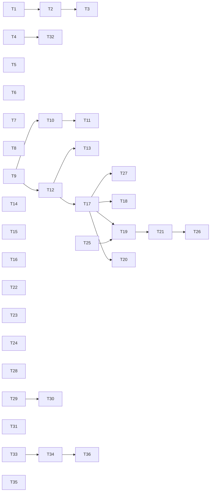

# QA round 21 fixes: a stop that stops, a handoff that keeps the human, and a failed answer that says so

status: done
commit-mode: orchestrator-commits
language: ruby
panel: Ruby (Linus Torvalds, Jeremy Evans, Sandi Metz, Richard Schneeman, Aaron Patterson)

## Intent

Fix every finding in [`planning/qa-findings-round21-2026-10-04.md`](../qa-findings-round21-2026-10-04.md)
rated LOW-MED or higher: 2 HIGH, 6 MED-HIGH, 12 MEDIUM and 13 LOW-MED (user ruling 2026-10-05, the same
line as round 20). 2 more rulings from that day shape it: B-2's input pane header becomes **live**
during an ask rather than staying a per-prompt snapshot, and the forks' proposed scenario-text
corrections are **out of scope** (code fixes only).

Round 21 found the round-20 pattern again: a fix landed on 1 route and the same class arrived 1 route
over. This plan names the concept each class was missing, so the next route is covered too:

| Missing concept | Findings it closes | Cards |
|---|---|---|
| a pane's own end is not the chat's | B-1 | T1 |
| a stop unwinds the processes it started | A-2/H-2 | T5, T6 |
| `Response::Failed`: one ask, one answer, or a named failure | M-1, E-3, E-4, plus the actor gap found in grounding | T17 to T21 |
| a handoff's question holds every turn no cut covers, human turns first | Fh-1, Fh-2 | T9 to T11 |
| a question's identity is its asking, not its text | G-3 | T32 |
| a clerk owns only what its own spawn wrote | E-1, E-6 | T25, T26 |
| settling a review forgets every per-buffer claim, threads included | B-3, D-1 | T31 |
| a test's target is the driver's declaration, not only the guard's mirror | G-1 | T33 |

**36 cards.** Roadmap line: `ROADMAP.md` item 51.

## Grounding

Verified 2026-10-05 at `d72090f2` by 7 parallel read-only explorations (cockpit input; shell stop and
credential names; compaction and handoff; failure surfacing; memory, rewind and watch; review and
docent anchors; epic tier). Fork reports read from `~/tmp/lain-qa-2026-10-04-<a..h>/records/fork-report.md`.
mempalace was skipped at the user's direction.

**Where docs, findings and code disagreed, and which won:**

- **B-1's wire name.** The finding says the pane forwards "HUP". `CLI::Signals::MAP`
  (`lib/lain/cli/signals.rb:25`) maps HUP and TERM both to `:sigterm`, so the frame is
  `{"v":"signal","name":"sigterm"}` and nothing downstream of `Signals` can tell them apart. The fix
  belongs in `InputPane#signal` (`lib/lain/frontend/input_pane.rb:134-138`), not in `MAP`, which
  `spec/lain/cli/signals_spec.rb:39,46` pins and the chat still needs.
- **A-1's root cause is not settled by reading.** The chat does publish `unpublished` after a withdraw
  (`Intake#withdraw`, `lib/lain/frontend/intake.rb:318-321`, then `InputSocket#drawn`,
  `lib/lain/cli/input_socket.rb:362-394`), and the lift works chat-side (`Intake#lifts?`, `:174-176`).
  So the pane either mishandles the frame or its idle listener starves: `Typeahead#listen`
  (`lib/lain/frontend/stdin_pump.rb:477-484`) returns nil unless `@input.echo?`, and a terminal the
  stopped Reline read left raw would starve it. Every pane spec publishes then withdraws at once, before
  the Reline read is blocked, which is why none reproduces it. T2 starts from the e2e journey that does.
- **C-1's line cite.** `intake.rb:221` is the comment on `#read`; the method is `:230-240`. The open
  read belongs to `HumanReplies::AnswerLoop` (`lib/lain/cli/human_replies.rb:553-640`), one fiber for the
  whole run, and only `HumanReplies#settled` (`:395-400`) stops it. `human_replies.rb:586-607` documents
  the stale `human>` as a "priced cost". T4 overturns that ruling, using `Outstanding#awaiting?`
  (`lib/lain/tools/ask_human.rb`) as the withdrawal signal the comment said was missing.
- **A-2 reaches docker too.** `Exec::Docker` (`lib/lain/exec/docker.rb:133-139`) reuses `Local`, and its
  only `@cleanup.call(name)` is in `rescue Timeout`, so a stop also leaves the container running.
  `Exec::Core` (`lib/lain/exec/core.rb:68-78`) has no cancel RPC at all (none in `crates/lain-core/src`);
  that needs a protocol change and is in Open decisions.
- **H-1's name hint misses 3 names.** `Regions::NAME_HINT` is at `lib/lain/sensitivity/regions.rb:66`
  (not `lib/lain/regions.rb`) and is applied today only to keys inside file content. It matches
  `password.txt`, `secret.txt`, `token.txt`, `api_key.txt`, `credentials`; it does not match `.s3cfg`,
  `.boto`, `.dockercfg`, which need `Sensitivity::GATED` rows instead (T8).
- **C-3 is narrower than filed.** `decode_stop_reason` returns `:max_tokens` and `Ask#say_failure`
  already prints `error: model hit max_tokens before finishing`. What is wrong is the committed
  `<tool_call>\n<function=…` text and the missing `malformed_response`.
- **Fr-2 stays withdrawn** (`lib/lain/tools/bash.rb:271`), which is why T11's stub carries the result's
  first line and not only `is_error`: a red test run is `is_error: false` by design.
- **G-1's mechanism.** The guard has no notion of a driver-declared target. 2 consumers refuse
  `:elsewhere`: the write-time middleware (`lib/lain/middleware/guard_test_layout.rb:26,138`) and the
  after-the-fact check (`lib/lain/gherkin/test_generation.rb:53,88`). A split sibling and a legitimate
  new-file target are indistinguishable to the guard alone, so the declaration has to reach both.
- **G-4's digest is the test engineer's, not the issue actor's.** The repeated `cf32d8ad` is a one-shot
  spawn (`role: "test_engineer"`, `prefix: "fresh"`), and round 20's Store-skip fix (`2b2d827e`,
  `lib/lain/tools/subagent/lineage.rb:177-191`) covers only actors. `lineage.rb:37-41` rules that
  identical twins share an address; T35 keeps that ruling for the empty lane.
- **G-6's line.** `factory.rb:1416` is stale; the default harness is at
  `lib/lain/cli/epic_driver/factory.rb:1304` and the call at `~1396`.
- **A gap found in grounding, same class as M-1:** `Tools::Subagent::Actor#process`
  (`lib/lain/tools/subagent/actor.rb:196`) hands `agent.ask(prompt)` straight to
  `@answer.bounded(...).text`, so an actor child's prose tool call is delivered as its settled answer.
  Only the one-shot path calls `refusing_malformed` (`lib/lain/tools/subagent.rb:328`). T17 closes it.
- **`Agent#failure_reason`** (`lib/lain/agent.rb:79`) has no reader in `lib/`. T17 deletes it.
- **Specs that pass on the bug:** `spec/lain/review/docent_spec.rb:376-426` (masked survey; never checks
  the brief's location text), `spec/lain/cli/epic_driver/issue_tests_spec.rb:50` (injects an rspec
  adapter, hiding G-6), `spec/lain/cli/epic_land_spec.rb:20-30` (parent already on `epic/demo`, hiding G-7).

## Compatibility

`lain.gemspec` is at 0.1.0 and unpublished (no git release tags; `CHANGELOG.md` has only the initial
entry). `crates/lain-core` and `ext/lain` are `publish = false`. No consumer outside this repo was found.
Standing ruling (memory `harness-vs-own-dev`): no back-compat for internal surfaces.

| Surface | Verdict | Evidence |
|---|---|---|
| `Agent#failure_reason` | free to break | no reader in `lib/`; 4 spec readers updated by T17 |
| `Agent#ask` return, plus new `Agent#ask!` | free to break | internal; T17 adds, callers move in T18 to T21 |
| `Arm::Driver` report cells, `grade_record.why` | free to break | read by humans and `bench` replays; T18 updates the fold |
| `malformed_response.kind` values | free to break | journal record; T22 adds `:cut_tool_call`, readers are validators in the same file |
| one-shot `:spawn` body in a non-empty lane | free to break | new digests only; empty-lane twins keep sharing an address |
| `Memory::Ownership` rule | must keep stored rows readable | the user's own `store.ndjson` files; T25 changes who may write, not the row format |
| new consolidation lineage record | free to break | additive telemetry type |
| question message body (`asking`) | free to break, old journals stay readable | `Question::Set.from_body` ignores extra keys; old digests replay unchanged; deterministic, so re-runs compare |
| `--compact-strategy elide+summarizing` | free to break | today it launches and fails every ask; T15 refuses it at launch |
| input pane wire frames (`unpublished` gains `header`) | free to break | pane and chat ship together from one checkout |
| `Sensitivity::GATED` rows | free to break | widening costs one prompt by the table's own design note (`sensitivity.rb:~28-40`) |
| `LAIN_CONNECT_TIMEOUT` / `LAIN_STREAM_STALL_TIMEOUT` empty value | free to break | an empty value meaning "off" is a bug; `=0` stays the documented off switch |

No trade report was needed: no must-keep surface blocked a simplification.

## Spike findings

none. A-1 is the one card resting on an unverified mechanism, and its first step is the failing e2e
journey that reproduces it (T2), with a stop condition if the cause is outside the pane. A spike would
have run the same journey.

## Shared files

The orchestrator owns these; cards hand back paragraphs or 1-line diffs.

- `ARCHITECTURE.md`: T4 (the stale `human>` ruling), T9 (what a handoff's summarizer sees), T25 (clerk
  ownership), T17 (`Response::Failed`).
- `docs/commands.md`: T1 (HUP/TERM end only the pane), T3 (live header), T15 (`--compact-strategy`).
- `ROADMAP.md`: item 51, added with this plan.
- `.rubocop.yml`, `spec/spec_helper.rb`, `lib/lain.rb`, `spec/support/slow_files.rb`: no card expects to
  touch them; a card that needs to hands back the line.

## Rejected options

- **Change `CLI::Signals::MAP` so HUP is not TERM (B-1).** The chat needs HUP-as-TERM (round 20's T16 and
  T16b, `spec/lain/seams/hangup_spec.rb`); only the pane must not forward its own end.
- **Clear thread anchors when a changeset reopens (B-3, D-1).** `51_thread_spec.rb:947-957` pins that a
  review keeps its threads across `open_other`/`open_counter`; settle is the only correct event.
- **Gate the name hint in `Sensitivity::GATED` (H-1).** The table also drives `read_file` parking and
  `glob`/`list_files` withholding; 57 of 2,403 tracked basenames here match the hint (`session.rb`,
  `secret_surface.rb`), so the abstain lives in the approval rule (user ruling 2026-10-05: hint on
  non-source files only).
- **Land `/rewind` on the prompt's parent (E-2).** It changes what a count means: `/rewind 1` after a
  text-only exchange would empty the session. A notice is the smaller, honest fix.
- **Make the docent tell a `/stop` from a session close (G-5).** At `Docent#abandon` both arrive as the
  same `Async::Stop`; a neutral sentence is true of both.
- **Revive an ended fleet row by digest (G-4, fleet-only).** The journal and `lain watch` would still
  see 1 address for 2 attempts.
- **Fix only `LandingQueue`'s advice (G-7).** The advice would be correct and the command still unusable
  from `main`, while the driver already lands in `landings/<slug>`.
- **A per-asker counter for G-3's identity.** G-3 repeated across runs; a fresh asker restarts at 0.
- **A random nonce for G-3's identity.** Identical scripted runs would journal different digests, which breaks replay comparison on a study bench; T32 counts prior askings in the Store instead.
- **A new lexical predicate over every word for H-1.** It would park `grep session lib/` and `--author=x`; T7 puts the hint in the content classifier, which only ever sees existing files.
- **`AskHuman` calling `HumanReplies#settled` on withdrawal (C-1).** That points `tools/` at `cli/`; T4 polls `awaiting?` from the side that already holds the directory.
- **Journal-only for C-3.** Keeping `<function=` in the committed text poisons the chain this model then
  imitates (`planning/qa/method.md`, "What the local model does badly"); the excerpt is kept in the record.

## Open decisions

- **`Exec::Core` stop.** The `lain-core` daemon has no cancel RPC, so a stop abandons the wait while the
  child runs to its own `timeout_ms`. Needs a protocol change; no card. `--exec core` is refused from chat
  by design, so it is unreachable from any round today.

## Dependency graph



## Tasks

### The cockpit input path

### T1: End only the pane when the pane is told to end          [risk: high]

**Depends on:** none
**Files:** `lib/lain/frontend/input_pane.rb`, `spec/lain/frontend/input_pane_spec.rb`, `spec/lain/seams/input_pane_socket_spec.rb`
**Reuse:** the `deliver(name)` helper and trap-saving `around` in `input_pane_spec.rb`; `serving`'s existing `IOError` rescue (`input_pane.rb:200`)
**Shared-file wiring:** `docs/commands.md:218-220`: add "HUP and TERM end only the pane; Ctrl-C and Ctrl-\ travel to the chat"
**Reachable from:** `exe/lain:1204` (`InputPane.open(path:).run`), which installs `Signals.new(sink: @relay).guarding` at `input_pane.rb:111`

Design: today `@quit` is read only in `#waited` (`input_pane.rb:188`), which runs only while no chat is connected, so a flag alone does nothing. On `:sigterm` (HUP or TERM, `signals.rb:25`) the pane must end `serving` (close the client) and make `attached` return `:quit` before `connected` can reconnect. Only `:sigint` and `:sigquit` are forwarded.

**Acceptance criteria**

```gherkin
Scenario: killing a connected pane leaves the chat running
  Given a chat with a connected lain input pane
  When the pane process receives HUP
  Then the pane exits 0, sends no signal frame, and the chat still answers a line from a respawned pane

Scenario: TERM ends the pane and it does not reconnect
  Given a connected pane and a chat that stays up
  When the pane receives TERM
  Then no signal frame reaches the chat, and the pane process has exited within 2 seconds

Scenario: Ctrl-C still travels to the chat
  Given a connected pane
  When it receives INT
  Then the chat receives a "sigint" signal frame and the pane keeps running
```
Spec file: `spec/lain/frontend/input_pane_spec.rb`, `spec/lain/seams/input_pane_socket_spec.rb`

**Stop and report if:**
- `spec/lain/cli/signals_spec.rb` would need `MAP` changed to pass
- `spec/lain/seams/hangup_spec.rb` or `terminal_gone_spec.rb` changes verdict (those are the chat's HUP)

### T2: Hear a typed line after another surface answered the approval          [risk: high]

**Depends on:** T1
**Files:** `lib/lain/frontend/input_pane.rb`, `lib/lain/frontend/stdin_pump.rb`, `spec/lain/frontend/input_pane_spec.rb`, `spec/e2e/stop_while_busy_spec.rb`
**Reuse:** `stop_while_busy_spec.rb`'s scripted stand-in `holding` reply, `cockpit.approve`, `await_chats`, `upstream.release`
**Shared-file wiring:** none
**Reachable from:** `exe/lain:1204` (`InputPane#received "unpublished"` → `idle` → `unprompted`, `input_pane.rb:225-244`)

**Acceptance criteria**

```gherkin
Scenario: /stop typed after an nvim approval stops the ask
  Given a cockpit ask parked on an approval
  When the human approves it in nvim, and types /stop while the next model call is held
  Then the journal records run_interrupted "stopped" before the stand-in is released

Scenario: the pane draws no stale command> after the approval resolves elsewhere
  Given a pane whose command> read was open and blocked for over 1 second
  When the chat sends unpublished and the human types a line
  Then the line reaches the chat at once with no generation
```
Spec file: `spec/e2e/stop_while_busy_spec.rb`, `spec/lain/frontend/input_pane_spec.rb`

Record the root cause in the plan's Execution log before T3 starts; T3 builds on the same handler.

**Stop and report if:**
- the new e2e example passes against unchanged `lib/` at the card's base commit (the repro does not hold in the suite)
- the cause is chat-side: the `unpublished` frame never leaves `InputSocket` (log `received` frames before changing the pane)
- the fix needs `Typeahead` to read with echo off, which `stdin_pump_spec.rb`'s cooked-mode examples forbid

### T3: Redraw the pane header during an ask          [risk: medium]

**Depends on:** T2
**Files:** `lib/lain/cli/input_socket.rb`, `lib/lain/frontend/input_pane.rb`, `spec/lain/cli/input_socket_spec.rb`, `spec/lain/frontend/input_pane_spec.rb`
**Reuse:** `InputSocket#published`/`fresh?`/`broadcast` (`input_socket.rb:362-394`); the `hud_line` thunk (`lib/lain/cli/wiring.rb:~468`); `over_the_prompt` in the pane
**Shared-file wiring:** `docs/commands.md:470-476`: say the header updates while an ask runs
**Reachable from:** `CLI::Wiring#input_socket` (`wiring.rb:455`) builds `InputSocket.new(header: method(:hud_line), ...)`

**Acceptance criteria**

```gherkin
Scenario: the unpublished frame carries the current header
  Given an ask in flight and a fleet row that changes turn count
  When the socket ticks
  Then it broadcasts an unpublished frame whose header names the new turn count

Scenario: an idle pane redraws a changed header without touching a half-typed line
  Given an idle pane with "abc" echoed on its input row
  When an unpublished frame with a changed header arrives
  Then the header rows are redrawn and the cursor returns to after "abc"

Scenario: a clock-only change redraws nothing
  Given a running fleet whose only change is elapsed time
  When the socket ticks for 2 seconds
  Then no frame is broadcast
```
Spec file: `spec/lain/cli/input_socket_spec.rb`, `spec/lain/frontend/input_pane_spec.rb`

**Interface**

```ruby
# input pane wire, chat -> pane
{ "v" => "unpublished", "header" => String }   # header added; was {"v"=>"unpublished"}
```

**Stop and report if:**
- `spec/lain/seams/input_pane_socket_spec.rb:355` ("redraws nothing while only the clock moves") goes red
- the header redraw needs the pane to read its own input row, which cooked mode does not allow

### T4: Close a question's open read when its ask is stopped          [risk: high]

**Depends on:** none
**Files:** `lib/lain/cli/human_replies.rb`, `lib/lain/tools/ask_human.rb` (comment only), `spec/lain/cli/human_replies_spec.rb`, `spec/lain/seams/plain_chat_prompt_guards_spec.rb`
**Reuse:** `HumanReplies#settled(digest)` (`human_replies.rb:395-400`); `Directory#awaiting?(digest)` (`ask_human/directory.rb:133,189`), already held by `HumanReplies` as `ask_human:`; `CommandLine#read_once`'s race against its reason at `TICK` (`human_replies.rb:777-784`)
**Shared-file wiring:** `ARCHITECTURE.md`: replace the "stale human> is a priced cost" sentence with "a withdrawn question closes its read"
**Reachable from:** `CLI::Wiring#build_repl` (`wiring.rb:959`) builds `HumanReplies.new(..., ask_human: directory)`; `human_replies.rb:283-284` spawns `answers` (plain chat) → `AnswerLoop#exchange`

Design: the withdrawal is a query, not an event (`AskHuman#withdraw`, `ask_human.rb:780`, is silent). `AnswerLoop#exchange` races its `human>` read against `!@ask_human.awaiting?(item.digest)`, polled at `TICK` the way `CommandLine#read_once` does, and on withdrawal calls `settled(item.digest)`. No edit to `AskHuman`'s behaviour and no dependency from `tools/` to `cli/`. Rewrite the "ghost" group in `human_replies_spec.rb:1107-1198` (it asserts `replies.pending?` stays true after `run.stop`, the ruling this card reverses) and `:457`. Amend `ask_human.rb:768-772` ("a withdrawal retires nothing from an inbox") and `human_replies.rb:586-607`.

**Acceptance criteria**

```gherkin
Scenario: /stop at a parked question gives the human you> back
  Given a plain chat (--no-nvim) with an ask parked on ask_human
  When the human types /stop
  Then the human> read closes, you> is drawn, and the next typed prompt is journaled as a turn

Scenario: Ctrl-C then s does the same
  Given the same parked question
  When the human presses Ctrl-C then s, then types "raven"
  Then "raven" is journaled as the next prompt and nothing is discarded

Scenario: a question still awaited keeps its read
  Given a parked question and a Ctrl-C answered with c (continue)
  When the human types "yes" at human>
  Then "yes" is delivered as the answer and the ask resumes
```
Spec file: `spec/lain/cli/human_replies_spec.rb`, `spec/lain/seams/plain_chat_prompt_guards_spec.rb`

**Stop and report if:**
- the "ghost" group protects a requirement other than the stale read (for example, an answer delivered to a resumed ask after the withdrawal)
- the cockpit path (`spec/e2e/stop_while_busy_spec.rb:122`) changes verdict

### The shell

### T5: Kill a command's process groups on any unwind          [risk: high]

**Depends on:** none
**Files:** `lib/lain/shell/pipeline.rb`, `spec/lain/shell/pipeline_spec.rb`, `spec/lain/exec/local_spec.rb`
**Reuse:** `Run#terminate(threads)` (`pipeline.rb:498-503`); the "a sink that raises IOError kills the groups" example and pid-to-tmpfile helper (`pipeline_spec.rb:~480-522`); `rescue Exception` precedent at `lib/lain/isolation/worker_handoff.rb:341`
**Shared-file wiring:** none
**Reachable from:** `Tools::Bash.new(exec:)` → `Exec::Local#call` (`exec/local.rb:~57`) → `Shell::Pipeline#call`; `CLI::ExecBackend#backend` selects `Local` by default (`cli/exec_backend.rb:95`)

**Acceptance criteria**

```gherkin
Scenario: a stopped term-arm command is killed
  Given Pipeline.new(grace: 0.1) running [["sleep", "20"]] in an Async child task
  When the task is stopped after 0.3 seconds
  Then the call unwinds in under 2 seconds and the process group no longer exists

Scenario: a stopped string-arm command leaves no side effect
  Given Exec::Local running "sleep 3 && touch z.txt"
  When the task is stopped after 0.3 seconds
  Then z.txt does not exist 4 seconds after the stop

Scenario: a second stop during the grace wait still kills the group
  Given a command that ignores TERM, under Pipeline.new(grace: 1.0)
  When the task is stopped, and stopped again 0.2 seconds later
  Then the process group no longer exists when the call unwinds

Scenario: a finished command is not signalled
  Given a command that exits 0 before any stop
  When the call returns
  Then terminate is not called
```
Spec file: `spec/lain/shell/pipeline_spec.rb`, `spec/lain/exec/local_spec.rb`

**Stop and report if:**
- the kill must run inside `Async::Task#defer_stop`, which would give `Shell::Pipeline` its first Async dependency
- `pipeline_spec.rb`'s timeout examples (`:417-511`) change timing

### T6: Remove a docker command's container on a stop          [risk: medium]

**Depends on:** none
**Files:** `lib/lain/exec/docker.rb`, `spec/lain/exec/docker_spec.rb`
**Reuse:** `@cleanup` and its 5 s `DEADLINE`; the fake-exec style at `docker_spec.rb:~470`
**Shared-file wiring:** none
**Reachable from:** `CLI::ExecBackend#backend` → `Exec::Docker` → `Tools::Bash.new(exec:)`

**Acceptance criteria**

```gherkin
Scenario: a stop removes the container
  Given Exec::Docker running a command under a fake exec
  When the task is stopped
  Then cleanup is called with the container name and Async::Stop is re-raised unchanged
```
Spec file: `spec/lain/exec/docker_spec.rb`

**Stop and report if:**
- the cleanup must run while the reactor is stopping and `Cleanup` blocks on a fiber that is already cancelled
- `docker run`'s own signal proxy already removes the container when T5 TERMs the client (check with the box's podman); then the cleanup is redundant and the card ends with that measurement

### T7: Withhold auto-approval of a data file whose name says it holds a secret          [risk: high]

**Depends on:** none
**Files:** `lib/lain/cli/wiring/board_build.rb`, `spec/lain/approval/composed_term_spec.rb`, `spec/lain/cli/wiring/board_build_spec.rb`
**Reuse:** `Sensitivity::Regions::NAME_HINT` (`lib/lain/sensitivity/regions.rb:66`); `Classifiers::Content#releasable?` (`board_build.rb:398`), which `ComposedTerm#plain_content?` (`composed_term.rb:483`) already asks for each word that is an existing regular file; helpers `write_file`, `in_tree`, `rule_for`, `call_of` and the `notes.cfg` example (`composed_term_spec.rb:~540-620`)
**Shared-file wiring:** none
**Reachable from:** `CLI::Wiring::BoardBuild` (`board_build.rb:127`): `[*remembered, ComposedTerm.new(sensitivity: factory)]`, whose content classifier is `Classifiers::Content`

Design (user ruling 2026-10-05: hint on non-source files only): the hint lives in the content predicate, not as a new lexical predicate over every word, so a pattern (`grep session lib/`) or a flag (`--author=x`) never reaches it. A file whose basename matches `NAME_HINT` and whose extension is not in `SOURCE_EXTENSIONS` is not releasable.

**Acceptance criteria**

```gherkin
Scenario: a hinted data file is not approved by the rule
  Given a 0644 file named password.txt, secret.txt, token.txt, api_key.txt, credentials or vault-pass.txt holding "hunter2"
  When ComposedTerm decides "cat" of that file
  Then it abstains, and the call parks for a human

Scenario: a hinted source file is still approved
  Given a 0644 file named session.rb, auth.py, token.ts or session.sh with ordinary source content
  When ComposedTerm decides "cat" of that file
  Then it allows

Scenario: a pattern or a flag naming a hint word is unchanged
  Given lib/ with ordinary files
  When ComposedTerm decides "grep session lib/" and "git log --author=x"
  Then each answers as it does at the base commit

Scenario: an unhinted name is unchanged
  Given README.md
  When ComposedTerm decides "cat README.md"
  Then it allows
```
Spec file: `spec/lain/approval/composed_term_spec.rb`, `spec/lain/cli/wiring/board_build_spec.rb`

**Interface**

```ruby
# board_build.rb, Classifiers::Content
SOURCE_EXTENSIONS = %w[.rb .rake .erb .py .js .jsx .ts .tsx .go .rs .lua .c .h .cc .hpp .java .kt
                       .swift .sh .ex .php .cs .sql .html .css .toml .md .rst].freeze
def releasable?(word) = ...   # also false when the basename matches NAME_HINT outside SOURCE_EXTENSIONS
```

**Stop and report if:**
- `composed_term_spec.rb`'s `id_ed25519.pub` "still approves" example (~`:545`) goes red
- `Content` has callers other than `ComposedTerm` whose verdict this changes (name them; do not widen)

### T8: Gate the cloud-tool credential files by name          [risk: medium]

**Depends on:** none
**Files:** `lib/lain/sensitivity.rb`, `spec/lain/sensitivity_spec.rb`
**Reuse:** the `passwords.txt` row and `variants: true` (`sensitivity.rb:574-580`); helper `levels(names)` (`sensitivity_spec.rb:462-463`)
**Shared-file wiring:** none
**Reachable from:** `Sensitivity::Policy` built in `CLI::Wiring::BoardBuild`; `ComposedTerm#ordinary_words?` reads the same table

**Acceptance criteria**

```gherkin
Scenario: the 3 names are gated
  Given the Sensitivity table
  When ".s3cfg", ".boto" and ".dockercfg" are classified
  Then each is :gated, and "cat .s3cfg" parks for a human

Scenario: the table stays lexical
  Given the no-syscall canary and Ripper audit
  When sensitivity_spec runs
  Then both stay green
```
Spec file: `spec/lain/sensitivity_spec.rb`

**Stop and report if:**
- a bare `credentials` outside `.aws`/`.gem` needs a table row as well as T7's hint (say which, do not add both)

### Compaction and handoff

### T9: Show the handoff summarizer every turn no held cut covers          [risk: high]

**Depends on:** none
**Files:** `lib/lain/compaction/source/held_cut.rb`, `spec/lain/compaction/source/held_cut_spec.rb`, `spec/lain/seams/handoff_spec.rb`
**Reuse:** `Stretch#indices` (`held_cut.rb:~404`); `@at.fetch(span.first)..@at.fetch(span.last)` span-to-index mapping; `handoff_ranges` (`:260`)
**Shared-file wiring:** `ARCHITECTURE.md:409-420`: add "the summarizer sees every turn in its range that no held cut covers"
**Reachable from:** `CLI::Backend#fallback` (`backend.rb:~679`) → `Fallback#call` (`fallback.rb:~63`) → `HeldCut#handoff`

**Acceptance criteria**

```gherkin
Scenario: a lone first turn below the newest cut reaches the question
  Given a user turn at index 0, an advance cut over indices 1 to 2, and a tool pair above it
  When HeldCut#handoff builds its question
  Then the question's span includes the index-0 text

Scenario: a collapsed turn is shown once
  Given a turn inside a held collapse
  When the question is built
  Then it appears once, as its replacement

Scenario: the directive survives a real handoff
  Given a chat under elide-tools+summarize-conversation whose first ask is the directive, then an advance, then an over-window prompt
  When the handoff runs
  Then the summarizer's request contains the directive's text
```
Spec file: `spec/lain/compaction/source/held_cut_spec.rb`, `spec/lain/seams/handoff_spec.rb`

**Stop and report if:**
- `source_spec.rb:2684` ("shows a second handoff the first document whole") changes
- a retained turn below the floor has no entry in `@at`

### T10: Spend a handoff's budget on the human's turns first          [risk: high]

**Depends on:** T9
**Files:** `lib/lain/oracle/handoff.rb`, `spec/lain/oracle/handoff_spec.rb`
**Reuse:** `Oracle::Handoff::Budget#take` and its elision notice
**Shared-file wiring:** none
**Reachable from:** `HeldCut#handoff` → `Oracle::Handoff.question` (built on the T9 path)

**Acceptance criteria**

```gherkin
Scenario: a binding budget keeps the oldest human turn
  Given a question whose turns exceed the budget and whose oldest turn is the human's directive
  When Budget#take selects turns
  Then the directive is kept whole and older tool turns are elided first, with the "[N turn(s) elided]" notice

Scenario: a human turn in the earlier slot is not cut short while budget remains
  Given a handoff whose earlier slot holds a human turn over 200 characters
  And the budget has room for it
  When the question renders
  Then that human turn appears whole in the earlier slot, not cut at 200 characters

Scenario: human turns alone over budget are cut newest-kept
  Given human text turns that alone exceed the budget
  When Budget#take selects
  Then it keeps the newest human turns and says how many it elided
```
Spec file: `spec/lain/oracle/handoff_spec.rb`

**Stop and report if:**
- `handoff_spec.rb:220-264`'s budget examples assert a newest-first order that this changes for a reason other than turn kind

### T11: Keep a tool result's outcome in the handoff          [risk: medium]

**Depends on:** T10
**Files:** `lib/lain/oracle/handoff.rb`, `spec/lain/oracle/handoff_spec.rb`
**Reuse:** `stub` (`handoff.rb:201-209`), `LINE_CHARS`
**Shared-file wiring:** none
**Reachable from:** `HeldCut#handoff` → `Oracle::Handoff.question`

**Acceptance criteria**

```gherkin
Scenario: a denied call reads as denied
  Given a tool_result with is_error true and content "approval denied"
  When the handoff renders it
  Then the line contains "error" and "denied"

Scenario: a red test run reads as red
  Given a tool_result whose content starts "exit status: 1" followed by 4 KB
  When the handoff renders it
  Then the line contains "exit status: 1" and its byte size, and not the 4 KB body

Scenario: a short result is kept whole
  Given a tool_result of at most LINE_CHARS characters
  When the handoff renders it
  Then its full content appears
```
Spec file: `spec/lain/oracle/handoff_spec.rb`

**Stop and report if:**
- `handoff_spec.rb:73-82` ("reduces a tool result to one line naming its size") cannot stay green for a large result

### T12: Retry an over-window ask once by re-rendering when something is droppable          [risk: high]

**Depends on:** T9 (both edit `spec/lain/seams/handoff_spec.rb`)
**Files:** `lib/lain/agent.rb`, `lib/lain/middleware/request_budget.rb`, `spec/lain/agent_spec.rb`, `spec/lain/middleware/request_budget_spec.rb`, `spec/lain/seams/handoff_spec.rb`
**Reuse:** `pipeline_source.droppable?` (`agent/pipeline_source.rb:44`, and `Source`); `accounting.observe_refusal`; the fake handoff seam (`agent_spec.rb:38-60`)
**Shared-file wiring:** none
**Reachable from:** `Agent#attempt` (`agent.rb:626-634`), run by every ask built in `CLI::Wiring`

**Acceptance criteria**

```gherkin
Scenario: a droppable over-window request compacts and answers within the ask
  Given a source whose handoff answers false and whose droppable? is true, and a provider that refuses until compacted
  When the ask runs
  Then 2 requests are sent and the answer lands, with no OverWindow raised

Scenario: refuse, re-render, refuse, hand off
  Given a source still over window after the re-render, with fallback on
  When the ask runs
  Then the second refusal hands off and the ask answers

Scenario: nothing can make room
  Given fallback none and a re-render that is still refused
  When the ask runs
  Then OverWindow is raised as today, and the message names no command that does not exist
```
Spec file: `spec/lain/agent_spec.rb`, `spec/lain/seams/handoff_spec.rb`, `spec/lain/middleware/request_budget_spec.rb`

**Stop and report if:**
- the compaction scheduler's timing gate defers the re-render's compaction, so the retry sends the same bytes
- `spec/lain/seams/handoff_spec.rb:305-317` (fallback off: refusal stands) has to change

### T13: Say nothing is stalled on the render a handoff just made room for          [risk: medium]

**Depends on:** T12
**Files:** `lib/lain/compaction/source.rb`, `spec/lain/compaction/source_spec.rb`
**Reuse:** `Diagnosis.of`, `Reporting#record` (`source.rb:341-348`), `RecordingChannel`/`sink` (`source_spec.rb:~2310`)
**Shared-file wiring:** none
**Reachable from:** `Source#handoff` and `Source#context_for`, built by `CLI::Backend#pipeline_source`

**Acceptance criteria**

```gherkin
Scenario: the render after a handoff prints no stall line
  Given a refused render followed by a committed handoff
  When the next context_for runs and records its decision
  Then no "nothing is droppable" line reaches the surface, and the journaled decision still reads compacted: false

Scenario: a later genuine stall is still said
  Given a second refused render with nothing droppable and no handoff
  When it is recorded
  Then the stall line is printed
```
Spec file: `spec/lain/compaction/source_spec.rb`

**Stop and report if:**
- suppressing the line needs `compacted: true` in the journaled decision

### T14: Skip the per-result summarizer when a strategy replaced it          [risk: medium]

**Depends on:** none
**Files:** `lib/lain/cli/backend.rb`, `spec/lain/cli/backend_spec.rb`
**Reuse:** `@compaction.strategy` (`lib/lain/cli/compaction_profile.rb`); `Observer::Null`
**Shared-file wiring:** none
**Reachable from:** `CLI::Backend#tool_observer` (`backend.rb:493-499`), wired by `compaction_mount.rb:50` and handed to the tool runner at `agent.rb:483`

**Acceptance criteria**

```gherkin
Scenario: a strategy run fires no eager summary
  Given a backend with compact_strategy "elide-tools+summarize-conversation"
  When a 40 KB tool result is observed
  Then no Summarize oracle is called and tool_observer is Observer::Null

Scenario: an unflagged compaction run keeps the eager tier
  Given compaction on with no strategy
  When the same result is observed
  Then the SummaryObserver summarizes it

Scenario: a resume that inherits a strategy also skips it
  Given a session header recording a strategy and a resume with no compaction flags
  When tool_observer is built
  Then it is Observer::Null
```
Spec file: `spec/lain/cli/backend_spec.rb`

**Stop and report if:**
- `Metrics/ClassLength` for `CLI::Backend` trips (108 of 110 per `compaction_strategy.rb:12`)

### T15: Refuse a strategy pair that both claim the whole span, at launch          [risk: low]

**Depends on:** none
**Files:** `lib/lain/cli/compaction_strategy.rb`, `spec/lain/cli/compaction_strategy_spec.rb`
**Reuse:** `strategy_names`; the `Unknown` error
**Shared-file wiring:** `docs/commands.md:103-109`: replace "resolves happily and then refuses at the first compacting turn" with the launch refusal
**Reachable from:** `CLI::CompactionStrategy#strategy` via `Backend::SpanSummarizer#strategy`, and preflight at `chat_launch.rb:289`

**Acceptance criteria**

```gherkin
Scenario: elide+summarizing refuses before a session opens
  Given lain chat --compact-strategy elide+summarizing
  When it launches
  Then it exits 1 naming both strategies and suggesting elide-tools+summarize-conversation, and writes no session file

Scenario: the partitioning pair still resolves
  Given --compact-strategy elide-tools+summarize-conversation
  When it resolves
  Then it builds as today
```
Spec file: `spec/lain/cli/compaction_strategy_spec.rb`

**Stop and report if:**
- `summarizing` is whole-span only when it has an answer, and refusing it unconditionally breaks a `composed_spec.rb` example

### T16: Show resume notices on the chat screen          [risk: low]

**Depends on:** none
**Files:** `lib/lain/cli/wiring.rb`, `spec/lain/cli/wiring_spec.rb`
**Reuse:** `tty.render_warning` (`frontend/tty.rb:377`); `resumed.notices`, `memory_notices` (`wiring.rb:287-288`)
**Shared-file wiring:** none
**Reachable from:** `CLI::Wiring#open_terminal` (`wiring.rb:289`), the TTY path of every `lain chat --resume`

**Acceptance criteria**

```gherkin
Scenario: a keep mismatch is still on screen after the chat opens
  Given a resume whose header recorded --compact-keep 4 and a launch with 8
  When the TTY frontend starts
  Then "recorded with --compact-keep 4; continuing with 8" reaches render_warning after the alternate screen opens

Scenario: a non-TTY run still says it once
  Given the same resume with no terminal
  When it launches
  Then the notice reaches the notice block exactly once
```
Spec file: `spec/lain/cli/wiring_spec.rb`

**Stop and report if:**
- `wiring_spec.rb:2278-2300` requires notices to be said only before the screen opens

### Failed answers

### T17: Raise a named failure from Agent#ask!, first for actor children          [risk: high]

**Depends on:** T12
**Files:** `lib/lain/response/failed.rb` (new), `lib/lain/agent.rb`, `lib/lain/tools/subagent/actor.rb`, `spec/lain/response/failed_spec.rb` (new), `spec/lain/agent_spec.rb`, `spec/lain/agent_state_machine_spec.rb`, `spec/lain/provider/ollama_spec.rb`, `spec/lain/tools/subagent/actor_spec.rb`
**Reuse:** `Response#failure` and `Response::Failure` (`response.rb:52-72`); `Lain::Error`; `Tools::Subagent#refusing_malformed` and `MalformedAnswer` (`subagent.rb:328`)
**Shared-file wiring:** `ARCHITECTURE.md`: 1 sentence that a caller wanting text uses `ask!`, which raises `Response::Failed` on a failed stop
**Reachable from:** the epic orchestrator's actor spawns → `Tools::Subagent::Actor#process` (`actor.rb:196`), the first production caller of `Agent#ask!`; T18 to T21 add the rest

The actor gap (found in grounding, same class as M-1) is this card's production caller, so `ask!` lands with a reader. `Agent#failure_reason` has 8 readers in 3 spec files and none in `lib/`; delete it and move those readers to `Response#failure`.

**Acceptance criteria**

```gherkin
Scenario: a malformed stop raises a named failure
  Given an agent whose provider returns stop_reason malformed with prose text
  When ask! is called
  Then Response::Failed is raised carrying the Failure, its message names malformed, and the agent is failed?

Scenario: a good answer returns its text
  Given an end_turn response
  When ask! is called
  Then it returns the text

Scenario: an actor child's prose tool call is a failure, not an answer
  Given an actor child whose provider returns a prose tool call
  When the actor processes a prompt
  Then the parent receives an error result naming malformed, and the child's completion reads failed
```
Spec file: `spec/lain/response/failed_spec.rb`, `spec/lain/agent_spec.rb`, `spec/lain/tools/subagent/actor_spec.rb`

**Interface**

```ruby
class Response
  class Failed < Lain::Error      # lib/lain/response/failed.rb
    attr_reader :failure          # Response::Failure
  end
end

class Agent
  # @return [String] the answer's text
  # @raise [Response::Failed] when the answer is a failed stop
  def ask!(prompt, **) = ...
end
```

**Stop and report if:**
- `Repl::Ask#settle`/`say_failure` (`cli/repl/ask.rb:65,79`) would need to change to pass
- the actor's mailbox protocol has no failed completion and adding one changes `Lineage`'s record shape

### T18: Report a failed stop as a failed bench cell          [risk: medium]

**Depends on:** T17
**Files:** `lib/lain/arm/driver.rb`, `lib/lain/arm/single_thread.rb`, `lib/lain/arm/one_shot.rb`, `lib/lain/arm/adaptive_router.rb`, `lib/lain/arm/orchestrator_worker.rb`, `lib/lain/arm/dual_ledger.rb`, `spec/lain/arm/driver_spec.rb`, `spec/lain/arm/single_thread_spec.rb`
**Reuse:** `CeilingFailure`, `Failed#row`, `journal_failure`, `fold` (`driver.rb:100-222`); `CeilingArm` (`driver_spec.rb:39-41`)
**Shared-file wiring:** none
**Reachable from:** `lain bench arms` → `Arm::Driver#run_task` (`driver.rb:192-197`)

**Acceptance criteria**

```gherkin
Scenario: a malformed stop is a named failed cell
  Given an arm whose provider returns a prose tool call on both tasks
  When the driver reports
  Then every metric row for that arm reads "failed: malformed (tasks 1, 2)" and a sibling arm prints its distributions

Scenario: the grade record says why
  Given the same run
  When the journal is read
  Then each failed task has a grade_record with pass false and a why naming malformed

Scenario: a mixed run names both reasons
  Given one task over the ceiling and one malformed
  When the driver reports
  Then the cell names both reasons with their task numbers
```
Spec file: `spec/lain/arm/driver_spec.rb`, `spec/lain/arm/single_thread_spec.rb`

**Stop and report if:**
- `OrchestratorWorker#settle`'s `rescue StandardError` absorbs `Response::Failed` into a graded result

### T19: Report a clerk's failed answer as a failed lineage          [risk: medium]

**Depends on:** T17, T25
**Files:** `lib/lain/consolidation.rb`, `lib/lain/cli/consolidate.rb`, `spec/lain/cli/consolidate_spec.rb`
**Reuse:** `Outcome` (`consolidation.rb:41`); `rendered`/`summary` (`cli/consolidate.rb:133-145`); the provider helper (`consolidate_spec.rb:84`)
**Shared-file wiring:** none
**Reachable from:** `exe lain consolidate` → `CLI::Consolidate.from_options` → `Consolidation#call` → `spawn_clerk`

**Acceptance criteria**

```gherkin
Scenario: a prose tool call is reported as a failed lineage
  Given a clerk whose provider returns stop_reason malformed with "<function=memory_write>..."
  When consolidate runs
  Then the report does not contain the envelope, names the lineage as failed (malformed), and the exit status is non-zero

Scenario: a lineage that answered is reported as today
  Given 2 lineages, the first malformed and the second answering
  When consolidate runs
  Then the second's outcome is printed with its result
```
Spec file: `spec/lain/cli/consolidate_spec.rb`

**Stop and report if:**
- the exit status for a partly failed pass is pinned as 0 by an existing example
- T25's per-spawn recorder changes what `Outcome.wrote` reports for a lineage that wrote nothing

### T20: Report what improve stored when it stops at the ceiling          [risk: low]

**Depends on:** T17
**Files:** `lib/lain/cli/improve.rb`, `spec/lain/cli/improve_spec.rb`
**Reuse:** `stored(sink)` (`improve.rb:222-226`); the stored-count `describe` (`improve_spec.rb:179`)
**Shared-file wiring:** none
**Reachable from:** `exe lain improve` → `CLI::Improve#report` (`improve.rb:205-211`)

**Acceptance criteria**

```gherkin
Scenario: the ceiling still reports the count
  Given an improver that stores 2 notes and then loops past the ceiling
  When improve runs
  Then it says it stopped at the ceiling after storing 2 notes, and exits 1

Scenario: a malformed stop is said too
  Given an improver whose answer is a prose tool call
  When improve runs
  Then it names the failure and the stored count, not the envelope
```
Spec file: `spec/lain/cli/improve_spec.rb`

**Stop and report if:**
- `exe/lain:86-93`'s `Thor::Error` rescue swallows the count before it is printed

### T21: Keep a consolidation pass going past a clerk that hits the ceiling          [risk: medium]

**Depends on:** T19
**Files:** `lib/lain/consolidation.rb`, `spec/lain/cli/consolidate_spec.rb`
**Reuse:** T19's failed `Outcome`; `Agent::Budget::Exceeded`
**Shared-file wiring:** none
**Reachable from:** `exe lain consolidate` → `Consolidation#call` (`consolidation.rb:96`, `lineages.map { spawn_clerk }`)

**Acceptance criteria**

```gherkin
Scenario: a looping clerk does not stop the next lineage
  Given lineage 1's clerk loops past the ceiling and lineage 2's answers
  When consolidate runs
  Then lineage 2's outcome is reported, lineage 1 reads failed at the ceiling, and memory lineage 1 wrote before the ceiling stays in the store
```
Spec file: `spec/lain/cli/consolidate_spec.rb`

**Stop and report if:**
- a clerk at the ceiling holds the store's lock when `Budget::Exceeded` escapes

### T22: Move a tool call cut off at max_tokens from the chain into the journal          [risk: medium]

**Depends on:** none
**Files:** `lib/lain/provider/ollama/decoding.rb`, `lib/lain/telemetry/malformed_response.rb`, `spec/lain/provider/ollama/decoding_spec.rb`, `spec/lain/telemetry/malformed_response_spec.rb`
**Reuse:** `PROSE_TOOL_CALL` (`decoding.rb:88-94`); the empty-reply-at-max_tokens precedent (`decoding_spec.rb:56-59`)
**Shared-file wiring:** none
**Reachable from:** `Provider::Ollama` → `Decoding#build_response`, built by `CLI::Backend#provider`

**Acceptance criteria**

```gherkin
Scenario: an unclosed envelope at length is recorded and kept off the chain
  Given a body with content "Checking.\n<tool_call>\n<function=list_files" and done_reason "length"
  When it is decoded
  Then the stop reason is max_tokens, the text is "Checking.", and one malformed_response of kind cut_tool_call carries the cut tail as its excerpt

Scenario: ordinary prose at length is untouched
  Given prose content and done_reason "length"
  When it is decoded
  Then no record is written and the text is whole
```
Spec file: `spec/lain/provider/ollama/decoding_spec.rb`, `spec/lain/telemetry/malformed_response_spec.rb`

**Stop and report if:**
- the anthropic decoder has the same shape (say so; do not widen this card)

### T23: Put an adjudication spike's malformed record where its message points          [risk: medium]

**Depends on:** none
**Files:** `lib/lain/cli/epic_submit.rb`, `spec/lain/cli/epic_submit_spec.rb`
**Reuse:** `Backend::Summarizer::RunJournal`'s per-event resolution; `Adjudication.pair` (`epic_submit.rb:619-629`); `spike_backend` and `pair` helpers (`epic_submit_spec.rb:1290-1297`)
**Shared-file wiring:** none
**Reachable from:** `lain epic submit` → `EpicSubmit::Adjudication.pair` → `Approval::Gate::Adjudicator#spike`

**Acceptance criteria**

```gherkin
Scenario: a failed spike's record is in the decision journal
  Given an adjudicated gate whose evidence spike returns a prose tool call
  When the gate decides
  Then the decision journal holds a malformed_response for it, and the note's reference resolves
```
Spec file: `spec/lain/cli/epic_submit_spec.rb`

**Stop and report if:**
- binding the run journal inside `@journal.hold` needs `bind_once` to bind 2 times; then change the note to quote the excerpt instead and say so

### T24: Read an empty timeout variable as unset          [risk: low]

**Depends on:** none
**Files:** `lib/lain/provider/http/configuration.rb`, `spec/lain/provider/http/connect_budget_spec.rb`, `spec/lain/provider/http/stall_protection_spec.rb`
**Reuse:** `Blankness.blank?`; `with_env` (`connect_budget_spec.rb:189-217`)
**Shared-file wiring:** none
**Reachable from:** `Provider::HTTP::Configuration.new`, built for every HTTP provider

**Acceptance criteria**

```gherkin
Scenario: an empty connect timeout uses the default
  Given LAIN_CONNECT_TIMEOUT=""
  When Configuration.new is built
  Then connect_timeout is 5

Scenario: an empty stall timeout uses the default
  Given LAIN_STREAM_STALL_TIMEOUT=""
  When Configuration.new is built
  Then the stall timeout is 30

Scenario: zero still turns it off
  Given LAIN_CONNECT_TIMEOUT=0
  When Configuration.new is built
  Then connect_timeout is nil
```
Spec file: `spec/lain/provider/http/connect_budget_spec.rb`, `spec/lain/provider/http/stall_protection_spec.rb`

**Stop and report if:**
- another `ENV.fetch` default in `configuration.rb` has the same shape and a spec pins its empty value as "off"

### Memory, rewind and watch

### T25: Scope a clerk to the items its own spawn wrote          [risk: high]

**Depends on:** none
**Files:** `lib/lain/memory/ownership.rb`, `lib/lain/consolidation.rb`, `spec/lain/memory/ownership_spec.rb`, `spec/lain/tools/memory_write_spec.rb`, `spec/lain/cli/consolidate_spec.rb`
**Reuse:** `Memory::Recorder.new(index:, store:, loaded:)` and `Loaded.of` (`recorder.rb:29-31`); `ProjectStore#append`'s locked `permit!` (`project_store.rb:194-197`); `prompts_seen(provider)` (`consolidate_spec.rb:~200-250`)
**Shared-file wiring:** `ARCHITECTURE.md:474-481`: add "a clerk sees and may replace only the items its own spawn wrote"
**Reachable from:** `exe lain consolidate` → `CLI::Consolidate.from_options` → `Consolidation#call` → `build_clerk` (`consolidation.rb:124-146`)

Accepted cost: a clerk no longer sees the chat's items, so it cannot de-duplicate against them. Twin spawns share a digest (`consolidation.rb:27-29`), so "own spawn" means own digest.

**Acceptance criteria**

```gherkin
Scenario: a clerk cannot replace another spawn's item
  Given a store holding an item written by clerk(spawn Y)
  When clerk(spawn X) writes the same id
  Then Ownership::Refused is raised with a message naming another lineage, and the row is unchanged

Scenario: a clerk refines its own item
  Given an item written by clerk(spawn X)
  When clerk(spawn X) writes it again
  Then the new body is stored

Scenario: a repeat pass over the same lineage refines its own item
  Given an item written by an earlier pass over lineage A
  When consolidate runs over lineage A again (the same spawn digest)
  Then the item is replaced

Scenario: a clerk's manifest holds only its own items
  Given a store with a chat item and a lineage-B clerk item
  When the pass consolidates lineage A
  Then no prompt the provider saw contains the chat item's description or lineage B's id
```
Spec file: `spec/lain/memory/ownership_spec.rb`, `spec/lain/cli/consolidate_spec.rb`, `spec/lain/tools/memory_write_spec.rb`

**Stop and report if:**
- `role.child_context` gives the clerk `Context::Recall` memory hits, which would leak other items outside the manifest
- a per-spawn recorder changes `memory_loaded`/`memory_root` in a way a bench replay reads

### T26: Journal each lineage a consolidation pass worked          [risk: low]

**Depends on:** T21
**Files:** `lib/lain/consolidation.rb`, `lib/lain/telemetry/consolidation_lineage.rb` (new), `spec/lain/cli/consolidate_spec.rb`, `spec/lain/telemetry/consolidation_lineage_spec.rb` (new)
**Reuse:** the `Telemetry::*` carrier and `Journalable` pattern; `journaled(...)` helper in `consolidate_spec.rb`
**Shared-file wiring:** none
**Reachable from:** `Consolidation#spawn_clerk`, on the T25 path

**Acceptance criteria**

```gherkin
Scenario: the pass journal names every lineage and its outcome
  Given a pass over 2 lineages, one that wrote and one that failed
  When the journal is read
  Then it holds 2 consolidation_lineage records naming each spawn, spawned_from, turn_count, wrote, and the failure or nil
```
Spec file: `spec/lain/cli/consolidate_spec.rb`, `spec/lain/telemetry/consolidation_lineage_spec.rb`

**Interface**

```ruby
module Telemetry
  ConsolidationLineage = Data.define(:spawn, :spawned_from, :turn_count, :wrote, :failure)
end
```

**Stop and report if:**
- a telemetry census spec or `bin/zeitwerk-census` needs a registration outside these files

### T27: Say which prompt the next line joins after /rewind lands on one          [risk: low]

**Depends on:** T17 (both edit `lib/lain/agent.rb`)
**Files:** `lib/lain/cli/command/rewind.rb`, `lib/lain/event.rb`, `lib/lain/agent.rb`, `spec/lain/cli/command/rewind_spec.rb`, `spec/lain/event_spec.rb`
**Reuse:** `Agent#stranded_prompt?`'s test (`agent.rb:366-368`), moved to a public `Event` predicate that `Agent#prompted` (`agent.rb:357`) then calls; `rendered` (`rewind.rb:179-181`)
**Shared-file wiring:** none
**Reachable from:** the `/rewind` command (`Command::Rewind`) in the repl

**Acceptance criteria**

```gherkin
Scenario: a landing on a text-only user turn says so
  Given a text-only exchange
  When /rewind 1 runs
  Then the output names the stranded prompt and says the next line is appended to it

Scenario: a landing on a tool result says nothing extra
  Given a tool exchange
  When /rewind 1 lands on the tool_result turn
  Then the output is the plain "rewound 1 turn" line
```
Spec file: `spec/lain/cli/command/rewind_spec.rb`, `spec/lain/event_spec.rb`

**Interface**

```ruby
class Event
  # @return [Boolean] a user turn whose every block is text: the next ask folds into it
  def self.stranded_prompt?(event) = ...
end
```

**Stop and report if:**
- `agent_spec.rb:1258-1300` needs the fold itself to change

### T28: Say once that a watch selector has matched nothing yet          [risk: low]

**Depends on:** none
**Files:** `lib/lain/cli/watch.rb`, `spec/lain/cli/watch_spec.rb`
**Reuse:** `Tail#at_end` (`watch.rb:204-208`); the `sleeper` seam (`watch_spec.rb:216`)
**Shared-file wiring:** none
**Reachable from:** `exe lain watch` and `chat --windows` viewer panes → `CLI::Watch#follow`

**Acceptance criteria**

```gherkin
Scenario: an unmatched selector on a live session is said once
  Given a live session file with no spawn matching "beef"
  When lain watch beef reaches the end of the file
  Then it prints 'no spawn matched selector "beef" yet (still watching)' exactly once, before the session closes

Scenario: a later match still follows
  Given the same watch
  When a matching spawn is appended
  Then its lineage is followed as today
```
Spec file: `spec/lain/cli/watch_spec.rb`

**Stop and report if:**
- `watch_spec.rb:333-346`'s closed-file verdict needs to change

### Review and docent

### T29: Show the asked line in a docent brief          [risk: medium]

**Depends on:** none
**Files:** `lib/lain/review/docent.rb`, `spec/lain/review/docent_spec.rb`
**Reuse:** `Changeset#projected_line` (`changeset.rb:150`); the hunk's masked line text; `KEY_SCHEME` (`docent.rb:844`)
**Shared-file wiring:** none
**Reachable from:** `Docent.for`, built in `lib/lain/cli/command/survey.rb:283` and `review.rb:376`

**Acceptance criteria**

```gherkin
Scenario: a question inside a masked key names the masked line
  Given a survey of a file whose lines 1 to 4 are a masked key and line 8 is code
  When the human asks on raw line 4
  Then the brief says "line 1" and quotes "<redacted:1>", and no key bytes appear

Scenario: a question on code after a mask names its shown line
  Given the same file
  When the human asks on raw line 8
  Then the brief says "line 3", quotes "def answer = 42", and does not say "line 8"

Scenario: a changeset question quotes its line
  Given a git changeset
  When the human asks on a changed line
  Then the brief quotes that line's text

Scenario: the record keeps the raw line
  Given any of the above
  When docent_asked is journaled
  Then it carries the raw line number
```
Spec file: `spec/lain/review/docent_spec.rb`

**Stop and report if:**
- quoting needs the buffer's raw text rather than the projected hunk (that would put secret bytes in the brief)

### T30: Render a stopped docent's answer as stopped          [risk: low]

**Depends on:** T29
**Files:** `lib/lain/review/docent.rb`, `spec/lain/review/docent_spec.rb`
**Reuse:** `abandon` (`docent.rb:587-592`), `render`, `ThreadView#show` (non-blocking rail, `rpc_thread.rb:229`)
**Shared-file wiring:** none
**Reachable from:** `/stop` → `Supervisor` actor stop (`supervisor.rb:428`) → `Docent#call`'s `ensure abandon`

**Acceptance criteria**

```gherkin
Scenario: /stop replaces the thinking line at once
  Given a docent thread showing "(thinking ...)"
  When the docent's actor is stopped
  Then the thread shows "this was stopped before it was answered" with no re-ask

Scenario: a closing editor cannot break the unwind
  Given a thread view whose show raises
  When the docent is stopped
  Then the journal order is docent_asked then docent_abandoned, as today
```
Spec file: `spec/lain/review/docent_spec.rb`

**Stop and report if:**
- `docent_spec.rb:1234-1275`'s journal order changes

### T31: Forget thread anchors when a review settles          [risk: low]

**Depends on:** none
**Files:** `lib/lain/frontend/neovim/runtime/51_thread.lua`, `lib/lain/frontend/neovim/runtime/47_diff.lua`, `spec/lain/frontend/neovim/runtime/51_thread_spec.rb`, `spec/lain/frontend/neovim/runtime/47_diff_spec.rb`
**Reuse:** `review_notes.forget()` and its `_G.__lain.review_notes_forget` export (`48_annotate.lua:409,594`); `_G.__lain.review_settled()` (`47_diff.lua:860-868`); `held_anchors`/`anchor_marks` helpers (`51_thread_spec.rb:288-295`)
**Shared-file wiring:** none
**Reachable from:** `:LainReviewVerdict` / review settle → `_G.__lain.review_settled()`

**Acceptance criteria**

```gherkin
Scenario: a settled changeset's thread does not return
  Given a thread on a changeset row, then the review settles
  When the same changeset is reopened at the same revision and the cursor moves to that line
  Then no thread anchor is found and the buffer holds no lain_thread_anchors extmark

Scenario: a re-survey of an unchanged file opens no old thread
  Given a survey thread, then the review settles
  When the file is surveyed again
  Then the old blocker's thread does not open

Scenario: within one review, threads survive reopening
  Given a thread, then open_other and open_counter
  When the cursor returns
  Then the thread is found, as today
```
Spec file: `spec/lain/frontend/neovim/runtime/51_thread_spec.rb`, `spec/lain/frontend/neovim/runtime/47_diff_spec.rb`

**Stop and report if:**
- `51_thread_spec.rb:947-957` goes red

### T32: Give each asking of a question its own identity          [risk: high]

**Depends on:** T4
**Files:** `lib/lain/tools/ask_human.rb`, `spec/lain/tools/ask_human_spec.rb`, `spec/lain/status_feed/inbox_spec.rb`, `spec/lain/frontend/neovim/inbox_view_spec.rb`, `spec/lain/cli/epic_driver/issue_actor_spec.rb`
**Reuse:** `emitted_body` (`ask_human.rb:1004-1007`) beside `ASKED_BY`; the Store the asker writes to
**Shared-file wiring:** none
**Reachable from:** `AskHuman#ask` (`ask_human.rb:704`) → `emit_question`, used by the chat, `Approval::Gate` and `EpicDriver::IssueActor`

Design: the identity is deterministic, so a re-run of a scripted session journals the same digests and bench arms stay comparable. `emitted_body` merges `"asking" => N`, where N is how many questions with the same body (without `asking`) the Store already holds. A fresh asker over the same Store counts the earlier ones, which is why a per-asker counter was rejected. A relay re-writes the body it was handed, so it keeps N.

**Acceptance criteria**

```gherkin
Scenario: the same text asked 2 times is 2 questions
  Given an unchanged parent chain
  When the same question text is asked 2 times
  Then the 2 message digests differ, and the bodies carry asking 0 and asking 1

Scenario: a re-asked question is pending after the first was consumed
  Given the first asking retired by questions_consumed
  When the second asking arrives
  Then the inbox, inbox_count and lain://inbox each show 1 pending

Scenario: a relayed question keeps its digest
  Given a child's question escalated to the parent
  When it is relayed and handed back
  Then every hop carries one digest

Scenario: a re-run journals the same digests
  Given the same scripted session run 2 times against fresh Stores
  When both journals are read
  Then their question digests are equal
```
Spec file: `spec/lain/tools/ask_human_spec.rb`, `spec/lain/status_feed/inbox_spec.rb`, `spec/lain/frontend/neovim/inbox_view_spec.rb`, `spec/lain/cli/epic_driver/issue_actor_spec.rb`

**Stop and report if:**
- `Ractor.shareable?` fails for the event (the body must stay deeply frozen)
- `inbox_view_spec.rb:155` ("ignores a redelivered question (same digest)") or `ask_human_spec.rb`'s relay examples go red
- counting prior askings needs a Store walk that is not O(questions) (say what it costs)

### The epic tier

### T33: Accept a test at the driver's declared target          [risk: high]

**Depends on:** none
**Files:** `lib/lain/test_layout/guard.rb`, `lib/lain/middleware/guard_test_layout.rb`, `lib/lain/gherkin/test_generation.rb`, `lib/lain/cli/epic_driver/factory.rb`, `spec/lain/test_layout/guard_spec.rb`, `spec/lain/middleware/guard_test_layout_spec.rb`, `spec/lain/gherkin/test_generation_spec.rb`
**Reuse:** `Placement#rule` `:no_source` (the deferred outcome, `guard_test_layout.rb:26`); `Record#generated?` (`test_generation.rb:53`); `GuardTestLayout::Run` (`board_build.rb:167`), one per run and shared by every child's stack, holding a guard per checkout root
**Shared-file wiring:** none
**Reachable from:** `EpicDriver::Factory#issue_tests` (`factory.rb:619`), which builds its own `Guard.new(layout: declared, root:)` (`factory.rb:1327`) for the after-the-fact check, and must reach the same `GuardTestLayout::Run` that `CLI::Wiring::BoardBuild` builds (`board_build.rb:167`) for the write-time check in the child's stack (`cli/tool_guard.rb:248`). The card names how that `Run` reaches `IssueTests`.

Design: a declaration is keyed by (checkout root, path) and is thread-safe, because lanes run concurrently over one `Run`. Every guard entry point takes it: `check`, `check_path` (called at `guard_test_layout.rb:138`) and `check_file`.

**Acceptance criteria**

```gherkin
Scenario: a new file inside an existing module is writable at its mirror
  Given lib/greeting.rb defines Greeting, and the issue declares Subject: lib/greeting/hello.rb
  When the test engineer writes spec/unit/greeting/hello_spec.rb describing Greeting
  Then the write is accepted as no_source and the red step counts the test as generated

Scenario: an undeclared split sibling is still refused
  Given the same tree and no declaration for order_extra_spec.rb
  When a test is written there describing an existing constant
  Then it is refused as elsewhere, naming the right path

Scenario: one issue's declaration does not admit another lane's write
  Given issue A declares spec/unit/greeting/hello_spec.rb in its own checkout root
  When issue B's child writes the same path in B's checkout root
  Then B's write is judged without A's declaration
```
Spec file: `spec/lain/test_layout/guard_spec.rb`, `spec/lain/gherkin/test_generation_spec.rb`, `spec/lain/middleware/guard_test_layout_spec.rb`

**Interface**

```ruby
class TestLayout::Guard
  # a path equal to a declared target whose mirror source does not exist is :no_source, not :elsewhere
  def check(path, content, declared: nil) = ...
  def check_path(path, declared: nil) = ...
  def check_file(path, declared: nil) = ...
end
class Middleware::GuardTestLayout::Run
  def declare(root:, path:) = ...   # IssueTests registers the target it set, per checkout root
end
```

**Stop and report if:**
- `guard_spec.rb:55-67` ("a split sibling is refused") goes red
- land-time still refuses a declared target whose source the child never wrote (report; do not widen)
- `IssueTests` cannot reach the board's `Run` without a new constructor argument threaded through more than `Factory`

### T34: Run the red step with the declared test preset          [risk: low]

**Depends on:** T33
**Files:** `lib/lain/grader/test_harness/adapter.rb`, `lib/lain/cli/epic_driver/factory.rb`, `spec/lain/grader/test_harness/adapter_spec.rb`, `spec/lain/cli/epic_driver/factory_spec.rb`
**Reuse:** `Adapter::PROBES` and `Probe#build`; `IssueTests`' `@layout.preset.name`
**Shared-file wiring:** none
**Reachable from:** `EpicDriver::Factory#issue_tests` → `IssueTests` default harness (`factory.rb:1304`)

**Acceptance criteria**

```gherkin
Scenario: an rspec preset runs without a Gemfile
  Given a declared tests preset :rspec and no Gemfile in the checkout
  When the red step runs
  Then it runs rspec and does not say "no test framework detected"

Scenario: an unimplemented preset is refused by name
  Given a declared preset with no adapter
  When Adapter.for is asked
  Then it raises naming the preset
```
Spec file: `spec/lain/grader/test_harness/adapter_spec.rb`, `spec/lain/cli/epic_driver/factory_spec.rb`

**Interface**

```ruby
module Grader::TestHarness::Adapter
  def self.for(name) = ...   # the PROBES builder for a framework name, or raise naming it
end
```

**Stop and report if:**
- `LeaseHarness` (`bench/altitude.rb:212`) shares the default and its spec changes

### T35: Give a retried one-shot in a lane a fresh address          [risk: medium]

**Depends on:** none
**Files:** `lib/lain/tools/subagent/lineage.rb`, `lib/lain/status_feed/fleet.rb`, `spec/lain/tools/subagent/lineage_spec.rb`, `spec/lain/status_feed/fleet_spec.rb`
**Reuse:** the Store-skip ordinal from `2b2d827e` (`lineage.rb:177-191`)
**Shared-file wiring:** none
**Reachable from:** `RoleSpawn#within(worker_env).call(:test_engineer, :fresh, prompt)` (`skill/role_spawn.rb:56`, from `test_generation.rb:86`) → `Lineage#spawn`

**Acceptance criteria**

```gherkin
Scenario: 2 attempts of the same work in a lane get 2 spawn digests
  Given lane "issue.demo.a" and a Store holding attempt 1's spawn
  When the same prompt is spawned again from the same head
  Then the digests differ, and the fleet lists the retry as running

Scenario: twins on the run's own lane still share an address
  Given an empty lane
  When 2 identical one-shots spawn from one head
  Then they share one digest, as lineage_spec.rb:142 pins
```
Spec file: `spec/lain/tools/subagent/lineage_spec.rb`, `spec/lain/status_feed/fleet_spec.rb`

**Stop and report if:**
- `lineage_spec.rb:146` or `:190` (no adoption or lane on a one-shot) must change for the empty lane

### T36: Land an epic from lain's own landings checkout          [risk: medium]

**Depends on:** T34
**Files:** `lib/lain/cli/epic_land.rb`, `lib/lain/isolation/landing_queue.rb`, `lib/lain/cli/epic_driver/factory.rb`, `spec/lain/cli/epic_land_spec.rb`
**Reuse:** `EpicDriver::Factory::LandingCheckout` (`factory.rb:~238-330`, `cut`/`release`); `IsolationBackend.worktree_root` (`cli/isolation_backend.rb:88`)
**Shared-file wiring:** none
**Reachable from:** `lain epic land` → `CLI::EpicLand` (`epic_land.rb:106-125`)

**Acceptance criteria**

```gherkin
Scenario: land works with the parent on main
  Given the parent checkout on main and epic/demo held by a landings/demo worktree
  When lain epic land demo runs
  Then it lands from landings/demo and releases the checkout

Scenario: a refusal never advises a switch that cannot work
  Given landings/demo held by a live holder
  When land runs
  Then it refuses naming the holder, and does not suggest git switch epic/demo
```
Spec file: `spec/lain/cli/epic_land_spec.rb`

**Stop and report if:**
- hoisting `LandingCheckout` out of `Factory` is needed and changes `factory_spec.rb`

## Integration checks

After the last card lands, with nothing else running (`pgrep -cf 'mise/installs/ruby/[0-9.]*/bin/parallel_rspec'` and `pgrep -cf '[p]re-commit (hook-impl|run)'` both 0):

1. `bundle exec rake pspec`: 0 failures, and the example count is at least the pre-plan count plus the new examples (a dead worker reads as a pass).
2. `bundle exec rubocop`, `pre-commit run --all-files`.
3. `bin/comment-census --check-tickets` and `--check-load-order`: 0; `bin/zeitwerk-census --check`: 0 (T17 and T26 add constants).
4. `bin/spec-census --check`: no new entries from this plan (the pre-existing ceiling breach is outside it).
5. `grep -rn require_relative lib/` is 0; `grep -rn failure_reason lib/` is 0.
6. **Manual QA the human owes:** `/manual-qa` over `cockpit-surfaces` (T1 to T3), `failure-injection` (T4, T12, T22, T24), `rails-blog` (T9 to T15), `bench-arms` (T18), `memory-and-dogfood` (T19, T20, T25 to T27), `shell-terms` and `shell-term-approval` (T5 to T8), `survey` and `changeset-review` (T29 to T31), `epic-tier` (T32 to T36), at most 4 concurrent forks. T2's root cause, T3's redraw over a half-typed line, and T9/T10 on a real handoff are only provable there.

## Panel review (2026-10-05)

Ruby panel, verdict APPROVE-WITH-FIXES, no blocker. What it changed:

- T4: named the mechanism (poll `awaiting?` from `AnswerLoop`, no `tools/` to `cli/` edge), the "ghost" examples to rewrite, the comments to amend, and a concrete 3rd criterion.
- T7: moved the hint from a lexical predicate over every word into `Classifiers::Content`, added the pattern and flag controls, widened `SOURCE_EXTENSIONS`.
- T1: stated the design; a flag alone does nothing while connected.
- T33: keyed declarations by checkout root, thread-safe, on every guard entry point, with a cross-lane criterion; risk raised to high.
- T32: replaced the random nonce with a deterministic per-Store asking count, with a re-run criterion.
- T27: added `agent.rb` and a dependency on T17.
- T19: split; the ceiling half is now T21. The actor gap moved into T17 as `ask!`'s first production caller, and `Response::Failed` got its own file.
- T5: a 3-second shape instead of 25, and a second-stop-during-grace criterion.
- T26 dropped the `refused` field (no source for it); T25 states the de-duplication cost and adds a repeat-pass criterion; T2 records its cause before T3 starts; T6 gained a stop condition on docker's own signal proxy.

## Execution log

- 2026-10-06 start. Base `main` at `d72090f2` plus the plan commits. `git worktree list`: the main
  checkout only. Branches: `main`, `flake/review`, `spike/combined`, `spike/combined2`.
- Hooks: whitespace and yaml checks, shellcheck, cargo fmt, clippy, test and deny on Rust changes,
  `rake compile check` (rubocop plus the full `pspec`) on any Ruby or Rust change, `yard-lint --staged`,
  `bin/lint-gherkin-docs` on staged plan docs, `bin/lint-commit-msg`, price freshness. A Ruby commit
  takes about 90s. The suite cannot run beside another suite (shared `TMPDIR`), so cards land in
  windows and implementers run single spec files only.
- Plan fix at start: T7's 2 `Scenario Outline` blocks rewritten as `Scenario` blocks; the gherkin hook
  refuses outlines.
- T1, T4, T5, T7, T9, T25 started (6 at a time: 15GB RAM).
- T7 handed back; T8 started.
- T8 handed back; T6 started.
- T25 handed back (scope: project_store.rb @raise doc fix, approved in main session); T33 started.
- T5 handed back; T22 started.
- T6 handed back; T14 started. User ruling: Sonnet for low and medium cards and their reviews, Opus only for high.
- T9, T22 handed back; T23 started.
- T33 stopped on its 3rd stop condition; main session chose a public ToolsetBuild#test_layout (toolset_build.rb and its spec join T33's Files). T1, T14 handed back.
- T15, T16 started.
- T22 landed 53228d8f.
- T9 review: REQUEST-CHANGES (slot order); oracle/handoff.rb and its spec move into T9's scope. T15, T16, T23 under review.
- T7 landed 64de0b59. T8 approved on 2nd review.
- T6 landed 4434f0e2.
- T8 landed b8b0f0a8.
- T16 landed 58672e1e.
- T25 landed d884c6f2.
- T9 landed b8e4ab3c.
- T14 landed 121bb316.
- T15 landed 84adc3a5.
- T28 landed efece2cf.
- T29 landed 579ed4ea.
- T24 landed 4d3f16c6.
- T5 landed 3c4c6a0e.
- T35 landed c848b304.
- T31 landed 6dd64fdb.
- T23 landed 4e0ed5d7.
- T1 landed 8ce8403c.
- T33 landed 5e23ab97.
- T30 landed 17631fd0.
- T34 landed 72d2a3e9.
- T10 landed 5e72c0a2.
- T36 landed 25d40f67.
- T12 landed ad5b9844.
- T11 landed 659655b5.
- T13 landed e1db5bd8.
- FLAKE1 landed f63da501.
- T4 landed df6a44a3.
- T17 landed 4717252b.
- T27 landed 3446ba6d.
- T20 landed 1384d250.
- T18 landed 98d409d7.
- T19 landed 298ed6c8.
- T2 landed 1bed48bc.
- T32 landed b602d1b8.
- T21 landed c9d80af5.
- T26 landed 1a006f50.
- T3 landed d7394b7d.

**Decisions made in the main session during the run:**

- T33: a public `ToolsetBuild#test_layout` over the board thunk it already held (its stop condition
  fired); `toolset_build.rb` and its spec joined T33's Files.
- T12: retry an over-window ask only when the re-render's digest differs from the refused one; a
  refusal after a re-render that could not shrink says "Nothing older can be compacted yet".
- T9 and T10: an uncovered turn below the floor is shown in its place, oldest first; HeldCut marks its
  summaries so Handoff spends on human turns first in every slot, whole when under an eighth of the
  budget; the notice reads "[N turn(s) elided]". T10's card gained a 3rd scenario (amended above).
- T18: a worker's failed stop in `OrchestratorWorker#settle` is a named failed worker (the arm's
  design); an arm's own failed ask is a failed cell.
- T21: a clerk at the ceiling fails its lineage as `Consolidation::CEILING` (`:ceiling`), the name the
  rest of `lib/` uses.
- T13: the "a handoff made room" quiet flag is keyed to the chain head it was set for.
- T2: A-1's cause is in the pane. `InputPane#idle` armed the idle `Typeahead#listen` stdin wait before
  the withdrawn Reline read had put the terminal back cooked. Under io-event's URing selector, a stdin
  wait loses its wakeup when the terminal mode changes while it is pending, so the cooked line sat
  readable and no `/stop` reached the chat. Fix: `#unprompted` takes `@pump.exclusively` first, and
  Reline restores cooked mode inside that lock.
- A flake fix landed between cards: `spec/plugin/tmux_plugin_spec.rb` waits for a pane's processes
  before its scratch dir is removed (`f63da501`).

**Open, for the human:**

- T4: a half-typed `human>` line is discarded when its ask is stopped from another surface (an approval
  window closing, a stop from outside). The card is silent; this is the implementer's ruling.

**Follow-ups found in review, out of this plan's scope:**

- `StdinPump#with_line_reader` keeps `Typeahead#listen`'s wait armed outside `@terminal` while a sweep
  runs a raw spell, so under URing a `/stop` in plain chat during a standing goal may go unheard
  (same class as T2, unconfirmed end to end).
- The one-shot subagent path (`subagent.rb` `refusing_malformed`) still hands back a max_tokens,
  refusal or truncated answer as finished text, while an actor now fails on it. One policy wanted.
- Killing a tmux pane closes the PTY before HUP; the input pane then exits with `Errno::EIO` in
  `TTY#exit_alternate_screen` (the chat survives).
- minitest and cargo epics have no red-step adapter (they failed before T34 too, now with a clearer
  message).
- A typed line that wraps past the input pane's width can misplace T3's in-place header redraw
  (documented in `docs/commands.md`).
- T32's asking count costs one digest per earlier asking of a body (quadratic in repeats; 2000 repeats
  take about 48s); `ChainWriter` addressing is repeated in `ask_human.rb` and `lineage.rb`.

**Close-out, 2026-10-06, at `d7394b7d`, with nothing else running:** all 36 cards landed. `rake pspec`
gave 21,821 examples, 0 failures, 13 pending in 65s. `rubocop`, `pre-commit run --all-files`,
`comment-census --check-tickets` and `--check-load-order`, `zeitwerk-census --check` and
`spec-census --check` are clean (`lib_reach` fell to 57 against a ceiling of 76). `require_relative` and
`failure_reason` under `lib/` both count 0. `git worktree list` and the branches match the start. The
manual QA pass in Integration checks item 6 is still owed.
