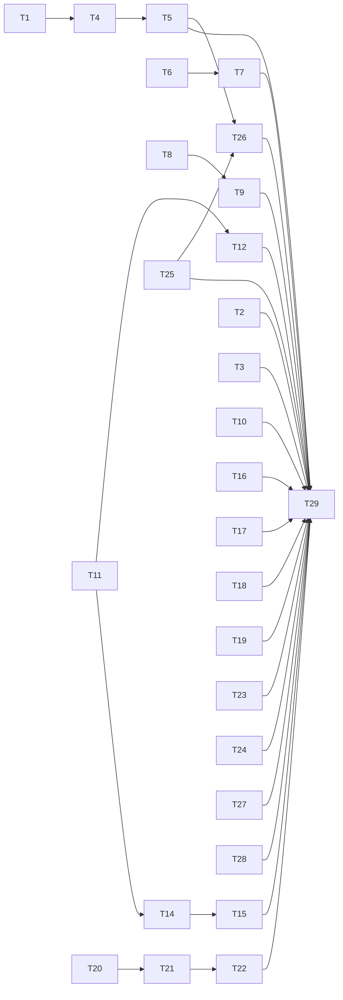

# QA round 22 fixes: the ask keeps its prompt, every reader sees one secret table, and markup never reaches the chain

status: done
commit-mode: orchestrator-commits
language: ruby
panel: Ruby (Linus Torvalds, Jeremy Evans, Sandi Metz, Richard Schneeman, Aaron Patterson)

## Intent

Fix every finding in [`planning/qa-findings-round22-2026-10-06.md`](../qa-findings-round22-2026-10-06.md)
rated LOW-MED or higher, plus 1 card applying the forks' proposed scenario corrections (user rulings
2026-10-06). 2 HIGH, 2 MED-HIGH, 13 MEDIUM, 11 LOW-MED.

Round 22 found the round-20 and round-21 pattern again: a fix on 1 route, the class open 1 route
over. This plan names the concept each class was missing, so the next route is covered too:

| Missing concept | Findings it closes | Cards |
|---|---|---|
| the running ask's prompt is pinned while the ask runs | F-6 | T1 |
| every reader of a path asks 1 table, names and directories below the root included | S-1 (H-1 dir, D-1, D-2) | T11 |
| a survey and a changeset hand every reader projected bytes, on every route | S-1 survey route (I-1), D-4 | T14, T15 |
| tool-call markup the model writes as text never reaches the chain | T-1 (C-1/F-2, A-8, E-5) | T6, T7 |
| a refusal lands before the record opens | M-1, M-2, A-3 | T9, T10 |
| a request is journaled under who sent it | A-1 | T8 |

**28 cards.** Roadmap line: `ROADMAP.md` item 52.

**User rulings, 2026-10-06:**

- Scope: LOW-MED and up; scenario corrections in scope as 1 card (T29).
- S-1: a name, or any directory component below the root, that names a secret classifies **gated** in
  `Sensitivity`, for every reader. Source files keep their carve-out (`lib/session.rb`, `auth.py`, `token.ts` stay
  ordinary, also under `lib/auth/`). The hint matches whole words, so `AUTHORS` and `README` are ordinary.
- F-6: the cut may drop an ask's earlier tool rounds, but the ask's opening human message is kept verbatim.
- T-1: a reply cut at `max_tokens` after complete tool calls **runs the complete calls**; only the cut
  tail is stripped and journaled, and the stop reason stays `tool_use`.
- F-3: detect a kernel-cut line and say so; do not switch the terminal to non-canonical mode.
- A-9: an `:inherit` child starts from the parent's view **at spawn time** (what the parent would send
  right then). A later parent compaction never reaches it.

## Grounding

Verified 2026-10-06 at `c2ee6485` by 4 parallel read-only explorations (compaction and handoff; secret
boundary and review; decoding and bench; frontend, chat and epic). Fork reports read from
`~/tmp/lain-qa-2026-10-06-<a..i>/records/fork-report.md`. mempalace searched for prior decisions on the
secret-name table (nothing beyond the code and `secret-boundary.md`).

**Where docs, findings and code disagreed, and which won:**

- **F-6's fix site.** `Boundary` (`compaction/boundary.rb:111-117`) has 5 construction sites
  (`derivation.rb:328`, `head.rb:69`, `held_cut.rb:76`, `context/compact.rb:78`, and `Head` via
  `source.rb:588`), and `Derivation::Plan.refuse_past` (`derivation.rb:350-355`) raises if they disagree.
  A clamp inside `Boundary` would have to hold at all 5. The pin set does not: `Source#pinned`
  (`source.rb:565-570`) builds 1 `Context::PinnedMessages` that already reaches `Head`, the advance
  derivation, the collapse and the handoff. The code won over the finding's suggested site: T1 pins the
  ask instead of clamping the boundary.
- **The ask's identity.** `HeldCut#ask_index` (`held_cut.rb:287-292`) is the last user message made only
  of text blocks. `Oracle::Handoff.human?` (`oracle/handoff.rb:216`) also excludes `SUMMARY`-flagged
  messages, but that key exists only inside the handoff question (`held_cut.rb:316-318`), never on the walk
  `Source#pinned` reads (`Derivation.projected` keeps only role and content, `derivation.rb:181-183`). So
  T1 makes `ask_index` the 1 definition rather than adding a second.
- **A pin outlives its ask until a collapse.** An advance cut's spans skip a pinned message and the floor
  moves past it, so a later advance never re-offers it; only a collapse does (`source.rb:702`). T1 states
  this instead of promising the prompt drops with the next advance.
- **S-1 is 2 fixes, not 1.** Moving the name rule into `Sensitivity` fixes `read_file`, the listing
  filter and `bash` (`ComposedTerm#ordinary_words?`, `composed_term.rb:459-462`, reads the same
  classifier). It does NOT fix the survey: `Survey::Walk#admit` (`walk.rb:269-274`) admits gated files
  by design, and `Projection` masks only detected regions (`projection.rb:11-16`, "a gated file enters
  the corpus REDACTED"). A gated file with no region enters raw. T14 masks a name-gated file whole on all 3
  `Projection` routes (`project`, `line`, `projected_line`); `corpus.rb:208,214` journal a note's evidence
  through `line`.
- **"Any directory component" means below the root.** `Sensitivity#lexical` makes every path absolute
  first (`sensitivity.rb:776-799`), so a rule over all segments would gate every file of a project rooted
  under `~/private/` (panel probe). T11 matches segments below the root only.
- **A whole-file mask has no release route.** The only `Ledger#release` caller is `RedactSecretReads`
  (`:324`), for regions it detected. T14 keeps a name-gated file masked in a survey and says so; a human
  who wants it reads it in chat through the gate.
- **NAME_HINT is too loose to move as is.** `regions.rb:66` is an unanchored substring match, so it also
  catches `AUTHORS`, `tokenizer.json`, `compass.yml`. Its job in `Regions` is the KEY of a `KEY=value`
  line; T11 adds a separate whole-word name rule and leaves `NAME_HINT` to that job.
- **D-4 reaches `/critique` too.** Hunks are parsed raw at `Diffed#files` (`review/source.rb:~259`,
  `Parser#hunk` `:~446-456`). `Docent::Brief`, `Critique::Patch.of` (`critique.rb:322-329`), `Submit` and
  `Marks` all read them. Only `Diffed#line_at` (`:290-296`, a note's `anchor_text`) projects. T15 projects
  each side of a file once and slices the hunk lines out, which keeps hunk line counts intact. Only the
  working-tree side may reconcile the ledger: `Projection#line` reconciles on every call
  (`projection.rb:135`) and the ledger is keyed by path, so projecting the base side the same way forgets
  a head-side release (panel probe).
- **T-1's coupling.** `Response#failure` (`response.rb:55-71`) tells a prose call from silence by
  `text.empty?`, and `agent_spec.rb:288-298` relies on it. Stripping the markup first would turn every
  prose call into "said nothing". T6 makes the response carry its failure kind before T7 strips.
- **T-1's single site.** Every ollama reply passes `Decoding#build_response` (`decoding.rb:110-122`); the
  commit at `agent.rb:549` is unconditional and provider-neutral. The strip goes at the decode, where the
  detectors live.
- **U-1's error class.** The raise is `Declarative::Types::CoercionError` (a `Lain::Error`) from
  `Item.new`, not a bare `Canonical::UnsupportedType`; `project_store.rb:248` rescues neither.
- **A-1 has no field to filter on.** `Telemetry::RequestSent` carries no requester; the baseline is every
  `request_sent` (`bench/session/loader.rb:281`). T8 adds one.
- **A-3's 2 routes.** `--compact-keep 0` raises a plain `ArgumentError` from `Compaction.validate_keep_last`
  (`compaction.rb:61-66`) after the header; `--compact-strategy` resolves only from `build_agent`, after
  `chronicle.start` (`wiring.rb:391`). `--compact-fallback` already refuses at `Backend#initialize`.
- **G-n3's lane.** `RoleSpawn#lent` (`skill/role_spawn.rb:86`) says "the caller's own lane travels with the
  lease", but `IssueTests#call` (`epic_driver/factory.rb:1333`) is never given the attempt's lane.
- **Specs that pass ON the bug** (each card that meets one rewrites it):
  `board_build_spec.rb:1038-1047` (admits `secrets/`), `ollama_spec.rb:359-366` (prose text kept),
  `decoding_spec.rb:149-153` (bare `<tool_call>` at a stop), `compaction_strategy_spec.rb:263`
  (`summarizing+summarize-conversation` resolves), `wiring_spec.rb:2343-2350` (alternate screen under
  `--non-interactive`), `approval_policy_spec.rb:64-70` and `:679-681` (`maybe` is an answer),
  `rewind_spec.rb:85-86` (the fold note), `watch_spec.rb:145-181` (`(stopped)` for an answered child),
  `spawn_policy_spec.rb:66-81` ("fork is identity").

## Compatibility

`lain.gemspec` is at 0.1.0 and unpublished: no release tag, `CHANGELOG.md` holds only the initial entry.
`crates/lain-core` and `ext/lain` are `publish = false`. No consumer outside this repo. Standing ruling
(memory `harness-vs-own-dev`): no back-compat for internal surfaces.

| Surface | Verdict | Evidence |
|---|---|---|
| `Response#failure` inference | free to break | internal; T6 adds an explicit kind, old readers move with it |
| `malformed_response.kind` values | free to break, old journals readable | T7 adds `:bare_tool_call`; readers validate in `telemetry/malformed_response.rb` |
| `request_sent` record | must keep old journals readable | the user's own session files; T8's `requester` is optional and nil reads as the agent |
| `Sensitivity` classification | free to break | widening costs 1 prompt by the table's design note (`sensitivity.rb:5-44`); user `exempt` rules stay valid |
| survey corpus bytes | free to break | regenerated per survey; masking a gated file is the survey's stated contract |
| changeset hunk `content_key` | free to break | a hunk holding a detected region gets a new key, so a mark on it does not carry from an older session; marks are per-review |
| `--compact-strategy` spellings | free to break | the 6 refused by T2 launch today and tear at the first compaction |
| `Elide` attestation bytes | free to break | the bench control arm's bytes shift; recorded comparisons across this commit are not comparable, said in T3 |
| `:inherit` child render | free to break | the child's chain stays `parent.fork`, so spawn digests, lineage and session files are unchanged; only what it renders differs |
| `lain watch` lifecycle label | free to break | read by humans |
| input pane, `[y/N]`, typeahead behaviour | free to break | pane and chat ship from 1 checkout |
| `@lain_input_pane` tmux option | free to break | written and read only by lain |
| `web_fetch` egress floor | free to break | widening refuses more |

No trade report was needed: no must-keep surface blocked a simplification.

## Spike findings

none. The 2 cards with an unverified mechanism carry it as a stop condition: T15's line-by-line projection
(`Projection#line` exists and is what `anchor_text` already uses), and T26's seam (the first step is
naming the constructor that can hand the parent's view to the spawn strategy).

## Shared files

Only the main session edits these; cards hand back 1-line diffs:

- `ARCHITECTURE.md`: the handoff paragraph (`:409-425`) gains "an advance cut keeps the running ask's
  prompt too" (T1); the secret-boundary section gains the name-and-directory rule (T11, T14).
- `CLAUDE.md`: the secret-boundary bullet, if T11's wording changes what "3 places" means (it should not).
- `docs/commands.md`: the `--compact-strategy` list of refused spellings (T2).
- `.rubocop.yml`: any `Metrics/*` raise, in its own commit with its reason.
- `ROADMAP.md`: the item 52 line.

## Rejected options

- **Pin the ask by position, not content (T1).** A content pin also keeps a byte-identical earlier prompt;
  that keeps a human's own words, and a position pin would need a second pin type beside `PinnedMessages`.
- **Base an `:inherit` child on the derived chain (T26).** Its turns would sit on a head the session file
  cannot replay (`message_replay.rb:126,137`), `Lineages#child_turns` would miscount, and `Derived#replayed`
  journals an edge and moves the parent's stale-edge bookkeeping.
- **Release a survey's whole-file mask on gate approval (T14).** It needs a new release route into the
  ledger; a name-gated file read in chat is enough for a human.
- **Clamp `Boundary#snapped` at the ask (F-6).** 5 construction sites must agree or `refuse_past` raises;
  the pin set is 1 site that already reaches all of them.
- **Strip markup at `Agent#commit_and_account` (T-1).** Provider-neutral, but the detectors live in the
  ollama decoder and no other provider has shown the shape.
- **Deny, not gate, a name-hinted file (S-1).** A denial cannot be lifted, which is wrong for a data file
  that merely has a telling name.
- **Mask only in `Docent::Brief` (D-4).** `/critique` builds its patch from the same raw hunks.
- **Non-canonical mid-ask reads (F-3)** and **refuse a too-large `:inherit` child (A-9)**: user rulings.
- **A code change for F-9 (`collapse` unreachable).** It is reachable by construction
  (`source_spec.rb:1958`, `keep_last 2` with 2-message steps); the scenario text is corrected in T29.
- **Prefer compaction over a handoff when the refused render held the newest cut (fork `f`'s C-2 note).**
  Documented design (`ARCHITECTURE.md:411`, pinned at `source_spec.rb:2700-2713`).
- **Journal the resume notice (Fh-4's other half).** Round 21's T16 scoped it to the screen.

## Open decisions

none that blocks a card. T29 has no production path by nature: it edits scenario documents, which
the `manual-qa` skill reads.

## Dependency graph



## Tasks

### T1: Pin the running ask's opening prompt for every cut          [risk: high]

**Depends on:** none
**Files:** `lib/lain/compaction/source.rb`, `lib/lain/compaction/source/held_cut.rb`,
`spec/lain/compaction/source_spec.rb`, `spec/lain/compaction/source/held_cut_spec.rb`
**Reuse:** `Source#pinned` (`source.rb:565-570`); `Context::PinnedMessages#indices_in`; `HeldCut#ask_index`
(`held_cut.rb:287-292`), which becomes the 1 definition of "the ask" both callers share
**Shared-file wiring:** `ARCHITECTURE.md:415`: "an advance cut keeps the running ask's prompt as well; a
long ask's prompt stays retained until the next collapse"
**Reachable from:** `CLI::Backend#compaction_source` (`backend.rb:666`) constructs the `Source`, which
`CompactionMount#instrumentation` (`compaction_mount.rb:50`) hands the Agent; `Agent#render_request`
(`agent.rb:687-692`) calls `Source#context_for` (`source.rb:523-527`) on every chat turn with compaction on

**Acceptance criteria**

```gherkin
Scenario: a long ask keeps its prompt through an advance cut
  Given keep_last 4 and an ask whose prompt is followed by 6 tool rounds
  When a compaction signal fires and an advance cut commits
  Then the derived request still holds the prompt's text verbatim
  And the tool rounds before the cut are collapsed

Scenario: the prompt stays retained after its ask ends, until a collapse
  Given that ask ended, a new prompt was sent, and the next advance cut commits
  Then the first ask's prompt is still in the request
  And after the next collapse of the held cuts it is not

Scenario: an identical earlier prompt is kept too
  Given an earlier user message byte-identical to the running prompt ("continue")
  When the advance cut commits
  Then both are kept verbatim
  # a decision, not an accident: pins match by content, and a human's own words are what is kept

Scenario: nothing else droppable
  Given an ask whose only droppable message is its prompt
  When a compaction signal fires
  Then the decision journals nothing_droppable and no cut commits
```
Spec files: `spec/lain/compaction/source_spec.rb`, `spec/lain/compaction/source/held_cut_spec.rb`

**Interface**

```ruby
# Compaction::Source::HeldCut, now public on the class
def self.ask_index(messages) # => Integer | nil, the newest user message made only of text blocks
# Source, private
def pinned(walk, session) # => Context::PinnedMessages, session pins plus messages[ask_index]
```

**Stop and report if:**
- `Derivation::Plan.refuse_past` (`derivation.rb:350-355`) raises once the ask is pinned.
- `source_spec.rb:1958`'s collapse sweep stops collapsing.

### T2: Refuse every overlapping strategy spelling at launch          [risk: medium]

**Depends on:** none
**Files:** `lib/lain/cli/compaction_strategy.rb`, `spec/lain/cli/compaction_strategy_spec.rb`
**Reuse:** `refuse_overlap` (`compaction_strategy.rb:250-269`), `CompactionStrategy::Unknown`
**Shared-file wiring:** `docs/commands.md`: the refused-spelling sentence names the rule, not 2 spellings
**Reachable from:** `CLI::Backend::SpanSummarizer#resolve` (`span_summarizer.rb:82`), from
`Backend#pipeline_source` on `lain chat --compact-strategy`

**Acceptance criteria**

```gherkin
Scenario: an overlapping composition refuses by name
  When --compact-strategy <name> is resolved
  Then it raises Unknown naming <name> and the one composable pair
  And <name> is each of: "summarizing+elide-tools", "elide+summarize-conversation", "summarizing+summarize-conversation", "elide+elide-tools", "elide-tools+elide-tools", "summarize-conversation+elide-tools+elide"

Scenario: the complementary pair still resolves, in either order
  When elide-tools+summarize-conversation or summarize-conversation+elide-tools is resolved
  Then a Composed strategy is returned
```
Spec file: `spec/lain/cli/compaction_strategy_spec.rb` (rewrite `:263`, which resolves an overlap)

**Stop and report if:**
- a whole-span strategy has a composition that does not overlap on some input other than an empty
  summary, which would make "1 leaf or the 1 pair" too strict.

### T3: Elided attestations name the tool and its path          [risk: medium]

**Depends on:** none
**Files:** `lib/lain/compaction/strategy/elide.rb`, `lib/lain/oracle/handoff.rb`,
`spec/lain/compaction/strategy/elide_spec.rb`, `spec/lain/oracle/handoff_spec.rb`
**Reuse:** `Oracle::Handoff.stub`/`outcome` (`handoff.rb:231-246`, private today); `Elide#attest` (`elide.rb:66-77`)
**Shared-file wiring:** none
**Reachable from:** `Compaction::Strategy::Elide#blocks`, through `ElideToolObservations` under
`--compact-strategy elide-tools+summarize-conversation`, and `HeldCut#earlier` into the handoff question

**Acceptance criteria**

```gherkin
Scenario: an elided tool round says what ran
  Given an assistant tool_use read_file {"path":"config/routes.rb"} and its result
  When elide-tools collapses the round
  Then the attestation for the call names read_file and config/routes.rb
  And the attestation for the result carries its outcome the way a handoff stub does

Scenario: the handoff sees it
  Given a held elide-tools cut over that round
  When the handoff question is built
  Then the question text names read_file and config/routes.rb

Scenario: still an elementwise map
  Then the shared elementwise laws in elide_spec still pass
```
Spec files: `spec/lain/compaction/strategy/elide_spec.rb`, `spec/lain/oracle/handoff_spec.rb`

**Interface**

```ruby
module Oracle::Handoff
  def self.gist(block) # => String, "[calls read_file config/routes.rb]" or a result's outcome line
end
```

**Stop and report if:**
- `spec/lain/bench/` pins `Elide` attestation bytes exactly; the bench control arm's bytes are a
  measured quantity, and that needs the user's ruling before they move.

### T4: A handoff that cannot make room is not committed          [risk: high]

**Depends on:** T1
**Files:** `lib/lain/compaction/source/fallback.rb`, `lib/lain/compaction/source/held_cut.rb`,
`lib/lain/compaction/source.rb`, `lib/lain/agent.rb`, `spec/lain/compaction/source_spec.rb`,
`spec/lain/agent_spec.rb`
**Reuse:** `WindowExceeded#prompt_tokens` (`agent.rb:~641`); `HeldCut#handoff_ranges` (`held_cut.rb:265-269`);
`Source#window_for` (`source.rb:~655`)
**Shared-file wiring:** none
**Reachable from:** `Agent#handed_off` (`agent.rb:675`) to `Source#handoff` (`source.rb:498-509`) to
`Fallback#call` (`fallback.rb:67-72`), on a refused over-window ask

**Acceptance criteria**

```gherkin
Scenario: the kept turns alone exceed the window
  Given a chain whose unanswered round, ask and pins measure more than the chat window
  When the provider refuses the prompt and the fallback is handoff
  Then no handoff cut is committed and no summarizer call is spent
  And the ask fails with one line saying what the handoff would have had to keep and the window it exceeds

Scenario: the kept turns fit
  Given the same chain with a small unanswered round
  When the provider refuses the prompt
  Then one handoff cut commits as today
```
Spec files: `spec/lain/compaction/source_spec.rb`, `spec/lain/agent_spec.rb`

**Interface**

```ruby
Source#handoff(timeline:, session:, window:) # window: Integer tokens the refused provider allows
```

**Stop and report if:**
- the kept span cannot be measured in the provider's tokens without a model call; measure bytes against
  `window * the Budget's bytes-per-token`, and say so, rather than adding a tokenizer.

### T5: The stall line says a handoff comes next          [risk: low]

**Depends on:** T4
**Files:** `lib/lain/compaction/source.rb`, `spec/lain/compaction/source_spec.rb`
**Reuse:** `Diagnosis#remedy` (`source.rb:307-311`), `Reporting#record` (`:361-365`)
**Shared-file wiring:** none
**Reachable from:** `Compaction::Source::Reporting#record`, from `Source#context_for` on every render

**Acceptance criteria**

```gherkin
Scenario: under --compact-fallback handoff
  Given a stalled diagnosis and the handoff fallback
  When the stall line prints
  Then it says the next refused request is summarized into a handoff, and does not say to start a new session

Scenario: under --compact-fallback none
  Then the line is unchanged
```
Spec file: `spec/lain/compaction/source_spec.rb`

**Stop and report if:**
- `Diagnosis` is built where the fallback arm is out of reach without a new constructor argument at
  more than 1 site.

### T6: A response carries its failure kind          [risk: medium]

**Depends on:** none
**Files:** `lib/lain/response.rb`, `lib/lain/response/failure.rb`, `spec/lain/response_spec.rb`
**Reuse:** `Response::Failure::PROSE_CALL`, `SILENT`, `withholds_text?`
**Shared-file wiring:** none
**Reachable from:** `Provider::Ollama::Decoding#build_response` constructs the `Response`; read by
`CLI::Repl::Ask#settle` and `Tools::Subagent#refusing_malformed`

**Acceptance criteria**

```gherkin
Scenario: a prose call stays a prose call with its text stripped
  Given a Response with stop_reason malformed, empty text, and malformed: :prose_tool_call
  Then failure is PROSE_CALL, not SILENT

Scenario: silence is still silence
  Given a Response with stop_reason malformed, empty text, and no malformed kind
  Then failure is SILENT

Scenario: a finding on a reply that is not malformed is not a failure
  Given a Response with stop_reason tool_use and malformed: :cut_tool_call
  Then failure is nil
```
Spec file: `spec/lain/response_spec.rb` (`agent_spec.rb:288-298` keeps passing: it builds its Response by hand, with text)

**Interface**

```ruby
Response.new(..., malformed: nil) # Symbol | nil: the decoder's finding on ANY reply; failure reads it only when stop_reason is malformed
```

**Stop and report if:**
- `Response`'s new member breaks `Ractor.shareable?` or a `Canonical` digest a spec pins.

### T7: The decoder strips tool-call markup from every reply          [risk: high]

**Depends on:** T6
**Files:** `lib/lain/provider/ollama/decoding.rb`, `lib/lain/telemetry/malformed_response.rb`,
`spec/lain/provider/ollama/decoding_spec.rb`, `spec/lain/provider/ollama_spec.rb`,
`spec/lain/telemetry/malformed_response_spec.rb`
**Reuse:** `CUT_TOOL_CALL`, `PROSE_TOOL_CALL`, `without_cut`, `note_cut_tool_call`, `said_nothing?`
(`decoding.rb:88-184`)
**Shared-file wiring:** none
**Reachable from:** `Provider::Ollama#complete` (`ollama.rb:282-284`) to `build_response`, on every
ollama reply, streamed or not

**Acceptance criteria**

```gherkin
Scenario: a cut after complete calls
  Given done_reason "length", 3 complete tool_calls, and content ending "<tool_call>\n<function=bash"
  When the reply is decoded
  Then the 3 calls are returned and the stop reason is tool_use
  And the content holds no "<tool_call>" and one malformed_response kind cut_tool_call is journaled

Scenario: a prose call is withheld from the chain
  Given a closed "<function=bash>...</function>" envelope in content and no tool_calls
  When the reply is decoded
  Then the response is malformed with malformed: :prose_tool_call
  And its content is the placeholder "(a tool call written as text was withheld)" when nothing else was said

Scenario: a bare trailing <tool_call> at a normal stop
  Given done_reason "stop" and content "42.\n<tool_call>"
  When the reply is decoded
  Then the content is "42." and one malformed_response kind bare_tool_call is journaled
  And the stop reason is end_turn

Scenario: markup alone at a normal stop is not an answer
  Given done_reason "stop", no thinking, and content "<tool_call>"
  When the reply is decoded
  Then silence is judged on the stripped content, and the reply is malformed as an empty answer

Scenario: the chain stays valid and clean
  Given a session whose model replied with a prose call and nothing else
  When the next request is rendered and a compaction derives over that turn
  Then no message contains "<function=" or "<tool_call>"
  And Context::Conversation accepts every message, so the derivation is not refused
```
Spec files: `spec/lain/provider/ollama/decoding_spec.rb` (rewrite `:149-153`),
`spec/lain/provider/ollama_spec.rb` (rewrite `:359-366`), `spec/lain/telemetry/malformed_response_spec.rb`

**Stop and report if:**
- `ollama_spec.rb:464-470`'s deliberate over-refusals start passing as clean text.
- a reply carrying thinking and a stripped prose call commits thinking only, and `Context::Conversation`
  rejects a thinking-only assistant turn on the ollama render.

### T8: A summarizer's request is journaled as the summarizer's          [risk: medium]

**Depends on:** none
**Files:** `lib/lain/telemetry/request_sent.rb`, `lib/lain/provider/journaled.rb`, `lib/lain/cli/backend.rb`,
`lib/lain/cli/backend/summarizer.rb`, `lib/lain/cli/backend/span_summarizer.rb`,
`lib/lain/oracle/secret_read.rb`, `lib/lain/bench/session/loader.rb`,
`spec/lain/provider/journaled_spec.rb`, `spec/lain/bench/session/loader_spec.rb`
**Reuse:** the 4 `Provider::Journaled` wrap sites (`backend.rb:701`, `summarizer.rb:50`,
`span_summarizer.rb:122`, `secret_read.rb:176`)
**Shared-file wiring:** none
**Reachable from:** `CLI::Backend#journaling` and the summarizer tiers build `Provider::Journaled`;
`Bench::Session::Loader#baseline` reads it under `lain bench variance`

**Acceptance criteria**

```gherkin
Scenario: variance over a session with a per-result summarizer call
  Given a session file with 3 agent request_sent records, 1 summarizer request_sent, and 3 assistant turns
  When lain bench variance replays it
  Then it is measured, not refused

Scenario: an old journal
  Given a request_sent record with no requester
  Then the loader counts it as the agent's
```
Spec files: `spec/lain/provider/journaled_spec.rb`, `spec/lain/bench/session/loader_spec.rb`

**Interface**

```ruby
Provider::Journaled.new(inner, journal:, requester: :agent) # :summarizer, :handoff, :secret_oracle
Telemetry::RequestSent # gains optional requester
```

**Stop and report if:**
- `friction/cache_waste.rb:212` or `session_record/salvage.rb:19-71` pairs `request_sent` to
  `turn_usage` by position; filter them to the agent too, and list each reader changed.

### T9: Refuse a bad --compact-keep or --compact-strategy before the session file          [risk: low]

**Depends on:** T8 (file order only: both edit `lib/lain/cli/backend.rb`)
**Files:** `lib/lain/cli/backend.rb`, `lib/lain/cli/chat_launch.rb`, `spec/lain/cli/backend_spec.rb`,
`spec/lain/cli/chat_launch_spec.rb`
**Reuse:** `Backend#compact_fallback`'s refusal (`backend.rb:519-527`); `ChatLaunch#constructed`
(`chat_launch.rb:285-290`)
**Shared-file wiring:** none
**Reachable from:** `CLI::ChatLaunch#call` (`chat_launch.rb:100-115`), before `open_chronicle`

**Acceptance criteria**

```gherkin
Scenario: refused by name, exit 1, no session file
  When lain chat runs with <flag>
  Then it prints one line naming the flag and its value, with no backtrace
  And the state home holds no new session file
  And <flag> is each of: "--compact-keep 0", "--compact-keep -1", "--compact-strategy elide+summarizing"
```
Spec file: `spec/lain/cli/chat_launch_spec.rb`

**Stop and report if:**
- `spec/lain/compaction_spec.rb:18,25,55` must change; `Compaction.validate_keep_last` keeps its
  `ArgumentError` contract and the flag check sits in front of it.

### T10: bench arms validates the fixture and the isolation name before the journal          [risk: medium]

**Depends on:** none
**Files:** `lib/lain/bench/cli.rb`, `lib/lain/bench/arm_tasks.rb`, `lib/lain/cli/isolation_backend.rb`,
`spec/lain/bench/cli_spec.rb`, `spec/lain/bench/arm_tasks_spec.rb`
**Reuse:** `ArmTasks::MalformedTask`, `MissingFixture`; `IsolationBackend::BACKENDS` (`isolation_backend.rb:68`)
**Shared-file wiring:** none
**Reachable from:** `exe/lain` `arms` (`:761-772`) to `Bench::CLI#arms_report` (`bench/cli.rb:223`)

**Acceptance criteria**

```gherkin
Scenario: refused before any record is written
  When lain bench arms runs with <problem> and --journal x.ndjson
  Then it exits 1 with one line naming the problem
  And x.ndjson does not exist
  And <problem> is each of: "a missing fixture", "a fixture with a YAML syntax error", "a fixture whose top level is a list", "--isolation docker2"
```
Spec files: `spec/lain/bench/cli_spec.rb`, `spec/lain/bench/arm_tasks_spec.rb`

**Interface**

```ruby
IsolationBackend.known!(name) # raises Unknown unless name is in BACKENDS
ArmTasks#load!                # forces the read; raises MalformedTask on Psych::Exception or a non-mapping
```

**Stop and report if:**
- resolving `--isolation worktree` early would lease or create anything; validate the name only.

### T11: Sensitivity gates a name or directory that names a secret, for every reader          [risk: high]

**Depends on:** none
**Files:** `lib/lain/sensitivity.rb`, `lib/lain/cli/wiring/board_build.rb`, `lib/lain/approval/composed_term.rb`,
`spec/lain/sensitivity_spec.rb`, `spec/lain/sensitivity/policy_spec.rb`,
`spec/lain/cli/wiring/board_build_spec.rb`, `spec/lain/approval/composed_term_spec.rb`
**Reuse:** `Sensitivity#lexical`/`rooted` (`sensitivity.rb:776-799`) for the root-relative segments;
`Rule#lifts?`, `samples` and `lifted_by` (`:235-241`, `:435`) for the exemption cap; `ComposedTerm#ordinary_words?`
(`composed_term.rb:459-462`), which reads the same classifier. This is a NEW KIND of rule, not new `GATED`
rows: `Rule#inside` is 1 literal case-sensitive segment and `named` is a case-sensitive glob, and neither says
"whole word, any case".
**Shared-file wiring:** `ARCHITECTURE.md` secret-boundary section: "a file or directory below the root that
names a secret is gated, code files excepted"; `lib/lain/sensitivity.rb:5-44` is the card's own doc
**Reachable from:** `CLI::Wiring::BoardBuild.for` (`board_build.rb:50-63`) builds the 1 `Sensitivity` the gate,
the listing filter, `ComposedTerm` and `Triage` read; `CLI::Survey` (`cli/survey.rb:140`) builds the headless
one from the same class

**The rule.** A path is name-gated when, after lowercasing and splitting on non-alphanumerics, a word of its
basename stem, or of any directory segment **below the root** (below cwd when there is no root), is one of:
`password passwords passwd secret secrets token tokens credential credentials apikey api key` (with `api`
and `key` only as the adjacent pair `api key`), `private`, `auth`. `session` and `signature` are NOT words
here (they gate this repo's own fixtures). Code files are excepted by extension:
`.rb .py .ts .tsx .js .jsx .go .rs .java .kt .c .h .cc .cpp .sh .lua .ex .exs .swift`; data and docs are
not (`.toml .yml .yaml .json .md .sql .txt .env` stay gated). The list lives in `Sensitivity`, and
`board_build.rb:392-393`'s copy is deleted with `Content#hinted?` (`:409-420`), so `bash` never runs 2 name rules.

**Acceptance criteria**

```gherkin
Scenario: gated by name or directory below the root
  Then <path> classifies gated
  And <path> is each of: "password.txt", "Password.TXT", "secrets/prod", ".secrets/x", "my-secrets/x", "credentials/x", "private/x", "auth/x", "api_key.txt", "secrets.toml"

Scenario: ordinary
  Then <path> classifies ordinary
  And <path> is each of: "AUTHORS", "README", "lib/session.rb", "lib/auth/token.rb", "token.ts", "tokenizer.json", "compass.yml", "spec/fixtures/sessions/a.ndjson"

Scenario: an ancestor of the root does not count
  Given a project rooted at /home/u/private/app
  Then README, Gemfile.lock and config/database.yml classify ordinary

Scenario: read_file, the listing and bash agree
  Given password.txt holding "hunter2" in the project root
  When the model calls read_file password.txt, list_files ., and bash "cat password.txt"
  Then the read parks for a human, the listing withholds the row, and ComposedTerm abstains

Scenario: an exemption is counted against the rule
  Given .lain/config.rb declares sensitivity exempt: ["*.txt"]
  Then it is refused as lifting more than 1 built-in entry, or lifts exactly the name rule and is counted
```
Spec files: `spec/lain/sensitivity_spec.rb`, `spec/lain/sensitivity/policy_spec.rb`,
`spec/lain/approval/composed_term_spec.rb`, `spec/lain/cli/wiring/board_build_spec.rb` (delete `:1038-1047`,
which admits `secrets/`; move `:1015-1036` here or delete them)

**Interface**

```ruby
Sensitivity::NameRule # specimens: 1 per word plus 1 directory form, so lifted_by can count an exemption against it
```

**Stop and report if:**
- any path in this repo outside `spec/fixtures/` classifies gated by the new rule (list them).
- `Content#hinted?` carries a rule this card's table does not, other than the substring match the user ruled out.

### T12: A malformed rule glob refuses at load          [risk: low]

**Depends on:** T11
**Files:** `lib/lain/sensitivity.rb`, `spec/lain/sensitivity_spec.rb`
**Reuse:** `Rules.check!` and `malformed(...)` (`sensitivity.rb:449-489`)
**Shared-file wiring:** none
**Reachable from:** `Config::Builder` (`config/builder.rb:123`) to `Rules.from`, on every `.lain/config.rb` load

**Acceptance criteria**

```gherkin
Scenario: an unclosed bracket
  Given .lain/config.rb declares sensitivity <key>: [<pattern>]
  When the config loads
  Then it refuses naming the key, the pattern and the line, with "an unclosed ["
  And <key> is each of: "gated", "exempt"
  And <pattern> is each of: ""[abc"", ""[""
```
Spec file: `spec/lain/sensitivity_spec.rb`

**Stop and report if:**
- a pattern this repo's own specs or fixtures declare is refused.


### T14: A survey masks a name-gated file whole, on every survey route          [risk: high]

**Depends on:** T11
**Files:** `lib/lain/survey/projection.rb`, `spec/lain/survey/projection_spec.rb`,
`spec/lain/review/source/corpus_spec.rb`
**Reuse:** `Projection#project`, `#line`, `#projected_line` (`projection.rb:97-160`); `Sensitivity::Masking.render`
**Shared-file wiring:** `ARCHITECTURE.md`: "a name-gated file enters a survey masked whole, and stays masked there"
**Reachable from:** `Survey::Corpus::Reading#content`, `#line` and `#projected_line` (`review/source/corpus.rb:208,214`),
under chat `/survey` (`command/survey.rb:205`) and `lain survey` (`cli/survey.rb:125`)

**Acceptance criteria**

```gherkin
Scenario: a name-gated file
  Given a surveyed tree with password.txt holding "hunter2" and one detected API_KEY= line
  When the corpus reads it
  Then the corpus text is 1 placeholder and holds neither "hunter2" nor the key
  And the file is still listed

Scenario: a note on it
  When a note is placed on password.txt:1
  Then the note's journaled evidence is the placeholder, and its projected line is 1

Scenario: an ordinary file is untouched
  Given notes.txt holding "hello"
  Then the corpus text is "hello"
```
Spec files: `spec/lain/survey/projection_spec.rb`, `spec/lain/review/source/corpus_spec.rb`

**Interface**

```ruby
Projection#whole_mask?(path) # true for a name-gated path; project, line and projected_line all honour it
```

**Stop and report if:**
- `Projection` cannot classify a path without being handed the run's `Sensitivity`; name the constructor
  sites that must pass it (`cli/survey.rb:107`, `command/survey.rb`) and stop if there are more than those.

### T15: Changeset hunks are projected before any reader sees them          [risk: high]

**Depends on:** T14
**Files:** `lib/lain/review/source.rb`, `lib/lain/survey/projection.rb`, `spec/lain/review/source_spec.rb`,
`spec/lain/review/docent_spec.rb`, `spec/lain/review/critique_spec.rb`
**Reuse:** `Projection#project` and `Anchor.lines`; `Diffed#line_at` (`source.rb:290-296`); `ledger_path`;
`file_at(revision, path)`
**Shared-file wiring:** none
**Reachable from:** `CLI::Review::Target#resolve` (`cli/review.rb:196-232`) builds the source and sets its
projection; `Command::Review` (`command/review.rb:365-378`) builds `Docent.for(changeset:)`; `/critique` reads
`Critique::Patch.of` (`critique.rb:322-329`) over the same files

**The approach.** At `Diffed#files`, project each side of each file ONCE (head side against the working-tree
revision, base side at `base_ref` under the OLD path for a rename) and slice the projected hunk lines out by
`Anchor.lines`, so a hunk costs 2 detects, not 1 per line. Only the revision that matches the working tree may
reconcile the ledger; the base side projects with `complete: false`, so it never forgets a head-side release.

**Acceptance criteria**

```gherkin
Scenario: a docent brief over an unreleased token
  Given a local-branch changeset adding creds.rb with "API_KEY=sk-live-..." on line 2, never read
  When a docent question is asked on creds.rb:2
  Then the brief sent to the child holds "<redacted:1>" and not the token
  And the session journal holds no byte of the token

Scenario: /critique gets the same bytes
  When the critique patch is built from that changeset
  Then it holds "<redacted:1>" and not the token

Scenario: line counts hold
  Given a changeset adding a 30-line PEM block
  Then each hunk's line count matches its header and every PEM line reads masked

Scenario: a head-side release survives the old side
  Given the human released the head-side region of creds.rb
  When the changeset's hunks are projected, base side included
  Then the head line reads released, before and after

Scenario: a rename
  Given creds.rb renamed to config/creds.rb with the token on a changed line
  Then the "-" lines are projected from the old path at base_ref and read masked
```
Spec files: `spec/lain/review/source_spec.rb`, `spec/lain/review/docent_spec.rb`, `spec/lain/review/critique_spec.rb`

**Interface**

```ruby
Projection#project(path, content, size: nil, reconcile: true) # reconcile: false projects without touching releases
```

**Stop and report if:**
- `Marks` or `Partition` keys from an older review are read back from a session file and must match;
  the Compatibility row assumes marks are per-review.
- a file added on the branch (no base side) or deleted (no head side) makes `file_at` raise rather than return nil.

### T16: A mid-ask line the kernel cut is held and said          [risk: medium]

**Depends on:** none
**Files:** `lib/lain/frontend/stdin_pump.rb`, `spec/lain/frontend/stdin_pump_spec.rb`
**Reuse:** `Typeahead#finished`/`forwarded` (`stdin_pump.rb:240-484`); `TTY#render_warning`
**Shared-file wiring:** none
**Reachable from:** `StdinPump#with_line_reader` (`stdin_pump.rb:222`) in a plain chat, and
`InputPane#unprompted` (`input_pane.rb:266`) in a cockpit; both build `Typeahead`

**Acceptance criteria**

```gherkin
Scenario: a line at the canonical limit
  Given a cooked terminal mid-ask
  When a line of 4,095 bytes arrives
  Then it is not committed and the human is told it was cut by the terminal and to paste it at the idle prompt

Scenario: a short line is unchanged
  When a 200-byte line arrives mid-ask
  Then it is held as typeahead as today
```
Spec file: `spec/lain/frontend/stdin_pump_spec.rb`

**Stop and report if:**
- the cockpit's input pane reads mid-ask lines through a path other than `Typeahead`.

### T17: --non-interactive draws no alternate screen          [risk: low]

**Depends on:** none
**Files:** `lib/lain/frontend/tty.rb`, `lib/lain/cli/wiring.rb`, `spec/lain/frontend/tty_spec.rb`,
`spec/lain/cli/wiring_spec.rb`
**Reuse:** `Wiring#attended?` (`wiring.rb:178`); `ScreenNotices` (`wiring.rb:~430`)
**Shared-file wiring:** none
**Reachable from:** `CLI::Wiring#open_terminal` (`wiring.rb:419-426`) builds the TTY for every chat

**Acceptance criteria**

```gherkin
Scenario: a non-interactive chat on a terminal
  When lain chat --non-interactive --prompt "say ok" runs with stdout a terminal
  Then stdout holds no "\e[?1049h" and the answer is left on screen after exit
  And each startup notice prints once

Scenario: an attended chat is unchanged
  Then the alternate screen is entered and left as today
```
Spec files: `spec/lain/frontend/tty_spec.rb`, `spec/lain/cli/wiring_spec.rb` (rewrite `:2343-2350`)

**Interface**

```ruby
Frontend::TTY.new(..., alternate_screen: true)
```

**Stop and report if:**
- a frontend layer other than `TTY#run` writes `ALTERNATE_SCREEN_ON`.

### T18: The input pane redraws its header only where it is          [risk: low]

**Depends on:** none
**Files:** `lib/lain/frontend/input_pane.rb`, `spec/lain/frontend/input_pane_spec.rb`
**Reuse:** `#sent` clearing `@shown` (`input_pane.rb:280`)
**Shared-file wiring:** none
**Reachable from:** `exe/lain input` to `Frontend::InputPane.open(...).run`

**Acceptance criteria**

```gherkin
Scenario: after an answered [y/N]
  Given a published header of 2 rows and an approval answered "y"
  When an "unpublished" frame with a fresh header arrives
  Then nothing is written over the echoed answer
  And the next prompt draws the header whole

Scenario: an unanswered prompt still restyles in place
  Then the output matches input_pane_spec.rb:353-369
```
Spec file: `spec/lain/frontend/input_pane_spec.rb`

**Stop and report if:**
- the pane can learn the cursor row only by a terminal query; then clear the header and redraw, never query.

### T19: lain input takes over the cockpit's input-pane slot          [risk: low]

**Depends on:** none
**Files:** `exe/lain`, `lib/lain/cli/up.rb`, `spec/lain/cli/up_spec.rb`
**Reuse:** `Up::Panes#record`/`rearm`/`live` (`up.rb:~340-395`)
**Shared-file wiring:** none
**Reachable from:** `exe/lain` `input` (`:1195-1205`)

**Acceptance criteria**

```gherkin
Scenario: a replacement pane
  Given a cockpit whose recorded input pane was killed
  When lain input --name <session> starts in a new pane with TMUX_PANE set
  Then @lain_input_pane names the new pane and the floor hook targets it

Scenario: a live recorded pane is not stolen
  Given the recorded input pane is alive
  When a second lain input starts
  Then @lain_input_pane is unchanged
```
Spec file: `spec/lain/cli/up_spec.rb`

**Interface**

```ruby
Up::Panes#adopt_input(pane_id) # records and re-arms only when the recorded input pane is not live
```

**Stop and report if:**
- `$TMUX` names a socket the `Tmux` wrapper cannot address with `-L`; use `-S` and say so.

### T20: A plain-chat approval's clock starts when it is drawn          [risk: medium]

**Depends on:** none
**Files:** `lib/lain/approval/queue.rb`, `lib/lain/frontend/intake.rb`, `lib/lain/frontend/approval_policy.rb`,
`spec/lain/approval/queue_spec.rb`, `spec/lain/frontend/intake_spec.rb`
**Reuse:** `Queue#await_decision` (`queue.rb:391-395`); the `Asked` hooks (`approval_policy.rb:~112`);
`Intake#answered` (`intake.rb:261`)
**Shared-file wiring:** none
**Reachable from:** `CLI::Repl::ApprovalSurfaces#terminal_surface` builds `ApprovalPolicy` over the queue
in a `--no-nvim` chat

**Acceptance criteria**

```gherkin
Scenario: 2 approvals parked together
  Given a 300 s timeout and 2 reads parked at t=0
  When the first is answered at t=279
  Then the second is drawn at t=279 and times out no earlier than t=579

Scenario: other surfaces
  Given an approval answered by the nvim surface
  Then its clock started when it parked, as today
```
Spec files: `spec/lain/approval/queue_spec.rb`, `spec/lain/frontend/intake_spec.rb`

**Stop and report if:**
- `spec/approval_consumer_discipline_spec.rb` refuses a second consumer of the queue.

### T21: Every approval parked behind another is announced          [risk: low]

**Depends on:** T20
**Files:** `lib/lain/frontend/intake.rb`, `spec/lain/frontend/intake_spec.rb`
**Reuse:** `TTY#queue_prompt`, `QUEUED` (`tty.rb:229`)
**Shared-file wiring:** none
**Reachable from:** `Frontend::Intake#enter` (`intake.rb:335`), from `ApprovalPolicy#read_until_decided`

**Acceptance criteria**

```gherkin
Scenario: 3 reads park at once
  When the first [y/N] is drawn
  Then a queued line naming each of the other 2 calls is on screen
```
Spec file: `spec/lain/frontend/intake_spec.rb`

**Stop and report if:**
- `QUEUED` already prints for each waiting call in a real `--no-nvim` chat; then the card is a spec only,
  and fork `c`'s "nothing announces" was a draw-order observation to note in T29.

### T22: A [y/N] takes only a verdict          [risk: low]

**Depends on:** T21
**Files:** `lib/lain/frontend/approval_policy.rb`, `spec/lain/frontend/approval_policy_spec.rb`
**Reuse:** `Asked#takes?` (`approval_policy.rb:112`); the held-line path (`Intake#judge`, `HELD`)
**Shared-file wiring:** none
**Reachable from:** `Frontend::Intake#answers?` consults `Asked#takes?` on every line at an open `[y/N]`

**Acceptance criteria**

```gherkin
Scenario: a verdict
  When "<line>" arrives at an open [y/N]
  Then it decides the approval
  And <line> is each of: "y", "Yes", "n", "no", (an empty line)

Scenario: anything else
  When "please also fix the tests" arrives at an open [y/N]
  Then the approval stays open and the line is held as the next prompt, said in one line
```
Spec file: `spec/lain/frontend/approval_policy_spec.rb` (rewrite `:64-70` and `:679-681`)

**Stop and report if:**
- a pasted multi-line block reaches `takes?` as 1 line; say what it arrives as.

### T23: /rewind onto a stranded prompt lands on its parent          [risk: medium]

**Depends on:** none
**Files:** `lib/lain/cli/command/rewind.rb`, `spec/lain/cli/command/rewind_spec.rb`
**Reuse:** `Event.stranded_prompt?` (`event.rb:107`); `settled_target!`, `distance_to`
**Shared-file wiring:** none
**Reachable from:** `CLI::Command::Rewind#call`, registered in the command surface for every chat

**Acceptance criteria**

```gherkin
Scenario: the landing would be a stranded prompt
  Given a session whose turns are prompt "write a.txt alpha", its write_file call and result, a reply, then "write a.txt beta"
  When /rewind lands on the "write a.txt alpha" prompt
  Then the head is that prompt's parent
  And the message says 1 more turn was dropped and quotes the first 60 characters of "write a.txt alpha"
  And the next line typed starts a fresh ask, and no write_file runs again

Scenario: the first turn
  Given the stranded prompt is the session's first turn
  Then the head is the empty session
```
Spec file: `spec/lain/cli/command/rewind_spec.rb` (rewrite `:85-86`)

**Stop and report if:**
- the parent is a `tool_use` turn, which `settled_target!` refuses.

### T24: A memory row that cannot be read is skipped by name          [risk: medium]

**Depends on:** none
**Files:** `lib/lain/memory/project_store.rb`, `lib/lain/cli/consolidate.rb`,
`spec/lain/memory/project_store_spec.rb`, `spec/lain/cli/consolidate_spec.rb`
**Reuse:** `ProjectStore#item_from` (`project_store.rb:240-249`); the `notice:` seam (`:142`)
**Shared-file wiring:** none
**Reachable from:** `CLI::Wiring#project_memory` (`wiring.rb:~585`) for a chat; `CLI::Consolidate`
(`consolidate.rb:88`) for a live pass

**Acceptance criteria**

```gherkin
Scenario: an invalid UTF-8 byte in one row
  Given store.ndjson whose second row's body holds byte 0xff
  When a chat or a live consolidate loads the store
  Then it runs, the other rows load
  And the human is told once, naming the store line and the row's id

Scenario: an edited digest still refuses
  Given a row whose digest no longer matches
  Then load raises Corrupt as today
```
Spec files: `spec/lain/memory/project_store_spec.rb`, `spec/lain/cli/consolidate_spec.rb`

**Stop and report if:**
- the skipped row's id cannot be read out of an invalid string; name the line only.

### T25: A retried red step gets a fresh spawn address          [risk: medium]

**Depends on:** none
**Files:** `lib/lain/cli/epic_driver/issue_actor.rb`, `lib/lain/cli/epic_driver/factory.rb`,
`lib/lain/skill/role_spawn.rb`, `spec/lain/cli/epic_driver/issue_tests_spec.rb`,
`spec/lain/skill/role_spawn_spec.rb`
**Reuse:** `IssueActor#lane_for` (`issue_actor.rb:393`); `Lane.named`; `Lineage#adopted` (`lineage.rb:186`)
**Shared-file wiring:** none
**Reachable from:** `IssueActor#adopted` (`issue_actor.rb:360`) calls `IssueTests#call`
(`factory.rb:1333`), under `/implement-epic`

**Acceptance criteria**

```gherkin
Scenario: a red step retried after the ceiling
  Given an issue whose test engineer hit the iteration ceiling on attempt 1
  When attempt 2 runs the red step
  Then its :spawn digest differs from attempt 1's
  And the fleet shows the retry running, not failed

Scenario: identical one-shots in the run's own lane still share an address
  Then lineage_spec.rb:211-215 still passes
```
Spec files: `spec/lain/cli/epic_driver/issue_tests_spec.rb`, `spec/lain/skill/role_spawn_spec.rb`

**Interface**

```ruby
IssueTests#call(criteria, worker_env, subject:, level:, since:, lane:)
RoleSpawn#within(worker_env, lane: nil)
```

**Stop and report if:**
- `Lane.named` refuses the attempt's lane name (`issue.<slug>.<id>.<attempt>`).

### T26: An :inherit child starts from the parent's held cuts at spawn          [risk: high]

**Depends on:** T5, T25
**Files:** `lib/lain/tools/subagent.rb`, `lib/lain/session.rb`, `lib/lain/compaction/source.rb`,
`lib/lain/skill/role_spawn.rb`, `lib/lain/cli/wiring/toolset_build.rb`, `spec/lain/tools/subagent_spec.rb`,
`spec/lain/session_spec.rb`, `spec/lain/seams/inherit_child_compaction_spec.rb`
**Reuse:** `Session#compaction_cuts`; `HeldCut.on`'s hold test (`held_cut.rb:84-87`), which a child chain
satisfies because it contains the parent's head; `Backend#compaction_source` (`backend.rb:666`) for a
same-arm `Source`
**Shared-file wiring:** none
**Reachable from:** `Tools::Subagent#spawn_agent` (`subagent.rb:~1220-1228`) builds the child Agent. `Tools::Subagent`
is constructed at `skill/role_spawn.rb:94` (`/meta`, `@role/skill`, the docent) and `toolset_build.rb:267,381,405`;
each passes the new carrier.

**The design.** The child's chain stays `parent.fork` (raw, so `spawned_from`, `Lineages#child_turns`,
`MessageReplay` and `ask_human`'s root address are untouched). What changes is how it RENDERS: the child gets
its own compaction `Source` of the parent's arm, and a `Session` seeded with the parent's `compaction_cuts`
as they stand at spawn. Seeding records the cuts without journaling them again. The parent's later cuts never
reach the child; the child's own compaction then proceeds on its own. Rejected: basing the child on the
derived chain, which writes turns the session file cannot replay and mutates `Derived`'s bookkeeping.

**Acceptance criteria**

```gherkin
Scenario: spawned after a handoff
  Given a parent whose held cut renders 26,000 tokens over a 63,000-token raw chain
  When /meta spawns an :inherit child
  Then the child's first request holds the handoff document and not the replaced turns
  And it is not refused over the window

Scenario: spawned before any compaction
  Given a parent with no held cut
  Then the child's first request equals today's

Scenario: the parent compacts later
  Given an :inherit child already running
  When the parent commits a new cut
  Then the child's next request is unchanged by it

Scenario: the parent is untouched
  Then the parent's journal and its next request are byte-identical with and without the spawn

Scenario: the session file reads back
  Given a session file written after such a spawn
  When Bench::Session::Loader loads it
  Then it loads, and Lineages reads the child's turns and nothing of the parent's as the child's
```
Spec files: `spec/lain/tools/subagent_spec.rb`, `spec/lain/session_spec.rb`,
`spec/lain/seams/inherit_child_compaction_spec.rb` (`:seam`: real Store, real Source, real session file)

**Interface**

```ruby
Session.new(..., seeded_cuts: [])           # recorded without journaling
Tools::Subagent.new(..., compaction: nil)   # #call(parent_session) => [Source, seeded Session] | nil
```

**Stop and report if:**
- a seeded cut's `arm` cannot match the child's `Source` arm without the parent's `Backend`.
- the carrier has to reach a `Tools::Subagent` construction site other than the 4 named.

### T27: lain watch tells an answered child from a stopped one          [risk: low]

**Depends on:** none
**Files:** `lib/lain/cli/watch.rb`, `lib/lain/cli/fleet_windows.rb`, `spec/lain/cli/watch_spec.rb`,
`spec/lain/cli/fleet_windows_spec.rb`
**Reuse:** `StatusFeed::SpawnLifecycle#finished?` (`status_feed/spawn_lifecycle.rb`)
**Shared-file wiring:** none
**Reachable from:** `CLI::Watch::View#decorated` (`watch.rb:266`) under `lain watch`;
`FleetWindows#observe_close` under `--windows`

**Acceptance criteria**

```gherkin
Scenario: an answered one-shot
  Then its line reads "(done) <result>" and its window title [done]

Scenario: a killed one-shot
  Then its line reads "(stopped)" with no trailing space and its window title [stopped]
```
Spec files: `spec/lain/cli/watch_spec.rb` (rewrite `:145-181`), `spec/lain/cli/fleet_windows_spec.rb`

**Stop and report if:**
- an actor's farewell renders through the same branch and would change.

### T28: web_fetch refuses a single-label host          [risk: low]

**Depends on:** none
**Files:** `lib/lain/tools/web_fetch.rb`, `spec/lain/tools/web_fetch_spec.rb`
**Reuse:** `NonRoutable.problem` (`web_fetch.rb:214`), applied at every redirect hop by `follow`
**Shared-file wiring:** none
**Reachable from:** `Tools::WebFetch#egress_problem` (`web_fetch.rb:687`), on every fetch and hop

**Acceptance criteria**

```gherkin
Scenario: refused
  When web_fetch is asked for <url>
  Then it refuses naming a single-label host the resolver search list could map inside
  And <url> is each of: "http://metadata/", "http://instance-data/", "http://metadata./"

Scenario: a redirect hop to one
  Given a public URL answering 302 to http://metadata/
  Then the hop is refused and nothing resolves metadata

Scenario: public names that resemble a blocked one
  Then web_fetch_spec.rb:831-840 still passes
```
Spec file: `spec/lain/tools/web_fetch_spec.rb`

**Stop and report if:**
- an allowlist entry can lift the new rung; `web_fetch_spec.rb:930-936` says the floor is unliftable.

### T29: Apply round 22's scenario corrections          [risk: low]

**Depends on:** T2, T3, T5, T7, T9, T10, T12, T15, T16, T17, T18, T19, T22, T23, T24, T25, T26, T27, T28
**Files:** `planning/qa/scenarios/cockpit-surfaces.md`, `failure-injection.md`, `prompt-slots-and-roles.md`,
`secret-boundary.md`, `subagents-and-backends.md`, `memory-and-dogfood.md`, `epic-tier.md`,
`ollama-cloud-arm.md`, `rails-blog.md`, `repl-commands.md`, `session-and-window.md`, `shell-terms.md`,
`shell-term-approval.md` (all under `planning/qa/scenarios/`)
**Reuse:** the "Scenario corrections proposed" section of each `~/tmp/lain-qa-2026-10-06-<x>/records/fork-report.md`
**Shared-file wiring:** none
**Reachable from:** deferred: documentation, read by the `manual-qa` skill; no production code path

**Acceptance criteria**

```gherkin
Scenario: every proposed correction is applied or ruled out
  Given the correction lists in fork reports a to i
  When the card lands
  Then each correction is either in the scenario text or listed in the commit message as withdrawn, with why

Scenario: corrections describe the fixed tree
  Then rows that said "once fixed" (shell-terms §4 secrets/prod and read_file, §8 metadata) state the new verdicts
  And rails-blog §1b says collapse is reachable only at keep_last 2 with 2-message steps (F-9)
  And rails-blog §1 checks the running ask's prompt after each advance cut (F-6)
```
Spec file: none (documentation; checked by the next manual QA round)

**Stop and report if:**
- a correction contradicts a card's landed behaviour; the code wins, and the correction is rewritten.

## Integration checks

- `bundle exec rake pspec` green at 12 workers, with the example COUNT at or above the last recorded
  count (21,730 on 2026-10-02) plus this plan's new examples. Check `pgrep` for other runners first.
- `bundle exec rubocop`, `bin/comment-census --check-tickets`, `bin/comment-census --check-load-order`,
  `bin/spec-census --check`, `bin/zeitwerk-census --check`.
- `Ractor.shareable?` spec still green for `Response` (T6) and `RequestSent` (T8).
- **Manual pass owed by the user: QA round 23**, a full round over every scenario. It re-checks F-6 with
  a 12-file audit ask, D-4 with a docent on a changeset secret, S-1 on all 4 routes (`cat`, `read_file`,
  listing, survey) plus a `secrets/` directory, T-1 at `--max-tokens 70`, and drives what round 22 was
  wound down before: `bench-arms`' live runs, `secret-boundary` §6, `rails-blog` §5's `/model` switch,
  `changeset-review` §6 and §7, and the end of `survey` §7.

## Execution log

- 2026-10-06 start. Base `main` at `c2ee6485` (the plan's grounding SHA, so no drift to re-check).
  `git worktree list`: only the main checkout. Branches besides `main`: `flake/review`,
  `spike/combined`, `spike/combined2`.
- Hooks: pre-commit runs file hygiene, shellcheck, cargo fmt/clippy/test/deny (Rust files only),
  `rake compile check` (rubocop plus the full parallel suite, about 90s) on any Ruby or Rust file,
  `yard-lint --staged`, `bin/lint-gherkin-docs` on plan docs, price freshness; commit-msg runs
  `bin/lint-commit-msg`. The suite cannot run beside other tests (shared `TMPDIR`), so cards land
  in windows. Worktrees under `tmp/worktrees/` (ignored by `/tmp/`).
- Friction log: `~/.claude/friction/lain-2026-10-06-qa-round-22-fixes.md`.
- T1, T2, T3, T6, T8, T11, T20, T25 started (worktrees cut at `9a249c59`, the plan commit).
- T8 stopped on its stop condition (2 readers pair request_sent by position); ruled in scope: `friction/cache_waste.rb` and `session_record/salvage.rb` filter to the agent.
- T6 landed `f7eed2d9`.
- T25 approved. First commit attempt red on 12 contention flakes (all green alone, none in T25's files); waits for a quiet window.
- T8 review found `bench/rewrites.rb#from_journal` reads every requester (reachable via `lain friction`); ruled into T8's scope, same filter.
- User rulings (2026-10-06, mid-run): T1 does not widen the collapse stretch; a prompt before the first held range stays verbatim until a handoff. T11's name rule also excepts `.md` ("let's not have to worry about .md files so much"); 4 planning docs named `secret` would otherwise gate.
- T16 scope widened to `input_pane.rb` (the cockpit reads mid-ask lines through `InputPane#sent`); T18 now waits for T16.
- Approved, awaiting a quiet landing window: T3, T25, T10, T20, T8. T7 REQUEST-CHANGES (the bare-opener anchor missed the real `42.<tool_call>` shape).
- Follow-up outside this plan: `frontend/neovim/request_buffer.rb:59` takes any `RequestSent` as the resend baseline, whatever the requester (from T8's review, unverified whether a non-agent event reaches it).
- T16 approved (the reviewer's off-by-one was not real: lines reach `uncut` without their newline; boundary specs at 4,094 and 4,095 pin it). T23 and T24 approved.
- T7 second review: APPROVE-WITH-FIXES, 1 substantive fix (the unclosed-envelope strip ate prose after a `<function=` example). No third review: the main session verifies it with the reviewer's probes. Follow-up outside this plan: a lone trailing `</tool_call>` stays as text with no record (0 real cases in the round-22 corpus).
- T10 `2dd597ce`, T16 `bc7700a6`, T20 `768bd2e4`, T25 `b90f2a69`, T3 `026d7d7a`, T2 `89b11196`, T8 `d42cca78` landed. T2 and T8 each had 1 hook run fail as 'files were modified by this hook' with a green suite (not reproduced). T23's hook went red on `seams/stranded_prompt_fold_spec.rb:244`, red alone too: it pins the old fold after /rewind; ruled into T23's scope.
- T24 `ddb63d7b`, T1 `a4cf0dc4`, T7 `d5353afa`, T17 `9265e7dc`, T23 `f353dfb4` landed (T23 after its seam rewrite). 14 of 28 cards landed; worktrees removed.
- T4, T9, T18, T19, T21, T27, T28 started at `f353dfb4`; T11 second review started.
- T28 approved. Pre-existing timing example to watch: `web_fetch_spec.rb` walk-budget (1M-node walk under 3 s), red once under agent load; T28 does not touch what it times.
- T21's stop condition fired: `Intake#enter` already announces each call parked behind the drawn one; the card is a spec only. T29 notes fork c's 'nothing announces' as a draw-order observation.
- T21 approved (spec only). T19 review: the takeover adopted by `--name` (default "chat"), so a `--socket` pane could adopt into the wrong session silently; ruled to derive the session from `TMUX_PANE`. T9 ruled name-only for the strategy check. T11 second review: the sub-cwd limit fails open under `/mode plan` from a subdirectory; closed in this card via `worker_env.checkout || cwd` (`middleware/gate.rb`, `approval/path_gate.rb`, the withhold middleware ruled in). `wiring_spec` attended-notice example flakes under load since T17 landed; T17's implementer fixes it in `T17fix`.
- T18 approved (its follow-up attempted a git stash against the brief; the classifier denied it and the tree was verified intact). The stubbed line reader is a stated limit; QA round 23 checks an answered [y/N] in a live input pane by hand.
- T11 approved: the main session ran the reviewer's v2 probe; read_file, the listing, grep and bash agree in the root, a checkout, and a checkout subdirectory. Its diff replayed cleanly onto `f353dfb4` in worktree T11b.
- T4 REQUEST-CHANGES: bytes/4 runs about 8% high on code against qwen3's real count, so the check could refuse a handoff that fits near a large window; the fix scales by the refused request's own count.
- T17's flake root-caused (T17fix): the attended example stubbed `tty?` true, so the line reader read the real `$stdin` and hung when stdin was a terminal (every agent shell); spec-only fix stubs `Reline.readmultiline`. 12 of 12 red before under pty, green after; main session confirmed 3 of 3 under pty.
- Landing window 2 opened: T9, T11b, T18, T19, T21, T27, T28, T17fix.
- Window 2 landed: T17fix `31d9ab33`, T9 `f1d05258`, T11 `ca1bed99`, T18 `63bdaff0`, T19 `c3e7662a`, T21 `7ffaf838`, T27 `2e109af0`, T28 `93d792ac`. 20 of 28 cards landed.
- T4 failed its second review (the proportional estimate still over-counts a kept span when the handed-off history is denser, 1.46x on lockfiles against live qwen3). User ruling: defer T4, and with it T5's handoff wording; T26 no longer waits on them. The T4 diff, hand-back and probes are kept in the session scratchpad.
- T12, T14, T26 started.
- T14 stopped (Projection has no classifier; 4 lib and 12 spec construction sites). Ruling, option B: `corpus.rb` passes the listing's verdict per call, and `NameRule` gets its own verdict reason so only name-gated files mask whole (.env keeps region release). `review/source/corpus.rb` and `sensitivity.rb` ruled in; T14 resumes after T12 lands (both edit sensitivity.rb).
- T26 stopped at step 1 (the parent's session lives only in `Wiring#wire_agent`; `Backend#compaction_source` is private). `cli/wiring.rb` and `cli/backend.rb` ruled in for those 2 seams; `epic_submit.rb:683` keeps a nil default.
- T12's hook red on `seams/input_pane_socket_spec.rb` 'draws a multi-line header whole, and redraws it when a row moves' (green alone 3 of 3); suspected from T18's header change; T18's implementer fixes it in T18fix. T12 waits.
- The header-redraw seam flake predated this plan (a fixed 0.5 s sleep; the pre-T18 pane fails the same way). User ruling: land the spec fix. Landed `e1cad496`, then T12 `d204ac24`. 21 of 28 landed.
- T26 review: APPROVE-WITH-FIXES (a seeded child inherits the parent's plan-step count; no seam where the child compacts itself; 3 dead view passes on always-fresh spawns). Follow-up outside this plan: tag a child's own summarizer and handoff requests so a bench does not charge them to the parent's arm.
- T14 resumed on `d204ac24` under option B.
- T14 ruling: `NameRule` answers ahead of the older gated name rows, so `secrets.yml`, `credentials.json`, `passwords.txt` mask whole too; shape-gated files (`.env`, `*.pem`) keep region masking; a deny is never downgraded. `policy_spec.rb` and `withhold_secret_paths_spec.rb` ruled in (the listing note now reads 'withheld (named)').
- T26 approved after its second review (11 mutants killed; live qwen3 probe). Wall-clock examples red under a load average of 12 during that review's pspec, green alone: `web_fetch_spec` walk budget (second time) and `terminal_gone_spec` example near line 122.
- T14 REQUEST-CHANGES: a credential-shaped symlink to a name-gated file kept the link's verdict on a tie and reached the survey raw; `survey/walk.rb` and `docs/review.md` ruled in. T26 landing.
- T26 landed `49096ec7`. 22 of 28 landed (T4, T5 deferred). T29 started early (documents only); its survey and changeset rows wait for T14 and T15.
- Follow-up outside this plan: a shape-gated file whose bytes no detector matches (`.env` with `PLAIN=hunter2`) still enters a survey raw; the plan keeps region masking for shape-gated files.
- T14 landed `e7c40ae1` (after 2 reviews; replayed onto `49096ec7`). 23 of 28 landed. T15 started.
- T29: corrections from forks a to h applied (fork i had none); 2 corrections rewritten to landed code (session-and-window section 7, the strategy spellings). `survey.md` and `changeset-review.md` ruled in for the S-1 and D-4 rows; the D-4 row waits for T15.
- T15 stopped (a Diffed source reaches no Sensitivity; 3 or more constructor sites). Ruling, option B: both sides project UNJUDGED on purpose; region masking meets the D-4 scenarios. Follow-ups outside this plan: whole-file masking of a name-gated file inside a changeset hunk; `Source::Repository` never gets the run's ledger, so a release made in chat does not reach an implementation review.
- T15: `spec/support/diff_source.rb` ruled in for 1 line (doubles without `file_at` answer nil); a side with hunk lines but no file never falls back to raw bytes.
- T15: `GithubPr#files` now fetches the head to project a file; ruled: on a failed fetch, mask from the hunk text and say so in 1 line, never fail the presentation or fall back to raw. `github_pr_spec.rb` and `rpc_thread_spec.rb` ruled in.
- T15: a GithubPr review already fetches before any hunk (via `#base_ref`), so projecting from the fetched file adds no failure mode; the fallback ruling is withdrawn, option A taken.
- Follow-ups outside this plan (from T15): `Diffed#line_at` still reconciles for a base-revision note, which can forget a head release; the head side reconciles even when the working tree is not at `head_ref` (no worse than before).
- T15 REQUEST-CHANGES: masking was lines times regions (6.3 s against 0.15 s on a HEAD~150 review); the head side reconciled when not the working tree; keys and identity hashed ordinal masked text. Ruled: keys from a release-blind, ordinal-free masking, never raw.
- T15 approved after its second review (cost accepted: 0.26 s at HEAD~1, 5.8 s at HEAD~150, about 15 to 20 ms per file; limiting detection to hunk ranges would reopen the edge leak). Follow-ups outside this plan: a note's evidence numbers placeholders file-wide while hunks number per hunk; read files with one `git cat-file --batch` instead of 1 `git show` each.
- T15 landed `6701ef5a`. 24 of 28 landed (T4, T5 deferred); T29 remains.
- Integration checks: rubocop clean; comment-census tickets and load order 0 unclassified; zeitwerk-census all 0; spec-census FAIL assertions 186 > 184, the 2 new sole_raise_error examples are from T9 (`backend_spec.rb`) and T12 (`sensitivity_spec.rb`); a scope change to landed cards' specs, fixed in worktree census. T29 approved (12 added em dashes replaced).
- T29 landed `68f2cef0`. The 2 new sole_raise_error examples (from T9 and T12) were rewritten to assert what they return: `ff7ca60a`; spec-census is back at its 184 ceiling.
- Close-out 2026-10-06. Landed 26 of 28 cards (T1 to T3, T6 to T29 apart from T4 and T5), plus 3 spec fixes (the attended resume notice reading a real stdin; the header-redraw seam's fixed sleep, which predated this plan; the 2 census examples). T4 and T5 deferred by user ruling; T4's diff, hand-back and probes are kept in the session scratchpad only.
- Integration checks at `ff7ca60a`: `rake pspec` 22,033 examples, 0 failures, 13 pending (above the 21,730 baseline); rubocop clean; comment-census tickets and load order 0 unclassified; spec-census ok (assertions 184 at ceiling, lib_reach 57); zeitwerk-census all 0. `git worktree list` and `git branch --list` match the start of the run.
- Still owed: QA round 23 by hand, as the Integration checks section says, plus an answered [y/N] in a live input pane (the T18 spec stubs the line reader).
- Follow-ups outside this plan, collected: the handoff fit check (T4, needs the provider's tokenizer or the reviewer's min() bound); whole-file masking of a name-gated file in a changeset hunk; `Source::Repository` never gets the run's ledger; a shape-gated file with no detected region enters a survey raw; `Diffed#line_at` reconciles for a base-revision note; a note's evidence numbers placeholders file-wide; `git cat-file --batch` for review open cost; a child's own compaction requests are charged to the parent's arm; `frontend/neovim/request_buffer.rb` takes any `RequestSent` as its baseline; a lone trailing `</tool_call>` stays as text.
