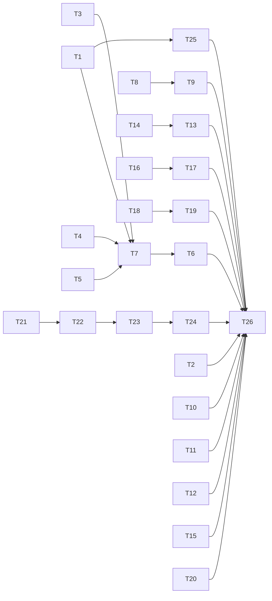

# QA round 23 fixes: every reader masks, the HUD tells the truth, and a gate says what it knows

status: draft
commit-mode: orchestrator-commits
language: ruby
panel: Ruby (Linus Torvalds, Jeremy Evans, Sandi Metz, Richard Schneeman, Aaron Patterson)

## Intent

Fix every finding in [`planning/qa-findings-round23-2026-10-09.md`](../qa-findings-round23-2026-10-09.md) rated
MEDIUM or higher: 1 HIGH, 4 MED-HIGH and 15 MEDIUM, with F-8 left deferred by ruling. Round 23 found the
pattern again: a reader the boundary forgot (`grep`), a fix that narrowed what it fixed (the name rule), and live
views that only work on the clean path (the HUD).

| Missing concept | Findings it closes | Cards |
|---|---|---|
| every tool that returns file bytes masks detected regions, not only `read_file` | G-1 | T1, T2, T25 |
| a secret name is a word inside a name, and directory names count below whatever root a reader works in | G-2, I23-1 | T3, T4, T5 |
| a model never approves what the classifier gated by name or shape | d-1 | T6 |
| a spawned child reads only inside the project, unless a human says yes | j-10 | T7 |
| the in-flight slot follows the run, not only the state machine, and is drawn where it already is | HUD-1, HUD-2, HUD-3 | T8, T9, T10 |
| a lapse, a prose line and a terminate each mean what they say | B23-2, B23-11, j-5 | T11, T12, T15 |
| a newline key is a newline at every prompt | KEY-1 | T13, T14 |
| a refusal on an nvim write never blocks nvim | j-9, j-8 | T16, T17 |
| a cap is roomy, and hitting it names the flag | j-7 | T18, T19 |
| compaction measures only what its strategy can claim | K23-1 | T20 |
| an epic gate reports the decision just made and the tests it opened over | g23-1, g23-3, g23-6 | T21, T22, T23, T24 |

**26 cards.** Roadmap line: `ROADMAP.md` item 55.

**User rulings, 2026-10-09:**

- Scope: MEDIUM and up. F-8 (round 22's T4 and T5) stays deferred.
- j-10: a spawned child's read outside the project root, its `related:` directories and its own working root
  **parks** for a human (denied where nobody can answer). The main agent's reads are unchanged.
- d-1: the oracle may approve only a pending the classifier did not gate by name or shape. For those it may deny
  or leave the call to the human, never approve.
- g23-3: before the implementation gate, the driver runs the tip's tests, journals the run, and the gate question
  says pass or fail. The human still decides; a red tip does not refuse.
- K23-1: the compaction signal counts only the bytes the configured strategy can claim. When the window still
  fills with nothing claimable, the decision names the strategy and the composed pair.
- j-7: the default `--max-tokens` becomes 16384, and a turn cut at the cap names the flag and the value in force.
  (`--max-tokens` is a cap: it changes nothing for a reply under it, and lain reserves none of it from the window.
  Its cost is that a runaway decode holds the single local slot up to 4 times longer before the cap cuts it.)

## Grounding

Checked 2026-10-09 at `fd807376` by 6 Explore passes and 2 spikes, against the files each card names. The QA round's
mechanisms were re-read; 2 changed:

- **K23-1 is not a pin defect.** `SummarizeConversation#propose_ranges`
  (`lib/lain/compaction/strategy/summarize_conversation.rb:57-60`) claims only `ToolMessages.conversational_runs`
  (`lib/lain/compaction/tool_messages.rb:50-53`), which drops every tool-carrying message and every run of 1. An ask
  made of tool rounds leaves nothing to claim, pin or no pin, while `Head#droppable`
  (`lib/lain/compaction/head.rb:123-127`) still counts all of it, so `Source#weigh` (`compaction/source.rb:700-702`)
  defers as `would_not_shrink` on every turn. Reproduced with a throwaway script; fork `e`'s unexplained
  no-span derivations are the same cause.
- **HUD-1's feed never receives a turn.** `Scribe#catch_up` (`lib/lain/session_record/scribe.rb:193-202`) writes the
  committed turn to the raw journal, not the tee, so neither the Hash nor an `Event` reaches `StatusFeed#<<`. The
  `:turn` arm at `lib/lain/status_feed.rb:566-570` is dead in production; `spec/lain/status_feed_spec.rb:2016-2019`
  feeds it by hand. `Telemetry::TurnUsage` does reach the feed through the tee (`agent/accounting.rb:49-60`) before
  `tool_use!` fires.

Other facts the cards rest on, each read at the line given:

- `RedactSecretReads::GUARDED_TOOLS = Set["read_file"]` (`lib/lain/middleware/redact_secret_reads.rb:68`);
  `WithholdSecretPaths::GUARDED_TOOLS` is `glob`, `list_files`, `grep`, without `ast_search`
  (`lib/lain/middleware/withhold_secret_paths.rb:171`). Every child stack is built by `ToolGuard.layered`
  (`lib/lain/cli/tool_guard.rb:249-260`), so a fix there reaches the docent, critic and qa children.
- `NameRule::WORD` (`lib/lain/sensitivity.rb:322-327`) matches whole words, so `vault-pass.txt`, `api_keys.txt`,
  `mysecrets.txt` are ordinary. `checkout_anchors(within)` (`sensitivity.rb:929-935`) already counts directory names
  below a `within` outside the base; `Survey::Walk#verdict_for` (`lib/lain/survey/walk.rb:215-219`) never passes one.
- `SecretSurface#inputs_for` (`lib/lain/approval/secret_surface.rb:162-165`) sends path, tool and region count;
  `PathGate` holds the policy (`lib/lain/approval/path_gate.rb:45-50`) and `Policy#judge` returns a `Verdict` with a
  reason (`lib/lain/sensitivity/policy.rb:186`).
- `Escalation::Surfaces#call` (`lib/lain/approval/escalation.rb:~717-725`) builds the ruling with
  `said: pending.reason`, nil on a lapse; `Pending#lapse` (`lib/lain/approval/queue.rb:229`) is used only by surfaces.
- `Conductor#settle` (`lib/lain/cli/conductor.rb:~536-540`) disposes a `Shutdown` still in `:grace` when the ask ends,
  and nothing carries the close forward.
- `60_question.lua:198,203` and `55_compose.lua:101` raise; the rail is `_G.__lain.review_refused`
  (`lib/lain/frontend/neovim/runtime/65_review.lua:225`).
- `Verdict#refused` (`lib/lain/cli/epic_submit.rb:350-356`) reads a queue folded before the decision (`:571`, `:580`).
  `LocalLanding#unanchored` (`lib/lain/forge/local_landing.rb:227-230`) merges "no anchor" and "no approval".
- The driver keeps the red run in memory only (`lib/lain/cli/epic_driver/factory.rb:1288-1344`), and nothing runs the
  tests between the actor's work and the gate; the checkout exists until `@supervisor.retire(row)` (`:1204`).

**Docs against code.** `docs/commands.md:848` says a read under a `related` directory never releases flagged regions;
`grep` does (code wins as defect, T1). `docs/commands.md:850` says each `related` directory must exist; the code
accepts a missing one (LOW, not in scope).

**Panel review, 2026-10-09 (REQUEST-CHANGES, all addressed):**

- T1: a row scan never adds to `@declined` (a grep would have silenced the next `read_file`), calls the ledger with
  `complete: false` (`complete: true` would erase releases), and keys rows by grep's real labels, which are relative
  to the walked directory, not to cwd.
- T22: tests run on the anchored sha after `retire`, in a throwaway worktree, because retirement rebases and the
  pre-retire tree is not the gated sha.
- T4 owns `Policy#classify(within:)`; T7 is wired in `ToolGuard.working` through `inputs.with(sensitivity:)`, so the
  never-parking judges are confined too, and registers its reason; T6 states the oracle rule as 1 predicate over every
  reason; T3 stays 1 regex; T9 reuses the inbox's never-raise fetch; T23 has its interface; T13 no longer waits on T10.

## Compatibility

| Surface | Verdict | Evidence |
|---|---|---|
| `grep` / `ast_search` tool result text | free to break | unpublished gem 0.1.0, no tags, no consumer outside this repo (`grep -rl 'require "lain"' ~/dev`: only the `lain-t32a` copy); results are read by the model only |
| `Sensitivity` classification of names | free to break | internal; the QA ruling of round 22 already moved it once |
| `--max-tokens` default | free to break | CLI flag of an unpublished tool; `LAIN_MAX_TOKENS` and the flag still override |
| journal records | additive only | session files are stored data read by `--resume` and `bench`; T22 adds `tests_ran`, nothing renames or removes a field, so old sessions load unchanged |
| `state.json` `in_flight` | must keep shape | read by the input pane and `lain://status` of the same build; values change, keys do not |
| `[y/N]` grammar | free to break | interactive surface only |
| `lain epic land` refusal text | free to break | `spec/lain/forge/local_landing_spec.rb:131-139` pins it and is rewritten in T24 |

No trade report: no must-keep surface blocks a simplification.

## Spike findings

| Question | Result | Evidence |
|---|---|---|
| Can the input pane rewrite the HUD rows in place over an open Reline `you>` prompt? | Partly. `"\e7\e[#{n}A" + rows.map { "\r\e[K#{_1}\n" }.join + "\e8"` in one write keeps the prompt, the draft and the cursor intact with no scrollback growth, when `n` is the header rows plus the cursor's row. It breaks when the draft wraps (needs Reline's private `@rendered_screen.cursor_y`), after an answer's echo (unknown row count), and after a resize. Reline has no redraw timer; it repaints only on WINCH. No mutex needed (500 rewrites/s against typing, 1 `print` each). | throwaway harness over `Reline.readmultiline` in a private tmux at 100x12, worktree removed |
| Does tmux 3.7b `extended-keys on` deliver Shift+Enter, and why does Alt+Enter submit? | With `on`, Shift+Enter arrives as `\e[27;2;13~` (or `\e[13;2u` under `csi-u`) only after the app writes `\e[>4;1m`; without it, `\r`. Writing `\e[>4;0m` restores `\r` for the next program. Alt+Enter stays `\e\r` and submits only in vi COMMAND mode: `NEWLINE_MODES` (`line_editor.rb:62-63`) omits `vi_command`, where `KeyStroke#expand("\e\r")` gives `ed_ignore` plus a CR. Adding `vi_command` and `"\e\r"` makes it insert. | matrix script over tmux 3.7b both formats; live `lain input` pane; worktree removed |

## Shared files

- `ROADMAP.md` (the main session adds item 55 and marks it done).

Documentation edits all live in T26, which runs last.

## Rejected options

- **Gate `grep` by parking a release per matched file (T1).** A grep row spans many files and a park per file turns
  one search into a queue of prompts; masking without asking, as a `related` read already does, keeps the search
  usable and `read_file` remains the way to ask.
- **Set tmux `extended-keys always` in `lain up` (T13).** It is server-wide and changes keys for every other program
  in the operator's tmux; the pane requesting the mode for its own reads affects only lain.
- **Read Reline's `@rendered_screen.cursor_y` to redraw over a wrapped draft (T10).** A private ivar; the card skips
  the in-place redraw for a draft over 1 row instead and redraws at the next prompt.
- **Teach `summarize-conversation` to claim tool rounds (T20).** It overlaps `elide-tools` and changes the one
  composable pair; the user chose measuring what the strategy can claim.
- **Refuse the implementation gate over a red tip (T22).** Ruled out: the gate reports, the human decides.
- **Add a CLI command that writes a worker anchor (T24).** No caller needs it; the refusal names the 2 causes apart
  and the remedies that exist.

## Open decisions

- **F-8 (round 22's T4 and T5): deferred by user ruling, 2026-10-09.** A handoff that cannot make room is still
  committed. The Explore pass found the sound check is a lower bound (refuse only when the kept round cannot fit at
  the worst density), not an estimate; that design is unreviewed. No card depends on it.

## Dependency graph



## Tasks

### T1: grep and ast_search mask the regions they return          [risk: high]

**Depends on:** none
**Files:** `lib/lain/middleware/redact_secret_reads.rb`, `lib/lain/cli/tool_guard.rb`,
`spec/lain/middleware/redact_secret_reads_spec.rb`, `spec/lain/cli/tool_guard_spec.rb`
**Reuse:** `RedactSecretReads::Scan` and `Scan#mask` (`redact_secret_reads.rb:414-498`); the ledger's
`outstanding(path, regions, complete: false)` (`lib/lain/sensitivity/ledger.rb:80-88`); the row split rule of
`WithholdSecretPaths::Matches` (`lib/lain/middleware/withhold_secret_paths.rb:134-161`); grep's labels
(`Files#label`, `lib/lain/tools/grep.rb:133-137`) and ast_search's (`lib/lain/tools/ast_search.rb:245-266`)
**Shared-file wiring:** none
**Reachable from:** `CLI::ToolGuard.layered` (`lib/lain/cli/tool_guard.rb:249-260`, line 254) builds `RedactSecretReads`
with the board's ledger and queue, for the main agent (`ToolGuard.stack`) and every child (`working`)

A `grep` or `ast_search` result is scanned row by row. **Row paths:** a directory target labels a row relative to
the walked root, a single-file target with the model's own spelling; so a row's file is the tool call's `path` input
resolved against `worker_env.cwd`, joined with the row label when the target is a directory. That is the key
`read_file` uses for the same file. **Masking:** a detected region the ledger has not released for that file is
masked in place. Ordinals count per result, in row order. Nothing parks.

**What a row scan must not do**, and why: it never adds to `@declined` and never calls `mask` (`:~322-328`), because
a grep-masked file must still park on its next `read_file`; and it calls the ledger with `complete: false`, because
a row is a partial view and `complete: true` drops releases for regions the rows do not show.

The result ends with 1 trailer line: how many rows were masked, that `read_file` on the file asks for their release,
and that a multi-line secret (a PEM body) cannot be detected one line at a time and is not masked here. Each masked
file is journaled as `read_redacted` once, under the existing state-transition rule. The comment at
`tool_guard.rb:20-21` ("guard disjoint tools, so their order carries no constraint") is rewritten: both guards now
see `grep`, and Redact runs outside Withhold, so it scans rows the path filter already kept.

**Acceptance criteria**

```gherkin
Scenario: a token in an ordinary file is masked in a grep row
  Given config/settings.yml holds a 40-character ghp_ token
  When the model calls grep with pattern "ghp_" and path "config"
  Then the row reads "settings.yml:2:  token: <redacted:1>"
  And the result ends with a line saying 1 row was masked and read_file asks for release
  And the token's bytes appear nowhere in the tool result

Scenario: a grep mask leaves read_file able to ask
  Given grep has masked config/settings.yml's token
  When the model calls read_file on config/settings.yml
  Then the call parks for a human release

Scenario: a release given through read_file survives a grep
  Given the human released config/settings.yml's region through read_file
  When the model calls grep with pattern "ghp_" and path "config"
  Then the row carries the token as written
  And a later read_file of config/settings.yml does not park

Scenario: a denied region stays masked for grep
  Given the human denied the release of config/settings.yml's region
  When the model calls grep with pattern "ghp_" and path "config"
  Then the row reads "<redacted:1>" and no approval parks

Scenario: a single-file grep keys on the model's spelling
  When the model calls grep with pattern "ghp_" and path "config/settings.yml"
  Then the row is masked against the same ledger entry read_file uses

Scenario: an ast_search capture carrying a secret is masked
  Given lib/conf.rb assigns a 40-character ghp_ token to a constant
  When the model calls ast_search over lib/conf.rb with a pattern capturing the value
  Then the capture in the row reads "<redacted:1>"

Scenario: a grep under a related directory masks
  Given sensitivity related names a directory holding a netrc-shaped line
  When the model calls grep over that directory
  Then the password field reads "<redacted:1>"

Scenario: the main agent's stack masks a grep
  Given the stack ToolGuard.stack builds for a chat
  When grep returns a row holding a ghp_ token
  Then the tool result carries "<redacted:1>"
```
Spec file: `spec/lain/middleware/redact_secret_reads_spec.rb`; the stack example in `spec/lain/cli/tool_guard_spec.rb`

**Interface**

```ruby
GUARDED_TOOLS = Set["read_file"].freeze          # unchanged: whole-file reads, park and release
ROW_TOOLS     = Set["grep", "ast_search"].freeze # masked per row, never parked, never declined
```

**Stop and report if:**
- `Sensitivity::Regions.detect` misses a key=value or netrc shape when handed 1 line alone; say which shapes need
  context the row lacks.
- `spec/lain/middleware/withhold_automatic_output_spec.rb` changes, since `withhold_automatic_output.rb:145` reuses `Scan`.
- ast_search labels its rows by a rule other than grep's; name it before resolving.
- a row scan needs `@declined` or `mask` to journal `read_redacted`; the record must come from a path that adds nothing
  to `@declined`.

### T2: WithholdSecretPaths filters ast_search rows          [risk: medium]

**Depends on:** none
**Files:** `lib/lain/middleware/withhold_secret_paths.rb`, `spec/lain/middleware/withhold_secret_paths_spec.rb`
**Reuse:** the `Matches` row shape and the `WITHHELD` trailer (`withhold_secret_paths.rb:134-174`)
**Shared-file wiring:** none
**Reachable from:** `CLI::ToolGuard.layered` (`lib/lain/cli/tool_guard.rb:249-260`)

**Acceptance criteria**

```gherkin
Scenario: an ast_search row under a gated path is withheld
  Given secrets/prod.rb is gated by name
  When the model calls ast_search over the project and a row names secrets/prod.rb
  Then that row is absent
  And the result ends with "1 match withheld (named)"

Scenario: ordinary ast_search rows pass unchanged
  Given only lib/a.rb matches
  When the model calls ast_search over the project
  Then the result equals the tool's own output
```
Spec file: `spec/lain/middleware/withhold_secret_paths_spec.rb`

**Stop and report if:**
- an ast_search row with captures (`file:line:text {k=v}`) splits differently from a grep row under `Matches`.

### T3: A secret name is a word inside a file or directory name          [risk: high]

**Depends on:** none
**Files:** `lib/lain/sensitivity.rb`, `spec/lain/sensitivity_spec.rb`, `spec/lain/approval/composed_term_spec.rb`
**Reuse:** `NameRule` (`sensitivity.rb:307-361`), `EXCEPTED`, `matches?`/`covers?`
**Shared-file wiring:** none
**Reachable from:** `Sensitivity#classify`, called by `Sensitivity::Policy`, `Filter`, `Survey::Walk` and
`Approval::ComposedTerm` on every production path

`NameRule` keeps its design: 1 precompiled regex over the name as it stands, no split copy, because every classify
pays for it. `WORD` grows 2 ways. The word list gains `pass`, `passcode`, `apikeys` and plurals, and `api` + separator +
`keys`. A suffix alternative matches a word that ends in `secret`, `password`, `credential` or `apikey` (singular or
plural) after any letters (`mysecrets`), with the same right boundary. A lowercase-to-uppercase transition counts as
a left boundary (`dbPassword`), which needs that 1 transition case-sensitive inside an otherwise `/i` pattern (an
inline `(?-i:...)` group). `EXCEPTED` source extensions stay ordinary.

**Acceptance criteria**

```gherkin
Scenario: the names round 23 found pass now gate
  Given a project root
  When each of "vault-pass.txt", "pass.txt", "passcode.txt", "api_keys.txt", "api_keys.json", "apikeys.txt", "mysecrets.txt", "api_keys/prod", "dbPassword.txt" is classified
  Then each is gated with reason named

Scenario: the ordinary names stay ordinary
  Given a project root
  When each of "AUTHORS", "README", "compass.yml", "tokenizer.json", "passport.txt", "lib/auth/token.rb", "token.ts" is classified
  Then each is ordinary

Scenario: round 22's gated table still gates
  Given a project root
  When each name in the existing gated table is classified
  Then each is gated with reason named

Scenario: cat of a newly gated name parks through ComposedTerm
  Given vault-pass.txt in the project root
  When the model calls bash with "cat vault-pass.txt"
  Then the call parks for a human
```
Spec file: `spec/lain/sensitivity_spec.rb`; the `cat` scenario in `spec/lain/approval/composed_term_spec.rb`

**Stop and report if:**
- `NameRule::SPECIMENS` growth moves the exemption-lift counts in `sensitivity_spec.rb:1040-1075` in a way that is
  not 1 more specimen per added word; say what the counts mean before changing them.
- the zero-allocation check (`sensitivity_spec.rb:544-554`) fails under the word split.
- `spec/lain/approval/composed_term_spec.rb:676` (`AUTHORS`, `tokenizer.json`, `compass.yml` approved) goes red.

### T4: A survey counts directory names below the survey root          [risk: medium]

**Depends on:** none
**Files:** `lib/lain/survey/walk.rb`, `lib/lain/sensitivity/policy.rb`, `spec/lain/survey/walk_spec.rb`,
`spec/lain/sensitivity/policy_spec.rb`, `spec/lain/seams/survey_outside_root_spec.rb`
**Reuse:** `Sensitivity#classify(path, within:)` and `checkout_anchors` (`sensitivity.rb:929-935`). `Walk` holds the
board's `Sensitivity::Policy`, whose `classify(path)` (`policy.rb:~164`) takes no `within:`; this card adds the keyword
to `Policy#classify` and `Policy::Null#classify`, passing it through.
**Shared-file wiring:** none
**Reachable from:** `CLI::Survey` (`lib/lain/cli/survey.rb:138-141`) and the chat's `/survey`, both building
`Survey::Walk.new(root:)`

**Acceptance criteria**

```gherkin
Scenario: a sibling tree's secret directory is masked whole
  Given a project at A and a tree at B outside A holding secrets/prod and credentials/x
  When /survey B runs
  Then secrets/prod and credentials/x project as masked whole
  And a note on secrets/prod line 1 journals its anchor_text masked

Scenario: a survey inside the root is unchanged
  Given the same files under the project root
  When /survey runs over them
  Then the projection equals today's
```
Spec file: `spec/lain/survey/walk_spec.rb`; the note scenario in `spec/lain/seams/survey_outside_root_spec.rb`

**Stop and report if:**
- a symlink classified by its `realpath` target needs a different `within` from its link name.

### T5: A survey docent works inside the survey root          [risk: medium]

**Depends on:** none
**Files:** `lib/lain/review/docent.rb`, `spec/lain/review/docent_spec.rb`, `spec/lain/seams/docent_outside_root_spec.rb`
**Reuse:** `Review::Critique`'s `@spawn.within(worker_env)` (`lib/lain/review/critique.rb:125,152`);
`Sensitivity::Policy.base_of(context)` (`policy.rb:197-199`)
**Shared-file wiring:** none
**Reachable from:** `Review::Docent::Answerer#call` (`docent.rb:216`), spawned by the review session's thread `:w`

**Acceptance criteria**

```gherkin
Scenario: a docent's own read under a sibling tree is gated by its directory name
  Given a survey of tree B outside the project, with B/secrets/prod holding a value
  When the docent child calls read_file on B/secrets/prod
  Then the read parks for a human
  And the value appears 0 times in the journal after a deny
```
Spec file: `spec/lain/review/docent_spec.rb`; the seam in `spec/lain/seams/docent_outside_root_spec.rb`

**Interface**

```ruby
# Answerer spawns with the review's root as the child's working root
def call(brief) = @spawn.within(@worker_env).call(@role, @mode, brief)
```

**Stop and report if:**
- the docent's changeset carries no survey root to build a `WorkerEnv` from; name where the root is lost.
- a changeset docent (local branch review) changes behaviour; its root is the project and must stay so.

### T6: The secret oracle never approves a name- or shape-gated path          [risk: high]

**Depends on:** T7
**Files:** `lib/lain/approval/secret_surface.rb`, `lib/lain/approval/path_gate.rb`,
`spec/lain/approval/secret_surface_spec.rb`, `spec/lain/approval/path_gate_spec.rb`, `lib/lain/sensitivity.rb`,
`spec/lain/sensitivity_spec.rb` (for `Verdict#oracle_approvable?`; ordered after T7, which adds `outside_project`)
**Reuse:** `Sensitivity::Policy#judge` (`policy.rb:186`), `Verdict#reason`; `SecretSurface#confident?` and `settle`
**Shared-file wiring:** none
**Reachable from:** `CLI::Wiring` builds `SecretSurface` under `--secret-oracle` (`lib/lain/cli/wiring.rb:219-226`)

The surface asks the classifier for the pending path's verdict through 1 predicate on `Sensitivity::Verdict`, and
applies an oracle `approve` only when it is true. A `deny` is always applied. Region pendings on a gated path follow
the same rule.

| reason | oracle may approve | why |
|---|---|---|
| `ordinary` (a region in an ordinary file) | yes | the case the oracle exists for |
| `named`, `credential` | no | gated by name or by shape: the ruling |
| `configured` | no | the operator gated it on purpose |
| `protected` | no | project config and executable config |
| `malformed` | no | unresolvable is never waved through |
| `out_of_scope`, `outside_project` (T7) | yes | gated by where it is, not by what it is |

**Acceptance criteria**

```gherkin
Scenario: an approve on .env is not applied
  Given --secret-oracle with an oracle answering approve at 1.0
  When read_file of ".env" parks at the path gate
  Then the call is still parked for the human
  And no read_released record is journaled

Scenario: a deny on .env is applied
  Given an oracle answering deny at 0.95
  When read_file of ".env" parks
  Then the call is denied with surface secret_oracle

Scenario: an approve on an ordinary file's region is applied
  Given an oracle answering approve at 0.95
  When read_file of an ordinary file with 1 detected region parks
  Then the release is approved with surface secret_oracle
```
Spec file: `spec/lain/approval/secret_surface_spec.rb`

**Interface**

```ruby
# PathGate
def verdict_for(pending) # => Sensitivity::Verdict, or nil for a pending no read tool made
# Sensitivity::Verdict
def oracle_approvable? # => true only for the reasons the table marks yes
```

**Stop and report if:**
- `.env` classifies with a reason other than `credential` or `named`; list the reasons the rule must cover.
- the 3-key oracle input pinned at `secret_surface_spec.rb:363-370` must change to carry the reason (it must not).

### T7: A spawned child's read outside its scope parks          [risk: high]

**Depends on:** T1, T3, T4, T5
**Files:** `lib/lain/sensitivity/policy.rb`, `lib/lain/sensitivity.rb`, `lib/lain/cli/tool_guard.rb`,
`spec/lain/sensitivity/policy_spec.rb`, `spec/lain/cli/tool_guard_spec.rb`, `spec/lain/seams/child_read_scope_spec.rb`
**Reuse:** `Policy::PATH_FIELDS` (`policy.rb:85-97`), `Policy#judge`, `Session::Confined#holds?` resolution
(`lib/lain/session.rb:594-599`), `Sensitivity#related?`; `ToolGuard.working` and the `inputs.with(...)` idiom
**Shared-file wiring:** none
**Reachable from:** `CLI::ToolGuard.working` (`tool_guard.rb:~241`), which every child stack passes through:
`Spawned#call` -> `child_stack` -> `working` for chat children, `NeverParking#call` -> `working` for the 2 approval
judges (`tool_guard.rb:151`), and `Detached#call` -> `working`

In `working`, a child's guard inputs are rebuilt as `inputs.with(sensitivity: inputs.sensitivity.confined(roots:))`,
where `roots` is the project root, every `related:` directory and the child's own `worker_env` root. The filter, the
`related:` check, the sensitivity layer and the gate all read `inputs.sensitivity`, so they all see the confinement.
The confined policy judges a read tool's path (and a `glob` pattern's absolute or `../` prefix) outside every root as
`gated` with a new reason `outside_project`, registered in `Verdict::REASONS` (`sensitivity.rb:~60-69`). The gate then
parks it for a human; a never-parking child (`ToolGuard.refusing`) is refused. A detached child's gate is
`ApproveAll`, so its behaviour does not change; that is stated, not tested. `Policy::Null#confined` returns a confined
Null, so a chat with no project root confines to the child's own root and `related:`. The main agent's stack
(`ToolGuard.stack` -> `layered`) does not pass through `working` and is unchanged.

`outside_project` is a new reason, not `out_of_scope`: `out_of_scope` gates named personal directories for every reader,
main agent included (`sensitivity.rb:747`), while this one exists only in a child's confined policy.

**Acceptance criteria**

```gherkin
Scenario: a researcher's list_files of the operator's home parks
  Given a chat that spawned a researcher child through the real Spawned seam
  When the child calls list_files with path "/home/tara/.local/share"
  Then the call parks in lain://approval naming the researcher
  And nothing is listed until a human answers

Scenario: a glob of "/" parks
  When the child calls glob with path "/" and pattern "**/*.md"
  Then the call parks

Scenario: a glob whose pattern leaves the project parks
  When the child calls glob with path "." and pattern "../../**/*.md"
  Then the call parks

Scenario: a child's reads inside the project run unasked
  When the child calls grep over "lib"
  Then the call runs with no park

Scenario: a related directory is in scope
  Given sensitivity related names ~/notes
  When the child calls read_file on ~/notes/a.md
  Then the call runs with no park

Scenario: the main agent is unchanged
  When the main agent calls list_files with path "/tmp"
  Then the call runs with no park

Scenario: a never-parking child is refused
  Given the auto_approver child built through NeverParking
  When it calls read_file on "/etc/hosts"
  Then the call is refused and nothing parks
```
Spec file: `spec/lain/seams/child_read_scope_spec.rb` (the Spawned and NeverParking scenarios, no double between the
seam and the gate); the policy rule in `spec/lain/sensitivity/policy_spec.rb`; `working` in `spec/lain/cli/tool_guard_spec.rb`

**Interface**

```ruby
# Sensitivity::Policy and Policy::Null
def confined(roots:) # => a Policy judging read-tool paths outside every root as gated, reason :outside_project
```

**Stop and report if:**
- a `glob` pattern's prefix is resolved somewhere the `path` field does not show; name the field that holds it.
- the survey docent (T5) or the critic parks on its own changeset reads; its working root must be in `roots`.
- a spec in `spec/lain/cli/tool_guard_spec.rb` pins `working`'s inputs as passed through unchanged.

### T8: The in-flight slot clears when a run is interrupted          [risk: medium]

**Depends on:** none
**Files:** `lib/lain/status_feed.rb`, `spec/lain/status_feed_spec.rb`, `spec/lain/cli/live_views_spec.rb`
**Reuse:** the `Telemetry::RunInterrupted` arm in `StatusFeed#<<` (`status_feed.rb:288`); `publish_if_changed`
**Shared-file wiring:** none
**Reachable from:** `CLI::LiveViews` tees the scribe's `RunInterrupted` into the feed (`lib/lain/cli/live_views.rb:129`;
`session_record/scribe.rb:284-289`)

**Acceptance criteria**

```gherkin
Scenario: a stop mid model call clears the slot
  Given a chat whose state reads in_flight kind model
  When /stop journals run_interrupted reason stopped
  Then state.json's in_flight is null
  And the HUD shows no model segment at the idle you> prompt

Scenario: a transport failure clears the slot
  Given a chat pointed at a closed --api-base port
  When the ask fails with run_interrupted reason transport
  Then in_flight is null

Scenario: a stop at a parked ask_human clears the tool names
  When s at the countdown stops a parked ask_human
  Then in_flight is null
```
Spec file: `spec/lain/status_feed_spec.rb`, plus 1 example through the real chronicle in `spec/lain/cli/live_views_spec.rb`

**Stop and report if:**
- a stop path journals no `RunInterrupted` (the Explore pass found every `Lain::Error` path does; a non-`Lain::Error`
  escaping `Repl::Ask#attempt` does not); name it rather than adding a second clear.

### T9: The HUD names the tools in flight          [risk: medium]

**Depends on:** T8
**Files:** `lib/lain/status_feed.rb`, `spec/lain/status_feed_spec.rb`, `spec/lain/cli/live_views_spec.rb`
**Reuse:** `StatusFeed#bind_store` (`status_feed.rb:312`), `Store#fetch` (`lib/lain/store.rb:38`), `tool_names_in`
(`status_feed.rb:575-579`); the tee seam at `spec/lain/cli/live_views_spec.rb:159-229`
**Shared-file wiring:** none
**Reachable from:** `CLI::Wiring#bind_hud_store` (`lib/lain/cli/wiring.rb:516`) binds the session store;
`Agent#account` journals `TurnUsage` through the tee before `tool_use!`

On `Telemetry::TurnUsage` with `stop_reason` `tool_use`, the feed fetches the turn by its digest from the bound store
and takes its tool names. The fetch reuses the store-walk pattern and wide rescue of `Inbox#cited_by_chain`
(`lib/lain/status_feed/inbox.rb:~128`): the tee re-raises a sink's failure into the agent loop, so a fetch that fails
names no tools and raises nothing. `on_transition` keeps the names, since it resets them only when the kind is not
`tool`. The dead `:turn` arm and its hand-fed spec go. A child's `TurnUsage` goes to the spawn seam's
`durable_journal`, not the tee (`lib/lain/cli/wiring/toolset_build.rb:~345`); the card checks that rather than assumes it.

**Acceptance criteria**

```gherkin
Scenario: a parked bash call is named
  Given a chat through the real chronicle, tee and store
  When the model's reply asks for bash and the call parks
  Then state.json's in_flight reads kind tool with tools ["bash"]
  And the HUD shows "tool:bash"

Scenario: 2 calls in 1 reply are both named
  When the reply asks for read_file and grep
  Then tools is ["read_file", "grep"]

Scenario: a head the store cannot read names nothing and breaks nothing
  Given a bound store whose fetch raises
  When a tool_use TurnUsage arrives
  Then tools is [] and the agent loop continues

Scenario: a child's tool call does not reach the parent's HUD
  Given a researcher child calls grep
  Then the parent's state.json tools never names grep
```
Spec file: `spec/lain/cli/live_views_spec.rb` (production path); unit cases in `spec/lain/status_feed_spec.rb`

**Stop and report if:**
- `TurnUsage` reaches the feed after the `tool_use!` transition, or the store does not yet hold the turn when it does.

### T10: The input pane redraws the HUD where it is          [risk: medium]

**Depends on:** none
**Files:** `lib/lain/frontend/input_pane.rb`, `spec/lain/frontend/input_pane_spec.rb`
**Reuse:** `restyled` (`input_pane.rb:255-261`) and its sequence; `over_the_prompt`; the spike's guards
**Shared-file wiring:** none
**Reachable from:** `exe/lain input` builds `Frontend::InputPane`, fed by `CLI::InputSocket#publishing`
(`lib/lain/cli/input_socket.rb:362-376`)

3 changes, all in the pane:

1. At an open prompt, a header change with the same row count and a 1-row draft is rewritten in place with
   `restyled`'s sequence. Any other header change waits for the next prompt generation; nothing is printed below.
2. After an answered prompt, on the first idle tick of the ask, the pane prints the header once below the echo and
   adopts it as drawn, so later changes are rewritten in place for the rest of the ask.
3. After a resize, the next prompt redraws whole.

**Acceptance criteria**

```gherkin
Scenario: a ticking header at an idle you> stacks no rows
  Given an open you> prompt under a 1-row header
  When the header changes 5 times
  Then the pane's scrollback holds 1 header row
  And the you> line and its draft are intact

Scenario: the HUD updates during a typed ask
  Given a prompt answered with "list the files"
  When the header changes from model:1s to model:4s during the ask
  Then the row below the echo reads model:4s
  And the echo line is intact

Scenario: a wrapped draft is not drawn over
  Given a draft longer than the pane width
  When the header changes
  Then nothing is written until the next prompt generation
```
Spec file: `spec/lain/frontend/input_pane_spec.rb` (byte-level, as `:372-441`)

**Stop and report if:**
- `spec/lain/frontend/input_pane_spec.rb:421-441` (63bdaff0's echo pin) must change beyond the new idle-tick header;
  the echo itself must stay untouched.
- typeahead echoed by the cooked reader during an ask moves the cursor before the idle-tick header lands.

### T11: A lapse tells the model it lapsed          [risk: low]

**Depends on:** none
**Files:** `lib/lain/approval/escalation.rb`, `spec/lain/approval/escalation_spec.rb`, `spec/lain/approval/queue_spec.rb`
**Reuse:** `Pending#lapse` and `#timed_out?` (`queue.rb:229,246`); the gate's `said` append (`middleware/gate.rb:149-153`)
**Shared-file wiring:** none
**Reachable from:** `Approval::Queue#rule` calls `Escalation::Surfaces#call` for every queue-held gate

**Acceptance criteria**

```gherkin
Scenario: a lapsed bash call's tool result says it lapsed
  Given approval timeout 30
  When a bash call parks and nobody answers for 30 seconds
  Then the tool result reads 'approval denied for tool "bash": denied after 0:30 with no answer'

Scenario: a human's bare deny is unchanged
  When a human denies with no reason
  Then the tool result reads 'approval denied for tool "bash"'
```
Spec file: `spec/lain/approval/queue_spec.rb` (beside `:189-207`)

### T12: A [y/N] takes only a verdict          [risk: medium]

**Depends on:** none
**Files:** `lib/lain/frontend/approval_policy.rb`, `lib/lain/frontend/tty.rb`, `spec/lain/frontend/approval_policy_spec.rb`,
`spec/lain/frontend/intake_spec.rb`, `spec/lain/seams/plain_chat_prompt_guards_spec.rb`
**Reuse:** `Asked#takes?` (`approval_policy.rb:122`), `AFFIRMATIVE`, `REASONED_NO`; `Intake#judge` and `#hold`
(`lib/lain/frontend/intake.rb:200-206,295-307`); `HELD` (`tty.rb:50`)
**Shared-file wiring:** none
**Reachable from:** `Frontend::Intake#answers?` consults `Asked#takes?` on every line at an open `[y/N]`

Round 22's T22, never landed. A verdict is `y`, `yes`, `n`, `no`, an empty line, or a `REASONED_NO` line
(`n <reason>`). Anything else is held as the next prompt and the `[y/N]` is drawn again.

**Acceptance criteria**

```gherkin
Scenario: a verdict decides
  When each of "y", "Yes", "n", "no", "n not now", and an empty line arrives at an open [y/N]
  Then it decides the approval, the reasoned no keeping "not now"

Scenario: prose is held
  When "please also fix the tests" arrives at an open [y/N]
  Then no approval_decision is journaled
  And the chat says "held as your next prompt: please also fix the tests" and that a y or n answers the approval
  And the [y/N] is drawn again
```
Spec file: `spec/lain/frontend/approval_policy_spec.rb` (rewrite `:108-114`, `:133`, `:736-753`); the seam in
`spec/lain/seams/plain_chat_prompt_guards_spec.rb`

**Stop and report if:**
- a pasted multi-line block reaches `takes?` as 1 line; say what it arrives as.
- "garbage" and "maybe" are pinned as denials elsewhere than `approval_policy_spec.rb`.

### T13: The input pane asks the terminal for Shift+Enter          [risk: medium]

**Depends on:** T14
**Files:** `lib/lain/frontend/line_editor.rb`, `spec/lain/frontend/line_editor_spec.rb`,
`spec/lain/seams/shift_enter_newline_spec.rb`
**Reuse:** `bind_newlines` and `NEWLINE_SEQUENCES` (`line_editor.rb:56-63,159-165`)
**Shared-file wiring:** none
**Reachable from:** `Frontend::StdinPump` builds one `LineEditor` (`lib/lain/frontend/stdin_pump.rb:103`) for every
prompt, in the input pane and in a plain chat

`LineEditor#read` writes `\e[>4;1m` before reading and `\e[>4;0m` after, on every exit path including an exception
and EOF. `lain up` keeps `extended-keys on` (`lib/lain/cli/up.rb:1388-1392`).

**Acceptance criteria**

```gherkin
Scenario: Shift+Enter inserts a newline under extended-keys on
  Given a tmux server with extended-keys on and a lain input pane
  When "ab", Shift+Enter, "cd", Enter are sent
  Then the prompt submitted is "ab\ncd"

Scenario: the mode is reset after the read
  When the read returns
  Then the pane's output ends with "\e[>4;0m"

Scenario: Shift+Enter at command> inserts a newline
  Given a call parked in a cockpit
  When "xy", Shift+Enter, "zw", Enter are sent at command>
  Then the held line is "xy\nzw"
```
Spec file: `spec/lain/frontend/line_editor_spec.rb` (bytes); the tmux scenarios in `spec/lain/seams/shift_enter_newline_spec.rb`, which goes in `spec/support/slow_files.rb` if it crosses that file's threshold

**Stop and report if:**
- the request or reset reaches a non-terminal output (a spec's StringIO, `--non-interactive`); it must be written
  only to a tty.

### T14: Alt+Enter inserts a newline in vi command mode          [risk: low]

**Depends on:** none
**Files:** `lib/lain/frontend/line_editor.rb`, `spec/lain/frontend/line_editor_spec.rb`
**Reuse:** `NEWLINE_MODES`, `NEWLINE_SEQUENCES` (`line_editor.rb:62-63`); the `KeyStroke#expand` spec pattern
(`line_editor_spec.rb:171-205`)
**Shared-file wiring:** none
**Reachable from:** `Frontend::StdinPump` (`stdin_pump.rb:103`)

**Acceptance criteria**

```gherkin
Scenario: ESC CR in vi command mode inserts a newline
  Given the vi keymap in command mode with draft "ab"
  When "\e\r" then "cd" are expanded
  Then the line reads "ab\ncd" and nothing is submitted

Scenario: every newline sequence works in all 3 keymaps
  When "\e[13;2u", "\e[27;2;13~" and "\e\r" are expanded in emacs, vi_insert and vi_command
  Then each yields key_newline
```
Spec file: `spec/lain/frontend/line_editor_spec.rb`

### T15: A terminate during an ask closes the session when the ask ends          [risk: medium]

**Depends on:** none
**Files:** `lib/lain/cli/conductor.rb`, `spec/lain/cli/conductor_spec.rb`
**Reuse:** `Conductor#settle`, `#close` (`conductor.rb:~283-290,536-542`); `Shutdown#state`
**Shared-file wiring:** none
**Reachable from:** `Conductor#supervise` for every ask in chat and cockpit

When the ask ends while its `Shutdown` is in `:grace`, the conductor closes the session with reason `exit` and
`supervise` returns `closed: true`.

**Acceptance criteria**

```gherkin
Scenario: an ask that finishes inside the grace window closes the session
  Given a SIGTERM arrived mid-ask and the countdown reads closing in 60s
  When the ask completes on its own after 3 seconds
  Then session_closed is journaled with reason exit
  And the chat does not draw you> again

Scenario: a cancelled grace leaves the session open
  Given a SIGINT then s cancelled the countdown
  When the ask completes
  Then the session stays open at you>
```
Spec file: `spec/lain/cli/conductor_spec.rb` (rewrite `:1123-1145`, which pins the session staying open)

**Stop and report if:**
- `:218-241` ("nothing once the ask settles") conflicts with closing; say which behaviour each pins.

### T16: Question and compose writes refuse on the rail          [risk: medium]

**Depends on:** none
**Files:** `lib/lain/frontend/neovim/runtime/60_question.lua`, `lib/lain/frontend/neovim/runtime/55_compose.lua`,
`spec/lain/frontend/neovim/runtime/60_question_spec.rb`, `spec/lain/frontend/neovim/runtime/55_compose_spec.rb`,
`spec/lain/frontend/neovim/rpc_thread_spec.rb`
**Reuse:** `_G.__lain.review_refused` (`65_review.lua:225`); `51_thread.lua:643-705`'s refusal shape; the UI-attached
seam at `rpc_thread_spec.rb:1294-1324`
**Shared-file wiring:** none
**Reachable from:** the `BufWriteCmd` autocmds on `lain://question` and the compose buffer, created when nvim attaches

Both callbacks refuse with `review_refused(...)` and `return`, leave `'modified'` set, and pass no `lain: ` prefix.
The untouched-buffer sentence keeps `:w!` last.

**Acceptance criteria**

```gherkin
Scenario: a refused question write leaves nvim answering
  Given a UI-attached nvim with lain://question open and a column-0 stray line typed
  When :w is typed
  Then nvim_get_mode is not blocking
  And an RPC round trip answers within 1 second
  And :messages holds the full refusal naming the line

Scenario: an untouched question write refuses on the rail
  When :w is typed on an untouched lain://question
  Then the message line ends with ":w!" and the buffer stays modified
```
Spec file: `spec/lain/frontend/neovim/rpc_thread_spec.rb` (seam); rewrite `60_question_spec.rb:159-163,190-231,248-261`
and `55_compose_spec.rb:70-88`

**Stop and report if:**
- a scripted `:w` caller in Ruby relies on the raised error text (search `lib/` for the "NOT saved" string).

### T17: A ticked option is not marked as a bad indent          [risk: low]

**Depends on:** T16
**Files:** `lib/lain/frontend/neovim/runtime/60_question.lua`, `spec/lain/frontend/neovim/runtime/60_question_spec.rb`
**Reuse:** `typed_rows`, `mark_indent_errors` (`60_question.lua:43-65`); the `ticked` let and `question_errors` helper
(`60_question_spec.rb:31,318-329`)
**Shared-file wiring:** none
**Reachable from:** `annotate_question` on `on_lines` of every `lain://question` buffer (`60_question.lua:84-112`)

`typed_rows` compares a row with its option mark normalised to `- [ ]`, so a ticked rendered option counts as
rendered.

**Acceptance criteria**

```gherkin
Scenario: ticking options raises no mark
  Given a rendered question with 3 options
  When 2 options are ticked with x
  Then question_errors is empty

Scenario: a typed column-0 line is still marked
  When "extra" is typed at column 0 under the question
  Then that row carries the bad-indent mark
```
Spec file: `spec/lain/frontend/neovim/runtime/60_question_spec.rb`

### T18: The default --max-tokens is 16384          [risk: low]

**Depends on:** none
**Files:** `exe/lain`, `spec/lain/cli/chat_flags_spec.rb`
**Reuse:** `ModelFlags.declare` (`exe/lain:412`), `EnvDefaults.numeric("LAIN_MAX_TOKENS", ...)`
**Shared-file wiring:** none
**Reachable from:** `ModelFlags.declare` (`exe/lain:412`), which sets the default for `lain chat` (`exe/lain:1123`),
`lain epic submit` (`:569`) and the journal passes (`consolidate`, `improve`, `:1251-1262`); `bench record` (`:713`) and
`bench arms` (`:739`) pass their own and do not move

**Acceptance criteria**

```gherkin
Scenario: a chat with no flag sends 16384
  Given no --max-tokens and no LAIN_MAX_TOKENS
  When a chat sends its first ollama request
  Then options.num_predict is 16384

Scenario: the environment still wins over the default
  Given LAIN_MAX_TOKENS=2048
  Then num_predict is 2048

Scenario: bench record keeps its own default
  When lain bench record resolves max_tokens with no flag
  Then it is RECORD_DEFAULTS' value, unchanged
```
Spec file: `spec/lain/cli/chat_flags_spec.rb`

**Stop and report if:**
- a spec outside this file pins 4096 as the chat default (the `spec/lain/cli_spec.rb` pins pass 4096 explicitly and
  stay green).

### T19: A turn cut at the cap names the flag          [risk: low]

**Depends on:** T18
**Files:** `lib/lain/cli/repl/ask.rb`, `spec/lain/cli/repl/ask_spec.rb`
**Reuse:** `Repl::Ask#say_failure` (`ask.rb:77-83`), `Response::Failure` (`lib/lain/response/failure.rb:19`), the
context's `max_tokens`
**Shared-file wiring:** none
**Reachable from:** `Repl::Ask` renders every failed chat turn

`Failure::MESSAGES` is unchanged, so a subagent's parent model never reads a flag it cannot use. The chat adds 1
line under the error.

**Acceptance criteria**

```gherkin
Scenario: the chat names the remedy
  Given --max-tokens 4096
  When a turn ends with stop_reason max_tokens
  Then the chat shows "error: model hit max_tokens before finishing"
  And the next line reads "raise --max-tokens (now 4096); a thinking model's reasoning counts against it"

Scenario: a subagent's failure text is unchanged
  When a child turn ends at max_tokens
  Then the parent's tool result carries the Failure message only
```
Spec file: `spec/lain/cli/repl/ask_spec.rb`

The value comes from `@agent.context.max_tokens` (`Agent#context`, `lib/lain/agent.rb:83`).

**Stop and report if:**
- the context's `max_tokens` differs from the one the request carried (a role or skill override); report which wins.

### T20: Compaction counts only what its strategy can claim          [risk: high]

**Depends on:** none
**Files:** `lib/lain/compaction/head.rb`, `lib/lain/compaction/source.rb`, `spec/lain/compaction/head_spec.rb`,
`spec/lain/compaction/source_spec.rb`
**Reuse:** `Derived#over` and `PinCuts#propose_ranges` (`lib/lain/compaction/source/derived.rb:~176,373-395`);
`Head#droppable` (`head.rb:123-127`); `Diagnosis#remedy` (`source.rb:~285-300`)
**Shared-file wiring:** none
**Reachable from:** `Compaction::Source#weigh` on every compaction decision of a chat with `--compact-strategy`

`Head#droppable` counts the bytes inside the ranges the configured strategy proposes (through the same `PinCuts`
wrapping), not every unpinned message. Proposing ranges calls no summarizer. When the window is approaching or over
and the strategy claims nothing, the decision's remedy names the strategy and `elide-tools+summarize-conversation`.

**Acceptance criteria**

```gherkin
Scenario: tool rounds do not fire a summarize-only strategy
  Given --compact-strategy summarize-conversation --compact-bytes 1500 --compact-keep 2
  And an ask of 10 tool rounds, 40 KB in all, with no second conversational turn
  When compaction decides
  Then head_bytes counts only conversational runs the strategy can claim
  And the decision does not fire on the tool bytes

Scenario: a window filled by unclaimable bytes says why
  Given the same session at 85% of its window
  When compaction decides
  Then the decision's remedy names summarize-conversation and elide-tools+summarize-conversation

Scenario: the composed pair claims tool rounds
  Given --compact-strategy elide-tools+summarize-conversation and the same ask
  When compaction decides
  Then head_bytes includes the tool rounds and the decision compacts
```
Spec file: `spec/lain/compaction/source_spec.rb`; `Head` unit cases in `spec/lain/compaction/head_spec.rb`

**Stop and report if:**
- proposing ranges for a summarizing strategy calls the summarizer oracle.
- the `Held` default strategy's `head_bytes` changes for any existing spec in `spec/lain/compaction/`.

### T21: A human's deny of an epic gate reads as a deny          [risk: medium]

**Depends on:** none
**Files:** `lib/lain/cli/epic_submit.rb`, `spec/lain/cli/epic_submit_spec.rb`, `spec/lain/tools/epic_submit_spec.rb`
**Reuse:** `ReadBack`'s `@decided` and `expired(digest)` (`epic_submit.rb:273-298`); `SignoffQueue::DEFERRED_POLICY`
**Shared-file wiring:** none
**Reachable from:** `CLI::EpicSubmit#submit` from `lain epic submit` (`exe/lain:567-576`) and the `epic_submit` tool
(`lib/lain/cli/wiring/toolset_build.rb:250`)

`Verdict#refused` reads this call's own decision: `deferred` only when that decision's policy was `deferred`.

**Acceptance criteria**

```gherkin
Scenario: a deny over an earlier deferral prints denied
  Given a deferred research decision already parked for the same digest
  When an interactive submit is answered "n"
  Then the output starts with "denied" and does not mention "parked"
  And the signoff queue for research is drained

Scenario: the epic_submit tool returns the same
  When the epic_submit tool runs the same submit
  Then its result starts with "denied"
```
Spec file: `spec/lain/cli/epic_submit_spec.rb` (helpers at `:69-137`); `spec/lain/tools/epic_submit_spec.rb`

### T22: The driver tests the anchored sha before the implementation gate          [risk: high]

**Depends on:** T21
**Files:** `lib/lain/cli/epic_driver/factory.rb`, `lib/lain/cli/epic_driver/tip_tests.rb`, `lib/lain/telemetry/tests_ran.rb`,
`spec/lain/cli/epic_driver/factory_spec.rb`, `spec/lain/cli/epic_driver/run_spec.rb`,
`spec/lain/cli/epic_driver/tip_tests_spec.rb`, `spec/lain/telemetry/tests_ran_spec.rb`
**Reuse:** `Grader::TestHarness#run` (`lib/lain/grader/test_harness.rb:92-104`) and `TestHarness::Adapter.for`;
the layout `IssueTests` already builds its harness from (`factory.rb:1347-1352,1426-1429`, built at `:619`);
`Telemetry::GradeRecord` as the record exemplar (`lib/lain/telemetry/grade_record.rb`)
**Shared-file wiring:** none
**Reachable from:** `Run#settle_one` (`factory.rb:1200-1205`); `Run` is built at `factory.rb:533`, which now also passes
a `TipTests` built from the same layout as `IssueTests` at `:619`

**Which tree is tested.** `Supervisor#retire` (`lib/lain/supervisor.rb:195-215`) rebases the checkout, anchors its
commits and releases the lease; the gate then names `report.sha`. Testing before `retire` would test a tree that is not
the gated sha. So `settle_one` becomes: grade (unchanged), retire, then `TipTests#call(issue_id, report.sha)`, then
`judge`. `TipTests` checks out `report.sha` detached in a throwaway worktree under the run's own tmp, runs the declared
harness over the whole suite (not `IssueTests#ran`'s single target), journals a `tests_ran` record and removes the
worktree on every path. A `:nothing_to_do` report runs nothing and journals nothing. The `@grading` hook keeps its place
before `retire` and its bench meaning.

**Acceptance criteria**

```gherkin
Scenario: a red tip's run is journaled against the gated sha
  Given an issue whose anchored commit fails with a NameError outside examples
  When the driver settles it
  Then a tests_ran record names the issue and the anchored sha with errors 1
  And the record is journaled before the implementation gate's question
  And no worktree for that sha remains

Scenario: a project with no test preset journals that nothing ran
  Given no tests preset
  When the driver settles an issue
  Then a tests_ran record says the tests were not run and why

Scenario: a bench grading hook still runs before retirement
  Given a Run built with a grading hook
  When an issue settles
  Then the hook sees the row before it is retired, as today
```
Spec file: `spec/lain/cli/epic_driver/tip_tests_spec.rb` (a real git repository); `spec/lain/cli/epic_driver/factory_spec.rb`;
`spec/lain/telemetry/tests_ran_spec.rb`

**Interface**

```ruby
TestsRan = Data.define(:issue_id, :sha, :ran, :passed, :failed, :errors, :why) # include Journalable
class TipTests
  def initialize(repo_root:, harness:, journal:, tmp:)
  def call(issue_id, sha) # => TestsRan, journaled
end
```

**Stop and report if:**
- a NameError outside examples is not counted in `TestHarness::Run#errors`; say where the adapter puts it.
- the harness needs the gems or files of the actor's checkout that a fresh detached worktree lacks (an untracked
  `.bundle`, a generated file); name what is missing.
- `TipTests` needs a collaborator `Run` cannot be given at `factory.rb:533`; name it.

### T23: The implementation gate question says what the tests did          [risk: medium]

**Depends on:** T22
**Files:** `lib/lain/epic/submission.rb`, `lib/lain/cli/epic_submit.rb`, `lib/lain/cli/epic_driver/factory.rb`,
`spec/lain/epic/submission_spec.rb`, `spec/lain/cli/epic_submit_spec.rb`, `spec/lain/cli/epic_driver/factory_spec.rb`,
`spec/lain/cli/epic_driver/run_spec.rb`
**Reuse:** `Submission.implementation` and `#gate_question` (`submission.rb:244-250,292-300`); `Factory::Gate#call`
(`factory.rb:146-150`)
**Shared-file wiring:** none
**Reachable from:** `Factory::Gate#call` -> `CLI::EpicSubmit#submit("implementation", ...)` on every implementation gate

**Interface**

```ruby
# Run#judge passes the TestsRan T22 journaled
Factory::Gate#call(issue_id, sha:, tests:)
CLI::EpicSubmit#submit(stage, slug = nil, issue: nil, digest: nil, tests: nil)
Submission.implementation(slug:, issue_id:, digest:, tests: nil) # tests renders into fact, never into #digest
```

**Acceptance criteria**

```gherkin
Scenario: a red tip says so in the question
  Given a tests_ran with 3 passed and 1 error
  When the implementation gate asks
  Then the question names the sha and reads "tests: 3 passed, 1 error"

Scenario: a green tip says so
  Given a tests_ran with 4 passed
  Then the question reads "tests: 4 passed"

Scenario: a hand submit with no run says nothing ran
  When lain epic submit implementation runs with --digest
  Then the question reads "tests: not run"
```
Spec file: `spec/lain/epic/submission_spec.rb`; `spec/lain/cli/epic_submit_spec.rb`

**Stop and report if:**
- the evidence changes `Submission#digest`; the address must stay the issue and sha only.

### T24: Land names a missing anchor apart from a missing approval          [risk: medium]

**Depends on:** T23
**Files:** `lib/lain/forge/local_landing.rb`, `lib/lain/cli/epic_submit.rb`, `spec/lain/forge/local_landing_spec.rb`,
`spec/lain/cli/epic_submit_spec.rb`
**Reuse:** `LocalLanding#approved_commit`, `#unanchored`, `Commits#anchored` (`local_landing.rb:107-110,175-185,227-230`);
`EpicSubmit::Artifacts#digest!` (`epic_submit.rb:233-243`)
**Shared-file wiring:** none
**Reachable from:** `CLI::EpicLand` (`lib/lain/cli/epic_land.rb:38-43`) and `lain epic submit implementation`

**Acceptance criteria**

```gherkin
Scenario: an approved commit that no worker anchored
  Given a hand-made commit with an approved implementation gate and no refs/lain/worker anchor
  When lain epic land runs for that issue
  Then the refusal says no worker commit is anchored for the issue
  And it names re-running the issue through the driver, not epic submit

Scenario: an anchored commit with no approval
  Given an anchored worker commit with no approved gate
  When lain epic land runs
  Then the refusal names lain epic submit implementation with that sha

Scenario: a digest that is not a commit refuses
  When lain epic submit implementation runs with --digest naming no commit in the repository
  Then it exits 1 naming the digest and that it is not a commit
```
Spec file: `spec/lain/forge/local_landing_spec.rb` (rewrite `:131-139`); `spec/lain/cli/epic_submit_spec.rb`

**Stop and report if:**
- an existing spec passes a `blake3:` value as an implementation digest (`epic_submit_spec.rb:185`) through a path
  that would now resolve it in git; keep non-implementation stages unchanged.

### T25: A docent child cannot read past a denial with grep          [risk: medium]

**Depends on:** T1
**Files:** `spec/lain/seams/docent_grep_masks_spec.rb`
**Reuse:** the docent seams under `spec/lain/seams/`; `RoleSpawn`; a real queue and `RedactSecretReads`
**Shared-file wiring:** none
**Reachable from:** `CLI::ToolGuard.child_stack` for the `diff_docent` role (`lib/lain/role/catalog.rb:71`)

G-1's HIGH scenario as a seam with no double between the docent child, its stack and the ledger.

**Acceptance criteria**

```gherkin
Scenario: a denied release stays masked when the docent greps
  Given config/gh.yml holds a ghp_ token and its read_file release was denied
  When a diff_docent child calls grep with pattern "ghp_" and path "config"
  Then the child's tool result reads "<redacted:1>"
  And the token's bytes appear 0 times in the journal
```
Spec file: `spec/lain/seams/docent_grep_masks_spec.rb`

**Stop and report if:**
- the docent role cannot be spawned without a model; use `Provider::Mock` scripting the grep call, as the other
  docent seams do.

### T26: Docs and scenarios state round 23's fixes          [risk: low]

**Depends on:** T2, T6, T9, T10, T11, T12, T13, T15, T17, T19, T20, T24, T25
**Files:** `docs/commands.md`, `ARCHITECTURE.md`, `planning/qa/scenarios/secret-boundary.md`,
`planning/qa/scenarios/survey.md`, `planning/qa/scenarios/cockpit-surfaces.md`, `planning/qa/scenarios/rails-blog.md`,
`planning/qa/scenarios/epic-tier.md`, `planning/qa/scenarios/greenfield-epic.md`,
`planning/qa/scenarios/shell-terms.md`, `planning/qa/scenarios/repl-commands.md`
**Reuse:** "Scenario corrections proposed" in `planning/qa-findings-round23-2026-10-09.md`; the fuller per-fork lists
in `~/tmp/lain-qa-2026-10-09-<x>/records/fork-report.md` exist only on the machine that ran round 23
**Shared-file wiring:** none
**Reachable from:** deferred: documentation, read by the `manual-qa` skill; no production code path

Say in each scenario what the fixed behaviour now is, at the section that checks it; `docs/commands.md` gets the
16384 default, grep masking, a child's outside-project park and the `[y/N]` grammar; `ARCHITECTURE.md`'s secret
boundary names grep and ast_search as masked readers.

**Acceptance criteria**

```gherkin
Scenario: each fix is checked where it lives
  Given the 8 scenarios this card lists
  When a reader looks for the check of each round-23 finding this plan fixed
  Then the scenario section that drives it states the fixed behaviour
```
Spec file: none (documentation; checked by the next manual QA round)

## Integration checks

- `bundle exec rake pspec` green, with the example count checked against the last run, not only the failure count.
- `bundle exec rubocop`, `bin/comment-census --check-tickets`, `bin/zeitwerk-census`.
- `cargo test && cargo clippy --all-targets -- -D warnings` (no Rust changes expected; the hook runs them).
- **Manual QA owed by the user:** a scoped round over `secret-boundary`, `survey`, `cockpit-surfaces`,
  `greenfield-epic`, `epic-tier` and `repl-commands`, re-checking G-1, G-2, I23-1, d-1, j-9, HUD-1 to HUD-3, B23-2,
  B23-11, KEY-1 from a real keyboard, j-5, K23-1, j-10 and g23-1/3/6.

## Execution log
