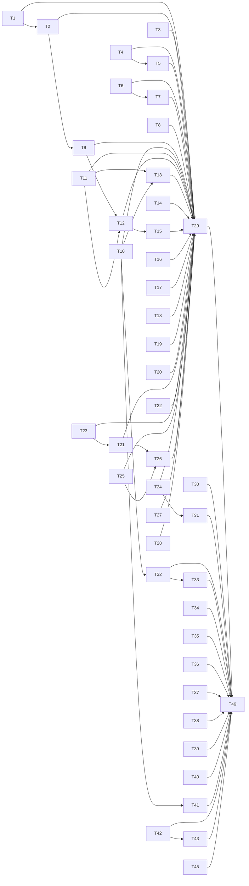

# QA round 27 fixes and a leaner suite: a default launch that survives compaction, a lease a script cannot walk out of, and a suite that stops waiting on itself

status: done (panel-reviewed 2026-10-22, closed 2026-10-22)
commit-mode: orchestrator-commits
language: ruby
panel: Ruby (Linus Torvalds, Jeremy Evans, Sandi Metz, Richard Schneeman, Aaron Patterson)

## Intent

2 asks from the user on 2026-10-22, in 1 plan:

1. Fix every finding in [`planning/qa-findings-round27-2026-10-21.md`](../qa-findings-round27-2026-10-21.md) rated
   MEDIUM or higher, plus the LOW to LOW-MED items whose fix sits in a file a MEDIUM card already opens. T1 to T29.
2. Make the suite faster, from a real profile of the suite rather than a read of it. T30 to T43, T45, T46.

The user ruled 4 questions while this plan was written (memory `qa-round-27-rulings.md`):

| finding | ruling |
|---|---|
| i27-3 / k27-1 | a child's ITERATION ceiling is its role's own (a researcher gets 60), whatever the parent ask has left; tokens stay attenuated from the parent's room |
| k27-2 | in `checkout` scope a write, or a command whose named path lands outside the project root, escalates like any gated call: the judge under `auto`, the human under `ask`, the rules under `bypass`. Reads are unchanged |
| bootsnap | `exe/lain` sets up bootsnap as a runtime dependency, cache under `$XDG_CACHE_HOME/lain/bootsnap` |
| g27-1 | under the dotenv name-hint rule only, a value that is all digits, a content digest or an absolute path is not masked; entropy and the named shapes still apply |

Round 27's defects cluster around 4 missing ideas:

| missing idea | findings | cards |
|---|---|---|
| a twin made for a Ractor holds values, never live collaborators | b27-4, a27-1 | T1, T2 |
| a lease refuses what it cannot check, including a program the run wrote | l27-4, k27-2 | T4, T24 |
| what the journal holds is what the human sees and what replay restores | d27-6, f27-1, a27-2, m27-3, m27-1 | T9, T11, T12, T13, T21, T22 |
| an epic stage reads the newest decision, not the first or any | h26-7, h27-4, h27-3, h27-1, h27-2 | T16 to T20 |

And the suite's time goes to 3 places the profile names (Spike findings): child Ruby boots (about 155
thread-seconds, beside 868 seconds of per-file runtime that partly overlaps them, because a worker waits while its
child boots), PTY prompts that wait 0.5s for a cursor report nobody sends, and fixed windows sized for a production
tick.

**What a saving means here.** Each suite card's estimate is serial time saved in its own file. The wall is the larger
of the slowest file and the total work over 12 workers, plus about 10s of startup, so a file-level saving moves the
wall by at most its share of total work divided by 12, unless the file is the slowest one
(`input_pane_socket_spec.rb` is, at 46s). 3 totals appear below and differ by source: 868s is the sum of the runtime
log's per-file times, 872s is RSpec's own example time from RSpecDissect, and `CLAUDE.md`'s 653s was the same runtime
log on 2026-10-02.

## Coverage

| finding | card | finding | card | finding | card |
|---|---|---|---|---|---|
| **b27-4 HIGH** | T1 | **l27-2 HIGH** | T3 | l27-4 MED-HIGH | T4 |
| a27-1 (re-arms b27-4) | T2 | `/btw` printed command | T2 | d27-5 | T5 |
| i27-1 | T6 | g27-3 | T6 | g27-1 (ruled) | T7 |
| g27-2 | T8 | d27-6 | T9 | b27-1 | T10 |
| f27-1 | T11, T12 | a27-2 | T13 | c27-2 | T14 |
| d27-1 | T15 | h26-7 | T16 | h27-4 | T17 |
| h27-2 | T18 | h27-3 | T19 | h27-1 | T20 |
| m27-3 | T21 | m27-1 | T22 | i27-3 / k27-1 (ruled) | T23 |
| k27-2 (ruled) | T24 | i27-5 | T25 | i27-2 | T26 |
| i27-6 | T27 | e27-1 | T28 | every scenario correction owed | T29 |
| fuzzy tick-floor flake | T30 | policy realpath-count flake | T31 | the suite profile | T30 to T43, T45, T46 |

**Left for round 28, with the reason:**

- **h27-5** (an in-flight issue that cannot land cannot be retired): a feature gap, a new `lain epic` verb with a
  state transition of its own. T16, T17 and T19 remove the 3 ways round 27 reached that state.
- **d27-2** (`read_file`'s `head -c` advice on a 1-line file), **d27-3**, **d27-4**, **d27-7**: LOW, in
  `tool/bounds.rb` and `round_budget.rb` code no card here opens for behaviour.
- **i27-4** (`rustc --version` through rustup's proxy reads `unresolved_exec`): LOW-MED, the tripwire's resolver, a
  subsystem no card opens.
- **l27-1, l27-3, l27-5, l27-6, l27-7**: LOW, bench reporting.
- **b27-2, b27-3, b27-5, f27-2 to f27-5, h27 nits, j27-1, j27-2, m27-2, e27-2**: LOW. e27-2 is the recorded
  `Shell::Named` gap the round 26 plan also left.
- **c27-2's nit** ("same result as call call_...") and the `ast_search` numbering nit: wording only.

## Preflight

1. **The main checkout holds no other session's `lib/` or `spec/` edits.** At planning time
   `git status --porcelain lib spec` was empty. Uncommitted: `planning/specs/algebra-and-flip.md` (113 lines, not this
   plan's, leave it alone), round 27's own documents (`planning/qa-findings-round27-2026-10-21.md`,
   `planning/qa/method.md`, `planning/qa/README.md`, `docs/toolchain-traps.md`) and untracked research notes. If
   `lib/` or `spec/` lists anything, ask the user before starting. Never stash or commit another session's edits.
2. **Round 27's documents.** T29 edits `planning/qa/scenarios/` and T46 edits `docs/toolchain-traps.md`, which holds
   an uncommitted round 27 entry. Ask the user to commit those documents first, or to say they stay uncommitted, in
   which case T29 and T46 run in the main checkout last.
3. **Base SHA.** Cut every worktree from `main` as it stands after step 2 and record it in the Execution log. Line
   numbers here were read at `b5de73a4`; an implementer re-reads each cited site before editing it.
4. **Worktree and branch names.** `tmp/worktrees/r27-T<id>`, branch `card/r27-T<id>`.
5. **The suite cards (T30 to T46) are timed.** Before T46 measures, `bin/box-state --guard` must pass and no other
   suite may run. Interleave before and after runs, per `docs/spec-suite-performance.md`.

## Grounding

2026-10-22, at `b5de73a4` (`git status --porcelain lib spec` empty).

6 Explore passes read the production path behind every finding and reported current line numbers. Every citation
they gave is copied into the card that uses it, so an executor needs nothing outside this file and the repo. Citations in the findings file that moved or were wrong:

- **d27-5** names `Policy#listed_judge`, which serves the `bwrap` mask. The filter path is
  `WithholdSecretPaths#reading` (`withhold_secret_paths.rb:346-351`, base at `:375-378`) into `Rows#classify`
  (`policy.rb:367`), `Policy#judge` (`:409-416`), `landed` (`:632-640`) and `Landing.of`, whose `File.realpath`
  rescues only `ENOENT`; the joined path raises `ENOTDIR` and reads as malformed.
- **i27-1** says the read side masks all 5 shapes. It does not mask `MYSQL_PWD=hunter2pass` (probed: `NAME_HINT`,
  `regions.rb:51`, has no `pwd`).
- **b27-1** names `lib/lain/cli/input_pane.rb`; the file is `lib/lain/frontend/input_pane.rb`.
- **i27-2**: a judge's spawn record carries no role (`tools/subagent/lineage.rb:71-75`), and `unattended: true` is
  shared by 5 roles, so the lineage reader cannot tell a judge apart today.
- **h27-4**: `Approvals.from` (`local_landing.rb:~318-326`) keeps only `approved == true` decisions, so a later deny
  of an approved digest is ignored too. That disagrees with `SignoffQueue#approved?`'s newest-verdict rule.
- **The factory profile** (`factory_spec.rb`, 17.6s CPU-bound): the research guessed `RedCommit#only?` re-ran
  `merge-base`; it is already memoised per landing (`red_commit.rb:29`). A spawn hook on `Process.spawn` (Spike
  findings) counted 3,582 git commands over 57 examples spread over about 40 call sites at about 1 per example each.
  There is no hot spot, so no card cuts it (Rejected options); the cost stays recorded as subject cost.

Probed rather than read:

- **b27-4**: `make_shareable` over a twin whose ceiling is `OutputCeiling::PerModel` walks into
  `WindowBook::Live`'s clock Proc (fork b's library check, re-read here). `PerModel#ceiling_for(model)` already returns
  the frozen `OutputCeiling` Data value, so no new class is needed.
- **Credential write shapes** (i27-1): all 6 return no match against `CredentialPatterns::WRITE` today.
  `Regions::PASSWORD_SHAPES` (`regions.rb:102-109`), scanned over the repo's `**/*.md`, `lib/` and `spec/`, matched
  only genuine secret fixtures. The whole `Regions.detect` matched 123 of 774 markdown files (120 by entropy), so T6
  moves the named shapes and never the entropy detector.
- **g27-1**: `token_count = 123456`, `session_id = blake3:abc` and `session_dir=/tmp/foo-bar` are each masked as
  `dotenv assignment` today.
- **Reline's cursor query** (T32): Reline 0.7.0 (`reline/io/ansi.rb:208`) writes `\e[6n` and waits up to 0.5s for
  a reply when input and output are both TTYs. A copy of `input_pane_socket_spec.rb` whose `drain` answers `\e[1;1R`
  passed all 19 examples and ran 30.0s against 43.0s (1 run each).
- **Bootsnap** (T42, T43): `require "lain"` costs 0.92s with no bootsnap, 0.44s warm, and **1.24s cold**. A spec
  child pointed at a fresh `XDG_CACHE_HOME` per example would get slower, so T43 hands children a shared cache.

Files read: every path a card names, plus `lib/lain/cli/backend/window_book.rb`, `lib/lain/channel.rb`,
`lib/lain/journal.rb`, `lib/lain/shell/named.rb`, `lib/lain/approval/composed_term.rb`, `lib/lain/landing.rb`,
`lib/lain/tools/subagent.rb`, `lib/lain/budget.rb`, `lib/lain/role/catalog.rb`, `lib/lain/isolation/worktree.rb`,
`lib/lain/isolation/worktree/handback/retirement.rb`, `lib/lain/isolation/self_sync.rb`,
`lib/lain/middleware/gate.rb`, `lib/lain/frontend/stdin_pump.rb`, `lib/lain/frontend/intake.rb`,
`lib/lain/cli/conductor.rb`, `lib/lain/cli/input_socket.rb`, `spec/support/wait_until.rb`,
`spec/support/warm_pool.rb`, `spec/support/child_boot.rb`, `spec/bootsnap_setup.rb`.

Docs that disagree with code, each fixed by the card named:

- `compaction/source.rb:20-27, 982-992` name only the `/model` slot as unshareable (T1).
- `withhold_secret_paths.rb:353-372` says a joined single-file row "can only be stricter" (T5).
- `session.rb:~11` and `spec/lain/tools/todo_write_spec.rb:~172` say a rewind can never resurrect a todo (T11).
- `gc.rb:14-17` says any local branch makes a commit safe elsewhere (T19).
- `tool_guard.rb:250-252` advises the arm to write a script and run it; `ARCHITECTURE.md:~576` documents the gap
  (T4, T29).
- `ARCHITECTURE.md:674` documents `checkout` as unconfined (T24, T29); `ARCHITECTURE.md:~1503` still names the
  removed `max_depth` keyword (T29).
- `docs/spec-suite-performance.md`'s section "Allocations and GC are a BOOT cost" says GC is under 2% of the wall. It is 5.5%
  of example time today (T46).

## Compatibility

| Surface | Verdict | Evidence |
|---|---|---|
| `Context` public methods (T1 adds `with_max_tokens`) | free to break | internal; `lain.gemspec` unpublished (`spec.metadata` has no push host), no consumer under `~/dev` outside this repo |
| session file records: `todo_snapshot` gains `head` (T11), a salvaged prompt turn (T9), `spawn` gains `role` (T26), `assistant_text` (T13) | must keep reading old files | sessions on disk under `$XDG_STATE_HOME/lain/sessions`; every new field is optional and every reader falls back on its absence (T11, T12, T26 criteria) |
| where a session file is filed (T15) | free to break, with a read fallback | memory `harness-vs-own-dev`: no back-compat owed; T15 still lists the cwd-keyed directory so existing sessions stay visible |
| `CredentialPatterns::WRITE` names (T6) | free to break | pinned only by `spec/lain/credential_patterns_spec.rb:36-42` |
| refusal wording (`LEASED_OPAQUE`, T4) | free to break | read by the model and by 2 specs; T4 keeps the substrings `leased to` and `paths cannot be read` that `bench/harness_spec.rb:~262-275` matches |
| `--max-tokens` on resume (T2) | behaviour change, ruled by precedent | compaction and arms already inherit a typed value on resume (`resume/mismatch_notices.rb`); T2 makes the ceiling do the same |
| `lain.gemspec` runtime dependencies (T42 adds bootsnap) | free to break | user ruling 2026-10-22 |
| `bin/suite-load` stop grace (T35) | free to break | a dev tool; its only consumer is `spec/lain/suite_load_spec.rb` |

No trade report: no must-keep surface blocks a simplification.

## Spike findings

| Question | Result | Evidence |
|---|---|---|
| Does test-prof profile the suite as it runs under `pspec`? | Yes, with 1 fix: test-prof names its dumps per mode only, so 12 workers overwrite 1 file. A `RUBYOPT` preload setting `TEST_PROF_REPORT` per worker gives 12 dumps | scratchpad `suite-prof-2026-10-22/worker-suffix.rb`, `profile.sh` |
| Where does setup time go? (RSpecDissect) | 30.3s of 872s, 3.5%. Fixture reuse cannot pay much; the cost is in example bodies | `dissect/run.log`, `dissect-sum.rb` |
| How much is `:seam`? (TagProf) | 2,664 seam examples (10%) take 380s; 23,800 others take 493s | `dissect/run.log` |
| What does in-process CPU do? (stackprof, cpu) | 259s sampled; GC 23% of it (marking 15%, sweeping 8%); then `Dir.glob` in the walk-off-the-reactor shared examples (6.5s), `ParsedSource` Ripper parses of `lib/` by 7 discipline specs (about 8s, once per worker that runs one), `Prism.parse` in `RepoAsFixture` and `TestLayout::Guard` | `stack-cpu/top.txt` |
| What waits? (stackprof, wall) | `IO::Event::Selector::URing#select` and `IO.select` 32%, `IO#readpartial`/`gets` 11%, `Kernel#sleep` 3.3% of main-thread samples | `stack-wall/top.txt` |
| How much is GC per file? (a `GC.stat` hook per example) | 48.4s of 872s example time, 5.5%, 282M objects, 202 major GCs. The top files are the Rust reentry specs, which call `GC.start` on purpose | `gc-sum.rb`, `gc/*.ndjson` |
| Does rbspy read Ruby 4.0.6? | Yes, rbspy 0.53.0 (installed with `cargo install rbspy`) | `rbspy-probe.txt` |
| What do the processes stackprof cannot see cost? (rbspy, 50 Hz, every thread of every Ruby process) | 1,380 thread-seconds. Child Ruby processes spend about 155 thread-seconds booting `lib/lain` (`loader.eager_load`, `lib/lain.rb:123`). Those overlap the parent worker's wait, so they are not a share of the 868s; they are what T42 and T43 can halve. Polls on `WaitUntil` sleep 67s | `rbspy/collapsed.txt`, `rbspy-sum.rb` |
| What does 1 boot cost, and does bootsnap help? | 0.92s cold, 0.44s with a warm bootsnap cache, 1.24s with a cold one; `exe/lain` sets up no bootsnap | `boot-summary.txt`, the 3-run timings above |
| Does answering Reline's cursor query keep `input_pane_socket_spec.rb` green? | Yes: 19 of 19, 43.0s to 30.0s | the Explore agent's scratchpad copy `probe/input_pane_socket_probe_spec.rb` |
| Where do `factory_spec.rb`'s 3,582 git commands come from? | About 40 call sites at about 1 per example each; the largest are `Leftover#clear`'s `worktree list` (52), `next_attempt`'s per-attempt `rev-parse` (56), `RedCommit` (164, already memoised per landing). No card: see Rejected options | `git_callers.rb` |
| A profiled run's own flake | Under `TEST_STACK_PROF_MODE=wall`, `Lain::CLI::InputSocket serving a pane sends nothing more while the header stays the same` failed once (1 run). The other 5 profiled runs were green at 26,464 examples | `stack-wall/run.log` |

The scratchpad is
`/home/tara/tmp/lain/claude-1000/-home-tara-dev-lain/cc02ae77-6a6c-45c5-98aa-27f473815ee4/scratchpad/suite-prof-2026-10-22/`.
No worktree was cut: every probe was read-only against the tree or ran in the scratchpad. T45 turns the lenses into
`bin/suite-profile` so the next profile does not depend on that directory.

## Shared files

Only the main session edits these. A card hands back a 1-line diff.

- `lain.gemspec`, `Gemfile`, `Gemfile.lock` (T42: bootsnap moves from the Gemfile's `:development, :test` group to a
  runtime dependency)
- `CLAUDE.md` (T24: the "A mode is scope x approval" paragraph; T46: the `pspec` wall and example count)
- `spec/spec_helper.rb`, `.rubocop.yml`
- `bin/runtime-census`'s ceilings (T46 lowers them after the speedups land)

## Rejected options

- **Make `OutputCeiling::PerModel` or `WindowBook::Live` shareable** (T1): the live book is mutable by design; the
  twin needs a value, and `PerModel#ceiling_for` already makes one.
- **Push a value object from `Telemetry::Escalation.write`** (T3): the record merges free-form keys and
  `Journal#record_hash` already accepts both shapes. One drain helper is smaller.
- **Run the whole `Regions.detect` on memory writes** (T6): 123 of 774 markdown files would be refused, 120 of them
  by entropy.
- **Treat every `./x.sh` or `ruby x.rb` inside the lease as opaque** (T4): refuses pre-existing project scripts
  (`bin/test`, `rake`). Freshness is the signal the tripwire already computes.
- **Lease a code reviewer from the orchestrator's dirty tree** (T18): racy while the orchestrator edits, and the gate
  and landing judge the committed tip, so the reviewer should too.
- **Put the outside-root write rule in `ConfineToScope`** (T24): it refuses before anyone is asked, and the ruling
  says escalate.
- **Count a child's iterations against a separate spawn pool** (T23): the user ruled the role's own ceiling.
- **`let_it_be` / `before_all`**: database-transaction tools, and RSpecDissect puts setup at 3.5%.
- **Tune the workers' GC with `RUBY_GC_HEAP_*`**: 48s of GC is spread over many files and the heaviest are specs that
  call `GC.start` on purpose; at most about 2s of wall.
- **Cache `ParsedSource` sexps on disk across workers**: about 8s of CPU at most, under 1s of wall, against a cache
  invalidation rule for every lib file.
- **Shrink the Rust GVL specs' corpora**: about 13s of serial work; the corpora are sized so a held GVL is visible.
- **Warm-pool the `tty_spec.rb` tmux children**: needs a tmux variant of `WarmPool`; T43's bootsnap halves those boots
  without one.
- **Rescale `pipeline_spec.rb`, `stall_protection_spec.rb`, `docker_spec.rb` and `human_replies_spec.rb`**: under
  1.5s each, and the docker ones risk a vacuous pass when the container has not started.
- **Cut the epic driver's repeated git reads (T44 in the draft)**: the spawn lens found no hot spot (about 40 sites at
  about 1 per example), the 2 candidate cuts came to about 100 of 3,582 spawns, and the `Leftover#clear` skip would
  have removed the pruned-worktree case `Leftover#drop` exists for. The file's cost stays recorded as subject cost.
- **Shard any spec file**: `CLAUDE.md` forbids it; the wall is a MAX.

## Open decisions

None. The 4 rulings above settled every question the code could not.

## Dependency graph



Cards with no incoming edge (T1, T3, T4, T6, T8, T10, T11, T14, T16 to T20, T22 to T25, T27, T28, T30, T34 to T40,
T42, T45) start at once. T29 waits on every fix card and T46 on every suite card, because each documents what landed.
There is no T44; the panel removed it (Rejected options).

**The chain T1, T2, T9, T12, T15 carries no data dependency.** Those cards change different code and share only
`spec/lain/cli/resume_spec.rb` (T1 and T2 share no file; T2 follows T1 so a resume's ceiling is tested against the fixed twin). The edges
serialise that spec file. An implementer must not read a design dependency into them, and a red T1 does not block
T2's design, only its merge order. T11 to T13 share `spec/lain/telemetry_spec.rb` in the same way.

## Tasks

### T1: flatten the output ceiling into the compaction twin          [risk: high]

**Depends on:** none
**Files:** `lib/lain/context.rb`, `lib/lain/compaction/source.rb`, `spec/lain/compaction/source_spec.rb`,
`spec/lain/context_spec.rb`, `spec/lain/cli/backend_spec.rb`
**Reuse:** `Context#copy(**changes)` (`context.rb:185-189`), `OutputCeiling::PerModel#ceiling_for` (`output_ceiling.rb:93-103`), the "compacts a base Context carrying the live model slot, without raising" example (`source_spec.rb:~1522-1540`)
**Shared-file wiring:** none
**Reachable from:** `exe/lain chat` -> `ChatLaunch#backend` -> `Backend#context` (`backend.rb:~398`, `max_tokens` at `:830`) and `Backend#compaction_source` (`:~855`) -> `Compaction::Source#commit` (`source.rb:959`) -> `BASE_PROVIDER` (`:1043`)

**Acceptance criteria**

```gherkin
Scenario: a default launch commits a compaction cut
  Given a Context built by CLI::Backend with no --max-tokens, whose ceiling is a per-model one over a live window book
  When compaction commits a cut and holds it
  Then no Ractor::IsolationError is raised and the cut is committed

Scenario: the twin carries the ceiling the live Context would send
  Given a live Context whose per-model ceiling resolves to N for the model in force
  When Source makes the twin it hands to a Ractor
  Then the twin's output_ceiling is the frozen value N and Ractor.shareable? is true of it
  And the live Context still carries the per-model slot, so /model still moves its ceiling
```
Spec file: `spec/lain/cli/backend_spec.rb` (the first, through `Backend#context` and `Backend#compaction_source` with no double between them; beside the ceiling-source examples at `:1068-1155`), `spec/lain/compaction/source_spec.rb` (the second, a unit case with no double for the twin), `spec/lain/context_spec.rb`

`output_ceiling` resolves the live window once per turn, and `Source#decide` (`source.rb:785`) already resolves it on the same path, so the twin adds no probe. That is why the twin takes the real value and not a placeholder such as `OutputCeiling.fixed(0)`.

**Interface**

```ruby
class Context
  def with_max_tokens(ceiling) # => Context, same everything but the ceiling slot
end
# Source#flattened_twin(base) = base.with_model(base.model).with_max_tokens(base.output_ceiling)
```

**Stop and report if:**
- `base.output_ceiling` probes the provider on a path `Source#decide` (`source.rb:785`) does not already resolve.
- Any other collaborator in the twin fails `Ractor.shareable?` once the ceiling is a value.

### T2: a resume keeps the ceiling it was launched with, and says when it changes          [risk: medium]

**Depends on:** T1
**Files:** `lib/lain/cli/resume/mismatch_notices.rb`, `lib/lain/cli/chat_launch.rb`, `spec/lain/cli/resume/mismatch_notices_spec.rb`, `spec/lain/cli/resume_spec.rb`, `spec/lain/cli/command/btw_spec.rb`
**Reuse:** the header's `max_tokens` and `max_tokens_source` (`session_record.rb:75-82`), `MismatchNotices#continuing`, the compaction-profile inheritance on resume
**Shared-file wiring:** none
**Reachable from:** `exe/lain chat --resume`/`--fork` -> `ChatLaunch` -> `Resume#resume_at`/`fork_at` (`chat_launch.rb:388-400`) -> `Backend.new(@options, ...)`

**Acceptance criteria**

```gherkin
Scenario: an untyped resume inherits a typed ceiling
  Given a session launched with --max-tokens 4096
  When it is resumed with no --max-tokens
  Then the resumed chat sends max_tokens 4096 and its header records source typed

Scenario: a different typed value is loud
  Given a session launched with --max-tokens 4096
  When it is resumed with --max-tokens 8192
  Then the resume prints a "continuing with" notice naming 4096 and 8192, and sends 8192

Scenario: a /btw child keeps the parent's typed ceiling
  Given a parent chat launched with --max-tokens 4096
  When /btw forks it with the printed or popup command
  Then the child, launched through --fork, sends max_tokens 4096
```
Spec file: `spec/lain/cli/resume/mismatch_notices_spec.rb`, `spec/lain/cli/resume_spec.rb`, `spec/lain/cli/command/btw_spec.rb`

**Stop and report if:**
- A recorded `:command_default` or `:served_window` ceiling would also be inherited; only `typed` is.
- `btw_spec.rb`'s exact argv assertion has to change (the fork door should carry the ceiling without a new flag).

### T3: arm drains accept a journaled Hash beside a record          [risk: medium]

**Depends on:** none
**Files:** `lib/lain/arm/instrument.rb`, `lib/lain/arm/orchestrator_worker.rb`, `lib/lain/arm/plan_only.rb`, `spec/lain/arm/instrument_spec.rb`, `spec/lain/bench/harness/confinement_spec.rb`
**Reuse:** `Journal#record_hash`'s duck (`journal.rb:178-188, 301-309`), `Channel#drain` (`channel.rb:35-38`)
**Shared-file wiring:** none
**Reachable from:** `lain bench arms --confine reader` -> `Bench::CLI` (`bench/cli.rb:~541`) -> `Harness::Confinement#ladder_for` (`confinement.rb:~140`) -> `Approval::Escalation.bypass(journal: <arm channel>)` -> `Telemetry::Escalation.write` -> `Arm::Instrument#price`

**Acceptance criteria**

```gherkin
Scenario: a reader arm prices a gated call
  Given a reader-confined arm whose guard stack escalates 1 bash call onto a real Lain::Channel
  When the arm is priced
  Then pricing succeeds and the escalation record is in the priced records

Scenario: every drain takes both shapes
  Given a channel holding a Telemetry::TurnUsage and an escalation Hash
  When Instrument, OrchestratorWorker and PlanOnly drain it
  Then each yields both as journal hashes, in order
```
Spec file: `spec/lain/arm/instrument_spec.rb`, `spec/lain/bench/harness/confinement_spec.rb` (with a real `Lain::Channel`, not `RecordingChannel`)

**Interface**

```ruby
# Arm::Instrument is a Data.define; the drain helper is a class method its 3 drain sites share
Arm::Instrument.records(channel) # => Array<Hash>: a record's to_journal, or the Hash itself
```

`price(journal)` uses it, so its 4 callers (`single_thread.rb:58`, `one_shot.rb:74`, `adaptive_router.rb:115`,
`dual_ledger.rb:99`) are unchanged and stay off the Files list.

**Stop and report if:**
- A drain consumer reads a record's class rather than its hash, so a Hash cannot stand in.

### T4: a leased run refuses a program the run itself wrote, and stops advising one          [risk: high]

**Depends on:** none
**Files:** `lib/lain/cli/tool_guard.rb`, `lib/lain/bench/harness.rb`, `lib/lain/bench/harness/confinement.rb`, `spec/lain/cli/tool_guard_spec.rb`, `spec/lain/bench/harness_spec.rb`
**Reuse:** `Shell::Executable::Resolver` and `Shell::Executable::Fresh` (`fresh.rb:44-49, 143-146`), `LeasedPolicy#refusal` (`tool_guard.rb:276`)
**Shared-file wiring:** none
**Reachable from:** `lain bench arms` -> `Harness::Confinement#instrumentation` (`confinement.rb:92`) -> `ToolGuard.detached(..., resolver:)` (`tool_guard.rb:~465-480`) -> `Inputs` (`tool_guard.rb:67`, a new `resolver` member) -> `Detached#call(worker_env)` -> `ToolGuard.leased` (`:377`) -> `LeasedPolicy.new(..., resolver:)`; the chat worker path reaches the same `leased`

**The freshness signal, decided at planning.** The bench's resolver today is `Fresh.for_lineage([])`, whose start is
the moment `Confinement` is built. A lease is a worktree cut after that, so every file it checks out has a later
ctime and would read fresh (the panel's finding). The lease's own `Fresh` therefore starts when its checkout
finishes: `Detached#call` builds it per worker from `worker_env` after the checkout exists. A file whose ctime is
after that start was written during the run. `ComposedTerm#trusted?` is a different rule (it trusts `:system` and
`:user`) and is not reused.

**Acceptance criteria**

```gherkin
Scenario: the opaque refusal no longer advises a script
  Given a leased unattended run
  When it sends `cd /out && for f in $(find .); do touch "$f"; done`
  Then the refusal still says "leased to" and "paths cannot be read" and says nothing about writing a script

Scenario: a script written this run is refused
  Given a leased unattended run that wrote <lease>/add_loop.sh in this lineage
  When it sends `bash add_loop.sh`
  Then the call is refused as a program written during this run, and nothing outside the lease changes

Scenario: a project script that predates the run still runs
  Given <lease>/bin/check.sh committed before the run began, in a real worktree cut for the lease
  When the run sends `bash bin/check.sh` and `bundle exec rspec`
  Then both calls are approved as before
```
Spec file: `spec/lain/cli/tool_guard_spec.rb` (`describe "LeasedPolicy"`), `spec/lain/bench/harness_spec.rb` (end to end through `Bench` with the real resolver, under both confinements)

**Interface**

```ruby
LeasedPolicy.new(sensitivity:, lease:, allow:, home:, resolver: Shell::Executable::Resolver::NULL)
# resolver: optional so the direct constructions in tool_guard_spec stay valid; ToolGuard.leased passes a real one
LEASED_FRESH # a refusal naming the program or script and that it was written during this run
```

**Stop and report if:**
- A file the checkout itself wrote still reads fresh after the per-lease start; the "approves a plain command inside the lease" example and the real-worktree scenario must stay green.
- `Resolver::NULL` is the only resolver available on the non-confined bench path and a real one cannot be built there.

### T5: a single-file grep classifies the file it searched          [risk: high]

**Depends on:** T4
**Files:** `lib/lain/middleware/withhold_secret_paths.rb`, `spec/lain/middleware/withhold_secret_paths_spec.rb`, `spec/lain/cli/tool_guard_spec.rb`
**Reuse:** `gated_file_search?`'s `File.file?(target)` (`withhold_secret_paths.rb:236-244`), `reading` (`:346-351`)
**Shared-file wiring:** none
**Reachable from:** `CLI::ToolGuard.layered` (`tool_guard.rb:412`) -> `WithholdSecretPaths.new(filter: inputs.sensitivity.filter)`

**Acceptance criteria**

```gherkin
Scenario: a relative single-file grep shows its rows
  Given gdir/g.txt holds "alpha line" and "beta line"
  When grep searches gdir/g.txt for "beta"
  Then the result is "gdir/g.txt:2:beta line", not "1 match withheld (malformed)"

Scenario: masking still reaches a single-file row
  Given config/settings.yml holds a token line
  When grep searches config/settings.yml for "token"
  Then the row reads "config/settings.yml:2:  token: <redacted:1>"

Scenario: a symlink to a gated file is still withheld
  Given notes.txt is a symlink to .env
  When grep searches notes.txt
  Then every row is withheld as the gated file's
```
Spec file: `spec/lain/middleware/withhold_secret_paths_spec.rb`, `spec/lain/cli/tool_guard_spec.rb` (flip "withholds a relative single-file grep's row before masking sees it", `:240-247`)

**Stop and report if:**
- An exempted exact path's grep starts showing rows `read_file` refuses; the comment at `:353-372` names that case.

### T6: the memory write guard refuses the named credential shapes the read side masks          [risk: high]

**Depends on:** none
**Files:** `lib/lain/credential_patterns.rb`, `lib/lain/sensitivity/regions.rb`, `spec/lain/credential_patterns_spec.rb`, `spec/lain/middleware/refuse_secret_writes_spec.rb`, `spec/lain/frontend/intake/discretion_spec.rb`, `spec/lain/sensitivity/regions_spec.rb`
**Reuse:** `Regions::PASSWORD_SHAPES` (`regions.rb:102-109`), `CredentialPatterns.for(:write)`, the 100 KB linear-time guard (`credential_patterns_spec.rb:162`)
**Shared-file wiring:** none
**Reachable from:** `ToolGuard.layered` (`tool_guard.rb:410`) -> `RefuseSecretWrites.new` (`PATTERNS = CredentialPatterns.for(:write)`, `refuse_secret_writes.rb:38`); `Wiring#history_for` (`wiring.rb:442`) -> `Frontend::Intake::Discretion`

**Acceptance criteria**

```gherkin
Scenario: memory_write refuses a credential ({"password": "hunter2pass"})
  When memory_write stores "{"password": "hunter2pass"}"
  Then the write is refused naming the shape, and nothing reaches the store or memory_loaded

Scenario: memory_write refuses a credential (PGPASSWORD=hunter2pass)
  When memory_write stores "PGPASSWORD=hunter2pass"
  Then the write is refused naming the shape, and nothing reaches the store or memory_loaded

Scenario: memory_write refuses a credential (MYSQL_PWD=hunter2pass)
  When memory_write stores "MYSQL_PWD=hunter2pass"
  Then the write is refused naming the shape, and nothing reaches the store or memory_loaded

Scenario: memory_write refuses a credential (postgres://app:hunter2pw@db/main)
  When memory_write stores "postgres://app:hunter2pw@db/main"
  Then the write is refused naming the shape, and nothing reaches the store or memory_loaded

Scenario: memory_write refuses a credential (Authorization: Bearer abcdefgh12345678)
  When memory_write stores "Authorization: Bearer abcdefgh12345678"
  Then the write is refused naming the shape, and nothing reaches the store or memory_loaded

Scenario: memory_write refuses a credential (a GitHub token)
  When memory_write stores a ghp_ token with 36 characters after the prefix
  Then the write is refused naming the shape, and nothing reaches the store or memory_loaded

Scenario: ordinary text is still stored (access_token = request.headers['X'])
  When memory_write stores "access_token = request.headers['X']"
  Then the write succeeds

Scenario: ordinary text is still stored (id_token: nil)
  When memory_write stores "id_token: nil"
  Then the write succeeds

Scenario: ordinary text is still stored (db_password: is stored in vault)
  When memory_write stores "db_password: is stored in vault"
  Then the write succeeds

Scenario: ordinary text is still stored (PGPASSWORD=$DB_PASSWORD)
  When memory_write stores "PGPASSWORD=$DB_PASSWORD"
  Then the write succeeds

Scenario: the read side masks MYSQL_PWD
  When a tool result holds "MYSQL_PWD=hunter2pass"
  Then the value is masked

Scenario: a GitHub token typed at you> stays out of history
  When the human types a bare ghp_ token of 36 characters at you>
  Then the history file holds no copy of it
```
Spec file: `spec/lain/middleware/refuse_secret_writes_spec.rb` (through `ToolGuard.layered`), `spec/lain/credential_patterns_spec.rb` (update the 4-name pin at `:36-42` and "a widened shape does not reach the write side" at `:226-241`), `spec/lain/frontend/intake/discretion_spec.rb`, `spec/lain/sensitivity/regions_spec.rb`

**Shapes.** Moving `PASSWORD_SHAPES` covers the quoted key, the URL, the bearer header and the GitHub token. It does
not cover `PGPASSWORD=` or `MYSQL_PWD=` (the panel's probe, `scratchpad/r27rev_t6.rb`): `ASSIGNED_NAME`'s lookbehind
rejects a word that is not a segment start, and `pwd` is in no vocabulary. The card adds 1 write row for an
environment assignment whose upper-case name ENDS in `PASSWORD`, `PASSWD` or `PWD`, with `=` and a bare literal
value (the `BARE_LITERAL` test from round 26's T50), and adds `pwd` to `NAME_HINT` so the read side masks
`MYSQL_PWD=hunter2pass` too. Every new regex passes the 100 KB linear-time guard (`credential_patterns_spec.rb:162`).

**Stop and report if:**
- Moving `PASSWORD_SHAPES` changes what `Regions#issuer_fixed?` (`regions.rb:330`) masks on the read side beyond the GitHub row.
- A new pattern fails the linear-time guard.

### T7: the dotenv name hint stops masking digits, digests and paths          [risk: medium]

**Depends on:** T6
**Files:** `lib/lain/sensitivity/regions.rb`, `spec/lain/sensitivity/regions_spec.rb`
**Reuse:** `qualifies?` (`regions.rb:296-299`), `substantial?` (`:301-306`), `secret_shaped?` (`:318-322`)
**Shared-file wiring:** none
**Reachable from:** `ToolGuard.layered` -> `Middleware::RedactSecretReads` -> `Sensitivity::Regions.detect`

**Acceptance criteria**

```gherkin
Scenario: an ordinary value under a hinted name is shown (token_count = 123456)
  When a result holds "token_count = 123456"
  Then it is delivered unmasked

Scenario: an ordinary value under a hinted name is shown (session_id = blake3:9f2c4a0e1b7d3f5a6c8e0b2d4f6a8c0e1b3d5f7a9c1e3b5d7f9a1c3e5b7d9f1a3)
  When a result holds "session_id = blake3:9f2c4a0e1b7d3f5a6c8e0b2d4f6a8c0e1b3d5f7a9c1e3b5d7f9a1c3e5b7d9f1a3"
  Then it is delivered unmasked

Scenario: an ordinary value under a hinted name is shown (session_dir=/tmp/foo-bar)
  When a result holds "session_dir=/tmp/foo-bar"
  Then it is delivered unmasked

Scenario: a secret under a hinted name is still masked
  When a result holds "DATABASE_PASSWORD=hunter2" or "SESSION_SECRET=Zq8x!pR2vL"
  Then the value is masked
```
Spec file: `spec/lain/sensitivity/regions_spec.rb`

**Stop and report if:**
- A digest or path value is also matched by `issuer_fixed?` or entropy; those keep masking by the ruling.

### T8: the round budget never dedups masked results          [risk: low]

**Depends on:** none
**Files:** `lib/lain/tool/round_budget.rb`, `spec/lain/tool/round_budget_spec.rb`
**Reuse:** `Regions.placeholders` or `PLACEHOLDER_SHAPE`
**Shared-file wiring:** none
**Reachable from:** `CLI::Arms` (`arms.rb:88-90`) -> `Agent.new(round_budget:)` (`agent.rb:596`) -> `RoundBudget::Pass#answer` (`round_budget.rb:139-146`)

**Acceptance criteria**

```gherkin
Scenario: 2 different secret outputs both deliver
  Given 2 tool results in 1 round whose masked contents are byte-identical ("<redacted:1>")
  When the round budget answers them
  Then neither is "same result as call ..."

Scenario: identical unmasked results still dedup
  Given 2 identical results with no placeholder
  Then the second names the first, as the "answers a later result with identical bytes" example pins
```
Spec file: `spec/lain/tool/round_budget_spec.rb`

**Stop and report if:**
- `block["content"]` reaches `answer` as a non-String the placeholder test cannot read.

### T9: resume salvage rebuilds the prompt it lost          [risk: high]

**Depends on:** T2
**Files:** `lib/lain/session_record/salvage.rb`, `lib/lain/cli/resume/salvager.rb`, `lib/lain/request.rb`, `spec/lain/session_record/salvage_spec.rb`, `spec/lain/cli/resume_spec.rb`
**Reuse:** `request_sent`'s `payload.messages` (`telemetry/request_sent.rb`), `Request#strip_cache_markers` (`request.rb:~225`), `Workspace::WORKSPACE_MARKER`
**Shared-file wiring:** none
**Reachable from:** `exe/lain chat --resume` -> `ChatLaunch` -> `Resume#rebuild` (`resume.rb:204`) -> `#salvage` (`:279-286`) -> `Salvage#recover` (`salvage.rb:210`) -> `Salvager#closing_records` (`salvager.rb:60-68`)

**Acceptance criteria**

```gherkin
Scenario: a prompt killed mid-stream comes back with its answer
  Given a session killed by SIGKILL after request_sent for the prompt "say iota" and before its turn record
  When the session is resumed
  Then the timeline holds a user turn "say iota" followed by the recovered answer
  And the user turn's digest equals the digest the uninterrupted run gives it

Scenario: a tool continuation is unchanged
  Given a session killed after a tool continuation's request_sent
  When it is resumed
  Then no user turn is rebuilt and the recovered digest equals the original's

Scenario: an old file with an empty payload salvages as before
  Given a request_sent whose payload is {}
  Then salvage commits only the assistant turn
```
Spec file: `spec/lain/session_record/salvage_spec.rb`, `spec/lain/cli/resume_spec.rb` (through `ChatLaunch` and a real crashed file; its `in_flight_request` fixture at `:384` carries a String content and must take the rebuild)

**Stop and report if:**
- The rebuilt user turn's digest cannot equal the original because the in-memory prompt differs from the payload tail beyond the 2 markers.
- `spec/lain/seams/crash_mid_tool_spec.rb` or `stranded_prompt_fold_spec.rb` goes red.

### T10: a line already accepted is not a typed line          [risk: medium]

**Depends on:** none
**Files:** `lib/lain/frontend/line_editor.rb`, `spec/lain/frontend/line_editor_spec.rb`, `spec/lain/frontend/stdin_pump_spec.rb`, `spec/lain/frontend/intake_spec.rb`, `spec/lain/frontend/input_pane_spec.rb`, `spec/lain/frontend/tty_spec.rb`, `spec/lain/cli/conductor_spec.rb`
**Reuse:** Reline's `line_editor.finished?` (reline 0.7.0 `line_editor.rb:1264`), the "#read on a real terminal" PTY describe (`line_editor_spec.rb:1267`)
**Shared-file wiring:** none
**Reachable from:** `StdinPump#typed?` (`stdin_pump.rb:180`), `InputPane#typing?` (`input_pane.rb:166-168`) and `TTY` (`tty.rb:1061`) all read `LineEditor.typed?`; `Intake#interrupt` (`intake.rb:255-262`) and `Conductor#deliver_idle` (`conductor.rb:499`) act on it

**Acceptance criteria**

```gherkin
Scenario: Enter then an immediate Ctrl-C keeps the line
  Given a real terminal at you>
  When "hello" then Enter then Ctrl-C arrive in 1 write
  Then "hello" is committed as the prompt and nothing is withdrawn

Scenario: Ctrl-C over an unsent draft still discards it
  Given "hel" typed at you> and no Enter
  When Ctrl-C arrives
  Then the draft is discarded and the chat lives, as round 26 ruled
```
Spec file: `spec/lain/frontend/line_editor_spec.rb` (the PTY describe), `spec/lain/frontend/input_pane_spec.rb`

**Stop and report if:**
- A multi-line continuation or vi command mode makes `finished?` true before the human submits.
- With the `finished?` guard removed (a local mutant), the PTY example does not go red. Then it does not test the race.

### T11: the todo list follows the chain on /rewind          [risk: high]

**Depends on:** none
**Files:** `lib/lain/telemetry/todo_snapshot.rb`, `lib/lain/session.rb`, `spec/lain/session_spec.rb`, `spec/lain/telemetry_spec.rb`, `spec/lain/tools/todo_write_spec.rb`
**Reuse:** `Session#record_read(head: @reads.head)` as the head-tagged precedent, `ReadSet::Chain#include?` (`session.rb:~888`)
**Shared-file wiring:** none
**Reachable from:** `/rewind` (`command/rewind.rb:63`) -> `Agent#rewind` (`agent.rb:451-461`) -> `Session#rewound_to` (`session.rb:202-206`)

**Acceptance criteria**

```gherkin
Scenario: a rewind past a todo_write drops that list
  Given a session that wrote a todo naming TULIP, then rewound to before that write
  When the next request is rendered
  Then its <workspace> holds no TULIP todo

Scenario: a todo written on the kept chain survives
  Given todos written at turn 3 and a rewind to turn 5
  Then the turn 3 list is the list in force

Scenario: a snapshot records its head
  When write_todos runs
  Then the todo_snapshot record carries the head it was written at
```
Spec file: `spec/lain/session_spec.rb` (through `Agent#rewind`)

**Stop and report if:**
- `plan_step_completions` (`session.rb:~461`) re-fires a plan step after a rewind restores an older list.

### T12: replay and the fork door restore the todos of their own chain          [risk: high]

**Depends on:** T9, T11
**Files:** `lib/lain/session_record/replay.rb`, `lib/lain/cli/resume.rb`, `spec/lain/session_record/replay_spec.rb`, `spec/lain/cli/resume_spec.rb`
**Reuse:** `Replay#restore_todos` (`replay.rb:148`), `forked_replay` (`resume.rb:257-259`), `Bench::Session::MemoryReplay`'s file-order fallback
**Shared-file wiring:** none
**Reachable from:** `exe/lain chat --resume`/`--fork` -> `Resume#replay`/`forked_replay` -> `Replay#restore_todos`

**Acceptance criteria**

```gherkin
Scenario: a resume after a rewind restores the kept list
  Given a session file with todos IRIS, then TULIP, then a rewind past TULIP
  When the session is resumed
  Then the restored list names IRIS and not TULIP

Scenario: a fork restores its own chain's list
  Given a /btw fork kept after TULIP was rewound
  When the fork is resumed
  Then its list names IRIS only

Scenario: an old file with headless snapshots resumes
  Given todo_snapshot records with no head
  Then the restored list is the list file order places on the chain
```
Spec file: `spec/lain/cli/resume_spec.rb` (through `ChatLaunch`), `spec/lain/session_record/replay_spec.rb`

**Stop and report if:**
- `Replay` cannot see the Timeline at `restore_todos` without a change to `Replay.new`'s callers outside `resume.rb`.

### T13: text written beside a tool call reaches the screen          [risk: medium]

**Depends on:** T10, T11
**Files:** `lib/lain/telemetry/assistant_text.rb` (new), `lib/lain/frontend/decorators/assistant_text.rb` (new), `lib/lain/frontend/decorators.rb`, `lib/lain/agent.rb`, `lib/lain/agent/tool_delivery.rb`, `spec/lain/agent_spec.rb`, `spec/lain/frontend/decorators_spec.rb`, `spec/lain/frontend/tty_spec.rb`, `spec/lain/telemetry_spec.rb`
**Reuse:** `Telemetry::FilesWritten`, built in `agent/tool_delivery.rb:104` with `role: @display_as`, and its decorator `frontend/decorators/files_written.rb`, dispatched at `decorators.rb:37`; the Agent's `display:` channel (`agent.rb:221`, wired at `cli/wiring.rb:622`)
**Shared-file wiring:** none
**Reachable from:** `Wiring` builds the main `Agent` with `display: @channel` -> the TTY's `Decorators.for(event)`

**Acceptance criteria**

```gherkin
Scenario: a turn with text and a tool call draws its text
  Given the model answers "Here are the paragraphs: ..." with a write_file call
  When the turn is committed
  Then the chat shows the text above the tool output, painted as a response

Scenario: the final text-only reply is drawn once
  Given the next turn is text only
  Then it is drawn by render_response and not also as an assistant_text event

Scenario: a child's text stays in its own record
  Given a spawned child writes text beside a tool call
  Then the parent's chat pane draws nothing for it
```

A child's display is the parent's channel through `CLI::JournalTee` (`tools/subagent.rb:1721`, `display_as: @name`),
so the emitter, not the wiring, decides: only an Agent whose `display_as` is `"lain"` emits. The third scenario
runs through a real `Tools::Subagent` spawn.
Spec file: `spec/lain/agent_spec.rb`, `spec/lain/frontend/tty_spec.rb` (through `Wiring`'s channel)

**Interface**

```ruby
Lain::Telemetry::AssistantText = Data.define(:text) # Ractor.shareable? true; to_journal type "assistant_text"
```

**Stop and report if:**
- The text arrives on the channel after the tool output it precedes.
- `spec/value_object_shareability_spec.rb` or `spec/journalable_surface_spec.rb` needs an entry the card cannot add without a shared file.

### T14: a summary never claims a prompt whose answer it leaves          [risk: medium]

**Depends on:** none
**Files:** `lib/lain/compaction/strategy/summarize_conversation.rb`, `spec/lain/compaction/strategy/summarize_conversation_spec.rb`
**Reuse:** `unanswered_prompt_kept` (`:69-75`), `Oracle::Handoff.human?` (`oracle/handoff.rb:217-219`), `ToolMessages.conversational_runs` (`tool_messages.rb:50-54`)
**Shared-file wiring:** none
**Reachable from:** `Backend#compaction_source` -> the `summarize-conversation` strategy -> `#propose_claims` (`:56-59`)

**Acceptance criteria**

```gherkin
Scenario: a span ending in a tool result keeps the prompt before its answer
  Given messages [u1, a1, u2 prompt, a2 tool_use, u3 tool_result] in the span
  When the strategy proposes claims
  Then no claimed run ends on u2, and u2 is never shown to the oracle

Scenario: a run left with 1 message is not claimed
  Given the trim leaves a run of 1 message
  Then that run is dropped
```
Spec file: `spec/lain/compaction/strategy/summarize_conversation_spec.rb`

**Stop and report if:**
- A recorded oracle memo in a spec fixture keys on the old span and the change re-asks it on resume.

### T15: a session is filed under its project root          [risk: medium]

**Depends on:** T12
**Files:** `lib/lain/cli/chronicle.rb`, `lib/lain/cli/chat_launch.rb`, `lib/lain/cli/resume.rb`, `lib/lain/cli/sessions.rb`, `lib/lain/cli/watch.rb`, `spec/lain/cli/chronicle_spec.rb`, `spec/lain/cli/sessions_spec.rb`, `spec/lain/cli/resume_spec.rb`, `spec/lain/cli/chat_launch_spec.rb`
**Reuse:** `Paths#sessions_dir(project:)` and `#project_hash(dir)` (`paths.rb:258, 282`), `ChatLaunch`'s memoised `project`
**Shared-file wiring:** none
**Reachable from:** `exe/lain chat --root P` -> `ChatLaunch#call` -> the chronicle factory (`chat_launch.rb:195`) -> `Chronicle.for(..., root:)`

**Acceptance criteria**

```gherkin
Scenario: --root from elsewhere files the session under the root
  Given a chat launched from directory A with --root P
  When it ends
  Then `lain sessions` run in P lists it, and `lain chat --resume` in P finds it

Scenario: a session filed under the old cwd key stays visible
  Given a session filed under hash(P/sub) by an earlier version
  When `lain sessions` runs in P/sub
  Then it is listed
```
Spec file: `spec/lain/cli/chat_launch_spec.rb` (through `ChatLaunch` with a real `--root`), `spec/lain/cli/sessions_spec.rb`

**Stop and report if:**
- `lain watch` or an epic reader keys on cwd for a reason its own spec pins.

### T16: a retry fast-forwards a reused issue branch that has landed          [risk: high]

**Depends on:** none
**Files:** `lib/lain/isolation/working_branch.rb`, `lib/lain/cli/epic_driver/issue_actor.rb`, `spec/lain/isolation/working_branch_spec.rb`, `spec/lain/cli/epic_driver/issue_actor_spec.rb`
**Reuse:** `WorkingBranch#transacted` (`working_branch.rb:347`), `WorkingBranch.holders`, `Checkout#ancestor?`
**Shared-file wiring:** none
**Reachable from:** `/implement-epic` -> `Factory#run` (`factory.rb:511`) -> `IssueActor#cut` (`issue_actor.rb:389-396`) -> `WorkingBranch.owned(..., forward: true)`

**Acceptance criteria**

```gherkin
Scenario: a landed issue branch moves to the epic tip on retry
  Given lain/issue/demo/shout at c26e4ee, an ancestor of epic/demo at fdabdbe
  When the issue is retried
  Then the branch and its owned marker both stand at fdabdbe, and the brief says it was cut from the tip

Scenario: a branch with unlanded work is reused where it stands
  Given the issue branch holds a commit epic/demo does not
  Then it is reused unmoved, as today

Scenario: a branch a worktree holds is not moved
  Given a live worktree has the branch checked out
  Then the branch is reused unmoved
```
Spec file: `spec/lain/cli/epic_driver/issue_actor_spec.rb` (through `IssueActor#cut` on a real repo), `spec/lain/isolation/working_branch_spec.rb` ("reuses a branch lain owns where it stands" at `:229` stays green with `forward:` off)

**Interface**

```ruby
WorkingBranch.owned(name, repo_root:, from:, forward: false)
```

**Stop and report if:**
- gc's `Branches#hold` (`gc.rb:445`) reads the moved branch as landed because the marker did not move in the same transaction.

### T17: `land` offers only the newest attempt's commits, never a denied one          [risk: medium]

**Depends on:** none
**Files:** `lib/lain/forge/local_landing.rb`, `spec/lain/forge/local_landing_spec.rb`, `spec/lain/cli/epic_land_spec.rb`
**Reuse:** `Approvals.from` (`local_landing.rb:~318-326`), `anchored_for?` (`:~258-268`), `SignoffQueue#approved?`'s newest-verdict rule
**Shared-file wiring:** none
**Reachable from:** `lain epic land` -> `CLI::EpicLand` (`epic_land.rb:150`, approvals at `:166`) -> `LocalLanding#approved_commit` (`:182-190`) -> `#missing_approval` (`:232-237`); the driver builds the same at `factory.rb:~207-224`

**Acceptance criteria**

```gherkin
Scenario: a denied attempt-1 commit is not offered
  Given attempt 1's commit was denied and attempt 2 anchored only its red commit
  When `lain epic land shout demo` runs
  Then the refusal says to re-run the issue and names no sha

Scenario: a later deny withdraws an approval
  Given a digest approved, then denied
  Then Approvals does not count it approved
```
Spec file: `spec/lain/forge/local_landing_spec.rb`, `spec/lain/cli/epic_land_spec.rb` (through `CLI::EpicLand`)

**Stop and report if:**
- An anchor name truncated at `SLUG_LIMIT` loses its attempt number; fall back to every anchor and say so in the report.

### T18: a code reviewer is spawned only over committed work          [risk: medium]

**Depends on:** none
**Files:** `lib/lain/cli/wiring/toolset_build.rb`, `lib/lain/prompt/templates/role/issue_orchestrator.md`, `lib/lain/prompt/templates/skill/execute-plan/skill.md`, `spec/lain/cli/wiring/toolset_build_spec.rb`
**Reuse:** `REVIEWER = :reviewer_code` (`toolset_build.rb:49`), `Isolation::Checkout#dirty?`
**Shared-file wiring:** none
**Reachable from:** `IssueActor#spawner` (`issue_actor.rb:433`) -> `ToolsetBuild#epic_subagent` (`toolset_build.rb:285`)

**Acceptance criteria**

```gherkin
Scenario: a reviewer spawn over a dirty tree is refused
  Given the orchestrator wrote lib/greeting.rb and has not committed
  When it spawns reviewer_code
  Then the spawn is refused with "commit your work first; the reviewer reads the committed tip"

Scenario: a dev child is unaffected
  Given the same dirty tree
  When the orchestrator spawns a dev child
  Then it spawns as before
```
Spec file: `spec/lain/cli/wiring/toolset_build_spec.rb`

**Stop and report if:**
- A prompt-slot spec pins `issue_orchestrator.md` or `skill.md` by digest.

### T19: gc keeps an anchor that only a lain-owned issue branch reaches          [risk: high]

**Depends on:** none
**Files:** `lib/lain/isolation/gc.rb`, `spec/lain/isolation/gc_spec.rb`
**Reuse:** `Repo#landing` (`gc.rb:127-134`), `WorkingBranch::OWNED`
**Shared-file wiring:** none
**Reachable from:** `lain worktrees gc` and the chat's scheduled gc -> `Isolation::Gc` -> `Anchors#judge` (`gc.rb:~395-410`)

**Acceptance criteria**

```gherkin
Scenario: an unlanded issue's anchor survives gc
  Given refs/lain/worker/issue.demo.shout.2 reached only by lain/issue/demo/shout
  When gc runs
  Then the anchor is kept

Scenario: an anchor on the epic branch or trunk is reaped
  Given the same anchor contained by epic/demo
  Then it is reaped as landed
```
Spec file: `spec/lain/isolation/gc_spec.rb` (invert "reaps the anchor as folded once that branch has moved on past it", `:505-511`)

**Stop and report if:**
- Worktree reaping (`gc.rb:300, 379`) depends on the same any-branch rule for a case this card must not change.

### T20: a stale parked submission is counted, and denying it withdraws nothing newer          [risk: medium]

**Depends on:** none
**Files:** `lib/lain/epic/progress.rb`, `lib/lain/epic/signoff_queue.rb`, `spec/lain/epic/progress_spec.rb`, `spec/lain/epic/signoff_queue_spec.rb`
**Reuse:** `Refold#parked_at` (`progress.rb:179-182`), `SignoffQueue#settle` (`signoff_queue.rb:~370-376`)
**Shared-file wiring:** none
**Reachable from:** `lain epic status`/`approve`/`deny` -> `Epic::Progress` and `SignoffQueue`

**Acceptance criteria**

```gherkin
Scenario: a v1 left parked after v2 was approved is shown
  Given research v1 parked and v2 approved, and the epic in epic_plan
  When status runs
  Then it counts 1 gate parked and names research v1

Scenario: denying the superseded v1 keeps v2's approval
  When v1 is denied
  Then research stays approved by v2

Scenario: denying a newer draft still withdraws an older approval
  Then "signoff_queue_spec.rb:403-417" holds unchanged
```
Spec file: `spec/lain/epic/progress_spec.rb`, `spec/lain/epic/signoff_queue_spec.rb`

**Stop and report if:**
- A stage-boundary rule reads `Progress#parked` expecting only the current stage.

### T21: a worker that commits and hits its ceiling says where its commit went          [risk: medium]

**Depends on:** T23
**Files:** `lib/lain/isolation/leases.rb`, `spec/lain/isolation/leases_spec.rb`, `spec/lain/tools/subagent_spec.rb`
**Reuse:** `WorkerHandoff#surrender`'s `Report#summary` (`worker_handoff.rb:141-150, 282-284`), `Exception#exception(message)`
**Shared-file wiring:** none
**Reachable from:** `Tools::Subagent#spawn_one_shot` -> `Leases#hold` (`leases.rb:206-218`)

**Acceptance criteria**

```gherkin
Scenario: the ceiling message carries the handback
  Given a worker that committed 5cb052a and then reached its iteration ceiling
  When the parent receives the result
  Then it reads the partial answer followed by "[the worker's commits are on <ref>, not yet on the branch]"
  And the error keeps its class and kind

Scenario: the surrender runs once
  Then the journal holds 1 handback record
```
Spec file: `spec/lain/tools/subagent_spec.rb` (through `Subagent`), `spec/lain/isolation/leases_spec.rb`

**Stop and report if:**
- `Async::Stop` reaches the new rescue.

### T22: a batch with no verifier stores the skip          [risk: low]

**Depends on:** none
**Files:** `lib/lain/isolation/merge_coordinator/batch.rb`, `spec/lain/isolation/merge_coordinator/batch_spec.rb`, `spec/lain/cli/land_spec.rb`
**Reuse:** `Batch#concluded` (`batch.rb:69-73`), `Land#unverified` (`cli/land.rb:~233-237`)
**Shared-file wiring:** none
**Reachable from:** `lain land --wait` -> `MergeCoordinator::Drain` -> `Batch#concluded`

**Acceptance criteria**

```gherkin
Scenario: wait says the verification was skipped
  Given no verify command configured and 2 held workers landed
  When `lain land --wait` reports
  Then it prints "verification skipped: no verification is configured" and counts 0 verifies
```
Spec file: `spec/lain/isolation/merge_coordinator/batch_spec.rb` (update "with no verifier configured" at `:150-163`), `spec/lain/cli/land_spec.rb`

**Stop and report if:**
- A reader of `outcome.verifications` other than `Drain` and `Tally` expects nil for a skip.

### T23: a child's iteration ceiling is its role's own          [risk: medium]

**Depends on:** none
**Files:** `lib/lain/budget/ceilings.rb`, `lib/lain/role/catalog.rb`, `spec/lain/budget/ceilings_spec.rb`, `spec/lain/tools/subagent_spec.rb`, `spec/lain/skill/role_spawn_spec.rb`, `spec/lain/cli/wiring_spec.rb`
**Reuse:** `Ceilings#attenuate` (`ceilings.rb:31-42`), `meet` (unchanged)
**Shared-file wiring:** none
**Reachable from:** `Tools::Subagent#granted` (`subagent.rb:436`) -> `Lain.live(@seam.holder).attenuate(budget)`

**Acceptance criteria**

```gherkin
Scenario: a chat's researcher gets 60
  Given a chat ask that has used 1 of its 25 iterations
  When it spawns a researcher
  Then the child runs to "ceiling is 60", and its wrap-up warning counts against 60

Scenario: tokens stay attenuated
  Given a parent with 1,000 tokens left
  When it spawns a child asking for 10,000
  Then the child's token ceiling is 1,000

Scenario: a role with no iteration request inherits
  Given a role that declares no ceiling
  Then it gets what its holder has, and a holder with 0 left still refuses it
```
Spec file: `spec/lain/cli/wiring_spec.rb` (through the chat's `ToolsetBuild`; rework "holds the chat's child to the iterations the chat has left", `:1699-1716`), `spec/lain/budget/ceilings_spec.rb` (invert `:68-72`), `spec/lain/tools/subagent_spec.rb`, `spec/lain/skill/role_spawn_spec.rb` (`:216`)

`meet` and its semilattice law examples are unchanged; only `attenuate`'s iterations arm differs. The card rewrites
the doc comment at `ceilings.rb:31`, which says "a child never outranks its spawner", to say that holds for tokens,
dollars, width and depth and not for iterations, and why.

**Stop and report if:**
- An epic or issue holder (`EPIC_ROOM`, `Holder.at(2)`) starts carrying iterations.
- A law-style example in `ceilings_spec.rb` or the shared meet_semilattice examples pins `attenuate` (not `meet`) as monotone.

### T24: checkout scope escalates a write that lands outside the project root          [risk: high]

**Depends on:** none
**Files:** `lib/lain/middleware/gate.rb`, `lib/lain/sensitivity/policy.rb`, `spec/lain/middleware/gate_spec.rb`, `spec/lain/sensitivity/policy_spec.rb`, `spec/lain/cli/switchboard_spec.rb`, `spec/lain/middleware/remembered_denials_spec.rb`, `spec/lain/approval/parked/path_gate_spec.rb`
**Reuse:** `Gate#path_gated?`/`noting` (`gate.rb:~204-235`, which hold the context), `Middleware::ParsedCommand.named_in(effect, context, home:)` (as `LeasedPolicy#unreadable?` calls it), `Policy#confined(roots:)` and `Confined#held?` (`policy.rb:309`) for symlink-aware containment, `OUTSIDE_PROJECT` (`policy.rb:~105`), `ConfineToScope::Reach`'s `directory || written` selection

**Where the clause lives, decided at planning.** `Policy#gates?(effect, cwd:, within:)` has no parsed command and 3
other readers (`remembered_denials.rb:92`, `approval/parked/path_gate.rb:70`, `tool_guard.rb:291`), so the clause
goes in `Gate`, which has the context: a `write_file`/`edit_file` path, or a bash command's `written`/`directory`
paths, that `@sensitivity.confined(roots: [Policy.base_of(context), *related]).held?` rejects is gated and noted
`outside_project`. `Policy` gains at most a public reader for its roots. `gates?` is unchanged.
**Shared-file wiring:** `CLAUDE.md`: in "A mode is scope x approval", add "checkout scope escalates a write or a command whose named path lands outside the project root"
**Reachable from:** `CLI::ToolGuard.layered` -> `Middleware::Gate#judged?` (`gate.rb:~235`) -> `#path_gated?`, beside its existing `@sensitivity.gates?` call on the unconfined `Policy`

**Acceptance criteria**

```gherkin
Scenario: an outside write escalates at each approval level (auto)
  Given a checkout-scope chat at approval auto
  When the agent calls write_file /tmp/frugirl-spike/src/main.rs
  Then the judge answers it, with an outside_project note, and an escalation is journaled

Scenario: an outside write escalates at each approval level (ask)
  Given a checkout-scope chat at approval ask
  When the agent calls write_file /tmp/frugirl-spike/src/main.rs
  Then the human answers it, with an outside_project note, and an escalation is journaled

Scenario: an outside write escalates at each approval level (bypass)
  Given a checkout-scope chat at approval bypass
  When the agent calls write_file /tmp/frugirl-spike/src/main.rs
  Then the rules answers it, with an outside_project note, and an escalation is journaled

Scenario: a command that names an outside write escalates
  When the agent runs `echo x > /tmp/out.txt` in checkout scope
  Then the call carries the outside_project note

Scenario: an unattended ask refuses it
  Given `--approval ask` with nobody attending
  When the agent writes outside the root
  Then the write is refused and nothing is written

Scenario: reads and inside writes are unchanged
  When the agent reads /etc/hostname or writes inside the root
  Then no new escalation is made
```
Spec file: `spec/lain/cli/switchboard_spec.rb` (through the real ladders at each level), `spec/lain/sensitivity/policy_spec.rb` (a sibling to `:1046`), `spec/lain/middleware/gate_spec.rb`

Scenario (added to the outline above): a remembered denial and a parked path gate are unchanged, pinned in
`remembered_denials_spec.rb` and `path_gate_spec.rb`.

**Stop and report if:**
- The clause cannot be decided in `Gate` without changing `Policy#gates?` or `#judge` (judge serves masking: `mask_paths`, `Survey::Walk`).
- A related directory declared in `.lain/` would be gated as outside.

### T25: `improve` and `consolidate` report a window overflow with what they stored          [risk: low]

**Depends on:** none
**Files:** `lib/lain/cli/improve.rb`, `lib/lain/consolidation.rb`, `spec/lain/cli/improve_spec.rb`, `spec/lain/consolidation_spec.rb`
**Reuse:** `Lain::WindowExceeded` (`error.rb:49-59`, `prompt_tokens`, `window_tokens`), `stored(sink)` (`improve.rb:236-240`)
**Shared-file wiring:** none
**Reachable from:** `lain improve` -> `CLI::Improve#answer` (`improve.rb:226-234`); `lain consolidate` -> `Consolidation#spawn_clerk` (`consolidation.rb:127-136`)

**Acceptance criteria**

```gherkin
Scenario: improve names the overflow and the count
  Given a pass that stored 51 notes and then exceeded a 32k window
  When `lain improve` ends
  Then it prints 1 line naming the window, the prompt size and "51 stored", and no raw JSON

Scenario: consolidate records the failed clerk
  Given the clerk exceeds its window
  Then the lineage record is written and the pass reports failure
```
Spec file: `spec/lain/cli/improve_spec.rb`, `spec/lain/consolidation_spec.rb`

**Stop and report if:**
- The ollama error reaches `answer` wrapped in a class that does not include `WindowExceeded`.

### T26: a spawn records its role, and lineage readers skip machinery roles          [risk: medium]

**Depends on:** T21, T25
**Files:** `lib/lain/tools/subagent/lineage.rb`, `lib/lain/tools/subagent.rb`, `lib/lain/bench/session/lineages.rb`, `spec/lain/bench/session/lineages_spec.rb`, `spec/lain/tools/subagent_spec.rb`, `spec/lain/consolidation_spec.rb`
**Reuse:** `Lineage#spawn`'s conditional fields (`lineage.rb:71-75`), `Role::Catalog`
**Shared-file wiring:** none
**Reachable from:** `Approval::Judge` -> `Skill::RoleSpawn#call` (`role_spawn.rb:99`) -> `Tools::Subagent` -> `Lineage#spawn`; readers `Consolidation.call`, `CLI::Improve#session_review`, `CLI::Friction` through `Lineages`

**Acceptance criteria**

```gherkin
Scenario: a judge's spawn is no lineage for consolidate
  Given a session where the approval judge ruled once and a researcher finished once
  When `lain consolidate` reads the lineages
  Then it sees the researcher's lineage only

Scenario: an old file with no role field reads as before
  Given spawn records with no role
  Then every completed lineage is read
```
Spec file: `spec/lain/consolidation_spec.rb` (through a real session file), `spec/lain/bench/session/lineages_spec.rb`

**Interface**

```ruby
# spawn record body gains an optional key, written only when the spawn has a role:
{ "role" => "auto_approver" }
Lineages.read(path, skip_roles: Role::Catalog::MACHINERY) # judge, gate adjudicator; workers kept
```

**Stop and report if:**
- The role cannot reach `Lineage#spawn` without changing `SpawnPolicy`'s public shape.

### T27: `improvement_write` stores a note once          [risk: low]

**Depends on:** none
**Files:** `lib/lain/improvement.rb`, `lib/lain/tools/improvement_write.rb`, `spec/lain/improvement_spec.rb`, `spec/lain/tools/improvement_write_spec.rb` (new)
**Reuse:** `Improvement::Sink#append` (`improvement.rb:149-155`)
**Shared-file wiring:** none
**Reachable from:** `lain improve` -> the harness_improver's `ImprovementWrite` tool -> `Sink#append`

**Acceptance criteria**

```gherkin
Scenario: a repeated note is not stored twice
  Given a note with the same kind, text and evidence digests already appended in this pass
  When improvement_write sends it again
  Then the tool answers "already recorded" and the file gains no line
```
Spec file: `spec/lain/tools/improvement_write_spec.rb`

**Stop and report if:**
- 2 concurrent passes appending to 1 file must also dedup; that needs a file read and is out of this card.

### T28: a missing lain-fence is announced as missing, not as no landlock          [risk: low]

**Depends on:** none
**Files:** `lib/lain/confine/sandbox.rb`, `spec/lain/confine/sandbox_spec.rb`
**Reuse:** `Confine::Probe#gap_for` (`probe.rb:83-88`), which records the real reason
**Shared-file wiring:** none
**Reachable from:** the chat's bash tool -> `Confine::Sandbox#call` -> `#unsandboxed` (`sandbox.rb:68`)

**Acceptance criteria**

```gherkin
Scenario: a box with landlock and no lain-fence binary
  When a confined bash call runs unsandboxed
  Then the notice names the missing lain-fence, not "the box lacks landlock"
```
Spec file: `spec/lain/confine/sandbox_spec.rb`

**Stop and report if:**
- `Probe` does not keep the reason past `gap_for`.

### T29: scenarios and ARCHITECTURE say what round 27's fixes made true          [risk: low]

**Depends on:** T1 to T28
**Files:** `planning/qa/scenarios/*.md` (each one the findings file's "Scenario corrections owed" names), `ARCHITECTURE.md`, `docs/commands.md`
**Reuse:** the "Scenario corrections owed" list in `planning/qa-findings-round27-2026-10-21.md`
**Shared-file wiring:** none
**Reachable from:** deferred: documentation, no runtime path

**Acceptance criteria**

```gherkin
Scenario: every owed correction is applied
  Given the "Scenario corrections owed" list
  Then each item is applied to its scenario, or the card's report says why it no longer applies
  And the --max-tokens workaround lines are removed now that T1 landed

Scenario: the docs match the code
  Then ARCHITECTURE.md:~576 says a script the run wrote is refused, :674 says checkout escalates an outside write,
  :~1503 no longer names max_depth, and docs/commands.md says a typed --max-tokens survives a resume
```
Spec file: `spec/docs_naming_spec.rb` and `spec/docs_config_examples_spec.rb` stay green

**Stop and report if:**
- A scenario correction contradicts a card's landed behaviour.

### T30: the GVL tick assertions survive a loaded box          [risk: low]

**Depends on:** none
**Files:** `spec/lain/rust/fuzzy_spec.rb`, `spec/lain/rust/bm25_spec.rb`, `spec/lain/rust/treesitter_spec.rb`, `spec/lain/rust/astgrep_spec.rb`, `spec/lain/tool/offload_spec.rb`
**Reuse:** the existing tick loops
**Shared-file wiring:** none
**Reachable from:** deferred: spec-only, the subjects are unchanged

**Acceptance criteria**

```gherkin
Scenario: a released GVL passes under load
  Given the 5 files run while a full pspec runs alongside (bin/suite-load, 5 rounds)
  Then none of the tick examples fails

Scenario: a held GVL still fails
  Given each subject's call made to hold the GVL (a local mutant)
  Then each tick example fails, because the caller's longest gap is near the whole call
```
Spec file: the 5 files above; the assertion becomes the longest gap as a share of the call's elapsed time (held: near 1.0; loaded and released: about 0.04)

**Stop and report if:**
- A mutant that holds the GVL passes the new assertion.

### T31: the realpath count counts only its own thread          [risk: low]

**Depends on:** T24
**Files:** `spec/lain/sensitivity/policy_spec.rb`
**Reuse:** `and_wrap_original`
**Shared-file wiring:** none
**Reachable from:** deferred: spec-only

**Acceptance criteria**

```gherkin
Scenario: a thread another example left running cannot inflate the count
  Given a background thread calling File.realpath during the example
  Then "does 1 realpath per directory over a plain listing, with judge's verdicts" still passes
```
Spec file: `spec/lain/sensitivity/policy_spec.rb` (`:836-849`)

**Stop and report if:**
- The count still exceeds 21 on the example's own thread; that is a real defect, report it.

### T32: PTY harnesses answer Reline's cursor query          [risk: low]

**Depends on:** T10
**Files:** `spec/support/cursor_report.rb` (new), `spec/lain/seams/input_pane_socket_spec.rb`, `spec/lain/frontend/input_pane_spec.rb`
**Reuse:** the inline precedents at `stdin_pump_spec.rb:64`, `seams/typed_during_ask_spec.rb:127`, `line_editor_spec.rb:1326`, `repl_spec.rb:299`
**Shared-file wiring:** none
**Reachable from:** deferred: spec-only

**Acceptance criteria**

```gherkin
Scenario: a pane prompt draws without the 0.5s wait
  Given input_pane_socket_spec's drain and input_pane_spec's drawn pane answer "\e[6n" with "\e[1;1R"
  Then all their examples pass, and input_pane_socket_spec runs at least 8s faster alone (best of 3, interleaved)
```
Spec file: `spec/lain/seams/input_pane_socket_spec.rb`, `spec/lain/frontend/input_pane_spec.rb`

**Interface**

```ruby
module CursorReport
  QUERY = "\e[6n"
  def answered(master, bytes) # writes "\e[1;1R" once per QUERY in bytes; returns bytes
end
```

**Stop and report if:**
- An example asserts on the bytes the query sits in and the reply changes them.

### T33: the input-pane seam runs its child at a test tick          [risk: low]

**Depends on:** T32
**Files:** `spec/lain/seams/input_pane_socket_spec.rb`
**Reuse:** `InputSocket.new(tick:)` (`input_socket.rb:158`), `Conductor.new(tick:)` (`conductor.rb:152`)
**Shared-file wiring:** none
**Reachable from:** deferred: spec-only

**Acceptance criteria**

```gherkin
Scenario: the negative windows span the same number of ticks at a shorter tick
  Given CHILD passes tick: 0.05 to InputSocket and Conductor
  And the windows at :418/421, :438, :456/460 and :477/480 shrink to 6 or more ticks, never under 0.3s
  Then all 19 examples pass, 5 rounds under bin/suite-load
```
Spec file: `spec/lain/seams/input_pane_socket_spec.rb`

**Stop and report if:**
- A window guards the pane's own `InputPane::TICK` (0.1, set in a real `exe/lain input`), which this card cannot shorten.

### T34: the approval cycle seam takes a warm chat          [risk: medium]

**Depends on:** none
**Files:** `spec/lain/seams/approval_cycle_key_spec.rb`
**Reuse:** `WarmPool`, `WarmCockpit.chat` (`spec/support/warm_pool.rb`, `warm_cockpit.rb`)
**Shared-file wiring:** none
**Reachable from:** deferred: spec-only

**Acceptance criteria**

```gherkin
Scenario: the chat child boots before its example
  Given start_chat (line 143) takes a parked chat from the warm pool
  Then all 11 examples pass, 5 rounds under bin/suite-load, and the file runs about 2.5s faster alone
```
Spec file: `spec/lain/seams/approval_cycle_key_spec.rb`

**Stop and report if:**
- A parked chat cannot take the example's chat script after boot.

### T35: `bin/suite-load` stops a cooperative group at once          [risk: low]

**Depends on:** none
**Files:** `bin/suite-load`, `spec/lain/suite_load_spec.rb`
**Reuse:** `Group#stop` (`bin/suite-load:91`), `SUITE_LOAD_RUN_TIMEOUT`
**Shared-file wiring:** none
**Reachable from:** `bin/suite-load` -> `Group#stop`

**Acceptance criteria**

```gherkin
Scenario: a group that exits on TERM costs no grace
  When the group ends within the grace
  Then stop returns as soon as it has ended

Scenario: a group that ignores TERM is still killed after 0.2s
  Then the "from a start that ignored it" examples pass unchanged

Scenario: the run-timeout example uses 0.3s
  Then "gives up on a run held open by a grandchild" asserts "timed out after 0.3s"
```
Spec file: `spec/lain/suite_load_spec.rb`

**Stop and report if:**
- The load loop's group needs the full grace to flush its log.

### T36: the background-process throughput check polls for its count          [risk: low]

**Depends on:** none
**Files:** `spec/lain/exec/sandboxed_spec.rb`
**Reuse:** `wait_until` (`spec/support/wait_until.rb`)
**Shared-file wiring:** none
**Reachable from:** deferred: spec-only

**Acceptance criteria**

```gherkin
Scenario: a draining tracer passes in well under 2s
  Given "keeps a background process the traced call left running at full speed" waits until the loop count rises by 200, with a 10s deadline
  Then it passes, and a stalled tracer fails naming the count it reached
```
Spec file: `spec/lain/exec/sandboxed_spec.rb` (`:512-523`)

**Stop and report if:**
- The count rises by 200 before the traced call returns, so the poll no longer measures the tracer.

### T37: the approval-surface spec runs its queue at a short clock          [risk: low]

**Depends on:** none
**Files:** `spec/lain/cli/repl/approval_surfaces_spec.rb`
**Reuse:** `Queue.new(timeout:)`, `pumped_until`, `settle_for`
**Shared-file wiring:** none
**Reachable from:** deferred: spec-only

**Acceptance criteria**

```gherkin
Scenario: the fail-closed examples wait 0.1s
  Given the queue's timeout is 0.1 and the post-denial sleeps are pumped_until or settle_for(0.05)
  Then all 38 examples pass, 5 rounds under bin/suite-load
  And the example at :284 keeps a 0.3 timeout or waits on the pending signal, since its draw must beat the clock
```
Spec file: `spec/lain/cli/repl/approval_surfaces_spec.rb`

**Stop and report if:**
- `Queue.face(0.1)` no longer renders `0:01`.

### T38: the standing-goal terminal examples wait on what they typed          [risk: low]

**Depends on:** none
**Files:** `spec/lain/cli/repl_spec.rb`
**Reuse:** `ReplGoalTerminal#await` (`repl_spec.rb:~179`)
**Shared-file wiring:** none
**Reachable from:** deferred: spec-only

**Acceptance criteria**

```gherkin
Scenario: no fixed sleep in typed_during or goal_off_at_the_drawn_prompt
  Given each sleep is replaced by an await on the echo or on the re-drawn [y/N]
  Then the 6 examples at :1106 to :1195 pass, 5 rounds under bin/suite-load
```
Spec file: `spec/lain/cli/repl_spec.rb`

**Stop and report if:**
- The 0.5s window is a negative with no positive signal after it.

### T39: the pre-flight survival check waits for the prompt, not 3s          [risk: low]

**Depends on:** none
**Files:** `spec/lain/cli/up_spec.rb`
**Reuse:** `wait_until`
**Shared-file wiring:** none
**Reachable from:** deferred: spec-only

**Acceptance criteria**

```gherkin
Scenario: a launch that survives its pre-flight is seen at you>
  Given session_survives_its_own_launch? (line 426) waits until the chat pane shows you>, then checks the session lives
  Then "creates for real, with a real pre-flight, even when LAIN_PREFLIGHT is exported" passes in under 2.5s
  And a pre-flight that exits the pane still fails it
```
Spec file: `spec/lain/cli/up_spec.rb`

**Stop and report if:**
- The pre-flight can end the pane after `you>` is drawn.

### T40: the QA sandbox pane spec polls at the suite's cadence          [risk: low]

**Depends on:** none
**Files:** `spec/lain/seams/qa_sandbox_pane_resolution_spec.rb`
**Reuse:** `wait_until`
**Shared-file wiring:** none
**Reachable from:** deferred: spec-only

**Acceptance criteria**

```gherkin
Scenario: polls and the reap grace end on the event
  Given poll_panes and await_process use wait_until, and reap polls alive? with a 0.2s cap
  Then all 7 examples pass, 5 rounds under bin/suite-load
```
Spec file: `spec/lain/seams/qa_sandbox_pane_resolution_spec.rb`

**Stop and report if:**
- A TERM-ignoring stub depends on the full 0.2s.

### T41: the line editor's real-terminal examples share children          [risk: low]

**Depends on:** T10
**Files:** `spec/lain/frontend/line_editor_spec.rb`
**Reuse:** `drive_child` and the `#read on a real terminal` describe (`:1267-1385`)
**Shared-file wiring:** none
**Reachable from:** deferred: spec-only

**Acceptance criteria**

```gherkin
Scenario: fewer child boots, same assertions
  Given the 2 timed_cx examples share 1 child, and the up-arrow and bracketed-paste examples share 1 child
  Then every assertion the 8 examples made still holds, and the describe spawns at most 5 children
```
Spec file: `spec/lain/frontend/line_editor_spec.rb`

**Stop and report if:**
- A key sent to a shared child changes the state a later key is asserted against.

### T42: `exe/lain` boots through bootsnap          [risk: medium]

**Depends on:** none
**Files:** `exe/lain`, `spec/lain/cli_spec.rb`
**Reuse:** `spec/bootsnap_setup.rb` (the cache shape), `Paths#cache_home` (`paths.rb:235`)
**Shared-file wiring:** `lain.gemspec`: `spec.add_dependency "bootsnap", "~> 1.18"`; `Gemfile`: remove bootsnap from the `:development, :test` group; `Gemfile.lock`: `bundle lock`
**Reachable from:** `exe/lain` itself, before `require "lain"`

**Acceptance criteria**

```gherkin
Scenario: a lain command writes and reuses its cache
  Given LAIN_BOOTSNAP_CACHE unset and XDG_CACHE_HOME=<dir>
  When `exe/lain --version` runs twice
  Then <dir>/lain/bootsnap holds a cache and the second boot takes the cached path

Scenario: an override names the cache
  Given LAIN_BOOTSNAP_CACHE=<other>
  Then the cache is written under <other>

Scenario: an unwritable cache never stops lain
  Given a cache directory lain cannot create
  Then `exe/lain --version` prints the version and exits 0

Scenario: a process that already set up bootsnap is left alone
  Given cli_spec loads exe/lain into a worker that ran Bootsnap.setup
  Then the worker's setup is unchanged

Scenario: bootsnap can be turned off
  Given LAIN_BOOTSNAP=0
  Then exe/lain boots with no bootsnap and writes no cache
```

Bootsnap keys a cache entry on (mtime-seconds, size), so a same-size edit inside 1 second can run stale bytecode
(`CLAUDE.md`, "Mutation harnesses lie by default here"). The spec workers already carry that trap; this card extends
it to `exe/lain`. A mutation harness that drives `exe/lain` sets `LAIN_BOOTSNAP=0`, and the docs card (T46) says so.
bootsnap is already in the Gemfile's dev group, so the card verifies in its worktree before the main session moves
it to the gemspec. **T42 and T43 land as 1 merge**: T42 alone points spec children at a fresh per-example cache,
which the probe measured at 1.24s against 0.92s.
Spec file: `spec/lain/cli_spec.rb`

**Stop and report if:**
- bootsnap's (mtime, size) key makes an installed gem's update load stale bytecode; the installed gem's files change size on update, so say what was measured.

### T43: spec children share 1 warm bootsnap cache          [risk: low]

**Depends on:** T42
**Files:** `spec/support/child_boot.rb`, `spec/support/warm_cockpit.rb`, `spec/support/e2e/sandbox.rb`, `spec/child_boot_spec.rb` (new; `spec/wait_until_spec.rb` is the precedent for a spec of a support file)
**Reuse:** `ChildBoot`'s `RUBYOPT` rewrite, `spec/bootsnap_setup.rb`
**Shared-file wiring:** none
**Reachable from:** deferred: spec-only

**Acceptance criteria**

```gherkin
Scenario: a ruby -e child and an exe/lain child both load from the shared cache
  Given ChildBoot adds bootsnap to a child's RUBYOPT and sets LAIN_BOOTSNAP_CACHE to the repo's tmp/cache
  And WarmCockpit and the e2e sandbox keep LAIN_BOOTSNAP_CACHE when they set their own XDG_CACHE_HOME
  Then a child's `require "lain"` takes under 0.6s on a warm cache
  And the e2e journeys stay green
```
Spec file: `spec/child_boot_spec.rb`

**Stop and report if:**
- A child that clears RUBYOPT (`Lain::Exec::FRAMEWORK_ENV`) is expected to boot without the cache by a spec.

### T45: `bin/suite-profile` reproduces the suite profile          [risk: low]

**Depends on:** none
**Files:** `bin/suite-profile` (new), `spec/support/suite_profile/` (new: the per-worker suffix preload, the GC-per-file and spawn-count `--require` hooks), `spec/suite_profile_spec.rb` (new)
**Reuse:** the scratchpad's `profile.sh`, `profile2.sh`, `worker-suffix.rb`, `gc_per_file.rb`, `git_callers.rb`, `dissect-sum.rb`, `gc-sum.rb`, `rbspy-sum.rb`; `bin/box-state --guard`
**Shared-file wiring:** none
**Reachable from:** `bin/suite-profile <lens>` from a shell

**Acceptance criteria**

```gherkin
Scenario: each lens runs 1 whole suite and writes 1 directory (dissect)
  When `bin/suite-profile dissect` runs on a quiet box
  Then it refuses while another suite or hook runs, never overwrites tmp/parallel_runtime_rspec.log,
  and writes tmp/suite-profile/<date>-dissect/ with the summary named below

Scenario: each lens runs 1 whole suite and writes 1 directory (stack-cpu)
  When `bin/suite-profile stack-cpu` runs on a quiet box
  Then it refuses while another suite or hook runs, never overwrites tmp/parallel_runtime_rspec.log,
  and writes tmp/suite-profile/<date>-stack-cpu/ with the summary named below

Scenario: each lens runs 1 whole suite and writes 1 directory (stack-wall)
  When `bin/suite-profile stack-wall` runs on a quiet box
  Then it refuses while another suite or hook runs, never overwrites tmp/parallel_runtime_rspec.log,
  and writes tmp/suite-profile/<date>-stack-wall/ with the summary named below

Scenario: each lens runs 1 whole suite and writes 1 directory (gc)
  When `bin/suite-profile gc` runs on a quiet box
  Then it refuses while another suite or hook runs, never overwrites tmp/parallel_runtime_rspec.log,
  and writes tmp/suite-profile/<date>-gc/ with the summary named below

Scenario: each lens runs 1 whole suite and writes 1 directory (spawns)
  When `bin/suite-profile spawns` runs on a quiet box
  Then it refuses while another suite or hook runs, never overwrites tmp/parallel_runtime_rspec.log,
  and writes tmp/suite-profile/<date>-spawns/ with the summary named below

Scenario: each lens runs 1 whole suite and writes 1 directory (rbspy)
  When `bin/suite-profile rbspy` runs on a quiet box
  Then it refuses while another suite or hook runs, never overwrites tmp/parallel_runtime_rspec.log,
  and writes tmp/suite-profile/<date>-rbspy/ with the summary named below

Scenario: a missing rbspy is named
  Given no rbspy on PATH
  Then `bin/suite-profile rbspy` says `cargo install rbspy` and exits 1
```
Spec file: `spec/suite_profile_spec.rb` (argument handling, the busy refusal and the summarizers over fixture data; no whole-suite run)

**Stop and report if:**
- A lens needs root.

### T46: the docs, the ceilings and CLAUDE.md say what the suite costs now          [risk: low]

**Depends on:** T29 to T43, T45
**Files:** `docs/spec-suite-performance.md`, `docs/toolchain-traps.md`
**Reuse:** `bin/suite-profile` (T45), `bin/runtime-census --record`
**Shared-file wiring:** `CLAUDE.md`: the `pspec` line's wall and example count from this card's measurement; `bin/runtime-census`: lower each ceiling a landed card brought down
**Reachable from:** deferred: documentation

**Acceptance criteria**

```gherkin
Scenario: the numbers are measured, not carried
  Given 5 interleaved pspec runs before (at the base SHA) and after, on a box bin/box-state --guard calls quiet
  Then docs/spec-suite-performance.md states both medians, the example counts, and the per-file changes
  And the GC section says 5.5% of example time (48s of 872s), measured with the gc lens
  And a section names child boots (about 155 thread-seconds before bootsnap), Reline's 0.5s cursor wait, and LAIN_BOOTSNAP=0 for a mutation harness
  And the profiling section documents bin/suite-profile's lenses

Scenario: the flake list is current
  Then docs/toolchain-traps.md retires the fuzzy and realpath-count flakes by name if 5 runs stay green,
  adds Reline's unanswered cursor query as a trap, and records the input-socket example that failed once under the wall profiler
```
Spec file: `spec/docs_naming_spec.rb` stays green; `bin/runtime-census --check` exits 0 after 3 recorded runs

**Stop and report if:**
- The after median does not beat the before median by more than the spread of the 5 interleaved runs (the largest
  minus the smallest on either side). Then the change is reported as file-level only, with each file's before and
  after times.

## Integration checks

1. `bundle exec rake pspec` 5 times on a quiet box: every run at the same example count (26,464 plus each card's
   new examples), 0 failures in at least 4, and any failure named in `docs/toolchain-traps.md`.
2. `bundle exec rubocop` clean; `bin/comment-census --check-tickets` and `--check-load-order` report nothing new.
3. `bin/zeitwerk-census --check` and `bin/spec-census --check` exit 0.
4. `bin/runtime-census --check` exits 0 with T46's ceilings.
5. **Manual QA owed by the user, round 28**: a default `lain up` session of 30 turns on ollama with no
   `--max-tokens` (T1); `bench arms --confine reader` to a report (T3); the l27-4 escape run (T4); Enter then an
   immediate Ctrl-C in the cockpit and the plain chat (T10); `/rewind` past a todo, then a kept `/btw` fork (T11,
   T12); a checkout-scope write to `/tmp` under each approval level (T24); a retried epic issue after its branch
   landed (T16), and gc over an unlanded issue (T19).

## Execution log

- 2026-10-22 start. Base `main` at `fb163f4d` (round 27's documents committed first, per the user). `git worktree list`:
  `/home/tara/dev/lain fb163f4d [main]` only. Branches at start: `flake/review`, `main`, `spike/combined`,
  `spike/combined2`.
- Commit checks (pre-commit): pre-commit-hooks basics (shebangs, merge conflict, yaml, end-of-file, trailing
  whitespace), shellcheck on shell files, cargo fmt/clippy/test on Rust, `bundle exec rake compile check`
  (rubocop whole repo plus `rake pspec`) on any Ruby or Rust, `bundle exec yard-lint <paths>`,
  `bin/lint-gherkin-docs` on `planning/specs/*.md`, `bin/lint-commit-msg`, `bin/lint-price-freshness`. A Ruby
  commit costs about 70s plus compile. The suite cannot run beside other tests (shared `TMPDIR`, timing specs);
  each worktree gets its own `TMPDIR`. No paths need user approval.
- Box: 16 cores, 15 GB RAM. Cards run in waves of about 6 so landings get quiet windows.
- Wave 1 started from `dcea7c9a`: T1, T4, T6, T11, T24 (opus), T10 (sonnet).
- T8, T27, T28 started (sonnet) from `dcea7c9a`.
- T3, T14, T22 (sonnet) and T16 (opus) started from `dcea7c9a`. Worktrees now get CARGO_TARGET_DIR=main's target, so lain-fence is found.
- T28 scope widened by the main session to `lib/lain/confine/probe.rb` (its stop condition fired: Probe kept no reason; the panel asked for a reader instead of a duplicate check).
- Window 1: T8 landed `4283b77f`, T27 landed `a34b2157`, T22 landed `315f50c0`, T3 landed `9dfab02c`, T14 landed
  `f0ac65b9`. Scope widened by the main session: T3 (the 2 arm specs), T14 (`spec/lain/cli/compaction_strategy_spec.rb`),
  T22 (`drain_spec.rb`), each a spec the card's change reached. Counted pspec after the window: 26,483 examples, 0 failures.
- T17, T20 (sonnet), T19, T23 (opus) started from `f0ac65b9`. T28 approved by the main session after its third round (an unstartable fence no longer claims the box lacks landlock). T11 scope widened to 3 comments its change made false (`agent.rb`, `workspace.rb`, `tools/todo_write.rb`).
- T4 REQUEST-CHANGES: quoted script names and a respawn over the same lease both ran a written script. Fix round ruled by the main session: 1 shared stage helper for Tools::Bash and the lease, 1 Fresh per lease, refuse fresh operands, docstring states the entry-point limit. Scope widened to `lib/lain/tools/bash.rb` and a shared stages unit.
- Window 2: T10 landed `0703035b`, T11 landed `4a97f178`, T28 landed `976bc881`. Counted pspec: 26,498 examples,
  0 failures. T10's literal 1-write Enter plus Ctrl-C cannot be driven: a tty with ISIG flushes pending input on
  INTR, so the spec raises INT after the accept instead (panel agreed).
- T16 review item 6 (gc's 'since lain created it' reason is false once a retry forwards the marker) routed to T19, which owns `gc.rb` now; T19's fix round or a follow-up rewords it to 'created or last moved it'.
- Window 3: T17 landed `73063b3f`, T20 landed `088fc26b`, T23 landed `e89f38f6`, T25 landed `24371fd6`. Counted
  pspec: 26,518 examples, 0 failures. T20 ruling by the main session: an approval supersedes only drafts parked
  before the approved digest. T25 scope widened to `spec/lain/cli/consolidate_spec.rb`; its outcome reads
  `:over_window`, the agent's own stop reason.
- T6 and T13 REQUEST-CHANGES (T6: the write side refused references the read side leaves clear; T13: the real
  child spawn never ran). T19's shared issue-branch prefix waits for T16, which owns `working_branch.rb`.
- Window 4: T1 landed `2e2b29f3` (the panel's substantive route: `Context#pipeline_provider` holds only the class
  and the stored pipeline; `flattened_twin` and `with_max_tokens` are gone), T13 landed `eb7d5e7f` (a subagent may
  not be named "lain"), T16 landed `7237cfbc`. T18's hook went red on `fuzzy_spec.rb` "lets the calling thread keep
  ticking while it matches" and "stops soon after its thread is killed"; green alone, so flaky. T18 is held until
  T30 lands. Counted pspec after the window: 26,538 examples, 0 failures.
- Window 5: T19 landed `cbe33920` (with the shared `WorkingBranch::ISSUE` prefix, after T16), T21 landed
  `f7dfc866`, T41 landed `1a500ef8`, T45 landed `5d5dd48d`, T18 landed `31f525c0`. 2 red hooks on T19 were not the
  card: first T30's busy-loop load probe outlived the pause, then T30's held-GVL mutant build had written main's
  `target/` (worktrees shared it through `CARGO_TARGET_DIR`) and the hook's compile copied it into `lib/lain/lain.so`.
  Rebuilt clean; worktrees now carry their own copy of the fence binary. T18's earlier fuzzy flake did not recur.
  Counted pspec before T18: 26,570 examples, 0 failures.
- Window 6: T32 landed `39eb5514`, T2 landed `19c1a19b`, T30 landed `6d2781a4` after its load proof
  (`bin/suite-load`, 5 rounds: card 5 of 5 green at 105 examples, base 5 of 5). T42/T43's hook went red on
  `pane_command_spec.rb` "accounts for every LAIN_ name in lib/ and exe/" and `cli_spec.rb` "writes a cache under
  the XDG cache home on the first boot and reuses it on the second"; back to its implementer. Counted pspec:
  26,581 examples, 0 failures. A load tree `tmp/worktrees/r27-load` (detached) is kept for the remaining load proofs.
- T26 note for the user: `lain friction` reads lineages through `Lineages.read`, so a judge's tool calls no longer reach the friction detectors (the card names Friction as a reader that skips machinery).
- T4 second review APPROVE-WITH-FIXES; last round ruled by the main session: interpreter found only at argv 0, a directory operand of an interpreter refused, plain globs expanded in `Named` (no `**`, no braces), a tripwire example for the quoted form. T42/T43 approved after its fix round (panes export `LAIN_BOOTSNAP*`; the cache-reuse example compares bytes).
- 08:42: the user asked for at most 6 suite workers until 11:00 (Zoom calls). Landings, counted runs and load proofs use LAIN_SPEC_WORKERS=6; agents' by-path runs use 2 workers; the T46 timing waits until after 11:00.
- Window 7: T35 landed `39b110bf`, T36 landed `d79f5a81`, T39 landed `4ea1d14c`, T33 landed `42bae0b9`, T37 landed
  `edc4da2e`, T38 landed `1bbf9333`. Load proofs at 6 workers (the user's cap): T33, T37, T38 each 5 of 5 on card and
  base. T26's hook went red on the e2e `session_passes` cassette (the spawn digest now covers the role; the cassette
  takes the new digest, as a re-record would). T42's reuse example failed inside the suite again; reworked to pin the
  setup call in process. Counted pspec (6 workers): 26,583 examples, 0 failures.
- T9 stop condition (a pending mailbox note makes the rebuilt prompt's digest differ) ruled by the main session: salvage drops a trailing block that is exactly the mailbox rendering, keyed on a constant in `context/mailbox.rb`; no wire marker, so caches and cassettes keep their bytes; the note's link to the answer is lost and accepted. Trailing user messages are each rebuilt.
- Window 8: T6 landed `b0c5d124`, T26 landed `720c5f11`. T42's hook went red on `child_boot_spec.rb` "once warm, adds nothing to the shared cache" (the same whole-cache fragility); ruled the same way.
- T7 stop condition fired as the card foresaw: a full 64-hex digest under a hinted name is still masked by the entropy detector, which the user's ruling keeps. The name-hint exemption is shown with a short digest; the long digest is pinned as masked by entropy. For the user: round 27's `session_id = blake3:<64 hex>` stays masked.
- T9 note for the user: a human note pending when a chat is killed is not redelivered on resume (true before this card too; each launch builds a fresh inbox). T9 pins it, and does not change it.
- T42/T43 landed `0ebe8344` (after the main session reordered its gemspec wiring for Gemspec/OrderedDependencies). T4's hook went red on `run_clock_spec.rb` "MONOTONIC is the only place in lib/ that NAMES the monotonic clock primitive"; back to its implementer.
- T4 landed `c0cbc4da`. T7 REQUEST-CHANGES: the ordinary-value exemption reached every assignment shape and unmasked numeric passwords; ruled to the name-hint arm only, never for a key that names a secret.
- 09:58 T24 fix round 2 handed back (all panel fixes; nit 11 pathless child glob left as follow-up); second review sent to a361cfe5d344a719f.
- 09:59 T7 fix round handed back (exemption on name-hint arm only, secret-naming keys never exempt, digest bounded 4-40 hex; HOST_PWD masked again); second review sent to ad0b47b489d6a4c65.
- 09:59 T9 REQUEST-CHANGES (salvage invents a user turn after a handoff or compaction; re-resume after a partial closing write loses the prompt). Ruled: rebuild the tail always, the prior message only when the head is a pending tool_use; seam example on a spec-owned skill root. Follow-ups for the user: skill catalog reads files as US-ASCII under LC_ALL=C; RequestReplay raises ArgumentError on a {} payload; already_committed? matches on content only.
- T24 landed `9b0a50e8` (attempt 1 failed only on a 79-char subject). Follow-up for the user: a confined child's pathless glob raises in Gate#path_verdict (before this card too).
- 10:06 T31 started; T5 handed back, review started (opus, high).
- T31 landed `39e3fc41`. T7 fix round 2: dbPwd dropped (NAME_HINT never matched it; follow-up). T5 APPROVE-WITH-FIXES (2 substantive).
- 10:14 T7 hook red (real): memory_read_spec's masked fixture was token_count = 123456, which T7 now delivers; returned to T7 with scope widened to that fixture. T9 fix round done, second review started. T5 fix round started (race A fail-closed by label, ast_search extended, policy.rb doc line widened).
- 10:14 T34 and T40 started.
- T7 landed `6a55b2ea` (attempt 2; scope widened to memory_read_spec's fixture). Follow-up: camelCase dbPwd was never masked (NAME_HINT knows only _PWD).
- 10:22 T40 load proof (6 workers, 5 rounds): card 5/5, base 5/5, 7 examples each; the single background pspec reported failed when it ended (it was most likely stopped at the end, not a real failure). T40 review started (low).
- T40 landed `d5541d34`.
- 10:30 T34 load proof (6 workers, 5 rounds): card 5/5, base 5/5, 11 examples each. Card is 2.5s faster alone (14.16s to about 11.6s), short of the card's 4s; to the reviewer. Both load proofs logged the background pspec at HEAD exiting non-zero once (its output goes to /dev/null, so unexplained); the landing hooks at the same HEAD were green. Follow-up: suite-load should keep the load run's failures.
- 10:32 T5 second review APPROVE-WITH-FIXES (timestamp rows in a relative single-file grep withheld; sift file check unpinned; double-swap mask unpinned). Final fix round; main session verifies. Notes for the user: the double swap is a known limit, backed only by the content mask, which misses an unkeyed value; RedactSecretReads and WithholdSecretPaths resolve an exempted .env differently (stricter, not a leak).
- 10:33 T9 second review APPROVE-WITH-FIXES with a blocker: content-equality on_record? fabricates turns over a user head (nvim edited resend, deduped parallel tool results, note-shaped typed prompt). Ruled: the reviewer's structural rule (proven green in its probe), plus cancellation minted when messages[-2] does not answer the head's tool_use. Main session verifies; no third review. Follow-up: skill/catalog.rb reads shipped skills without an encoding (red under LC_ALL=C).
- 10:36 T5 final round verified by the main session (reviewer probes rerun: no leak through the path boundary). T34 APPROVE-WITH-FIXES: criterion amended from 4s to about 2.5s (measured 14.4s to 11.6s; the rest is per-example tmux pane boots, outside the file).
- T5 landed `37c9ffa3`. T34 landed `3dccf3fb`.
- 10:44 T9 final round verified by the main session (reviewer's user-head and handoff probes: 4 examples, 0 failures).
- T9 landed `bf552483`. Follow-ups for the user: RequestReplay raises ArgumentError on a {} payload; already_committed? matches on content only. T12 started.
- 10:49 Counted pspec on bf552483 at 6 workers: 26,769 examples, 0 failures, 13 pending.
- 10:58 User lifted the 6-worker cap; landings and agents back to 12 workers.
- 11:12 T12 APPROVE-WITH-FIXES (high depth; no real file reaches the unknown-head refusal; plain resume unchanged across 23 real QA files). Ruled all mechanical: Corrupt for a damaged head, drop the false plan-step claim, place headless snapshots at the last preceding turn, pin the memory-fold order with a spec instead of changing Session's API, on: required. Follow-ups: replayed plan-step count differs from live after a rewind (pre-existing); --fork at an unanswered todo_write restores that list.
- 11:22 T12 fixes verified by the main session; scope widened to 7 spec files for the required on: keyword.
- T12 landed `edf93d02`. T15 started.
- 11:25 T46 base tree prepared at fb163f4d (tmp/worktrees/r27-base; no Rust change since base, so main's lain.so is reused).
- 11:26 T15 stop fired: epic_project_keying_seam_spec pins epic journal readers on the cwd key. Ruled: chats file under the root key, epic writers unchanged, every sessions-dir reader folds root then cwd through one Paths method; seam spec rewritten to that. Scope widened to paths.rb, epic.rb, epic_mount.rb, watch/session_file readers and the seam spec. Review raised to high (opus).
- 12:08 T15 REQUEST-CHANGES (high depth, real exe/lain drive): readers inside a --root chat used the process root (resume from elsewhere warned and /sessions was empty); a chain split across the two keys could not resume. Ruled: pass the chat's root to every reader; the chain resolver finds a parent by basename across session_dirs then every sibling sessions directory; root:/cwd: required on Paths; 14 surviving mutants killed. One second review.
- 12:59 T15 fix round 1 handed back (33 mutants, 0 survive; card specs 7289 examples, 0 failures). The Paths code came before its specs, so no red run for items 1 and 2; the reviewer is asked to prove those specs red against the round-0 lib in a copy. Second and final review started.
- 13:20 T15 second review APPROVE-WITH-FIXES: blockers fixed on the real binary, 33/33 mutants killed, the new specs red against the round-0 readers. Fixes: a driven epic land example (the source scan missed a wrong root, 3 mutants), a duplicate @param, a lazy root in EpicQueue, long lines. Ruled: sessions the old code filed under hash(cwd) for a --root chat are not folded (no back-compat needed). I verify; no third review.
- 14:03 T15 land attempt 1 red (hook-T15-1.log): project_dir_spec :626 and :772, paths.rb composes sessions+state_home by hand in 6 places. Deterministic, a lint-style spec, not a flake. Main restored. Returned to the implementer. Finish and submit read-back root mutants survive: follow-up.
- 14:26 T15 landed ce226ef3 (attempt 2; fix round 3 routed chain_file's sibling dirs through ProjectDir#container).
- 14:27 T29 started (cut at ce226ef3, sonnet).
- 15:50 T29 handed back (method.md, 16 scenarios, ARCHITECTURE, docs/commands.md; doc specs green). Low-depth review started, no tests. T46 timing started: 5 interleaved pspec pairs, base fb163f4d vs HEAD ce226ef3, box quiet (user stopped a game).
- 15:51 T29 review APPROVE-WITH-FIXES (low depth): all 4 doc claims hold against the code; guesses settled. 1 mechanical fix applied by me (bash-confinement §3 names the non-parking write_file). Lands after T46 timing.
- 16:05 T29 landed 4754ee7e. T46 timing: base fb163f4d walls 136/78/77/77/78s (median 78, first run cold), HEAD 73/73/74/75/74s (median 74); 26464 vs 26817 examples, 0 failures in all 10. runtime-census --record x3 and --check rc=0.
- 16:08 Integration: rubocop, comment-census tickets/load-order, zeitwerk-census all rc=0. spec-census --check FAIL lib_reach 50 > 49 (base 49): Shell::Verdict.literal? lost its last lib caller in c0cbc4da and is now named only by verdict_spec. Deleting it was blocked by the permission classifier; asked the user.
- 16:43 T46 landed 298e059e. Also ec313138: dropped Shell::Verdict.literal?, orphaned by T4, at the user's ruling, so spec-census lib_reach is back to 49.
- 16:43 Close-out. Integration checks:
  1. 5 pspec runs at HEAD's code (the T46 timing), all 26,817 examples, 0 failures in 5 of 5.
  2. rubocop and comment-census --check-tickets and --check-load-order: rc 0.
  3. zeitwerk-census --check rc 0; spec-census --check rc 0 after ec313138.
  4. runtime-census --check rc 0 with the lowered ceilings.
  5. Manual QA round 28 is owed by the user.
  Worktrees and branches match the start: main, flake/review, spike/combined, spike/combined2. Status done.
