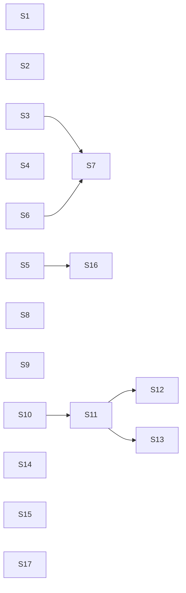

# Repo scaffolding cleanup

status: done  head: f90c0c181b1b90f3d1107647a7960202da83e5db
base: cb517990c75dcbae6fe9852eb3d28126951c73b2
commit-mode: orchestrator-commits
language: ruby (cards S5, S6, S16 are bash and YAML)
panel: Linus Torvalds, Jeremy Evans, Sandi Metz, Richard Schneeman, Aaron Patterson

## Intent

Clean up what sits around `lib/` and `spec/`: junk at the root, finished scripts in `bin/`, inline bash in CI, hand-kept hooks with upstream equivalents, and specs that do a linter's job. Fix the 2 defects the audit found: the confinement probe tests a different bwrap command from the one lain runs, and the bootsnap cache has grown to 83G with nothing to evict it. Add a Lima VM template so lain runs on the work MacBook with every Linux isolation layer. Research: `planning/repo-scaffolding-research-2026-11.md`. Roadmap line: `ROADMAP.md` Status, "Repo scaffolding cleanup (2026-11-18)".

**Precondition.** Another session has docs work in flight: moves into `docs/devs/` and `docs/users/`, plus edits to `.pre-commit-config.yaml`, `CLAUDE.md`, `lain.gemspec`, `.gitmodules` and `ROADMAP.md`, and new `.vale.ini`, `lychee.toml` and `styles/`. Start this plan only after `git status --short docs .pre-commit-config.yaml CLAUDE.md lain.gemspec` prints nothing. Several cards edit those files, and the doc paths below are the post-move paths.

Card ids use the prefix `S` because `tmp/worktrees/` already holds 82 directories named `T<n>` from earlier plans.

## Grounding

Checked 2026-11-18 at `943103f1` on `main`, by 7 read-only agents, 2 spikes, and direct reads. Files checked:

- CI and hooks: `.github/workflows/main.yml`, `.github/workflows/spec-workers-bench.yml`, `.github/actions/spec-binaries/action.yml`, `.pre-commit-config.yaml` (HEAD and working tree), `Rakefile`, `Gemfile`, `Gemfile.lock`, `.rubocop.yml`, `lain.gemspec`.
- Scripts: every file in `bin/`.
- Lint specs: `spec/*_discipline_spec.rb`, `spec/mixlib_free_lib_spec.rb`, `spec/fixture_discipline_spec.rb`, `spec/docs_naming_spec.rb`, `spec/lib_null_defaults_spec.rb`, `spec/repo_as_fixture_spec.rb`, `spec/support/parsed_source.rb`.
- Confinement: `lib/lain/confine/probe.rb`, `lib/lain/confine/bwrap.rb`, `lib/lain/confine/profile.rb`, `lib/lain/confine/sandbox.rb`, `lib/lain/cli/wiring/toolset_build.rb`, `lib/lain/cli/chat_launch.rb`, `spec/lain/confine/probe_spec.rb`, `spec/lain/confine/bwrap_spec.rb`.
- Bootsnap: `spec/bootsnap_setup.rb`, `spec/support/child_boot.rb`, `lib/lain/boot/launch.rb`, and the installed bootsnap 1.26.1.
- Mac plan: `planning/specs/lain-macos-bringup.md`.

Where docs and code disagreed:

- **The nvim leak.** The research said `spec/plugin/nvim_plugin_spec.rb` writes `not/absolute` into the repo root. The code wins: `boot_nvim` spawns with `chdir: @project` (`:75-85`), so the relative path already lands in the example's tmpdir. The root `not/` and `.local/` date from 2026-08-23 and are stale. No spec change.
- **Upstream secret hooks.** The research proposed `detect-private-key`. Probing the tree rejected it: it fires on about 27 spec files that test the redactor, and on `crates/lain-daemon/src/test_tls/server.key`. `gitleaks` with an allowlist replaces it (S9).
- **Cop candidates.** The research listed 11 specs for cops. Reading each rule cut that to 5:
  - `refusal_delivery_discipline_spec` scans Lua.
  - `declarative_inclusion_discipline_spec` and `lib_null_defaults_spec` need loaded constants.
  - `provider_construction_discipline_spec`, `gate_decision_fold_discipline_spec` and `repo_as_fixture_spec` each carry tree-wide stale-entry or exact-set checks, which a cop cannot express. Porting them would leave each rule split across a cop and a residual spec.
- **`docs_naming_spec`.** The research listed it for a text hook. Its `Turn` rule is paragraph-scoped, and its other examples read loaded constants, so it stays.
- **`bin/demo-fanout`.** It is not archive material. `spec/lain/tools/subagent/stagger_driver_spec.rb:16-28` runs it as a driver.
- **`bin/bench-ollama-gpu`.** The docs session edited it today, and `docs/devs/debugging-ollama.md` tells readers to run it. It stays.

Runtime premises probed rather than read:

- **Confinement in a container.** Measured in rootless podman 6.1 (spike 1).
- **The 83G cache.** Measured with `du` and `find`: 9,187,951 files, 1,790,436 written in the last 7 days.
- **The writer of that cache.** Measured by spike 2.
- **Dirty worktrees.** Measured with `git status` in each worktree: at least 40 of the 82 hold uncommitted edits.
- **Branch protection.** Measured with `gh api`: `main` is not protected, so the CI job display name is free to change.

Panel review (Ruby roster, 2026-11-18) returned REQUEST-CHANGES with 1 blocker. Changes made:

- **The blocker.** S14's probe ran a bare `"bwrap"` through Open3, which searches the cwd on an empty `PATH` entry, while the Sandbox resolves bwrap with `Shell::Path.find`. S14 now builds both through 1 factory, `Bwrap.on_path`.
- **S14 reasons.** It also keeps bwrap's own error text in the journal.
- **S5.** The script asserts lain's real namespace flags. The old `--unshare-user` check passes where lain's argv fails.
- **S6.** Moving the remote shell out of `main.yml` would have stopped edits to it from triggering the remote jobs. `changed-paths` now watches the new scripts.
- **S9.** The gitleaks allowlist names fake values and generator files only. VCR cassettes and most of `planning/` stay scanned.
- **S2.** The archive keeps the 78 ignored `.handback*.md` reports and records each worktree's base SHA. Locked worktrees are skipped, and `--apply` names the real run.
- **S11 to S13.**
  - `lain_cops_spec.rb` pins each cop's exemptions and refuses inline `rubocop:disable Lain/...`, restoring guarantees the deleted specs gave.
  - Cop specs load the RuboCop expect-offense helper per group, never through `rubocop/rspec/support`.
  - The `.rubocop/` directory is added to `AllCops: Include`.
  - SdkRequire matches string-named doubles.
  - The output-discipline grep and its 5 module citations are listed in full.
- **S15.** It reads `LAIN_BOOTSNAP_CACHE`, so its specs use a private cache, and it excludes the repo's own `tmp/`.
- **S16.** It avoids nested mounts, sets a guest-local `CARGO_TARGET_DIR`, strips the `ruby-` prefix, is idempotent, and requires the real `limactl validate`.
- **Small fixes.** The probe has 4 construction sites, not 3. Line and count corrections are made in S4 and S8, and S3's self-answering stop condition is removed.

Rejected: the suggestion to extract only the CI scripts that carry logic. You asked for no multi-line bash in the workflow YAML (S6).

## Compatibility

| Surface | Verdict | Evidence |
|---|---|---|
| CI job ids and check names | free to break | `gh api repos/liaden/lain/branches/main/protection` returns 404 "Branch not protected", and no rulesets exist. Job ids stay anyway; only the `build` display name `Ruby ${{ matrix.ruby }}` changes |
| Pre-commit hook ids | must keep | `main.yml:177-178` `SKIP=ruby-checks,remote-*` and CLAUDE.md name hook ids. No card renames one |
| `bin/` scripts removed (S3) | free to break | No caller in `lib/`, `spec/`, `Rakefile`, hooks or CI (grep, research audit). `docs/devs/spec-suite-performance.md` lists them, and S3 edits that table |
| `Confine::Probe.new` keywords | free to break | Internal. 4 construction sites, all in `lib/` and all using the defaults: `toolset_build.rb:262`, `chat_launch.rb:96`, `bench/harness.rb:67`, `bench/hot_paths.rb:228` |
| `Confine::Bwrap` public methods | free to break (S14 adds `Bwrap.on_path`, `#bwrap` and `#namespace_argv`) | Internal, no consumer outside `lib/` and `spec/` |
| Spec files removed (S10 to S13) | free to break | Each rule moves to a hook or a cop that runs where rspec ran: in the commit hook and in CI |
| Bootsnap cache layout | free to break | `spec/bootsnap_setup.rb:7-9`: "rebuilds lazily, so a cold cache is slower, never wrong" |
| The gem (`lain.gemspec`) | unchanged | You ruled the gem scaffolding out of scope. Version 0.1.0, no release tags. S11 edits 1 comment at `lain.gemspec:94` that names a deleted spec |
| Trial notes at the root | moved | Your ruling: move to `tmp/`, which `/tmp/` in `.gitignore` covers |
| Merged card worktrees | removed after archiving | Your ruling: remove them. S2 archives each one's uncommitted diff and untracked files first, because cards land by patch and a merged branch does not prove that its uncommitted edits landed |

## Spike findings

| Question | Result | Evidence |
|---|---|---|
| Which confinement layers survive inside a container? | `lain-fence` (Landlock ABI 9, reaper) and strace pass with no flags. lain's real bwrap argv fails until the container gets `--cap-add=SYS_ADMIN,NET_ADMIN`. `seccomp=unconfined`, `label=disable` and `--userns=keep-id` do not help. | Spike 1, rootless podman 6.1, ubuntu:24.04, Linux 7.1. Its scripts are kept at `/home/tara/tmp/lain/claude-1000/-home-tara-dev-lain/3b13ffd9-4e28-4fa2-9fcc-e232b2aee368/scratchpad/spike/` |
| Does the probe agree with the real argv? | No. `bwrap --unshare-user --ro-bind / / true` passes in a default container where the real argv fails with "Creating new namespace failed: Operation not permitted". | Spike 1; `probe.rb:93,102` against `bwrap.rb:59-61` |
| Who writes the out-of-tree bootsnap entries? | 1 suite run fetched 12,591 iseqs for 12,558 distinct paths outside the repo and gem dirs, so each run adds about 12,500 cache files that are never read again. Writers: `spec/lain/review/deletability_spec.rb` (11,153; 9 `RbConfig.ruby -e` children, each loading about 1,240 files from a `Dir.mktmpdir("lain-deletability")` copy of the tree), `spec/lain/seams/workspace_profile_spec.rb` (1,393; a `cp_r` copy in `Dir.mktmpdir("w")`), `exe/lain` children loading hash-named load-path files (41, keys recur), and `seam_report` (4). The children inherit the cache through `RUBYOPT -r spec/bootsnap_setup.rb` (`spec/support/child_boot.rb:45-49`). | Spike 2: a logging prepend on `Bootsnap::CompileCache::ISeq.fetch`, the single entry point for every iseq fetch in bootsnap 1.26.1, then `rake pspec` at 6 workers (36,208 examples; 58 failures under a load near 100 from other sessions). Afterwards the fresh cache held 18,240 files, about 12,500 of them out of tree. The hook is kept at the scratchpad path above, as `bootsnap_log.rb` |

Both spike worktrees are removed. Spike 2 ran a full suite under a load near 100, which nobody should repeat: the next measurement of S15 is the single-file check in its criteria.

## Shared files

The main session alone edits these files; each card hands back its 1-line diffs.

- `.pre-commit-config.yaml` (S8, S9, S10)
- `.rubocop.yml` (S11, S12, S13)
- `CLAUDE.md` (S7, S11, S15)
- `lain.gemspec` (S11: 1 comment line)
- `ROADMAP.md` (status line at the end)

## Rejected options

- **A Dockerfile plus `compose.yaml`.** A container keeps bwrap only with `SYS_ADMIN` and `NET_ADMIN` (spike 1), and on a Mac it runs inside a VM anyway. compose adds nothing for 1 process. Lima runs lain natively instead (S16).
- **`dorny/paths-filter` for the `changes` job.** Its behaviour on a new branch or a force push, where `github.event.before` is all zeros, is unverified against the current "no base, run everything" rule (`main.yml:199`). Extracting the shell (S6) keeps the semantics exactly and lets shellcheck see it.
- **`detect-private-key`.** It fires on about 27 redactor spec files and a real test TLS key (see Grounding).
- **gitlint or commitlint for `bin/lint-commit-msg`.** The house rules (no dashes, no generated-by markers) would need custom plugins in Python or Node.
- **Porting `provider_construction`, `gate_decision_fold` and `repo_as_fixture` to cops.** Their stale-entry and exact-set checks need the whole tree, so each rule would end up half in a cop and half in a spec.
- **Wiring the census scripts into CI.** CLAUDE.md keeps them ungated on purpose.
- **Moving `lint-price-freshness` to a scheduled workflow.** The calendar nag at commit time is deliberate, and moving it changes who sees it.
- **Archiving the deleted scripts under `planning/archive/tools/`.** Your ruling is to delete replaced code. The archived bash scripts call `$repo/bin/...` and would break when moved. Git history keeps them, and S3 names the last SHA in the doc table.
- **ast-grep for the lint rules.** It is not installed, and installing it was denied during research. RuboCop already runs in the hook and CI, and ruby-lsp shows its offenses in the editor.
- **Deleting the mutation sweep (`rake rust:mutants`).** It is the only check that the Rust core's tests can fail (`docs/devs/rust-bindings.md` rule 5), and CI runs it only when `ext/lain/` changes.

## Open decisions

- **The probe's `:trace` and `:landlock` checks.** They also run outside bwrap: `strace -f` without `--seccomp-bpf`, and `lain-fence --status` without the grants. Spike 1 found no failure from either, so S14 fixes bwrap and private_net only. A later card can probe them inside the namespace if a box shows a gap.
- **Whether the Lima guest kernel has Landlock and user namespaces.** This box cannot run a macOS VM. S16 ships the template and a verify step; you run it on the Mac (Integration checks).

## Dependency graph



## Tasks

### S1: Remove junk files and leak directories from the root          [risk: low]

**Depends on:** none
**Files:** `.red.txt`, `gc_per_file.bak`, `worker_suffix.bak`, `TERM`, `sites`, `sig/lain.rbs` (all `git rm`); `.gitignore`; untracked `old.err`, `not/`, `.local/`, `sock-sai7ftim/` (delete); untracked `notes.md`, `nyotes-notes.md`, `nyotes-trial.md`, `nyotes-approvals.log`, `frugirl-trial.md` (move to `tmp/trials/`)
**Reuse:** the research table in `planning/repo-scaffolding-research-2026-11.md`, "Top-level clutter"
**Shared-file wiring:** none
**Reachable from:** deferred: repo hygiene, no production path

**Acceptance criteria**

```gherkin
Scenario: the root holds no tracked junk
  Given the tree at the card's base
  When `git ls-files .red.txt gc_per_file.bak worker_suffix.bak TERM sites sig` runs
  Then it prints nothing

Scenario: leak directories stay out of git status
  Given a directory named not/ and one named sock-abc/ created at the root
  When `git status --porcelain --untracked-files=all` runs
  Then neither path appears

Scenario: the trial notes are kept, out of the tree
  When the card lands
  Then tmp/trials/ holds notes.md, nyotes-notes.md, nyotes-trial.md, nyotes-approvals.log and frugirl-trial.md
  And `git status --porcelain` lists none of them
```
Check: the 3 commands above, run by the implementer and pasted into the hand-back. No spec file: there is no Ruby behaviour.

`.gitignore` gains `/not/`, `/.local/`, `/sock-*/`, `/*.bak`, `/*.err`, `/.ruby-lsp/`, `/nyotes-approvals.log`. `/.ruby-lsp/` and the log are hidden today only by your global git ignore, which the Mac clone lacks.

**Stop and report if:**
- `sig/` is named by `lain.gemspec`, `Rakefile` or any `spec/` file (the grep at research time found none).
- Any of the 5 tracked junk files is read by a spec (`git grep -l -e '\.red\.txt' -e 'worker_suffix\.bak' -e 'gc_per_file\.bak' -- spec lib bin`).

### S2: Prune merged card worktrees after archiving their uncommitted work          [risk: medium]

**Depends on:** none
**Files:** `bin/prune-merged-worktrees` (new)
**Reuse:** `git worktree list --porcelain`, `git branch --merged main`
**Shared-file wiring:** none
**Reachable from:** deferred: a maintenance script you run by hand; no production path

Following your ruling on readable scripts, it is a small named bash script with numbered steps. All 82 `card/` branches read as merged only because their tips are cut points with nothing committed on top; cards here land by patch. So the merge test proves nothing, and the archive in step 2 is what protects the work. For each worktree under `tmp/worktrees/` whose branch is `card/<id>`, merged into `main`:

1. **Skip, and say why,** when:
   - the branch starts with `card/S` (this plan's own cards);
   - the worktree is locked;
   - a process has its cwd inside it (`/proc/*/cwd`).
2. **Archive** into `tmp/worktree-archive/<name>/`:
   - `diff.patch`, from `git -C <wt> diff HEAD`;
   - `base.txt`, holding the worktree's HEAD SHA;
   - `untracked.tar`, holding untracked files that are not ignored (`git ls-files --others --exclude-standard`) plus every ignored `.handback*.md`. Of the 82 worktrees, 78 hold a handback report, ignored through `.git/info/exclude:20`.
3. **Remove** with `git worktree remove --force <wt>`, then `git branch -D card/<id>`.
4. **Report** 1 line per worktree, then the totals.

Flags:

- `--dry-run` prints what each worktree would get and changes nothing.
- `--apply` does it.
- With neither flag, it prints usage and exits 2.
- `--repo <path>` points it at another repo; the spec uses it.

Measured at planning time: 0 worktrees locked or prunable, none with initialised submodules. The 3 stashes are repo-wide refs, which removing a worktree does not touch.

**Acceptance criteria**

```gherkin
Scenario: a merged worktree with uncommitted edits is archived, then removed
  Given a scratch repo with a worktree on card/T1, merged into main, holding 1 modified tracked file, 1 untracked file and an ignored .handback.md
  When bin/prune-merged-worktrees --repo <scratch> --apply runs
  Then tmp/worktree-archive/T1/diff.patch applies cleanly at the SHA in base.txt
  And untracked.tar holds the untracked file and the ignored .handback.md
  And the worktree and its branch are gone

Scenario: an unmerged worktree is left alone
  Given a worktree on card/T2 with a commit main does not have
  When the script runs
  Then the worktree and the branch remain, and the output says why

Scenario: this plan's cards and busy worktrees are skipped
  Given worktrees on card/S3, on a locked card/T5, and on card/T4 with a process whose cwd is inside it
  When the script runs
  Then all 3 remain, and the output names each with its reason

Scenario: dry run changes nothing
  When the script runs with --dry-run
  Then `git worktree list` is unchanged and no archive directory exists
```
Spec file: `spec/lain/prune_merged_worktrees_spec.rb`. It drives real git in a `Dir.mktmpdir` repo, scrubbing `GIT_DIR` and `GIT_INDEX_FILE` per CLAUDE.md's pre-commit trap.

After the card lands, the main session runs `bin/prune-merged-worktrees --dry-run` against the real repo and pastes the output into the Execution log, then runs it with `--apply` only if the dry run lists no surprises.

**Stop and report if:**
- `git branch --no-merged main` lists any `card/` branch whose worktree the dry run would remove.
- An archived `diff.patch` from the real run fails `git apply --check` against its own base SHA.

### S3: Delete the finished profiling scripts, bin/chat and bin/demo-skills          [risk: low]

**Depends on:** none
**Files:** `bin/trace-pspec`, `bin/trace-summary`, `bin/trace-memleak`, `bin/memleak-summary`, `bin/strace-children`, `bin/setup-profiling`, `bin/chat`, `bin/demo-skills` (all `git rm`); `docs/devs/spec-suite-performance.md` (rows at `:296-297`, prose at `:344`, tool table at `:388-396`)
**Reuse:** none
**Shared-file wiring:** none
**Reachable from:** deferred: deleting dev scripts; no production path

**Acceptance criteria**

```gherkin
Scenario: no live reference to a deleted script remains
  Given the 8 scripts are deleted
  When `git grep -n -E 'bin/(trace-pspec|trace-summary|trace-memleak|memleak-summary|strace-children|setup-profiling|chat|demo-skills)\b' -- . ':!planning'` runs
  Then it prints nothing

Scenario: the performance doc says where the tools went
  When a reader opens the tool table in docs/devs/spec-suite-performance.md
  Then it names the commit that deleted the profiling chain and `git show <sha>^:bin/<name>` to recover one
```
Check: the grep above, and `bundle exec rspec spec/lain/tools/subagent/stagger_driver_spec.rb`, which runs `bin/demo-fanout`. That script stays.

**Stop and report if:**
- Any `spec/` file execs or loads one of the 8 scripts. At grounding, only `bin/demo-fanout` was, and it is kept.

### S4: Remove the unused benchmark-ips and simplecov gems          [risk: low]

**Depends on:** none
**Files:** `Gemfile` (`:11`, and `:70` with the comment block above it), `Gemfile.lock`
**Reuse:** none
**Shared-file wiring:** none
**Reachable from:** deferred: dependency removal; no production path

**Acceptance criteria**

```gherkin
Scenario: neither gem is required anywhere
  When `git grep -n -E 'benchmark/ips|Benchmark\.ips|SimpleCov|simplecov' -- bin lib spec exe Rakefile` runs
  Then it prints nothing

Scenario: the bundle resolves without them
  When `bundle install` runs after the Gemfile edit
  Then Gemfile.lock no longer lists benchmark-ips or simplecov
  And `bundle exec rake pspec` reports the same example count as the base
```
Check: the 2 commands above.

**Stop and report if:**
- `bundle install` changes any other locked version. Pin back, then report.
- `bin/hot-path-bench` or `lib/lain/bench/hot_paths.rb` requires `benchmark` in a way that resolves to `benchmark-ips`.

### S5: Move the spec-binaries steps into bin/ci/install-spec-binaries          [risk: medium]

**Depends on:** none
**Files:** `bin/ci/install-spec-binaries` (new, bash), `.github/actions/spec-binaries/action.yml`
**Reuse:** the 3 `run:` blocks at `action.yml:23-29`, `:34-41` and `:48-62`
**Shared-file wiring:** none
**Reachable from:** `.github/workflows/main.yml` `build` job, `uses: ./.github/actions/spec-binaries`, which now runs the script. S16 runs the same script to provision Lima

The script works as root or through `sudo`, on x86_64 and aarch64. Steps:

1. Install bubblewrap if missing.
2. Allow unprivileged user namespaces where AppArmor restricts them: the sysctl, and with `--persist` a file in `/etc/sysctl.d/`.
3. Install the neovim release tarball for the machine's arch into `/opt`, and link `nvim` into `/usr/local/bin`. This replaces the `GITHUB_PATH` append.
4. Install `tmux`, `jq` and `strace` if missing.
5. Assert that every binary runs, and print its version.
6. Assert that bwrap can build lain's reader namespace: `bwrap --ro-bind / / --dev /dev --proc /proc --tmpfs /tmp --unshare-pid --die-with-parent -- true`. Today's check, `bwrap --unshare-user --ro-bind / / true` (`action.yml:29`), passes on hosts where lain's real argv fails (spike 1), so CI and Lima would report bwrap working when it is not.

The neovim version is the first argument, defaulting to `stable`, which keeps the action's `neovim-version` input.

**Acceptance criteria**

```gherkin
Scenario: a bare Ubuntu box gets every spec binary
  Given a rootless podman container from ubuntu:24.04, started with --cap-add=SYS_ADMIN,NET_ADMIN, with the repo mounted read-only
  When bin/ci/install-spec-binaries runs inside it as root
  Then nvim, tmux, jq, bwrap and strace each print a version
  And the reader-namespace assert passes

Scenario: a box that cannot build the namespace fails loudly
  Given the same container started without the extra capabilities
  When bin/ci/install-spec-binaries runs
  Then it exits non-zero and names the bwrap namespace assert

Scenario: the action is 1 step
  When .github/actions/spec-binaries/action.yml is read
  Then its only run step calls bin/ci/install-spec-binaries with the neovim-version input
  And the actionlint and shellcheck hooks pass on both files

Scenario: arm64 picks the arm64 tarball
  Given `uname -m` reports aarch64
  When the script computes its download URL
  Then the URL names nvim-linux-arm64
```
Check: the podman run (spike 1 showed rootless podman works on this box), `pre-commit run actionlint --files .github/actions/spec-binaries/action.yml`, and `pre-commit run shellcheck --files bin/ci/install-spec-binaries`. The arm64 scenario runs with `uname` stubbed by a `PATH` shim, through `--print-url`.

**Stop and report if:**
- The CI `build` job's "Assert the suite's binaries" output lists a different version set from the base run (compare the 2 job logs).
- neovim stops publishing `nvim-linux-arm64.tar.gz` under that name (check the latest release assets).

### S6: Move main.yml's multi-line steps into bin/ci scripts          [risk: low]

**Depends on:** none
**Files:** `.github/workflows/main.yml` (`:170-172`, `:198-209`, `:248-251`, `:277-279`, `:286-287`), `bin/ci/changed-paths`, `bin/ci/remote-app-hooks`, `bin/ci/dioxus-cli-version`, `bin/ci/build-apk`, `bin/ci/check-macos-target` (all new, bash)
**Reuse:** the existing blocks, moved verbatim and then shellchecked
**Shared-file wiring:** none
**Reachable from:** `.github/workflows/main.yml` jobs `changes`, `remote-app`, `remote-android` and `lint`

`bin/ci/changed-paths` keeps today's rule: with no usable base it reports every group as `true`. It takes the base and head SHAs and writes `mutants=` and `remote=` lines to `$GITHUB_OUTPUT`, or to stdout when that variable is unset, so you can run it locally.

The `remote` group fires today on `\.github/workflows/main\.yml$` (`main.yml:209`), so editing a remote job's shell runs that job. Once the shell moves out, the groups widen to match: `remote` adds `bin/ci/(remote-app-hooks|dioxus-cli-version|build-apk)`, and both groups add `bin/ci/changed-paths` itself.

The panel suggested extracting only the scripts with logic, since actionlint already shellchecks `run:` blocks. This card keeps the full extraction because you asked for no multi-line bash in the workflow YAML. A 2-line script also runs locally, where the inline block cannot.

**Acceptance criteria**

```gherkin
Scenario: a change under ext/lain trips mutants only
  Given a scratch repo where the head commit touches ext/lain/src/dag.rs
  When bin/ci/changed-paths <base> <head> runs with GITHUB_OUTPUT unset
  Then it prints mutants=true and remote=false

Scenario: no usable base runs everything
  When bin/ci/changed-paths runs with a base of 40 zeros
  Then it prints mutants=true and remote=true

Scenario: editing an extracted remote script runs the remote jobs
  Given a head commit that touches only bin/ci/build-apk
  When bin/ci/changed-paths <base> <head> runs
  Then it prints remote=true and mutants=false

Scenario: editing the filter itself runs everything
  Given a head commit that touches only bin/ci/changed-paths
  Then it prints mutants=true and remote=true

Scenario: the workflow holds no multi-line run block
  When main.yml is read
  Then no step has a `run: |` block
  And actionlint passes
```
Spec file: `spec/lain/ci_changed_paths_spec.rb`, driving real git in a tmpdir, with `GIT_DIR` and `GIT_INDEX_FILE` scrubbed. The other 4 scripts are checked by shellcheck and actionlint, plus 1 CI run on the card's branch.

**Stop and report if:**
- The CI run after this card skips the `mutants` or `remote-app` job on a push that touched `ext/lain/` or `apps/lain-remote/`.
- `bin/ci/build-apk` needs an environment variable that the workflow sets only through `GITHUB_ENV` within the same step.

### S7: Read Ruby from .ruby-version and drop the duplicated CI work          [risk: low]

**Depends on:** S3, S6
**Files:** `.github/workflows/main.yml`, `.github/workflows/spec-workers-bench.yml` (`git rm`), `docs/devs/spec-suite-performance.md`
**Reuse:** `spec-workers-bench.yml:32` passes `ruby-version: '.ruby-version'`, but that workflow never ran (`gh run list` is empty), so it proves nothing about the action reading a file; the first stop condition covers it
**Shared-file wiring:** `CLAUDE.md`: in the Toolchain block, add after `export LAIN_SPEC_WORKERS=12`: "CI reads its Ruby from `.ruby-version`; change the version there"
**Reachable from:** `.github/workflows/main.yml` jobs `build`, `lint`, `remote-app` and `mutants`

Changes:

1. Replace the 4 hardcoded `'4.0.9'` values (`:39`, `:142`, `:226`, `:307`) with `ruby-version: '.ruby-version'`. This removes the 1-entry matrix and renames the job to "Ruby".
2. Add `daemon-tier` to the lint job's `SKIP` (`:177-178`), because the `build` job already runs it at `:111`.
3. Delete `spec-workers-bench.yml`. Its question is settled: `main.yml` uses `$(nproc)`.
4. Move the 21-line comment at `main.yml:75-95` into `docs/devs/spec-suite-performance.md`, keeping 1 line that points there.
5. Hoist `rubygems: '4.0.3'` (4 copies) and `cargo-deny@0.21.0` (2 copies) into a workflow-level `env:` and reference them.

**Acceptance criteria**

```gherkin
Scenario: 1 place names the Ruby version
  When `git grep -n "4\.0\.9" -- .github` runs
  Then it prints nothing

Scenario: the daemon tier runs once per push
  When the CI run for this card's branch finishes
  Then the "core and daemon" specs appear in the build job's log and not in the lint job's log

Scenario: the CI run is green with the same example count
  When the build job finishes
  Then rake pspec reports the base run's example count
```
Check: the grep, and the CI run on the card's branch.

**Stop and report if:**
- `oxidize-rb/actions/setup-ruby-and-rust@v1` rejects a file path for `ruby-version` in the `build` job, although the bench workflow passes one.
- A step reads `matrix.ruby`, for example the cache prefix at `:59`, which reads `RUBY_VERSION` from Ruby itself.

### S8: Swap in the upstream file-hygiene hooks          [risk: low]

**Depends on:** none
**Files:** none outside shared files. The implementer proves the new config on a scratch copy, `pre-commit run --config <copy> --all-files <id>`
**Reuse:** `pre-commit-hooks` v6.0.0, already pinned at `.pre-commit-config.yaml:7-8`
**Shared-file wiring:** `.pre-commit-config.yaml`:
- Replace the local `shellcheck` hook (`:33-38`) with `repo: https://github.com/shellcheck-py/shellcheck-py`, `id: shellcheck`, keeping `exclude: '^\.envrc$'`.
- Add to the `pre-commit-hooks` block: `check-added-large-files` with `args: [--maxkb=1024]`; `check-toml` with `exclude: '^spec/fixtures/toml-test/'`; `check-json`.
**Reachable from:** the git `pre-commit` hook, and the CI lint job through `pre-commit/action`

**Acceptance criteria**

```gherkin
Scenario: the current tree passes every new hook
  When `pre-commit run --all-files shellcheck check-added-large-files check-toml check-json` runs with the new config
  Then every hook passes

Scenario: a broken TOML file outside the fixtures is caught
  Given a staged file scratch.toml containing "a = "
  When the hooks run on staged files
  Then check-toml fails and names scratch.toml

Scenario: a new 2 MB file is caught
  Given a staged 2 MB file
  When the hooks run on staged files
  Then check-added-large-files fails
```
Check: the 3 runs above, in a scratch clone so the planted files never reach the repo.

**Stop and report if:**
- shellcheck-py's pinned shellcheck reports findings that the system shellcheck did not report on `bin/`. List them; do not fix them in this card.
- `check-toml` fails on a TOML file outside `spec/fixtures/toml-test/`. At grounding, all 14 such files parsed.

### S9: Add gitleaks with an allowlist for redactor fixtures          [risk: medium]

**Depends on:** none
**Files:** `.gitleaks.toml` (new)
**Reuse:** none
**Shared-file wiring:** `.pre-commit-config.yaml`: add `repo: https://github.com/gitleaks/gitleaks`, a `rev` at least 2 weeks old, `hooks: [{id: gitleaks}]`
**Reachable from:** the git `pre-commit` hook

`.gitleaks.toml` extends the default rules (`[extend] useDefault = true`). The allowlist is narrow on purpose. `spec/fixtures/vcr_cassettes/` is recorded from live API calls, which makes it the likeliest place for a real credential to land, so it stays scanned, and so does most of `planning/`, which holds pasted real output.

The allowlist covers only the redactor's own fake tokens:

1. **By value first.** List the fake tokens the redactor specs plant (`regexes` or `stopwords`). Today there are about 35 files with `sk-ant-`, 17 with `AKIA` and 31 with `ghp_` shapes. Collect the literal fake values with `git grep -h -o`, and allowlist those values, not their files.
2. **By path, for what cannot be listed by value.** A generator that builds tokens at runtime, such as `spec/conformance/corpus_generator.rb`, `lib/lain/bench/hot_paths.rb` and `ext/lain/src/regions.rs`, plus `crates/lain-daemon/src/test_tls/`. Each path gets a reason comment.

There is no cap on entries, but each one names a file or a value, never a directory above it.

**Acceptance criteria**

```gherkin
Scenario: the current tree is clean under the allowlist
  When `gitleaks dir . --config .gitleaks.toml` runs over the tracked files
  Then it reports 0 leaks

Scenario: a real-looking key in a new lib file is caught at commit time
  Given a scratch clone with lib/lain/scratch.rb staged, holding a token shaped like an Anthropic API key
  When the gitleaks hook runs
  Then it fails and names lib/lain/scratch.rb

Scenario: a new real-looking key in a spec is still caught
  Given spec/lain/scratch_spec.rb staged with a token of the same shape that is not on the allowlist
  When the gitleaks hook runs
  Then it fails

Scenario: a key in a recorded cassette is caught
  Given spec/fixtures/vcr_cassettes/scratch.yml staged with a real-looking Authorization header value
  When the gitleaks hook runs
  Then it fails
```
Check: the 3 runs above, in a scratch clone.

**Stop and report if:**
- `gitleaks dir` finds a leak in `spec/fixtures/vcr_cassettes/` or in `planning/` that is not a redactor fixture. That is a finding for you; do not allowlist it.
- Silencing the existing fakes needs a directory-wide entry anywhere under `spec/`.

### S10: Replace mixlib_free_lib_spec and fixture_discipline_spec with hooks          [risk: low]

**Depends on:** none
**Files:** `spec/mixlib_free_lib_spec.rb`, `spec/fixture_discipline_spec.rb` (both `git rm`); `bin/spec-census` (comment at `:32`)
**Reuse:** the rules as written in the 2 specs
**Shared-file wiring:** `.pre-commit-config.yaml`, 2 local hooks:
- `id: no-mixlib`, `language: pygrep`, `entry: '(?i)mixlib'`, `files: '^lib/'`, `exclude: '\.so$'`
- `id: no-spec-under-fixtures`, `language: fail`, `entry: 'a spec planted under spec/fixtures/ would run as part of the suite'`, `files: '^spec/fixtures/.*_(spec|test)\.rb$'`
**Reachable from:** the git `pre-commit` hook, and CI's `pre-commit/action`, which runs `--all-files`

**Acceptance criteria**

```gherkin
Scenario: the tree passes both hooks
  When `pre-commit run --all-files no-mixlib no-spec-under-fixtures` runs
  Then both pass

Scenario: a mixlib mention in lib is caught, in any file type
  Given a staged lib/lain/frontend/neovim/runtime/scratch.lua containing "Mixlib"
  When the hooks run
  Then no-mixlib fails

Scenario: a spec planted under fixtures is caught
  Given a staged spec/fixtures/x/thing_spec.rb
  When the hooks run
  Then no-spec-under-fixtures fails
```
Check: the 3 runs above, in a scratch clone, then `bundle exec rake pspec`. The example count drops by exactly the deleted specs' examples.

**Stop and report if:**
- Another spec references `MixlibFreeLib` or the fixture discipline's constants (`git grep -n -e MixlibFreeLib -e FixtureDiscipline -- spec`).

### S11: Add the Lain cop loader and port output discipline to Lain/TerminalOutput          [risk: medium]

**Depends on:** S10 (both edit `bin/spec-census`)
**Files:**
- New: `.rubocop/lain.rb`, `.rubocop/cops/lain/terminal_output.rb`, `spec/rubocop/cops/lain/terminal_output_spec.rb`, `spec/rubocop/lain_cops_spec.rb`.
- Deleted: `spec/output_discipline_spec.rb`.
- Edited:
  - `bin/spec-census` (`:43`)
  - `docs/devs/glossary.md` (`:687`)
  - `docs/devs/architecture.md` (`:2569`)
  - comments that name the spec, in `lib/lain/frontend.rb:4`, `lib/lain/frontend/tty.rb:15`, `lib/lain/middleware/gate.rb:28`, `lib/lain/provider/http/logging/sink_logger.rb:6` and `lib/lain/arm/driver.rb:444`.
  - comments in 20 spec files that cite the spec as the precedent for a Ripper scan or a terminal rule. They are: `spec/declarative_inclusion_discipline_spec.rb`, `spec/docs_naming_spec.rb`, `spec/endpoint_env_isolation_spec.rb`, `spec/lain/agent_state_machine_diagram_spec.rb`, `spec/lain/bench/arms_report_spec.rb`, `spec/lain/bench/cli_spec.rb`, `spec/lain/cli/chat_flags_spec.rb`, `spec/lain/cli/epic_submit_spec.rb`, `spec/lain/epic/scribe_write_side_spec.rb`, `spec/lain/project/root_defaults_spec.rb`, `spec/lain/project_dir_spec.rb`, `spec/lain/review/bounds_spec.rb`, `spec/lain/sensitivity/regions_spec.rb`, `spec/lain/sensitivity_spec.rb`, `spec/lain/tools/subagent/stagger_spec.rb`, `spec/lain/vcr_ollama_posture_spec.rb`, `spec/plugin/nvim_plugin_spec.rb`, `spec/provider_construction_discipline_spec.rb`, `spec/repo_as_fixture_spec.rb` and `spec/tool_bounds_discipline_spec.rb`. Each comment keeps its reason and names the cop, or "the old output discipline spec" where the point was the Ripper technique.
  - Another 5 comments cite the spec's module, `{OutputDiscipline}`, rather than its file: `spec/error_taxonomy_discipline_spec.rb:60`, `spec/lain/run_clock_spec.rb:10`, `spec/refusal_delivery_discipline_spec.rb:7`, `spec/refusal_width_discipline_spec.rb:8` and `spec/reply_surface_discipline_spec.rb:17`.
  - Afterwards, `git grep -n -e output_discipline_spec -e OutputDiscipline -- . ':!planning' ':!references' ':!spec/lain/test_layout/guard_spec.rb'` must print nothing. `references/` holds dated research. `guard_spec.rb:183` uses the old path only as a string fed to a layout check, and it stays.
- Unchanged: `spec/lain/test_layout/guard_spec.rb:183` uses the old path only as a string fed to a layout check (the panel confirmed it does not need the file to exist).

**Reuse:** `spec/output_discipline_spec.rb` (the rule, the allowlist entry `lain/daemon/spawner.rb` with its reason, and the 4 self-test cases), and `rubocop/rspec/support` from rubocop 1.92.2
**Shared-file wiring:**
- `.rubocop.yml`: add `require: - ./.rubocop/lain` and a `Lain/TerminalOutput:` block with `Include: ['lib/**/*.rb']` and `Exclude: ['lib/lain/frontend/**/*', 'lib/lain/daemon/spawner.rb']`, the latter with its reason comment. Point the comment at `:280` at the cop.
- `CLAUDE.md` Output discipline section: "`spec/output_discipline_spec.rb` fails on" becomes "the `Lain/TerminalOutput` cop (`.rubocop/cops/lain/terminal_output.rb`) fails on".
- `lain.gemspec:94`: the comment names the cop.

**Reachable from:** `bundle exec rubocop`, run by `rake check` in the `ruby-checks` hook and by the CI lint job at `main.yml:182`

The loader requires every file under `.rubocop/cops/lain/`, so S12 and S13 add cops without touching it. Cops live outside `lib/` because the gem's Zeitwerk loader (`lib/lain.rb:65`) would map `lib/rubocop/` to a `Rubocop` constant and eager-load it.

```ruby
module RuboCop
  module Cop
    module Lain
      # Only the frontend may write to the terminal.
      class TerminalOutput < Base
        MSG = "Write to an injected Lain::Sink or a Lain::Channel; only lib/lain/frontend/ touches the terminal."
        def on_send(node) = nil   # receiverless puts/print/warn
        def on_gvar(node) = nil   # $stdout, $stderr
        def on_const(node) = nil  # STDOUT, STDERR, qualified or bare
      end
    end
  end
end
```

`spec/rubocop/lain_cops_spec.rb` holds the guarantees a cop cannot give itself, which the deleted specs gave:

- **Non-vacuity.** For every cop under `RuboCop::Cop::Lain`, its configured `Include` globs match at least 1 tracked file.
- **Pinned exemptions.** Each Lain cop's `Exclude` list, and S13's `AllowedReceivers` keys, equal a literal in this spec, as `output_discipline_spec.rb:142-144` pinned its allowlist to exactly `spawner.rb`. A new exemption therefore edits 2 files and shows up in review.
- **No inline escape.** No tracked file holds `rubocop:disable` or `rubocop:todo` naming a `Lain/` cop. The Ripper specs had no such escape, and `lib/` already carries about 30 inline disables.

Loading the cops into rspec:

- Each cop spec requires `rubocop` and `rubocop/rspec/expect_offense` itself and includes `RuboCop::RSpec::ExpectOffense` in its own group. Neither goes in `spec/support/`, which every worker loads.
- Never require `rubocop/rspec/support`. It runs `config.include CopHelper` globally, which adds `let(:registry)`, `let(:ruby_version)` and others to every group in whichever parallel worker loads a cop spec.
- `.rubocop.yml` gains `AllCops: Include: ['.rubocop/**/*.rb']`. RuboCop skips hidden directories by default (the panel checked with `rubocop -L`), and without it the cops' own source goes unlinted.

**Acceptance criteria**

```gherkin
Scenario: a bare puts in lib is an offense
  Given source `puts "hi"` at lib/lain/x.rb
  When Lain/TerminalOutput inspects it
  Then it registers 1 offense

Scenario: the old self-tests still hold
  Given a comment mentioning puts, a string "warn", a call sink.puts, and a method named puts
  When the cop inspects each
  Then it registers no offense
  And `warn "x"`, `$stdout`, `STDERR` and `Foo::STDOUT` each register 1 offense

Scenario: the real tree is clean through the real config
  When `bundle exec rubocop --only Lain/TerminalOutput` runs at the repo root
  Then it reports 0 offenses

Scenario: the exempt file stays exempt
  Given lib/lain/daemon/spawner.rb with `$stdout` written into it in a scratch copy of the tree
  When `bundle exec rubocop --only Lain/TerminalOutput lib/lain/daemon/spawner.rb` runs there
  Then it reports no offenses

Scenario: an inline disable of a Lain cop fails the suite
  Given a tracked file containing "# rubocop:disable Lain/TerminalOutput"
  When spec/rubocop/lain_cops_spec.rb runs
  Then it fails and names the file

Scenario: a planted violation fails the real config
  Given lib/lain/scratch.rb containing `$stderr.write("x")`
  When `bundle exec rubocop --only Lain/TerminalOutput` runs
  Then it exits 1 and names lib/lain/scratch.rb

Scenario: every Lain cop scans something
  When spec/rubocop/lain_cops_spec.rb runs
  Then each Lain cop's Include matches at least 1 file from `git ls-files`
```
Spec files: `spec/rubocop/cops/lain/terminal_output_spec.rb` and `spec/rubocop/lain_cops_spec.rb`. The "real tree" and "planted" scenarios run the real `rubocop` executable against the real `.rubocop.yml`, with no double.

This is the gate card. After it lands, the main session compares the cop with the deleted spec: lines, clarity, and whether the offense message tells a reader what to do. S12 and S13 start only if the cop is no harder to read than the spec it replaced. If it is harder, mark S12 and S13 blocked and ask you.

**Stop and report if:**
- Requiring `rubocop` inside the rspec worker changes the example count or the boot of other specs (`spec/lain_spec.rb` pins `Lain`'s members by source location).
- `bundle exec rubocop` wall time grows by more than 10% on a warm cache.
- You need to autocorrect. Never run a bare `bundle exec rubocop -a` here: it rewrites untracked files too, including other sessions' work (`docs/devs/toolchain-traps.md`). Scope it: `bundle exec rubocop -a .rubocop spec/rubocop`.

### S12: Port the git scrub and SDK require rules to spec-scope cops          [risk: low]

**Depends on:** S11
**Files:**
- New: `.rubocop/cops/lain/git_fixture_scrub.rb`, `.rubocop/cops/lain/sdk_require.rb`, `spec/rubocop/cops/lain/git_fixture_scrub_spec.rb`, `spec/rubocop/cops/lain/sdk_require_spec.rb`.
- Deleted: `spec/git_fixture_scrub_discipline_spec.rb`, `spec/sdk_require_discipline_spec.rb`.
- Edited: `docs/devs/toolchain-traps.md` (`:128` prose).

**Reuse:** each spec's rule and self-tests; the loader and `lain_cops_spec.rb` from S11
**Shared-file wiring:** `.rubocop.yml`: `Lain/GitFixtureScrub:` with `Include: ['spec/**/*.rb']`; `Lain/SdkRequire:` with `Include: ['spec/**/*_spec.rb']`
**Reachable from:** `bundle exec rubocop`, as in S11

Rules, as the specs state them:

- **GitFixtureScrub.** A `popen`, `capture2`, `capture2e`, `capture3`, `popen2`, `popen2e`, `popen3`, `system` or `spawn` call whose program is the literal `"git"` must pass an env hash naming a constant that ends in `SCRUB`. The program is the first argument, or the first element of an Array literal, or the argument after a leading env.
- **SdkRequire.** A file that names `Anthropic::Errors`, `Client`, `BedrockMantleClient`, `Resources`, `Models` or `Internal` outside a comment must contain `require "anthropic"`. The cop reports on the first such reference. It matches string contents as well as constant nodes. The deleted spec's header (`spec/sdk_require_discipline_spec.rb:18-22`) names `instance_double("Anthropic::BedrockMantleClient")` as the silent case, and a cop on constant nodes alone misses it.

`spec/rubocop/lain_cops_spec.rb` gains the deleted spec's floor (`:49-53`): at least 1 tracked spec file names an SDK constant, so the cop's subject still exists.

**Acceptance criteria**

```gherkin
Scenario: an unscrubbed git spawn in a spec is an offense
  Given `Open3.capture3("git", "status")` in spec/x_spec.rb
  When Lain/GitFixtureScrub inspects it
  Then it registers 1 offense

Scenario: a scrubbed spawn passes
  Given `Open3.capture3(SeedRepo::SCRUB, "git", "status")`
  Then no offense

Scenario: naming the SDK without requiring it is an offense
  Given a spec file referencing Anthropic::Errors::APIError with no require "anthropic"
  When Lain/SdkRequire inspects it
  Then it registers 1 offense on that reference

Scenario: a string-named SDK double without the require is an offense
  Given `instance_double("Anthropic::BedrockMantleClient")` in a spec file with no require "anthropic"
  When Lain/SdkRequire inspects it
  Then it registers 1 offense

Scenario: the real spec tree is clean through the real config
  When `bundle exec rubocop --only Lain/GitFixtureScrub,Lain/SdkRequire` runs
  Then it reports 0 offenses
```
Spec files: the 2 cop specs, plus `spec/rubocop/lain_cops_spec.rb`, which must pass with the 2 new cops.

**Stop and report if:**
- SdkRequire needs whole-file state that RuboCop's `on_new_investigation` cannot give it.
- The real-tree run finds offenses that the deleted spec did not, or misses ones that it did. Run the old spec at the base SHA beside the cop to compare.

### S13: Port the approval-consumer and memory/compaction separation rules to cops          [risk: medium]

**Depends on:** S11
**Files:**
- New: `.rubocop/cops/lain/approval_consumer.rb`, `.rubocop/cops/lain/memory_compaction_separation.rb`, `spec/rubocop/cops/lain/approval_consumer_spec.rb`, `spec/rubocop/cops/lain/memory_compaction_separation_spec.rb`.
- Reduced: `spec/approval_consumer_discipline_spec.rb` keeps only the example that the file defining `ApprovalPolicy#watch` holds the `queue` receiver in `.rubocop.yml`'s `AllowedReceivers`. It reads that key from the config, so the consumer's path lives in 1 place, and the `APPROVAL_CONSUMER` constant goes.
- Deleted: `spec/memory_compaction_separation_discipline_spec.rb`.
- Edited: `docs/devs/architecture.md` (`:582`), the comment at `lib/lain/cli/repl/approval_surfaces.rb:108`, and the `{ApprovalConsumerDiscipline}` citation at `spec/refusal_width_discipline_spec.rb:9`.

**Reuse:** each spec's rule, allowlist reasons and self-tests
**Shared-file wiring:** `.rubocop.yml`:
- `Lain/ApprovalConsumer:` with `Include: ['lib/**/*.rb']` and an `AllowedReceivers:` map of file to receivers, copied from the spec's `ALLOWLIST` (`:65-77`) with each reason as a YAML comment.
- `Lain/MemoryCompactionSeparation:` with 2 `Sides:`, each holding its file globs and its forbidden names, copied from the spec.

**Reachable from:** `bundle exec rubocop`, as in S11

```ruby
# .rubocop.yml shape, not code
# Lain/ApprovalConsumer:
#   Include: ['lib/**/*.rb']
#   AllowedReceivers:
#     lib/lain/frontend/approval_policy.rb: [queue]   # THE approval consumer
```

**Acceptance criteria**

```gherkin
Scenario: a dequeue on an unruled receiver is an offense
  Given `parked.dequeue` in lib/lain/x.rb
  When Lain/ApprovalConsumer inspects it
  Then it registers 1 offense naming the receiver

Scenario: the ruled consumer passes
  Given `queue.dequeue` in lib/lain/frontend/approval_policy.rb
  Then no offense

Scenario: compaction naming project memory is an offense
  Given `ProjectStore` referenced in lib/lain/compaction/x.rb
  When Lain/MemoryCompactionSeparation inspects it
  Then it registers 1 offense

Scenario: a symbol body counts, a comment does not
  Given `kind: :compaction_cut` in lib/lain/consolidation/x.rb, and a comment naming Compaction
  Then the symbol registers 1 offense and the comment registers none

Scenario: both sides still cover their anchor files
  When spec/rubocop/cops/lain/memory_compaction_separation_spec.rb reads the real .rubocop.yml
  Then the compaction side matches lib/lain/compaction.rb, lib/lain/compaction/source.rb and lib/lain/compaction/strategy.rb
  And the consolidation side matches lib/lain/cli/consolidate.rb, lib/lain/cli/improve.rb and lib/lain/consolidation.rb

Scenario: the real tree is clean through the real config
  When `bundle exec rubocop --only Lain/ApprovalConsumer,Lain/MemoryCompactionSeparation` runs
  Then it reports 0 offenses
```
Spec files: the 2 cop specs and the reduced `spec/approval_consumer_discipline_spec.rb`.

**Stop and report if:**
- A cop cannot read a per-file map from its config through `cop_config`.
- The real-tree run disagrees with the deleted spec at the base SHA (compare as in S12).

### S14: Probe bwrap with the argv and binary the Sandbox runs          [risk: high]

**Depends on:** none
**Files:**
- `lib/lain/confine/bwrap.rb`, `lib/lain/confine/probe.rb`, `lib/lain/confine/sandbox.rb` (`:266-268`)
- `spec/lain/confine/bwrap_spec.rb`, `spec/lain/confine/probe_spec.rb`, `spec/lain/confine/sandbox_spec.rb`
- Re-checked, and edited only if they go red: `spec/lain/cli/wiring/toolset_build_spec.rb` (`:1438` matches `argv.first == "bwrap"`, which becomes an absolute path) and `spec/lain/confine/profiles_spec.rb` (`:18` runner).

**Reuse:**
- `Bwrap#namespace` (private today, `bwrap.rb:58-67`) and `Profile.new(name: :reader, trace: false, private_net:)`.
- `Shell::Path.find`, which `Sandbox#on_path` already uses. It skips an empty `PATH` entry; `sandbox_spec.rb:27` pins that.
- The probe's injected `runner:`.

**Shared-file wiring:** none
**Reachable from:**
- **Chat:** `exe/lain` → `Boot::Launch` → `CLI::Wiring#build_toolset` (`lib/lain/cli/wiring.rb:766`) → `CLI::Wiring::ToolsetBuild.new`. Its keyword default (`toolset_build.rb:262`) builds `Confine::Probe.new(fence:, journal:)`. The probe goes to `Confine::Sandbox.new(probe:)` (`toolset_build.rb:449`), whose `#wrap` calls `Sandbox.lacking(@probe)` (`sandbox.rb:222`).
- **Other builders.** Another 3 sites build the same default probe:
  - `CLI::ChatLaunch` (`chat_launch.rb:96`, `--human remote`, read at `:503` through `Sandbox.gap`);
  - `Bench::Harness::PROBE` (`lib/lain/bench/harness.rb:67`);
  - `Bench::HotPaths#probe` (`lib/lain/bench/hot_paths.rb:228`).

Today the probe runs the bare string `"bwrap"` through Open3, which searches the cwd on an empty `PATH` entry. `Sandbox#launcher` resolves bwrap with `Shell::Path.find`, which does not. In a project that holds a `bwrap`, the probe can report bwrap present while the launcher gets nil. The panel reproduced that with `PATH=/usr/bin::/bin`.

A single factory now resolves bwrap for both, and the probe runs the namespace argv that factory's `Bwrap` builds:

```ruby
class Bwrap
  # @param fence [String]
  # @param env [Hash] where PATH is read from
  # @return [Bwrap] with bwrap and strace resolved on PATH, nil where absent
  def self.on_path(fence:, env: ENV) = new(fence:, bwrap: find("bwrap", env), strace: find("strace", env))

  # @return [String, nil] the resolved bwrap, nil when PATH has none
  attr_reader :bwrap

  # @param private_net [Boolean]
  # @return [Array<String>] the bwrap argv a confined call runs under, through its closing "--"
  def namespace_argv(private_net:) = namespace(Profile.new(name: :reader, trace: false, private_net:))
end

class Probe
  # @param bwrap [Bwrap] the launcher a Sandbox on this box would build
  def initialize(fence:, journal:, bwrap: Bwrap.on_path(fence:), runner: method(:run),
                 ptrace_scope: method(:read_ptrace_scope))
end
```

Behaviour:

- `Sandbox#launcher` becomes `Bwrap.on_path(fence: @fence)`, and `Sandbox#on_path` goes.
- When `bwrap.bwrap` is nil, `bwrap_gap` answers "bwrap is not on PATH" without calling the runner.
- Otherwise it tries `[*namespace_argv(private_net: false), "true"]`; `private_net_gap` does the same with `private_net: true`.
- The reasons read "bwrap cannot build the reader namespace" and "bwrap cannot build a private-network namespace". The first line of bwrap's own output is appended, so "Creating new namespace failed: Operation not permitted" reaches the journal's `CapabilityDegraded`.

**Acceptance criteria**

```gherkin
Scenario: the probe tries what a confined call runs
  Given a probe whose runner records each argv
  When supports?(:bwrap) is asked
  Then the recorded argv equals the probe's Bwrap#namespace_argv(private_net: false) followed by "true"
  And it includes --proc /proc and --unshare-pid

Scenario: private network is probed with --unshare-net in the real argv
  When supports?(:private_net) is asked on a fence that reports private_net
  Then the recorded argv equals Bwrap#namespace_argv(private_net: true) followed by "true"

Scenario: the probe and the launcher agree on the binary
  Given PATH "<tmp>/empty::/usr/bin" and a cwd holding an executable named bwrap
  When a probe and a Sandbox launcher are built the production way
  Then the probe's argv[0] equals the launcher's bwrap path
  And neither is the cwd copy

Scenario: no bwrap on PATH is reported without running anything
  Given PATH with no bwrap
  When supports?(:bwrap) is asked
  Then it answers false, the runner was not called for bwrap, and the reason says bwrap is not on PATH

Scenario: bwrap's refusal reaches the journal
  Given a runner that fails any argv containing "--proc" with output "Creating new namespace failed: Operation not permitted"
  When supports?(:bwrap) is asked
  Then it answers false
  And the journal holds 1 CapabilityDegraded for :bwrap whose text includes "Creating new namespace failed"

Scenario: the real box still reports bwrap
  Given /usr/bin/bwrap exists and `bwrap --ro-bind / / --proc /proc --unshare-pid -- true` exits 0 (otherwise the example skips, saying why)
  When a probe built the production way (Probe.new(fence: Bwrap.fence_binary, journal:)) asks supports?(:bwrap)
  Then it answers true
```
Spec files: `spec/lain/confine/probe_spec.rb`, `spec/lain/confine/bwrap_spec.rb` and `spec/lain/confine/sandbox_spec.rb`. The real-box scenario is a `:seam` example with no double.

Integration check, by the implementer: in a default rootless podman container (ubuntu:24.04 with bubblewrap installed), run the raw argv from `namespace_argv(private_net: false)` and confirm that it fails there. That failure is what the probe now reports. No lain build is needed in the container.

**Stop and report if:**
- `namespace(profile)` calls `File.exist?` or `File.directory?` on a path for a profile with no grants (`under_tmp`, `masking`), so that the probe's answer would depend on its cwd.
- The 8-thread example at `probe_spec.rb:209-224` ("bwrap asked once") needs a second spawn.
- `lib/lain/bench/hot_paths.rb:284` builds `Bwrap.new` with the `/usr/bin/bwrap` default and its row then measures a different binary from the probe. Report it; do not change the bench in this card.

### S15: Stop bootsnap caching sources outside the repo and gem dirs          [risk: medium]

**Depends on:** none
**Files:** `spec/bootsnap_setup.rb`, `spec/bootsnap_setup_spec.rb` (new)
**Reuse:**
- `Bootsnap::CompileCache::ISeq.fetch(path, cache_dir:)`. It is the prepend point spike 2 used. In bootsnap 1.26.1, `InstructionSequenceMixin#load_iseq` (`iseq.rb:189-196`) returns `fetch`'s result, and Ruby compiles normally when that is nil; bootsnap relies on this itself under coverage (`iseq.rb:140,152`).
- `LAIN_BOOTSNAP_CACHE`, which `spec/support/child_boot.rb:27,48` already sets for children and `bootsnap_setup.rb` does not read yet.

**Shared-file wiring:** `CLAUDE.md` Known traps, 1 bullet: "bootsnap never evicts. `spec/bootsnap_setup.rb` caches only sources under the repo (outside its `tmp/`) and the gem dirs; a spec that boots Ruby over a tmpdir copy compiles that copy uncached."
**Reachable from:** `spec/spec_helper.rb:5` requires `spec/bootsnap_setup.rb` in every rspec worker, and `ChildBoot.install` (`spec/support/child_boot.rb:73`) adds it to `RUBYOPT` for every child Ruby and `exe/lain` the suite spawns

The filter lives where the cache is configured, so it covers every writer spike 2 found, and any future spec that boots Ruby over a copied tree. A fetch for a path outside the allowed roots returns nil without touching the cache, and Ruby compiles the file the ordinary way. The repo's own `tmp/` is excluded, because the verifier builds checkouts there (`lib/lain/isolation/verifier/command.rb:55`).

```ruby
# spec/bootsnap_setup.rb
REPO = File.expand_path("..", __dir__)
Bootsnap.setup(cache_dir: ENV.fetch("LAIN_BOOTSNAP_CACHE", File.join(REPO, "tmp/cache")))

module InTreeIseqCache
  ROOTS = [REPO, RbConfig::CONFIG["rubylibprefix"], *Gem.path].map { "#{_1}/" }.freeze
  SCRATCH = "#{REPO}/tmp/".freeze
  def fetch(path, ...) = cached?(path.to_s) ? super : nil
  def cached?(path) = !path.start_with?(SCRATCH) && ROOTS.any? { path.start_with?(_1) }
end
Bootsnap::CompileCache::ISeq.singleton_class.prepend(InTreeIseqCache)
```

**Acceptance criteria**

```gherkin
Scenario: a source outside the repo is compiled without a cache entry
  Given a child Ruby booted with RUBYOPT "-r spec/bootsnap_setup.rb" and LAIN_BOOTSNAP_CACHE set to a fresh tmpdir
  When it requires a .rb file written into a second tmpdir
  Then the require succeeds and the file's code runs
  And that cache dir's compile-cache-iseq holds no file

Scenario: a repo source is still cached
  Given the same child and a fresh cache dir
  When it requires lib/lain/version.rb
  Then compile-cache-iseq holds exactly 1 file

Scenario: a source under the repo's tmp/ is not cached
  Given the same child and a fresh cache dir
  When it requires a .rb file written under <repo>/tmp/
  Then compile-cache-iseq holds no file

Scenario: deletability_spec no longer writes cache entries
  Given LAIN_BOOTSNAP_CACHE set to a fresh tmpdir
  When `bundle exec rspec spec/lain/review/deletability_spec.rb` runs twice
  Then the file count after the second run equals the count after the first
```
Spec file: `spec/bootsnap_setup_spec.rb`. The first 3 scenarios boot a real child Ruby with no double. The fourth is a manual check pasted into the hand-back. It uses its own cache dir, so other agents' runs cannot move the count.

After the card lands, the main session deletes `tmp/cache/bootsnap/compile-cache-iseq` (83G at grounding) once no suite holds the lock. Per `spec/bootsnap_setup.rb:7-9` it rebuilds lazily, slower once and never wrong.

**Stop and report if:**
- `spec/lain/review/deletability_spec.rb` or `spec/lain/seams/workspace_profile_spec.rb` grows by more than 20% in `tmp/parallel_runtime_rspec.log`, now that both compile their tree copies cold, or `bin/runtime-census --check` fails.
- The parent's `RUBYOPT` makes a child load `bootsnap_setup.rb` before `Gem` is defined. `Gem.path` would then raise; the panel found `--disable-gems` children already boot without the cache (`lib/lain/shell/pipeline.rb:149` strips `RUBYOPT`).
- `exe/lain`'s own setup (`lib/lain/boot/launch.rb:42-46`) runs in a spawned child instead of `bootsnap_setup.rb`. It has no filter, so any per-run path it compiles would still be cached.

### S16: Add a Lima template that runs lain with every confinement layer          [risk: medium]

**Depends on:** S5
**Files:** `lima/lain.yaml` (new), `bin/ci/install-toolchain` (new, bash), `docs/users/lima.md` (new)
**Reuse:** `bin/ci/install-spec-binaries --persist` from S5; `Paths::Shipped.cargo_target`, which reads `CARGO_TARGET_DIR`
**Shared-file wiring:** none
**Reachable from:** deferred: run by hand on the Mac with `limactl start lima/lain.yaml`; listed in Open decisions

The template:

- **Image.** The default Ubuntu LTS image, with `vmType: vz` on macOS.
- **Mounts.** Exactly 2 writable mounts: the lain checkout and `~/tmp/lain`. It mounts no home directory, which avoids a writable mount nested inside a read-only one.
- **Environment.**
  - `TMPDIR` points under the `~/tmp/lain` mount, as CLAUDE.md requires.
  - `CARGO_TARGET_DIR` points at a guest-local directory, so the VM's `rake compile` never overwrites the Mac's `target/release/`.
  - The compiled extension is `lain.so` in the guest and `lain.bundle` on macOS, so both can sit in `lib/lain/` together.
- **Provisioning.** A system step runs `install-spec-binaries --persist`, then a user step runs `install-toolchain`. Lima repeats provisioning on every boot, so both scripts skip what is already installed. The neovim download is skipped when the installed version matches.

`bin/ci/install-toolchain` installs mise, then Ruby from `.ruby-version` with its `ruby-` prefix stripped (the file reads `ruby-4.0.9`), rustup and clang, then runs `bundle install`. It is idempotent in the same way.

`docs/users/lima.md` covers:

- starting the VM and `limactl shell lain`;
- building with `bundle exec rake compile`;
- the verify step: `$CARGO_TARGET_DIR/release/lain-fence --status` reports a Landlock ABI, and a chat's first bash call journals no `CapabilityDegraded`.

**Acceptance criteria**

```gherkin
Scenario: the toolchain script provisions a bare Ubuntu box
  Given a rootless podman container from ubuntu:24.04 with the repo mounted
  When bin/ci/install-spec-binaries and then bin/ci/install-toolchain run
  Then `ruby -e 'print RUBY_VERSION'` prints the version in .ruby-version without its prefix
  And `cargo -V` and `clang --version` succeed

Scenario: provisioning twice does no work the second time
  When both scripts run a second time in the same container
  Then each exits 0, downloads nothing, and says what it skipped

Scenario: the template passes Lima's own validator
  When `limactl validate lima/lain.yaml` runs
  Then it passes
```
Check: the 2 podman runs, shellcheck on the new script, and `limactl validate`. limactl is not installed on this box. Download the Linux release tarball into the scratchpad and run it from there. If that download is refused, move the validate step into the Mac pass in Integration checks and say so in the hand-back. Do not fall back to a plain YAML parse.

**Stop and report if:**
- `mise` takes more than 15 minutes to build `ruby@<version>` from source on Ubuntu. Report the time; a prebuilt Ruby may be needed.
- `limactl validate` rejects a mount or `env` key the design above needs.
- `Paths::Shipped.cargo_target` does not honour `CARGO_TARGET_DIR` for `lain-fence`, which would mean the VM's sandbox looks for the fence in the Mac's `target/`.

### S17: Bring mutants-survivors.md in line with the 8-file baseline          [risk: low]

**Depends on:** none
**Files:** `ext/lain/mutants-survivors.md`
**Reuse:** `rake rust:mutants` with `LAIN_MUTANT_FILES` set to the 3 files the doc lacks: `ext/lain/src/nogvl.rs`, `ext/lain/src/bm25.rs`, `ext/lain/src/toml_table.rs`
**Shared-file wiring:** none
**Reachable from:** deferred: documentation of the CI mutation gate

**Acceptance criteria**

```gherkin
Scenario: the survivors doc covers every swept file
  When ext/lain/mutants-survivors.md is read
  Then it has a section for each of the 8 files in MUTANT_FILES (Rakefile:133)
  And each section's counts equal that file's row in ext/lain/mutants-baseline.txt
```
Check: the sweep for the 3 files, run with `nice` and only while no suite holds the lock, plus a hand comparison of counts.

**Stop and report if:**
- The sweep's counts for any of the 3 files differ from `mutants-baseline.txt`. The gate would then fail in CI; report it, and do not edit the baseline.

### F1: Stop the workspace-profile rspec seam reading STUCK on a loaded box          [risk: medium]

Added mid-run under the repeat-flake rule: the example went red in 2 S14 landing hooks this run, and `docs/devs/toolchain-traps.md:268-289` already lists it, "fixed 2026-11-10".

**Depends on:** none
**Files:**
- `spec/support/watchdog.rb` (`Starvation#starved?` and how it reads CPU), `spec/support/watchdog_spec.rb` or wherever the Starvation specs live.
- `spec/lain/seams/workspace_profile_spec.rb` only if the defect is in the example.
- `docs/devs/toolchain-traps.md`: move the entry to retired, or record what changed.

**Evidence:** `spec/lain/seams/workspace_profile_spec.rb` "passes one spec file with the example count an unconfined run reports" (`budget: 60, starvable:`) raised STUCK at 60.8s (13.1s CPU, load1 28.3 on 16 cores) and 60.9s (13.0s CPU, load1 23.8). `starved?` needs a CPU share under `CPU_SHARE_FLOOR` (0.2) and load over `cores * LOAD_FACTOR` (24) or a memory stall. Both runs sat at a share of 0.21, and the 2nd at a load just under 24, so the starvable excuse never applied. The CPU clock is `CLOCK_PROCESS_CPUTIME_ID` of the whole worker process. The example's work runs in a nested `bundle exec rspec` child, so the share measures the wrong process. Hook logs: the scratchpad's `land-S14/hook-1.keep.log:973`, `hook-2.keep.log:673`.

**Task:** find the defect, then fix it. The leading hypothesis is that the share should count the work the example waits on, not the worker's own threads. Show with a unit spec on `Starvation` that the 2 recorded readings classify as STARVED after the fix and stay STUCK before it. Keep a true hang (0 CPU in the child, quiet box) STUCK.

**Stop and report if:** the only fix you find is a looser threshold (a lower floor, a higher load factor, a bigger budget). That goes to the user as a decision.

**Acceptance criteria**

```gherkin
Scenario: a starved nested run reads STARVED
  Given a watch whose example waits on a child process using 13s CPU over 61s wall at load 28 on 16 cores
  Then the reading is starved and a starvable example ends pending

Scenario: a real hang still raises
  Given a watch whose example and its children use no CPU on a box at load 2
  Then the reading is not starved and the example raises STUCK
```

## Integration checks

After the last card lands:

1. `bundle exec rake pspec`. It is green, and the example count equals the base count minus the examples of the deleted specs. Record both numbers in the Execution log.
2. `pre-commit run --all-files`. Every hook passes, including the new ones.
3. `bundle exec rubocop`. 0 offenses; record the wall time against the base.
4. The CI run on `main` after the last push: `build`, `lint` and `changes` green, and `mutants` and `remote-app` gated as before.
5. `git status --porcelain` at the root lists none of S1's files.
6. `du -sh tmp/cache tmp/worktrees`. Record both against the 83G and 21G at grounding.
7. **Manual, on the Mac (you):** `limactl validate lima/lain.yaml` if S16 could not run it, then `limactl start lima/lain.yaml`. Inside the VM, check that `$CARGO_TARGET_DIR/release/lain-fence --status` reports a Landlock ABI, and that a `lain` chat's bash call reports no `CapabilityDegraded` in the journal. Then update `planning/specs/lain-macos-bringup.md` with 1 line pointing at the Lima route.

## Execution log

Base: `main` at `cb517990c75dcbae6fe9852eb3d28126951c73b2`. Started 14:59, 2026-11-18. Precondition held: `git status --short docs .pre-commit-config.yaml CLAUDE.md lain.gemspec` printed nothing. Grounding re-checked: 10 commits since `943103f1`, all from the docs session; the line numbers the cards cite in `docs/devs/spec-suite-performance.md`, `CLAUDE.md:179` and `lain.gemspec:94` still hold.

Start state: 84 worktrees (main plus 83 under `tmp/worktrees/`); `git worktree list`, `git branch --list` and `git status --porcelain` are saved in the run's scratchpad. Pre-staged user work, unstaged for the run: `.gitmodules`, `references/repos/cliffcompaction`, `references/repos/pi`. Re-stage at close-out with `git add -f .gitmodules references/repos/cliffcompaction references/repos/pi` (the 2 repos sit under the ignored `references/repos/`).

Worktrees: `tmp/worktrees/S<n>` on `card/S<n>`, as the plan names them. No `card/S*` branch existed, and S2's skip rule covers them.

Hooks: a commit runs pre-commit-hooks (shebangs, merge conflict, yaml, end-of-file, trailing whitespace), actionlint, lychee and vale on doc paths, shellcheck, the cargo hooks on Rust, `ruby-checks` (`bundle exec rake compile daemon:build check`, which is `rake pspec` plus rubocop, about 2 to 3 minutes) on any Ruby or Rust file, `daemon-tier` on daemon paths, yard-lint on staged Ruby, gherkin-docs on `planning/specs/`, lint-price-freshness, and lint-commit-msg at commit-msg. The suite cannot run beside another; the passing hook prints nothing, so the example count comes from `tmp/parallel_runtime_rspec.log` and the hook log. Test runner pattern for the wait: `parallel_rspec|rspec|cargo test|cargo mutants`.

Agent checks, on their own paths: `bundle exec rubocop <files>`, `bundle exec yard-lint <files>`, `pre-commit run <hook-id> --files <files>` for shellcheck, actionlint, check-yaml, end-of-file-fixer, trailing-whitespace, lychee and vale.

Ratchet specs: `spec/*_discipline_spec.rb`, `spec/lain_spec.rb`, `spec/zeitwerk_spec.rb`, `spec/repo_as_fixture_spec.rb`, `spec/endpoint_env_isolation_spec.rb`, `spec/isolated_home_spec.rb`, `spec/lib_null_defaults_spec.rb`, `spec/docs_naming_spec.rb`, `spec/lain/comment_census_spec.rb`, `spec/lain/test_layout/guard_spec.rb` (new spec files must pass its layout rules).

Build outputs a fresh worktree needs, copied at the cut: `lib/lain/lain.so`, `target/release/lain-fence`, `target/release/lain-daemon`, `tmp/parallel_runtime_rspec.log`.

Paths that need user approval: none.

- 15:01: plan committed at 3aa11f1c. S14 (opus), S15, S2, S10, S5, S9, S3 started; worktrees cut from 3aa11f1c. S1 done by the main session (deletions and .gitignore only).
- 15:02: S1 landed a994effd
- 15:02: S3, S10, S5 handed back; reviews started (S3 low, S10 low, S5 medium). S10 wiring applied in its worktree.
- 15:03: S2 handed back; review started (medium).
- 15:03: base example count by LAIN_SLOW=1 rspec --dry-run at a994effd: 36212. S10 APPROVE (low). S3 and S5 APPROVE-WITH-FIXES, mechanical, sent back.
- 15:08: S10 landed d9fca227
- 15:08: S10 landed d9fca227 (ruby-checks passed in the hook). S9 handed back, wiring applied, review started (medium). S3 and S5 fixes applied.
- 15:17: S3 landed 1f944245
- 15:17: S5 landed 28818f88
- 15:17: S3 landed 1f944245, S5 landed 28818f88 (neither hook ran the suite: no Ruby staged). S3 follow-up names the sha: 9f155393.
- 15:17: S6, S16, S8 started from 9f155393.
- 15:18: S15 stop: workspace_profile seam red (sandboxed child inherits LAIN_BOOTSNAP_CACHE pointing at the read-only repo cache, now that bootsnap_setup reads it). Ruled in the main session: the env var is load-bearing for exe/lain children (launch.rb:46) and stays; scope adds 1 line to spec/lain/seams/workspace_profile_spec.rb giving the lease its own cache, as it already does TMPDIR and CARGO_TARGET_DIR.
- 15:18: S14 handed back (stop condition on bench/hot_paths.rb:284 fired as a report: Bwrap.new there keeps the /usr/bin/bwrap default; left for a follow-up per the card). Review started (high, opus).
- 15:18: S8 handed back, wiring applied and the 4 hooks pass --all-files in its worktree; review started (low).
- 15:29: S8 landed 81f67ed9
- 15:30: S8 APPROVE (low), landed 81f67ed9. S6 handed back; its agent ran pre-commit with no hook id, which finished on its own; main's status and S6's worktree checked intact. Review started (low).
- 15:30: S4 started from 81f67ed9.
- 15:31: S6 REQUEST-CHANGES (blocker: empty base aborts changed-paths, so workflow_dispatch fails the changes job). Fix round sent; second review to follow.
- 15:31: S15 fix round done (seam green, no runtime growth). CLAUDE.md bullet applied in its worktree; review started (medium).
- 15:31: S9 APPROVE-WITH-FIXES: dead allowlist entries, a cassette Bearer rule (substantive, so a second review), a staged-only comment, comment cleanup. Accepted as recorded: the 3 corpus files (ext/lain/corpus/regions.ndjson, spec/fixtures/sensitivity/digest_corpus.yml, spec/fixtures/sensitivity/hinted_corpus.yml) are allowlisted whole by path, because they are generated corpora of fake secrets that cannot be listed by value. CI does not run gitleaks (the hook scans staged changes only); a CI step is a later card if wanted.
- 15:32: S4 handed back; diff reviewed inline by the main session (2 unused gems, lockfile drops only them). Landing.
- 15:41: S4 landed 790c10ab
- 15:41: S4 landed 790c10ab (ruby-checks passed: covers S3 and S5 too). S6 fix done, narrow second review sent to the same reviewer. S16 handed back; limactl download refused by the auto-mode classifier, so validate moves to the Mac pass (accepted, per the card); scope addition to bin/ci/install-spec-binaries for the nvim version guard the card requires.
- 15:42: S17 started from 790c10ab.
- 15:52: S6 second review APPROVE; landing (hook running). S14 APPROVE-WITH-FIXES, 4 mechanical items sent (a bare "true" resolved from the cwd could turn the sandbox off; a vacuous agreement spec; journal text; a missing assertion); item 5, launcher from the probe's own Bwrap, left out of scope. S9 fixes done; second review sent. User asked about benchmark-ips: only planning/specs/algebra-and-flip/spike-rust-bench.rb (a finished spike) ever required it; no bin/ file in history; the gem stays out unless the user says otherwise.
- 16:16: S17 stopped: sweep counts differ from mutants-baseline.txt in 6 of 8 files (misses unchanged); main.yml CI red since 2026-11-10. User ruled: refresh the baseline in S17. Sent back with ext/lain/mutants-baseline.txt added to scope.
- 16:19: S6 landed 778417d9
- 16:19: S6 landed 778417d9 (ruby-checks and shellcheck passed). Worktrees of S1 S3 S4 S5 S6 S8 S10 removed, hand-backs kept in the scratchpad.
- 16:20: S7 started from 778417d9. S17 done after the ruling (baseline rows from outcomes.json); review started (low).
- 16:23: S17 landed 77402f40
- 16:23: S17 APPROVE (low), landed 77402f40. S7 handed back, CLAUDE.md wiring applied in its worktree; review started (low).
- 16:23: S11 started from 77402f40. S17 worktree removed.
- 16:23: S14 fixes 1 to 4 done (2842 examples green); a 5th mechanical item sent: the strace check's bare strace resolves from the cwd too.
- 16:25: S7 landed 0506231e
- 16:25: S7 APPROVE (low), landed 0506231e. S15 APPROVE-WITH-FIXES (a gem-dir example, substantive, so a second review; constants nested). S16 fix done; review started (medium).
- 16:26: S2 REQUEST-CHANGES: binary changes not archived (no --binary), and a same-name archive overwritten, both followed by deletion; plus 5 smaller items. Fix round sent; second review to follow.
- 16:27: S16 APPROVE-WITH-FIXES, mechanical (offline lookup falls through to a download; version computed twice; exact version compare; comment placement). Lima keys unconfirmed are listed in the review; all go to the Mac pass.
- 16:27: S16 fixes verified by the main session from the diff (mechanical round). Landing.
- 16:28: S16 landed a3bad618
- 16:28: S16 landed a3bad618. S2 and S15 fix rounds done; second reviews sent to their reviewers.
- 16:29: the first reviewers of S2, S9 and S15 could not answer their second-review messages (stuck background work), so fresh second reviewers started.
- 16:30: S14 re-check APPROVE (every mutant red; the cwd true and strace cases fixed). Landing.
- 16:36: S9 second review APPROVE-WITH-FIXES, mechanical (the docent entry had an empty path list, so it matched in any file; comment wording), applied by the main session; gitleaks dir . clean. Queued to land after S14.
- 16:38: S9 landed a21b27fe
- 16:38: S14 hook red: 36228 examples, 1 failure, seed 45549 (worker): workspace_profile_spec.rb:49 'passes one spec file with the example count an unconfined run reports', SpecWatchdog STUCK at 60.8s in the UNCONFINED bundle run, load1 28.3/16. Hook log kept as land-S14/hook-1.keep.log. Flaky procedure next, after S9's landing.
- 16:39: S9 landed a21b27fe. S14 flake procedure: workspace_profile_spec.rb:49 passed alone on a quiet box with S14's tree, seed 45549, 6.3s. Its name is on the known-flake list (docs/devs/toolchain-traps.md, starvable since 2026-11-10), so it is a repeat: an F-card at the end of this plan, and S14 lands. The repeat shows the starvable guard missed: STUCK raised at load 28.3/16 instead of STARVED. Base moved (S9), so the landing retries.
- 16:39: S2 second review APPROVE-WITH-FIXES with a substantive item (a prunable worktree aborts --apply and leaves a half archive that wedges reruns; build archives atomically). Third fix round sent; third review to follow. S15 likewise in a third round (Gem.path unpinned).
- 16:51: S14 retry red again: same example, STUCK 60.9s, load 23.8/16, 36228 examples 1 failure. Base passed it in 2 earlier landing suites; S14 red 2 of 2. Alone: S14 6.2s and 6.6s, base 21.4s and 21.8s (alternating). Sent back to the S14 implementer per the procedure (card may cause it; compare under load). S15 third round done (Gem.path pinned; header and doc sentence); S2 third round done (revert red, so re-prove by backing out); third reviews next.
- 16:53: S11 handed back. Wiring applied in its worktree; the plan's AllCops Include wiring alone would have cut rubocop to 20 files, so the implementer's inherit_mode merge is used (2777 files, 0 offenses). Main session added the 6th OutputDiscipline citation fix (spec/approval_consumer_discipline_spec.rb, 1 comment) so the card's grep prints nothing. 14 examples green. Review started (medium, opus).
- 16:54: S15 third review APPROVE-WITH-FIXES (sibling-prefix example, rewrap), applied. Landing.
- 16:55: S2 third review APPROVE-WITH-FIXES (macOS: GNU-only tar flag and /proc in-use check; a hidden ls-files failure could drop handbacks; nits). Main session ruled the script Linux-only with a loud startup check rather than a port; final fixes sent, verified by the main session, no 4th review.
- 16:59: S15 landed 7826c6d5
- 17:02: S15 landed 7826c6d5 (ruby-checks passed; the workspace-profile seam green, 3 of 3 base suites). S14 implementer measured no slowdown (8 alternating runs at load 13 to 23: 11 to 20s both trees; the stuck unconfined step never runs S14 code). Base moved, so S14 retries once more; a third red goes to the user.
- 17:03: S2 final fixes verified by the main session (Linux and GNU tar guard, ignored listing under set -e, mv -T, archive kept message). Queued to land after S14.
- 17:08: S14 third try: suite passed (36228 examples, flake did not recur), but yard-lint --staged failed on a pre-existing {Profiles} reference in bwrap.rb, which staged mode cannot resolve; it had failed in tries 1 and 2 as well, hidden behind the red suite. Main session made it a plain code span (yard-lint --staged clean). land.sh now runs yard-lint --staged before the commit. S14 retries after S2.
- 17:10: S2 landed 52d724db (ruby-checks passed). Its landing script's last line errored because the main session edited land.sh while bash was still reading it; the commit was whole and the index clean, only the log line was lost (this one replaces it).
- 17:14: S14 landed 63565fc5
- 17:14: S14 landed 63565fc5 (ruby-checks and yard-lint passed).
- 17:18: prune dry run: would remove 82, skipped 1 (S11, a plan card); no card branch unmerged. --apply removed 82: tmp/worktrees 21G to 166M, archive 9.1M. All 81 non-empty diff.patch files pass git apply --check at their base.txt; 1 archive had no diff. Deleting tmp/cache/bootsnap/compile-cache-iseq under the gate next.
- 17:19: S11 APPROVE-WITH-FIXES (example count tied to the cop registry; rubocop:disable all not caught; stale comment citations; message names the exemption route). Gate passed: the cop (51 lines) reads more clearly than the 164-line spec, and its message says what to do; parity with the old Ripper scanner on 21 edge inputs. Fixes sent; S12 and S13 start after S11 lands.
- 17:23: bootsnap iseq cache deleted, rc 0; tmp/cache now 11M (was 85G).
- 17:28: S11 landing attempt 1 refused by land.sh yard-lint --staged before the suite: 4 offenses that were already in sink_logger.rb and tty.rb (whole-file lint). Sent back to the implementer.
- 17:30: S11 attempt 2 refused by yard-lint --staged: {Lain::ProjectDir} unresolved because project_dir.rb is not staged. Made it a plain code span; attempt 3.
- 17:34: S11 attempt 3 red in suite: 36256 examples, 1 failure. terminal_output_spec 'finds no terminal write in the real tree' STUCK 30.6s (whole-tree rubocop in a worker, load 21.8). Card-caused (a new whole-tree subprocess), so not a flake. Sent back: remove that example, since the hook's rubocop already gates the real tree.
- 17:38: S11 landed 79196856
- 17:38: S11 landed 79196856 (attempt 4; hook passed, ruby-checks green).
- 17:39: S12 started, S13 started (cut from 79196856).
- 17:43: S12 handed back (2 cops, real tree 0 offenses at 2781 files, same as the old specs). Review started (low).
- 17:44: S12 APPROVE-WITH-FIXES: the valid_encoding? guard hid a binary-string offense; &. (csend) git spawns were unchecked. Both mechanical; sent back. The worktree-only 'already initialized constant' warning was confirmed absent on main.
- 17:48: S12 landed a96c4cb7
- 17:48: S12 landed a96c4cb7 (attempt 1).
- 17:51: F1 added for the repeat flake (workspace_profile rspec seam STUCK at a 0.21 CPU share). S13 rebased onto a96c4cb7 by the main session (shared-file conflict with S12, both sides kept); review started (medium).
- 17:52: F1 started (cut from 73fd2ba4).
- 17:54: S13 APPROVE-WITH-FIXES: casgn and match_var names missed (old lexer caught them), Forbidden lists unpinned, 1 comment made false by the card, 3 surviving mutants, 2 comment nits. Sent back; dequeue via send/public_send left out (old spec missed it too).
- 17:57: F1 handed back. Cause: the seam copied the whole checkout (9GB ignored apps/lain-remote/target) inside its watch window; STUCK was correct. Fix: copy only the entries the nested runs read. The card's Starvation acceptance (main-session hypothesis) was disproved; the main session dropped it, since meeting it needed a looser threshold. Review started (medium).
- 18:04: S13 landed cd2760b3
- 18:04: S13 landed cd2760b3 (attempt 1). Note: rubocop run in a worktree under tmp/ also loads main's .rubocop/ cops, so a card editing an existing cop is linted by main's copy.
- 18:06: F1 APPROVE-WITH-FIXES: cause confirmed by probes (old copy 6.7s CPU/14.5s wall at load 9, new 0.2s). Wording overclaims, exe unused, .ruby-version missing, the sibling fence-crate example covered by the same fix. Sent back.
- 18:10: F1 landed f90c0c18
- 18:11: F1 landed f90c0c18 (attempt 1). All cards landed.
- 18:20: Integration checks.
  1. rake pspec: 36265 examples, 0 failures, 15 pending; the LAIN_SLOW=1 dry-run also counts 36265, so no worker died. Base dry-run at a994effd was 36212; the net +53 is the 7 deleted specs' examples out and the new cop, prune, bootsnap and changed-paths specs in.
  2. pre-commit run --all-files: every hook passed, the 6 new ones included.
  3. bundle exec rubocop: 2784 files, 0 offenses, 58.3s wall. No base wall time was taken.
  4. CI on main: not run; main is 32 commits ahead of origin and pushing is the user's call.
  5. git status lists none of S1's files.
  6. tmp/cache 96M (was 83G at grounding, 85G at the cut), tmp/worktrees 4.0K (was 21G).
  7. Mac pass: owed by the user (limactl validate and start, a Landlock ABI from lain-fence, update lain-macos-bringup.md).
- Close-out: the 82 merged card worktrees and branches from earlier plans were removed on purpose by S2's prune, with archives in tmp/worktree-archive/. Every pre-commit stash was restored. Pre-staged user work re-staged after this commit.
