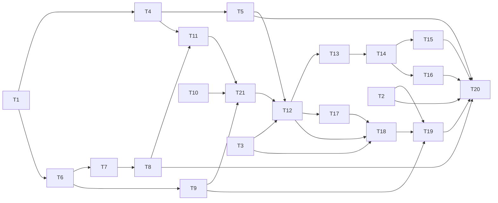

# Research agents, judge-first approval and environment facts

status: draft
commit-mode: orchestrator-commits
language: ruby
panel: Ruby (Linus Torvalds, Jeremy Evans, Sandi Metz, Richard Schneeman, Aaron Patterson)

## Intent

Round 3 of the frugirl trial (2026-10-15) needed 37 human approvals and 0 automatic ones, and stalled. The main agent gave a researcher shell work it had no shell for, so the researcher probed `/etc/passwd` and `/home` to find its own home directory.

This plan delivers 6 things:

- Every agent gets an environment block, and the main agent sees what each child role can do.
- The account and sudo files are always refused.
- The approval values become `ask`, `auto` and `bypass`. The new `auto` is a judge-first ladder and is on by default.
- Shift+Tab cycles between `ask` and `auto`, and the key can be rebound.
- A human deny on a path is remembered per requester.
- The shell triage approves plain read-only probes.

Researchers then get gated `bash` and writes in a kept scratch directory or spike worktree. The plan deletes what the old shape needed as it goes, because no backward compatibility is required.

Research and rulings: `planning/research-agents-and-approval-research-2026-10.md` (its Decisions section) and `planning/approval-layering-research-2026-10.md`. Roadmap line: `ROADMAP.md` item 57.

**User rulings (2026-10-15):**

- Names `ask`, `auto`, `bypass`. `bypass` is today's `auto`.
- The new `auto` is the default approval. `/mode !` resets approval to `ask`.
- `--non-interactive` under `auto` refuses a call the judge is unsure about.
- A deny is remembered for the session, per requester.
- A researcher's scratch directory or spike worktree is kept. The parent picks which at spawn (`extends:`), and the harness does the setup.
- No `environment` tool.
- Shift+Tab is the default cycle key, rebindable in the user's config. `bypass` is never on a key.
- The judge is bounded at 30s. An unsure verdict returns as soon as the judge says so, so the bound only matters for a hung judge.
- A model approve applies only when the call's class allows it. Confidence is never used.
- The deterministic first tier (tier 0) is in this plan.

**Tier 0, as this plan builds it.** It is the class check inside the `Judged` rung (T10), always on, with no model.

- Any call with a path in `Sensitivity::Policy::PATH_FIELDS` (the 6 readers, `write_file`, `edit_file`, and `bash`'s `cwd`) is judged by `Policy#judge`. If that verdict is not `oracle_approvable?` (credential, named, configured, protected, malformed), the call never goes to the model and parks for the human. The rung journals why: `unjudgeable`.
- Anything else goes to the model judge.
- A model approve is applied only when the class allowed judging.
- The `--secret-oracle` model tier stays opt-in and unchanged.

## Grounding

**Date and base.** 2026-10-15, `main` at `6b43bab1`.

**How it was checked.** 4 read-only Explore passes (approval modes, shell triage and deny path, agents and environment and leases, sensitivity), plus my own reads. Probes I ran myself:

- `tmux -L <sock> -f /dev/null` with `send-keys BTab` into `cat -v` printed `^[[Z`. So Shift+Tab reaches a pane as `ESC [ Z` with tmux's `extended-keys` off, unlike Shift+Enter.
- `Open3.pipeline_r(["sh","-c","echo out; echo err >&2", {err: File::NULL}], ["cat"])` returned `"out\n"` and printed no `err`. Per-stage spawn options work.
- `bwrap` 0.11.2 is installed. It is not used here.

**Files checked.**

- Approval and modes: `lib/lain/mode.rb`, `lib/lain/mode/{approval,layer,layer_set,resolution,scope}.rb`, `lib/lain/cli/command/mode.rb`, `lib/lain/cli/switchboard.rb`, `lib/lain/approval/{escalation,auto_surface,secret_surface,queue_surface,queue,path_gate,composed_term,remembered,risk,rule}.rb`.
- Shell: `lib/lain/shell/{parse,verdict,pipeline}.rb`, `lib/lain/tools/bash.rb`, `lib/lain/exec/{local,docker}.rb`, `lib/lain/telemetry/shell_arm.rb`.
- Middleware and sensitivity: `lib/lain/middleware/{gate,sensitivity,withhold_automatic_output}.rb`, `lib/lain/cli/tool_guard.rb`, `lib/lain/sensitivity.rb`, `lib/lain/sensitivity/policy.rb`.
- Agents and isolation: `lib/lain/tools/subagent.rb`, `lib/lain/cli/wiring/{toolset_build,board_build}.rb`, `lib/lain/cli/{wiring,backend,chat_launch}.rb`, `lib/lain/prompt/{slots,locked_binding}.rb`, `lib/lain/prompt/templates/system.md.erb`, `lib/lain/role/catalog.rb`, `lib/lain/role.rb`, `lib/lain/isolation/{spike,scratch,leases,lease,worktree}.rb`, `lib/lain/session.rb`.
- Frontend and config: `lib/lain/frontend/{line_editor,intake,input_pane,stdin_pump}.rb`, `lib/lain/cli/input_socket.rb`, `lib/lain/config.rb`, `lib/lain/config/builder.rb`, `exe/lain`.
- The round 3 session record.

**Where docs and code disagreed.**

- `lib/lain/cli/wiring.rb:124-126` says `/mode auto` uses `Gate::ApproveAll`. The code uses `Escalation::Remainder`; `ApproveAll` serves only the detached builder (`tool_guard.rb:307`). Code wins, and T12 fixes the comment.
- `escalation.rb:168-176` says Triage and Rules are inert. Both are wired (`switchboard.rb:376,390`, `board_build.rb:62-63`). Code wins, and T11 fixes it.
- `remembered.rb:5-34` says answers are remembered from the prompt. Nothing writes them. T1 fixes the docstring.

**Runtime premises behind the cards.**

- **Session-fixed prompt.** Slots render once per process (`backend.rb:614` memoizes the library).
- **VCR.** It matches on method and URI only (`spec/support/vcr_configuration.rb:233`).
- **e2e fingerprints.** They leave out the system prompt (`spec/support/e2e/cassette.rb:59-70`).
- **The Gate.** It consults the ladder only for a gated call (`gate.rb:163-180`), so an ordinary-path read never reaches a rung.
- **Region pendings.** `RedactSecretReads` parks them on the queue directly (`redact_secret_reads.rb:327`), bypassing the ladder.
- **Lines typed during a run.** They are held or become notes; only `/stop` leaves as a `Signal` (`intake.rb:56-68,179`). `InputSocket` already carries `signal` frames (`input_socket.rb:353`).

## Compatibility

| Surface | Verdict | Evidence |
|---|---|---|
| `/mode` tokens (`auto` meaning approve-all, `+auto_approve`, the retired `manual`/`accept_edits` refusals) | free to break | Gem `0.1.0`, unpublished (`CHANGELOG.md` has only Initial release); no tags; no use in `~/dev` outside lain. Memory `harness-vs-own-dev`: no back-compat needed. |
| `--auto-approve` flag | free to break | Same evidence; a grep of `~/dev` found no script passing it. |
| Default approval `ask` | free to break | User ruling: default `auto`. |
| Journal mode-switch records (`to_approval`, `to_layers`) | free to break | Session files under `~/.local/state/lain/sessions/`. Old `auto` runs will read as the new `auto` in `Compare::Mode`. No mapping (user ruling); `ModeState.lighter_of` already falls back to the raw name, so the HUD will not raise. |
| Bash term shape `Array<Array<String>>` | free to break | Internal. Consumers: `bash.rb`, `exec/{local,docker}.rb`, `approval/{composed_term,rule}.rb`, `telemetry/shell_arm.rb`. |
| `shell_arm` journal record's `term` field | free to break | Internal telemetry. |
| `Tools::Subagent` input schema (gains `extends`) | free to break | Model-facing schema, internal. |
| System prompt bytes | free to break | VCR and e2e do not match on them; `slots_spec.rb:216` pins a digest that T2 replaces. |
| `.lain/config.rb` verbs | must keep | `~/dev/frugirl/.lain/config.rb` uses `approval timeout:` and `sensitivity related:`. Neither changes; T15 adds a user verb. |
| `Approval::Risk` classes other than `Root` | free to break | No `lib/` caller (Explore pass 2); spec-only. |

No trade report was needed: no must-keep surface blocks a simplification.

## Spike findings

| Question | Result | Evidence |
|---|---|---|
| Does Shift+Tab reach a tmux pane without extended-keys? | Yes, as `ESC [ Z` | `cat -v` in a `-f /dev/null` tmux server printed `^[[Z` |
| Can 1 stage of an `Open3.pipeline_r` discard stderr? | Yes, with a trailing `{err: File::NULL}` in that stage's array | Probe output `"out\n"`, no stderr |
| How fast and accurate is the judge on glm-5.3? | Not measured; needs a cloud session | Integration check 5, and the trial runbook |

No worktree was created.

## Shared files

The main session edits these; cards hand back 1-line diffs:

- `ROADMAP.md` (item 57).
- `CLAUDE.md` (the "A mode is scope × approval" bullet near line 323: values become `ask`/`auto`/`bypass`, and `auto` judges first).
- `planning/qa/method.md` and `planning/qa/README.md`. Both carry the user's uncommitted edits, so T20 hands back diffs for them rather than editing.
- `.rubocop.yml`.
- `spec/support/slow_files.rb`.

## Rejected options

- **Deleting `PrefixStrategy::SiblingTemplate` and `AttenuationPosture::HandlerUnion`.** They are bench arms (`lib/lain/cache_profile.rb`, `spec/lain/tools/subagent_posture_equivalence_spec.rb`). Comparable strategies are the deliverable, so they stay.
- **Renaming the "automatic" cluster (`AUTOMATIC`, `automatic_approval_barred?`, `Queue#automatic`, `WithholdAutomaticOutput`).** "Automatic" still means "decided by a machine", which stays true under the new `auto`. Renaming touches about 40 files for no change in meaning.
- **Approving `a && b` and running it through `sh -c`, as Codex does.** The term arm exists so the parser and the shell cannot disagree (`bash.rb:16-24`; CVE-2026-19591 is that failure in Codex). T7 runs sequences without a shell instead.
- **`-V` as a version probe.** `sort -V` and `ls -V` mean version sort, and some tools read `-V` as verbose. Only `--version` is accepted.
- **Memoizing a shell `Decision` per `tool_use_id`.** Parsing 3 times costs microseconds, and the memo adds shared state. YAGNI.
- **Keeping `AutoSurface` racing the human under `ask`.** Under the new names, `ask` means the human answers. The judge lives in the `auto` rung.
- **Merging the secret oracle and the `auto_approver` judge.** The oracle sees only a path and cannot judge a command (earlier research).
- **A deny rule written to `.lain/config.rb`.** A mistaken deny would outlive the chat. The user ruled session scope.
- **A rung for deny memory.** Ordinary-path reads never reach the ladder (Grounding), so a rung would miss `/home/joel` after `/home` was denied. T17 uses middleware.

## Open decisions

None. Every card can start once its dependencies land.

## Panel changes

The Ruby panel returned REQUEST-CHANGES on the first draft. What changed:

- **T14.** The cycle key no longer rides `Intake::Signal`, which ends in the shutdown machine's closed byte table and is dropped between asks. It is its own callable, and the input pane sends a `cycle` frame. The key registry is keyed by byte sequence, so `S-Tab` (`ESC [ Z`) can bind, with a lone ESC kept working in vi mode.
- **T10.** Tier 0 reads `Policy#judge` over every `PATH_FIELDS` tool, so writes, edits and a `bash` cwd are covered, not only reads. The "reason class" is a journaled `escalation` record from the rung, so there is no new queue field. A hang is journaled as a fault.
- **T11 split.** A mechanical rename card (T11: `bypass`, `--approval`) and a wiring card (T21: `auto` runs `Judged`, through `BoardBuild.for`, with the judge and policy held before `seed` and shared by leased workers' ladders).
- **T12.** Its file list now covers `escalation.rb`'s `AUTOMATIC`, `repl.rb`, and every comment the integration grep would hit.
- **T13.** The default `auto` sits on the `--approval` launch option, not in `Mode.new`, so the 26 files that build a `Mode` or `Switchboard` directly keep `ask`. The headless consequence is stated, and the whole e2e tier runs before handback.
- **T17.** It records in `Queue#settle` and reads the queue from the guard inputs, with no separate store. It refuses only paths the policy would have asked about, on a `/` boundary, keyed by `Queue.requester_for`.
- **T9.** The version probe is a closed program table. `which` takes program names without the landing check. The rustup-proxy download risk is accepted in writing.
- **T7 and T8.** `&&` precedence, the dangling and leading `&&` cases, and words after a redirect are acceptance criteria now.
- **T18.** It adds a per-child `ConfineToScope` over the lease, so a write outside it is refused.
- **T4.** The bash case through Triage is an acceptance criterion, and the scope of "every agent" is stated.
- **The graph.** Edges that only served the old deny-memory store are gone. Every remaining edge is a code dependency or a file 2 cards share.

## Dependency graph



## Tasks

### T1: Delete Risk's unused classes and keep Root as Approval::Root          [risk: low]

**Depends on:** none
**Files:** `lib/lain/approval/risk.rb` (delete), `lib/lain/approval/root.rb` (new), `lib/lain/cli/wiring/board_build.rb`, `spec/lain/approval/risk_spec.rb` (delete), `spec/lain/approval/root_spec.rb` (new, from the `Risk::Root` block at `risk_spec.rb:455+`), `spec/lain/approval/composed_term_spec.rb` and `spec/lain/cli/wiring/board_build_spec.rb` (they build `Risk::Root`), `spec/lain/credential_patterns_spec.rb` and `spec/lain/sensitivity/ledger_spec.rb` (comments naming Risk), `lib/lain/approval/remembered.rb` (docstring only), and comment-only edits at `lib/lain/sensitivity.rb:23,32,81,510,825,842,939`, `lib/lain/sensitivity/ledger.rb:38`, `lib/lain/approval/rule.rb:45`, `lib/lain/config/answers.rb:205`, `lib/lain/approval/composed_term.rb:41`
**Reuse:** `Risk::Root` as it stands (`risk.rb:175-226`)
**Shared-file wiring:** none
**Reachable from:** `CLI::Wiring::BoardBuild` (`board_build.rb:230-241`), which constructs `Approval::Root`

**Acceptance criteria**

```gherkin
Scenario: The project-root rule still confines automatic shell approval
  Given a board built on the production path for a project at a temporary root
  When a bash call reads a file outside that root
  Then the composed-term rule does not approve it, as before

Scenario: Nothing names the deleted classes
  Given the lib tree
  When it is searched for Keepsake, Classification, OutsideRoot, ShellString and Risk#classify
  Then no file names them
```

Spec files: `spec/lain/approval/root_spec.rb`, `spec/lain/cli/wiring/board_build_spec.rb`

**Interface**

```ruby
module Lain::Approval
  class Root # was Risk::Root, unchanged behaviour
  end
end
```

**Stop and report if:**

- A `lib/` file calls `Risk#classify` or `Risk::Keepsake` (the Explore pass found none).
- `bin/zeitwerk-census --check` reports an orphan after the move.

### T2: Every agent's system prompt carries a fixed environment block          [risk: medium]

**Depends on:** none
**Files:** `lib/lain/prompt/environment.rb` (new), `lib/lain/prompt/slots.rb`, `lib/lain/prompt/templates/system.md.erb`, `lib/lain/skill/library.rb`, `lib/lain/cli/backend.rb`, `lib/lain/cli/chat_launch.rb`, `spec/lain/prompt/environment_spec.rb` (new), `spec/lain/prompt/slots_spec.rb`, `spec/lain/cli/backend_spec.rb`, `spec/lain/cli/chat_launch_spec.rb`
**Reuse:** `Environment.none` as `Backend.new`'s default, so the other callers (`cli/improve.rb:173`, `cli/consolidate.rb:81`, `tools/epic_submit.rb:477`, `exe/lain:843`) need no edit; `LockedBinding` `locals:` (`locked_binding.rb:88-93`), as `render_skill` uses them; `Project` (`project.rb`); `Config.sensitivity(root:).related`; `Project::Repository.nearest`
**Shared-file wiring:** none
**Reachable from:** `CLI::ChatLaunch#backend` builds `Prompt::Environment.current(project:, related:)` and passes it to `Backend.new`, whose `library` loads `Slots` with it, and `Backend#context` renders it. Persona children get it through `Role#child_context`'s `slots.render("system")`.

**Acceptance criteria**

```gherkin
Scenario: The main agent's system prompt names its environment
  Given a chat launched on the production path in a project with 1 related directory
  When its first request is rendered
  Then the system text holds the home directory, the user name, the OS name and version, the shell, the project root, the cwd, the related directory, whether the root is a git repository, and today's date

Scenario: A fresh researcher child sees the same block
  Given that chat's research subagent
  When the child's first request is rendered
  Then its system text holds the same environment block

Scenario: The block is byte-stable within a session
  Given 2 requests rendered in 1 session
  Then their system texts are byte-identical

Scenario: A spec renders a fixed environment
  Given Prompt::Environment.fixed
  When the shipped system slot is rendered with it
  Then the digest equals the pinned digest
```

Spec files: `spec/lain/prompt/environment_spec.rb`, `spec/lain/prompt/slots_spec.rb`, `spec/lain/cli/backend_spec.rb`, `spec/lain/cli/chat_launch_spec.rb`

**Interface**

```ruby
module Lain::Prompt
  Environment = Data.define(:home, :user, :os, :shell, :root, :cwd, :related, :git, :date) do
    def self.current(project:, related:, clock: Time, env: ENV, os_release: "/etc/os-release") = ...
    def self.fixed = ...      # for specs: constant values, no filesystem
    def self.none = ...       # renders nothing; for callers with no project
  end
end
# Slots.load(root:, environment: Environment.none)
```

**Stop and report if:**

- `spec/lain/prompt/slots_spec.rb`'s purity checks (lines 41-62) refuse a `locals:` name in `system.md.erb`.
- `spec/lain/project/root_defaults_spec.rb:382-389,789-806` fails. `Slots.load` must keep `root:` required.
- `spec/support/cassette_hygiene.rb` flags a committed cassette, which would mean a recorder captured a real `$HOME`.

### T3: The subagent tool says what its child can do, and the chat's researcher gets its persona          [risk: low]

**Depends on:** none
**Files:** `lib/lain/tools/subagent.rb`, `lib/lain/cli/wiring/toolset_build.rb`, `spec/lain/tools/subagent_spec.rb`, `spec/lain/cli/wiring/toolset_build_spec.rb`
**Reuse:** `policy.only` (`tool/spawn_policy.rb`); `ToolsetBuild#persona(role)` (`toolset_build.rb:441`)
**Shared-file wiring:** none
**Reachable from:** `CLI::Wiring::ToolsetBuild#research_subagent` (`toolset_build.rb:408-414`)

**Acceptance criteria**

```gherkin
Scenario: The description lists the child's tools
  Given the chat's research subagent built on the production path
  When its tool description is rendered
  Then it names every tool in the researcher role's only list

Scenario: A role with no shell says so
  Given a subagent whose role has no bash
  Then its description says the child cannot run commands and that the parent should run them and pass the output in

Scenario: The chat's researcher receives its role prompt
  Given the chat's research subagent
  When a child's first request is rendered
  Then its system blocks hold the researcher persona text
```

Spec files: `spec/lain/tools/subagent_spec.rb`, `spec/lain/cli/wiring/toolset_build_spec.rb`

**Stop and report if:**

- The description bytes vary between 2 renders in 1 run. The comment at `subagent.rb:18-23` makes them a cache key.

### T4: Account and sudo files are always refused, by absolute path          [risk: high]

**Depends on:** T1
**Files:** `lib/lain/sensitivity.rb`, `spec/lain/sensitivity_spec.rb`, `spec/lain/middleware/sensitivity_spec.rb`, `spec/lain/approval/escalation_spec.rb`
**Reuse:** `Rule` and `Anchors` (`sensitivity.rb:114-315`); `DENIED` (l.699); `Pathname#cleanpath` normalization (l.992-1005); `Escalation::Triage`'s final deny on a denied argv word that holds a `/` (`escalation.rb:590-619`)
**Shared-file wiring:** none
**Reachable from:** `Sensitivity.new` (`sensitivity.rb:883`) puts `DENIED` first; `Sensitivity::Policy` is built in `Switchboard`, and `Middleware::Sensitivity` is in every stack (`tool_guard.rb:262-275`)

The refusal covers the path tools in `Policy::PATH_FIELDS`, and a `bash` command that names one of these files as an argv word through Triage. Shell content that is not a parsed word (`sh -c`, a script) is the known gap that `sensitivity.rb:807-809` already accepts.

**Acceptance criteria**

```gherkin
Scenario: A system secret is refused for every agent and every mode
  Given a chat on the production path under approval bypass
  When the main agent calls read_file on each of /etc/shadow, /etc/gshadow, /etc/sudoers, /etc/sudoers.d/90-x and /etc/../etc/shadow
  Then each call is refused with "no approval can lift this" and nothing is parked

Scenario: A shell read of the shadow file is refused under bypass
  Given approval bypass
  When the agent runs "cat /etc/shadow"
  Then Triage denies it as final and nothing runs

Scenario: A project file with the same tail is not refused
  Given a project holding etc/shadow
  When read_file names <project>/etc/shadow
  Then the verdict is not denied by the system rule

Scenario: A link to the shadow file is refused
  Given a symlink in the project pointing at /etc/shadow
  When read_file names the link
  Then the call is refused
```

Spec files: `spec/lain/sensitivity_spec.rb`, `spec/lain/middleware/sensitivity_spec.rb`, `spec/lain/approval/escalation_spec.rb`

**Interface**

```ruby
# One anchor field replaces the homed?/rooted? predicate pair.
Rule.new(anchor: :home | :root | :filesystem, ...)
Rule.absolute("/etc/shadow", level: :denied, reason: :system)
# EXPLANATIONS gains system: "a system account or privilege file"
```

**Stop and report if:**

- The no-filesystem canary (`sensitivity_spec.rb:1182-1270`) fails. The new rule must be pure string work.
- A `Rule.homed` or `Rule.rooted` caller outside `sensitivity.rb` breaks when the anchors merge (`Rules.rooted` config, `PROJECT_RUBY`).

### T5: A child's read of the account database is refused with a reason          [risk: high]

**Depends on:** T4
**Files:** `lib/lain/sensitivity/policy.rb`, `lib/lain/sensitivity.rb` (an `EXPLANATIONS` entry), `spec/lain/sensitivity/policy_spec.rb`, `spec/lain/seams/child_read_scope_spec.rb`
**Reuse:** `Confined#walked` (`policy.rb:197-202`); `READ_TOOLS`; `Denial`
**Shared-file wiring:** none
**Reachable from:** `ToolGuard.child_stack`, then `confined`, then `inputs.sensitivity.confined(roots:)` (`tool_guard.rb:228-254`)

**Acceptance criteria**

```gherkin
Scenario: A researcher cannot read /etc/passwd
  Given a chat's research child on the production path
  When it calls read_file on /etc/passwd
  Then the call is refused, not parked, and the result says the home directory is in its environment block

Scenario: A walk rooted at /etc/group is refused for a child
  When the child calls glob with path /etc/group
  Then the call is refused

Scenario: The main agent's read still asks
  When the main agent calls read_file on /etc/passwd under ask
  Then the call parks for the human, as before
```

Spec files: `spec/lain/sensitivity/policy_spec.rb`, `spec/lain/seams/child_read_scope_spec.rb`

**Stop and report if:**

- `Policy::Null#confined` (the detached builder at `tool_guard.rb:309`) does not reach `Confined#denial`.

### T6: Shell terms become a value object          [risk: high]

**Depends on:** T1
**Files:** `lib/lain/shell/term.rb` (new), `lib/lain/shell/verdict.rb`, `lib/lain/shell/pipeline.rb`, `lib/lain/tools/bash.rb`, `lib/lain/exec/local.rb`, `lib/lain/exec/docker.rb`, `lib/lain/approval/composed_term.rb`, `lib/lain/approval/rule.rb`, `lib/lain/telemetry/shell_arm.rb`, `spec/lain/shell/term_spec.rb` (new), `spec/lain/shell/verdict_spec.rb`, `spec/lain/shell/pipeline_spec.rb`, `spec/lain/tools/bash_spec.rb`, `spec/lain/exec/local_spec.rb`, `spec/lain/exec/docker_spec.rb`, `spec/lain/approval/composed_term_spec.rb`, `spec/lain/telemetry/shell_arm_spec.rb`
**Reuse:** `Verdict#allow` (`verdict.rb:219-221`); `Pipeline::Run#call` (`pipeline.rb:379-386`)
**Shared-file wiring:** none
**Reachable from:** `Tools::Bash#perform` gets `@verdict.call(input.command)` and hands `decision.term` to `Exec::Local` (`bash.rb:275-333`)

**Acceptance criteria**

```gherkin
Scenario: A pipeline still runs without a shell
  Given the bash tool on the production path with Exec::Local
  When it runs "ls -la | wc -l"
  Then the term arm runs it, and the shell_arm record names 1 pipeline of 2 stages

Scenario: Every consumer reads the same term
  Given the term for "grep -n foo lib/a.rb | head -3"
  Then ComposedTerm, ShellArm and Exec::Docker each read it through Term, with no Array<Array<String>> left in lib/lain
```

Spec files: `spec/lain/shell/term_spec.rb`, `spec/lain/tools/bash_spec.rb`

**Interface**

```ruby
module Lain::Shell
  Term = Data.define(:pipelines) do        # sequential, joined by &&
    def stages = pipelines.flat_map(&:stages)
  end
  Term::Pipeline = Data.define(:stages)
  Term::Stage = Data.define(:argv, :discards)   # discards: frozen subset of %i[stdout stderr]
end
```

**Stop and report if:**

- `Ractor.shareable?` on a Term is false.
- `spec/lain/shell/pipeline_spec.rb`'s `STDIN_SAFE` examples (143-200) change meaning.

### T7: A command joined by && runs as a sequence without a shell          [risk: high]

**Depends on:** T6
**Files:** `lib/lain/shell/verdict.rb`, `lib/lain/shell/pipeline.rb`, `lib/lain/exec/docker.rb`, `lib/lain/tools/bash.rb` (the `command` field description at lines 123-135), `spec/lain/shell/verdict_spec.rb`, `spec/lain/shell/pipeline_spec.rb`, `spec/lain/exec/docker_spec.rb`, `spec/lain/tools/bash_spec.rb`
**Reuse:** `Parse::Result#separators` with byte ranges (`parse.rb:100-104`); the malformed-term check (`verdict.rb:336-342`), widened to count `|` and `&&` together
**Shared-file wiring:** none
**Reachable from:** `Tools::Bash#perform` (`bash.rb:275`)

`&&` binds looser than `|`, so `a | b && c | d` is 2 pipelines. Every stage of every pipeline must be allowed on its own, builtins such as `cd` stay unrunnable, a newline still abstains, and 1 deadline covers the whole sequence. `Exec::Docker` runs a sequence through its existing `sh -c` arm, which is the same exposure its pipes already accept (`docker.rb:197`); this card accepts it and says so in the class comment.

**Acceptance criteria**

```gherkin
Scenario: && runs each pipeline in order and stops at the first failure
  Given the bash tool with Exec::Local
  When it runs "false && echo no"
  Then nothing is printed, the exit status is 1, and the term arm ran it

Scenario: Each stage is judged
  When the verdict reads "pwd && ls -la | wc -l"
  Then it allows with a term of 2 pipelines, the second of 2 stages

Scenario: A dangling or leading && abstains
  When the verdict reads "echo hi &&" or "&& echo hi"
  Then it abstains

Scenario: Other separators still abstain
  When the verdict reads "ls; pwd", "ls || pwd" or "ls & pwd"
  Then it abstains naming the separator

Scenario: A newline is not a sequence
  When the verdict reads "ls" and "pwd" on 2 lines
  Then it abstains

Scenario: Docker runs a sequence through its string arm
  Given Exec::Docker
  Then takes_term? is false for a term with 2 pipelines
```

Spec files: `spec/lain/shell/verdict_spec.rb`, `spec/lain/shell/pipeline_spec.rb`, `spec/lain/exec/docker_spec.rb`, `spec/lain/tools/bash_spec.rb`

**Stop and report if:**

- The timeout in `pipeline_spec.rb:417` cannot be made to cover the whole sequence with 1 deadline.

### T8: A redirect to /dev/null is understood          [risk: high]

**Depends on:** T7
**Files:** `lib/lain/shell/parse.rb`, `lib/lain/shell/verdict.rb`, `lib/lain/shell/pipeline.rb`, `lib/lain/tools/bash.rb` (description), `spec/lain/shell/parse_spec.rb`, `spec/lain/shell/verdict_spec.rb`, `spec/lain/shell/pipeline_spec.rb`
**Reuse:** `Term::Stage#discards` (T6); the probe in Spike findings (`{err: File::NULL}` per stage)
**Shared-file wiring:** none
**Reachable from:** `Tools::Bash#perform` (`bash.rb:275`)

`Parse` does not expose a redirect's operator or target today, drops words after a trailing redirect, and keeps a leading one as a literal argv word (`parse_spec.rb:327-342`). This card adds the captures.

**Acceptance criteria**

```gherkin
Scenario: stderr to /dev/null is a discard
  When the verdict reads "ls missing 2>/dev/null"
  Then it allows, and the stage discards stderr

Scenario: stdout to /dev/null is a discard
  When the verdict reads "cat a >/dev/null"
  Then it allows, and the stage discards stdout

Scenario: Both streams to /dev/null are discarded
  When the verdict reads "ls missing &>/dev/null"
  Then it allows, and the stage discards stdout and stderr

Scenario: Any other redirect still abstains
  When the verdict reads "echo a >out.txt" or "cat <in.txt" or "ls 2>&1" or ">/dev/null ls"
  Then it abstains

Scenario: A word after a redirect abstains
  When the verdict reads "echo a >/dev/null b"
  Then it abstains, so the argv that runs is never different from the one written

Scenario: The discarded stream is gone when it runs
  Given the bash tool with Exec::Local
  When it runs "ls /nonexistent 2>/dev/null"
  Then the result holds no stderr text
```

Spec files: `spec/lain/shell/parse_spec.rb`, `spec/lain/shell/verdict_spec.rb`, `spec/lain/shell/pipeline_spec.rb`

**Stop and report if:**

- The tree-sitter query cannot capture a `file_redirect`'s descriptor and target as separate nodes.

### T9: ls, pwd, which and a named program's --version approve with no human          [risk: high]

**Depends on:** T6
**Files:** `lib/lain/approval/composed_term.rb`, `spec/lain/approval/composed_term_spec.rb`, `spec/lain/cli/wiring/board_build_spec.rb`
**Reuse:** `PROGRAMS` and `Flags` (`composed_term.rb:298-410`); predicates 4 to 9
**Shared-file wiring:** none
**Reachable from:** `BoardBuild#approving` (`board_build.rb:131-134`), which appends `ComposedTerm.new(sensitivity:)`

The rule judges every stage of every pipeline (`Term#stages`).

- **New `PROGRAMS` entries.** `ls` (refusing `-R`, `--recursive`, `-L`, `-H` and the `--dereference` flags), `pwd` and `which`.
- **`which`.** Its arguments are program names, so a word with no `/` skips the landing predicate for `which` alone. A word with a `/` is judged as a path, as before.
- **Version probes.** A closed `VERSION_PROBES` table: `rustc cargo rustup dx adb node npm python3 ruby go gcc clang cmake`. A probe stage is exactly `[name, "--version"]`, with a bare `name`.
- **Accepted risk.** `rustc`, `cargo` and `rustup` on this machine are rustup proxies (`~/.cargo/bin`). In a project whose `rust-toolchain.toml` names a toolchain that is not installed, `--version` may download it. The user asked for these probes, so the card accepts this and says so in the constant's comment.

**Acceptance criteria**

```gherkin
Scenario: A read-only probe approves on the production path
  Given a board on the production path in a project
  When the agent runs each of "pwd", "ls -la", "pwd && ls -la", "which cargo" and "rustc --version"
  Then the composed-term rule approves each one and no pending is parked

Scenario: The hazards still ask
  Given a board on the production path in a project
  When the agent runs each of "ls -R", "ls --recursive", "ls -L link", "rustc -V", "rustc --version extra", "./x --version" and "mytool --version"
  Then the composed-term rule approves none of them
```

Spec files: `spec/lain/approval/composed_term_spec.rb`, `spec/lain/cli/wiring/board_build_spec.rb`

**Stop and report if:**

- `composed_term_spec.rb:846-857` asserts that every `PROGRAMS` value is a `Flags` with no executor, and the version table cannot sit beside it without breaking that claim.

### T10: A judge-first rung decides clear calls and parks the rest          [risk: high]

**Depends on:** none
**Files:** `lib/lain/approval/judge.rb` (new), `lib/lain/approval/judged.rb` (new), `spec/lain/approval/judge_spec.rb` (new), `spec/lain/approval/judged_spec.rb` (new)
**Reuse:** `AutoSurface#prompt_for`/`parse`/`VERDICT` (`auto_surface.rb:29,116-125`); `RoleSpawn#never_parking` (`role_spawn.rb:92-95`); `Escalation::Surfaces`; `Ruling`; `Sensitivity::Policy.path_in` and `#judge` over `PATH_FIELDS` (`policy.rb:85-97,295`); `Session.cwd_of(context)` and `Policy.base_of(context)` as `Queue#admit` uses them (`queue.rb:386-388`); `Verdict#oracle_approvable?`; `Async::Task#with_timeout` as `SecretSurface` uses it
**Shared-file wiring:** none
**Reachable from:** `Switchboard#ladders`, `auto:` key (wired in T21)

**How the rung answers**

- A barred context, or a call whose path verdict is not `oracle_approvable?`, goes straight to `asking` with no judge call.
- Otherwise the judge runs within its bound.
  - approve becomes `Ruling.allow` with automatic authority.
  - deny becomes `Ruling.deny`, not final.
  - defer, a hang or an error delegates to `asking`.
- Before delegating, the rung journals 1 `escalation` record of its own: rung `auto`, verdict `abstain`, and the reason `deferred`, `fault` or `unjudgeable`. No new queue or `Pending` field is needed. A hang is also journaled as `fault: true`.
- The judge's child runs inside the timed task, so the timeout unwinds it.

**Acceptance criteria**

```gherkin
Scenario: A clear approve is applied
  Given an attended auto rung whose judge answers approve
  When an ordinary gated bash call reaches it
  Then the ruling allows with automatic authority and nothing is parked

Scenario: A judge deny is applied and not final
  Given a judge that answers deny
  Then the ruling denies, not final

Scenario: An unsure judge parks for the human
  Given a judge that answers defer
  When the call reaches the rung
  Then an escalation record names deferred, the call parks on the queue, and the human's answer decides it

Scenario: A hung judge parks after the bound
  Given a judge that does not answer within 30 seconds
  Then an escalation record names fault, and the call parks for the human

Scenario: Tier 0 keeps secret-gated reads away from the model
  Given a read_file call on a credential-named path
  Then the judge is never asked, an escalation record names unjudgeable, and the call parks

Scenario: Tier 0 covers writes and commands too
  Given a write_file call on a protected path, and a bash call whose cwd is a named secret directory
  Then the judge is never asked for either, and both park

Scenario: Unattended refuses what the judge cannot settle
  Given an unattended auto rung with no queue
  When the judge answers defer
  Then the ruling denies with a reason that names --non-interactive

Scenario: A barred call goes to the human
  Given a context whose automatic approval is barred
  Then the judge is never asked and the call parks as humans-only
```

Spec files: `spec/lain/approval/judge_spec.rb`, `spec/lain/approval/judged_spec.rb`

**Interface**

```ruby
module Lain::Approval
  class Judge
    TIMEOUT = 30
    def initialize(role_spawn:, timeout: TIMEOUT) = ...
    # => :approve | :deny | :defer | :fault
    def call(requester:, tool:, input:) = ...
  end

  class Judged # an Escalation rung
    NAME = "auto"
    def initialize(judge:, policy:, asking:, journal:) = ... # asking: Surfaces, or a refusing rung
    def call(effect, context) = ... # => Escalation::Ruling
  end
end
```

**Stop and report if:**

- `with_timeout` has no reactor where the rung runs. `SecretSurface` skips the bound in that case, and the rung must not hang.
- The `auto_approver` child is spawned on a separate task that the timeout does not cancel.

### T11: Today's auto becomes bypass, and --approval replaces --auto-approve          [risk: medium]

**Depends on:** T8, T4
**Files:** `lib/lain/mode/approval.rb`, `lib/lain/cli/command/mode.rb`, `lib/lain/cli/switchboard.rb`, `lib/lain/approval/escalation.rb`, `lib/lain/middleware/withhold_automatic_output.rb`, `exe/lain`, `lib/lain/compare/mode.rb` (comments), `lib/lain/bench/variance.rb` (comment), `spec/lain/mode/approval_spec.rb`, `spec/lain/cli/command/mode_spec.rb`, `spec/lain/cli/switchboard_spec.rb`, `spec/lain/approval/escalation_spec.rb`, `spec/lain/middleware/withhold_automatic_output_spec.rb`, `spec/lain/cli/wiring_spec.rb`, `spec/lain/mode/switch_spec.rb`, `spec/lain/mode/resolution_spec.rb`, `spec/lain/compare/mode_spec.rb`, `spec/lain/seams/symlink_boundary_spec.rb`, `spec/lain/seams/plan_scope_spike_spec.rb`, `spec/lain/seams/child_worktree_approval_spec.rb`, `spec/lain/tools/bash_spec.rb`, `spec/journal_routing_discipline_spec.rb`, `spec/lain/bench/session_spec.rb`, `spec/lain/cli/command/env_spec.rb`, `spec/lain/cli/command/surface_spec.rb`, `spec/lain/cli/resume_spec.rb`, `spec/lain/cli_spec.rb`, `spec/lain/cli/tool_guard_spec.rb`, `spec/lain/compare_spec.rb`, `spec/lain/frontend/prompt_composer_spec.rb`, `spec/lain/mode_spec.rb`, `spec/lain/status_feed/mode_state_spec.rb`, `spec/lain/status_feed_spec.rb`, `spec/lain/telemetry/shell_arm_spec.rb` (each spec that sets approval `:auto` meaning approve-all, from `grep -rln 'approval: :auto\|/mode auto\|mode("auto' spec`; the matches in `toolset_build_spec.rb` move in T12)
**Reuse:** `Escalation::Remainder`, renamed `Bypass` with `NAME = "bypass"`; `Escalation.automatic`, renamed `.bypass`; `Switchboard#automatic_ladder`, renamed `#bypass_ladder`
**Shared-file wiring:** none
**Reachable from:** `Switchboard.for` (`switchboard.rb:108-114`) reads `options[:approval]` and seeds the starting mode with it; `Switchboard#ladders` and `#plan_ladders` key the ladders `ask:` and `bypass:`

A mechanical rename with no new behaviour. This card adds no `auto` value; T21 adds it.

**Acceptance criteria**

```gherkin
Scenario: bypass approves what the rules allow
  Given a chat on the production path
  When the human types /mode bypass and the agent runs a gated bash command
  Then it is approved with no prompt, as auto did before

Scenario: --approval chooses the starting approval
  When a chat starts with --approval bypass
  Then its mode is checkout with bypass approval

Scenario: The old flag and words are gone
  When lain is started with --auto-approve
  Then Thor refuses the unknown switch
  When the human types /mode manual
  Then it is refused as an unknown token
```

Spec files: `spec/lain/cli/switchboard_spec.rb`, `spec/lain/cli/command/mode_spec.rb`, `spec/lain/approval/escalation_spec.rb`, `spec/lain/cli_spec.rb`

**Interface**

```ruby
# exe/lain chat:  --approval ask|bypass   (auto arrives in T21; replaces --auto-approve)
# Mode::Approval::DECLARED  => ask, bypass
```

**Stop and report if:**

- `spec/journal_routing_discipline_spec.rb` or `spec/tool_bounds_discipline_spec.rb` names `Remainder` in a way a rename cannot satisfy.

### T21: The auto approval value runs the judge-first ladder          [risk: high]

**Depends on:** T10, T11, T9
**Files:** `lib/lain/mode/approval.rb`, `lib/lain/cli/switchboard.rb`, `lib/lain/cli/wiring/board_build.rb`, `lib/lain/cli/wiring.rb`, `spec/lain/cli/switchboard_spec.rb`, `spec/lain/cli/wiring/board_build_spec.rb`, `spec/lain/cli/wiring_spec.rb`, `spec/lain/seams/judged_approval_spec.rb` (new)
**Reuse:** `Approval::Judged` and `Approval::Judge` (T10); `ToolsetBuild#role_spawn` (set at `toolset_build.rb:248`, before `Wiring#switchboard` runs at `wiring.rb:388`); `Switchboard#build_ladder`, `#plan_ladders`, `#policy_for`
**Shared-file wiring:** none
**Reachable from:** `Wiring#switchboard` (`wiring.rb:968`) passes `judge: Approval::Judge.new(role_spawn: toolset.role_spawn)` to `BoardBuild.for`, which passes it to `Switchboard.for`. `Switchboard#initialize` keeps the judge and the sensitivity policy in ivars set before `seed`, so `ladders`, `plan_ladders` and the per-worker `policy_for` (`switchboard.rb:171-178`) all build `Judged` from the same 2 objects.

**Acceptance criteria**

```gherkin
Scenario: auto judges first on the production path
  Given a chat wired on the production path with --approval auto and a judge child that answers defer
  When the agent runs a gated bash command
  Then the call parks for the human

Scenario: A leased worker's ladder judges with the same judge
  Given an epic worker leased under auto
  When it makes a gated call and the judge answers approve
  Then the call is approved

Scenario: Plan scope has all 3 ladders
  Given plan scope
  When approval is each of ask, auto and bypass
  Then a resolution is found, and a command nothing confined still goes to a human

Scenario: An unattended auto run keeps triage and rules
  Given --non-interactive with --approval auto
  Then its ladder is triage, rules, then the judged rung that refuses on abstain
```

Spec files: `spec/lain/seams/judged_approval_spec.rb`, `spec/lain/cli/switchboard_spec.rb`, `spec/lain/cli/wiring/board_build_spec.rb`

**Stop and report if:**

- `Switchboard` passes `Metrics/ClassLength` only by a raise. Extract the ladder construction into a collaborator (for example `Switchboard::Ladders`) in this card instead.

### T12: Remove the auto_approve layer and the racing judge surface          [risk: medium]

**Depends on:** T21, T5, T3
**Files:** `lib/lain/approval/auto_surface.rb` (delete), `lib/lain/approval/escalation.rb` (`Surfaces::AUTOMATIC` at line 697), `lib/lain/approval/queue_surface.rb`, `lib/lain/approval/secret_surface.rb`, `lib/lain/cli/repl.rb` (`auto_surface:` at lines 32 and 47), `lib/lain/cli/repl/approval_surfaces.rb`, `lib/lain/cli/wiring/toolset_build.rb`, `lib/lain/cli/wiring.rb`, `lib/lain/mode/layer.rb`, and the comments naming the layer or the surface at `lib/lain/status_feed.rb:130`, `lib/lain/telemetry/mode_switch.rb:56`, `lib/lain/approval/path_gate.rb:40`, `lib/lain/approval/queue.rb:327`, `lib/lain/shell/verdict.rb:13`, `lib/lain/frontend/neovim/approval_view.rb:12`, `lib/lain/approval/gate/adjudicator.rb:45,64`, `lib/lain/mode/approval.rb:13`, `lib/lain/status_feed/mode_state.rb:21`, `lib/lain/cli/command/mode.rb:13-29`, `exe/lain:1093`; specs `spec/lain/approval/auto_surface_spec.rb` (delete), `spec/lain/approval/queue_surface_spec.rb`, `spec/lain/approval/secret_surface_spec.rb`, `spec/lain/cli/repl/approval_surfaces_spec.rb`, `spec/lain/cli/wiring/toolset_build_spec.rb`, `spec/lain/mode/layer_spec.rb`, `spec/lain/status_feed_spec.rb`, `spec/lain/status_feed/mode_state_spec.rb`, `spec/lain/seams/child_read_scope_spec.rb`, `spec/lain/cli/command/surface_spec.rb`, `spec/lain/approval/escalation_spec.rb`, `spec/lain/approval/gate/adjudicator_spec.rb`, `spec/lain/approval/queue_surface/pruning_spec.rb`, `spec/lain/cli/command/mode_spec.rb`, `spec/lain/cli/switchboard_spec.rb`, `spec/lain/cli/tool_guard_spec.rb`, `spec/lain/cli/wiring_spec.rb`, `spec/lain/frontend/neovim/approval_view_spec.rb`, `spec/lain/frontend/prompt_composer_spec.rb`, `spec/lain/mode/layer_set_spec.rb`, `spec/lain/mode/resolution_spec.rb`, `spec/lain/mode_spec.rb`, `spec/lain/mode/switch_spec.rb`, `spec/lain/seams/cockpit_answer_surfaces_spec.rb`, `spec/lain/seams/plain_chat_prompt_guards_spec.rb`, `spec/lain/seams/plan_scope_spike_spec.rb`, `spec/lain/tools/subagent_gate_spec.rb`, `spec/refusal_width_discipline_spec.rb`, `spec/support/nulls/no_switchboard.rb`
**Reuse:** none; this card only deletes. The `auto_approver` role stays, because `Approval::Judge` spawns it
**Shared-file wiring:** none
**Reachable from:** `ToolsetBuild#build` no longer constructs `AutoSurface`; `ApprovalSurfaces` watches only `SecretSurface`

**Acceptance criteria**

```gherkin
Scenario: /mode +auto_approve is unknown
  When the human types /mode +auto_approve
  Then it is refused as an unknown layer, listing goal, notify and vi

Scenario: The secret oracle still answers its pendings
  Given a chat with --secret-oracle
  When a read parks with sensitive regions
  Then SecretSurface still judges it

Scenario: Layers carry no outcome flag
  Then Mode::Layer has no alters_outcome member

Scenario: Nothing in lib or exe names the deleted surface or layer
  When lib and exe are searched for auto_approve, AutoSurface and auto_surface
  Then nothing is found
```

Spec files: `spec/lain/cli/repl/approval_surfaces_spec.rb`, `spec/lain/mode/layer_spec.rb`, `spec/lain/approval/secret_surface_spec.rb`

**Stop and report if:**

- `QueueSurface`'s partition (`judges?`, `claims?`, `yield_path_gates_to`) is still needed by `SecretSurface` alone. Then keep the base class and delete only `NoSenior` and the yield.

### T13: A launched chat starts in auto, and /mode ! resets to ask          [risk: high]

**Depends on:** T12
**Files:** `exe/lain` (the `--approval` default), `lib/lain/cli/command/mode.rb` (`FLOOR`, header comment, `held_in_flight` text), `lib/lain/mode/approval.rb` (lighters), `lib/lain/prompt/default.toml`, `spec/lain/cli_spec.rb`, `spec/lain/cli/command/mode_spec.rb`, `spec/lain/status_feed/mode_state_spec.rb`, `spec/e2e/cockpit_approval_spec.rb`, `spec/e2e/stop_while_busy_spec.rb`, and any other `spec/e2e/*_spec.rb` the full e2e run shows making a gated call
**Reuse:** the `--approval` option (T11); `Mode.new`'s own default stays `ask`, so the 26 files that build a `Mode` or a `Switchboard` directly are unchanged
**Shared-file wiring:** none
**Reachable from:** `exe/lain`'s chat command gives `--approval` the default `auto`, which `Switchboard.for` seeds (T11)

**What changes for headless runs.** With the default at launch, a `--non-interactive` run that names no approval gets `auto`. Today an unattended `ask` refuses every gated call (`switchboard.rb:423-436`). After this card the judge decides gated calls in a headless run, and an unsure verdict is refused. This is the user's ruling; the docs card states it. Bench and compare arms that need the old refusal pass `--approval ask`.

**Acceptance criteria**

```gherkin
Scenario: A new chat starts in auto
  Given a chat launched through exe/lain with no --approval
  Then its mode is checkout with auto approval, and the HUD shows no approval lighter

Scenario: ask and bypass are visible
  When approval is ask
  Then the HUD lighter shows ASK
  When approval is bypass
  Then it shows BYPASS

Scenario: Reset lands on ask
  Given approval auto
  When the human types /mode !
  Then approval is ask with no layers

Scenario: A journey that parks a call pins ask
  Given the e2e cockpit approval journey
  Then it launches with --approval ask and replays its cassette unchanged
```

Spec files: `spec/lain/cli_spec.rb`, `spec/lain/cli/command/mode_spec.rb`, `spec/e2e/cockpit_approval_spec.rb`

**Stop and report if:**

- An e2e journey reaches a judge request that its cassette does not hold. Pin `--approval ask` there; never re-record to cover the judge. Run the whole e2e tier (`LAIN_SLOW=1 bundle exec rspec spec/e2e`) before handing back.

### T14: Shift+Tab cycles approval between ask and auto          [risk: high]

**Depends on:** T13
**Files:** `lib/lain/frontend/line_editor.rb`, `lib/lain/frontend/intake.rb`, `lib/lain/frontend/input_pane.rb`, `lib/lain/frontend/stdin_pump.rb`, `lib/lain/cli/input_socket.rb`, `lib/lain/cli/switchboard.rb`, `lib/lain/cli/wiring.rb`, `spec/lain/frontend/line_editor_spec.rb`, `spec/lain/frontend/intake_spec.rb`, `spec/lain/cli/input_socket_spec.rb`, `spec/lain/cli/switchboard_spec.rb`, `spec/lain/seams/approval_cycle_key_spec.rb` (new)
**Reuse:** `LineEditor::Registry` (`line_editor.rb:370-520`); `InputSocket`'s frame dispatch (`input_socket.rb:353`); the mode switch `/mode` journals
**Shared-file wiring:** none
**Reachable from:** `Wiring` hands `Intake` an `on_cycle` callable bound to `Switchboard#cycle_approval`. The in-process `StdinPump` editor binds the key to it, and the input pane sends a `cycle` frame that `InputSocket` routes to the same callable.

**Design, after the panel.**

- The `Intake::Signal` path cannot carry this. It ends in `Shutdown::Ingress`'s closed byte table (`shutdown.rb:42-46,298`), and between asks `Signals::Null` drops it (`signals.rb:30`).
- So the cycle is its own callable, beside the line and signal paths, and it works with or without a run in flight.
- `Registry` is keyed by 1 byte today (`KEY_NAME`, `byte_of`). This card keys it by byte sequence, so `"S-Tab"` names `ESC [ Z`, and `bind`, `dispatch`, `claimed_by` and `verify_routing` all follow.
- In Reline 0.7.0, `[27, 91, 90]` is unbound in emacs and vi_insert. `[27]` alone is `:ed_ignore` in emacs and `:vi_command_mode` in vi_insert, so the binding must leave a lone ESC working.

**Acceptance criteria**

```gherkin
Scenario: The key cycles while a run is in flight
  Given a chat in auto with a tool call parked
  When the human presses Shift+Tab in the input pane
  Then approval is ask at once, without waiting for the run, and a mode switch is journaled with surface key

Scenario: The key cycles between runs
  Given a chat idle at you>
  When the human presses Shift+Tab
  Then approval changes

Scenario: The key never reaches bypass
  Given approval bypass
  When the human presses Shift+Tab
  Then approval is ask
  When the human presses it again
  Then approval is auto

Scenario: The key text is not typed
  When the human presses Shift+Tab with a draft in the line
  Then the draft is unchanged

Scenario: ESC still works in vi mode
  Given the vi layer is on
  When the human presses ESC alone
  Then the editor enters command mode, as before
```

Spec files: `spec/lain/frontend/line_editor_spec.rb`, `spec/lain/frontend/intake_spec.rb`, `spec/lain/cli/input_socket_spec.rb`, `spec/lain/seams/approval_cycle_key_spec.rb`

**Interface**

```ruby
# Registry key names: "C-<letter>" and "S-Tab" ("\e[Z"); keyed by byte sequence.
# InputSocket frame: {"type" => "cycle"}
# Switchboard#cycle_approval(surface:)  # ask -> auto, auto -> ask, bypass -> ask
```

**Stop and report if:**

- Reline cannot dispatch a 3-byte sequence to a lain method without changing what a lone ESC does in vi_insert.
- `Switchboard` passes `Metrics/ClassLength` only by a raise.

### T15: The user's config rebinds the cycle key          [risk: medium]

**Depends on:** T14
**Files:** `lib/lain/config/builder.rb`, `lib/lain/config.rb`, `lib/lain/config/keys.rb` (new), `lib/lain/cli/wiring.rb`, `spec/lain/config/keys_spec.rb` (new), `spec/lain/config/builder_spec.rb`, `spec/lain/config_spec.rb`
**Reuse:** `Builder::USER_VERBS` and `Config.user` (`config.rb:123-127`); `Builder#declare`
**Shared-file wiring:** none
**Reachable from:** `Config.user(paths)` is read at chat launch and its keys are handed to the `LineEditor` binding T14 added

**Acceptance criteria**

```gherkin
Scenario: A user binds the cycle to another key
  Given the user's config says keys approval_cycle: "C-t"
  When a chat starts
  Then C-t cycles approval and Shift+Tab does nothing

Scenario: An unknown key name is refused at launch
  Given keys approval_cycle: "Hyper-Q"
  Then launch refuses, naming the config line and the accepted forms

Scenario: A project config cannot rebind keys
  Given .lain/config.rb says keys approval_cycle: "C-t"
  Then it is refused as a verb only the user's config may use
```

Spec files: `spec/lain/config/keys_spec.rb`, `spec/lain/config_spec.rb`

**Interface**

```ruby
# ~/.config/lain/config.rb
keys approval_cycle: "S-Tab"   # the default when unset
```

**Stop and report if:**

- A taken key in the user's inputrc makes `Registry` raise `KeyTaken` at launch with no way to name another key.

### T16: :LainMode sets approval from nvim          [risk: medium]

**Depends on:** T14
**Files:** `lib/lain/frontend/neovim/runtime/30_commands.lua`, `lib/lain/frontend/neovim/approval_view.rb`, `spec/lain/frontend/neovim/runtime/30_commands_spec.rb`, `spec/lain/frontend/neovim/approval_view_spec.rb`
**Reuse:** `LainApprove`/`LainDeny` wiring (`62_approval.lua:189-232`); `Switchboard#cycle_approval`'s switch call (T14)
**Shared-file wiring:** none
**Reachable from:** the neovim frontend's RPC thread dispatches the message to the board, as it does for approve and deny

**Acceptance criteria**

```gherkin
Scenario: nvim sets auto
  Given a cockpit in ask
  When the human runs :LainMode auto
  Then approval is auto and the switch is journaled with surface nvim

Scenario: bypass is accepted by name only
  When the human runs :LainMode bypass
  Then approval is bypass

Scenario: A wrong value is refused in nvim
  When the human runs :LainMode yes
  Then nvim shows an error naming ask, auto and bypass
```

Spec files: `spec/lain/frontend/neovim/runtime/30_commands_spec.rb`, `spec/lain/frontend/neovim/approval_view_spec.rb`

**Stop and report if:**

- The nvim RPC has no route to the board other than a typed line, which would be held during a run.

### T17: A human deny on a gated path holds for that requester          [risk: high]

**Depends on:** T12
**Files:** `lib/lain/approval/queue.rb`, `lib/lain/middleware/remembered_denials.rb` (new), `lib/lain/cli/tool_guard.rb`, `spec/lain/approval/queue_spec.rb`, `spec/lain/middleware/remembered_denials_spec.rb` (new), `spec/lain/cli/tool_guard_spec.rb`, `spec/lain/seams/remembered_denial_spec.rb` (new)
**Reuse:** `Queue#settle` (`queue.rb:399-405`), which knows the `Pending`'s `requester`, `surface`, `reason`, `timed_out?` and `path`; `Queue.requester_for(context, Queue::REQUESTER)`; `Policy.path_in`, `Policy#judge` and `#gates?`; `Gate#refusal`'s non-final form; `ToolGuard::Inputs#approvals`
**Shared-file wiring:** none
**Reachable from:** `ToolGuard.stack` and `child_stack` put `Middleware::RememberedDenials` just before `Sensitivity`, so `Gate.closes!` still holds (it reads only the last 2, `gate.rb:99-104`). The middleware reads the queue from `inputs.approvals`; an unattended run has no queue and remembers nothing.

**Rules**

- **What is remembered.** `Queue#settle` remembers a deny when its surface is human: not `timeout`, not `abandoned`, not in `Surfaces::AUTOMATIC`, and not `ApprovalPolicy::FAULT_SURFACE`. The pending must carry a path.
- **The key.** `Queue.requester_for(context, Queue::REQUESTER)` on both sides, recording and lookup. The main agent is `agent`, and every chat researcher shares `researcher`.
- **The path.** It is resolved against the call's cwd, with `cleanpath`.
- **What is refused.** A later call by the same requester, with any tool, whose resolved path equals the denied path or sits under it on a `/` boundary. It is refused only when `Policy#gates?` would have asked about it, so an ordinary path under a denied ancestor (the project under `/home`) still reads.
- **Tools.** Any tool: a denied `write_file` also blocks a read of that path. This is intended.

**Acceptance criteria**

```gherkin
Scenario: Round 3's /home sequence asks once
  Given a research child on the production path
  And the human denied its list_files on /home with reason "not your business"
  When the same child calls glob on /home, then list_files on /home/joel
  Then both are refused with "not your business" and nothing is parked

Scenario: A project under the denied ancestor still reads
  Given that deny, and a project rooted under /home
  When the child reads a file in its project
  Then the read succeeds

Scenario: A sibling name is not under the denied path
  Given the human denied /home/jo
  When the same requester lists /home/joel
  Then the call parks for the human

Scenario: Another requester still asks
  Given the deny on /home by researcher
  When the main agent calls list_files on /home
  Then the call parks for the human

Scenario: A timeout or an automatic deny is not remembered
  Given a call on /tmp/x denied by the queue's timeout
  When the same requester reads /tmp/x again
  Then the call parks again
```

Spec files: `spec/lain/approval/queue_spec.rb`, `spec/lain/middleware/remembered_denials_spec.rb`, `spec/lain/seams/remembered_denial_spec.rb`

**Interface**

```ruby
# Queue#denied(requester:, path:) # => the human's reason String, or nil
```

**Stop and report if:**

- `Pending#decide`'s no-ledger-writes invariant (`queue.rb:168-177`) forbids the write in `settle` as well.

### T18: A researcher spawn leases its own kept, confined directory          [risk: high]

**Depends on:** T3, T12, T17
**Files:** `lib/lain/tools/subagent.rb`, `lib/lain/isolation/spike.rb`, `lib/lain/isolation/scratch.rb`, `lib/lain/session.rb`, `lib/lain/cli/wiring/toolset_build.rb`, `lib/lain/cli/tool_guard.rb`, `spec/lain/tools/subagent_spec.rb`, `spec/lain/isolation/spike_spec.rb`, `spec/lain/isolation/scratch_spec.rb`, `spec/lain/cli/tool_guard_spec.rb`, `spec/lain/seams/research_lease_spec.rb` (new)
**Reuse:** `Isolation::Spike.new(repo_root:, root:, cwd:)` and `#acquire(key)` (`spike.rb:46,70`); `Scratch#acquire`; `IsolationBackend.worktree_root`; `Project::Repository.nearest`; `Sensitivity#in_related_tree?` (`sensitivity.rb:913`); `Session::Confined.new(worker_env:, reminder:)` (`session.rb:603-607`); `Middleware::ConfineToScope` (`confine_to_scope.rb:24-46`)
**Shared-file wiring:** none
**Reachable from:** `ToolsetBuild#research_subagent` builds the `Subagent` with a lease source, and `Subagent#spawn_one_shot` (`subagent.rb:256-275`) leases from it before `build_child`. The child's stack (`ToolGuard.child_stack`) gets a `ConfineToScope` over the child's own `Session::Confined` scope, because the stack's existing `ConfineToScope` reads the board's scope (`confine_to_scope.rb:12`), which holds everything under `checkout`.

**Acceptance criteria**

```gherkin
Scenario: A researcher with no extends gets a kept scratch directory
  Given the chat's research subagent on the production path
  When it spawns a child with no extends
  Then the child's bash cwd is a fresh directory under lain's scratch root, its workspace names that directory in 1 sentence, and the directory exists after the child ends

Scenario: extends cuts a kept spike of that repository
  Given a related directory that is a git repository
  When the parent spawns with extends naming it
  Then the child works in a new worktree of that repository on its own lain/plan branch, and both remain after the child ends

Scenario: 2 parallel researchers never share a lease
  When the parent spawns 2 children at once with the same extends
  Then their worktrees and branches differ

Scenario: extends outside the project and related directories is refused
  When the parent spawns with extends "/etc"
  Then the subagent call fails validation and no child starts

Scenario: A write outside the lease is refused
  Given a research child in its lease
  When it calls write_file on a path in the parent's project
  Then the call is refused by name, before any approval

Scenario: The child spends no turns on setup
  Then the child's first request is its task, with no setup tool calls before it
```

Spec files: `spec/lain/seams/research_lease_spec.rb`, `spec/lain/tools/subagent_spec.rb`, `spec/lain/cli/tool_guard_spec.rb`

**Interface**

```ruby
# Subagent input (researcher only):
#   prompt:  String (required)
#   extends: String (optional) -- a git repository in the project root or a related directory
# The branch key is unique per spawn (SecureRandom), never the worker id,
# because WorkingBranch.owned reuses an existing owned branch.
```

**Stop and report if:**

- Under plan scope, `scope.lend` returns `InPlace` (`session.rb:627-631`) and a per-spawn lease cannot replace it without breaking `spec/lain/seams/plan_scope_spike_spec.rb`.
- Releasing through `Leases` removes a clean worktree (`worktree.rb`), which would break "kept".

### T19: Researchers run commands and write in their own lease          [risk: medium]

**Depends on:** T18, T9, T2
**Files:** `lib/lain/role/catalog.rb`, `lib/lain/prompt/templates/role/researcher.md`, `lib/lain/prompt/templates/skill/research-epic/skill.md`, `spec/lain/role_spec.rb`, `spec/lain/role_prelude_wiring_spec.rb`, `spec/lain/cli/wiring/toolset_build_spec.rb`, `spec/lain/skill/shipped_skills_spec.rb`, `spec/lain/prompt/slots_spec.rb` (the researcher digest at lines 218-219)
**Reuse:** the role catalog entry (`catalog.rb:34-35`)
**Shared-file wiring:** none
**Reachable from:** `Role::Catalog.fetch(:researcher)`, read by `ToolsetBuild#research_subagent` through `backend.spawn_policy`

**Acceptance criteria**

```gherkin
Scenario: A researcher's version probe needs no human
  Given a research child on the production path under ask
  When it runs "rustc --version"
  Then the command runs in its lease with no pending parked

Scenario: A researcher's curl asks
  When it runs "curl -s http://127.0.0.1:11434/api/tags"
  Then the call parks for the human, with researcher as requester

Scenario: A researcher writes a spike in its lease
  When it calls write_file on spike/main.rs relative to its cwd
  Then the file lands in its lease, and a write outside the lease is refused

Scenario: The skill tells the parent what researchers can do
  Then research-epic's skill text says researchers can run commands and spikes, names extends, and keeps the sentence that they do not search above the named paths
```

Spec files: `spec/lain/role_prelude_wiring_spec.rb`, `spec/lain/skill/shipped_skills_spec.rb`, `spec/lain/cli/wiring/toolset_build_spec.rb`

**Stop and report if:**

- `toolset_build_spec.rb:1144-1160`'s self-sync `askable` for the researcher turns true and changes a handback.
- `shipped_skills_spec.rb:487-503`'s pinned phrases cannot stay true with the new text.

### T20: Docs and QA scenarios describe the new approval, keys, leases and refusals          [risk: low]

**Depends on:** T2, T5, T8, T15, T16, T19
**Files:** `docs/commands.md`, `ARCHITECTURE.md`, `README.md`, `planning/qa/scenarios/repl-commands.md`, `planning/qa/scenarios/shell-term-approval.md`, `planning/qa/scenarios/shell-terms.md`, `planning/qa/scenarios/secret-boundary.md`, `planning/qa/scenarios/cockpit-surfaces.md`, `planning/qa/scenarios/prompt-slots-and-roles.md`, `planning/qa/scenarios/subagents-and-backends.md`, `planning/qa/scenarios/greenfield-epic.md`
**Reuse:** each card's acceptance criteria as the scenario checks
**Shared-file wiring:** diffs for `CLAUDE.md` (mode bullet), `planning/qa/method.md` (the "never `/mode auto`" rule at lines 215-247 becomes "state the approval you run under; the default is auto"), `planning/qa/README.md:142`, `ROADMAP.md` item 57 marked done
**Reachable from:** `spec/docs_config_examples_spec.rb` and `spec/docs_naming_spec.rb` read these docs; the behaviour they describe is reached through T2 to T19

**Acceptance criteria**

```gherkin
Scenario: The docs name only live surfaces
  When the docs and QA scenarios are searched for "auto_approve", "--auto-approve" and "/mode auto" meaning approve-all
  Then no live description remains, and each mention of auto describes the judge-first ladder

Scenario: The docs specs pass
  Then spec/docs_config_examples_spec.rb and spec/docs_naming_spec.rb pass
```

Spec files: `spec/docs_config_examples_spec.rb`, `spec/docs_naming_spec.rb`

**Stop and report if:**

- `planning/qa/method.md` or `planning/qa/README.md` needs an edit. Hand back the diff; the user has uncommitted work in both.

## Integration checks

After the last card lands:

1. `pgrep -cf 'mise/installs/ruby/[0-9.]*/bin/parallel_rspec'` and `pgrep -cf '[p]re-commit (hook-impl|run)'` both read 0. Then run `bundle exec rake pspec` and compare the example count against the base run plus the examples the cards added, net of deleted specs (`risk_spec.rb`, `auto_surface_spec.rb`).
2. `bundle exec rubocop`, `bin/comment-census --check-tickets`, `bin/zeitwerk-census --check`, `bin/spec-census --check`.
3. `pre-commit run --all-files`.
4. `grep -rn 'auto_approve\|AutoSurface\|auto_surface\|Risk::' lib exe` returns nothing, comments included.
5. **Manual, owed by the user:** frugirl round 4 per `frugirl-trial.md`, in the default `auto`. Record:
   - the judge's latency per call and its wrong approves;
   - the count of human prompts against round 3's 37;
   - that no researcher reads `/etc/passwd` or lists `/home`;
   - that Shift+Tab switches mid-run;
   - that a researcher's `rustc --version` runs without a prompt.
6. **Manual:** `/manual-qa repl-commands secret-boundary shell-term-approval cockpit-surfaces`.

## Execution log
