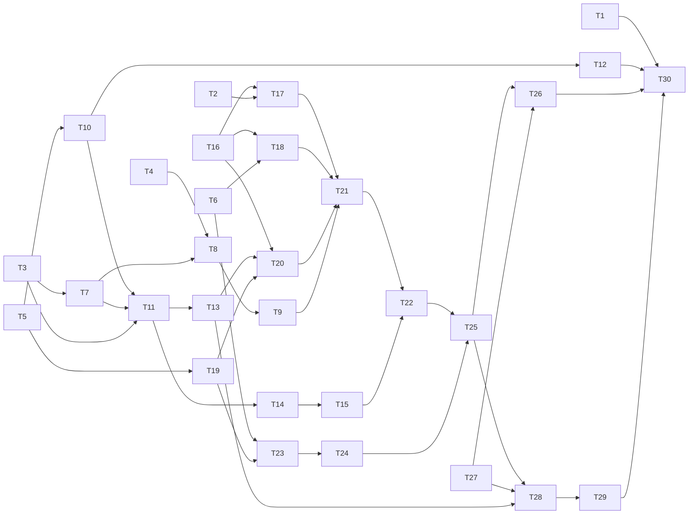

# Review queue, HUD count and review simplifications

status: draft
commit-mode: orchestrator-commits
language: ruby, rust (T1 only)
panel: Ruby (Linus Torvalds, Jeremy Evans, Sandi Metz, Richard Schneeman, Aaron Patterson); Rust seats for T1 (Raph Levien, Andrew Gallant)

## Intent

Carry out `planning/review-hud-research-2026-11.md`, option 1, with the user's rulings of 2026-11-16.

1. **The queue.** `lain queue` lists what waits for review, with 0 model calls:
   - plan runs;
   - local changes;
   - GitHub PRs requested of you or your teams;
   - keyword and path matches.

   A fzf popup picks 1. The running chat in that checkout offers the `/review`, and you press Enter.
2. **The count.** `lain queue poll`, every 5 minutes from a timer, writes 2 numbers: the reviews waiting, and the direct requests that are new since you last opened the queue. The herdr sidebar and lain's HUD show them.
3. **Targeted critique, on request.** Enter opens a review with no model call. Alt-Enter opens it and then runs the existing `/critique` over it, aimed at the reason the row is listed.
4. **Simplifications.**
   - `/review` and `/survey` share 1 opener.
   - Every `gh` call lain makes runs under 1 configurable account.
   - QA-only commands move to `qa-lain`.
   - The Rust workspace type-checks for macOS.

The dotfiles changes are main-session steps D0 to D5 at the end. The Mac bring-up is a separate plan, `planning/specs/lain-macos-bringup.md`, run after this one lands and is pushed.

The ROADMAP line is under `## Status` as "Review queue and HUD count".

## Grounding

2026-11-16, `main` at `6c9f57b1`. Read:

- `CLAUDE.md`, `ROADMAP.md` `## Status`;
- the research report and its sources;
- `planning/specs/herdr-attention.md`;
- the user's dotfiles bare repo `~/.cfg` (HEAD 2026-11-10).

4 code surveys and a panel (REQUEST-CHANGES, folded in below) covered every file the cards name.

**Probed or measured:**

- **GitHub query.** 1 GraphQL search returns PRs, typed review requests (`User` or `Team`, plus `asCodeOwner`), `ReviewRequestedEvent` times and the first 100 changed paths. It costs 1 to 2 points; measured against `rails/rails`. `path:` returns 0 in PR search, so path matching happens client-side.
- **macOS Rust.** `cargo check --target aarch64-apple-darwin` on `lain-wire`, `lain-core` and `lain-fence` passes from this box once the Linux-only code is gated (spike, below).
- **Boot.** `exe/lain help` boots in 0.83 to 1.01 s. Compiling `exe/lain` takes 3.6 ms of that.
- **The installed shim.** `~/.local/bin/lain` is pinned to Ruby 4.0.6 and fails (D0).
- **herdr 0.9.5.** It has `workspace list|create|get|focus|rename|report-metadata|close` and `notification show`. `~/bin/herdr-pr-watch` calls both from a systemd unit.
- **Namespace shadowing (panel probe).** A module named `Lain::CLI::Thor` shadows `::Thor` for `class X < Thor` inside `Lain::CLI`, and eager load raises `TypeError`. T4 uses `Lain::CLI::Exe`.
- **First prompt and the editor.** `RpcThread#start` blocks until the editor attaches, before `frontend.run` yields to `converse` (`frontend/neovim/rpc_thread.rb:1150-1156`, `cli/repl.rb:125`). So a first prompt runs with the editor attached.

**Read, with paths:**

- **Opener steps.** `Command::Review#opened` (`cli/command/review.rb:257-272`) and `Command::Survey#opened` (`survey.rb:196-216`) run the same 13 steps. The differences:
  - Review refuses over held notes (`:321`).
  - Survey roots its docent at the walk root (`survey.rb:295-308`).
  - Survey holds `number: nil` after the draw.
  - The 1-review rule is written twice: `refuse_over_survey!` (`review.rb:312`) and `refuse_second_surface!` (`survey.rb:240`).
- **Target.** `CLI::Review::Target` (`cli/review.rb:177-250`) is built by `Command::Review#targets` (`command/review.rb:406`) and `CLI::Review#initialize`. `Command::Review#headline` reads `CLI::Review::HEADLINE`.
- **`LocalBranch`** diffs `merge-base(base, head)..head`, and both ends take any commit-ish (`local_branch.rb:76, 261`).
- **`GithubPr::Remote`** runs `gh` itself (`github_pr.rb:232-238`), deliberately outside `Forge::Gh`, which is "a closed set of landing verbs" (`:77-83`). That set is mirrored in `Gh::Recorded` and `Unrecorded` (`forge/gh/recorded.rb:30-45`), in `Journaled`, and in `spec/support/shared_examples/gh_parity.rb` `VERBS`.
- **`Forge::Gh`** passes no `environment:` (`forge/gh.rb:229-236`, `shell/out.rb:50, 244-261`).
  - It is built at `cli/command/review_submit.rb:86`, where `ReviewSubmit` is built by `Surface` at `surface.rb:234` with no `paths:`, and at `cli/epic_finish.rb:77`.
  - `Command::Share` runs `gh gist` itself (`share.rb:72`).
- **Config verbs.** `Builder::VERBS` (14) and `USER_VERBS` overlap only on `middleware` (`builder.rb:30-31, 54`). `declare` admits a verb in both sets with no special case (panel check).
- **Bash env.** The production bash env is `ExecBackend.launch` at `cli/wiring.rb:797`.
  - `toolset_build.rb:254`'s `ChildEnv.from` is a spec-only default.
  - `ChildEnv#call(lent)` passes names the caller adds (`exec/child_env.rb:8-15, 75-79`).
  - Output masking and the egress guard learn secret values only from `child_env.environment` and `lent` (`sensitivity/literals.rb:52`, `sensitivity/secrets/egress.rb:40-53`, `wiring.rb:931`).
  - `ChildEnv::SECRET` refuses token names in a pass list (`child_env.rb:37`).
- **HUD.** `state.json`'s `"hud"` is rendered by `StatusFeed#rendered` (`status_feed.rb:677`) and read by 4 renderers:
  - `plugin/tmux/scripts/lain-status`;
  - `Up::Hud#status_right` (`cli/up.rb:~1117`);
  - `Wiring#hud_line` (`wiring.rb:454`);
  - `plugin/nvim/lua/lain/init.lua:231`.

  Changing `Reading#hud` would bake a segment into `state.json` and every reader would add it again, so the new segment is composed only at the renderers.
- **Input socket.** `InputSocket.path` gives `<runtime_dir>/input-<project_hash>-<name>.sock`, mode 0600.
  - Every client gets `prompt` frames carrying the generation (`input_socket.rb:417-425`).
  - `/approve` and `/deny` are `:control` and run mid-turn (`command/approve.rb:35`, `frontend/intake.rb:392-404`).
  - A generation-0 line never answers an approval (`intake.rb:525-528`), but it does redraw the prompt.
- **Critique.** `/critique` over a held round is `SkillDispatch#report_critique` (`middleware/skill_dispatch.rb:153`), against `@outbox.held_changeset`. Its output is prose reported in the chat.
- **The shipped execute-plan skill** marks the plan `in-progress` (`prompt/templates/skill/execute-plan/skill.md:24`). It is pinned by `spec/lain/skill/shipped_skills_spec.rb:243-290`.
- **Helper modules.** `exe/lain` defines `Boundary`, `ProjectFlags`, `Argv`, `Help`, `ModelFlags`, `ExecFlags`, `CompactionFlags`, `LiveSweep`, `AskingFlags`, `SurfaceFlags` and `JournalPassFlags` inline (`:82-1709`). 8 spec files and `lib/lain/cli/improvements.rb` name them as `LainCLI::<Name>`.

**Where docs and code disagreed:**

- `docs/commands.md:1524` omits `attention` from the user-file verbs. **Code wins.**
- The research report proposed `git stash create`, critique notes and a findings file. **Superseded** by T6 and by the user's ruling that `/review` stays focused, with critique run on request.

**Paths.** A path marked `(new)` is created by the first card that names it. The research report is untracked; read it from `/home/tara/dev/lain/planning/`. `/home/tara/w/ir` (branch `nyotes/implement-readiness`) names `lain survey`; rebasing it is the user's job.

## Compatibility

| Surface | Verdict | Evidence |
|---|---|---|
| `lain review`, `survey`, `bench`, `verify`, `usage`, `friction` | free to break: move to `qa-lain` (ruling 2026-11-16) | Gem `0.1.0`, never published. Callers are QA scenarios, specs, docs and `lib/` strings in this repo, plus `/home/tara/w/ir`. |
| `/review` and `/survey` | must keep behaviour | Their specs stay green through T7, except the 2 refusals that named a text command. |
| `/review` flags | free to extend | Adds `--since` (T14) and `--critique[=FOCUS]` (T15). |
| `reviews.json`, `queue/seen.json`, `queue/notified.json`, `queue/pending/*.json` under `state_home` | free | New. 1 writer per file. |
| `state.json` and its `"hud"` | must keep | Unchanged. The reviews segment is added by each renderer (T29). |
| Config verbs | free to extend | Adds `github` in both files (T5). |
| `Forge::Gh` | free | Internal. Reads go in a new `Forge::Gh::Reads` (S10 of the panel), so the landing verb set and its mirrors stay closed. |
| Bash tool env | changes by ruling | The configured account's `GH_TOKEN` reaches bash children: the same account lain's own gh uses, project file included (ruling 2026-11-16). It is lent through `ChildEnv`, so masking and egress know the value. |
| Input socket protocol | free to extend | Adds an `offer` frame (T24). `line` frames keep their meaning. |
| Plan file header | free to extend | Adds `base:` and `head:`. |
| The shipped execute-plan skill | must keep pinned phrases | `shipped_skills_spec.rb:243-290`. |
| herdr CLI 0.9.5 | must keep | External. Uses `workspace list|create|report-metadata`, `pane run` and `notification show`, with source `lain-queue`. |
| `lain-core` and `lain-fence` deps | free | Unpublished. Linux unchanged (spike). |

No must-keep surface, if broken, would remove a card or about 20% of the plan.

## Spike findings

| Question | Result | Evidence |
|---|---|---|
| Can this box confirm `lain-core` and `lain-fence` compile for macOS? | Yes, after gating:<br>• `landlock`, `nix`, `seccompiler`, `signal-hook` and fence's `serde_json` move under `[target.'cfg(target_os = "linux")'.dependencies]`.<br>• Fence's main body moves behind `#[cfg(target_os = "linux")]`, with a non-Linux `main` that prints "lain-fence: Linux only" and exits 2.<br>• The 5 fence test files get `#![cfg(target_os = "linux")]`.<br>• `relay::confine` gets a non-Linux twin returning `Err(StartError::Unconfined)`.<br>• `blake3` takes `features = ["pure"]` on macOS only, because its C build needs a macOS SDK this box lacks.<br>Then `cargo check --target aarch64-apple-darwin --all-targets -p lain-wire -p lain-core -p lain-fence` passes clean, and Linux clippy and `cargo test --no-run` stay green. | `planning/specs/review-queue-hud/mac-cargo-spike.patch` |
| Can `ext/lain` be checked for macOS here? | No: tree-sitter needs a macOS SDK. Left to the Mac plan. | same |
| Does 1 GraphQL call give requests, types, times and paths? | Yes, 1 to 2 points | `gh api graphql` on `rails/rails` |
| Does PR search accept `path:`? | No | same |
| Does `Lain::CLI::Thor::X` break `< Thor` in `Lain::CLI`? | Yes, `TypeError` at eager load | panel probe, `scratchpad/thor_shadow_probe/probe.rb` |

## Shared files

Only the main session edits these. Cards hand back 1-line diffs.

- `lib/lain/cli/wiring.rb`:
  - `exec_backend` lends the account's environment (T12, at `:797`);
  - `hud_line` appends the reviews segment (T29);
  - `first_prompt:` falls back to `Review::Queue::Pending.take` (T26, at `:295`).
- `docs/commands.md`:
  - `lain queue` (T21, T22, T25, T28);
  - `/review --since` and `--critique` (T14, T15);
  - the `github` verb, verb count 14 to 15, and the user-file verb list (T5);
  - a `## qa-lain` section taking the moved verbs (T8, T9);
  - the reviews HUD segment (T29).
- `ROADMAP.md`: the Status line.

## Rejected options

- **The queue as a dotfiles script.** The plan and local-change rows need lain's git rules. User ruling: the code lives in lain.
- **Critique findings as notes, a findings file, Claude's critique sidecar.** Submit would post model text as the human, and critique blockers would gate approve (panel B3). The user ruled that `/review` stays focused, with critique run on request (T15).
- **`git stash create` for a dirty tree.** It makes a merge commit and drops untracked files.
- **`Lain::CLI::Thor` as the helpers' namespace.** It shadows `::Thor` (probe). `Exe` names whom they serve.
- **`exe/qa-lain`.** The gemspec ships every `exe/` file.
- **Raw lines from the queue into the chat, or a raw pending file.** Any same-uid process could plant `/ruby` or `/mode bypass` (panel S5, S6). The queue sends a structured request, and the chat rebuilds and confirms it.
- **Close the input socket to outside clients now.** The user chose validate-and-confirm. The older risk, that raw `line` frames from any same-uid client are accepted, is recorded in Open decisions.
- **A `credentials:` field on `ChildEnv`.** Masking and egress would not learn the value (panel S4). The token is lent.
- **Read the account at chat boot.** An unknown account would kill every launch. It is resolved on first use and degrades to a note.
- **Keyword and path queries in the 5-minute poll.** The poll counts requests with 1 cheap query.
- **A "last 30 minutes" window for new requests.** "New" means since the queue was last opened.
- **Snapshot a dirty tree at list time.** `reload` and preview would write commits. The snapshot is taken at open.
- **A lain daemon for polling, or a token on every herdr workspace.** A timer is enough, and the user ruled for 1 `reviews` workspace.
- **Skip `rake core:build` off Linux.** lain-core compiles on macOS after T1; its relay refuses to start unconfined, which is today's behaviour.

## Open decisions

- **The input socket accepts raw `line` frames from any same-uid client.** This predates this plan. With no sandbox on macOS, the agent's bash can reach it. T24's `offer` frame doesn't fix it; closing it (a per-session secret held by the input pane) is a later card. The user has accepted a thinner macOS sandbox for now (2026-11-16). No card depends on this.
- **What `/review` should do beyond this plan,** now that it is the formal form of a critique. Dogfood the queue and `--critique` first. No card depends on this.

## Dependency graph



T1, T2, T3, T4, T5, T6, T16 and T27 have no dependencies.

## Tasks

### T1: Make the Rust workspace type-check for macOS          [risk: medium]

**Depends on:** none
**Files:**
- `crates/lain-core/Cargo.toml`, `crates/lain-core/src/relay.rs`
- `crates/lain-fence/Cargo.toml`, `crates/lain-fence/src/main.rs`, `crates/lain-fence/src/linux_main.rs` (new)
- `crates/lain-fence/tests/fence.rs`, `crates/lain-fence/tests/memfd.rs`, `crates/lain-fence/tests/private_net.rs`, `crates/lain-fence/tests/reap.rs`, `crates/lain-fence/tests/sockets.rs`
- `Cargo.lock`, `.github/workflows/main.yml`

**Reuse:** `planning/specs/review-queue-hud/mac-cargo-spike.patch`. Use `#[cfg(target_os = "linux")] mod linux_main;` with `crate::` paths fixed, not the spike's `include!`, so inner docs and module paths keep working.
**Shared-file wiring:** none
**Reachable from:** `cargo build` and CI's Ruby and pre-commit jobs.

**Acceptance criteria**

```gherkin
Scenario: the Linux-only crates type-check for macOS
  Given the aarch64-apple-darwin target is installed
  When `cargo check --target aarch64-apple-darwin --all-targets -p lain-wire -p lain-core -p lain-fence` runs
  Then it exits 0 with no warnings

Scenario: Linux is unchanged
  When `cargo clippy --all-targets -- -D warnings` and `cargo test -p lain-core -p lain-fence` run on Linux
  Then both pass with the same test count as before

Scenario: CI keeps the macOS check
  Then .github/workflows/main.yml runs the darwin check after `rustup target add aarch64-apple-darwin`
```

Spec file: the CI step in `.github/workflows/main.yml` (Rust has no rspec here). Record the before and after Linux test counts in the hand-back.

**Stop and report if:**
- The Linux `cargo test -p lain-fence` count drops.
- `mod linux_main` trips `#![deny(missing_docs)]` in a way the spike's `include!` avoided.
- Gating `relay.rs` changes which `StartError` Linux returns.

### T2: Record the base and head of a plan run in the plan file          [risk: low]

**Depends on:** none
**Files:** `lib/lain/prompt/templates/skill/execute-plan/skill.md`, `spec/lain/skill/shipped_skills_spec.rb`
**Reuse:** Phase 1's "Mark the plan `in-progress`" sentence (`skill.md:24`).
**Shared-file wiring:** none
**Reachable from:** the shipped skill catalog, rendered when a chat runs `/execute-plan`.

**Acceptance criteria**

```gherkin
Scenario: the skill writes a base line when a run starts
  When the shipped execute-plan skill renders
  Then Phase 1 says to write `base: <full sha of the base branch tip>` on the line after `status:` when the plan is marked in-progress

Scenario: the skill writes a head line when a run ends
  Then the close-out says to write `head: <full sha of the base branch tip>` beside `status: done`
```

Spec file: `spec/lain/skill/shipped_skills_spec.rb`

**Stop and report if:**
- A pinned phrase at `shipped_skills_spec.rb:243-290` would have to change.

### T3: Move `CLI::Review::Target` to `Review::Target`          [risk: low]

**Depends on:** none
**Files:**
- `lib/lain/review/target.rb` (new), `lib/lain/cli/review.rb`, `lib/lain/cli/command/review.rb`
- `spec/lain/review/target_spec.rb` (new), `spec/lain/cli/review_spec.rb`

**Reuse:** `CLI::Review::Target`, `Resolved`, `Ambiguous` and `HEADLINE` (`cli/review.rb:57-250`), moved whole.
**Shared-file wiring:** none
**Reachable from:** `Command::Review#targets` (`command/review.rb:406`), built by `Command::Surface#review_commands` (`surface.rb:233`); and `CLI::Review#initialize`.

**Acceptance criteria**

```gherkin
Scenario: a branch and a pull request resolve as before
  Given branch feature/x and a stubbed gh that knows PR 12
  When Review::Target resolves "feature/x" and then "#12"
  Then the first is a LocalBranch source labelled "branch feature/x" with no number
  And the second is a GithubPr source labelled "pull request 12" with number 12

Scenario: a commit range resolves
  Given commits A and B on main
  When Review::Target resolves B with base A
  Then the source diffs A..B
```

Spec file: `spec/lain/review/target_spec.rb`, holding the examples moved from `spec/lain/cli/review_spec.rb:259-289` plus the range example.

**Interface**

```ruby
module Lain::Review
  class Target
    Resolved = Data.define(:source, :label, :number)
    HEADLINE = "reviewing %<label>s at %<scope>s scope: %<base>s..%<head>s"
    def initialize(repo_root:, shell_out_factory:, ledger:) = ...
    def resolve(target, base: nil) = ... # => Resolved
  end
end
```

**Stop and report if:**
- A spec outside the 2 listed names `CLI::Review::Target` or `CLI::Review::HEADLINE`.

### T4: Move the Thor helper modules out of `exe/lain` into `Lain::CLI::Exe`          [risk: medium]

**Depends on:** none
**Files:**
- `exe/lain`
- `lib/lain/cli/exe.rb` (new; the namespace's docstring), and under `lib/lain/cli/exe/`: `boundary.rb`, `project_flags.rb`, `argv.rb`, `help.rb`, `model_flags.rb`, `exec_flags.rb`, `compaction_flags.rb`, `live_sweep.rb`, `asking_flags.rb`, `surface_flags.rb`, `journal_pass_flags.rb` (all new)
- `lib/lain/cli/improvements.rb`
- Specs: `spec/lain/cli_spec.rb`, `spec/lain/cli/epic_submit_spec.rb`, `spec/lain/cli/up_spec.rb`, `spec/lain/cli/chat_flags_spec.rb`, `spec/lain/cli/backend_spec.rb`, `spec/lain/session_record_spec.rb`, `spec/lain/cli/chat_launch_spec.rb`, `spec/lain/bench/arms_command_spec.rb`

**Reuse:** the module bodies at `exe/lain:82-1709`, moved verbatim, with `::Thor` root-qualified wherever a body names `Thor::Error` or `Thor` itself.
**Shared-file wiring:** none
**Reachable from:** `exe/lain`'s `LainCLI` and its nested Thor classes, which `include` and `declare` them.

**Acceptance criteria**

```gherkin
Scenario: every lain command keeps its flags and refusals
  When spec/lain/cli_spec.rb loads exe/lain and checks every command's options and the argv table
  Then every example passes with the modules referenced as Lain::CLI::Exe::<Name>

Scenario: exe/lain holds only commands
  When exe/lain is read
  Then it defines only LainCLI and its nested Thor command classes

Scenario: nothing in Lain::CLI is shadowed
  When bin/zeitwerk-census runs, and Lain::CLI::HerdrLink is loaded
  Then every tier reports 0, and HerdrLink's superclass is ::Thor
```

Spec file: `spec/lain/cli_spec.rb`

**Stop and report if:**
- A module reads a constant that only exists inside `LainCLI`.
- `cli_spec.rb`'s source-reading checks (`:15-29`) depend on the modules living in `exe/lain`.

### T5: Add the `github` config verb, set per project or per user          [risk: medium]

**Depends on:** none
**Files:**
- `lib/lain/config/github.rb` (new), `lib/lain/config/builder.rb`, `lib/lain/config.rb`
- `spec/lain/config/github_spec.rb` (new), `spec/lain/config/builder_spec.rb`, `spec/lain/config_spec.rb`

**Reuse:** `Config::Review` (the shape of a verb); `Table.read`; `Config.middleware` (`config.rb:121`), the precedent for a verb read from both files; `EnvDefaults`' loud refusal of garbage.
**Shared-file wiring:** `docs/commands.md`: add `### github`, change the count to 15, and list `attention` and `github` in the user-file paragraph.
**Reachable from:** `Config.github(root:, paths:, env:)`, called by T10's construction sites, T12, T19, T20 and T28.

**Acceptance criteria**

```gherkin
Scenario: env beats project beats user
  Given the user config says `github account: "joel-fuze"` and the project config says `github account: "liaden"`
  When Config.github resolves for that root with LAIN_GH_ACCOUNT unset
  Then the account is "liaden"
  And with LAIN_GH_ACCOUNT=other it is "other"

Scenario: no project root uses the user file and env
  When Config.github resolves with root: nil, as a timer or a popup outside a project does
  Then it reads only the user file and LAIN_GH_ACCOUNT

Scenario: unset everywhere means gh's own account
  Then the account is nil, and the filters are the defaults

Scenario: a typo is refused by name
  Given `github acount: "x"`
  Then loading refuses, naming the file and line, `acount`, and the known keys

Scenario: the filters keep their types
  Given `github orgs: %w[fuze], roots: %w[~/src ~/work], keywords: %w[perf sql], paths: [%r{\Adb/migrate/}, /\.sql\z/], since_days: 14`
  Then they resolve frozen, with roots expanded
  And a non-Regexp path or a non-String keyword is refused
```

Spec file: `spec/lain/config/github_spec.rb`, `spec/lain/config/builder_spec.rb`

**Interface**

```ruby
module Lain
  class Config
    Github = Data.define(:account, :orgs, :roots, :keywords, :paths, :since_days)
    class Github
      KEYS = %w[account orgs roots keywords paths since_days].freeze
      ENV_ACCOUNT = "LAIN_GH_ACCOUNT"
      def self.from(table, path:) = ...
      def self.resolve(project:, user:, env:) = ... # env > project > user > defaults
    end
    def self.github(root:, paths:, env: ENV) = ... # root: nil reads the user file and env only
  end
end
```

**Stop and report if:**
- `spec/docs_config_examples_spec.rb` evaluates docs blocks under `VERBS` only, so a user-file example would be refused.

### T6: Snapshot a dirty work tree as 1 commit          [risk: medium]

**Depends on:** none
**Files:** `lib/lain/review/snapshot.rb` (new), `spec/lain/review/snapshot_spec.rb` (new)
**Reuse:** `Isolation::Checkout` (`isolation/checkout.rb:53, 77`); the temporary-index `write-tree` and `commit-tree` in `isolation/gc.rb:225-236` and its `IDENTITY`; `Worktree::GIT_SPAWN_ENV`.
**Shared-file wiring:** none
**Reachable from:** T23's request rebuild for a `dirty` row, at open time.

**Acceptance criteria**

```gherkin
Scenario: tracked and untracked changes land in 1 single-parent commit
  Given a modified tracked file and a new untracked, non-ignored file
  When Review::Snapshot takes the work tree
  Then it returns a commit whose only parent is HEAD and whose tree holds both changes
  And the index, HEAD and refs are unchanged

Scenario: ignored files stay out, and a clean tree has none
  Then an ignored file is absent from the tree, and a clean work tree returns nil

Scenario: the hook's index cannot leak in
  Given GIT_INDEX_FILE and GIT_DIR exported, as pre-commit does
  Then the commit is built from the target repository only

Scenario: the commits scope shows 1 commit
  When /review <snapshot> --base HEAD opens at the commits scope
  Then it lists exactly 1 commit
```

Spec file: `spec/lain/review/snapshot_spec.rb` (`:seam`, real git)

**Interface**

```ruby
class Lain::Review::Snapshot
  def initialize(repo_root:, shell_out_factory: Shell::Out.public_method(:new)) = ...
  def take = ... # => commit sha or nil
end
```

**Stop and report if:**
- `commit-tree` needs an author identity the box doesn't have outside `IDENTITY`.

### T7: Open `/review` and `/survey` through 1 opener          [risk: medium]

**Depends on:** T3
**Files:**
- `lib/lain/cli/command/review_round.rb` (new), `lib/lain/cli/command/review.rb`, `lib/lain/cli/command/survey.rb`, `lib/lain/review/submit/outbox.rb`
- `spec/lain/cli/command/review_round_spec.rb` (new), `spec/lain/cli/command/review_spec.rb`, `spec/lain/cli/command/survey_spec.rb`, `spec/lain/review/submit/outbox_spec.rb`

**Reuse:** the identical steps in Grounding; `Outbox#held_source` and `held_verdict`.
**Shared-file wiring:** none
**Reachable from:** `Command::Surface#review_commands` (`surface.rb:233-236`) builds `Review` and `Survey`, which both call `ReviewRound#open`.

**Acceptance criteria**

```gherkin
Scenario: the 1-review rule lives in the outbox
  Given a survey is held with no verdict
  When /review opens a branch
  Then it is refused with the existing wording
  And the reverse case refuses with the existing wording

Scenario: both commands keep every behaviour
  When review_spec.rb and survey_spec.rb run
  Then every example passes, except the 2 refusals that named a text command, which now name `lain up --nvim` and `lain chat --nvim <socket>` only

Scenario: the differences stay
  Then a survey's docent is rooted at the walk root, a survey holds no PR number, and only a review refuses over held editor notes
```

Spec file: `spec/lain/cli/command/review_round_spec.rb`, `spec/lain/cli/command/review_spec.rb`, `spec/lain/cli/command/survey_spec.rb`, `spec/lain/review/submit/outbox_spec.rb`

**Interface**

```ruby
module Lain::CLI::Command
  class ReviewRound
    Opening = Data.define(:source, :source_name, :target, :label, :number, :bounds, :policy, :spawn, :headline)
    def initialize(outbox:, ledger:) = ...
    def open(opening, env, scope:) = ... # => banner String
  end
end
# Outbox#refuse_other!(source_name, refusal:) is the 1 home of the 1-review rule.
```

**Stop and report if:**
- Holding before vs after the draw is observable in a spec. Keep each command's order and report it.

### T8: Give `qa-lain` its own executable with `review` and `survey`          [risk: medium]

**Depends on:** T4, T7
**Files:**
- `bin/qa-lain` (new), `lib/lain/boot/launch.rb` (new), `exe/lain`
- `.claude/skills/manual-qa/scripts/qa-sandbox.sh`
- `spec/lain/qa_lain_spec.rb` (new), `spec/lain/cli_spec.rb`, `spec/lain/cli/survey_spec.rb`
- `planning/qa/scenarios/changeset-review.md`, `planning/qa/scenarios/survey.md`, `planning/qa/scenarios/secret-boundary.md`

**Reuse:**
- `exe/lain:30-55`: the load-path cache and Bootsnap move into `Lain::Boot::Launch`, while each executable keeps its own `abort` and stderr;
- `Lain::Boot::FrozenLoadPath`, the precedent for a pre-Zeitwerk boot file;
- `LainCLI::Review` and `Survey` (`exe/lain:767-818`);
- `Lain::CLI::Exe::Boundary` (T4).

**Shared-file wiring:** `docs/commands.md`: move `### lain review` and `### lain survey` under `## qa-lain`.
**Reachable from:** `bin/qa-lain`, started by the QA sandbox's `qa-lain` shim.

**Acceptance criteria**

```gherkin
Scenario: qa-lain reviews a branch as text
  When `bin/qa-lain review feature/x` runs in a repository with that branch
  Then it prints the round text `lain review feature/x` printed before

Scenario: lain no longer offers them
  When `exe/lain help` runs
  Then neither review nor survey is listed

Scenario: 1 boot, 2 executables
  Then exe/lain and bin/qa-lain both call Lain::Boot::Launch, and only the executables write to stderr

Scenario: the QA sandbox puts qa-lain on PATH
  When qa-sandbox.sh writes its shims
  Then $QA/shim holds lain and qa-lain, each under ruby 4.0.9
```

Spec file: `spec/lain/qa_lain_spec.rb`, `spec/lain/cli_spec.rb`

**Stop and report if:**
- `spec/docs_naming_spec.rb:147-167` requires every verb in `docs/commands.md` to be declared in `exe/lain`.
- `spec/output_discipline_spec.rb` flags `lib/lain/boot/launch.rb`.

### T9: Move `bench`, `verify`, `usage` and `friction` to `qa-lain`          [risk: medium]

**Depends on:** T8
**Files:**
- `exe/lain`, `bin/qa-lain`
- `spec/lain/cli_spec.rb`, `spec/lain/qa_lain_spec.rb`, `spec/lain/bench/compaction_sweep_command_spec.rb`, `spec/lain/bench/memory_sweep_command_spec.rb`, `spec/lain/bench/arms_command_spec.rb`
- the `planning/qa/scenarios/` files and `lib/` files whose user-facing strings name these verbs under `lain` (grep `lain (bench|verify|usage|friction)` in both; for example `lib/lain/bench/altitude.rb:54` and `lib/lain/cli/usage.rb`)

**Reuse:** `LainCLI::Bench` (`exe/lain:1098`), and `usage`, `friction` and `verify` (`:1634-1663`), moved whole.
**Shared-file wiring:** `docs/commands.md`: move their sections under `## qa-lain`.
**Reachable from:** `bin/qa-lain`.

**Acceptance criteria**

```gherkin
Scenario: the moved commands run under qa-lain
  When `qa-lain bench sweep --help`, `qa-lain usage --help`, `qa-lain friction --help` and `qa-lain verify --help` run
  Then each prints its usage with the same flags as before

Scenario: lain help shows daily commands only
  Then bench, verify, usage, friction, review and survey are absent from `exe/lain help`

Scenario: nothing tells you to run a moved verb under lain
  When lib/ and planning/qa/scenarios are grepped for `lain (bench|verify|usage|friction|review|survey) `
  Then there are 0 hits that are not `qa-lain`
```

Spec file: `spec/lain/qa_lain_spec.rb`, `spec/lain/bench/compaction_sweep_command_spec.rb`

**Stop and report if:**
- A bench command spawns `exe/lain bench ...` as a child, or `bin/runtime-census` or `bin/hot-path-bench` calls a moved verb through `exe/lain`.

### T10: Run every `gh` call under the configured account          [risk: high]

**Depends on:** T5
**Files:**
- `lib/lain/forge/gh.rb`, `lib/lain/forge/gh/account.rb` (new), `lib/lain/cli/command/review_submit.rb`, `lib/lain/cli/command/share.rb`, `lib/lain/cli/command/surface.rb`, `lib/lain/cli/epic_finish.rb`
- `spec/lain/forge/gh_spec.rb`, `spec/lain/forge/gh/account_spec.rb` (new), `spec/lain/cli/command/review_submit_spec.rb`, `spec/lain/cli/command/share_spec.rb`, `spec/lain/cli/command/surface_spec.rb`, `spec/lain/cli/epic_finish_spec.rb`, `spec/support/shared_examples/gh_parity.rb`

**Reuse:** `Shell::Out`'s `environment:`; `Gh#invoke` (`gh.rb:328`); `Config.github` (T5); the chat's notes sink that `Surface` already holds (`surface.rb:80`).
**Shared-file wiring:** none
**Reachable from:**
- `Surface` resolves `Gh::Account.for(Config.github(root: @root, paths:))` once and passes it to `ReviewSubmit` (`surface.rb:234`, which gains `paths:`) and to `Share`;
- `EpicFinish` does the same at `epic_finish.rb:77`.

**Acceptance criteria**

```gherkin
Scenario: a configured account's token goes to every gh child
  Given account "joel-fuze" and a stubbed `gh auth token --user joel-fuze` that prints t0k
  When /review-submit posts and /share creates a gist
  Then both gh children get GH_TOKEN=t0k, and `gh auth token` ran once per process

Scenario: an exported token wins, and the chat is told once
  Given GH_TOKEN exported and account "joel-fuze" configured
  When 2 gh calls run
  Then neither changes GH_TOKEN, and the chat's notes sink gets 1 note naming joel-fuze

Scenario: an unknown account fails on use, with the fix
  Given `gh auth token --user nobody` exits 1
  When /review-submit runs
  Then it fails naming "nobody" and `gh auth login`, no gh call ran under another account, and the chat stays up

Scenario: no account means today's behaviour
  Then the child env is the parent env, unchanged, through Gh::Account::None
```

Spec file: `spec/lain/forge/gh/account_spec.rb`, `spec/lain/cli/command/review_submit_spec.rb` (production `Surface` construction, no injected Gh)

**Interface**

```ruby
class Lain::Forge::Gh
  def initialize(cwd: Dir.pwd, account: Account::None.new, timeout: DEFAULT_TIMEOUT, poll: Poll.new,
                 shell_out_factory: Shell::Out.public_method(:new)) = ...
end
class Lain::Forge::Gh::Account
  def self.for(github_config, env: ENV, shell_out_factory:, notes:) = ... # => Account | Account::None
  def environment = ... # => {"GH_TOKEN" => token}; memoised; raises Refused naming the fix
  class None; def environment = {}; end
end
```

**Stop and report if:**
- The token would appear in a journal record, a note or a refusal (grep the spec output for the stub token).

### T11: Route `GithubPr`'s `gh` calls through the account          [risk: medium]

**Depends on:** T10, T7, T3
**Files:**
- `lib/lain/review/source/github_pr.rb`, `lib/lain/forge/gh/reads.rb` (new), `lib/lain/review/target.rb`, `lib/lain/cli/command/review.rb`, `lib/lain/cli/command/surface.rb`
- `spec/lain/review/source/github_pr_spec.rb`, `spec/lain/forge/gh/reads_spec.rb` (new), `spec/lain/review/target_spec.rb`, `spec/lain/cli/command/review_spec.rb`

**Reuse:** `Gh::Account` (T10); `Remote`'s error mapping (`github_pr.rb:165-201`), kept as raises; the `CombinedDiff` fallback (`:151-223`).
**Shared-file wiring:** none
**Reachable from:** `Surface` passes the resolved `account` to `Command::Review`, which passes it to `Review::Target`, which builds `GithubPr.new(..., reads: Forge::Gh::Reads.new(cwd:, account:))`.

**Acceptance criteria**

```gherkin
Scenario: a PR review uses the configured account
  Given account "joel-fuze" and a stubbed gh
  When /review 12 resolves and reads the diff
  Then `gh pr view` and `gh pr diff` both ran with joel-fuze's GH_TOKEN

Scenario: refusals keep their shape
  Given gh refuses `pr view 99`
  Then building the source raises UnknownRef naming 99, and a missing gh still raises NoGh

Scenario: the landing verbs stay closed
  Then Forge::Gh's verb list, Gh::Recorded and gh_parity's VERBS are unchanged, and lib/lain/review holds no "gh" argv
```

Spec file: `spec/lain/forge/gh/reads_spec.rb`, `spec/lain/review/source/github_pr_spec.rb`

**Interface**

```ruby
class Lain::Forge::Gh::Reads
  def initialize(cwd:, account:, timeout: Gh::DEFAULT_TIMEOUT, shell_out_factory: Shell::Out.public_method(:new)) = ...
  def pr_refs(ref:) = ...  # gh pr view --json baseRefName,baseRefOid,headRefOid
  def pr_diff(ref:) = ...  # raw diff String, or a fallback reason
end
```

**Stop and report if:**
- `Reads` would duplicate `Gh#invoke`'s refusal parsing. Then extract the runner both use, in this card.

### T12: Lend the account's token to the agent's bash commands          [risk: high]

**Depends on:** T10
**Files:**
- `lib/lain/cli/exec_backend.rb`, `lib/lain/exec/child_env.rb`
- `spec/lain/cli/exec_backend_spec.rb`, `spec/lain/exec/child_env_spec.rb`, `spec/lain/sensitivity/literals_spec.rb`, `spec/lain/provider/http/egress_guard_spec.rb`

**Reuse:** the lend path `ChildEnv#call(lent)` and `#environment` (`child_env.rb:8-15, 75-83`); `Sensitivity::Literals` (`sensitivity/literals.rb:52`); `EgressGuard` (`egress.rb:40-53`); `Gh::Account#environment` (T10).
**Shared-file wiring:** `lib/lain/cli/wiring.rb:797`: `ExecBackend.launch(options, ..., lend: Lain::Forge::Gh::Account.lazy(Config.github(root:, paths: @paths)))`
**Reachable from:** `Wiring#exec_backend` (`wiring.rb:796-799`), the production bash backend.

**Acceptance criteria**

```gherkin
Scenario: a configured account reaches bash's gh
  Given account "joel-fuze" with token t0k
  When the agent's bash tool runs `gh api user`
  Then the child has GH_TOKEN=t0k, resolved on that first call and not at chat boot

Scenario: masking and egress know the value
  Then Sensitivity::Literals over the backend's child env includes t0k
  And EgressGuard refuses a provider request body that carries t0k
  And a bash command that prints GH_TOKEN has the value masked in its tool result

Scenario: an exported token is what bash gets
  Given GH_TOKEN exported and an account configured
  Then bash gets the exported token, the same one lain's gh uses (T10)

Scenario: no account means no token
  Given no account
  Then the child has no GH_TOKEN, even if the parent exported one

Scenario: an unknown account degrades to a note
  Given `gh auth token --user nobody` fails
  Then bash runs without GH_TOKEN, and the chat gets 1 note naming the fix

Scenario: the pass list still refuses secret names
  Given `env pass: %w[GH_TOKEN]` in a config
  Then it is refused as before
```

Spec file: `spec/lain/cli/exec_backend_spec.rb`, `spec/lain/sensitivity/literals_spec.rb`, `spec/lain/provider/http/egress_guard_spec.rb`

**Stop and report if:**
- The lent value also reaches non-bash children (`Exec.child_env` callers in `isolation/` and `grader/`).
- A lazily resolved value can't be registered with `Sensitivity::Literals` after the board is built (`wiring.rb:931`).

### T13: Ask GitHub for PRs that request my review, in 1 query          [risk: medium]

**Depends on:** T11
**Files:**
- `lib/lain/forge/gh/reads.rb`, `lib/lain/forge/gh/review_request.rb` (new)
- `spec/lain/forge/gh/reads_spec.rb`, `spec/lain/forge/gh/review_request_spec.rb` (new), `spec/fixtures/gh/review_requests.json` (new)

**Reuse:** the GraphQL query in Grounding, extended with `viewer { login }` and each PR's `latestReviews(first: 20) { nodes { author { login } commit { oid } } }`; `Gh::Account`.
**Shared-file wiring:** none
**Reachable from:** T20's `PullRequests` and T28's poll, which build `Forge::Gh::Reads.new(cwd:, account:)`.

**Acceptance criteria**

```gherkin
Scenario: direct, team and code-owner requests are told apart
  Given the recorded response in spec/fixtures/gh/review_requests.json
  When Reads#review_requests(query: "is:open is:pr review-requested:@me archived:false") parses it
  Then each ReviewRequest names repo, number, title, url, head sha, author, paths, the time it was requested of me, how (direct, team with slug, or code owner), and the commit of my latest review or nil

Scenario: drafts are dropped
  Then a draft PR in the response is not returned

Scenario: GitHub refuses
  Given gh exits 1 with a rate-limit message
  Then the result is a refusal carrying that message

Scenario: 1 call
  Then exactly 1 gh process ran, with no REST call per PR
```

Spec file: `spec/lain/forge/gh/review_request_spec.rb`, `spec/lain/forge/gh/reads_spec.rb`

**Interface**

```ruby
class Lain::Forge::Gh
  ReviewRequest = Data.define(:repo, :number, :title, :url, :head_sha, :author, :paths,
                              :requested_at, :via, :team, :my_last_review) # via: :direct | :team | :code_owner
  class Reads
    def review_requests(query:) = ... # => Array<ReviewRequest>, or raises Refused
  end
end
```

**Stop and report if:**
- `latestReviews` omits a review whose commit was force-pushed away. Pin it in the fixture and report it.

### T14: Review a pull request since a given commit          [risk: medium]

**Depends on:** T11
**Files:**
- `lib/lain/review/target.rb`, `lib/lain/review/source/github_pr.rb`, `lib/lain/cli/command/review.rb`
- `spec/lain/review/target_spec.rb`, `spec/lain/review/source/github_pr_spec.rb`, `spec/lain/cli/command/review_spec.rb`

**Reuse:** `GithubPr#local` and `fetch!` (`github_pr.rb:347-360`); `LocalBranch.new(base:, head:)`.
**Shared-file wiring:** `docs/commands.md`: `/review --since <sha>`.
**Reachable from:** `Command::Review#call` parses `--since` and passes it to `Review::Target#resolve`.

**Acceptance criteria**

```gherkin
Scenario: a re-review shows only the new commits
  Given PR 12 at head C, and my last review at A, an ancestor of C
  When /review 12 --since A opens
  Then the round diffs A..C, and /review-submit still posts to PR 12

Scenario: a force-pushed PR shows the whole PR
  Given A is not an ancestor of C
  Then the round diffs the whole PR, and the banner says the since commit was not an ancestor

Scenario: --since is for pull requests
  When /review feature/x --since A runs
  Then it is refused, naming --base for branches
```

Spec file: `spec/lain/review/source/github_pr_spec.rb`, `spec/lain/cli/command/review_spec.rb`

**Stop and report if:**
- A comment on a line inside A..C but outside the full PR diff would be refused by GitHub. Pin it in a spec and report it.

### T15: Run a targeted critique when a review opens, on request          [risk: medium]

**Depends on:** T14
**Files:**
- `lib/lain/cli/command/review.rb`, `lib/lain/middleware/skill_dispatch.rb`
- `spec/lain/cli/command/review_spec.rb`, `spec/lain/middleware/skill_dispatch_spec.rb`, `spec/lain/seams/critique_over_held_review_spec.rb`

**Reuse:** `SkillDispatch#report_critique` (`skill_dispatch.rb:153`), which already critiques the held round with a focus; `CritiqueOptions.split`.
**Shared-file wiring:** `docs/commands.md`: `/review --critique[=FOCUS]`.
**Reachable from:** `Command::Review#call`. After the round opens, it hands `/critique <focus>` to the chat's dispatch, through the same path a typed `/critique` takes.

**Acceptance criteria**

```gherkin
Scenario: a plain /review spends nothing
  When /review feature/x opens
  Then no child is spawned and no provider request is sent

Scenario: --critique runs the existing critique once the round is open
  When /review 12 --critique=migration safety opens
  Then the round opens first, then the critique of the held round runs with focus "migration safety", and its reply is shown as /critique's is today

Scenario: --critique with no focus
  When /review 12 --critique opens
  Then the critique runs with no focus

Scenario: an unspawnable model refuses before opening
  Given the critique's model can't be spawned
  When /review 12 --critique opens
  Then the review is not opened, and the refusal is /critique's own
```

Spec file: `spec/lain/cli/command/review_spec.rb`, `spec/lain/seams/critique_over_held_review_spec.rb` (real outbox and dispatch)

**Stop and report if:**
- A command cannot hand a follow-up line to the chat's dispatch without reaching into the REPL. Report the seam it would need before adding one.

### T16: Model the review queue: rows, ranking and seen          [risk: medium]

**Depends on:** none
**Files:**
- `lib/lain/review/queue.rb` (new), `lib/lain/review/queue/row.rb` (new), `lib/lain/review/queue/seen.rb` (new), `lib/lain/paths.rb`
- `spec/lain/review/queue_spec.rb` (new), `spec/lain/review/queue/seen_spec.rb` (new), `spec/lain/paths_spec.rb`

**Reuse:** `Paths#state_home` and `ensure_dir`; `File#flock` for the read-modify-write.
**Shared-file wiring:** none
**Reachable from:** T21's `lain queue`, which builds `Review::Queue.new(sources:, seen: Queue::Seen.new(paths:))`.

**Acceptance criteria**

```gherkin
Scenario: the order is the rank
  Given 1 finished plan run, 1 direct re-review, 1 direct request, 1 team request and 1 path match
  When the queue enumerates
  Then they come in that order, each with its reason

Scenario: a seen head leaves the list until it moves
  Given row "pr:o/r#12" opened at head C
  Then it is absent while the head is C, and back when the head is D

Scenario: concurrent openers don't lose a mark
  Given 2 processes mark different rows at once
  Then seen.json holds both
```

Spec file: `spec/lain/review/queue_spec.rb`, `spec/lain/review/queue/seen_spec.rb`

**Interface**

```ruby
module Lain::Review
  class Queue
    include Enumerable
    Row = Data.define(:id, :rank, :reason, :request, :head_sha) # request: Queue::Request (T23)
    def initialize(sources:, seen:) = ...
    def each(&) = ... # rows from every source, sorted by rank, seen heads skipped
  end
  class Queue::Seen
    def initialize(paths:, clock: -> { Time.now }) = ...
    def seen?(row) = ...
    def mark(row) = ...   # flock'd read-modify-write of seen.json
    def opened_at = ...
  end
end
```

**Stop and report if:**
- `paths_spec.rb` pins `Paths`' full method list.

### T17: List plan runs from plan files          [risk: low]

**Depends on:** T16, T2
**Files:** `lib/lain/review/queue/plan_runs.rb` (new), `spec/lain/review/queue/plan_runs_spec.rb` (new)
**Reuse:** `Isolation::Checkout#run`; `git grep --untracked -l -E '^base: [0-9a-f]{40}$'`.
**Shared-file wiring:** none
**Reachable from:** T21's `lain queue here`.

**Acceptance criteria**

```gherkin
Scenario: a finished run is listed with its range
  Given an untracked plan with `status: done`, `base: A`, `head: C`
  Then 1 row with a range request A..C, rank 1, reason "plan done: <title>"

Scenario: a run in flight reviews up to the tip
  Given `status: in-progress` and `base: A` with main at D
  Then the request is A..D, reason "plan in progress: <title>"

Scenario: plans without a base are ignored, and so are ignored files
  Given 60 done plans with no base line, and an ignored plan with one
  Then no rows
```

Spec file: `spec/lain/review/queue/plan_runs_spec.rb` (`:seam`, real git)

**Stop and report if:**
- `status:` lines with prose after the word (`done (landed ...)`) need more than taking the first token.

### T18: List local branches, a dirty tree and recent commits          [risk: medium]

**Depends on:** T16, T6
**Files:** `lib/lain/review/queue/local_changes.rb` (new), `spec/lain/review/queue/local_changes_spec.rb` (new)
**Reuse:** `for-each-ref` and `merge-base --is-ancestor` through `Isolation::Checkout` (`checkout.rb:150`); `Worktree::Registry` (`isolation/worktree/registry.rb:44`).
**Shared-file wiring:** none
**Reachable from:** T21's `lain queue here` and `local`.

**Acceptance criteria**

```gherkin
Scenario: an unmerged branch is a row, a merged one is not
  Given branches a (unmerged) and b (merged)
  Then 1 branch row, for a

Scenario: a dirty tree is 1 row with no commit made
  Given uncommitted changes
  Then 1 row with id "dirty:<root>" and a dirty request, and no snapshot commit was written by listing

Scenario: recent commits rank below branches
  Given 3 commits on main since yesterday
  Then 3 rows, each a single-commit range, ranked below branches
```

Spec file: `spec/lain/review/queue/local_changes_spec.rb` (`:seam`, real git)

**Stop and report if:**
- Listing the 82 leftover worktrees takes over 1 s. Report the time and the git call count.

### T19: Find the local checkout for an `owner/repo`          [risk: low]

**Depends on:** T5
**Files:** `lib/lain/review/queue/checkouts.rb` (new), `spec/lain/review/queue/checkouts_spec.rb` (new)
**Reuse:** `Config::Github#roots` (T5); `git remote get-url origin` through `Isolation::Checkout`.
**Shared-file wiring:** none
**Reachable from:** T20's `PullRequests` and T23's request rebuild.

**Acceptance criteria**

```gherkin
Scenario: an origin maps to its checkout
  Given roots [~/work] holding a clone whose origin is git@github.com:fuze/api.git
  When Checkouts#for("fuze/api") runs
  Then it returns that clone's path, matching https and ssh origin spellings

Scenario: no checkout
  Then Checkouts#for("fuze/other") returns nil

Scenario: 2 clones of 1 repo
  Given 2 clones of fuze/api under the roots
  Then the one with the most recent commit on HEAD is returned, and the other is named in a note
```

Spec file: `spec/lain/review/queue/checkouts_spec.rb` (`:seam`, real git)

**Interface**

```ruby
class Lain::Review::Queue::Checkouts
  def initialize(roots:, shell_out_factory: Shell::Out.public_method(:new), notes: Sink::Null.new) = ...
  def for(name_with_owner) = ... # => absolute path or nil; scans roots 2 levels deep, once per process
end
```

**Stop and report if:**
- Scanning `~/src` and `~/work` 2 levels deep takes over 500 ms. Report it, with the directory count.

### T20: List pull requests that want my review          [risk: medium]

**Depends on:** T16, T13, T19
**Files:** `lib/lain/review/queue/pull_requests.rb` (new), `spec/lain/review/queue/pull_requests_spec.rb` (new)
**Reuse:** `Reads#review_requests` (T13); `Config::Github` filters (T5); `Checkouts` (T19).
**Shared-file wiring:** none
**Reachable from:** T21's `lain queue prs`, which builds it with `Config.github(root: nil or the cwd's project, paths:)`.

**Acceptance criteria**

```gherkin
Scenario: direct over team, with a toggle
  Given 1 direct and 1 team request
  Then scope :mine yields the direct row only, and scope :all yields both, direct first

Scenario: a re-review row carries --since
  Given my last review of PR 12 at A, an ancestor of head C
  Then the row's request is PR 12 since A, reason "direct, re-review: N commits"

Scenario: each row names its checkout
  Given fuze/api cloned under the roots
  Then a fuze/api row's request holds that checkout
  And a row with no local checkout says "no local checkout"

Scenario: keyword and path rows are off by default
  When PullRequests enumerates without matches
  Then no keyword or path query runs
  And with matches on, an unrequested PR touching db/x.sql in org fuze yields a row with reason "path: db/x.sql", below every request
```

Spec file: `spec/lain/review/queue/pull_requests_spec.rb`

**Stop and report if:**
- The keyword and path query for 1 org at `since_days: 14` returns over 100 PRs in the fixture shape. Report the page cost.

### T21: Add `lain queue` to print the rows          [risk: medium]

**Depends on:** T17, T18, T20, T9
**Files:** `lib/lain/cli/queue.rb` (new), `exe/lain`, `spec/lain/cli/queue_spec.rb` (new), `spec/lain/cli_spec.rb`
**Reuse:** `Lain::CLI::HerdrLink`, the precedent for a Thor class in `lib/` registered from `exe/lain` (with `::Thor` root-qualified); `Lain::CLI::Exe::Boundary` (T4).
**Shared-file wiring:** `docs/commands.md`: `### lain queue`.
**Reachable from:** `exe/lain`: `subcommand "queue", Lain::CLI::Queue`.

**Acceptance criteria**

```gherkin
Scenario: here lists plan runs first, then local changes
  Given a repository with a finished plan run and an unmerged branch
  When `lain queue here` runs in it
  Then it prints 2 lines, `<id>\t<reason>\t<summary>`, the plan row first

Scenario: text from GitHub can't break a line
  Given a PR title containing a tab, a newline and an escape sequence
  Then its line holds none of them

Scenario: --json and show
  Then `lain queue prs --json` prints 1 JSON object per row
  And `lain queue show <id>` prints the reason, the range, and for a PR its title, author and requested time
```

Spec file: `spec/lain/cli/queue_spec.rb`, `spec/lain/cli_spec.rb`

**Stop and report if:**
- `lain queue` clashes with `lain epic queue` in Thor's help or argv parsing.

### T22: Pick a queue row in fzf          [risk: medium]

**Depends on:** T21, T15
**Files:** `lib/lain/cli/queue.rb`, `lib/lain/cli/queue/picker.rb` (new), `spec/lain/cli/queue/picker_spec.rb` (new)
**Reuse:** fzf 0.74: `--delimiter '\t' --with-nth 2..`, `--expect alt-enter`, and `--bind 'ctrl-t:reload(...)'` and `ctrl-k`, with `--preview 'lain queue show {1}'`.
**Shared-file wiring:** `docs/commands.md`: `lain queue pick`.
**Reachable from:** `lain queue pick [here|local|prs]`.

**Acceptance criteria**

```gherkin
Scenario: fzf runs in the foreground with the toggles
  Given a stubbed fzf that records argv, stdin and its process group, and prints a row and a key
  When `lain queue pick prs` runs
  Then fzf ran in the terminal's foreground process group with no timeout, got the rows on stdin, had ctrl-t and ctrl-k bound to reload, and listed alt-enter in --expect

Scenario: Enter opens, Alt-Enter opens with a critique
  When fzf returns a row with Enter
  Then the row is opened with no critique
  And with alt-enter, it is opened with a critique focused on the row's reason

Scenario: no fzf, or Escape
  Then without fzf it exits 1 naming fzf and prints the rows
  And on fzf exit 130 nothing is opened or marked seen
```

Spec file: `spec/lain/cli/queue/picker_spec.rb`, plus a real-fzf step in T30's QA scenario (a pty is the only place the process group shows).

**Stop and report if:**
- `reload` takes over 1.5 s per keypress. Measure it and report.

### T23: Validate a queued review request and rebuild its `/review` line          [risk: high]

**Depends on:** T6, T19
**Files:** `lib/lain/review/queue/request.rb` (new), `spec/lain/review/queue/request_spec.rb` (new)
**Reuse:** `Review::Snapshot` (T6) for a dirty request; `Checkouts` (T19); `Source::GithubPr::Remote::URL_NUMBER`.
**Shared-file wiring:** none
**Reachable from:** T24 (the chat side), T25 (the sender) and T26 (pending), all through `Queue::Request.load`.

**Acceptance criteria**

```gherkin
Scenario: only 4 shapes are accepted
  Then a request is 1 of these, and anything else is refused with no line built:
    a range (2 commits as 40-hex SHAs, plus a repository root);
    a branch (a ref that passes `git check-ref-format --branch`, plus a repository root);
    a dirty tree (a repository root only);
    a PR (a https://github.com/<owner>/<repo>/pull/<n> URL, an optional 40-hex since, an optional focus of at most 80 printable characters)

Scenario: the line is rebuilt, never copied
  Given a request whose focus contains "\n/mode bypass"
  Then it is refused
  And a valid request's line is built only from its validated fields, for example `/review https://github.com/fuze/api/pull/12 --since <sha> --critique=migration safety`

Scenario: a dirty request snapshots at rebuild
  Given a dirty request for a repository with changes
  Then the line is `/review <snapshot> --base HEAD`, and the snapshot is taken now, not at listing
```

Spec file: `spec/lain/review/queue/request_spec.rb`

**Interface**

```ruby
class Lain::Review::Queue::Request
  def self.load(hash) = ... # => Request, or raises Refused naming the field
  def to_h = ...            # the wire and file form
  def review_line = ...     # rebuilt from validated fields only
  def repo_root = ...
end
```

**Stop and report if:**
- A focus needs characters outside printable ASCII and spaces to be useful. Report it before widening the rule.

### T24: Offer a queued review in the chat for 1 keypress          [risk: high]

**Depends on:** T23
**Files:**
- `lib/lain/cli/input_socket.rb`, `lib/lain/frontend/intake.rb`, `lib/lain/frontend/intake/offer.rb` (new)
- `spec/lain/cli/input_socket_spec.rb`, `spec/lain/frontend/intake_spec.rb`, `spec/lain/frontend/intake/offer_spec.rb` (new)

**Reuse:** `InputSocket`'s `Codec` and `receive` (`input_socket.rb:~110-120, ~357-370`); `Intake`'s `:human` prompt kind, the way a run asks the human.
**Shared-file wiring:** none
**Reachable from:** `InputSocket#receive` handles a `{"v":"offer","request":{...}}` frame by passing `Queue::Request.load(frame["request"])` to `Intake#offer`.

**Acceptance criteria**

```gherkin
Scenario: an offer asks before it runs
  Given a chat at rest
  When an offer frame for PR 12 arrives
  Then the chat shows "lain queue: /review https://github.com/fuze/api/pull/12  (Enter opens, Esc drops)"
  And Enter dispatches the rebuilt line as if typed, while Esc drops it

Scenario: an invalid offer is dropped with a note
  Given an offer frame that fails Request.load
  Then nothing is shown or dispatched, and 1 note names the refused field

Scenario: an offer never answers anything else
  Given an approval or a question is waiting
  When an offer arrives
  Then the waiting prompt is untouched, its typed text is kept, and the offer waits behind it
```

Spec file: `spec/lain/frontend/intake/offer_spec.rb`, `spec/lain/cli/input_socket_spec.rb` (`:seam`, real socket and Intake)

**Stop and report if:**
- `Intake` can't show an offer without a new prompt kind. Report the smallest change before adding one to `KINDS`.

### T25: Send a picked review to the chat in its checkout          [risk: high]

**Depends on:** T22, T24
**Files:** `lib/lain/review/queue/delivery.rb` (new), `lib/lain/cli/queue.rb`, `spec/lain/review/queue/delivery_spec.rb` (new)
**Reuse:** `InputSocket.path` and its `Codec`; `Project::Resolver`; `Queue::Seen#mark` (T16).
**Shared-file wiring:** `docs/commands.md`: `lain queue open`.
**Reachable from:** `lain queue open <id>`, which `pick` calls with the chosen row id. The request is rebuilt from the row, never from fzf's text.

**Acceptance criteria**

```gherkin
Scenario: the chat in the row's checkout gets the offer
  Given a real InputSocket listening for a chat in the fuze/api checkout
  When `lain queue open pr:fuze/api#12` runs
  Then that socket receives 1 offer frame with the row's request, and the row is marked seen

Scenario: a row is never sent to another repository's chat
  Given the only running chat is in a checkout whose origin is not fuze/api
  Then nothing is sent, and the result is :no_chat

Scenario: 2 chats in 1 checkout
  Then the offer goes to the most recently started one, and the other is named in the output

Scenario: a PR with no local checkout
  Then it runs `gh pr view --web <url>` under the configured account, and sends nothing
```

Spec file: `spec/lain/review/queue/delivery_spec.rb` (`:seam`, real socket)

**Stop and report if:**
- The socket's name can't be tied to a start time without reading a new file.

### T26: Hold a review for the next chat, and start one in herdr          [risk: high]

**Depends on:** T25, T27
**Files:** `lib/lain/review/queue/pending.rb` (new), `lib/lain/review/queue/delivery.rb`, `spec/lain/review/queue/pending_spec.rb` (new), `spec/lain/cli/wiring_spec.rb`
**Reuse:** `Queue::Request` (T23); `Intake#offer` (T24); `Herdr::Workspaces#create` (T27), as `~/bin/herdr-park` does.
**Shared-file wiring:** `lib/lain/cli/wiring.rb:295`: the chat offers `Lain::Review::Queue::Pending.take(project:, paths:)` through `Intake#offer` once the frontend is up, when the chat is attended and has an editor.
**Reachable from:** `Wiring#run`, which takes the pending request for its project.

**Acceptance criteria**

```gherkin
Scenario: the next cockpit offers the review
  Given no running chat, and `lain queue open <id>` wrote a pending request for the checkout
  When `lain up --nvim` starts there
  Then it offers the review for 1 keypress, and the pending file is gone

Scenario: only an attended chat with an editor takes it
  Given a pending request
  When a plain `lain chat` or a non-interactive chat starts
  Then the request stays pending

Scenario: a planted or stale file is not trusted
  Given a pending file that fails Request.load, or 1 older than 1 day
  Then nothing is offered, the file is removed, and 1 note says why

Scenario: inside herdr a cockpit is started, outside it you are told
  Given HERDR_ENV=1 and a stubbed herdr
  When no chat is running
  Then a workspace is created at the checkout running `lain up --nvim`
  And without herdr, 1 line says the review opens with the next `lain up --nvim` there
```

Spec file: `spec/lain/review/queue/pending_spec.rb`, `spec/lain/cli/wiring_spec.rb` (production `Wiring#run`)

**Stop and report if:**
- The offer can't be made after the frontend is up without reaching into `Repl`. Report the seam.

### T27: Set a herdr workspace token and notify, from outside a chat          [risk: low]

**Depends on:** none
**Files:** `lib/lain/herdr/workspaces.rb` (new), `spec/lain/herdr/workspaces_spec.rb` (new), `spec/fixtures/herdr/workspace_list.json` (new)
**Reuse:** how `Herdr::Reporter#herdr` (`herdr/reporter.rb:274`) builds and runs a herdr argv; `Shell::Path.find`; the call shapes in `~/bin/herdr-pr-watch`.
**Shared-file wiring:** none
**Reachable from:** T26's cockpit start and T28's poll.

**Acceptance criteria**

```gherkin
Scenario: the token goes to the workspace with that label
  Given a stubbed herdr whose `workspace list` (recorded in the fixture) has a workspace labelled reviews
  When Workspaces#token(label: "reviews", name: "reviews", value: "7 (2 new)") runs
  Then `herdr workspace report-metadata <id> --source lain-queue --token reviews=7 (2 new)` ran

Scenario: no such workspace, or no herdr
  Then nothing runs and nothing raises
```

Spec file: `spec/lain/herdr/workspaces_spec.rb`

**Interface**

```ruby
class Lain::Herdr::Workspaces
  def initialize(env: ENV, shell_out_factory: Shell::Out.public_method(:new)) = ...
  def token(label:, name:, value:) = ...
  def notify(title:, body:) = ...
  def create(cwd:, command:) = ...
end
```

**Stop and report if:**
- Reusing `Reporter#herdr` means moving it. Move it into `Workspaces` only if `Reporter`'s specs stay untouched.

### T28: Poll the review count for the HUD          [risk: medium]

**Depends on:** T25, T27, T13
**Files:**
- `lib/lain/review/queue/poll.rb` (new), `lib/lain/cli/queue.rb`, `lib/lain/paths.rb`
- `spec/lain/review/queue/poll_spec.rb` (new), `spec/lain/cli/queue_spec.rb`

**Reuse:** `Reads#review_requests` (T13); `Queue::Seen#opened_at` (T16); `Notices.for(env:, notes:)`; `Herdr::Workspaces` (T27).
**Shared-file wiring:** `docs/commands.md`: `lain queue poll` and the timer note.
**Reachable from:** `lain queue poll`, run by D3's timer with `Config.github(root: nil, ...)`.

**Acceptance criteria**

```gherkin
Scenario: the count file is written
  Given 3 direct and 4 team requests, 2 direct ones requested after the queue was last opened
  When `lain queue poll` runs
  Then reviews.json holds total 7, direct 3, team 4, new_direct 2, polled_at, and hud "rv 7+2"

Scenario: each new direct request notifies once
  Given the same 2 new requests on 2 polls
  Then 2 notices go out on the 1st poll and none on the 2nd, tracked in notified.json, which only the poll writes

Scenario: the herdr workspace shows the count
  Then the `reviews` workspace token is "7 (2 new)"

Scenario: GitHub is unreachable
  Then reviews.json keeps its last counts with stale: true, and no notice is sent

Scenario: 1 query
  Then exactly 1 review_requests call ran, and no keyword or path query
```

Spec file: `spec/lain/review/queue/poll_spec.rb`

**Stop and report if:**
- A notice would carry a PR title through `notify-feed`'s argv unescaped.

### T29: Show the review count in every HUD          [risk: medium]

**Depends on:** T28
**Files:**
- `plugin/tmux/scripts/lain-status`, `lib/lain/cli/up.rb`, `plugin/nvim/lua/lain/init.lua`, `lib/lain/review/queue/poll.rb`
- `spec/plugin/tmux_plugin_spec.rb`, `spec/lain/cli/up_spec.rb`, `spec/plugin/nvim_plugin_spec.rb`, `spec/lain/review/queue/poll_spec.rb`

**Reuse:** the `"hud"` extraction each renderer already does; `Reading::UNRENDERABLE`; each reader's existing copy of the XDG state rule.
**Shared-file wiring:** `lib/lain/cli/wiring.rb:454`: `hud_line` appends `Lain::Review::Queue::Poll.hud(paths: @paths)`.
**Reachable from:** tmux status (`lain.tmux`), `Up::Hud#status_right`, `Wiring#hud_line` and `require('lain').hud()`.

**Acceptance criteria**

```gherkin
Scenario: each renderer shows the segment exactly once
  Given state.json with hud "❄ fleet:0 inbox:0 " and reviews.json with hud "rv 7+2"
  When lain-status, the up status line, the input pane header and lain.hud() render
  Then each shows "❄ fleet:0 inbox:0 rv 7+2" with "rv 7+2" once
  And state.json's "hud" field still has no "rv"

Scenario: no reviews file, no segment
  Then every renderer prints what it printed before

Scenario: a stale count says so
  Given stale: true
  Then the segment reads "rv 7+2?"
```

Spec file: `spec/plugin/tmux_plugin_spec.rb`, `spec/lain/cli/up_spec.rb`, `spec/plugin/nvim_plugin_spec.rb`

**Stop and report if:**
- A renderer would need a third copy of the XDG state rule.

### T30: Write QA scenarios for the queue, the account and `--critique`          [risk: low]

**Depends on:** T1, T12, T26, T29
**Files:** `planning/qa/scenarios/review-queue.md` (new), `planning/qa/scenarios/changeset-review.md`, `planning/qa/README.md`
**Reuse:** the scenario format in `planning/qa/scenarios/survey.md`; `.claude/skills/manual-qa/references/scenario.md`.
**Shared-file wiring:** none
**Reachable from:** `/manual-qa` reads `planning/qa/scenarios/`.

**Acceptance criteria**

```gherkin
Scenario: every new surface has a happy and an unhappy path
  Then review-queue.md drives all of these:
    `lain queue` here, local and prs;
    real fzf in a herdr popup, with ctrl-t, ctrl-k, Enter, Alt-Enter and Escape;
    an offer accepted and an offer dropped;
    a row for another repository's PR, and a PR with no checkout;
    a pending review taken by the next `lain up --nvim`;
    the poll writing reviews.json and the herdr token;
    LAIN_GH_ACCOUNT over the config, and an unknown account;
    bash's gh under the account, with the token masked;
    the agent's bash writing an offer frame or a pending file, which must reach you as an offer and never run without your keypress
  And changeset-review.md drives /review --since and --critique
```

Spec file: none. These are QA scenario documents; the manual pass in Integration checks runs them.

**Stop and report if:**
- A scenario needs a GitHub write to a real work PR. Use a throwaway PR in a personal repo.

## Main-session dotfiles steps

These run after T30 lands, in the dotfiles bare repo:

```bash
git --git-dir=$HOME/.cfg --work-tree=$HOME <cmd>
```

The user ruled (2026-11-16) that the main session makes these changes. The work tree has unrelated uncommitted edits (`.claude/settings.json`, `.claude/statusline-command.sh`), so stage by explicit path only. Each step is its own commit.

- **D0. Repair the `lain` shim.** Run `bin/install-shim` under Ruby 4.0.9. Not committed.
- **D1. herdr keys and sidebar** (`.config/herdr/config.toml`):
  - `prefix+v` runs `lain queue pick here`;
  - `prefix+g` runs `lain queue pick local`;
  - `prefix+p` runs `lain queue pick prs`;
  - all 3 are popups at 90% by 70%;
  - add `["$reviews"]` to `[ui.sidebar.spaces] rows`;
  - create the `reviews` workspace once with `herdr workspace create --label reviews`. That is a runtime step, not committed.
- **D2. tmux binds** (`.config/tmux/tmux.conf`): `V`, `g` and `P` run the same 3 commands in `display-popup -E -d '#{pane_current_path}'`.
- **D3. The 5-minute poll timer.**
  - `.config/systemd/user/lain-queue-poll.{service,timer}`: `OnUnitActiveSec=5min`, the PATH line from `herdr-pr-watch.service`, `ExecStart=%h/.local/bin/lain queue poll`. Enable it with `systemctl --user enable --now lain-queue-poll.timer`.
  - `Library/LaunchAgents/com.lain.queue-poll.plist` with `StartInterval` 300 and an `EnvironmentVariables` PATH, for the Mac.
- **D4. Plan runs record base and head.** In `.claude/skills/execute-plan/SKILL.md`, the same 2 sentences as T2.
- **D5. fzf on Apple Silicon.** In `.zsh/fzf.zsh`, the `/opt/homebrew` branch sources `/opt/homebrew/opt/fzf/shell/key-bindings.zsh`.

## Integration checks

- `bundle exec rake pspec` green. Check the example count, not only the failure count.
- `bundle exec rubocop`, `cargo clippy --all-targets -- -D warnings`, `cargo test`, and `pre-commit run --all-files`.
- `cargo check --target aarch64-apple-darwin --all-targets -p lain-wire -p lain-core -p lain-fence`.
- `bin/zeitwerk-census --check`, and `bin/comment-census --check-tickets` over the new files.
- **Manual QA:** `/manual-qa planning/qa/scenarios/review-queue.md` and `changeset-review.md`, in the QA sandbox, with a throwaway PR on the personal account.
- **Live check after D0 to D3:**
  1. Press `prefix+p` in herdr.
  2. Toggle with `ctrl-t`.
  3. Open a PR with Enter, then accept the offer in a running `lain up --nvim`.
  4. Wait 1 timer tick. Then `reviews.json`, the `reviews` workspace and the tmux status all show the count.
- **The user's job:** rebase `/home/tara/w/ir` onto the new `main`.
- Push `main` to `origin`, then hand `planning/specs/lain-macos-bringup.md` to Claude on the Mac.

## Execution log
