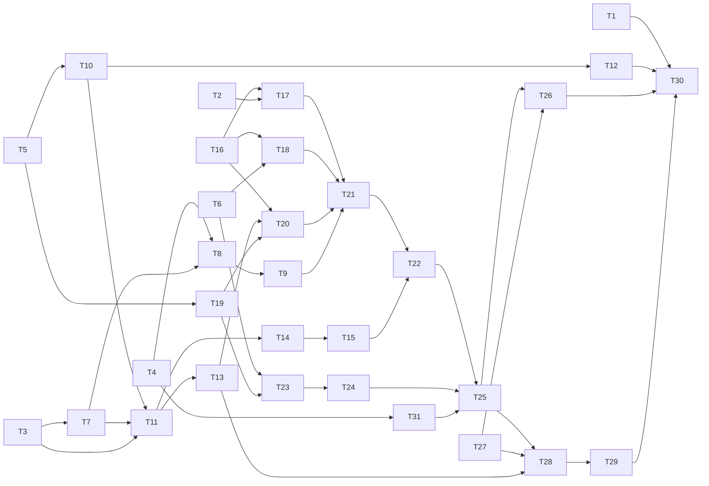

# Review queue, HUD count and review simplifications

status: done
head: 38d3f560667b6ddeaab6b665ef6793749814079a
base: af8591cd98446be0cfb25f05f48b4d22c3ab6c5b
commit-mode: orchestrator-commits
language: ruby, rust (T1 only)
panel: Ruby (Linus Torvalds, Jeremy Evans, Sandi Metz, Richard Schneeman, Aaron Patterson); Rust seats for T1 (Raph Levien, Andrew Gallant)

## Intent

Carry out `planning/review-hud-research-2026-11.md`, option 1, with the user's rulings of 2026-11-16.

1. **The queue.** `lain queue` lists what waits for review, with 0 model calls:
   - plan runs;
   - local changes;
   - GitHub PRs requested of you or your teams;
   - keyword and path matches.

   A fzf popup picks 1. The running chat in that checkout offers the `/review`, and you press Enter.
2. **The count.** `lain queue poll`, every 5 minutes from a timer, writes 2 numbers: the reviews waiting, and the direct requests that are new since you last opened the queue. The herdr sidebar and lain's HUD show them.
3. **Targeted critique, on request.** Enter opens a review with no model call. Alt-Enter opens it and then runs the existing `/critique` over it, aimed at the reason the row is listed.
4. **Simplifications.**
   - `/review` and `/survey` share 1 opener.
   - Every `gh` call lain makes runs under 1 configurable account.
   - QA-only commands move to `qa-lain`.
   - The Rust workspace type-checks for macOS.

The dotfiles changes are main-session steps D0 to D5 at the end. The Mac bring-up is a separate plan, `planning/specs/lain-macos-bringup.md`, run after this one lands and is pushed.

The daemon research (`planning/lain-daemon-research-2026-11.md`) shaped 3 choices here, so its follow-on plan, `planning/specs/lain-daemon.md`, can take these pieces over rather than replace them:

- the queue's state is 1 append-only log (T16);
- live chats leave a record the queue reads (T31);
- the queue's request is a plain value that maps 1 to 1 onto the daemon's future `Offer` message (T23).

The ROADMAP line is under `## Status` as "Review queue and HUD count".

## Grounding

2026-11-16, `main` at `6c9f57b1`. Read:

- `CLAUDE.md`, `ROADMAP.md` `## Status`;
- the research report and its sources;
- `planning/specs/herdr-attention.md`;
- the user's dotfiles bare repo `~/.cfg` (HEAD 2026-11-10).

4 code surveys and a panel (REQUEST-CHANGES, folded in below) covered every file the cards name.

**Probed or measured:**

- **GitHub query.** 1 GraphQL search returns PRs, typed review requests (`User` or `Team`, plus `asCodeOwner`), `ReviewRequestedEvent` times and the first 100 changed paths. It costs 1 to 2 points; measured against `rails/rails`. `path:` returns 0 in PR search, so path matching happens client-side.
- **macOS Rust.** `cargo check --target aarch64-apple-darwin` on `lain-wire`, `lain-core` and `lain-fence` passes from this box once the Linux-only code is gated (spike, below).
- **Boot.** `exe/lain help` boots in 0.83 to 1.01 s. Compiling `exe/lain` takes 3.6 ms of that.
- **The installed shim.** `~/.local/bin/lain` is pinned to Ruby 4.0.6 and fails (D0).
- **herdr 0.9.5.** It has `workspace list|create|get|focus|rename|report-metadata|close` and `notification show`. `~/bin/herdr-pr-watch` calls both from a systemd unit.
- **Namespace shadowing (panel probe).** A module named `Lain::CLI::Thor` shadows `::Thor` for `class X < Thor` inside `Lain::CLI`, and eager load raises `TypeError`. T4 uses `Lain::CLI::Exe`.
- **First prompt and the editor.** `RpcThread#start` blocks until the editor attaches, before `frontend.run` yields to `converse` (`frontend/neovim/rpc_thread.rb:1150-1156`, `cli/repl.rb:125`). So a first prompt runs with the editor attached.

**Read, with paths:**

- **Opener steps.** `Command::Review#opened` (`cli/command/review.rb:257-272`) and `Command::Survey#opened` (`survey.rb:196-216`) run the same 13 steps. The differences:
  - Review refuses over held notes (`:321`).
  - Survey roots its docent at the walk root (`survey.rb:295-308`).
  - Survey holds `number: nil` after the draw.
  - The 1-review rule is written twice: `refuse_over_survey!` (`review.rb:312`) and `refuse_second_surface!` (`survey.rb:240`).
- **Target.** `CLI::Review::Target` (`cli/review.rb:177-250`) is built by `Command::Review#targets` (`command/review.rb:406`) and `CLI::Review#initialize`. `Command::Review#headline` reads `CLI::Review::HEADLINE`.
- **`LocalBranch`** diffs `merge-base(base, head)..head`, and both ends take any commit-ish (`local_branch.rb:76, 261`).
- **`GithubPr::Remote`** runs `gh` itself (`github_pr.rb:232-238`), deliberately outside `Forge::Gh`, which is "a closed set of landing verbs" (`:77-83`). That set is mirrored in `Gh::Recorded` and `Unrecorded` (`forge/gh/recorded.rb:30-45`), in `Journaled`, and in `spec/support/shared_examples/gh_parity.rb` `VERBS`.
- **`Forge::Gh`** passes no `environment:` (`forge/gh.rb:229-236`, `shell/out.rb:50, 244-261`).
  - It is built at `cli/command/review_submit.rb:86`, where `ReviewSubmit` is built by `Surface` at `surface.rb:234` with no `paths:`, and at `cli/epic_finish.rb:77`.
  - `Command::Share` runs `gh gist` itself (`share.rb:72`).
- **Config verbs.** `Builder::VERBS` (14) and `USER_VERBS` overlap only on `middleware` (`builder.rb:30-31, 54`). `declare` admits a verb in both sets with no special case (panel check).
- **Bash env.** The production bash env is `ExecBackend.launch` at `cli/wiring.rb:797`.
  - `toolset_build.rb:254`'s `ChildEnv.from` is a spec-only default.
  - `ChildEnv#call(lent)` passes names the caller adds (`exec/child_env.rb:8-15, 75-79`).
  - Output masking and the egress guard learn secret values only from `child_env.environment` and `lent` (`sensitivity/literals.rb:52`, `sensitivity/secrets/egress.rb:40-53`, `wiring.rb:931`).
  - `ChildEnv::SECRET` refuses token names in a pass list (`child_env.rb:37`).
- **HUD.** `state.json`'s `"hud"` is rendered by `StatusFeed#rendered` (`status_feed.rb:677`) and read by 4 renderers:
  - `plugin/tmux/scripts/lain-status`;
  - `Up::Hud#status_right` (`cli/up.rb:~1117`);
  - `Wiring#hud_line` (`wiring.rb:454`);
  - `plugin/nvim/lua/lain/init.lua:231`.

  Changing `Reading#hud` would bake a segment into `state.json` and every reader would add it again, so the new segment is composed only at the renderers.
- **Input socket.** `InputSocket.path` gives `<runtime_dir>/input-<project_hash>-<name>.sock`, mode 0600.
  - Every client gets `prompt` frames carrying the generation (`input_socket.rb:417-425`).
  - `/approve` and `/deny` are `:control` and run mid-turn (`command/approve.rb:35`, `frontend/intake.rb:392-404`).
  - A generation-0 line never answers an approval (`intake.rb:525-528`), but it does redraw the prompt.
- **Critique.** `/critique` over a held round is `SkillDispatch#report_critique` (`middleware/skill_dispatch.rb:153`), against `@outbox.held_changeset`. Its output is prose reported in the chat.
- **The shipped execute-plan skill** marks the plan `in-progress` (`prompt/templates/skill/execute-plan/skill.md:24`). It is pinned by `spec/lain/skill/shipped_skills_spec.rb:243-290`.
- **Helper modules.** `exe/lain` defines `Boundary`, `ProjectFlags`, `Argv`, `Help`, `ModelFlags`, `ExecFlags`, `CompactionFlags`, `LiveSweep`, `AskingFlags`, `SurfaceFlags` and `JournalPassFlags` inline (`:82-1709`). 8 spec files and `lib/lain/cli/improvements.rb` name them as `LainCLI::<Name>`.

**Where docs and code disagreed:**

- `docs/commands.md:1524` omits `attention` from the user-file verbs. **Code wins.**
- The research report proposed `git stash create`, critique notes and a findings file. **Superseded** by T6 and by the user's ruling that `/review` stays focused, with critique run on request.

**Paths.** A path marked `(new)` is created by the first card that names it. The research report is untracked; read it from `/home/tara/dev/lain/planning/`. `/home/tara/w/ir` (branch `nyotes/implement-readiness`) names `lain survey`; rebasing it is the user's job.

## Compatibility

| Surface | Verdict | Evidence |
|---|---|---|
| `lain review`, `survey`, `bench`, `verify`, `usage`, `friction` | free to break: move to `qa-lain` (ruling 2026-11-16) | Gem `0.1.0`, never published. Callers are QA scenarios, specs, docs and `lib/` strings in this repo, plus `/home/tara/w/ir`. |
| `/review` and `/survey` | must keep behaviour | Their specs stay green through T7, except the 2 refusals that named a text command. |
| `/review` flags | free to extend | Adds `--since` (T14) and `--critique[=FOCUS]` (T15). |
| `reviews.json`, `queue/log.ndjson`, `queue/pending/*.json`, `live/<session>.json` under `state_home` | free | New. `log.ndjson` is append-only with many writers; each other file has 1 writer. The daemon plan replaces `live/` with registration. |
| `state.json` and its `"hud"` | must keep | Unchanged. The reviews segment is added by each renderer (T29). |
| Config verbs | free to extend | Adds `github` in both files (T5). |
| `Forge::Gh` | free | Internal. Reads go in a new `Forge::Gh::Reads` (S10 of the panel), so the landing verb set and its mirrors stay closed. |
| Bash tool env | changes by ruling | The configured account's `GH_TOKEN` reaches bash children: the same account lain's own gh uses, project file included (ruling 2026-11-16). It is lent through `ChildEnv`, so masking and egress know the value. |
| Input socket protocol | free to extend | Adds an `offer` frame (T24). `line` frames keep their meaning. |
| Plan file header | free to extend | Adds `base:` and `head:`. |
| The shipped execute-plan skill | must keep pinned phrases | `shipped_skills_spec.rb:243-290`. |
| herdr CLI 0.9.5 | must keep | External. Uses `workspace list|create|report-metadata`, `pane run` and `notification show`, with source `lain-queue`. |
| `lain-core` and `lain-fence` deps | free | Unpublished. Linux unchanged (spike). |

No must-keep surface, if broken, would remove a card or about 20% of the plan.

## Spike findings

| Question | Result | Evidence |
|---|---|---|
| Can this box confirm `lain-core` and `lain-fence` compile for macOS? | Yes, after gating:<br>• `landlock`, `nix`, `seccompiler`, `signal-hook` and fence's `serde_json` move under `[target.'cfg(target_os = "linux")'.dependencies]`.<br>• Fence's main body moves behind `#[cfg(target_os = "linux")]`, with a non-Linux `main` that prints "lain-fence: Linux only" and exits 2.<br>• The 5 fence test files get `#![cfg(target_os = "linux")]`.<br>• `relay::confine` gets a non-Linux twin returning `Err(StartError::Unconfined)`.<br>• `blake3` takes `features = ["pure"]` on macOS only, because its C build needs a macOS SDK this box lacks.<br>Then `cargo check --target aarch64-apple-darwin --all-targets -p lain-wire -p lain-core -p lain-fence` passes clean, and Linux clippy and `cargo test --no-run` stay green. | `planning/specs/review-queue-hud/mac-cargo-spike.patch` |
| Can `ext/lain` be checked for macOS here? | No: tree-sitter needs a macOS SDK. Left to the Mac plan. | same |
| Does 1 GraphQL call give requests, types, times and paths? | Yes, 1 to 2 points | `gh api graphql` on `rails/rails` |
| Does PR search accept `path:`? | No | same |
| Does `Lain::CLI::Thor::X` break `< Thor` in `Lain::CLI`? | Yes, `TypeError` at eager load | panel probe, `scratchpad/thor_shadow_probe/probe.rb` |

## Shared files

Only the main session edits these. Cards hand back 1-line diffs.

- `lib/lain/cli/wiring.rb`:
  - `exec_backend` lends the account's environment (T12, at `:797`);
  - `hud_line` appends the reviews segment (T29);
  - `first_prompt:` falls back to `Review::Queue::Pending.take` (T26, at `:295`).
- `docs/commands.md`:
  - `lain queue` (T21, T22, T25, T28);
  - `/review --since` and `--critique` (T14, T15);
  - the `github` verb, verb count 14 to 15, and the user-file verb list (T5);
  - a `## qa-lain` section taking the moved verbs (T8, T9);
  - the reviews HUD segment (T29).
- `ROADMAP.md`: the Status line.

## Rejected options

- **The queue as a dotfiles script.** The plan and local-change rows need lain's git rules. User ruling: the code lives in lain.
- **Critique findings as notes, a findings file, Claude's critique sidecar.** Submit would post model text as the human, and critique blockers would gate approve (panel B3). The user ruled that `/review` stays focused, with critique run on request (T15).
- **`git stash create` for a dirty tree.** It makes a merge commit and drops untracked files.
- **`Lain::CLI::Thor` as the helpers' namespace.** It shadows `::Thor` (probe). `Exe` names whom they serve.
- **`exe/qa-lain`.** The gemspec ships every `exe/` file.
- **Raw lines from the queue into the chat, or a raw pending file.** Any same-uid process could plant `/ruby` or `/mode bypass` (panel S5, S6). The queue sends a structured request, and the chat rebuilds and confirms it.
- **Close the input socket to outside clients now.** The user chose validate-and-confirm. The older risk, that raw `line` frames from any same-uid client are accepted, is recorded in Open decisions.
- **A `credentials:` field on `ChildEnv`.** Masking and egress would not learn the value (panel S4). The token is lent.
- **Read the account at chat boot.** An unknown account would kill every launch. It is resolved on first use and degrades to a note.
- **Keyword and path queries in the 5-minute poll.** The poll counts requests with 1 cheap query.
- **A "last 30 minutes" window for new requests.** "New" means since the queue was last opened.
- **Snapshot a dirty tree at list time.** `reload` and preview would write commits. The snapshot is taken at open.
- **A daemon for polling, in this plan.** Out of scope here. `planning/specs/lain-daemon.md` (D19) moves the poll into the daemon, and the timer stands in until then.
- **A token on every herdr workspace.** The user ruled for 1 `reviews` workspace.
- **Skip `rake core:build` off Linux.** lain-core compiles on macOS after T1; its relay refuses to start unconfined, which is today's behaviour.

## Open decisions

- **The input socket accepts raw `line` frames from any same-uid client.** This predates this plan. With no sandbox on macOS, the agent's bash can reach it. T24's `offer` frame doesn't fix it; closing it (a per-session secret held by the input pane) is a later card. The user has accepted a thinner macOS sandbox for now (2026-11-16). No card depends on this.
- **The daemon.** `planning/specs/lain-daemon.md` follows this plan. It replaces T31's records with registration, routes T25's offers through the daemon, and runs T28's poll as a supervised task. No card here depends on it.
- **What `/review` should do beyond this plan,** now that it is the formal form of a critique. Dogfood the queue and `--critique` first. No card depends on this.

## Dependency graph



T1, T2, T3, T4, T5, T6, T16 and T27 have no dependencies.

## Tasks

### T1: Make the Rust workspace type-check for macOS          [risk: medium]

**Depends on:** none
**Files:**
- `crates/lain-core/Cargo.toml`, `crates/lain-core/src/relay.rs`
- `crates/lain-fence/Cargo.toml`, `crates/lain-fence/src/main.rs`, `crates/lain-fence/src/linux_main.rs` (new)
- `crates/lain-fence/tests/fence.rs`, `crates/lain-fence/tests/memfd.rs`, `crates/lain-fence/tests/private_net.rs`, `crates/lain-fence/tests/reap.rs`, `crates/lain-fence/tests/sockets.rs`
- `Cargo.lock`, `.github/workflows/main.yml`

**Reuse:** `planning/specs/review-queue-hud/mac-cargo-spike.patch`. Use `#[cfg(target_os = "linux")] mod linux_main;` with `crate::` paths fixed, not the spike's `include!`, so inner docs and module paths keep working.
**Shared-file wiring:** none
**Reachable from:** `cargo build` and CI's Ruby and pre-commit jobs.

**Acceptance criteria**

```gherkin
Scenario: the Linux-only crates type-check for macOS
  Given the aarch64-apple-darwin target is installed
  When `cargo check --target aarch64-apple-darwin --all-targets -p lain-wire -p lain-core -p lain-fence` runs
  Then it exits 0 with no warnings

Scenario: Linux is unchanged
  When `cargo clippy --all-targets -- -D warnings` and `cargo test -p lain-core -p lain-fence` run on Linux
  Then both pass with the same test count as before

Scenario: CI keeps the macOS check
  Then .github/workflows/main.yml runs the darwin check after `rustup target add aarch64-apple-darwin`
```

Spec file: the CI step in `.github/workflows/main.yml` (Rust has no rspec here). Record the before and after Linux test counts in the hand-back.

**Stop and report if:**
- The Linux `cargo test -p lain-fence` count drops.
- `mod linux_main` trips `#![deny(missing_docs)]` in a way the spike's `include!` avoided.
- Gating `relay.rs` changes which `StartError` Linux returns.

### T2: Record the base and head of a plan run in the plan file          [risk: low]

**Depends on:** none
**Files:** `lib/lain/prompt/templates/skill/execute-plan/skill.md`, `spec/lain/skill/shipped_skills_spec.rb`
**Reuse:** Phase 1's "Mark the plan `in-progress`" sentence (`skill.md:24`).
**Shared-file wiring:** none
**Reachable from:** the shipped skill catalog, rendered when a chat runs `/execute-plan`.

**Acceptance criteria**

```gherkin
Scenario: the skill writes a base line when a run starts
  When the shipped execute-plan skill renders
  Then Phase 1 says to write `base: <full sha of the base branch tip>` on the line after `status:` when the plan is marked in-progress

Scenario: the skill writes a head line when a run ends
  Then the close-out says to write `head: <full sha of the base branch tip>` beside `status: done`
```

Spec file: `spec/lain/skill/shipped_skills_spec.rb`

**Stop and report if:**
- A pinned phrase at `shipped_skills_spec.rb:243-290` would have to change.

### T3: Move `CLI::Review::Target` to `Review::Target`          [risk: low]

**Depends on:** none
**Files:**
- `lib/lain/review/target.rb` (new), `lib/lain/cli/review.rb`, `lib/lain/cli/command/review.rb`
- `spec/lain/review/target_spec.rb` (new), `spec/lain/cli/review_spec.rb`

**Reuse:** `CLI::Review::Target`, `Resolved`, `Ambiguous` and `HEADLINE` (`cli/review.rb:57-250`), moved whole.
**Shared-file wiring:** none
**Reachable from:** `Command::Review#targets` (`command/review.rb:406`), built by `Command::Surface#review_commands` (`surface.rb:233`); and `CLI::Review#initialize`.

**Acceptance criteria**

```gherkin
Scenario: a branch and a pull request resolve as before
  Given branch feature/x and a stubbed gh that knows PR 12
  When Review::Target resolves "feature/x" and then "#12"
  Then the first is a LocalBranch source labelled "branch feature/x" with no number
  And the second is a GithubPr source labelled "pull request 12" with number 12

Scenario: a commit range resolves
  Given commits A and B on main
  When Review::Target resolves B with base A
  Then the source diffs A..B
```

Spec file: `spec/lain/review/target_spec.rb`, holding the examples moved from `spec/lain/cli/review_spec.rb:259-289` plus the range example.

**Interface**

```ruby
module Lain::Review
  class Target
    Resolved = Data.define(:source, :label, :number)
    HEADLINE = "reviewing %<label>s at %<scope>s scope: %<base>s..%<head>s"
    def initialize(repo_root:, shell_out_factory:, ledger:) = ...
    def resolve(target, base: nil) = ... # => Resolved
  end
end
```

**Stop and report if:**
- A spec outside the 2 listed names `CLI::Review::Target` or `CLI::Review::HEADLINE`.

### T4: Move the Thor helper modules out of `exe/lain` into `Lain::CLI::Exe`          [risk: medium]

**Depends on:** none
**Files:**
- `exe/lain`
- `lib/lain/cli/exe.rb` (new; the namespace's docstring), and under `lib/lain/cli/exe/`: `boundary.rb`, `project_flags.rb`, `argv.rb`, `help.rb`, `model_flags.rb`, `exec_flags.rb`, `compaction_flags.rb`, `live_sweep.rb`, `asking_flags.rb`, `surface_flags.rb`, `journal_pass_flags.rb` (all new)
- `lib/lain/cli/improvements.rb`
- Specs: `spec/lain/cli_spec.rb`, `spec/lain/cli/epic_submit_spec.rb`, `spec/lain/cli/up_spec.rb`, `spec/lain/cli/chat_flags_spec.rb`, `spec/lain/cli/backend_spec.rb`, `spec/lain/session_record_spec.rb`, `spec/lain/cli/chat_launch_spec.rb`, `spec/lain/bench/arms_command_spec.rb`

**Reuse:** the module bodies at `exe/lain:82-1709`, moved verbatim, with `::Thor` root-qualified wherever a body names `Thor::Error` or `Thor` itself.
**Shared-file wiring:** none
**Reachable from:** `exe/lain`'s `LainCLI` and its nested Thor classes, which `include` and `declare` them.

**Acceptance criteria**

```gherkin
Scenario: every lain command keeps its flags and refusals
  When spec/lain/cli_spec.rb loads exe/lain and checks every command's options and the argv table
  Then every example passes with the modules referenced as Lain::CLI::Exe::<Name>

Scenario: exe/lain holds only commands
  When exe/lain is read
  Then it defines only LainCLI and its nested Thor command classes

Scenario: nothing in Lain::CLI is shadowed
  When bin/zeitwerk-census runs, and Lain::CLI::HerdrLink is loaded
  Then every tier reports 0, and HerdrLink's superclass is ::Thor
```

Spec file: `spec/lain/cli_spec.rb`

**Stop and report if:**
- A module reads a constant that only exists inside `LainCLI`.
- `cli_spec.rb`'s source-reading checks (`:15-29`) depend on the modules living in `exe/lain`.

### T5: Add the `github` config verb, set per project or per user          [risk: medium]

**Depends on:** none
**Files:**
- `lib/lain/config/github.rb` (new), `lib/lain/config/builder.rb`, `lib/lain/config.rb`
- `spec/lain/config/github_spec.rb` (new), `spec/lain/config/builder_spec.rb`, `spec/lain/config_spec.rb`

**Reuse:** `Config::Review` (the shape of a verb); `Table.read`; `Config.middleware` (`config.rb:121`), the precedent for a verb read from both files; `EnvDefaults`' loud refusal of garbage.
**Shared-file wiring:** `docs/commands.md`: add `### github`, change the count to 15, and list `attention` and `github` in the user-file paragraph.
**Reachable from:** `Config.github(root:, paths:, env:)`, called by T10's construction sites, T12, T19, T20 and T28.

**Acceptance criteria**

```gherkin
Scenario: env beats project beats user
  Given the user config says `github account: "joel-fuze"` and the project config says `github account: "liaden"`
  When Config.github resolves for that root with LAIN_GH_ACCOUNT unset
  Then the account is "liaden"
  And with LAIN_GH_ACCOUNT=other it is "other"

Scenario: no project root uses the user file and env
  When Config.github resolves with root: nil, as a timer or a popup outside a project does
  Then it reads only the user file and LAIN_GH_ACCOUNT

Scenario: unset everywhere means gh's own account
  Then the account is nil, and the filters are the defaults

Scenario: a typo is refused by name
  Given `github acount: "x"`
  Then loading refuses, naming the file and line, `acount`, and the known keys

Scenario: the filters keep their types
  Given `github orgs: %w[fuze], roots: %w[~/src ~/work], keywords: %w[perf sql], paths: [%r{\Adb/migrate/}, /\.sql\z/], since_days: 14`
  Then they resolve frozen, with roots expanded
  And a non-Regexp path or a non-String keyword is refused
```

Spec file: `spec/lain/config/github_spec.rb`, `spec/lain/config/builder_spec.rb`

**Interface**

```ruby
module Lain
  class Config
    Github = Data.define(:account, :orgs, :roots, :keywords, :paths, :since_days)
    class Github
      KEYS = %w[account orgs roots keywords paths since_days].freeze
      ENV_ACCOUNT = "LAIN_GH_ACCOUNT"
      def self.from(table, path:) = ...
      def self.resolve(project:, user:, env:) = ... # env > project > user > defaults
    end
    def self.github(root:, paths:, env: ENV) = ... # root: nil reads the user file and env only
  end
end
```

**Stop and report if:**
- `spec/docs_config_examples_spec.rb` evaluates docs blocks under `VERBS` only, so a user-file example would be refused.

### T6: Snapshot a dirty work tree as 1 commit          [risk: medium]

**Depends on:** none
**Files:** `lib/lain/review/snapshot.rb` (new), `spec/lain/review/snapshot_spec.rb` (new)
**Reuse:** `Isolation::Checkout` (`isolation/checkout.rb:53, 77`); the temporary-index `write-tree` and `commit-tree` in `isolation/gc.rb:225-236` and its `IDENTITY`; `Worktree::GIT_SPAWN_ENV`.
**Shared-file wiring:** none
**Reachable from:** T23's request rebuild for a `dirty` row, at open time.

**Acceptance criteria**

```gherkin
Scenario: tracked and untracked changes land in 1 single-parent commit
  Given a modified tracked file and a new untracked, non-ignored file
  When Review::Snapshot takes the work tree
  Then it returns a commit whose only parent is HEAD and whose tree holds both changes
  And the index, HEAD and refs are unchanged

Scenario: ignored files stay out, and a clean tree has none
  Then an ignored file is absent from the tree, and a clean work tree returns nil

Scenario: the hook's index cannot leak in
  Given GIT_INDEX_FILE and GIT_DIR exported, as pre-commit does
  Then the commit is built from the target repository only

Scenario: the commits scope shows 1 commit
  When /review <snapshot> --base HEAD opens at the commits scope
  Then it lists exactly 1 commit
```

Spec file: `spec/lain/review/snapshot_spec.rb` (`:seam`, real git)

**Interface**

```ruby
class Lain::Review::Snapshot
  def initialize(repo_root:, shell_out_factory: Shell::Out.public_method(:new)) = ...
  def take = ... # => commit sha or nil
end
```

**Stop and report if:**
- `commit-tree` needs an author identity the box doesn't have outside `IDENTITY`.

### T7: Open `/review` and `/survey` through 1 opener          [risk: medium]

**Depends on:** T3
**Files:**
- `lib/lain/cli/command/review_round.rb` (new), `lib/lain/cli/command/review.rb`, `lib/lain/cli/command/survey.rb`, `lib/lain/review/submit/outbox.rb`
- `spec/lain/cli/command/review_round_spec.rb` (new), `spec/lain/cli/command/review_spec.rb`, `spec/lain/cli/command/survey_spec.rb`, `spec/lain/review/submit/outbox_spec.rb`

**Reuse:** the identical steps in Grounding; `Outbox#held_source` and `held_verdict`.
**Shared-file wiring:** none
**Reachable from:** `Command::Surface#review_commands` (`surface.rb:233-236`) builds `Review` and `Survey`, which both call `ReviewRound#open`.

**Acceptance criteria**

```gherkin
Scenario: the 1-review rule lives in the outbox
  Given a survey is held with no verdict
  When /review opens a branch
  Then it is refused with the existing wording
  And the reverse case refuses with the existing wording

Scenario: both commands keep every behaviour
  When review_spec.rb and survey_spec.rb run
  Then every example passes, except the 2 refusals that named a text command, which now name `lain up --nvim` and `lain chat --nvim <socket>` only

Scenario: the differences stay
  Then a survey's docent is rooted at the walk root, a survey holds no PR number, and only a review refuses over held editor notes
```

Spec file: `spec/lain/cli/command/review_round_spec.rb`, `spec/lain/cli/command/review_spec.rb`, `spec/lain/cli/command/survey_spec.rb`, `spec/lain/review/submit/outbox_spec.rb`

**Interface**

```ruby
module Lain::CLI::Command
  class ReviewRound
    Opening = Data.define(:source, :source_name, :target, :label, :number, :bounds, :policy, :spawn, :headline)
    def initialize(outbox:, ledger:) = ...
    def open(opening, env, scope:) = ... # => banner String
  end
end
# Outbox#refuse_other!(source_name, refusal:) is the 1 home of the 1-review rule.
```

**Stop and report if:**
- Holding before vs after the draw is observable in a spec. Keep each command's order and report it.

### T8: Give `qa-lain` its own executable with `review` and `survey`          [risk: medium]

**Depends on:** T4, T7
**Files:**
- `bin/qa-lain` (new), `lib/lain/boot/launch.rb` (new), `exe/lain`
- `.claude/skills/manual-qa/scripts/qa-sandbox.sh`
- `spec/lain/qa_lain_spec.rb` (new), `spec/lain/cli_spec.rb`, `spec/lain/cli/survey_spec.rb`
- `planning/qa/scenarios/changeset-review.md`, `planning/qa/scenarios/survey.md`, `planning/qa/scenarios/secret-boundary.md`

**Reuse:**
- `exe/lain:30-55`: the load-path cache and Bootsnap move into `Lain::Boot::Launch`, while each executable keeps its own `abort` and stderr;
- `Lain::Boot::FrozenLoadPath`, the precedent for a pre-Zeitwerk boot file;
- `LainCLI::Review` and `Survey` (`exe/lain:767-818`);
- `Lain::CLI::Exe::Boundary` (T4).

**Shared-file wiring:** `docs/commands.md`: move `### lain review` and `### lain survey` under `## qa-lain`.
**Reachable from:** `bin/qa-lain`, started by the QA sandbox's `qa-lain` shim.

**Acceptance criteria**

```gherkin
Scenario: qa-lain reviews a branch as text
  When `bin/qa-lain review feature/x` runs in a repository with that branch
  Then it prints the round text `lain review feature/x` printed before

Scenario: lain no longer offers them
  When `exe/lain help` runs
  Then neither review nor survey is listed

Scenario: 1 boot, 2 executables
  Then exe/lain and bin/qa-lain both call Lain::Boot::Launch, and only the executables write to stderr

Scenario: the QA sandbox puts qa-lain on PATH
  When qa-sandbox.sh writes its shims
  Then $QA/shim holds lain and qa-lain, each under ruby 4.0.9
```

Spec file: `spec/lain/qa_lain_spec.rb`, `spec/lain/cli_spec.rb`

**Stop and report if:**
- `spec/docs_naming_spec.rb:147-167` requires every verb in `docs/commands.md` to be declared in `exe/lain`.
- `spec/output_discipline_spec.rb` flags `lib/lain/boot/launch.rb`.

### T9: Move `bench`, `verify`, `usage` and `friction` to `qa-lain`          [risk: medium]

**Depends on:** T8
**Files:**
- `exe/lain`, `bin/qa-lain`
- `spec/lain/cli_spec.rb`, `spec/lain/qa_lain_spec.rb`, `spec/lain/bench/compaction_sweep_command_spec.rb`, `spec/lain/bench/memory_sweep_command_spec.rb`, `spec/lain/bench/arms_command_spec.rb`
- the `planning/qa/scenarios/` files and `lib/` files whose user-facing strings name these verbs under `lain` (grep `lain (bench|verify|usage|friction)` in both; for example `lib/lain/bench/altitude.rb:54` and `lib/lain/cli/usage.rb`)

**Reuse:** `LainCLI::Bench` (`exe/lain:1098`), and `usage`, `friction` and `verify` (`:1634-1663`), moved whole.
**Shared-file wiring:** `docs/commands.md`: move their sections under `## qa-lain`.
**Reachable from:** `bin/qa-lain`.

**Acceptance criteria**

```gherkin
Scenario: the moved commands run under qa-lain
  When `qa-lain bench sweep --help`, `qa-lain usage --help`, `qa-lain friction --help` and `qa-lain verify --help` run
  Then each prints its usage with the same flags as before

Scenario: lain help shows daily commands only
  Then bench, verify, usage, friction, review and survey are absent from `exe/lain help`

Scenario: nothing tells you to run a moved verb under lain
  When lib/ and planning/qa/scenarios are grepped for `lain (bench|verify|usage|friction|review|survey) `
  Then there are 0 hits that are not `qa-lain`
```

Spec file: `spec/lain/qa_lain_spec.rb`, `spec/lain/bench/compaction_sweep_command_spec.rb`

**Stop and report if:**
- A bench command spawns `exe/lain bench ...` as a child, or `bin/runtime-census` or `bin/hot-path-bench` calls a moved verb through `exe/lain`.

### T10: Run every `gh` call under the configured account          [risk: high]

**Depends on:** T5
**Files:**
- `lib/lain/forge/gh.rb`, `lib/lain/forge/gh/account.rb` (new), `lib/lain/cli/command/review_submit.rb`, `lib/lain/cli/command/share.rb`, `lib/lain/cli/command/surface.rb`, `lib/lain/cli/epic_finish.rb`
- `spec/lain/forge/gh_spec.rb`, `spec/lain/forge/gh/account_spec.rb` (new), `spec/lain/cli/command/review_submit_spec.rb`, `spec/lain/cli/command/share_spec.rb`, `spec/lain/cli/command/surface_spec.rb`, `spec/lain/cli/epic_finish_spec.rb`, `spec/support/shared_examples/gh_parity.rb`

**Reuse:** `Shell::Out`'s `environment:`; `Gh#invoke` (`gh.rb:328`); `Config.github` (T5); the chat's notes sink that `Surface` already holds (`surface.rb:80`).
**Shared-file wiring:** none
**Reachable from:**
- `Surface` resolves `Gh::Account.for(Config.github(root: @root, paths:))` once and passes it to `ReviewSubmit` (`surface.rb:234`, which gains `paths:`) and to `Share`;
- `EpicFinish` does the same at `epic_finish.rb:77`.

**Acceptance criteria**

```gherkin
Scenario: a configured account's token goes to every gh child
  Given account "joel-fuze" and a stubbed `gh auth token --user joel-fuze` that prints t0k
  When /review-submit posts and /share creates a gist
  Then both gh children get GH_TOKEN=t0k, and `gh auth token` ran once per process

Scenario: an exported token wins, and the chat is told once
  Given GH_TOKEN exported and account "joel-fuze" configured
  When 2 gh calls run
  Then neither changes GH_TOKEN, and the chat's notes sink gets 1 note naming joel-fuze

Scenario: an unknown account fails on use, with the fix
  Given `gh auth token --user nobody` exits 1
  When /review-submit runs
  Then it fails naming "nobody" and `gh auth login`, no gh call ran under another account, and the chat stays up

Scenario: no account means today's behaviour
  Then the child env is the parent env, unchanged, through Gh::Account::None
```

Spec file: `spec/lain/forge/gh/account_spec.rb`, `spec/lain/cli/command/review_submit_spec.rb` (production `Surface` construction, no injected Gh)

**Interface**

```ruby
class Lain::Forge::Gh
  def initialize(cwd: Dir.pwd, account: Account::None.new, timeout: DEFAULT_TIMEOUT, poll: Poll.new,
                 shell_out_factory: Shell::Out.public_method(:new)) = ...
end
class Lain::Forge::Gh::Account
  def self.for(github_config, env: ENV, shell_out_factory:, notes:) = ... # => Account | Account::None
  def environment = ... # => {"GH_TOKEN" => token}; memoised; raises Refused naming the fix
  class None; def environment = {}; end
end
```

**Stop and report if:**
- The token would appear in a journal record, a note or a refusal (grep the spec output for the stub token).

### T11: Route `GithubPr`'s `gh` calls through the account          [risk: medium]

**Depends on:** T10, T7, T3
**Files:**
- `lib/lain/review/source/github_pr.rb`, `lib/lain/forge/gh/reads.rb` (new), `lib/lain/review/target.rb`, `lib/lain/cli/command/review.rb`, `lib/lain/cli/command/surface.rb`
- `spec/lain/review/source/github_pr_spec.rb`, `spec/lain/forge/gh/reads_spec.rb` (new), `spec/lain/review/target_spec.rb`, `spec/lain/cli/command/review_spec.rb`

**Reuse:** `Gh::Account` (T10); `Remote`'s error mapping (`github_pr.rb:165-201`), kept as raises; the `CombinedDiff` fallback (`:151-223`).
**Shared-file wiring:** none
**Reachable from:** `Surface` passes the resolved `account` to `Command::Review`, which passes it to `Review::Target`, which builds `GithubPr.new(..., reads: Forge::Gh::Reads.new(cwd:, account:))`.

**Acceptance criteria**

```gherkin
Scenario: a PR review uses the configured account
  Given account "joel-fuze" and a stubbed gh
  When /review 12 resolves and reads the diff
  Then `gh pr view` and `gh pr diff` both ran with joel-fuze's GH_TOKEN

Scenario: refusals keep their shape
  Given gh refuses `pr view 99`
  Then building the source raises UnknownRef naming 99, and a missing gh still raises NoGh

Scenario: the landing verbs stay closed
  Then Forge::Gh's verb list, Gh::Recorded and gh_parity's VERBS are unchanged, and lib/lain/review holds no "gh" argv
```

Spec file: `spec/lain/forge/gh/reads_spec.rb`, `spec/lain/review/source/github_pr_spec.rb`

**Interface**

```ruby
class Lain::Forge::Gh::Reads
  def initialize(cwd:, account:, timeout: Gh::DEFAULT_TIMEOUT, shell_out_factory: Shell::Out.public_method(:new)) = ...
  def pr_refs(ref:) = ...  # gh pr view --json baseRefName,baseRefOid,headRefOid
  def pr_diff(ref:) = ...  # raw diff String, or a fallback reason
end
```

**Stop and report if:**
- `Reads` would duplicate `Gh#invoke`'s refusal parsing. Then extract the runner both use, in this card.

### T12: Lend the account's token to the agent's bash commands          [risk: high]

**Depends on:** T10
**Files:**
- `lib/lain/cli/exec_backend.rb`, `lib/lain/exec/child_env.rb`
- `spec/lain/cli/exec_backend_spec.rb`, `spec/lain/exec/child_env_spec.rb`, `spec/lain/sensitivity/literals_spec.rb`, `spec/lain/provider/http/egress_guard_spec.rb`

**Reuse:** the lend path `ChildEnv#call(lent)` and `#environment` (`child_env.rb:8-15, 75-83`); `Sensitivity::Literals` (`sensitivity/literals.rb:52`); `EgressGuard` (`egress.rb:40-53`); `Gh::Account#environment` (T10).
**Shared-file wiring:** `lib/lain/cli/wiring.rb:797`: `ExecBackend.launch(options, ..., lend: Lain::Forge::Gh::Account.lazy(Config.github(root:, paths: @paths)))`
**Reachable from:** `Wiring#exec_backend` (`wiring.rb:796-799`), the production bash backend.

**Acceptance criteria**

```gherkin
Scenario: a configured account reaches bash's gh
  Given account "joel-fuze" with token t0k
  When the agent's bash tool runs `gh api user`
  Then the child has GH_TOKEN=t0k, resolved on that first call and not at chat boot

Scenario: masking and egress know the value
  Then Sensitivity::Literals over the backend's child env includes t0k
  And EgressGuard refuses a provider request body that carries t0k
  And a bash command that prints GH_TOKEN has the value masked in its tool result

Scenario: an exported token is what bash gets
  Given GH_TOKEN exported and an account configured
  Then bash gets the exported token, the same one lain's gh uses (T10)

Scenario: no account means no token
  Given no account
  Then the child has no GH_TOKEN, even if the parent exported one

Scenario: an unknown account degrades to a note
  Given `gh auth token --user nobody` fails
  Then bash runs without GH_TOKEN, and the chat gets 1 note naming the fix

Scenario: the pass list still refuses secret names
  Given `env pass: %w[GH_TOKEN]` in a config
  Then it is refused as before
```

Spec file: `spec/lain/cli/exec_backend_spec.rb`, `spec/lain/sensitivity/literals_spec.rb`, `spec/lain/provider/http/egress_guard_spec.rb`

**Stop and report if:**
- The lent value also reaches non-bash children (`Exec.child_env` callers in `isolation/` and `grader/`).
- A lazily resolved value can't be registered with `Sensitivity::Literals` after the board is built (`wiring.rb:931`).

### T13: Ask GitHub for PRs that request my review, in 1 query          [risk: medium]

**Depends on:** T11
**Files:**
- `lib/lain/forge/gh/reads.rb`, `lib/lain/forge/gh/review_request.rb` (new)
- `spec/lain/forge/gh/reads_spec.rb`, `spec/lain/forge/gh/review_request_spec.rb` (new), `spec/fixtures/gh/review_requests.json` (new)

**Reuse:** the GraphQL query in Grounding, extended with `viewer { login }` and each PR's `latestReviews(first: 20) { nodes { author { login } commit { oid } } }`; `Gh::Account`.
**Shared-file wiring:** none
**Reachable from:** T20's `PullRequests` and T28's poll, which build `Forge::Gh::Reads.new(cwd:, account:)`.

**Acceptance criteria**

```gherkin
Scenario: direct, team and code-owner requests are told apart
  Given the recorded response in spec/fixtures/gh/review_requests.json
  When Reads#review_requests(query: "is:open is:pr review-requested:@me archived:false") parses it
  Then each ReviewRequest names repo, number, title, url, head sha, author, paths, the time it was requested of me, how (direct, team with slug, or code owner), and the commit of my latest review or nil

Scenario: drafts are dropped
  Then a draft PR in the response is not returned

Scenario: GitHub refuses
  Given gh exits 1 with a rate-limit message
  Then the result is a refusal carrying that message

Scenario: 1 call
  Then exactly 1 gh process ran, with no REST call per PR
```

Spec file: `spec/lain/forge/gh/review_request_spec.rb`, `spec/lain/forge/gh/reads_spec.rb`

**Interface**

```ruby
class Lain::Forge::Gh
  ReviewRequest = Data.define(:repo, :number, :title, :url, :head_sha, :author, :paths,
                              :requested_at, :via, :team, :my_last_review) # via: :direct | :team | :code_owner
  class Reads
    def review_requests(query:) = ... # => Array<ReviewRequest>, or raises Refused
  end
end
```

**Stop and report if:**
- `latestReviews` omits a review whose commit was force-pushed away. Pin it in the fixture and report it.

### T14: Review a pull request since a given commit          [risk: medium]

**Depends on:** T11
**Files:**
- `lib/lain/review/target.rb`, `lib/lain/review/source/github_pr.rb`, `lib/lain/cli/command/review.rb`
- `spec/lain/review/target_spec.rb`, `spec/lain/review/source/github_pr_spec.rb`, `spec/lain/cli/command/review_spec.rb`

**Reuse:** `GithubPr#local` and `fetch!` (`github_pr.rb:347-360`); `LocalBranch.new(base:, head:)`.
**Shared-file wiring:** `docs/commands.md`: `/review --since <sha>`.
**Reachable from:** `Command::Review#call` parses `--since` and passes it to `Review::Target#resolve`.

**Acceptance criteria**

```gherkin
Scenario: a re-review shows only the new commits
  Given PR 12 at head C, and my last review at A, an ancestor of C
  When /review 12 --since A opens
  Then the round diffs A..C, and /review-submit still posts to PR 12

Scenario: a force-pushed PR shows the whole PR
  Given A is not an ancestor of C
  Then the round diffs the whole PR, and the banner says the since commit was not an ancestor

Scenario: --since is for pull requests
  When /review feature/x --since A runs
  Then it is refused, naming --base for branches
```

Spec file: `spec/lain/review/source/github_pr_spec.rb`, `spec/lain/cli/command/review_spec.rb`

**Stop and report if:**
- A comment on a line inside A..C but outside the full PR diff would be refused by GitHub. Pin it in a spec and report it.

### T15: Run a targeted critique when a review opens, on request          [risk: medium]

**Depends on:** T14
**Files:**
- `lib/lain/cli/command/review.rb`, `lib/lain/middleware/skill_dispatch.rb`
- `spec/lain/cli/command/review_spec.rb`, `spec/lain/middleware/skill_dispatch_spec.rb`, `spec/lain/seams/critique_over_held_review_spec.rb`

**Reuse:** `SkillDispatch#report_critique` (`skill_dispatch.rb:153`), which already critiques the held round with a focus; `CritiqueOptions.split`.
**Shared-file wiring:** `docs/commands.md`: `/review --critique[=FOCUS]`.
**Reachable from:** `Command::Review#call`. After the round opens, it hands `/critique <focus>` to the chat's dispatch, through the same path a typed `/critique` takes.

**Acceptance criteria**

```gherkin
Scenario: a plain /review spends nothing
  When /review feature/x opens
  Then no child is spawned and no provider request is sent

Scenario: --critique runs the existing critique once the round is open
  When /review 12 --critique=migration safety opens
  Then the round opens first, then the critique of the held round runs with focus "migration safety", and its reply is shown as /critique's is today

Scenario: --critique with no focus
  When /review 12 --critique opens
  Then the critique runs with no focus

Scenario: an unspawnable model refuses before opening
  Given the critique's model can't be spawned
  When /review 12 --critique opens
  Then the review is not opened, and the refusal is /critique's own
```

Spec file: `spec/lain/cli/command/review_spec.rb`, `spec/lain/seams/critique_over_held_review_spec.rb` (real outbox and dispatch)

**Stop and report if:**
- A command cannot hand a follow-up line to the chat's dispatch without reaching into the REPL. Report the seam it would need before adding one.

### T16: Model the review queue: rows, ranking and an append-only log          [risk: medium]

**Depends on:** none
**Files:**
- `lib/lain/review/queue.rb` (new), `lib/lain/review/queue/row.rb` (new), `lib/lain/review/queue/log.rb` (new), `lib/lain/paths.rb`
- `spec/lain/review/queue_spec.rb` (new), `spec/lain/review/queue/log_spec.rb` (new), `spec/lain/paths_spec.rb`

**Reuse:**
- `Paths#state_home` and `ensure_dir`;
- the journal's NDJSON shape;
- appends that open the file with `O_APPEND`, make 1 `syswrite` of 1 whole line, check the byte count, and close. Each write lands at the end of the file, so many writers need no lock. The log lives only on a local disk: `O_APPEND` is not atomic over NFS.

This is the daemon research's finding: the queue's state is an event log that readers fold, as sessions are, and the daemon can fold the same file later.
**Shared-file wiring:** none
**Reachable from:** T21's `lain queue`, which builds `Review::Queue.new(sources:, log: Queue::Log.new(paths:))`. T28's poll calls `Log#prune` once per run.

**Acceptance criteria**

```gherkin
Scenario: the order is the rank
  Given 1 finished plan run, 1 direct re-review, 1 direct request, 1 team request and 1 path match
  When the queue enumerates
  Then they come in that order, each with its reason

Scenario: a seen head leaves the list until it moves
  Given row "pr:o/r#12" opened at head C
  Then it is absent while the head is C, and back when the head is D

Scenario: concurrent writers don't lose an event
  Given 4 processes append 200 events each to the log at once
  Then the log holds 800 whole lines, and folding it marks every opened row

Scenario: "new since you last looked" is a fold
  Given the log records the queue listed at 09:00 and again at 11:00
  Then Log#last_listed_at is 11:00

Scenario: a torn last line is skipped
  Given a log whose last line was cut short by a crash
  When the log is folded
  Then every whole line counts, and the torn one is skipped with 1 note

Scenario: the log stays small, by rotation
  Given a log over 1 MiB
  When Log#prune runs
  Then the log is renamed to log.1, replacing the old log.1, and the fold reads both files
  And an append that races the rename lands in 1 of the 2 files, never in an unlinked one
```

Spec file: `spec/lain/review/queue_spec.rb`, `spec/lain/review/queue/log_spec.rb`

**Interface**

```ruby
module Lain::Review
  class Queue
    include Enumerable
    Row = Data.define(:id, :rank, :reason, :request, :head_sha) # request: Queue::Request (T23)
    def initialize(sources:, log:) = ...
    def each(&) = ... # rows from every source, sorted by rank, seen heads skipped
  end
  class Queue::Log
    Event = Data.define(:kind, :at, :row_id, :head_sha) # kind: :opened | :notified | :offered | :listed
    def initialize(paths:, clock: -> { Time.now }) = ...
    def append(event) = ...   # 1 O_APPEND write of 1 line; no lock
    def seen?(row) = ...      # an :opened event for this id at this head
    def notified?(row_id) = ...
    def last_listed_at = ...  # time of the newest :listed event
    def prune = ...           # rotate to log.1 above 1 MiB
  end
end
```

**Stop and report if:**
- `paths_spec.rb` pins `Paths`' full method list.

### T17: List plan runs from plan files          [risk: low]

**Depends on:** T16, T2
**Files:** `lib/lain/review/queue/plan_runs.rb` (new), `spec/lain/review/queue/plan_runs_spec.rb` (new)
**Reuse:** `Isolation::Checkout#run`; `git grep --untracked -l -E '^base: [0-9a-f]{40}$'`.
**Shared-file wiring:** none
**Reachable from:** T21's `lain queue here`.

**Acceptance criteria**

```gherkin
Scenario: a finished run is listed with its range
  Given an untracked plan with `status: done`, `base: A`, `head: C`
  Then 1 row with a range request A..C, rank 1, reason "plan done: <title>"

Scenario: a run in flight reviews up to the tip
  Given `status: in-progress` and `base: A` with main at D
  Then the request is A..D, reason "plan in progress: <title>"

Scenario: plans without a base are ignored, and so are ignored files
  Given 60 done plans with no base line, and an ignored plan with one
  Then no rows
```

Spec file: `spec/lain/review/queue/plan_runs_spec.rb` (`:seam`, real git)

**Stop and report if:**
- `status:` lines with prose after the word (`done (landed ...)`) need more than taking the first token.

### T18: List local branches, a dirty tree and recent commits          [risk: medium]

**Depends on:** T16, T6
**Files:** `lib/lain/review/queue/local_changes.rb` (new), `spec/lain/review/queue/local_changes_spec.rb` (new)
**Reuse:** `for-each-ref` and `merge-base --is-ancestor` through `Isolation::Checkout` (`checkout.rb:150`); `Worktree::Registry` (`isolation/worktree/registry.rb:44`).
**Shared-file wiring:** none
**Reachable from:** T21's `lain queue here` and `local`.

**Acceptance criteria**

```gherkin
Scenario: an unmerged branch is a row, a merged one is not
  Given branches a (unmerged) and b (merged)
  Then 1 branch row, for a

Scenario: a dirty tree is 1 row with no commit made
  Given uncommitted changes
  Then 1 row with id "dirty:<root>" and a dirty request, and no snapshot commit was written by listing

Scenario: recent commits rank below branches
  Given 3 commits on main since yesterday
  Then 3 rows, each a single-commit range, ranked below branches
```

Spec file: `spec/lain/review/queue/local_changes_spec.rb` (`:seam`, real git)

**Stop and report if:**
- Listing the 82 leftover worktrees takes over 1 s. Report the time and the git call count.

### T19: Find the local checkout for an `owner/repo`          [risk: low]

**Depends on:** T5
**Files:** `lib/lain/review/queue/checkouts.rb` (new), `spec/lain/review/queue/checkouts_spec.rb` (new)
**Reuse:** `Config::Github#roots` (T5); `git remote get-url origin` through `Isolation::Checkout`.
**Shared-file wiring:** none
**Reachable from:** T20's `PullRequests` and T23's request rebuild.

**Acceptance criteria**

```gherkin
Scenario: an origin maps to its checkout
  Given roots [~/work] holding a clone whose origin is git@github.com:fuze/api.git
  When Checkouts#for("fuze/api") runs
  Then it returns that clone's path, matching https and ssh origin spellings

Scenario: no checkout
  Then Checkouts#for("fuze/other") returns nil

Scenario: 2 clones of 1 repo
  Given 2 clones of fuze/api under the roots
  Then the one with the most recent commit on HEAD is returned, and the other is named in a note
```

Spec file: `spec/lain/review/queue/checkouts_spec.rb` (`:seam`, real git)

**Interface**

```ruby
class Lain::Review::Queue::Checkouts
  def initialize(roots:, shell_out_factory: Shell::Out.public_method(:new), notes: Sink::Null.new) = ...
  def for(name_with_owner) = ... # => absolute path or nil; scans roots 2 levels deep, once per process
end
```

**Stop and report if:**
- Scanning `~/src` and `~/work` 2 levels deep takes over 500 ms. Report it, with the directory count.

### T20: List pull requests that want my review          [risk: medium]

**Depends on:** T16, T13, T19
**Files:** `lib/lain/review/queue/pull_requests.rb` (new), `spec/lain/review/queue/pull_requests_spec.rb` (new)
**Reuse:** `Reads#review_requests` (T13); `Config::Github` filters (T5); `Checkouts` (T19).
**Shared-file wiring:** none
**Reachable from:** T21's `lain queue prs`, which builds it with `Config.github(root: nil or the cwd's project, paths:)`.

**Acceptance criteria**

```gherkin
Scenario: direct over team, with a toggle
  Given 1 direct and 1 team request
  Then scope :mine yields the direct row only, and scope :all yields both, direct first

Scenario: a re-review row carries --since
  Given my last review of PR 12 at A, an ancestor of head C
  Then the row's request is PR 12 since A, reason "direct, re-review: N commits"

Scenario: each row names its checkout
  Given fuze/api cloned under the roots
  Then a fuze/api row's request holds that checkout
  And a row with no local checkout says "no local checkout"

Scenario: keyword and path rows are off by default
  When PullRequests enumerates without matches
  Then no keyword or path query runs
  And with matches on, an unrequested PR touching db/x.sql in org fuze yields a row with reason "path: db/x.sql", below every request
```

Spec file: `spec/lain/review/queue/pull_requests_spec.rb`

**Stop and report if:**
- The keyword and path query for 1 org at `since_days: 14` returns over 100 PRs in the fixture shape. Report the page cost.

### T21: Add `lain queue` to print the rows          [risk: medium]

**Depends on:** T17, T18, T20, T9
**Files:** `lib/lain/cli/queue.rb` (new), `exe/lain`, `spec/lain/cli/queue_spec.rb` (new), `spec/lain/cli_spec.rb`
**Reuse:** `Lain::CLI::HerdrLink`, the precedent for a Thor class in `lib/` registered from `exe/lain` (with `::Thor` root-qualified); `Lain::CLI::Exe::Boundary` (T4).
**Shared-file wiring:** `docs/commands.md`: `### lain queue`.
**Reachable from:** `exe/lain`: `subcommand "queue", Lain::CLI::Queue`.

**Acceptance criteria**

```gherkin
Scenario: here lists plan runs first, then local changes
  Given a repository with a finished plan run and an unmerged branch
  When `lain queue here` runs in it
  Then it prints 2 lines, `<id>\t<reason>\t<summary>`, the plan row first

Scenario: text from GitHub can't break a line
  Given a PR title containing a tab, a newline and an escape sequence
  Then its line holds none of them

Scenario: --json and show
  Then `lain queue prs --json` prints 1 JSON object per row
  And `lain queue show <id>` prints the reason, the range, and for a PR its title, author and requested time
```

Spec file: `spec/lain/cli/queue_spec.rb`, `spec/lain/cli_spec.rb`

**Stop and report if:**
- `lain queue` clashes with `lain epic queue` in Thor's help or argv parsing.

### T22: Pick a queue row in fzf          [risk: medium]

**Depends on:** T21, T15
**Files:** `lib/lain/cli/queue.rb`, `lib/lain/cli/queue/picker.rb` (new), `spec/lain/cli/queue/picker_spec.rb` (new)
**Reuse:** fzf 0.74: `--delimiter '\t' --with-nth 2..`, `--expect alt-enter`, and `--bind 'ctrl-t:reload(...)'` and `ctrl-k`, with `--preview 'lain queue show {1}'`.
**Shared-file wiring:** `docs/commands.md`: `lain queue pick`.
**Reachable from:** `lain queue pick [here|local|prs]`.

**Acceptance criteria**

```gherkin
Scenario: fzf runs in the foreground with the toggles
  Given a stubbed fzf that records argv, stdin and its process group, and prints a row and a key
  When `lain queue pick prs` runs
  Then fzf ran in the terminal's foreground process group with no timeout, got the rows on stdin, had ctrl-t and ctrl-k bound to reload, and listed alt-enter in --expect

Scenario: Enter opens, Alt-Enter opens with a critique
  When fzf returns a row with Enter
  Then the row is opened with no critique
  And with alt-enter, it is opened with a critique focused on the row's reason

Scenario: no fzf, or Escape
  Then without fzf it exits 1 naming fzf and prints the rows
  And on fzf exit 130 nothing is opened or marked seen
```

Spec file: `spec/lain/cli/queue/picker_spec.rb`, plus a real-fzf step in T30's QA scenario (a pty is the only place the process group shows).

**Stop and report if:**
- `reload` takes over 1.5 s per keypress. Measure it and report.

### T23: Validate a queued review request and rebuild its `/review` line          [risk: high]

**Depends on:** T6, T19
**Files:** `lib/lain/review/queue/request.rb` (new), `spec/lain/review/queue/request_spec.rb` (new)
**Reuse:** `Review::Snapshot` (T6) for a dirty request; `Checkouts` (T19); `Source::GithubPr::Remote::URL_NUMBER`.
**Shared-file wiring:** none
**Reachable from:** T24 (the chat side), T25 (the sender) and T26 (pending), all through `Queue::Request.load`.

**Acceptance criteria**

```gherkin
Scenario: only 4 shapes are accepted
  Then a request is 1 of these, and anything else is refused with no line built:
    a range (2 commits as 40-hex SHAs, plus a repository root);
    a branch (a ref that passes `git check-ref-format --branch`, plus a repository root);
    a dirty tree (a repository root only);
    a PR (a https://github.com/<owner>/<repo>/pull/<n> URL, an optional 40-hex since, an optional focus of at most 80 printable characters)

Scenario: the line is rebuilt, never copied
  Given a request whose focus contains "\n/mode bypass"
  Then it is refused
  And a valid request's line is built only from its validated fields, for example `/review https://github.com/fuze/api/pull/12 --since <sha> --critique=migration safety`

Scenario: a dirty request snapshots at rebuild
  Given a dirty request for a repository with changes
  Then the line is `/review <snapshot> --base HEAD`, and the snapshot is taken now, not at listing
```

Spec file: `spec/lain/review/queue/request_spec.rb`

Its `to_h` is a plain map of strings. The daemon plan forwards it as an opaque `request` map inside its `Offer` (D13), and the chat runs `Request.load` on it again, so nothing outside this class reads its fields.

**Interface**

```ruby
class Lain::Review::Queue::Request
  def self.load(hash) = ... # => Request, or raises Refused naming the field
  def to_h = ...            # the wire and file form
  def review_line = ...     # rebuilt from validated fields only
  def repo_root = ...
end
```

**Stop and report if:**
- A focus needs characters outside printable ASCII and spaces to be useful. Report it before widening the rule.

### T24: Offer a queued review in the chat for 1 keypress          [risk: high]

**Depends on:** T23
**Files:**
- `lib/lain/cli/input_socket.rb`, `lib/lain/frontend/intake.rb`, `lib/lain/frontend/intake/offer.rb` (new)
- `spec/lain/cli/input_socket_spec.rb`, `spec/lain/frontend/intake_spec.rb`, `spec/lain/frontend/intake/offer_spec.rb` (new)

**Reuse:** `InputSocket`'s `Codec` and `receive` (`input_socket.rb:~110-120, ~357-370`); `Intake`'s `:human` prompt kind, the way a run asks the human.
**Shared-file wiring:** none
**Reachable from:** `InputSocket#receive` handles a `{"v":"offer","request":{...}}` frame by passing `Queue::Request.load(frame["request"])` to `Intake#offer`.

**Acceptance criteria**

```gherkin
Scenario: an offer asks before it runs
  Given a chat at rest
  When an offer frame for PR 12 arrives
  Then the chat shows "lain queue: /review https://github.com/fuze/api/pull/12  (Enter opens, Esc drops)"
  And Enter dispatches the rebuilt line as if typed, while Esc drops it

Scenario: an invalid offer is dropped with a note
  Given an offer frame that fails Request.load
  Then nothing is shown or dispatched, and 1 note names the refused field

Scenario: an offer never answers anything else
  Given an approval or a question is waiting
  When an offer arrives
  Then the waiting prompt is untouched, its typed text is kept, and the offer waits behind it
```

Spec file: `spec/lain/frontend/intake/offer_spec.rb`, `spec/lain/cli/input_socket_spec.rb` (`:seam`, real socket and Intake)

**Stop and report if:**
- `Intake` can't show an offer without a new prompt kind. Report the smallest change before adding one to `KINDS`.

### T25: Send a picked review to the chat in its checkout          [risk: high]

**Depends on:** T22, T24, T31
**Files:** `lib/lain/review/queue/delivery.rb` (new), `lib/lain/cli/queue.rb`, `spec/lain/review/queue/delivery_spec.rb` (new)
**Reuse:** `LiveSessions` (T31) to find the attended chats in a checkout and their input sockets; the `InputSocket` `Codec`; `Queue::Log#append` (T16).
**Shared-file wiring:** `docs/commands.md`: `lain queue open`.
**Reachable from:** `lain queue open <id>`, which `pick` calls with the chosen row id. The request is rebuilt from the row, never from fzf's text.

**Acceptance criteria**

```gherkin
Scenario: the chat in the row's checkout gets the offer
  Given a real InputSocket listening for a chat in the fuze/api checkout
  When `lain queue open pr:fuze/api#12` runs
  Then that socket receives 1 offer frame with the row's request, and the row is marked seen

Scenario: a row is never sent to another repository's chat
  Given the only running chat is in a checkout whose origin is not fuze/api
  Then nothing is sent, and the result is :no_chat

Scenario: 2 chats in 1 checkout
  Given 2 live records for the checkout, started at 09:00 and 10:00
  Then the offer goes to the 10:00 one, and the other is named in the output

Scenario: a PR with no local checkout
  Then it runs `gh pr view --web <url>` under the configured account, and sends nothing
```

Spec file: `spec/lain/review/queue/delivery_spec.rb` (`:seam`, real socket)

**Stop and report if:**
- A live record names an input socket that no longer answers. Skip it and report how often that happens in the seam spec.

### T26: Hold a review for the next chat, and start one in herdr          [risk: high]

**Depends on:** T25, T27
**Files:** `lib/lain/review/queue/pending.rb` (new), `lib/lain/review/queue/delivery.rb`, `spec/lain/review/queue/pending_spec.rb` (new), `spec/lain/cli/wiring_spec.rb`
**Reuse:** `Queue::Request` (T23); `Intake#offer` (T24); `Herdr::Workspaces#create` (T27), as `~/bin/herdr-park` does.
**Shared-file wiring:** `lib/lain/cli/wiring.rb:295`: the chat offers `Lain::Review::Queue::Pending.take(project:, paths:)` through `Intake#offer` once the frontend is up, when the chat is attended and has an editor.
**Reachable from:** `Wiring#run`, which takes the pending request for its project.

**Acceptance criteria**

```gherkin
Scenario: the next cockpit offers the review
  Given no running chat, and `lain queue open <id>` wrote a pending request for the checkout
  When `lain up --nvim` starts there
  Then it offers the review for 1 keypress, and the pending file is gone

Scenario: only an attended chat with an editor takes it
  Given a pending request
  When a plain `lain chat` or a non-interactive chat starts
  Then the request stays pending

Scenario: a planted or stale file is not trusted
  Given a pending file that fails Request.load, or 1 older than 1 day
  Then nothing is offered, the file is removed, and 1 note says why

Scenario: inside herdr a cockpit is started, outside it you are told
  Given HERDR_ENV=1 and a stubbed herdr
  When no chat is running
  Then a workspace is created at the checkout running `lain up --nvim`
  And without herdr, 1 line says the review opens with the next `lain up --nvim` there
```

Spec file: `spec/lain/review/queue/pending_spec.rb`, `spec/lain/cli/wiring_spec.rb` (production `Wiring#run`)

**Stop and report if:**
- The offer can't be made after the frontend is up without reaching into `Repl`. Report the seam.

### T27: Set a herdr workspace token and notify, from outside a chat          [risk: low]

**Depends on:** none
**Files:** `lib/lain/herdr/workspaces.rb` (new), `spec/lain/herdr/workspaces_spec.rb` (new), `spec/fixtures/herdr/workspace_list.json` (new)
**Reuse:** how `Herdr::Reporter#herdr` (`herdr/reporter.rb:274`) builds and runs a herdr argv; `Shell::Path.find`; the call shapes in `~/bin/herdr-pr-watch`.
**Shared-file wiring:** none
**Reachable from:** T26's cockpit start and T28's poll.

**Acceptance criteria**

```gherkin
Scenario: the token goes to the workspace with that label
  Given a stubbed herdr whose `workspace list` (recorded in the fixture) has a workspace labelled reviews
  When Workspaces#token(label: "reviews", name: "reviews", value: "7 (2 new)") runs
  Then `herdr workspace report-metadata <id> --source lain-queue --token reviews=7 (2 new)` ran

Scenario: no such workspace, or no herdr
  Then nothing runs and nothing raises
```

Spec file: `spec/lain/herdr/workspaces_spec.rb`

**Interface**

```ruby
class Lain::Herdr::Workspaces
  def initialize(env: ENV, shell_out_factory: Shell::Out.public_method(:new)) = ...
  def token(label:, name:, value:) = ...
  def notify(title:, body:) = ...
  def create(cwd:, command:) = ...
end
```

**Stop and report if:**
- Reusing `Reporter#herdr` means moving it. Move it into `Workspaces` only if `Reporter`'s specs stay untouched.

### T28: Poll the review count for the HUD          [risk: medium]

**Depends on:** T25, T27, T13
**Files:**
- `lib/lain/review/queue/poll.rb` (new), `lib/lain/cli/queue.rb`, `lib/lain/paths.rb`
- `spec/lain/review/queue/poll_spec.rb` (new), `spec/lain/cli/queue_spec.rb`

**Reuse:** `Reads#review_requests` (T13); `Queue::Log#last_listed_at`, `#notified?` and `#prune` (T16); `Notices.for(env:, notes:)`; `Herdr::Workspaces` (T27).
**Shared-file wiring:** `docs/commands.md`: `lain queue poll` and the timer note.
**Reachable from:** `lain queue poll`, run by D3's timer with `Config.github(root: nil, ...)`.

**Acceptance criteria**

```gherkin
Scenario: the count file is written
  Given 3 direct and 4 team requests, 2 direct ones requested after the queue was last opened
  When `lain queue poll` runs
  Then reviews.json holds total 7, direct 3, team 4, new_direct 2, polled_at, and hud "rv 7+2"

Scenario: each new direct request notifies once
  Given the same 2 new requests on 2 polls
  Then 2 notices go out on the 1st poll and none on the 2nd, each recorded as a :notified event in the queue log

Scenario: the herdr workspace shows the count
  Then the `reviews` workspace token is "7 (2 new)"

Scenario: GitHub is unreachable
  Then reviews.json keeps its last counts with stale: true, and no notice is sent

Scenario: 1 query
  Then exactly 1 review_requests call ran, and no keyword or path query
```

Spec file: `spec/lain/review/queue/poll_spec.rb`

**Stop and report if:**
- A notice would carry a PR title through `notify-feed`'s argv unescaped.
- `lain queue poll` needs anything but the environment and config to run. The daemon plan (D19) starts it as a process.

### T29: Show the review count in every HUD          [risk: medium]

**Depends on:** T28
**Files:**
- `plugin/tmux/scripts/lain-status`, `lib/lain/cli/up.rb`, `plugin/nvim/lua/lain/init.lua`, `lib/lain/review/queue/poll.rb`
- `spec/plugin/tmux_plugin_spec.rb`, `spec/lain/cli/up_spec.rb`, `spec/plugin/nvim_plugin_spec.rb`, `spec/lain/review/queue/poll_spec.rb`

**Reuse:** the `"hud"` extraction each renderer already does; `Reading::UNRENDERABLE`; each reader's existing copy of the XDG state rule.
**Shared-file wiring:** `lib/lain/cli/wiring.rb:454`: `hud_line` appends `Lain::Review::Queue::Poll.hud(paths: @paths)`.
**Reachable from:** tmux status (`lain.tmux`), `Up::Hud#status_right`, `Wiring#hud_line` and `require('lain').hud()`.

**Acceptance criteria**

```gherkin
Scenario: each renderer shows the segment exactly once
  Given state.json with hud "❄ fleet:0 inbox:0 " and reviews.json with hud "rv 7+2"
  When lain-status, the up status line, the input pane header and lain.hud() render
  Then each shows "❄ fleet:0 inbox:0 rv 7+2" with "rv 7+2" once
  And state.json's "hud" field still has no "rv"

Scenario: no reviews file, no segment
  Then every renderer prints what it printed before

Scenario: a stale count says so
  Given stale: true
  Then the segment reads "rv 7+2?"
```

Spec file: `spec/plugin/tmux_plugin_spec.rb`, `spec/lain/cli/up_spec.rb`, `spec/plugin/nvim_plugin_spec.rb`

**Stop and report if:**
- A renderer would need a third copy of the XDG state rule.

### T30: Write QA scenarios for the queue, the account and `--critique`          [risk: low]

**Depends on:** T1, T12, T26, T29
**Files:** `planning/qa/scenarios/review-queue.md` (new), `planning/qa/scenarios/changeset-review.md`, `planning/qa/README.md`
**Reuse:** the scenario format in `planning/qa/scenarios/survey.md`; `.claude/skills/manual-qa/references/scenario.md`.
**Shared-file wiring:** none
**Reachable from:** `/manual-qa` reads `planning/qa/scenarios/`.

**Acceptance criteria**

```gherkin
Scenario: every new surface has a happy and an unhappy path
  Then review-queue.md drives all of these:
    `lain queue` here, local and prs;
    real fzf in a herdr popup, with ctrl-t, ctrl-k, Enter, Alt-Enter and Escape;
    an offer accepted and an offer dropped;
    a row for another repository's PR, and a PR with no checkout;
    a pending review taken by the next `lain up --nvim`;
    the poll writing reviews.json and the herdr token;
    LAIN_GH_ACCOUNT over the config, and an unknown account;
    bash's gh under the account, with the token masked;
    the agent's bash writing an offer frame or a pending file, which must reach you as an offer and never run without your keypress
  And changeset-review.md drives /review --since and --critique
```

Spec file: none. These are QA scenario documents; the manual pass in Integration checks runs them.

**Stop and report if:**
- A scenario needs a GitHub write to a real work PR. Use a throwaway PR in a personal repo.

### T31: Record each live chat so the queue can find it          [risk: medium]

**Depends on:** T4
**Files:**
- `lib/lain/live_sessions.rb` (new), `lib/lain/live_sessions/record.rb` (new), `lib/lain/cli/chat_launch.rb`
- `spec/lain/live_sessions_spec.rb` (new), `spec/lain/cli/chat_launch_spec.rb`

**Reuse:** `Paths#state_home` and `ensure_dir`, with the `live/` directory named inside `LiveSessions`; `Liveness::Writer.current` (`liveness.rb:125-156`) for pid, start and host; `Liveness::Probe` for dead records; `InputSocket.path`; atomic tmp-plus-rename writes.
**Shared-file wiring:** none
**Reachable from:** `ChatLaunch#call` (`chat_launch.rb:104`) enters the record once the session header is written (`chronicle.start`, `wiring.rb:343`), and `close_session` (`:340`) leaves it. `ChatLaunch` builds `LiveSessions.new(paths:)`. The session id is the journal's file name (`Journal.stem`, `journal.rb:160`). A `--no-journal` chat has no journal, so its id is `pid-<pid>-<start>`, and its `journal` field is nil.

This is the file-based stand-in for the daemon's session registry (`planning/lain-daemon-research-2026-11.md`, phase 1). The daemon plan deletes it once chats register over the socket, so keep it to 1 small class and 1 value.

**Acceptance criteria**

```gherkin
Scenario: an attended chat leaves a record while it runs
  Given `lain chat --input socket:chat` starting in /work/api
  When it has opened its session
  Then state_home/live/<session id>.json holds its session id, pid, start, host, root, cwd, input socket path, journal path, attended true and started_at
  And after the chat closes, the file is gone

Scenario: a crashed chat's record is not trusted
  Given a record whose pid is dead by Liveness::Probe
  When LiveSessions#each runs
  Then the record is skipped, and the reader doesn't delete it

Scenario: the pre-flight fork writes nothing
  When `lain up` runs its chat pre-flight
  Then no live record is written

Scenario: a headless chat is marked so
  Given `lain chat --non-interactive --prompt x`
  Then its record says attended false and names no input socket
```

Spec file: `spec/lain/live_sessions_spec.rb`, `spec/lain/cli/chat_launch_spec.rb` (production `ChatLaunch#call`)

**Interface**

```ruby
class Lain::LiveSessions
  include Enumerable
  Record = Data.define(:session_id, :pid, :start, :host, :root, :cwd, :input_socket, :journal, :attended, :started_at)
  def initialize(paths:, probe: Liveness::Probe.new) = ...
  def enter(record) = ...   # writes live/<session_id>.json; returns a handle whose #leave removes it
  def each(&) = ...         # live records only, newest started_at first
  def in(root) = ...        # attended records for 1 checkout root
end
```

**Stop and report if:**
- `close_session` doesn't run on a signal-ended chat (`cli/signals.rb`), leaving records behind. Report it rather than adding a second cleanup path. The reader already skips dead pids.

### Fix cards added during the run

These were written in the run's briefs, not here, because each came from a finding while the run was in flight. Each line gives what it fixed and where it landed.

| Card | Risk | Landed | What it fixed |
|---|---|---|---|
| F1 | high | f6504763 | A row is marked seen only when the human presses Enter on its offer, live or held; `x` or Ctrl-D leaves it listed (user ruling 2026-11-17). `Intake#offer` returns the answer, the offer frame and the held file carry the row as `Review::Queue::Mark`, and a stopping chat ends its offers within 2 s. Replaced T26's 0.1 s grace. |
| F2 | medium | 03aa43ec | `lain queue show` and `open` find a team or match row that `pick prs` listed after ctrl-t or ctrl-k. Found by T30 while writing scenarios. |
| F3 | low | 6c49e95e | 7 files subclassed `SimpleDelegator` without `require "delegate"`; zeitwerk-census seed 376309 found it. Pre-existing on base. |
| F4 | medium | 44e3cc3f | The repeat `Exec::Local` stop flake was a real race: a stop met no process group before `setsid` ran. 3 of 100 runs under load before, 0 of 100 after. |
| F5 | medium | 38d3f560 | Every chat launch ran 1 `bwrap --unshare-net` (since f6db4dca) to learn whether the box gives a private network; the answer is now deferred to the first gated call that reads a secret. wire_ready went from about 21 ms to 17.4 to 17.8 ms, still over its 17.1 ceiling. |
| F6 | medium | ae0042ba | Every `Config` reader requires `paths:` and every caller passes the Paths it holds; `lain worktrees` read its config under the default Paths. |
| F7 | low | 947b5d9e | `/review --critique` and a typed `/critique` refuse a bad `critics=` before anything opens. |

Not carded, left for later: wire_ready still reads 0.3 to 0.7 ms over its 17.1 ms ceiling after F5 (3 of 3 logs at load just under 2), which F5 attributes, unproven, to extra git spawns in d7aaf58c and bdd602d8; `frontend/tty.rb:117` and `provider/ollama.rb:557` build a Paths in classes that hold none; a cockpit chat with an offer showing takes about 60 s to exit on SIGTERM; 2 checkouts with the same directory name share one herdr `review <dir>` label; Intake#offer's draft after a restored draft counts `you>` as touched, so later offers wait behind it until the human sends a line.

## Main-session dotfiles steps

These run after T30 lands, in the dotfiles bare repo:

```bash
git --git-dir=$HOME/.cfg --work-tree=$HOME <cmd>
```

The user ruled (2026-11-16) that the main session makes these changes. The work tree has unrelated uncommitted edits (`.claude/settings.json`, `.claude/statusline-command.sh`), so stage by explicit path only. Each step is its own commit.

- **D0. Repair the `lain` shim.** Run `bin/install-shim` under Ruby 4.0.9. Not committed.
- **D1. herdr keys and sidebar** (`.config/herdr/config.toml`):
  - `prefix+v` runs `lain queue pick here`;
  - `prefix+g` runs `lain queue pick local`;
  - `prefix+p` runs `lain queue pick prs`;
  - all 3 are popups at 90% by 70%;
  - add `["$reviews"]` to `[ui.sidebar.spaces] rows`;
  - create the `reviews` workspace once with `herdr workspace create --label reviews`. That is a runtime step, not committed.
- **D2. tmux binds** (`.config/tmux/tmux.conf`): `V`, `g` and `P` run the same 3 commands in `display-popup -E -d '#{pane_current_path}'`.
- **D3. The 5-minute poll timer.**
  - `.config/systemd/user/lain-queue-poll.{service,timer}`: `OnUnitActiveSec=5min`, the PATH line from `herdr-pr-watch.service`, `ExecStart=%h/.local/bin/lain queue poll`. Enable it with `systemctl --user enable --now lain-queue-poll.timer`.
  - `Library/LaunchAgents/com.lain.queue-poll.plist` with `StartInterval` 300 and an `EnvironmentVariables` PATH, for the Mac.
- **D4. Plan runs record base and head.** In `.claude/skills/execute-plan/SKILL.md`, the same 2 sentences as T2.
- **D5. fzf on Apple Silicon.** In `.zsh/fzf.zsh`, the `/opt/homebrew` branch sources `/opt/homebrew/opt/fzf/shell/key-bindings.zsh`.

## Integration checks

- `bundle exec rake pspec` green. Check the example count, not only the failure count.
- `bundle exec rubocop`, `cargo clippy --all-targets -- -D warnings`, `cargo test`, and `pre-commit run --all-files`.
- `cargo check --target aarch64-apple-darwin --all-targets -p lain-wire -p lain-core -p lain-fence`.
- `bin/zeitwerk-census --check`, and `bin/comment-census --check-tickets` over the new files.
- **Manual QA:** `/manual-qa planning/qa/scenarios/review-queue.md` and `changeset-review.md`, in the QA sandbox, with a throwaway PR on the personal account.
- **Live check after D0 to D3:**
  1. Press `prefix+p` in herdr.
  2. Toggle with `ctrl-t`.
  3. Open a PR with Enter, then accept the offer in a running `lain up --nvim`.
  4. Wait 1 timer tick. Then `reviews.json`, the `reviews` workspace and the tmux status all show the count.
- **The user's job:** rebase `/home/tara/w/ir` onto the new `main`.
- Push `main` to `origin`, then hand `planning/specs/lain-macos-bringup.md` to Claude on the Mac.

## Execution log

### Setup (2026-11-16 09:27)

- **Base:** `main` at `af8591cd98446be0cfb25f05f48b4d22c3ab6c5b`. Code under `lib/`, `spec/`, `exe/`, `crates/` is unchanged since the grounding SHA `6c9f57b1`, so Grounding holds.
- **Worktrees at start:** the main checkout, `/home/tara/w/ir`, and 82 stale `tmp/worktrees/<id>` from earlier plans with `card/<id>` branches. This run uses `tmp/worktrees/rqh-T<id>` and `card/rqh-T<id>`.
- **Pre-staged user work, unstaged for the run:** `.gitmodules`, `references/repos/cliffcompaction` (gitlink `b48d660a`), `references/repos/pi` (gitlink `36be9c61`). Re-stage at close-out with `git add .gitmodules references/repos/cliffcompaction references/repos/pi`, then check `git ls-files -s` against those SHAs.
- **User edits in card files:** `.claude/skills/manual-qa/scripts/qa-sandbox.sh` (T8) and `planning/qa/README.md` (T30) carry unstaged user edits. Land those cards' hunks with `git apply --cached` plus `git apply`, never a whole-file copy or `git add` of the file.
- **Hook:** pre-commit runs `bundle exec rake compile check` (rubocop on the whole repo plus `rake pspec`) on any Ruby or Rust file, the cargo fmt, clippy and test hooks on Rust, `yard-lint --staged`, `bin/lint-gherkin-docs` on staged plan docs, and `bin/lint-commit-msg` at commit-msg. A Ruby commit takes about 3 minutes. The suite cannot run beside other tests. A passing hook prints little, so the example count comes from `tmp/parallel_runtime_rspec.log` and the hook log.
- **Agent checks on own paths:** `bundle exec rubocop <files>`, `bundle exec yard-lint <files>`, `bin/lint-gherkin-docs <plan doc>`; for Rust, `cargo fmt -- --check`, `cargo clippy --all-targets -- -D warnings`, `cargo test -p <crate>`.
- **Ratchet specs:** every top-level `spec/*_spec.rb` (35 discipline scanners over `lib/`, `exe/` and docs), `spec/lain/landing_calls_spec.rb`, `spec/lain/isolation/checkout_calls_spec.rb`, `spec/lain/comment_census_spec.rb`, `spec/lain/cli_spec.rb`, `spec/lain/skill/shipped_skills_spec.rb`; plus `bin/zeitwerk-census --check` for a card that adds a constant.
- **Build outputs a fresh worktree needs (copied at cut):** `lib/lain/lain.so`, `target/release/lain-fence`, `tmp/parallel_runtime_rspec.log`.
- **Test-runner pattern for wait-quiet:** `rspec|parallel_rspec|rake (pspec|check)|cargo (test|clippy|build)`.
- **Concurrency cap:** 15 GB RAM with another project's cargo build on the box, so 4 agents, with a landing counted as 1.
- **Paths that need user approval:** none in the cards; the dotfiles steps D0 to D5 run in `~/.cfg` after T30.

### Where the run departed from the cards

The cards above are as planned. These are the rulings and scope changes made during the run; the log below has the detail and the time of each.

- T3: 3 comment-only files joined by scope ruling.
- T4: stdin and stderr are injected from `exe/lain`; `endpoint_env_isolation`'s read widened.
- T5: `lib/lain/cli/pane_command.rb` joined, for the `LAIN_GH_ACCOUNT` name ratchet.
- T7: the deletability and introspect maps fixed in the card; the refusal keyword renamed rather than widening `OFF_RAIL`.
- T9: 2 specs that name `LainCLI::Bench` and 4 docs that name the verbs joined; bench, verify, usage and friction examples moved from `cli_spec` to `qa_lain_spec`.
- T11: the `qa_lain_spec` example T9 moved, red alone, fixed in T11's round.
- T12: `Account#environment` returns the exported `GH_TOKEN` for a configured account; `account.rb` and its spec joined. A configured account with no gh is refused, not raised. `Config.load` takes `paths:`.
- T13: teams come from the viewer's orgs (`role: MEMBER|ADMIN`) in the same query, matched by org-qualified slug; a `paths_truncated` field.
- T14: Submit places comments against the whole PR changeset (`Changeset#placement`); `source.rb`, `changeset.rb`, `submit.rb` and its spec joined.
- T15: `Command::Review` reaches the critique through a callable `Surface` injects over a public `SkillDispatch` method; `surface.rb` joined. The `--critique` path does not run the Repl's extras, so "the same path" in the card is looser than written. The up-front `critics=` check became F7.
- T16: the log frames each record with a leading newline, so a torn last line cannot swallow the next append.
- T20: `Reads#matches(query:)` added, with `via: :match` and a shared parse; T13's `reads.rb` and `review_request.rb` joined.
- T21: `pull_requests.rb` joined for one shared PR id builder; `chat_flags_spec` joined (`ELSEWHERE` may name a Thor class). The `Pulls` decorator is interim.
- T22: ctrl-t toggles scope mine/all and ctrl-k toggles matches; `prs` gains `--all` and `--matches`. A reload of 1.3 to 3 s was accepted.
- T23: the branch shape gains an optional base, `refs/heads/<trunk>`.
- T24: `x` drops an offer (no producer delivers Esc at a line prompt); text refused at an offer stays an unsent `you>` draft; `input_pane.rb` joined.
- T25: the socket replies to the sender only, `{v: offered, outcome: held|crowded|repeat|refused}`; `input_socket.rb`, `intake.rb` and `offer.rb` joined. Delivery waits 5 s for the greeting, then 30 s for the reply. Marking seen on `held` was replaced by F1.
- T26: Wiring's human input moved to `Wiring::InputProducer` rather than raising ClassLength; outcomes `:pending`, `:started`, `:herdr_failed`, `:replaced`, `:replaced_started`, `:replaced_herdr_failed`; the offer waits for the chat's first `you>`; the held file is refused unless it is a regular private file under 64 KiB and under 1 day old.
- T28: `lain queue prs` (text and pick) appends `:listed`; `--json` does not. With no prior counts file and GitHub down, nothing is written; an overlapping poll does nothing. `PullRequests::REQUESTS` and `Request.plain` reused.
- T29: `reviews.json` is named once, by `Paths#review_counts`, which creates nothing; the HUD line change moved into `InputProducer#hud_line` after T26.
- T31: dead live records are skipped and never deleted.

### Close-out (2026-11-17)

- **Landed:** all 31 cards and fix cards F1 to F7; 45 commits from `af8591cd` to `38d3f560`, among them `d6dae6ef` (flake records in `docs/toolchain-traps.md`).
- **Integration checks on `38d3f560`:** `bundle exec rake check` green: rubocop 2760 files, no offenses; pspec 35881 examples, 0 failures, 15 pending. `cargo clippy --all-targets -- -D warnings`, `cargo test` and `cargo check --target aarch64-apple-darwin` for lain-wire, lain-core and lain-fence all clean. `bin/zeitwerk-census --check` and `bin/comment-census --check-tickets` clean. `pre-commit run --all-files` was not run: its whitespace fixers would rewrite the user's uncommitted planning edits; `rake check` covers its Ruby half, and every landing ran the hook on its own files.
- **Not met:** `bin/hot-path-bench --check` still fails on wire_ready (17.36, 17.85 and 17.82 ms against 17.1). No ceiling was raised.
- **Dotfiles (`~/.cfg`):** D0 shim rewritten (it pointed at Ruby 4.0.6); D1 `481b862` (herdr config check ok, reloaded, `reviews` workspace created); D2 `fdc7655`; D3 `64aa41f` (the plist force-added past the `Library` ignore; the timer is enabled and its first poll wrote `reviews.json` with `rv 0`); D4 `d12edd0`; D5 `0b335e6`.
- **Owed to the user:** the manual QA pass (`/manual-qa planning/qa/scenarios/review-queue.md` and `changeset-review.md`, with a throwaway PR on the personal account); the live check after D0 to D3 (prefix+p, ctrl-t, Enter into a running `lain up --nvim`, 1 timer tick); rebasing `/home/tara/w/ir`; pushing `main`.
- **Worktrees and branches** match the start: the main checkout, `/home/tara/w/ir` and the 82 stale `card/<id>` worktrees from earlier plans; no `rqh-` worktree or branch is left.

### Run log

As written during the run, times in local time.

- 09:29 T3, T4, T5, T16 started (sonnet), cut at d2cf4814.
- 09:33 T3 implemented (+3 comment-only files by scope ruling); low review started. T16 fix round: torn last line swallowed the next append.
- 09:35 T3 approved-with-fixes (2 comment fixes), landing attempt 1. T16 fix round done (pread last byte, leading newline); review waits on the landing.
- 09:36 T5 implemented; docs wiring applied in its worktree. Review waits on the landing and a docs spec run.
- 10:05 T3 landing 1 red: 30 failures, all watchdog STARVED (load to 230, swap full) from other projects' cargo builds. Main restored clean. Not a card defect.
- 10:11 User ruling: stricter quiet wait (load < 4, memory PSI < 5), 3 agents. T4 stopped on 3 discipline specs; ruled: inject stdin and stderr from exe/lain, widen endpoint_env_isolation's read. T3 landing attempt 2.
- 10:16 User asked to fan out: cap raised to about 7 agents; T1, T2, T6, T27 to start after the T3 landing.
- 10:26 T3 landing 2 stopped by pid: deadlock between the quiet wait and an agent's piped grep; wait fixed. T1, T2, T6, T27 cut at d2cf4814.
- 10:27 T1 (rust), T2, T6, T27 started (sonnet). T5 and T16 medium reviews started. T3 landing attempt 3.
- 10:36 T3 attempt 3 red, card-caused: deletability_spec github_pr row (consumers moved to Review::Target) and yard-lint ReferenceTypo pre-existing at lib/lain/cli/survey.rb:62. Fix round sent. deletability_spec added to ratchet list. T4 fix round done, 1747 examples green.
- 10:37 T5 review APPROVE-WITH-FIXES (mechanical, 5 items), sent. T16 review APPROVE-WITH-FIXES with 3 substantive items, fix round sent, second review owed. T4 medium review started. T1 done, medium review started.
- 10:37 T2 done (88 examples green), low review started.
- 10:37 T27 done (12 examples, ratchets 727 green), low review started. herdr create argv unverified live: agent's herdr --help call was denied.
- 10:37 T6 done (6 examples, ratchets 639 green), medium review started.
- 10:38 T27 review APPROVE-WITH-FIXES: 2 mechanical (shape guards, no NoMethodError rescue), sent. Carried to T29: Herdr::Workspaces#create passes no --focus/--label (herdr-park passes both); T29 decides whether the user must see the new workspace, and confirms the argv live.
- 10:40 T3 fix round done (942 green; main fixed a rubocop-mangled comment). T5 fixes done (1433 green). T2 APPROVE. T1 fixes done (crate attrs restored). T27 fixes done (760 green). T16 fix round done, second review started. Landing queue: T3 4, T5 1, T2 1, T1 1, T27 1.
- 10:41 T6 review APPROVE-WITH-FIXES, mechanical (2 read-tree specs, unborn-HEAD raise pinned, MESSAGE order), sent. Carried to T23: unborn HEAD raises; snapshot sha not deterministic.
- 10:41 T4 review APPROVE (1502 green, help output byte-identical across commands). Follow-up noted: chat_flags_spec SOURCES excludes lib/lain/cli/exe, so flag reads in the Thor layer are unchecked by design.
- 10:42 User ruling: delete and clean up old code as cards change it, no backwards compatibility. Added to the brief template and reviewer briefs. Checked the in-flight card diffs: no compat aliases or shims found.
- 11:08 T3 attempt 4 red: starvation, not the card. A zsh in this session's scope grew to 4.8 GB, OOM-killed 11:06. Asked T16 reviewer and T6 implementer what they ran. Brief template bans large captures and unlocked probes.
- 11:08 Quiet check now also needs MemAvailable >= 7000 MB. Landing queue relaunched: T3 5, T5 1, T2 1, T1 1, T27 1, T4 1.
- 11:09 T6 fixes done (663 green); ready to land after the queue. T6 agent ran no captures in the OOM window.
- 11:18 T3 attempt 5 red: 1 failure, "Lain::Ext::Timeline#messages re-entering Ruby frees the render state when the fiber is dropped inside Canonical.adopt" (leaked 1001401, limit 1000000), worker seed 30242. Green alone, green 3 of 3 on base: flaky, not reproduced. To record in docs/toolchain-traps.md. Landing past it.
- 11:19 T16 second review APPROVE-WITH-FIXES with 1 substantive (false torn reads under concurrent appends make blank lines; 4-process spec latent flake). Fix round 3 sent (leading-newline framing suggested), third review owed. Landing queue relaunched: T3 6, T5, T2, T1, T27, T4, T6 (output rqh-queue-2.out).
- 11:21 T3 landed af4a0410
- 11:26 T3 landed af4a0410. T5 attempt 1 red, card-caused: pane_command_spec LAIN_ name ratchet misses LAIN_GH_ACCOUNT. Ratchet grep redone (Dir/glob/ls-files over lib or exe): 22 more nested specs added to briefs. T5 scope adds lib/lain/cli/pane_command.rb. Queue stopped after T5; T2, T1, T27, T4, T6 still to land.
- 11:30 T5 fix done (pane_command RUNTIME_ENV, 3032 green), diff verified. Wider ratchets: T27 and T6 green (1627), T4 red on pane_command_spec drift example (scans exe/lain only); T4 fix sent. Queue: T5 2, T2, T1, T27, T6.
- 11:30 T3 worktree and branch removed, hand-back copied. T7 cut at af4a0410, started (sonnet). Queue: T5 2, T2 1, T1 1, T27 1, T6 1.
- 11:34 T5 landed cad00ae1
- 11:34 T4 fix done (pane_command drift spec scans lib/lain/cli/exe too; 1599 wider ratchets green), diff verified. Landing queued.
- 11:38 T2 landed 61f54141
- 11:40 T16 third review APPROVE (probe clean, backout red, no pread code left, 840 green). 1 docstring nit sent.
- 11:40 T5 landed cad00ae1. T2 landed 61f54141. T10 (high, opus) and T19 (low, after T16 lands) briefs ready; cut at next hook gap.
- 11:45 T1 landed 831375d7
- 11:46 T16 nit done; wider ratchets then landing queued after T4.
- 11:50 T27 landed c5bae705
- 11:54 T6 landed 04be9853
- 11:54 T1 landed 831375d7. T27 landed c5bae705. T6 landed 04be9853. Worktrees T5 T2 T1 T27 T6 removed, hand-backs copied. T10 cut at 04be9853, started (opus, high).
- 11:57 T7 stopped on 3 ratchet reds (deletability, introspect outbox.hold holder, refusal_width slot word). Ruling: fix the 2 maps in-card, rename the refusal: keyword rather than widen OFF_RAIL.
- 12:01 T7 ratchet fixes done (keyword renamed sentence:), medium review started.
- 12:02 T4 and T16 landing waiters were stuck: pgrep -f matched the waiter's own command line (~25 min lost). Stopped; relaunched as 1 queue. T16 wider ratchets 1627 green.
- 12:05 T4 attempt 1: suite green, yard-lint --staged red (3 pre-existing ReferenceTypo in improvements.rb, 2 OptionTags on moved flag methods). yard-lint <files> misses them; main now runs rqh-yard-staged.sh before each landing. T4 doc fix sent.
- 12:06 T4 doc fixes done; yard-lint --staged clean in worktree. Landing attempt 2 queued on the gate behind T16.
- 12:12 T7 review APPROVE-WITH-FIXES (14/15 mutants red, deviations forced). Fix round sent: yard refs, dedupe Survey.source_name into Outbox::CORPUS (substantive-small; narrow re-check by same reviewer), matcher once, bind target once.
- 12:15 T16 landed 5af3aaa3
- 12:15 T16 landed 5af3aaa3.
- 12:19 T4 landed fc981266
- 12:19 T4 landed fc981266. Worktrees T16 T4 removed. T17, T18, T19, T31 cut at fc981266 and started (sonnet).
- 12:21 T10 done (4702 green). Wiring applied in worktree (wiring.rb paths: @paths), patch rqh-wiring-T10.patch. High review started (opus), fake gh only.
- 12:26 T17, T18, T19, T31 done. Wider ratchets: T17 T18 green; T19 red on checkout_calls_spec (Checkout.new). T19 review APPROVE-WITH-FIXES, fix round sent with the ratchet. T18 RANKS wiring applied (plan gap: card listed none). T17 low, T18 medium, T31 medium reviews started. T7 fixes done, narrow re-check sent.
- 12:26 T17 review APPROVE-WITH-FIXES; ruling: drop branch: and review base..HEAD; fix round sent. Carried to T23: delete interim request forms.
- 12:29 T19 fixes verified (1627 ratchets, staged yard clean, 6 card examples). T17 fix round verified same way. Landing T19, T17. T18 REQUEST-CHANGES (status rewrites index; fingerprint parsing; RANKS spec), fix round sent. T7 re-check: 3 small items sent. T31 APPROVE-WITH-FIXES.
- 12:29 T18 fix round done (40 green); second review started. T31 fix round sent (reap dead same-host records, 0600, pre-flight example, require, comment).
- 12:31 T19 landed 4fa82cce
- 12:35 T17 landed 00864486
- 12:44 T19 T17 worktrees removed. T10 fix round 1 sent (6 items, item 2 substantive: 1 Account injected by Wiring). T23 cut at 00864486, started (opus, high).
- 12:47 T7 verified (1627 wider ratchets, staged yard clean after a tag-order swap in outbox.rb). T18 verified (1627, yard clean); 2 optional nits skipped. Landing queue T7 1, T18 1.
- 12:50 T7 landed 84efdba5
- 12:54 T18 landed c1b4cde7
- 12:55 (12:47) T7 landed 84efdba5. 12:50 T18 landed c1b4cde7. Worktrees removed. T8 cut at c1b4cde7. Note: the main checkout has the user's unstaged edit to qa-sandbox.sh (a T8 file); land T8's change to it as a patch and check with the user before staging over their edit.
- 12:55 T8 started (sonnet, medium).
- 12:57 T31 user ruling: follow the card (reader skips dead records, no reap). Fix round 2 sent: remove reap, fix class comment, keep 0600/preflight/require/comment. All remaining items mechanical, so no second review: main verifies, then lands.
- 12:58 T23 done (27 card examples green). Worktree ff'd to c1b4cde7; fold of T18 LocalChanges onto Request sent. URL_NUMBER reuse dropped (deletability map). Zeitwerk census red at 2 seeds on missing require "delegate" (Rerouting at 230004, ToolsetBuild at 798853), pre-existing: candidate F-card at the end of the plan.
- 12:59 T10 fix round 1 done (489 card, 4708 ratchets green). Wiring now builds 1 Account (gh_account:), paths: @paths reverted; rqh-wiring-T10.patch is stale, regenerate before landing. ClassLength 311/306 on Wiring: ruled raise to 311 in its own commit (precedent: 302, 306), landing now. Second review sent to the same reviewer.
- 13:04 Raise landed bb726733. T31 fix round 2 verified (1627 ratchets; staged yard needed {LiveViews} made plain at chat_launch.rb:32). Landing T31 attempt 1.
- 13:05 T8 done (182 card, 7005 wider green). Follow-up sent: own docs/commands.md, rename lain review/survey mentions to qa-lain. T8 and T10 both touch exe/lain: land the second by patch. T23 fold done (65 queue, 2254 ratchets green); root-commit example has no red on old code, so the reviewer backs it out. T23 high review waits for T31's landing to finish. Zeitwerk: a 3rd SimpleDelegator site (Wiring::JudgeSource).
- 13:14 T31 landed e0b437a2
- 13:14 T31 landed e0b437a2; worktree removed.
- 13:14 T23 high review started (opus). No new card ready: next spawns are T11+T12 on T10, T9 on T8, T24 on T23.
- 13:18 T10 second review APPROVE-WITH-FIXES with 1 substantive (Account.configured, 3 copies; production notes untested). Fix round 2 sent with all 6; third review after (memory: third-review-after-failed-second). Follow-up on main after T10 lands: lower ClassLength to Wiring's real count (309 expected) and drop the bash-environment claim from the .rubocop.yml comment.
- 13:19 T8 rename sweep done (docs/commands.md owned, 8 lib comment files; MESSAGE and Lua string kept as generic). 7005 green. Medium review started. Second friction: implementer used & despite the rule.
- 13:24 T8 review APPROVE-WITH-FIXES, mechanical (spec comment renames); sent, no second review. User ruled: commit their qa-sandbox.sh edit first (backup at qa-sandbox.user-backup.sh); landing it now. It leaves the start-of-run unstaged list at close-out. T8 then lands qa-sandbox.sh as a patch.
- 13:25 T23 high review REQUEST-CHANGES (2 blockers: encoding compare, hostile values escape Refused; plus refname:short, master trunk, one bad row aborts listing, bidi branch names). Fix round 1 sent, 14 items. Rulings: the branch shape gains an optional base (plan change to record); refused rows are skipped with a note via a required notes: sink; sha256 stays refused; root normalised via show-toplevel.
- 13:30 User's qa-sandbox.sh edit landed 7b0aa2ef (file intact). T8 verified (1627 ratchets, staged yard clean); its qa-sandbox change rebuilt on main as rqh-wiring-T8.patch and dropped from the paths list. Landing T8 attempt 1. T10 fix round 2 done (649 card, 4713 ratchets; Wiring 309).
- 13:37 T8 attempt 1 RED: qa_sandbox_pane_resolution_spec 5 failures, also red alone on main at 7b0aa2ef (the user's sandbox commit set TMUX_TMPDIR; its hook skipped rspec because only a .sh was staged). Also exec/local_spec 'stop leaves no side effect' red once (flake check pending). Lower commit landed 84b37076. Landings held. F1 cut to fix the spec.
- 13:37 Flake: "Lain::Exec::Local a stop leaves no side effect from a String command stopped before it got there" red in T8 attempt 1 suite; green alone, 3 of 3 on base 84b37076. Record by name; land past it.
- 13:39 F1 done (red 5 of 7, green 3 runs; socket 82-89 bytes). Reviewed inline at low depth (spec-only, 25 lines). Landing F1 then T8 attempt 2.
- 13:48 F1 landed a3b8ff91
- 13:51 T23 fix round 1 done (81 queue, 2254 ratchets). Round 1b sent: PlanRuns skip-with-note, stamp on non-ASCII, drop realpath. Second review after.
- 13:54 T8 landed 18208da3
- 13:55 F1 landed a3b8ff91. T8 landed 18208da3. Worktrees removed. T9 cut at 18208da3 (shares exe/lain and cli_spec with T10: land the second by patch).
- 13:55 T9 started (sonnet, medium).
- 13:56 T9 stopped on scope (2 specs reference LainCLI::Bench; 4 docs name the verbs). Widened: those specs and docs, bench/verify/usage/friction examples move from cli_spec to qa_lain_spec; historical notes untouched.
- 13:57 T23 round 1b done (83 queue, 2254 ratchets). Second review sent to the same reviewer.
- 13:57 T10 third review APPROVE-WITH-FIXES, 1 mechanical (spec for EpicFinish.local's NoGithub); sent. Main verifies, then lands. Census seed 631068 fails on Wiring::Askers (same SimpleDelegator family).
- 14:00 T10 fix round 3 verified (9-line spec, red with plain Gh). 1627 ratchets green; staged yard [C] fixed (param text). Wiring patch regenerated (26 lines, applies). Landing T10 attempt 1.
- 14:05 T10 landed efb75259
- 14:05 T10 landed efb75259; worktree removed. T11 and T12 cut at efb75259 and started (T11 sonnet medium, T12 opus high).
- 14:06 T9 done (271/76 red; 4657 green; 42 files lint clean). exe/lain and cli_spec diffs apply cleanly on efb75259. Medium review started.
- 14:07 T12 stopped: 'exported token is what bash gets' unbuildable (environment returns {} when exported). Ruling: Account#environment returns the exported GH_TOKEN for a configured account; account.rb and its spec join T12 scope. Owed after T12: .rubocop.yml comment names the bash backend too.
- 14:10 T23 second review APPROVE-WITH-FIXES (14/14 confirmed; 2 should-fix in readers, 6 nits). Fix round 2 sent (7 items incl. shared skip-with-note home and \p{M} refusal); narrow re-check by the same reviewer after.
- 14:11 T11 done; sent back before review: required account: on Target and Command::Review (no None default), qa-lain review builds Account.configured, full rerun.
- 14:14 T9 review APPROVE (2 nits skipped). 1627 ratchets green. Staged yard: 7 pre-existing unresolvable {refs} in touched comments made plain. T9 also edits planning/qa/README.md and method.md, which hold the user's uncommitted edits: asking.
- 14:14 User ruled: commit their planning/qa README and method edits first (backups taken), then T9 by patch. Landing both.
- 14:22 T23 fix round 2 done (85 queue, 2254 ratchets; new Queue::Listing). Narrow re-check sent to the same reviewer.
- 14:25 T9 landed d65cb680
- 14:25 User's QA docs landed 29f65322 (files intact, qa doc specs green). T9 landed d65cb680; worktree removed. No card newly ready (T21 waits on T20).
- 14:25 T11 notes: required, bin/qa-lain passes $stderr. qa_lain_spec conflicted with T9: worktree ff'd to d65cb680 (both files reset first, bin/qa-lain patch reapplied); implementer re-adding its example, then full rerun, then medium review.
- 14:27 T23 narrow re-check APPROVE (all 7 hold); 4 last small items sent, main verifies. T12 done (164 card; 2 reader specs pin old {}); fixing those. Wiring applied in T12 worktree (lend: gh_account; .rubocop.yml comment names the bash backend), rqh-wiring-T12.patch. High review after the spec fix.
- 14:30 T12 reader specs fixed (5856 green). High review started (opus). provenance_spec 'records the running lain's harness' red once in T12's run, green alone: watch.
- 14:31 T23 last 4 items verified (Latin-1 red; UNSEEN comment; injected factory). 1627 ratchets, staged yard clean. Plan edit owed: T23 branch shape gains optional base. Landing T23 attempt 1.
- 14:32 T11 example re-added on main's qa_lain_spec (5380 green over 104 files). Medium review started. 2nd agent this run started a whole-tree rspec from an empty file list (killed by pid).
- 14:35 T23 landed 45fb2c07
- 14:36 Plan edit owed: T23 branch shape gains optional base refs/heads/<trunk>.
- 14:36 T24 started
- 14:40 T24 stopped: no producer delivers Esc at a line prompt. User ruling: x drops (Enter opens, x drops); other text keeps the offer. Plan edit owed: T24 criterion 1 wording. Wiring: checkouts from Config::Github#roots.
- 14:41 T11 review APPROVE-WITH-FIXES (mechanical: reads: required, Remote#gh inline). Scope add: qa_lain_spec LainCLI example from T9 (d65cb680) red when run alone, fixed in T11's round.
- 14:47 T11 fixes verified (reads: required, rename, LainCLI load). 1627 ratchets, staged yard clean. Landing T11 attempt 1.
- 14:47 T12 review REQUEST-CHANGES: BLOCKER live display unmasked on the first lent command (mask built before the lend resolves). Fix round items 1-6; rulings: refusal re-asked, LeaseCommit asks carry no lend, no lend under docker. Second review owed (opus, high).
- 14:51 T11 attempt 1 RED: local_changes_spec:56 (landed by T23 after T11's cut) builds Target without account:. Not a flake. Integration fix lands with T11 as rqh-wiring-T11.patch (Account::None at that call). Landing T11 attempt 2.
- 14:57 T11 landed e4831457
- 14:58 T11 landed e4831457 (attempt 2). T13 started. T14 started.
- 14:59 T24 done (x drops; other text held for you>, sent to reviewer to judge). Wiring: InputSocket checkouts from Config.github roots; needs ClassLength 309->312 raise in its own commit (rubocop-raise-T24.yml, rqh-msg-raise-T24.txt), land before T24. High review started.
- 15:00 T12 fix round done (6 items, reds recorded). Second high review sent to the same reviewer. Owed before landing: bin/hot-path-bench --check (Display#sinks on the bash-call path).
- 15:02 T13 done; stop condition checked live by main session (rails/rails, read-only GraphQL): latestReviews keeps force-pushed-away reviews with their old oid (19 of 30). Sent back: pin it in the fixture, rerun ratchets.
- 15:05 T13 addendum: force-push pin added (passes at once; parser never compares oid to head), ratchets 2408/0. Medium review started; asked to judge 'any Team node counts as mine'.
- 15:06 T14 stop fired: a since round's comments can anchor outside the whole PR diff (GitHub 422) and old-side lines use A's numbers. Ruling (main session): Submit places against the whole PR changeset; Placer's existing degrade/refuse handles both. Scope widens to the placement path. Plan edit owed.
- 15:09 T13 review APPROVE-WITH-FIXES, substantive: wrong team picked (first Team node); paths cap silent. Ruling: viewer orgs' teams(role: MEMBER|ADMIN) in the same query, org-qualified slug match; paths_truncated field. Second review owed (medium). Plan edit owed: ReviewRequest gains paths_truncated, team is org/slug.
- 15:12 T13 fix round done (teams via viewer orgs, paths_truncated, latest request time). Item 3/4 reds only via keyword; second review (same reviewer) to back out mutants.
- 15:13 T12 second review REQUEST-CHANGES: BLOCKER configured account + no gh -> Errno::ENOENT escapes Lend, every bash call fails. Fix round 2 sent (rescue SystemCallError -> Refused; memo pin; drop structural spec). Third review owed per user memory (high risk).
- 15:15 T14 ruling implemented (Changeset#placement; scope +source.rb, changeset.rb, submit.rb, submit_spec). docs/commands.md wiring applied in worktree. Medium review started.
- 15:15 T13 second review APPROVE-WITH-FIXES (mechanical: 2 surviving-mutant specs, cap docs). Live cost 4 points. Main session verifies; no third review.
- 15:24 T24 high review APPROVE-WITH-FIXES. User ruling: refused offer text stays as an unsent you> draft. Checkouts wiring + ClassLength raise dropped (no reader). Fix round sent; second review owed.
- 15:24 T14 review APPROVE-WITH-FIXES (abbrev sha resolve, substantive small; api_answerable spec). Fix round sent; narrow re-check owed.
- 15:24 T12 third review APPROVE-WITH-FIXES (mechanical: errno message, /share export fallback). Main verifies. hot-path-bench owed.
- 15:24 T13 yard duplicate-docstring fixed; landing.
- 15:28 T13 landed 944dcdd6
- 15:28 T13 landed 944dcdd6. T20 started.
- 15:29 T20 stopped: Reads#review_requests drops unrequested PRs, so path/keyword rows had no input. Ruling: scope widens to T13's reads.rb/review_request.rb; add Reads#matches(query:) with via :match, shared parse. Plan edit owed.
- 15:30 T12 final mechanical fixes verified by diff (errno-specific message; /share export fallback). Hot-path bench running under the gate (3 records + check).
- 15:35 T12 hot-path bench --check FAIL: wire_ready 21.0 vs 17.1 (3/3), request_1000000 3.06 vs 2.98 (2/3). Bash rows all under. Running the same bench on main HEAD in a base worktree to compare.
- 15:38 T14 re-check APPROVE (NIT left: no spec that the full sha reaches merge-base). 2 pre-existing yard [W] refs in touched files made plain. Base bench: wire_ready 20.7 over on main too (pre-existing); request_1000000 2.55 under on main vs 3.06 on T12 (busier box) -> rerunning T12 bench. Landing T14 attempt 1 (queued behind the bench).
- 15:47 T14 landed db26bead
- 15:49 T20 done (Reads#matches, via :match; search first: 50 no cursor). Medium review started. T24 fix round done; draft lost in cockpit pane -> input_pane.rb joins T24 scope. F-card owed: wire_ready over ceiling on main.
- 15:49 T12 bench: request_1000000 2.90 under on rerun; only wire_ready over, also over on main (pre-existing, F-card). Final fixes verified, pre-existing yard ref made plain. Landing T12 attempt 1.
- 15:54 T12 attempt 1 RED: child_read_scope_spec:172 Untrusted (gh_account reads Config.github with injected paths; Config.load ignores paths). Red alone in worktree: card-caused. Sent back to implementer: Config.load takes paths:, Wiring#config passes @paths.
- 15:54 T15 cut at db26bead
- 15:54 T15 started (sonnet)
- 15:55 T20 review APPROVE-WITH-FIXES: 4 should-fix (org filter unpinned, truncated paths dropped silently, 50 search cap silent, scope :mine leaks hidden requests as match rows) + nits. Fix round sent.
- 15:55 T15 stop: Command::Review cannot reach dispatch. Ruled seam 1 (Surface injects critique callable over a public SkillDispatch method with spawnability pre-check); surface.rb joins scope. Plan edit owed: T15 Files + surface.rb.
- 15:56 T12 fix: paths through Config.load not enough (8 readers ignore paths). Ruled: Account.configured drops paths:, Config.github uses default like all readers; revert the partial threading.
- 16:00 T12 fix verified (Account.configured drops paths:; integration patch adds cli/review.rb caller). Landing T12 attempt 2.
- 16:01 T15 hand-back done (seam 1); docs wiring applied in worktree. Review waits for T12 landing to finish. Note: model=x the provider does not serve still refuses after open (needs Review::Critique hook; out of scope).
- 16:01 T20 fixes done (12 red first; items 1,4 red by backing out). Second review (same reviewer) queued until T12 landing ends; reads.rb was truncated by an edit script then rewritten: reviewer reads it whole.
- 16:06 T12 attempt 2: suite green, yard-lint red on pre-existing wiring.rb offenses (ReviewSeams ref, tag order); yard script did not cover patch files. Fixed both, script now includes patch files. Landing attempt 3.
- 16:06 T24 draft handling done (pane applies draft at next redraw; Draft.typed_back escapes controls). Pre-existing {Intake} yard refs made plain. Second high review (opus) after T12 landing.
- 16:10 T12 landed 6b7ff11c
- 16:10 T12 landed 6b7ff11c (21 of 31)
- 16:11 Reviews started: T15 (new, medium), T20 second (same reviewer), T24 second high (same reviewer).
- 16:13 T15 review APPROVE-WITH-FIXES: surface wiring unpinned; late refusals after open lose headline (ruled rescue + up-front critics= check); docs prose. Plan edit owed: T15 'same path' wording (Repl extras not on the --critique path). Fix round sent.
- 16:14 T20 approved (2nd review, mechanical fixes verified: notes pin red-first, sort pin cannot go red, unused arg gone). Landing T20 attempt 1.
- 16:19 T20 landed d1df0c1b
- 16:19 T20 landed (22 of 31)
- 16:19 T21 cut at d1df0c1b
- 16:19 T21 started (sonnet)
- 16:20 T15 fixes: wiring pinned, late refusal rescued (headline kept). 2b (up-front critics=) dropped: check private to Review::Critique, out of scope. Docs prose applied. Second review (same reviewer) sent.
- 16:22 T15 second review APPROVE (1 mechanical nit: pin rescue from above; sent). F-card candidate: public Review::Critique critics= check so bad critics= refuses before open.
- 16:23 T15 nit verified (re-raise pin red-first). Landing T15 attempt 1.
- 16:27 T15 landed f0f7f02d
- 16:27 T15 landed (23 of 31). T22 waits on T21.
- 16:28 T21 hand-back done; docs section applied in worktree; medium review started.
- 16:30 T24 second high review REQUEST-CHANGES: pane applied draft at next stop_drawing, so during a run it merged into an approval and reached the model. Fix round sent; third review (opus) follows per user rule.
- 16:30 T21 review APPROVE-WITH-FIXES: duplicated PR id format, @pulls side effect, show vs plain id, stderr + hidden-row unpinned, author escape. Fix round sent (pull_requests.rb joins scope for a shared id builder). Plan note: Pulls decorator is interim; PR title/author/requested on the row belongs in T17's Row.
- 16:33 T21 fixes in (pull_requests.rb + spec joined). Guards for stderr/hidden-row/author passed first run; narrow re-check by same reviewer to prove they can fail.
- 16:34 T21 re-check APPROVE (all 7 back-outs red).
- 16:35 Landing T21 attempt 1.
- 16:42 T21 attempt 1 RED: chat_flags_spec:186 (options[:json] undeclared; ELSEWHERE cannot name a subcommand class). Card-caused, deterministic by construction. Sent back: ELSEWHERE may name a Thor class; chat_flags_spec joins scope. Ratchet list gains spec/lain/cli/chat_flags_spec.rb.
- 16:42 Ratchet scan list widened by 6 nested specs that glob lib/ via Pathname (chat_flags, project_dir, scribe_write_side, root_defaults, review/bounds, run_clock).
- 16:43 T24 round 3 fixes done (draft held until next you> prompt; seam example with approval after drop). Third review (opus, high) waits for T21 landing.
- 16:44 T21 guard fix verified (red first, backing check bites). Landing T21 attempt 2.
- 16:48 T21 landed 728de381
- 16:48 T21 landed (24 of 31). T22 ready.
- 16:48 T22 cut at 728de381
- 16:48 T22 started (sonnet). T24 third review started (fresh opus reviewer, high).
- 16:56 T22 stops: (1) reload 1.3-3s; accepted (here measured at load 7; prs network-bound, fzf spinner). (2) open needs T25: by design, seam pinned by stub. Toggle ruling: ctrl-t = scope mine/all, ctrl-k = matches off/on, per T20; prs gains --all/--matches; chat_flags_spec joins scope. Plan edits owed: T22 toggle meaning, reload ruling.
- 17:00 T22 done under rulings; docs rows applied; medium review started.
- 17:08 T22 review REWORK: pick after toggle refused (membership check), vacuous no-toggle spec, class_options leak onto pick/here/show. Fix round sent; second review by same reviewer.
- 17:11 T22 rework done (5 red first); docs updated; second review (same reviewer) sent.
- 17:13 T22 second review APPROVE-WITH-FIXES (reap spec, mechanical; sent).
- 17:16 T22 reap spec verified (red without reap). Landing T22 attempt 1.
- 17:21 T22 landed fbba8756
- 17:21 T22 landed (25 of 31). T25 waits on T24 third review.
- 17:25 T24 third review APPROVE-WITH-FIXES (live drive clean in 8 cases; typed_back use unpinned, cross-offer drafts glued, thread cleanup unpinned, &&nil). Fixes sent; main verifies. Plan edit owed: T24 card text (x drops, draft rule) and Files (input_pane.rb, draft.rb, specs, seam).
- 17:33 T24 round 4 verified by main (typed_back seam red from mutant, single-space join, &&nil gone; thread cleanup left unpinned, no observable difference).
- 17:35 Landing T24 attempt 1.
- 17:36 T24 attempt 1 stopped at lint (no suite): stale rqh-wiring-T24.patch from the dropped checkouts wiring pushed Wiring to 312/309. Patch moved aside; attempt 2.
- 17:40 T24 landed 83822daf
- 17:40 T24 landed (26 of 31). T25 ready.
- 17:40 T25 cut at 83822daf
- 17:40 T25 started (opus, high).
- 17:41 T25 stop: socket never tells the sender the offer's fate. Ruled: reply frame {v:offered,outcome:held|crowded|repeat|refused} to sender only; mark seen only on held; input_socket.rb, intake.rb(+offer.rb) and specs join scope. Plan edit owed: T25 Files and the offered frame.
- 17:58 T25 review started (opus, high)
- 18:15 T25 review APPROVE-WITH-FIXES: 1 substantive (5 s reply bound covers a slow snapshot, CLI says silent while chat later shows the offer), 3 should-fix mechanical, 5 nits. Fix round sent; 2nd review owed (same reviewer).
- 18:25 T25 fix round done (309 green, wide 4099 green); docs row replaced; 2nd review sent.
- 18:33 T25 2nd review APPROVE (3 nits carried). Main fixed 2 pre-land offenses: delivery.rb clock via RunClock::MONOTONIC (run_clock_spec ratchet), input_socket.rb yard refs to backticks. Landing T25 attempt 1.
- 18:37 T25 landed c799487b
- 18:38 T25 worktree removed. T26 cut at c799487b, started (opus, high). T28 cut at c799487b, started (sonnet, medium).
- 18:42 T28 done (37 green, 790 ratchets). Pre-review fix round: reuse PullRequests::REQUESTS and Entry.plain (scope +pull_requests.rb); ruling: lain queue prs (text, pick) appends :listed, --json does not.
- 18:46 T28 fix round done (644 green); found main's pick prs NoMethodError (pr_sources vs send prs_sources) and fixed it. Review started (sonnet, medium).
- 18:49 T28 review APPROVE-WITH-FIXES: 4 substantive (overlap race double notice, org filter copy untested, write errors swallowed as stale, notified recorded on failed send), layering move of plain to Request; fix round 2 sent; 2nd review owed. Docs row rewritten.
- 18:55 T26 done but wiring trips Wiring ClassLength 314/309. Ruling: no raise; T26 gets wiring.rb + wiring_spec and extracts 1 collaborator from Wiring; delivery_spec joins, pending: required. rubocop Exclude accepted as wiring. queue.diff lands on top of T28.
- 18:57 T28 2nd review APPROVE-WITH-FIXES: 1 should-fix (pick examples do not observe which source feeds fzf), 2 nits; all mechanical, fix round 3 sent, main verifies.
- 19:01 T28 fix round 3 verified by main (mechanical). Checks green (yard, ratchets 1941, msg). Landing T28 attempt 1.
- 19:05 T28 landed dad7d9a2
- 19:05 T28 landed dad7d9a2, worktree removed. T29 cut at dad7d9a2, started (sonnet, medium).
- 19:10 T26 rulings done: Wiring::InputProducer extracted (Wiring 295/309), pending: required, Unheld deleted, require delegate added (zeitwerk seed 671324). T26 worktree ff'd to dad7d9a2 (no overlap); queue.diff did not apply on T28's queue.rb, so queue.rb + queue_spec join T26 to fold in. T29 told hud_line moves to InputProducer.
- 19:13 T29 done (373 green, 2608 wide). hud_line wiring applied in its wiring.rb (ClassLength 312/309 known; lands in InputProducer after T26) + docs paragraph. Review started (sonnet, medium).
- 19:14 T26 queue fold done (3185 green incl ratchets, LAIN_SLOW). rubocop Exclude + docs applied as wiring. Review started (opus, high).
- 19:21 T29 review APPROVE-WITH-FIXES: 6 mechanical (null reviews.json crash, reader mkdir every refresh, Ruby whitelist, 2 surviving mutants, header comment) + stale key order; fix round sent, main verifies. Docs note applied.
- 19:26 T26 review REQUEST-CHANGES: FIFO/dir planted file, herdr failure swallowed, 2nd open makes 2 workspaces, review taken before socket bind/editor attach (lost on crash), 4 surviving mutants. Fix round sent. Incident: reviewer probe ran exe with inherited HERDR_* and hit real herdr 4x; herdr workspace list shows only w1 'lain', no review workspaces left.
- 19:34 T29 fixes verified by main (reviews.json named once in Paths; readers create nothing). Approved; waits for T26 to land, then wiring re-targets InputProducer#hud_line.
- 19:41 T26 fix round 1 done (72/16 red, 3202/0 green). Wiring re-applied (.rubocop.yml rationale: thread joined; docs held-review sentences). 2nd review sent to aa482e5ee7a167cf8, copy2. Carry: Ctrl-D at offer = drop, not held again (needs Intake#offer distinct value).
- 19:57 T26 2nd review APPROVE-WITH-FIXES (replaced blocks herdr retry; 5 surviving mutants; x-then-stop re-holds; :crowded loses review). Fix round 2 sent to adf6c3fd438ab80a7; 3rd review follows. Docs owe a Ctrl-D-drops clause.
- 20:07 T26 fix round 2 done (79/9 red, 3210/0 green); wiring re-applied; 3rd review (fresh opus panel) spawned, copy3.
- 20:43 T26 3rd review APPROVE-WITH-FIXES, mechanical (SystemCallError in thread, untested Refused rescue, EEXIST, herdr replaced message, comment/type). Fix round 3 sent; coordinator verifies. Docs: 'for 1 keypress' wrong (x needs Enter) -> main fixes wording.
- 20:52 T26 round 3 verified by main (455/0 card specs, ratchets 1941/0, yard clean). Landing.
- 20:55 T26 landed ceccccff
- 20:56 T26 landed ceccccff
- 21:00 T29 ff to ceccccff; hud_line re-targeted to InputProducer with new spec (red 2/1, green 2/0); dead {#spawn_chat_pane} YARD ref on main fixed to {#run_chat}; card specs 852/0, ratchets 1942/0. Landing.
- 21:04 T29 landed 0e02eac5
- 21:05 T29 landed 0e02eac5. T30 started (cut 0e02eac5, sonnet a92751c422039e015).
- 00:30 T30 implementer done (docs; flagged 2 defects). User ruling: seen only on Enter, drop keeps listed. F1 (seen on Enter, high, opus a4ca338b4442aa2dd) and F2 (pick scope for show/open, medium, sonnet a61ce3a8ab78c0224) cut at 0e02eac5. T30 review held until F1/F2 land, then scenarios updated to match.
- 00:34 F2 done (red 4/2, green 264/0, ratchets 2321/0). Review spawned.
- 00:35 F2 review spawned (sonnet ab9c74522f9c4ff42). F3 (require delegate, low, sonnet a56dc042df06b557f) cut 0e02eac5.
- 00:36 F2 review APPROVE-WITH-FIXES: a miss repeats the @me read (3 gh calls per team/match row, per picker cursor move). Fix round 1 sent.
- 00:39 F2 round 1 verified by main (cache by query; spec 2 calls on a miss). Landing.
- 00:39 F3 done (7 requires; seed 376309 red at cut, 4+3 seeds green; 2975/0). Coordinator-verified (mechanical, low risk); lands after F2.
- 00:40 F4 (Exec::Local repeat flake, medium, sonnet ad89726a2f510184b) and F7 (critics= up front, low, sonnet ab968c3fb2b56eb16) cut 0e02eac5. Owed later: F5 wire_ready bench (quiet box), F6 Paths through Config readers (after F1). Lock-line empty-list guard is a skill/brief fix, logged as friction, not a lain card.
- 00:44 F2 landed 03aa43ec
- 00:44 F2 landed 03aa43ec. Landing F3.
- 00:50 F3 landed 6c49e95e
- 00:50 F3 landed 6c49e95e.
- 00:51 F7 done (red 156/4, green 196/0; ratchets 2361/1 fixed). Low review spawned.
- 00:53 F7 review APPROVE-WITH-FIXES: move check into SkillDispatch#prepared_critique (1 parse, typed /critique too); pin BAD_CRITICS text. Fix round 1 sent; scope + skill_dispatch.rb.
- 00:54 F4 stop: cause is Shell::Pipeline::Run#signal killing -pid before setsid made the group (ESRCH swallowed); 3/100 under 80 burners; deterministic red via slow setsid wrapper. Scope widened to shell/pipeline.rb + spec; asked to judge the reverse window.
- 00:58 F7 round 1 verified by main (196/0, 5 files clean, yard clean). Landing.
- 01:04 F7 landed 947b5d9e
- 01:04 F7 landed 947b5d9e.
- 01:05 F4 fixed (pid then group; red 1/1; 3/100 -> 0/100 under 80 burners; 3192/0). Medium review spawned. F6 (Paths through Config, medium, sonnet ab6282038cdf3cbd7) cut 947b5d9e. toolchain-traps retire note folded into close-out docs.
- 01:07 F1 done (red 290/90, green 290/0; 2 out-of-scope specs fixed by wiring, 357/0 with wiring; input_producer log: wiring; docs seen wording). High review spawned (opus). F4 review APPROVE-WITH-FIXES (double signal -> group first, pid on ESRCH; spec sleep); fix round 1 sent.
- 01:13 F4 round 1 verified by main (mutant red 1/1, green). Landing.
- 01:19 F4 landed 44e3cc3f
- 01:20 F4 landed 44e3cc3f.
- 01:35 F6 done (77 files; red 11/10; 2733/0). queue.rb wiring (paths: on Config.github x2) applied, queue_spec 48/0. Review spawned (sonnet, medium). Lands after F1.
- 01:39 F1 review APPROVE-WITH-FIXES (opus): unbounded join at chat exit; socket stop kills offers before end_offer; 6 untested guards; log: default; Mark moves to review/queue/mark.rb. Live cockpit drive confirmed Enter/x/Ctrl-D/end semantics. Fix round 1 sent; second review follows.
- 01:42 F6 review APPROVE-WITH-FIXES (Surface 4 Paths.new; EarlierRounds default -> thread from Surface; wiring spec gaps; altitude default). Strace of real chat: 0 reads outside sandbox. Fix round 1 sent.
- 01:56 F6 round 1 done (294 files 12611/0; rubocop 87 clean). Coordinator-verified; waits for F1 to land, then ff + land.
- 01:56 F1 fix round 1 done (305/0 card; 8 spec-only mutants red; Mark -> review/queue/mark.rb). 3 seam specs given log: as wiring (14/0), docs wording. Second review sent to ad6c936d581e9d022 (copy2).
- 02:18 F1 2nd review APPROVE-WITH-FIXES, mechanical (60 s wait on blocked snapshot -> shared 2 s offers-end bound; pin end_offer in socket stop). All 11 round-1 items verified red under mutants; 9 live cockpit scenarios pass. Fix round 2 sent; coordinator verifies.
- 02:27 F1 round 2 verified by main (real chat exit probe: 2.1 s, held again 1, nothing left). Landing.
- 02:27 T30 sent back to match F1/F2 behaviour.
- 02:32 F1 landed f6504763
- 02:32 F1 landed f6504763.
- 02:34 F6 ff'd onto F1 f6504763; overlap re-applied clean; 87 files rubocop clean, 6174/0 over changed specs; 9 pre-existing dead yard links made plain. Landing.
- 02:35 T30 review APPROVE-WITH-FIXES (HUD 'counted' conflation, HUD control check, stale SHA stamps, 2 wording nits). Fix round 2 sent.
- 02:35 T30 round 2 done (verified by main: files, no em dashes). Lands after F6.
- 02:39 F6 attempt 1 RED in hook: improve_spec x3, consolidate_spec x2, worktrees_spec x7, account_spec x2 (Untrusted under injected Paths; not flakes). Returned to implementer. Landing T30 meanwhile.
- 02:40 T30 landed d4af133b
- 02:40 T30 landed d4af133b. All 31 plan cards landed.
- 02:54 F6 round 2: worktrees.rb passed no paths (prod defect), 3 specs trust under injected Paths; 518 files 19426/0. 3 more dead yard links plain. Landing attempt 2.
- 02:57 F6 landed ae0042ba
- 02:58 F6 landed ae0042ba.
- 03:02 Dotfiles: D0 shim rewritten (was ruby 4.0.6, now 4.0.9; lain queue --help ok). D1 481b862 (herdr config check ok, reload applied, reviews workspace w9 created). D2 fdc7655 (tmux parses). D3 64aa41f (units verify; plist force-added past Library ignore; timer NOT yet enabled, waits for F5 bench). D4 d12edd0. D5 0b335e6. Committed toolchain-traps d6dae6ef.
- 03:20 F5: cause f6db4dca (Sandbox#containment probes bwrap at wire, +3.1 ms; round 29 F23 never landed). Fix: Containment::Deferred. Red 2/2, green 369/0, 6756/0. No 3 bench logs: game held load 2.4-7.8. High review spawned (opus).
- 03:32 F5 review APPROVE-WITH-FIXES (opus; deferred never allows what eager refused; strace confirms no wire probe). Fix round 1 sent: probe only for secret reads, wiring-level spec, delegate coverage, YARD types, Mutex on probe memo.
- 03:38 F5 round 1 done (541/0 subject; 9291/0 related; off? answered without probe; probe only after holds_secrets?). 5 pre-existing yard links (Rule, Ladder) made plain. Bench recording script started (waits load<2).
- 03:42 F5 bench: wire_ready 17.36, 17.85, 17.82 ms (3/3 over 17.1; loads 1.79-1.99 at start, up to 2.5 after); was ~21. Landing the fix; remaining ~0.5 ms goes to a follow-up card.
- 03:47 F5 landed 38d3f560
- 03:47 F5 landed 38d3f560.
