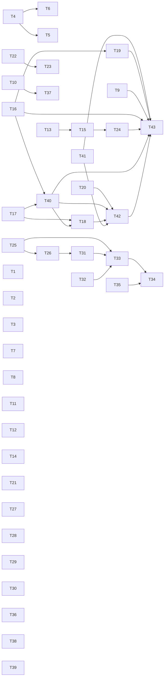

# Round 30 fixes

status: in-progress
base: 9e083c2d090aebfff2d4c56e38b9dc07a4f1c805
commit-mode: orchestrator-commits
language: ruby (T25, T31 and T33 also touch Rust in `crates/lain-daemon` and `crates/lain-wire`)
panel: Ruby (Linus Torvalds, Jeremy Evans, Sandi Metz, Richard Schneeman, Aaron Patterson); Rust (Raph Levien, Andrew Gallant, Frank McSherry) join for T25, T31, T33

## Intent

QA round 30 (`planning/qa-findings-round30-2026-11-18.md`) filed 1 HIGH, 5 MED-HIGH and 18 MEDIUM findings. This plan fixes all 24, plus the LOW findings that share a fix site with one of them. Most of the fixes reuse an owner lain already has and that some sites never call: `Sensitivity::TextMask` with `Secrets::Source` for known secret values, the cut-off path in `Agent` for a reply the window ended, `Source#early_handoff` for a chat that cannot read, and `ChildArgv` for every child command line.

The user ruled on 2026-11-19 (memory `qa-round-30-rulings.md`):

1. The scope is MEDIUM and up, plus the LOWs sharing a fix: o30-1, r30-3, g30-6 (with h30-2); s30-4 (with q30-1); s30-1 (with g30-1); n30-2 (with q30-2); d30-1 (with n30-1); c30-1 (it caused the round's daemon incident). This plan also takes h30-3 (the other half of m30-2), m30-4 (a sandbox note), and p30-4 (the same rule as p30-1, and the probe that settles p30-3).
2. a30-2: under `auto`, a human's `y` is remembered for that exact call for the rest of the chat.
3. o30-3: a blocked notice names the command, masked and truncated.
4. q30-1: a headless run takes provider, model, api base, ctx and batch from the requester. A run with no requester uses the `LAIN_*` values the daemon started with.
5. c30-1:
   - Only a new lain-daemon build or a changed lain checkout replaces an idle daemon.
   - The daemon's own settings (relay, devices, review poll) come from the user config.
   - A project's `.lain/config.rb` may add project-level daemon settings, its own review poll, layered over the user's. The daemon applies them when a chat there registers, without a restart. The user does not want daemon settings to be a singleton.
6. g30-1: a child starts at the parent's current approval, read live.
7. m30-2: a human's plain `y` on a project script (`bin/rails`) must run it, contained with no network, even if the script was edited in the session. Masked files stay masked. Whether a contained run with no network could see secrets went to research (`planning/contained-run-secrets-research-2026-11.md`).
8. The research's 2 recommendations are in this plan (user, 2026-11-19): masks become decoys so a masked Rails app boots (T40), and a separate human answer unmasks the secret files for 1 contained run, with the decrypted credentials masked and the run's writes scanned (T41 to T43).

Roadmap: `ROADMAP.md` item 76, added in the commit that lands this plan.

What lands, by stream:

- **P, prompt and memory (T1 to T3):**
  - An oracle's input values are data and are never compiled.
  - An unknown directory under `.lain/slots/` is refused.
  - The clerk's scaffold stops telling it to cite the spawn as a file.
- **R, replies and windows (T4 to T8):**
  - A length-cut ollama reply is a cut, whatever calls it holds.
  - A cut reply's stranded calls are dropped, not answered 1 by 1.
  - Ollama's cache reads are journaled.
  - A child sizes itself by the probed window.
  - A read-starved chat that no cut can cure hands off.
- **S, secrets (T9 to T15):**
  - The known secret values are masked on every surface a reader can reach: `read_file`, `grep`, review evidence, export and `/share`, the plain-chat question, the desk `[y/N]`, a `/park` note, and the blocked notice.
- **C, confinement and approval (T16 to T24):**
  - A human `y` runs a project script contained.
  - The refusal stops telling the model to ask a human who already answered.
  - A masked file is named.
  - A masked file reads as empty, and a masked Rails key pair as a decoy, so `bin/rails` boots contained.
  - An unreadable lineage parks the next networked build (round 29 ruling 12).
  - The mask listing stops reclassifying 50,000 ignored names per call.
  - The judge sees related directories.
  - A drained chore can add a file.
  - A human allow is remembered.
  - A `secrets` answer runs 1 contained call with the secret files unmasked. Its decrypted Rails credentials are masked, and what it wrote is scanned and gated.
- **H, headless and daemon (T25 to T34):**
  - A headless run gets a provider.
  - A chore's failure says why.
  - An unattended gate refuses at once.
  - A signal with nobody at the keyboard interrupts.
  - A relay that fails at launch is said.
  - Only a new build replaces a daemon.
  - A project can add its own review poll.
- **K, children and cockpit (T35 to T39):**
  - A child keeps the parent's approval.
  - notify-feed runs with a clean env.
  - `/stop` reaches a `/review` critique.
  - A phone gate item is 1 revision.
  - A queue offer goes only to a chat that can open it.

## Grounding

2026-11-19, `898c63c1` on `main`.

**How it was checked:**
- 7 read-only Explore agents (Sonnet), 1 per area, traced each finding from its production entry point to the site that causes it, and listed the specs that pin today's behaviour. Their notes are condensed in `~/tmp/lain/claude-1000/-home-tara-dev-lain/aea49922-74fe-442d-95e0-15309e016fdd/scratchpad/r30/grounding.md`.
- The coordinator re-read these itself:
  - `prompt/locked_binding.rb:27-86` and the m30-1 repro, which it re-ran during the round.
  - `provider/ollama/decoding.rb:280-321`.
  - `tools/ask_human/unattended.rb:45-56`.
  - `notices/feed.rb:30-45`.
  - `cli/child_argv.rb:38-60`.
  - `agent.rb:700-728`.
  - `confine/mask_list.rb:15-70`.
  - `confine/profiles.rb:360-385`.
  - `cli/wiring/board_build.rb:186-220`.
- mempalace was not reachable this session (the MCP server failed to connect), so prior decisions come from the memory files and `planning/` only.

**Where the docs and the code disagree, and which wins:**
- m30-2 says "restricted profile". Under the default arm a human's contained `y` runs the workspace profile (`Profiles#contained`, `confine/profiles.rb:159-163`). It fails because `Profile::GRANTED_CLASSES` (`confine/profile.rb:42`) never exec-grants a `project` program. The code is right about the profile; the finding's wording is wrong.
- `telemetry/malformed_response.rb:85-87` says a cut inside an envelope keeps `:max_tokens`. `decode_stop_reason`'s header (`decoding.rb:282-289`) says tool calls force `:tool_use`. T4 makes the header say that a length cut wins.
- `price_book.rb:55-57` says an ollama response reports only `prompt_eval_count`. The e2e cassettes carry `prompt_eval_cached_count` (`spec/fixtures/vcr_cassettes/e2e/todos_drain.yml:279`). T6 fixes the comment.
- `docs/users/configuration.md:138` says a cancelled wait denies. A SIGINT to a headless chat settles a parked call as a silence `postpone`. The doc wins (T29).
- `docs/users/configuration.md:420-426` says `github` may be set per project, env over project over user. The review poll reads the user file only (`cli/queue.rb:168-178`, `root: nil`). T32 and T33 make a project's `github` drive its own poll, so the doc becomes true.
- `docs/users/configuration.md:62` says a project pins `LAIN_*` in `.envrc`. A headless run reads none of them (`daemon/launch.rb:18-35`). T25 and T26 fix the code.
- Round 29 ruling 12 (an unreadable lineage parks the next networked build) is not implemented. `BuildGrant#program` (`confine/profiles.rb:374-380`) withdraws the network silently, and `Fresh#any_under?` never clears. T19 implements the ruling.
- Round 29 ruling 17 (`max_tokens` continues the reply) has not landed, and stays out of this plan.
- The p30-1 and p30-3 cites are stale. `commit?` is at `approval/lease_commit.rb:94-97` and `own_lease` at `:110-115`. Reading the code does not support p30-3's guess (`own_lease` reads the parent root). The leased child's `LeaseCommit` is rooted at its checkout (`board_build.rb:~706-737`). T23 makes the abstain name its failing check, which settles it.
- `Remembered`'s class comment (`approval/remembered.rb:8`) says nothing writes an answer from the prompt. `Parked::Queue#remember` writes denials. T24 corrects it.
- The round 29 plan's read-starved exemption is T29, not T27. It applies only when a rewrite frees about 8 KB, which a read-starved head of 1 to 2 KB never can. That is why it did not help m30-3.

## Compatibility

| Surface | Verdict | Evidence |
|---|---|---|
| Ruby API (`Lain::*`) | free to break | `lain.gemspec` at `0.1.0`, no consumers outside lain's own worktrees (round 29's grep, unchanged since) |
| Rust crates | free to break | every `Cargo.toml` says `publish = false` |
| `lain-wire` `RunStart` and `Register` | free to break; new fields are `#[serde(default)]` | the daemon, the relay and the app are built from this repo (`crates/lain-wire/src/lib.rs:255-266`) |
| `run.start`'s refusal of `argv`, `approval` and `env` keys | kept; T25 adds a typed `profile` member, not raw flags | `planning/specs/lain-daemon.md:~970` |
| Daemon `info` reply | free to break; T31 adds a `build_digest` and a `settings_digest` | read only by `Lain::Daemon` (`daemon.rb:118-140`) and `crates/lain-daemon/tests/lifecycle.rs:125-161` |
| CLI flags and subcommands | free to break; `lain queue poll --root` is new | user ruling 2026-11-11, "nothing is in production" |
| Journal records (`awaiting_human` summary, `writes_unread`) | free to break | memory `old-sessions-disposable.md`; the summary keeps its type and gains masked text, `writes_unread` gains a masked `command` |
| Review counts file | free to break; T32 adds 1 file per project root beside the user's | `paths.review_counts`, read by the HUD |
| Config DSL (`.lain/config.rb`) | no new key; the project `github` verb that exists already starts driving a poll | `lib/lain/config.rb:180-187` |
| `lain export --format jsonl` | must keep raw | round 29 ruling 7 |
| Approval answers (`y`, `n`, `hold`, `network`) | free to break; T43 adds `secrets` at the TTY and in nvim, the 2 surfaces that offer `network` | `Approval::Reply` (`approval/reply.rb:35-57`) is the only parser; the phone offers neither (`remote/wire.rb:126-144`) |
| Mask contents inside a contained run | free to break, with 1 guard; T40 turns EACCES into an empty file or a decoy | the sandboxed program reads them, and git can write them into the host's index and objects. T40's filter and `DecoyGuard` keep a decoy out of the repo. `spec/lain/confine/bwrap_spec.rb:410-518` pins EACCES and is rewritten |

No must-keep surface stood in the way of a simplification, so there was no trade to report.

## Spike findings

| Question | Result | Evidence |
|---|---|---|
| c30-3: is the per-call cost git's listing or lain's work over the names? | lain's. `git ls-files -z -co` over 50,000 ignored files took 0.03 s (3 runs). Fork c measured 280 to 370 ms warm and 5.1 to 5.3 s cold per call for the same tree, so the Ruby diff and classification of 50,000 names is the cost, not git. T20 skips the work when the listing is byte-identical, and prunes the common build directories. | throwaway repo in the session scratchpad (`r30/spike-ls`), 500 dirs of 100 files under an ignored `build/`; `~/tmp/lain-qa-2026-11-18-c/records/fork-report.md:48-49,59` |

| T40: does a git clean filter set through env keep a decoy out of a commit? | Yes for `git commit -am`: HEAD kept the original blob. A `.gitattributes` with `-filter` in the repo turns it off, so T40 also checks the index and new commits after the run. | throwaway repo in the session scratchpad (`r30/filterspike`) |
| m30-2: does `bin/rails` run under today's masks, and what would let it? | No. A mask is `/dev/null` bound `nodev`, so a read fails with EACCES, and Rails 8.1 reads its credentials at boot: `rails runner 'p 1+1'` and `rails g scaffold` exit 1. A decoy pair (a random key and `{}` encrypted under it) boots both, with credentials empty. The private netns blocked TCP, DNS, UDP, the dbus socket and abstract sockets through `Confine::Profiles`. | `planning/contained-run-secrets-research-2026-11.md`, 2 spikes and a decoy run under bwrap (T40, T43) |

The c30-3 spike was a throwaway git repo in the scratchpad, not a worktree, because it ran git alone and no lain code.

## Panel review

1 review (Ruby roster, with the Rust seats), verdict REQUEST-CHANGES, 2 BLOCKERs, 14 SHOULD-FIX and 8 NITs. The panel traced T19's `Fresh` from `Observers.register` (`cli/wiring/observers.rb:105,117-125`) to both the sandbox (`toolset_build.rb:406-408,449-450`, `profiles.rb:130`) and the board, and probed the rule verdicts (`Rule::VERDICTS` is `[:allow, :deny]`). Every BLOCKER and SHOULD-FIX was applied:

- **BLOCKERs:**
  - T19 was an `Approval::Rule`. A rule cannot park: a deny is final, and an abstention falls through to the judge or `Bypass`, which can still allow. T19 is now a context bar (`automatic_approval_barred?`) mounted in `ToolGuard#layered`. The grant test moves to 1 public owner that the sandbox and the bar both ask.
  - T24 was a rule in `BoardBuild.approving`, which cannot see the queue, and a Rules-rung allow is always automatic. It is now a rung in `Switchboard#judged_ladder` that replays the human's ruling.
- **Rulings:**
  - T24 no longer remembers a `network` answer, which a30-2 did not rule.
  - T35 no longer refuses a fork from plan scope; that is an Open decision now.
  - T33's timer always runs, so a project poll needs no user `github` verb and no restart.
- **Mechanism:**
  - T5's rule is "a reply that is not a tool turn keeps no call". This covers the `:max_tokens` path T4 opens.
  - T20 keys the reuse on the policy and the directory stamps, with a link-swap scenario, and drops the build-directory prune.
  - T36 scrubs only the loader names, so `notify-send` keeps its display variables.
  - T8 names the fallback arms.
  - T25 covers chores.
  - T34 reads the right HUD.
- **Mechanical:**
  - T5 depends on T4 (shared `agent_spec.rb`) and lists `cancellation_spec.rb`.
  - T13 names `Switchboard#queue_over` and reuses `live_display`.
  - Production-path scenarios were added to T7, T13, T19, T21 and T24.
  - T22 pins `&&` and pathspec magic and names `.sole`.
  - T16 names the tripwire's reader.
  - T32 handles an untrusted project.
  - T1 lists `recorded_spec.rb`.
  - T15 uses the notifier's 200-character limit.
- **Declined:** merging T17 with T18 and T22 with T23. The reason is in Rejected options.

A 2nd review (Ruby roster) covered T40 to T43, added after the secrets research. Verdict REQUEST-CHANGES, 2 BLOCKERs, 9 SHOULD-FIX and 8 NITs, all applied. The panel traced `secrets` from `ApprovalPolicy.read` and `ApprovalView#read` through `Reply.parse`, `Pending#resolve` and `Escalation` to `Profiles#contained`, and probed T40 with the real `Bwrap` argv and the compiled fence:

- **BLOCKERs:**
  - A decoy over the tracked `credentials.yml.enc` let a contained `git commit -am` commit it, where the mask fails closed today. T40 now prevents this with a git clean filter and checks the index and new commits after the run.
  - A decoy bound from a path let a planted link read any host file at a project path. T40 binds every mask from an fd (`--ro-bind-data`).
- **Mechanism:**
  - T42 scopes by ctime against a filesystem mark, scans the index and new commits, unions the taint into the bwrap masks, and keys T20's reuse on the taint.
  - T42's wiring goes through `ToolsetBuild` lazily, and it says "per process".
  - T42 introduces `Profile#unmasked?` for T43 to set, and gives `:tainted` a home in `Sensitivity`.
  - T43 lifts project masks only, caps the row at 5 names, lists every surface's files, and covers the combined answers per surface.
  - T40 binds a decoy pair whenever the key is masked, and builds its decoy lazily.
- **Mechanical:** T18 uses `.env` and names a decoy as a decoy; graph edges T17 --> T40, T20 --> T42, T40 --> T42 and T41 --> T43; the zeitwerk line; the phone gains no answer.

## Shared files

Only the main session edits these. Cards hand back 1-line diffs.

- `lib/lain/cli/command/surface.rb`: T10, T11, T35 thread a collaborator into the command env.
- `lib/lain/cli/wiring.rb`: T12, T19.
- `lib/lain/cli/wiring/board_build.rb`: T19 puts the lineage's `Fresh` on `ToolGuard::Inputs`. T42 builds 1 `Sensitivity::Taint` per chat and hands it to the Policy (`:296`) and to `Sandboxed`.
- `lib/lain/cli/wiring/toolset_build.rb`: T7 hands the window to the spawn seam. T42 hands `Sandboxed` the taint and the known values lazily.
- `ROADMAP.md`, `docs/devs/architecture.md`, `docs/users/configuration.md`, `docs/users/remote.md`, `docs/users/commands.md` (`:1228-1235`, the masks and the answers, for T40 and T43): doc lines the cards hand back.
- `.rubocop.yml`: only if a card's stop condition says a limit trips.

## Rejected options

- **Pass oracle inputs as ERB locals (`<%= source %>`) instead of sentinels (T1).** This changes all 7 oracle templates and the recorded-question digests. `LockedBinding#clean_binding` also matches a local by regex over the source, so a local named `held` or `span` could match prose. The sentinel splice that `Skill::Renderer` already uses keeps every rendered byte identical for an ordinary value.
- **Loosen `memory_write`'s `sources` to accept a digest (T3).** That would break the stale-mark invariant (`memory/staleness.rb:41-48`). The spawn is already stamped as the author (`consolidation.rb:200`).
- **A per-round tool-call cap (g30-2).** Every case seen came from a length cut. T4 and T5 stop a reply that is not a tool turn from running or keeping any call, and a cap would be a new budget with no other caller.
- **Merge T17 with T18, and T22 with T23 (panel).** Each pair touches 1 file in a chain, but each card has 1 responsibility (a refusal's wording and a note's content; an approval rule and its diagnostics). They stay separate and ordered.
- **Treat a cut reply's calls as cancelled one by one (T5).** That is today's path. With 943 calls it adds 943 results and keeps the chat over the window. Dropping the stranded calls and saying how many keeps the reply's text, which is what round 25's ruling kept.
- **`--exclude-standard` on the mask listing (c30-3).** Ignored files are the usual secrets (`mask_list_spec.rb:75`).
- **Prune `build/` and `dist/` below their top level (c30-3).** It brings back, 1 level down, the gap `--directory` has: `build/sub/.env` goes unlisted. T20 reuses the masks instead.
- **List ignored directories with `--directory` (c30-3).** Fast, but classification is by name (`Policy#mask_paths`, `sensitivity/policy.rb:635`), so `build/.env` would go unmasked.
- **Exec-grant a project script only if it was not written in the session (m30-2).** The user ruled that a human's `y` runs it either way, because the call has no network.
- **Hash `LAIN_*` values into the daemon digest (q30-1).** A shell with another `LAIN_MODEL` would then replace an idle daemon. That is the c30-1 failure the user ruled out.
- **A per-project poll interval (c30-1, rule 3).** The poll's only inputs are the account and the orgs (`review/queue/poll.rb`). No caller needs a second interval, so a project's poll runs on the user's.
- **Present a masked file as absent (T40).** Rails boots with the key absent, but bwrap cannot remove 1 file under the bound `/` without a tmpfs over its directory, and new files written there would vanish with the run. A decoy pair gives the same boot with ordinary binds.
- **Unmask on the plain `y` (T43).** A program can reshape a secret (reverse, base64) past any exact-value mask, so unmasking is a separate human answer that names the files, never the default.
- **Inject `RAILS_MASTER_KEY` into the child env, `op run` style (T43).** The credentials file stays unreadable, so Rails still fails, and it has the same derived-value and copy gaps as unmasking.
- **Decoys only for untracked masks (T40, panel).** `config/credentials.yml.enc` is tracked in nearly every Rails app, so this would leave Rails failing to boot. T40 keeps decoys and guards git instead.
- **A path source for each decoy (T40, panel).** bwrap follows a link at the source, so a planted link would read any host file at a project path. `--ro-bind-data` from an fd has no path.
- **Scope the scan by mtime (T42, panel).** `cp -p`, hard links, `tar x` and `touch -d` keep an old mtime. ctime moves for all 4.
- **Trace every read and write to taint files (T42).** strace or fanotify costs far more than a listing by mtime and still cannot follow a reshaped value.
- **Journal the raw command in `awaiting_human` for o30-3.** The record leaves input out on purpose, because input can carry credential bytes (`telemetry/awaiting_human.rb:75-79`). T15 journals only text that has already gone through the chat's mask.

## Open decisions

- **The name of the unmasking answer (T43).** The plan uses `secrets`, beside `network`. The user may rename it; only `Reply`'s word and the surfaces' prompts change.
- **Databases in a contained run.** The netns has its own loopback and grants no unix socket, so a contained `rails runner` cannot reach a host postgres. Granting a database socket would give a `secrets` run a store outside T42's scan. Not in this plan.
- **A child of a parent in plan scope (g30-1).** There is no scope flag, so a child starts in checkout scope. T35 carries the approval only. Whether a fork from plan scope should refuse, or a `--scope` flag should exist, is the user's call.
- **Round 29 ruling 17 (`max_tokens` continues the reply).** Still its own plan. T4 only stops a length cut from running calls.

## Dependency graph



## Tasks

### T1: render an oracle's input values as data, never as ERB          [risk: high]

**Depends on:** none
**Files:**
- `lib/lain/prompt/locked_binding.rb`
- `lib/lain/oracle/definition.rb`
- `lib/lain/skill/renderer.rb`
- `spec/lain/prompt/locked_binding_spec.rb`
- `spec/lain/oracle/definition_spec.rb`
- `spec/lain/oracle/handoff_spec.rb`
- `spec/lain/oracle/summarize_spec.rb`
- `spec/lain/skill/renderer_spec.rb`
- `spec/lain/oracle/recorded_spec.rb`

**Reuse:** `Skill::Renderer`'s sentinel and single splice (`skill/renderer.rb:34-86`, `splice` at `:74-76`). The splice moves onto `LockedBinding`, and `Skill::Renderer` calls it there, so 1 copy remains.
**Shared-file wiring:** none
**Reachable from:** `CLI::Backend` builds the handoff tier with `journaling(Oracle::Handoff.definition)` (`cli/backend.rb:990`). `Oracle::Model#request_for` (`oracle/model.rb:110`) and `Oracle::Recorded#ask` (`oracle/recorded.rb:65`) call `Definition#render`.

**Acceptance criteria**

```gherkin
Scenario: a transcript holding a Rails helper tag hands off
  Given a held message whose text is "The view has <%= link_to 'Back', posts_path %> at the bottom."
  When Oracle::Handoff.definition renders the question
  Then it raises nothing
  And the rendered prompt holds that text byte for byte

Scenario: a pure ERB tag in a transcript stays literal
  Given a held message whose text is "literal <%= \"INJECTED\" %> text"
  When the handoff question is rendered
  Then the prompt holds "<%= \"INJECTED\" %>" and not a bare "INJECTED"

Scenario: the summarizer takes ERB in its source
  When Oracle::Summarize.definition renders "assistant: use <%= link_to 'Back', posts_path %>"
  Then it raises nothing and the source appears verbatim

Scenario: a template is still checked for purity
  Given an oracle template "<%= Time.now %>"
  When it renders
  Then it raises Prompt::ImpureSlot

Scenario: a project slot fill is still a template
  Given .lain/slots/system.md holding "<%= rand %>"
  Then the system prompt render raises Prompt::ImpureSlot

Scenario: an ordinary value renders the same bytes as before
  Given each oracle's recorded-question spec
  Then its rendered digest is unchanged
```
Spec files: `spec/lain/oracle/definition_spec.rb`, `spec/lain/oracle/handoff_spec.rb`, `spec/lain/oracle/summarize_spec.rb`, `spec/lain/prompt/locked_binding_spec.rb`, `spec/lain/prompt/slots_spec.rb` (unchanged, must stay green)

**Interface**

```ruby
# values: names whose resolved String is DATA. `render(name)` for one of them
# returns an inert sentinel; render_template splices the raw bytes in after the
# single ERB pass, so a value is never compiled.
LockedBinding.new(resolve:, locals: {}, values: {})
def render_template(source, label) # -> String, values spliced
```

**Stop and report if:**
- A recorded oracle question's digest changes for a value with no `<%`. `spec/lain/oracle/recorded_spec.rb:22,131` pins those digests.
- `Skill::Renderer`'s fragments rely on being re-evaluated after the splice. `spec/lain/skill/renderer_spec.rb` would show it.
- A TEMPLATE (not a value) holds the sentinel token. A single-pass `gsub` (`skill/renderer.rb:74-76`) never rescans spliced bytes, so a value holding it is harmless; a template holding it is the case to refuse.

### T2: refuse an unknown directory under `.lain/slots/`          [risk: low]

**Depends on:** none
**Files:**
- `lib/lain/prompt/slots.rb`
- `spec/lain/prompt/slots_spec.rb`

**Reuse:** `Slots.refuse_unknown!` and `suggestion` (`prompt/slots.rb:105-110,132-137`), the m29-4 fix's helpers.
**Shared-file wiring:** none
**Reachable from:** `Skill::Library` (`skill/library.rb:42`) calls `Prompt::Slots.load`.

**Acceptance criteria**

```gherkin
Scenario: a misspelled region directory is loud
  Given .lain/slots/roles/reviewer.md
  When the slots load
  Then Prompt::UnknownSlot names "roles" and suggests "role"

Scenario: a directory inside the role region is loud
  Given .lain/slots/role/extra/x.md
  Then Prompt::UnknownSlot names "extra" and says nothing is declared there

Scenario: the two real regions still load
  Given .lain/slots/role/reviewer.md and .lain/slots/skill/<a known skill>/<a declared hole>.md
  Then both fills are read
```
Spec file: `spec/lain/prompt/slots_spec.rb`

**Stop and report if:**
- `spec/lain/prompt/skill_slots_spec.rb:73` changes wording. The skill level's message must stay as m29-4 left it.
- An editor leftover (`editor_leftover?`, `slots.rb:171`) or a dot-directory starts refusing.

### T3: tell the clerk the spawn is recorded for it          [risk: low]

**Depends on:** none
**Files:**
- `lib/lain/consolidation.rb`
- `spec/lain/consolidation_spec.rb`

**Reuse:** `Memory::Author.clerk(spawn:)`, which `Tools::MemoryWrite` is already built with (`consolidation.rb:200`).
**Shared-file wiring:** none
**Reachable from:** `lain consolidate` calls `Consolidation#call`, which renders `Consolidation::Scaffold#render` (`consolidation.rb:231-243`).

**Acceptance criteria**

```gherkin
Scenario: the scaffold no longer asks for the spawn as a source
  When a lineage's scaffold renders
  Then it says the spawn is recorded as each memory's author
  And it says `sources` takes project file paths only
  And it still names the spawn digest

Scenario: an obedient clerk stores its memories
  Given a scripted clerk that follows the scaffold
  When lain consolidate runs over a completed lineage
  Then the store holds the clerk's items with author "clerk" and that spawn
```
Spec file: `spec/lain/consolidation_spec.rb` (the examples at `:101-122` and `:186-188` change their wording assertions)

**Stop and report if:**
- `spec/lain/consolidation_spec.rb:186-188` needs the masked digest in a different place than the scaffold.

### T4: an ollama reply cut at the length limit is a cut, whatever calls it holds          [risk: medium]

**Depends on:** none
**Files:**
- `lib/lain/provider/ollama/decoding.rb`
- `lib/lain/telemetry/malformed_response.rb` (comment only)
- `spec/lain/provider/ollama/decoding_spec.rb`
- `spec/lain/provider/ollama_spec.rb`
- `spec/lain/agent_spec.rb`

**Reuse:** `window_cut?` (`decoding.rb:312-315`) and the `CONTEXT_FULL` / `MAX_TOKENS` arms that exist.
**Shared-file wiring:** none
**Reachable from:** `Provider::Ollama` decodes every response through `Decoding#decode_stop_reason`. `Agent::Transition#call` (`agent/transition.rb:30-35`) runs calls only on `:tool_use`.

**Acceptance criteria**

```gherkin
Scenario: a length cut with complete tool calls runs none
  Given an ollama body with done_reason "length", eval_count below the ceiling and 3 tool_calls
  When it decodes
  Then the stop reason is :context_full

Scenario: at the ceiling it is a max_tokens stop
  Given the same body with eval_count equal to the ceiling
  Then the stop reason is :max_tokens

Scenario: a finished tool turn is still a tool turn
  Given done_reason "stop" and 2 tool_calls
  Then the stop reason is :tool_use

Scenario: a chat whose reply is cut with calls runs no bash
  Given Provider::Mock answering 1 cut reply holding 5 bash calls, through Agent
  When the ask runs
  Then the journal holds no exec_record for the round
```
Spec files: `spec/lain/provider/ollama/decoding_spec.rb` (`:141` "strips a cut that follows complete calls, and the calls still run" is rewritten), `spec/lain/provider/ollama_spec.rb:796-801`, `spec/lain/agent_spec.rb` (a new example; T5 rewrites the one at `:1003` after this card lands)

**Stop and report if:**
- `done: false` stops winning over everything. `decoding_spec.rb`'s truncated examples pin it.
- A streamed reply reaches `decode_stop_reason` without `done_reason`. Check `provider/ollama/stream_assembler.rb:238-242`'s `build_body`.

### T5: a reply that is not a tool turn commits no tool call          [risk: medium]

**Depends on:** T4
**Files:**
- `lib/lain/agent.rb`
- `spec/lain/agent_spec.rb`
- `lib/lain/tool/cancellation.rb`
- `spec/lain/tool/cancellation_spec.rb`

**Reuse:** `Agent#commit_reply` and `pairable` (`agent.rb:711-721`), `CUT_OFF_NOTICES` (`:42-45`). The rule is 1 line in `commit_reply`: a reply whose stop reason is not `:tool_use` keeps no `tool_use` block. That replaces the notice-key check, so `:max_tokens` (which `LoopMachine` fails at `loop_machine.rb:50`) is covered too.
**Shared-file wiring:** none
**Reachable from:** `Agent#attempt` commits every reply through `commit_reply`. `answer_stranded_cut` (`:724`) is the path this replaces.

**Acceptance criteria**

```gherkin
Scenario: a cut reply keeps its text and loses its calls
  Given a :context_full reply with text "Running the suite" and 943 tool_use blocks
  When the agent commits it
  Then the turn holds the text, the cut notice, and a line saying 943 tool calls were cut off and not run
  And the turn holds no tool_use block
  And no tool_result follows it

Scenario: the next request fits
  Given that turn in a 32,768-token window
  When the next prompt is rendered
  Then its tokens are below the window

Scenario: a max_tokens reply with calls commits none
  Given a :max_tokens reply with text and 2 tool_use blocks (T4 maps a length cut at the ceiling, or with no ceiling, here)
  Then the turn holds the text and a line saying 2 tool calls were cut off and not run, and no tool_use block
  And the next ask is not answered with :unknown results

Scenario: a cut reply with no calls is unchanged
  Given a :truncated reply with only text
  Then the committed turn is today's text plus the notice
```
Spec file: `spec/lain/agent_spec.rb` (`:1003` "answers a tool call in a cut-off reply so the next request is well formed" is rewritten)

**Stop and report if:**
- A reader of the journal needs the stranded `tool_use` ids (the HUD, `lain watch`, `Journal::Projection::Lineage`). Grep `cut_off` and `Cancellation` across `lib/` first.
- `Tool::Cancellation(:cut_off)` loses its last caller. Delete the `:cut_off` kind and its examples in `spec/lain/tool/cancellation_spec.rb:58,71`.

### T6: journal ollama's cache reads          [risk: medium]

**Depends on:** T4
**Files:**
- `lib/lain/provider/ollama/decoding.rb`
- `lib/lain/provider/ollama/stream_assembler.rb`
- `lib/lain/price_book.rb` (comment at `:55-57`)
- `spec/lain/provider/ollama/decoding_spec.rb`
- `spec/lain/provider/ollama/stream_assembler_spec.rb`
- `spec/lain/provider/ollama_streaming_spec.rb`
- `spec/lain/compaction/cold_spec.rb`

**Reuse:** `Usage.new(cache_read_input_tokens:)` (`usage.rb:15-40`). The e2e cassettes already carry `prompt_eval_cached_count`.
**Shared-file wiring:** none
**Reachable from:** `Provider::Ollama` builds usage in `Decoding#build_usage` (`decoding.rb:318-320`) and, for a stream, `StreamAssembler#capture_done` / `build_body` (`stream_assembler.rb:228-242`). `Compaction::Cold#observe` (`compaction/cold.rb:87-90`) reads it from `Compaction::Source` (`compaction/source.rb:626`).

**Acceptance criteria**

```gherkin
Scenario: a warm ollama turn reports its cached tokens
  Given a final frame with prompt_eval_count 7353 and prompt_eval_cached_count 6998
  When it decodes, streamed or not
  Then usage has input_tokens 355 and cache_read_input_tokens 6998
  And total_input_tokens is 7353

Scenario: an old server with no cached count
  Given a frame with no prompt_eval_cached_count
  Then cache_read_input_tokens is 0 and input_tokens is prompt_eval_count

Scenario: a warm ollama turn is not confirmed cold
  Given an ollama session whose second response reports cached tokens
  Then no cache_cold_confirmed record follows that response
```
Spec files: `spec/lain/provider/ollama/decoding_spec.rb`, `spec/lain/provider/ollama/stream_assembler_spec.rb`, `spec/lain/compaction/cold_spec.rb:104-151`

**Stop and report if:**
- `Lain::Compare` (`lib/lain/compare.rb:283-303`) still withholds `cache_hit_ratio` for ollama through a `degraded` `:prompt_caching` flag. Name where the flag is set, and do not change it in this card.
- Compaction's timing on ollama changes in `spec/lain/compaction/source_spec.rb`, because `cold` now reads false (`source.rb:1024`). Report which examples move.

### T7: a child sizes its window by the probed one          [risk: low]

**Depends on:** none
**Files:**
- `lib/lain/tools/subagent.rb`
- `spec/lain/tools/subagent_spec.rb`

**Reuse:** `CLI::Backend#context_window` (`cli/backend.rb:501`), the run's 1 `WindowBook::Live`.
**Shared-file wiring:** `lib/lain/cli/wiring/toolset_build.rb:495`: pass `context_window: backend.context_window` to `Subagent::Seam.new`.
**Reachable from:** `CLI::Wiring::ToolsetBuild#spawn_seam` (`toolset_build.rb:495`) builds the `Seam` that `Tools::Subagent#spawn_agent` (`subagent.rb:2095-2105`) reads.

**Acceptance criteria**

```gherkin
Scenario: a child's occupancy uses the parent's window
  Given a seam whose context window resolves to 32,768 tokens
  When a child is spawned and has used 3,777 tokens
  Then its occupancy is 3777/32768

Scenario: a child's tool round is sized from the same window
  Then the child's RoundBudget.window is computed from 32,768, not 8,192

Scenario: through the production seam
  Given a toolset built by CLI::Wiring::ToolsetBuild#spawn_seam over a backend whose window resolves to 32,768
  When a subagent is spawned
  Then its occupancy denominator is 32,768

Scenario: a seam built without a window keeps the default
  Given Subagent::Seam.new with no context_window
  Then the child uses ContextWindow.default
```
Spec file: `spec/lain/tools/subagent_spec.rb`

**Interface**

```ruby
Seam = Data.define(..., :context_window) # default ContextWindow.default
```

**Stop and report if:**
- `cli/epic_submit.rb:1183`'s `Seam.new` needs the window too. It has no backend in scope.

### T8: hand off when the reads are starved and no cut can cure it          [risk: high]

**Depends on:** none
**Files:**
- `lib/lain/compaction/source.rb`
- `lib/lain/compaction/source/fallback.rb`
- `spec/lain/compaction/source_spec.rb`
- `spec/lain/seams/compaction_window_spec.rb`

**Reuse:** `Source#early_handoff` (`compaction/source.rb:755-770`), the clean-break handoff that `--compact-fallback early-handoff` already uses. `Need::ReadStarved` (`compaction/need.rb:135-141`). `Room#cured_by?` (`source.rb:203-208`).
**Shared-file wiring:** none
**Reachable from:** `Compaction::Source#context_for` (`source.rb:718`) on every render. `CLI::Backend` builds the Source at `cli/backend.rb:959`.

**Arms:** today `early_handoff` acts only under `--compact-fallback early-handoff` (`early_armed?`, `compaction/source/fallback.rb:72,82`; `cli/backend.rb:969-975`). This card fires the starved handoff under the default arm (`handoff`) and under `early-handoff`, and never under `none`, which promises no handoff.

**Acceptance criteria**

```gherkin
Scenario: a read-starved chat with nothing a cut can free hands off
  Given a session at 91% whose round budget withholds every read, and whose head past the last cut holds 2 KB
  When the next ask renders
  Then a compaction_handoff record is journaled with reason read_starved
  And the next tool round's read budget is above 8,192 bytes

Scenario: a cut that cures still wins
  Given a read-starved session whose droppable head frees 12 KB
  Then the cut applies and no handoff is journaled

Scenario: the default arm hands off
  Given the starved session launched with no --compact-fallback
  Then the handoff is journaled

Scenario: the none arm never hands off
  Given --compact-fallback none
  Then no handoff is journaled, and the over-window refusal says why

Scenario: an unknown window never hands off early
  Given the same starved session on a guessed window
  Then no handoff happens and the sink says early handoff waits for the window, once
```
Spec files: `spec/lain/compaction/source_spec.rb` (near `:782-817` and `:1133-1236`), `spec/lain/seams/compaction_window_spec.rb`

**Stop and report if:**
- `Source#handoff` declines because `kept_tokens >= window` (`source.rb:794-797`) in m30-3's shape. Use `~/tmp/lain-qa-2026-11-18-m/records/cockpit.journal.ndjson`'s numbers. The handoff would then need a forward collapse (`Derived#collapsed`, `:1058-1060`), which is a design call.
- The handoff fires on a session that is starved only for 1 turn and then recovers.

### T9: mask the known secret values in `read_file` and `grep`          [risk: high]

**Depends on:** none
**Files:**
- `lib/lain/middleware/redact_secret_reads.rb`
- `spec/lain/middleware/redact_secret_reads_spec.rb`
- `spec/lain/seams/passed_value_masking_spec.rb`

**Reuse:**
- `Sensitivity::TextMask#masked` (`sensitivity/text_mask.rb:95-98`) and `Regions.recurrences`.
- `@secrets.for(context)` (`redact_secret_reads.rb:175-191`), which the bash path already calls at `:307-313`.
**Shared-file wiring:** none
**Reachable from:** `ToolGuard` mounts `RedactSecretReads.new(**read_kwargs(...))` (`cli/tool_guard.rb:678`) with `secrets: inputs.secrets` (`:800-805`). `CLI::Wiring::BoardBuild#secrets` builds that from `board_build.rb:278-281`.

**Acceptance criteria**

```gherkin
Scenario: read_file masks a shapeless env pass value
  Given env pass names DEPLOY_PW="hunter2xyz", and a project file holding "pw=hunter2xyz"
  When the model calls read_file on it
  Then the result holds a mask placeholder and not "hunter2xyz"

Scenario: grep masks it too
  When the model greps for "pw="
  Then the matching row is masked the same way

Scenario: the lent GitHub token is masked in a read
  Given a call whose worker env lends a token
  Then a file holding that token reads masked

Scenario: a known value is never released
  Given the human released the file's detected regions
  Then the known value is still masked

Scenario: the session file never holds it
  Then no journal record holds "hunter2xyz"
```
Spec files: `spec/lain/middleware/redact_secret_reads_spec.rb`, a new `read_file` and `grep` example group in `spec/lain/seams/passed_value_masking_spec.rb`

**Stop and report if:**
- The digest and ordinal bookkeeping in `Scan` (`redact_secret_reads.rb:594-632`) cannot carry a known-value span. Say which field breaks.
- `bin/hot-path-bench --check` regresses a read row.

### T10: mask the known values in review evidence, critique and docent briefs          [risk: medium]

**Depends on:** none
**Files:**
- `lib/lain/survey/projection.rb`
- `lib/lain/review/target.rb`
- `lib/lain/review/source.rb`
- `lib/lain/cli/command/review.rb`
- `lib/lain/cli/review.rb`
- `spec/lain/survey/projection_spec.rb`
- `spec/lain/seams/review_masked_note_spec.rb`

**Reuse:** `Sensitivity::TextMask.text` with a `Secrets::Source` (`sensitivity/secrets/source.rb`, `DEFAULT` for callers with none).
**Shared-file wiring:** `lib/lain/cli/command/surface.rb`: hand `secrets: switchboard.guard_inputs.secrets` to the `Review` command's env.
**Reachable from:** `CLI::Command::Review` builds `Review::Target` (`cli/command/review.rb:378-379`), which builds `Survey::Projection.new(ledger:)` (`review/target.rb:47`).

**Acceptance criteria**

```gherkin
Scenario: a review note's evidence masks a lent token
  Given a chat whose secrets include a shapeless value, and a diff line holding it
  When /review projects that file
  Then the evidence and the docent brief hold a placeholder, not the value

Scenario: a projection built with no secrets masks only what it detects
  Given Survey::Projection.new(ledger:) with no secrets
  Then it behaves as today
```
Spec files: `spec/lain/survey/projection_spec.rb`, `spec/lain/seams/review_masked_note_spec.rb`

**Interface**

```ruby
Survey::Projection.new(ledger:, secrets: Sensitivity::Secrets::Source::DEFAULT)
Review::Target.new(..., secrets: Sensitivity::Secrets::Source::DEFAULT)
```

**Stop and report if:**
- `lain review` from the CLI (`cli/review.rb:78`) has no chat and so no history literals. Say what it should mask with.

### T11: mask the known values in export and `/share`, and count them          [risk: medium]

**Depends on:** none
**Files:**
- `lib/lain/cli/export.rb`
- `spec/lain/cli/export_spec.rb`
- `spec/lain/cli/export/html_spec.rb`
- `spec/lain/cli/command/share_spec.rb`

**Reuse:** `Sensitivity::TextMask.transcript` (`sensitivity/text_mask.rb:29`), so every piece masks the same bytes with ordinals running across them.
**Shared-file wiring:** `lib/lain/cli/command/surface.rb:216`: pass `secrets: switchboard.guard_inputs.secrets` to `Export.new`.
**Reachable from:** `/share` builds `Export.new(selector:, paths:, project:)` (`cli/command/surface.rb:216`). `lain export` builds it from the CLI.

**Acceptance criteria**

```gherkin
Scenario: an HTML export masks a raw known value
  Given a session whose journal holds "hunter2xyz" and a chat whose secrets name it
  When it exports as HTML
  Then the HTML holds a placeholder, not the value
  And the summary counts that region

Scenario: /share uploads the masked page
  When /share runs over that session through a stand-in gh
  Then the uploaded body holds no "hunter2xyz" and says "1 region masked"

Scenario: jsonl stays raw
  When it exports with --format jsonl
  Then the output is byte-identical to today's
```
Spec files: `spec/lain/cli/export_spec.rb`, `spec/lain/cli/export/html_spec.rb`, `spec/lain/cli/command/share_spec.rb`

**Stop and report if:**
- `lain export` from the CLI has no chat. Say whether it should mask with the env pass values from `.lain/config.rb`, and stop.

### T12: mask a plain chat's question and arrival lines          [risk: medium]

**Depends on:** none
**Files:**
- `lib/lain/frontend/tty.rb`
- `spec/lain/frontend/tty_spec.rb`

**Reuse:** `Frontend::TTY::Notifier#mask` (`frontend/tty/notifier.rb:48-56`), the mask `Wiring::Attention` builds over `guard_inputs.secrets` (`cli/wiring/attention.rb:19,34,55`).
**Shared-file wiring:** `lib/lain/cli/wiring.rb`: after the TTY is built, hand it `notifier.mask`, as `HerdrBinding#bind` already does for the reporter (`cli/wiring/herdr_binding.rb:69-72`).
**Reachable from:** `Wiring#open_terminal` (`cli/wiring.rb:397-404`) builds the TTY. `TTY#render_question` (`frontend/tty.rb:331-336`) and `Arrivals#arrival` (`:806-815`) print what `ask_human` sends.

**Acceptance criteria**

```gherkin
Scenario: an ask_human question naming a session secret prints masked
  Given a plain chat whose secrets include a shapeless value
  When the model asks the human a question holding it
  Then the arrival line and the question block print a placeholder

Scenario: a TTY with no mask prints as today
  Given a TTY built with no mask
  Then the question prints byte for byte
```
Spec file: `spec/lain/frontend/tty_spec.rb`

**Interface**

```ruby
TTY#mask_with(mask) # mask: #call(String) -> String
```

**Stop and report if:**
- The answer the human types is masked too. Only lines lain shows are in scope.

### T13: mask the desk approval's call text          [risk: medium]

**Depends on:** none
**Files:**
- `lib/lain/approval/parked/queue.rb`
- `spec/lain/approval/parked/queue_spec.rb`
- `spec/lain/frontend/approval_policy_spec.rb`
- `lib/lain/cli/switchboard.rb`
- `spec/lain/cli/switchboard_spec.rb`

**Reuse:** `Switchboard#live_display` (`cli/switchboard.rb:169`), the 1 display mask over `guard_inputs.secrets`, which `Switchboard` already holds (`:282`).
**Shared-file wiring:** none
**Reachable from:** `Switchboard#queue_over` (`cli/switchboard.rb:519-522`) builds the queue; this card hands it `live_display`. `Parked::Queue::Pending#call_face` (`approval/parked/queue.rb:341`), read by `frontend/approval_policy.rb:161,322,327`, `frontend/neovim/approval_view.rb:552`, `cli/command/deny.rb:63` and `cli/repl/approval_surfaces.rb:167,178`.

**Acceptance criteria**

```gherkin
Scenario: the [y/N] line masks an env pass value
  Given env pass names a shapeless value and a parked bash call whose command holds it
  When the desk prompt renders
  Then the line holds a placeholder, not the value

Scenario: through Switchboard.for
  Given a switchboard built by Switchboard.for with env pass naming a value
  Then a parked call's face from its queue is masked

Scenario: what runs is unmasked
  When the human answers y
  Then the command that runs holds the real value
```
Spec files: `spec/lain/approval/parked/queue_spec.rb`, `spec/lain/frontend/approval_policy_spec.rb`, `spec/lain/cli/command/deny_spec.rb` (unchanged, must stay green)

**Stop and report if:**
- `call_face` is used as a key or compared anywhere (grep `call_face` across `lib/` and `spec/`). A masked face must only be shown.

### T14: mask a `/park` note before it is journaled          [risk: low]

**Depends on:** none
**Files:**
- `lib/lain/cli/command/park.rb`
- `spec/lain/cli/command/park_spec.rb`

**Reuse:** `env.reporter.mask` (`cli/command/park.rb:36`), which already masks the feed line.
**Shared-file wiring:** none
**Reachable from:** the registry dispatches `/park` to `Command::Park#call` (`park.rb:26-30`), which calls `session.record_reentry_note`.

**Acceptance criteria**

```gherkin
Scenario: a parked note holding a token is masked everywhere
  Given /park "resume with ghp_<36 chars>" in a chat that knows the token
  Then the ReentryNote record, lain sessions and the first notice after /resume all hold a placeholder
```
Spec files: `spec/lain/cli/command/park_spec.rb`, `spec/lain/cli/resume_spec.rb` (unchanged, must stay green)

**Stop and report if:**
- `Resume#parked_notice` (`cli/resume.rb:420-423`) reads the note from anywhere but the record.

### T15: a blocked notice names the masked command          [risk: medium]

**Depends on:** T13
**Files:**
- `lib/lain/telemetry/awaiting_human.rb`
- `lib/lain/approval/parked/queue.rb`
- `spec/lain/telemetry/awaiting_human_spec.rb`
- `spec/lain/agent_states/notices_spec.rb`
- `spec/lain/frontend/neovim/status_view_spec.rb`

**Reuse:** T13's masked `call_face`, and `Notifier.plain` (`frontend/tty/notifier.rb:78`), which truncates to `TmuxMessage::LIMIT`.
**Shared-file wiring:** none
**Reachable from:** `Parked::Queue` journals `AwaitingHuman.approval(pending)` (`queue.rb:758`). `AgentStates#agent` (`journal/projection/agent_states.rb:65-66`) reads the summary. `AgentStates::Notices` (`agent_states/notices.rb:78-81`) and `StatusView` (`frontend/neovim/status_view.rb:172`) print it.

**Acceptance criteria**

```gherkin
Scenario: a parked bash call's notice names its command
  Given a parked call `cargo test --release`
  Then the notice reads "blocked: bash cargo test --release"

Scenario: a secret in the command never reaches the journal
  Given a parked call whose command holds a known value
  Then the awaiting_human record's summary holds a placeholder
  And the record still has no input field

Scenario: a long command is cut
  Then the summary is cut at Notifier.plain's limit (TmuxMessage::LIMIT, 200)
```
Spec files: `spec/lain/telemetry/awaiting_human_spec.rb:114-160`, `spec/lain/agent_states/notices_spec.rb:70`, `spec/lain/frontend/neovim/status_view_spec.rb:319`

**Stop and report if:**
- Any reader keys on `summary == tool` (grep `\.summary` under `lib/lain/journal/` and `lib/lain/remote/`).

### T16: a human's plain y runs the call's project script contained          [risk: high]

**Depends on:** none
**Files:**
- `lib/lain/confine/profiles.rb`
- `spec/lain/confine/profiles_spec.rb`
- `spec/lain/seams/contained_approval_spec.rb`

**Reuse:** the `exec_files` parameter of `Profile.workspace` (`confine/profile.rb:313-329`), `Request#executables`, and `ruling.human?` (`approval/escalation.rb:184`).
**Shared-file wiring:** none
**Reachable from:** `Confine::Sandbox` hands each call to `Profiles#for` (`profiles.rb:140-146`), which goes to `contained` (`:159-163`) for a contained ruling. `Sandbox` is built from `board_build.rb:188`.

**Acceptance criteria**

```gherkin
Scenario: a human y runs bin/rails contained
  Given a Rails project whose bin/rails is a project script, and a parked `bin/rails runner 'p 1'`
  When the human answers y
  Then it runs under the workspace profile with bin/rails exec-granted
  And it has no network
  And config/master.key is still masked

Scenario: a script edited in the session still runs on a human y
  Given bin/rails was written by an earlier call in this lineage
  When the human answers y
  Then it runs, contained, with no network

Scenario: an automatic allow grants no project script
  Given the judge approves the same call
  Then bin/rails is not exec-granted

Scenario: only the call's own programs are granted
  Given `bin/rails runner x && bin/other`
  Then both are granted for this call only, and nothing else under the project is
```
Spec files: `spec/lain/confine/profiles_spec.rb` (the `human(contained:, network:)` helper at `:1399`), `spec/lain/seams/contained_approval_spec.rb`

**Stop and report if:**
- `Tripwire::Resolution#unchanged?` (`tripwire/resolution.rb:82`) reads `Profile::GRANTED_CLASSES` too. Check `spec/lain/tripwire/resolution_spec.rb` stays green, and say if a granted project script changes the tripwire's score.
- The tripwire or `Fresh` counts the granted script as a new program in a way that parks the next call.
- A Rails dev server reaching a database over localhost TCP fails under `private_net`. Report it; do not open the network.

### T17: after a human approved, the refusal stops telling the model to ask one          [risk: low]

**Depends on:** none
**Files:**
- `lib/lain/exec/sandboxed.rb`
- `spec/lain/exec/sandboxed_spec.rb`

**Reuse:** `UNCONTAINABLE` (`exec/sandboxed.rb:68-71`) as the template, and `confinement.ruling.contained?`.
**Shared-file wiring:** none
**Reachable from:** `Sandboxed#run_under` (`sandboxed.rb:144-149`) refuses through `refuse` (`:287-290`), and the post-run path through `notice` (`:241`).

**Acceptance criteria**

```gherkin
Scenario: a human-approved contained call that still cannot run
  Given a contained ruling from a human, and a program the profile cannot run
  Then the refusal says the human approved it contained and names what cannot run there
  And it says the human can answer network to run it unconfined
  And it does not say "ask the human to approve it"

Scenario: an automatic ruling keeps today's text
  Given a contained ruling from the judge
  Then the refusal is REFUSED's text
```
Spec file: `spec/lain/exec/sandboxed_spec.rb` (`REFUSED` at `:28,85,270,319,330`)

**Stop and report if:**
- `REFUSED`'s text is matched anywhere outside `exec/` (grep the constant and its words).

### T18: a contained run names the masked files its command touched          [risk: low]

**Depends on:** T17, T40 (both edit or read the mask note's files, and T40 makes "read as empty" true)
**Files:**
- `lib/lain/exec/sandboxed.rb`
- `spec/lain/exec/sandboxed_spec.rb`

**Reuse:** `Middleware::ParsedCommand.named_in`, which resolves argv paths (used at `redact_secret_reads.rb:357-361`), and the profile's mask paths.
**Shared-file wiring:** none
**Reachable from:** `Sandboxed#contained_line` (`sandboxed.rb:163-166`) builds the note appended to a contained capture.

**Acceptance criteria**

```gherkin
Scenario: cat of a masked file says which file
  Given a contained `cat .env` that printed nothing
  Then the note says .env is masked in the sandbox and read as empty

Scenario: a decoy key is named as a decoy
  Given a contained `cat config/master.key` that printed a key
  Then the note says config/master.key is a decoy in the sandbox, not the project's key

Scenario: a command that names no masked file gets today's note
  Given a contained `ls`
  Then the note is today's CONTAINED line
```
Spec file: `spec/lain/exec/sandboxed_spec.rb` (contained note examples at `:112-148`)

**Stop and report if:**
- Naming the masked path in the note would show a secret-shaped path the listing filter withholds (`Middleware::WithholdSecretPaths`). Say which rule wins.

### T19: an unreadable lineage parks the next networked build, naming the command          [risk: high]

**Depends on:** T16
**Files:**
- `lib/lain/shell/executable/fresh.rb`
- `lib/lain/confine/profiles.rb`
- `lib/lain/telemetry/writes_unread.rb`
- `lib/lain/tools/bash.rb`
- `lib/lain/middleware/bar_unread_build.rb` (new)
- `lib/lain/cli/tool_guard.rb`
- `spec/lain/shell/executable/fresh_spec.rb`
- `spec/lain/middleware/bar_unread_build_spec.rb` (new)
- `spec/lain/confine/profiles_spec.rb`
- `spec/lain/cli/tool_guard_spec.rb`

**Reuse:**
- The context bar that parks without refusing: a context answering `automatic_approval_barred?` (`approval/escalation.rb:67-75,244-245,356-359`), as `Middleware::WithholdAutomaticOutput` sets it (`middleware/withhold_automatic_output.rb:118`), mounted in `ToolGuard#layered` (`cli/tool_guard.rb:681`). Under auto and bypass a barred automatic allow abstains and reaches a human (bypass gives a liftable refusal); under ask the call reaches the human anyway.
- `Fresh` (`shell/executable/fresh.rb:57-173`).
- `BuildGrant#program` (`confine/profiles.rb:374-380`). Its "would this build get network" test moves to 1 public owner (`Profiles.build_grant_for(request, root)` or a public `Confine::BuildGrant`), which both the sandbox and the new middleware ask. `BuildGrant` is a `private_constant` today (`profiles.rb:426`).

**Shared-file wiring:**
- `lib/lain/cli/wiring.rb:908-913` and `lib/lain/cli/wiring/board_build.rb`: put `observers.fresh` on `ToolGuard::Inputs` as `fresh:`. The same instance already reaches the sandbox through `ToolsetBuild#bash_inputs` (`toolset_build.rb:406-408,449-450`). The panel traced both sides to `Observers.register`'s `lineage_fresh` (`cli/wiring/observers.rb:105,117-125`), built at `wiring.rb:339` before the toolset (`:340`) and the switchboard (`:345`).

**Reachable from:** `ToolGuard#layered` (`cli/tool_guard.rb:670-684`) builds every chat's stack. The wiring above hands it the lineage's `Fresh`.

**Acceptance criteria**

```gherkin
Scenario: under auto, a build after an unreadable command parks
  Given `cd sub && make` ran earlier in the lineage and journaled writes_unread
  When the model calls `cargo build`, which the build grant would give network
  Then the call parks for a human with a reason naming "cd sub && make"
  And the judge does not allow it

Scenario: under bypass it is refused with a liftable reason naming the command
  Given the same lineage under bypass
  When the model calls `cargo build`
  Then it is refused with a liftable reason naming "cd sub && make"

Scenario: under ask the row names the command
  Then the parked row's reason names "cd sub && make"

Scenario: the human's y gives the build its network back
  When the human answers y
  Then cargo build runs with the build grant's ports
  And the root's unread mark is cleared, so the next build is not barred and gets the grant

Scenario: the same holds after a resume
  Given the lineage is resumed in a new chat
  Then the first networked build parks once, naming the command

Scenario: a build the grant would not give network is not barred
  Given an unread lineage and a call no build grant covers
  Then the middleware sets no bar

Scenario: through the production stack
  Given a chat built by CLI::Wiring with an unread lineage
  Then ToolGuard's stack holds the bar and the sandbox's BuildGrant reads the same Fresh
```
Spec files: `spec/lain/middleware/bar_unread_build_spec.rb`, `spec/lain/shell/executable/fresh_spec.rb:123-295`, `spec/lain/confine/profiles_spec.rb`, `spec/lain/cli/tool_guard_spec.rb`

**Interface**

```ruby
Telemetry::WritesUnread       # gains :command, the masked command text
Fresh#unread_command(root)    # -> String, nil
Fresh#vouch!(root)            # a human vouched for the lineage under root; clears only the unread mark
Profiles.build_grant_for(request, root) # -> String, nil; the 1 owner of "this build gets network"
```

**Stop and report if:**
- A leased worker's stack (`ToolGuard.leased`, `tool_guard.rb:279-282`) holds a different `Fresh` (`LEASES.for(worker_env)`). Say whether its builds are barred by its own lease's lineage.
- `Fresh#any_under?`'s other causes (a changed program, a ctime change) start clearing on `vouch!`. Only the unread mark may clear.
- The human's `y` reaches `Profiles#for` as a contained ruling (T16), which would run the build with no network after all. Say how the vouch reaches the grant.

### T20: reuse the masks when nothing a mask depends on changed          [risk: medium]

**Depends on:** none
**Files:**
- `lib/lain/confine/mask_list.rb`
- `spec/lain/confine/mask_list_spec.rb`

**Reuse:** `Tree#refresh` (`mask_list.rb:531-542`) and the incremental `remasked` (`:568-571`).
**Shared-file wiring:** none
**Reachable from:** `Profiles#mask_paths` (`confine/profiles.rb:261`) asks `MaskList#masks` (`mask_list.rb:122-126`) on every confined bash call.

**Acceptance criteria**

```gherkin
Scenario: an unchanged listing reuses the last masks
  Given a refresh that listed 50,000 names
  When the next ask lists the same bytes, under the same policy, with no directory stamp changed
  Then no name is classified again and the masks are the same object

Scenario: a changed policy reclassifies
  Given the same listing and a policy whose identity changed (a new related directory, a config reload)
  Then every name is classified again

Scenario: a file swapped for a link is reclassified
  Given the same names, but config/app.yml replaced by a link to ~/.aws/credentials
  Then config/app.yml is masked

Scenario: a new ignored secret is still masked
  Given an ignored build/.env created after the last refresh
  When the next ask runs
  Then build/.env is masked

Scenario: the warm cost drops
  Then bin/hot-path-bench's mask_list_warm row over a 50,000-file ignored build/ is under its ceiling
```
Spec file: `spec/lain/confine/mask_list_spec.rb` (`EXCLUDES` pinned at `:225-260`, the listing at `:525,542`)

**Stop and report if:**
- The cache key cannot see a link swap through directory stamps alone. Say what `remasked`'s identity key (`mask_list.rb:568-571`) adds.
- `bin/hot-path-bench --check` needs a new ceiling. Raising one is its own commit.

### T21: the judge sees related directories as read roots          [risk: low]

**Depends on:** none
**Files:**
- `lib/lain/approval/judged.rb`
- `lib/lain/approval/judge.rb`
- `spec/lain/approval/judged_spec.rb`
- `spec/lain/approval/judge_spec.rb`

**Reuse:** `Policy#related_directories` (`sensitivity/policy.rb:171`).
**Shared-file wiring:** none
**Reachable from:** `Judged#place_for` (`approval/judged.rb:386-395`) fills the place `Judge#question` (`judge.rb:317-318`) prints.

**Acceptance criteria**

```gherkin
Scenario: a related-directory read is explained to the judge
  Given a policy whose related directories include ../shared
  When the judge is asked about `cat ../shared/README.md`
  Then the prompt's related directories line lists ../shared

Scenario: through Judged
  Given Judged built over a policy with related directories
  When it weighs `cat ../shared/README.md`
  Then the question it sends the judge lists ../shared

Scenario: the memo key changes with it
  Then JudgeMemo keys a call in a project with related directories apart from one without
```
Spec files: `spec/lain/approval/judge_spec.rb` (`:185`, and the forged-newline guards at `:203-262,330-332`), `spec/lain/approval/judged_spec.rb:450-518`

**Stop and report if:**
- A related directory's path can carry a newline into the prompt. The forged-newline guards must cover the new line.

### T22: a drained chore may add files and commit them          [risk: high]

**Depends on:** none
**Files:**
- `lib/lain/approval/lease_commit.rb`
- `spec/lain/approval/lease_commit_spec.rb`

**Reuse:** `untouched?`, `no_git_below?` and `no_gitlink?` (`lease_commit.rb:118-124`), `Shell::Term#stages`.
**Shared-file wiring:** none
**Reachable from:** `CLI::Wiring::BoardBuild#approving` (`board_build.rb:218`) adds `LeaseCommit` under the workspace arm. A drained chore's chat reaches it through `Switchboard#policy_for` (`cli/switchboard.rb:366-373`).

**Acceptance criteria**

```gherkin
Scenario: add then commit in the lease lands
  Given a drained chore in its own clone lease
  When it runs `git add docs/new.md && git commit -m "add doc"`
  Then LeaseCommit approves it

Scenario: an add of a path outside the lease is no opinion
  Given `git add ../other && git commit -m x`
  Then the rule abstains

Scenario: a gitlink is still refused
  Given `git add vendored-repo && git commit -m x`, where vendored-repo holds a .git
  Then the rule abstains

Scenario: add with a pathspec option, magic or glob is no opinion
  Given `git add -A && git commit -m x`, `git add --pathspec-from-file=f && ...`, `git add ':(attr:x)' && ...` or `git add '*' && ...`
  Then the rule abstains

Scenario: only && joins the stages
  Given `git add f; git commit -m x` or `git add f || git commit -m x`
  Then the rule abstains
```
Spec file: `spec/lain/approval/lease_commit_spec.rb` (`:404` "abstains on a commit of 2 stages without a fault" is rewritten for the add stage)

**Stop and report if:**
- `untouched?` calls `executables(term, cwd).sole` (`lease_commit.rb:120`), which raises on 2 stages. Say how it reads each stage.
- `no_gitlink?` asks the index before the `git add` runs, so it cannot see what the add will stage. Say how the rule judges literal paths instead.

### T23: an abstaining LeaseCommit names the check that failed          [risk: low]

**Depends on:** T22
**Files:**
- `lib/lain/approval/lease_commit.rb`
- `spec/lain/approval/lease_commit_spec.rb`

**Reuse:** the note channel other rules use on an abstain (`Approval::Rule`'s opinion shape).
**Shared-file wiring:** none
**Reachable from:** as T22.

**Acceptance criteria**

```gherkin
Scenario: a leased child's commit that abstains says why
  Given a @dev child's `git commit -a -m x` in its own clone lease
  When LeaseCommit abstains
  Then the escalation record names the failing check (own_lease, untouched, trusted_git or admitted)

Scenario: a leased child rooted at its clone commits
  Given that child, built through Switchboard#policy_for
  Then LeaseCommit approves its commit
```
Spec file: `spec/lain/approval/lease_commit_spec.rb` (a new child-worker example beside `:46-57`)

**Stop and report if:**
- The second scenario fails. That is p30-3 confirmed. Report which check failed and stop.

### T24: remember a human's allow for the same call under auto          [risk: high]

**Depends on:** T15
**Files:**
- `lib/lain/approval/parked/queue.rb`
- `lib/lain/approval/remembered_allow.rb` (new)
- `lib/lain/approval/remembered.rb` (comment at `:8`)
- `lib/lain/cli/switchboard.rb`
- `spec/lain/approval/parked/queue_spec.rb`
- `spec/lain/approval/remembered_allow_spec.rb` (new)
- `spec/lain/cli/switchboard_spec.rb`

**Reuse:** `Queue#remember` (`approval/parked/queue.rb:786-796`), the requester key and `[tool, input, cwd]` key that `denied_call` uses (`:686`), and `forget_lapsed` (`:692`). The queue is built privately by `Switchboard#queue_over` (`cli/switchboard.rb:519-522`), so the consult lives in `Switchboard#judged_ladder` (`:577-582`).
**Shared-file wiring:** none
**Reachable from:** `Switchboard.for` builds the auto ladder through `judged_ladder`. The new rung sits ahead of `judged(classifiers)` and returns `Ruling.allow(authority: :human, contained:)` from the queue's memory, so the repeat runs exactly as the human's answer ran. A Rules-rung allow would be `authority: :automatic` (`approval/escalation.rb:612-619`), which is why this is a rung and not an `Approval::Rule`.

**Acceptance criteria**

```gherkin
Scenario: the judge does not send the same call to the human twice
  Given a chat built by Switchboard.for at auto, and the judge defers `cargo test` to the human, who answers y
  When the model calls `cargo test` again in the same cwd
  Then it is allowed without the judge or the human
  And it runs contained, as the first one did

Scenario: a network answer is not remembered
  Given the human answered network
  Then the repeat asks again

Scenario: a secret release is never remembered
  Given an approval that released detected regions
  Then the repeat parks again

Scenario: another requester is asked
  Given the same call from a child agent
  Then it is not allowed by the parent's memory

Scenario: a human denial still wins
  Given the human allowed a call and later denied it
  Then the repeat is denied

Scenario: ask and bypass are unchanged
  Given the same answers under ask
  Then the repeat parks again
```
Spec files: `spec/lain/approval/remembered_allow_spec.rb`, `spec/lain/approval/parked/queue_spec.rb` (`:783` "remembers nothing for an approval" is rewritten), `spec/lain/cli/switchboard_spec.rb`

**Interface**

```ruby
Parked::Queue#allowed_call(requester:, tool:, input:, cwd:) # -> Remembered, nil
Approval::RememberedAllow.new(queue:) # an Escalation rung for the auto ladder
```

**Stop and report if:**
- A remembered human allow, replayed as `authority: :human`, skips a check a fresh human answer goes through (the T16 exec grant, the T19 bar). Name the check.
- `Switchboard` builds no queue (`@attended` false). Then the rung must be absent, not a null that allows.

### T25: a headless run takes the requester's provider profile          [risk: high]

**Depends on:** none
**Files:**
- `crates/lain-wire/src/lib.rs`
- `crates/lain-daemon/src/supervisor.rs`
- `crates/lain-daemon/tests/supervisor.rs`
- `lib/lain/cli/daemon_command.rb`
- `spec/lain/cli/daemon_command_spec.rb`

**Reuse:** `ModelFlags.profile` (`cli/exe/model_flags.rb:97-104`) and `RunProfile#to_options`. The epic argv in `supervisor.rs:160-177`.
**Shared-file wiring:** `docs/users/remote.md` or `planning/specs/lain-daemon.md`: 1 line saying a run takes the requester's provider.
**Reachable from:** `lain daemon run` builds `run_request` (`cli/daemon_command.rb:161-164`). The daemon's `run.start` parses it in `RunKind::from_request` (`supervisor.rs:~104-131`) and spawns the child with `.env_clear().envs(settings.env)` (`:480-481`).

**Acceptance criteria**

```gherkin
Scenario: an epic run uses the requester's ollama model
  Given LAIN_PROVIDER=ollama and LAIN_MODEL=qwen3-coder:30b in the shell that runs `lain daemon run epic greet`
  When the run's chat starts
  Then its argv carries --provider ollama --model qwen3-coder:30b and the requester's --num-ctx

Scenario: a chores run uses the requester's model too
  Given the same shell runs `lain daemon run chores`
  Then the `todos drain` argv carries the same provider flags (`supervisor.rs:180`)

Scenario: a run.start with a raw argv key is still refused
  Given a run.start whose args hold "argv"
  Then the daemon refuses it as today

Scenario: a profile with an unknown provider is refused
  Given a profile whose provider is "nope"
  Then run.start refuses it, naming the provider
```
Spec files: `crates/lain-daemon/tests/supervisor.rs` (`:385-420` pins the epic argv), `spec/lain/cli/daemon_command_spec.rb`

**Interface**

```rust
// lain-wire
#[derive(Deserialize, Serialize, Default)]
pub struct RunProfile {
    #[serde(default)] pub provider: Option<String>,
    #[serde(default)] pub model: Option<String>,
    #[serde(default)] pub api_base: Option<String>,
    #[serde(default)] pub num_ctx: Option<u32>,
    #[serde(default)] pub num_batch: Option<u32>,
}
```

**Stop and report if:**
- The api base can carry credentials (`scheme://user:secret@`). It must not reach the run log or `ps`. Say how it travels.
- The spec's refusal of `env` keys (`planning/specs/lain-daemon.md:~970`) is enforced by a test that the new member trips.

### T26: a run with no requester uses the provider the daemon started with          [risk: medium]

**Depends on:** T25
**Files:**
- `lib/lain/daemon/launch.rb`
- `spec/lain/daemon/launch_spec.rb`

**Reuse:** `EnvDefaults::READ` (`cli/env_defaults.rb:42`) and `RUN_NAMES` (`daemon/launch.rb:35`).
**Shared-file wiring:** none
**Reachable from:** `Daemon::Launch.current` (`launch.rb:49-58`) builds the daemon's run env. `Daemon.ensure` uses it.

**Acceptance criteria**

```gherkin
Scenario: a scheduled drain's chat uses the daemon's model
  Given the daemon started with LAIN_PROVIDER=ollama and LAIN_MODEL=qwen3-coder:30b
  When a chores run starts with no requester profile
  Then its env carries both

Scenario: a requester's profile beats the daemon's
  Given T25's profile names another model
  Then the run's argv flag wins

Scenario: the digest does not change with a LAIN_MODEL value
  Given two launches that differ only in LAIN_MODEL's value
  Then their digests are equal
```
Spec file: `spec/lain/daemon/launch_spec.rb` (`:56-70` "hands a run none of the suite's own LAIN_ controls" must still pass; `:409` "changes with the run allowlist")

**Stop and report if:**
- One of `EnvDefaults::READ`'s names is among the suite's own controls that `launch_spec.rb:66-70` keeps out.

### T27: a drained chore passes its profile on and keeps why its chat failed          [risk: medium]

**Depends on:** none
**Files:**
- `lib/lain/chores/runner.rb`
- `spec/lain/chores/runner_spec.rb`

**Reuse:** `ModelFlags.profile`'s options, `Chores::Runner`'s `@spawner` seam, and `chat_failure` (`chores/runner.rb:131-135`).
**Shared-file wiring:** none
**Reachable from:** `lain todos drain` builds `Chores::Runner`, which spawns the chat at `runner.rb:148-161`.

**Acceptance criteria**

```gherkin
Scenario: a chore's chat uses the drain's model
  Given a drain started with --provider ollama --model qwen3-coder:30b
  Then each chore's chat argv carries the same flags

Scenario: a failed chore says why
  Given a chore chat that exits 1 printing "ANTHROPIC_API_KEY is not set" on stderr
  Then TODOS.md marks the chore [!] with that line, not only "chat exited 1"
  And the full stderr is kept in a per-chore log under the drain's runs dir

Scenario: a secret on stderr is masked in TODOS.md
  Given a chore chat whose stderr holds a known value
  Then the TODOS.md line holds a placeholder
```
Spec file: `spec/lain/chores/runner_spec.rb`

**Stop and report if:**
- `TODOS.md` is committed by the drain, so a stderr line would land in git. Say what masks it first.

### T28: an unattended gate refuses at once with its remedy          [risk: medium]

**Depends on:** none
**Files:**
- `lib/lain/tools/ask_human/unattended.rb`
- `lib/lain/epic/gate.rb`
- `spec/lain/tools/ask_human/unattended_spec.rb`
- `spec/lain/epic/gate_spec.rb`

**Reuse:** `EpicSubmit#unattended`'s refusal and remedy text (`cli/epic_submit.rb:~1050-1062`, `Gate::Policies::Refusal`).
**Shared-file wiring:** none
**Reachable from:** `Wiring::Askers#asker_over` (`cli/wiring/askers.rb:82-83`) returns `Unattended` for a chat that cannot ask. `Epic::Gate#call` calls `asker.ask` (`epic/gate.rb:306`).

**Acceptance criteria**

```gherkin
Scenario: a gate in a --non-interactive chat refuses at once
  Given lain chat --non-interactive and an epic stage gated :ask
  When the gate is reached
  Then it refuses within 1 s, naming `gate :<stage>, :<policy>` in .lain/config.rb
  And no desk notice is sent

Scenario: a subagent with no mailbox keeps its refusal text
  Given Subagent::NoAskers' Unattended
  When its ask is called
  Then it refuses with NO_MAILBOX's text
```
Spec files: `spec/lain/tools/ask_human/unattended_spec.rb`, `spec/lain/epic/gate_spec.rb`

**Stop and report if:**
- A drained chore (p30-2) reaches a human through a path other than `asker.ask`.

### T29: a signal with nobody at the keyboard interrupts at once          [risk: medium]

**Depends on:** none
**Files:**
- `lib/lain/cli/conductor.rb`
- `lib/lain/cli/shutdown.rb`
- `spec/lain/cli/conductor_spec.rb`
- `spec/lain/cli/shutdown_spec.rb`

**Reuse:** `Shutdown#interrupt_now`, and `Human#answers_at_terminal?` (`cli/human.rb:40-52`).
**Shared-file wiring:** none
**Reachable from:** `Conductor#build_shutdown` (`cli/conductor.rb:572-574`), built by `Wiring#open_conductor` (`cli/wiring.rb:310-311`).

**Acceptance criteria**

```gherkin
Scenario: SIGINT to a headless remote chat with a parked call
  Given lain chat --non-interactive --human remote with a call parked
  When it gets SIGINT
  Then it interrupts at once, with no countdown
  And the parked call settles as cancelled, which denies
  And no silence postpone is journaled

Scenario: SIGHUP stops the ask before another completion
  Then no provider request starts after the signal

Scenario: an attended chat keeps its grace window
  Given a chat at a terminal
  When it gets SIGINT
  Then the 60 s countdown starts as today
```
Spec files: `spec/lain/cli/conductor_spec.rb` (grace at `:154-177`), `spec/lain/cli/shutdown_spec.rb`

**Stop and report if:**
- The silence `postpone` comes from `Approval::Parked::Queue`'s settle path rather than the grace expiry. Name the site and stop.

### T30: say a relay that fails at launch          [risk: low]

**Depends on:** none
**Files:**
- `lib/lain/cli/wiring/observers.rb`
- `spec/lain/cli/wiring/observers_spec.rb`

**Reuse:** `Observers#notices` (`cli/wiring/observers.rb:153-165`), as the `Unconfined` notice uses it.
**Shared-file wiring:** none
**Reachable from:** `Wiring#run` says the startup notices (`cli/wiring.rb:291`), which include `@observers.notices`. `PhoneSurface` is registered at `observers.rb:44-62`.

**Acceptance criteria**

```gherkin
Scenario: a relay that fails before the terminal opens is said
  Given --human remote and a relay that refuses at launch
  When the chat opens
  Then the startup notices include "phone surface off: <reason>"

Scenario: a relay that fails mid-chat is said once, as today
  Given a relay that dies after the terminal opened
  Then "phone surface off" is said once
```
Spec file: `spec/lain/cli/wiring/observers_spec.rb`

**Stop and report if:**
- `CapabilityDegraded` is journaled after the startup notices are said. Then the remembered event needs a second say.

### T31: only a new build replaces an idle daemon          [risk: high]

**Depends on:** T26
**Files:**
- `lib/lain/daemon.rb`
- `lib/lain/daemon/launch.rb`
- `crates/lain-daemon/src/main.rs`
- `crates/lain-daemon/tests/lifecycle.rs`
- `spec/lain/daemon_spec.rb`
- `spec/lain/daemon/launch_spec.rb`

**Reuse:** `Launch.digest_of` (`daemon/launch.rb:121-129`), split in 2. The `KEYLESS` note's shape (`daemon.rb:25-26,137`). `lain daemon restart` (`cli/daemon_command.rb:95-107`).
**Shared-file wiring:** `docs/users/remote.md`: the restart note's wording.
**Reachable from:** `CLI::ChatLaunch#registration` (`chat_launch.rb:389-392`) and `lain daemon ensure` (`cli/daemon_command.rb:92-93`) call `Daemon.ensure(replace: true)`.

**Acceptance criteria**

```gherkin
Scenario: a chat with another config leaves an idle daemon running
  Given an idle daemon started with --relay and --poll-every 300
  When a chat whose user config has neither starts
  Then the daemon keeps running with its flags
  And the chat says once which settings differ and that `lain daemon restart` applies them

Scenario: a new build replaces an idle daemon
  Given an idle daemon whose binary digest differs from the chat's
  Then the chat replaces it, as today

Scenario: an unreadable config never replaces
  Given a user config.rb that raises
  Then the running daemon is kept and the chat names the config error

Scenario: the daemon reports both digests
  When ping or info is asked
  Then the reply carries build_digest and settings_digest
```
Spec files: `spec/lain/daemon_spec.rb` (`:120-278`, `:372` "replaces an idle daemon from another launch"), `spec/lain/daemon/launch_spec.rb` (`:147,183,239,356-409`), `crates/lain-daemon/tests/lifecycle.rs:125-161`

**Interface**

```ruby
Launch#build_digest    # binary sha, ruby, lain, runs, KEEP and RUN_ENV sources
Launch#settings_digest # relay, devices, poll flags, ntfy topic
```

**Stop and report if:**
- The provider key's presence (`keyed`) belongs in neither digest cleanly. Keep `KEYLESS`'s behaviour and say where it went.
- `main.rs`'s rule that the digest comes from the env and never argv (`the_launch_digest_comes_from_the_environment_and_never_from_the_command_line`, `main.rs:1023`) needs a second env name.

### T32: `lain queue poll --root` polls a project's own github settings          [risk: medium]

**Depends on:** none
**Files:**
- `lib/lain/cli/queue.rb`
- `lib/lain/review/queue/poll.rb`
- `lib/lain/paths.rb`
- `spec/lain/cli/queue_spec.rb`
- `spec/lain/review/queue/poll_spec.rb`

**Reuse:** `Config.github(root:, paths:)` (`config.rb:180-187`), which already layers env over project over user. `Review::Queue::Poll` and its `FileLock`.
**Shared-file wiring:** `docs/users/configuration.md:420-426`: a project's `github` block drives its own poll.
**Reachable from:** the daemon's supervisor runs `lain queue poll` (`supervisor.rs:~178`). T33 adds `--root`.

**Acceptance criteria**

```gherkin
Scenario: a project poll reads the project's orgs
  Given a project config with `github { orgs %w[acme] }` and a user config with other orgs
  When `lain queue poll --root <project>` runs
  Then it queries with orgs ["acme"]
  And writes the counts to that project's counts file, leaving the user's untouched

Scenario: an untrusted project is not polled
  Given a project whose trust is not granted (`Config.github` raises Project::Trust::Untrusted, `config.rb:183-187`)
  When `lain queue poll --root <project>` runs
  Then it exits 0, writes nothing, and its run log says the project is untrusted

Scenario: the herdr reviews token is the user's
  Then a project poll does not push the herdr reviews token (`cli/queue.rb:175`); the user's poll still does

Scenario: a poll with no --root is today's
  Then it reads the user config and writes the user's counts file

Scenario: a project with no github verb is not polled
  When `lain queue poll --root <project>` runs there
  Then it exits 0 and writes nothing
```
Spec files: `spec/lain/cli/queue_spec.rb`, `spec/lain/review/queue/poll_spec.rb`

**Interface**

```ruby
Paths#review_counts(root = nil) # nil -> the user's file
```

**Stop and report if:**
- The HUD's `reviews` token or `lain queue` reads `review_counts` somewhere that cannot know a root. List the readers.

### T33: the daemon polls each registered project that has its own github settings          [risk: high]

**Depends on:** T25, T31, T32
**Files:**
- `crates/lain-wire/src/lib.rs`
- `crates/lain-daemon/src/registry.rs`
- `crates/lain-daemon/src/periodic.rs`
- `crates/lain-daemon/src/supervisor.rs`
- `crates/lain-daemon/tests/supervisor.rs`
- `crates/lain-daemon/src/main.rs`
- `lib/lain/daemon/launch.rb`
- `spec/lain/daemon/launch_spec.rb`

**Decision (panel):** the daemon always runs the 300 s timer. `--poll-every` becomes `--poll-user`, a flag that only says whether the user's poll runs; each tick also polls every registered project root that asked. T31 counts `--poll-user` as a setting, so it never replaces a daemon.

**Reuse:** `poll_every` and `tick` (`periodic.rs`), `RunKind::ReviewPoll` (`supervisor.rs:66-178`), and the registry's per-root records (`registry.rs:383-440`).
**Shared-file wiring:** none
**Reachable from:** the daemon's `register` handler (`main.rs:~403-420`) calls `registry.register`. `periodic::poll_every` is spawned when `--poll-every` is given.

**Acceptance criteria**

```gherkin
Scenario: the timer runs with no user github verb
  Given a daemon whose user config has no github verb
  When a chat at R registers with project_poll true
  Then the next tick (300 s) runs `lain queue poll --root R` and no user poll

Scenario: a registered project with its own poll is polled
  Given a Register for root R with project_poll true
  When the poll ticks
  Then the daemon runs `lain queue poll` and `lain queue poll --root R`

Scenario: the project poll stops with its last chat
  Given every chat at R has deregistered
  Then the next tick runs only the user's poll

Scenario: 2 chats at R give 1 poll
  Then the tick runs 1 poll for R

Scenario: a client still cannot start a review poll
  Given a run.start of kind review-poll
  Then it is refused as today

Scenario: a project poll runs without a daemon restart
  Given the daemon was started before R's config gained a github verb
  When a chat at R registers
  Then the next tick polls R
```
Spec files: `crates/lain-daemon/tests/supervisor.rs`, the tests in `crates/lain-daemon/src/periodic.rs` and `crates/lain-daemon/src/registry.rs`

**Interface**

```rust
// lain-wire Register
#[serde(default)] pub project_poll: bool,
// supervisor
RunKind::ReviewPoll { root: Option<PathBuf> }
```

**Stop and report if:**
- 2 polls of 1 account in 1 tick would hit the forge's rate limit. Measure the request count per tick.

### T34: a chat registers its project's poll and its HUD reads that count          [risk: medium]

**Depends on:** T33, T35
**Files:**
- `lib/lain/live_sessions/record.rb`
- `lib/lain/cli/chat_launch.rb`
- `spec/lain/live_sessions/record_spec.rb` (new)
- `spec/lain/cli/chat_launch_spec.rb`
- `lib/lain/cli/up.rb`
- `spec/lain/cli/up_spec.rb`

**Reuse:** `Config.github(root:, paths:)` and `Github.empty`.
**Shared-file wiring:** none
**Reachable from:** `CLI::ChatLaunch#live_record` (`chat_launch.rb:~397-400`) builds the record that `Daemon::Registration#registered` sends (`daemon/registration.rb:~155`).

**Acceptance criteria**

```gherkin
Scenario: a chat in a project with a github verb asks for its poll
  Given a project config with a github block
  When the chat registers
  Then its Register carries project_poll true

Scenario: a chat in a project without one does not
  Then project_poll is false

Scenario: the cockpit's review count is its project's
  Given the project's counts file says 3 and the user's says 5
  Then `lain up`'s Hud (`cli/up.rb:1241`, `reviews_path:`) shows 3

Scenario: a project with no poll shows the user's count
  Then the Hud shows 5
```
Spec files: `spec/lain/live_sessions/record_spec.rb` (new), `spec/lain/cli/chat_launch_spec.rb`

**Stop and report if:**
- `lain up` cannot know the root when it builds the Hud. Say where the root comes from.

### T35: a child starts at the parent's current approval          [risk: medium]

**Depends on:** none
**Files:**
- `lib/lain/cli/child_argv.rb`
- `lib/lain/cli/chat_launch.rb`
- `lib/lain/herdr/reporter.rb`
- `lib/lain/cli/live_views.rb`
- `spec/lain/cli/child_argv_spec.rb`
- `spec/lain/herdr/reporter_spec.rb`
- `spec/lain/seams/herdr_resume_spec.rb`
- `spec/lain/cli/command/fork_spec.rb`
- `spec/lain/cli/command/btw_spec.rb`
- `spec/lain/cli/fleet_windows_spec.rb`

**Reuse:** `ChildArgv`'s `journal_path` lambda (`child_argv.rb:38-60`) as the pattern for a live read. `Env#mode_switch` (`cli/command/env.rb:8`).
**Shared-file wiring:** `lib/lain/cli/command/surface.rb:168`: pass `mode: -> { mode_switch.current }` to `ChildArgv.for`.
**Reachable from:** `ChildArgv.for` is built at `cli/chat_launch.rb:248` (the herdr reporter) and `cli/command/surface.rb:168` (`/fork`, `/btw`). `FleetWindows.for` takes it from `cli/live_views.rb:127-128`.

**Acceptance criteria**

```gherkin
Scenario: /fork from an ask chat starts an ask child
  Given a chat launched --approval auto and flipped to ask
  When /fork runs
  Then the child's argv carries --approval ask

Scenario: the herdr resume of a plain chat keeps the approval
  Given a plain chat at bypass
  Then the stored resume command carries --approval bypass

Scenario: the dead chat_flags member is gone
  Then ChildArgv has no chat_flags parameter
```
Spec files: `spec/lain/cli/child_argv_spec.rb`, `spec/lain/herdr/reporter_spec.rb:206,252`, `spec/lain/seams/herdr_resume_spec.rb:77`, `spec/lain/cli/command/fork_spec.rb:71`, `spec/lain/cli/command/btw_spec.rb:53`, `spec/lain/cli/fleet_windows_spec.rb:564,575,1060`

**Interface**

```ruby
ChildArgv.for(root:, cwd:, chronicle:, profile:, mode:) # mode: -> Mode
```

**Stop and report if:**
- `chat_launch.rb:248` builds `ChildArgv.for` for the herdr reporter before the switchboard exists. `mode:` must be a lambda that reads the switchboard when the resume command is written, not when the reporter is built. Say if the reporter writes the command earlier than that.
- `CLI::Up`'s `ChildArgv.fresh(@chat_args)` (`up.rb:1402,1481,1593`) also needs the live mode. It carries the cockpit's typed flags today.
- `--human remote` reaches a fork. It needs `--non-interactive` (`chat_launch.rb:483`) and must not be inherited.

### T36: notify-feed runs without lain's Ruby loader env          [risk: low]

**Depends on:** none
**Files:**
- `lib/lain/notices/feed.rb`
- `lib/lain/notices.rb`
- `spec/lain/notices/feed_spec.rb`

**Reuse:** `Shell::Out`'s `environment:` (`shell/out.rb:258`), whose nil value deletes a name. The names come from `Exec::ChildEnv`'s loader and framework sets (`exec/child_env.rb:86`, `SCRUB`; `exec.rb:71`, `FRAMEWORK_ENV`), not its `KEEP` allowlist: the allowlist would strip `DBUS_SESSION_BUS_ADDRESS`, `DISPLAY` and `WAYLAND_DISPLAY` (`exec/child_env.rb:75-78`), and `notify-send` needs them.
**Shared-file wiring:** none
**Reachable from:** `Notices.for(env:, notes:)` (`notices.rb:34-37`) builds `Feed`. `Feed#run` (`feed.rb:39`) spawns the program.

**Acceptance criteria**

```gherkin
Scenario: the feed program sees no Ruby loader env
  Given lain runs with RUBYOPT, RUBYLIB and BUNDLE_GEMFILE set
  When a notice is fed
  Then the program's env has none of them, and keeps PATH, HOME, DISPLAY and DBUS_SESSION_BUS_ADDRESS

Scenario: a Ruby notify-feed exits 0
  Given a stand-in feed program that is a Ruby script under another Ruby
  Then the note is delivered and no "exited 1" is said
```
Spec file: `spec/lain/notices/feed_spec.rb`

**Stop and report if:**
- `SCRUB` holds a name a desktop notifier needs. Name it.

### T37: `/stop` reaches a critique `/review` started          [risk: medium]

**Depends on:** T10
**Files:**
- `lib/lain/cli/command/review.rb`
- `spec/lain/cli/command/review_spec.rb`

**Reuse:** the registry's action return (`cli/command/registry.rb:74`, `returns_action?`), so the repl runs the critique supervised, as plain `/critique` already runs through `SkillDispatch` (`middleware/skill_dispatch.rb:148`).
**Shared-file wiring:** none
**Reachable from:** the registry dispatches `/review`. `Review#critiqued` (`cli/command/review.rb:269-279`) runs the prepared critique today.

**Acceptance criteria**

```gherkin
Scenario: /stop during /review --critique stops the critics
  Given /review --critique with 3 critics, the first one running
  When the human types /stop
  Then the running critic is stopped and the other 2 never start
  And /stop does not say "no ask is running"

Scenario: an unstopped critique finishes as today
  Given /review --critique with 3 critics and no /stop
  Then all 3 critics answer and the round holds their notes
```
Spec files: `spec/lain/cli/command/review_spec.rb:441-547`, `spec/lain/cli/command/stop_spec.rb` (unchanged, must stay green)

**Stop and report if:**
- Returning an action changes when the review round opens relative to the critique. The round must open first.

### T38: a phone gate item stands for the newest revision of its stage          [risk: medium]

**Depends on:** none
**Files:**
- `lib/lain/remote/agenda.rb`
- `spec/lain/remote/agenda_spec.rb`

**Reuse:** `Waves#sightings` (`remote/agenda.rb:146-149`) and `key_of` (`:171`).
**Shared-file wiring:** none
**Reachable from:** `Remote::Agenda#refresh` (`agenda.rb:93-98`) builds the items the relay publishes. `Agenda#answer` (`:84-85`) applies a phone answer.

**Acceptance criteria**

```gherkin
Scenario: 1 Approve journals 1 decision
  Given 2 parked revisions of stage "plan" with no issues
  When the phone approves the item
  Then 1 gate_decision is journaled, for the newer revision's digest

Scenario: a desk decision on the older revision keeps the item's id
  Given the phone shows the item
  When the desk decides the older revision
  Then the item's id is unchanged and the phone's answer still lands

Scenario: an issue-keyed gate is unchanged
  Given a parked gate whose rows each name an issue
  Then each issue is answered by its own key, as today
```
Spec file: `spec/lain/remote/agenda_spec.rb` (`:452` "answers every issue-less row at the stage with the one key" is rewritten)

**Stop and report if:**
- The older revision still parked after the newer is approved blocks the stage. Check `Epic::GateView` and `cli/epic_queue.rb:144-152`, and say what settles it.

### T39: offer a queued review only to a chat that can open it          [risk: medium]

**Depends on:** none
**Files:**
- `lib/lain/cli/wiring/input_producer.rb`
- `spec/lain/cli/wiring/input_producer_spec.rb`

**Reuse:** `@cockpit` (`cli/wiring.rb:433`, already handed to `InputProducer`), `replied` and Delivery's `held` outcome (`review/queue/delivery.rb:26,51`).
**Shared-file wiring:** none
**Reachable from:** `Wiring` builds `InputProducer`, whose `call` (`input_producer.rb:43-48`) wraps an attended producer in `QueueOffers` (`:80`).

**Acceptance criteria**

```gherkin
Scenario: a plain chat holds the offer
  Given a chat with no editor and a queue offer from the daemon
  Then no offer is shown, the reply's outcome is held, and the row stays unseen

Scenario: a cockpit chat is offered it, as today
  When the human presses Enter at the offer
  Then the row is marked seen and /review opens it
```
Spec files: `spec/lain/cli/wiring/input_producer_spec.rb` (`:74-95`, `:153-358`), `spec/lain/review/queue/delivery_spec.rb:85` (unchanged, must stay green)

**Stop and report if:**
- A held reply makes the daemon try the next-newest chat in a loop. Check `crates/lain-daemon/src/registry.rs:307-321`.

### T40: a mask reads as an empty file, and Rails's key pair as a decoy          [risk: high]

**Depends on:** T16 (shared `contained_approval_spec.rb`), T17 (shared `exec/sandboxed.rb`)
**Files:**
- `lib/lain/confine/bwrap.rb`
- `lib/lain/confine/decoys.rb` (new)
- `lib/lain/confine/decoy_guard.rb` (new)
- `lib/lain/confine/sandbox.rb` (`ABLE_CHOICE` and `PORTED_CHOICE` at `:71-75`)
- `lib/lain/exec/sandboxed.rb` (`CONTAINED` and `CONTAINED_PORTED` at `:76-80`)
- `spec/lain/confine/bwrap_spec.rb`
- `spec/lain/confine/decoys_spec.rb` (new)
- `spec/lain/confine/decoy_guard_spec.rb` (new)
- `spec/lain/confine/sandbox_spec.rb`
- `spec/lain/exec/sandboxed_spec.rb`
- `spec/lain/seams/contained_approval_spec.rb`

**Reuse:**
- `Bwrap#masking` (`confine/bwrap.rb:118-123`), which keeps its directory rule (a read-only tmpfs).
- The trace fd's route through `Bwrap#wrap(term, profile, trace_fd:)` (`bwrap.rb:57`) to the spawn, for the decoy fds.
- `ActiveSupport::EncryptedConfiguration`, already in lain's bundle, required inside the method that builds the decoy.
**Shared-file wiring:** none
**Reachable from:** `Bwrap#wrap` builds every contained call's argv, masks and hidden programs included (`bwrap.rb:78-86`), for the profiles `Profiles#for` returns (`profiles.rb:140-146`). `Exec::Sandboxed` runs it and runs the guard after it.

Today a mask is `--ro-bind /dev/null <file>`. bwrap mounts it `nodev`, so a read fails with EACCES. A Rails app's boot reads its credentials (`ActiveRecord::Encryption`'s railtie), so every `bin/rails` command fails under the masks, `rails runner 'p 1+1'` and `rails g scaffold` included. Research `planning/contained-run-secrets-research-2026-11.md` measured both, and measured that a decoy pair boots Rails 8.1 with empty credentials.

- **Content.** A masked file becomes an empty regular file. A masked Rails key becomes a decoy pair: a random 32-hex key, and `{}` encrypted under it, bound over both the key and its credentials file, whether or not the credentials file is masked (a real file under a decoy key raises `key must be 16 bytes`). The pairs are `config/master.key` with `config/credentials.yml.enc`, and `config/credentials/<env>.key` with `config/credentials/<env>.yml.enc`. Each lain process builds its decoy bytes once, in memory.
- **No source path.** Every mask is `--perms 0400 --ro-bind-data <fd> <dest>`: a `/dev/null` fd for an empty file, a pipe for decoy bytes. A path source would be followed by bwrap on the host, and a link planted there would read any host file at a project path (panel probe). Mode 0400 also keeps an empty file bound over a hidden program (`/usr/bin/mise`, `bwrap_spec.rb:822-830`) from running as an empty script.
- **Git.** `config/credentials.yml.enc` is tracked by design, and today `git commit -a` under a mask fails closed (exit 128). A decoy would commit. 2 layers stop it:
  - Prevent: a run with a decoy over a tracked file gets `GIT_CONFIG_COUNT`/`GIT_CONFIG_KEY_n`/`GIT_CONFIG_VALUE_n` naming a `core.attributesFile` (bound with `--ro-bind-data`) and a `filter.laindecoy.clean` command that maps the decoy's bytes back to the index blob. A coordinator spike (scratchpad `r30/filterspike`) showed `git commit -am` then stores the original blob. A `.gitattributes` the run writes can turn the filter off, so the filter is not the guarantee.
  - Detect: `Confine::DecoyGuard` records HEAD and the index's blob ids at the masked paths before the run. After it, an index entry holding a decoy blob is restored to its recorded blob, and a new commit holding one is named in the run's note with the command to amend it. A decoy holds no secret, so this protects the repo's integrity, not a secret.

**Acceptance criteria**

```gherkin
Scenario: a masked file reads as empty
  Given a project whose .env is masked
  When a contained call runs `cat .env; echo rc=$?`
  Then it prints "rc=0" and nothing before it

Scenario: a masked Rails pair decrypts to empty credentials
  Given a project whose config/master.key and config/credentials.yml.enc are masked
  When a contained call reads them with ActiveSupport::EncryptedConfiguration
  Then the read returns {} and raises nothing
  And the key it read is not the project's key

Scenario: a masked key beside an unmasked credentials file still decrypts
  Given config/master.key is masked and config/credentials.yml.enc is exempt
  Then the contained read returns {}

Scenario: a lone masked key file is an empty file
  Given a masked config/server.key with no credentials file beside it
  Then a contained read of it is empty

Scenario: a masked directory is unchanged
  Given a masked .ssh directory
  Then it is still a read-only tmpfs

Scenario: nothing on the host path can redirect a mask
  Given a link to a host file outside every grant, placed anywhere lain might keep decoys
  Then no contained read at a masked project path returns that file's bytes

Scenario: commit -a stores the real credentials file
  Given a tracked config/credentials.yml.enc under a decoy, and an edit to app.rb
  When a contained call runs `git commit -am x`
  Then HEAD's config/credentials.yml.enc is the blob it was before the run

Scenario: a repo .gitattributes that defeats the filter is caught after the run
  Given the call also writes `config/credentials.yml.enc -filter` to .gitattributes, then runs `git add -A`
  Then after the run the index holds the recorded blob at that path

Scenario: a commit that holds a decoy is named
  Given the call commits the decoy past the filter
  Then the run's note names the commit and the path, and says how to amend it

Scenario: the row and the note say what the run sees
  Then the approval row and the contained note say masked files read as empty or as a decoy, not that they cannot be read
```
Spec files: `spec/lain/confine/bwrap_spec.rb` (its masked-read examples at `:410-414` and `:512-518` expect `Permission denied`; they now expect empty output and assert the secret's bytes are absent; the comment at `:801-802` is updated), `spec/lain/confine/decoys_spec.rb`, `spec/lain/confine/decoy_guard_spec.rb`, `spec/lain/confine/sandbox_spec.rb`, `spec/lain/exec/sandboxed_spec.rb`, `spec/lain/seams/contained_approval_spec.rb` (bwrap and the compiled fence, real masks, a real git repo)

**Interface**

```ruby
Confine::Decoys.new # builds the empty and decoy bytes once per process, lazily
Confine::Decoys#bytes_for(mask, masks:) # -> "" or a decoy key or decoy credentials
Confine::DecoyGuard.before(root:, masks:) # -> a guard holding HEAD and the index blobs at those paths
Confine::DecoyGuard#settle # -> Settled(restored: [paths], commits: [[sha, path]])
```

**Stop and report if:**
- `--ro-bind-data` with a pipe fails for any mask count lain sees in practice (the fixture of round 30's 50,000 ignored files lists its masks; measure the fd count).
- A fresh boot's `$LOADED_FEATURES` gains `active_support/encrypted_configuration`. Build the decoy lazily, with the spec the Requires rule asks for.
- A spec outside the Files reads EACCES on a masked file as the proof that the mask holds (grep `Permission denied` and `EACCES` under `spec/`). Name it.
- `bin/hot-path-bench --check` regresses the bash-call row.

### T41: decrypted Rails credentials are known values          [risk: medium]

**Depends on:** none
**Files:**
- `lib/lain/sensitivity/history_literals.rb`
- `lib/lain/sensitivity/rails_credentials.rb` (new)
- `spec/lain/sensitivity/history_literals_spec.rb`
- `spec/lain/sensitivity/rails_credentials_spec.rb` (new)

**Reuse:** `HistoryLiterals`'s on-disk pass (`sensitivity/history_literals.rb:90-130`), which already reads the key file as a known value, and `ActiveSupport::EncryptedConfiguration#config`.
**Shared-file wiring:** none
**Reachable from:** `CLI::Wiring::BoardBuild#secrets` primes `HistoryLiterals` (`board_build.rb:278-281`), and every mask site reads the known values through `Secrets::Source`.

A program that decrypts the credentials prints values no known value matches today. This card makes them known, so T9's reads and every bash result mask them. Research measured the decrypt at 0.053 ms for 33 leaves.

**Acceptance criteria**

```gherkin
Scenario: a credential leaf is masked in bash output
  Given a project whose credentials.yml.enc holds stripe.key "synthetic-leaf-4f9a2c" under its master.key
  When a bash result prints "synthetic-leaf-4f9a2c"
  Then the model sees a mask placeholder

Scenario: per-environment credentials count too
  Given config/credentials/development.yml.enc with its development.key
  Then its leaves are known values

Scenario: RAILS_MASTER_KEY in lain's own env decrypts the file
  Given no key file, and RAILS_MASTER_KEY set in lain's env
  Then the leaves are known values

Scenario: a file that will not decrypt adds nothing and says nothing secret
  Given a credentials file and a key that does not match it
  Then no leaf is added, and the reason journaled names the file, not the key

Scenario: short or structural leaves are not masked
  Given leaves "true", "3" and "development"
  Then they are not known values
```
Spec files: `spec/lain/sensitivity/rails_credentials_spec.rb`, `spec/lain/sensitivity/history_literals_spec.rb`

**Stop and report if:**
- `HistoryLiterals`'s minimum-length or shape filter has no rule that keeps a structural leaf out. Say which leaves the fixture masks.
- Loading `active_support/encrypted_configuration` adds to a fresh boot's `$LOADED_FEATURES` in a way the boot-time spec catches. Then require it inside the method, with the spec the repo's Requires rule asks for.

### T42: scan what an unmasked run wrote, and gate what holds a secret          [risk: high]

**Depends on:** T18 (shared `exec/sandboxed.rb`), T20 (shared `confine/mask_list.rb`), T40 (shared `exec/sandboxed.rb`), T41
**Files:**
- `lib/lain/sensitivity/taint.rb` (new)
- `lib/lain/sensitivity.rb` (`EXPLANATIONS` at `:63-78` gains `:tainted`)
- `lib/lain/sensitivity/policy.rb`
- `lib/lain/confine/mask_list.rb`
- `lib/lain/confine/profile.rb` (an `unmasked` attribute)
- `lib/lain/confine/sandbox.rb`
- `lib/lain/exec/sandboxed.rb`
- `spec/lain/sensitivity/taint_spec.rb` (new)
- `spec/lain/sensitivity/policy_spec.rb`
- `spec/lain/confine/mask_list_spec.rb`
- `spec/lain/confine/profile_spec.rb`
- `spec/lain/exec/sandboxed_spec.rb`

**Reuse:** `Sensitivity::TextMask` with the known values, `git ls-files -co` as `Confine::MaskList` runs it (0.03 s over 50,000 files), `Bounds::Cell#swap` (`sensitivity/bounds/cell.rb:36`) for the taint's set inside a Policy that freezes itself (`policy.rb:379-392`), and `Sandboxed#notice` (`sandboxed.rb:241`).
**Shared-file wiring:** `lib/lain/cli/wiring/toolset_build.rb` hands `Sandboxed` the taint and the `Secrets::Source` lazily, the way `MaskList` reads `-> { @switchboard.call.sensitivity }`, because `ToolsetBuild#sandboxed` (`toolset_build.rb:446-453`) runs before `BoardBuild.for`. `lib/lain/cli/wiring/board_build.rb` builds 1 `Sensitivity::Taint` per process and hands it to the Policy (`:296`).
**Reachable from:** `Sandboxed#run_under` (`sandboxed.rb:144-149`), after a run whose profile is `unmasked?`. T43 is the only caller that sets it.

A run that could read a secret can copy it into a project file (research: `cp config/master.key leaked.txt` succeeded). After such a run lain scans what it changed, and a file that holds a known value is gated with reason `:tainted` for the rest of the process. "Per chat" means per process: in-process children share the Policy through `Policy#confined` (`tool_guard.rb:661-665`), and a `/fork`, `btw` or pane chat runs its own board and does not see the taint. The gateway's and the bench's Policies classify no chat reads.

- **Scope.** Files under the project, tracked, untracked or ignored, whose ctime is at or after a start mark. The mark is the ctime of a file lain touches under the project's TMPDIR just before the run, so the kernel's coarse clock is on both sides. mtime is not used: `cp -p`, a hard link, `tar x` and `touch -d` all keep it before the start (panel probe).
- **Git.** The index's new blob ids and the blobs of commits made since the recorded HEAD are scanned too (`git cat-file --batch`). An object written with `git hash-object -w` and reachable from no ref is not scanned; a push cannot carry it.
- **Size.** A file over 8 MB is not read; it is gated unscanned and the note says so. This fails closed, which matters for `log/development.log`.
- **Masks.** `MaskList#masks` unions in the taint's paths, and T20's reuse key includes the taint's generation, so a later contained run gets the tainted file masked even when its inode did not change.
- **Who answers.** A tainted path is gated like `.env`: a human may release it, and the judge may not approve it.

**Acceptance criteria**

```gherkin
Scenario: a copied key is gated
  Given an unmasked run of `cp config/master.key leaked.txt`
  Then leaked.txt is gated with reason tainted for the rest of the process
  And a read_file of it parks for a human, and the judge cannot approve it
  And the run's note names leaked.txt

Scenario: a copy that keeps its old mtime is still caught
  Given an unmasked run of `cp -p config/master.key keep.txt` and `touch -d 2020-01-01 keep.txt`
  Then keep.txt is gated

Scenario: a decrypted value appended to a log is gated and masked in the next run
  Given an unmasked run that appended a credential leaf to an existing log/development.log
  Then log/development.log is gated
  And the next contained run reads it as an empty file

Scenario: a secret committed during the run is named
  Given an unmasked run of `git add -f config/master.key && git commit -m x`
  Then the note names the commit as holding a known value

Scenario: a file too large to scan is gated unscanned
  Given an unmasked run that wrote a 9 MB file
  Then it is gated, and the note says it was not scanned

Scenario: a file holding no known value is untouched
  Given an unmasked run that wrote app/models/post.rb with no known value
  Then it is not gated

Scenario: a run with decoy masks is not scanned
  Given a plain y run under decoy masks
  Then no scan runs
```
Spec files: `spec/lain/sensitivity/taint_spec.rb`, `spec/lain/sensitivity/policy_spec.rb`, `spec/lain/confine/mask_list_spec.rb`, `spec/lain/confine/profile_spec.rb`, `spec/lain/exec/sandboxed_spec.rb`

**Interface**

```ruby
Sensitivity::Taint.new # a per-process set of gated paths, swapped through Bounds::Cell
Sensitivity::Taint#scan(root:, since:, head:, secrets:) # -> Taint::Scan
Sensitivity::Taint::Scan = Data.define(:gated, :unscanned, :commits)
Sensitivity::Taint#generation # -> Integer, part of MaskList's reuse key
Confine::Profile#unmasked? # true only for a profile T43 builds
```

**Stop and report if:**
- The scan takes over 1 s after a first `rails runner` boot in a fresh app (it writes `tmp/cache`), or on round 30's fixture of 50,000 ignored files the run did not touch.
- A gated path breaks a later `git add` of an unrelated file, or `LeaseCommit`.
- The ctime start mark misses a file the run wrote within the same clock tick. Then mark the start a tick earlier and say how far.

### T43: a `secrets` answer runs a contained call with the project's secret files unmasked          [risk: high]

**Depends on:** T9, T16, T19 (shared `confine/profiles.rb`), T24, T40, T41, T42
**Files:**
- `lib/lain/approval/verdict.rb`
- `lib/lain/approval/reply.rb`
- `lib/lain/approval/escalation.rb`
- `lib/lain/approval/parked/queue.rb`
- `lib/lain/confine/profiles.rb`
- `lib/lain/confine/sandbox.rb`
- `lib/lain/exec/sandboxed.rb` (`contained_line` at `:157-166`)
- `lib/lain/frontend/approval_policy.rb`
- `lib/lain/frontend/neovim/approval_view.rb`
- `lib/lain/telemetry/sandbox.rb` (the audit record at `:36-42`)
- `spec/lain/approval/verdict_spec.rb`
- `spec/lain/approval/reply_spec.rb`
- `spec/lain/approval/escalation_spec.rb`
- `spec/lain/approval/parked/queue_spec.rb`
- `spec/lain/confine/profiles_spec.rb`
- `spec/lain/confine/sandbox_spec.rb`
- `spec/lain/exec/sandboxed_spec.rb`
- `spec/lain/frontend/approval_policy_spec.rb`
- `spec/lain/frontend/neovim/approval_view_spec.rb`
- `spec/lain/telemetry/sandbox_spec.rb`
- `spec/lain/seams/contained_approval_spec.rb`

**Reuse:** the `network` answer, end to end. `Verdict::Base`'s `network` field (`approval/verdict.rb:11-24`), `Reply::NETWORK` and its strict tail (`approval/reply.rb:35-57`), the Ruling's `network` field (`approval/escalation.rb:158-195`), `Pending#resolve` and its offer rule (`parked/queue.rb:305-324,722-733`), and `Containment#over`, the only route from `MaskList` to the row (`sandbox.rb`).
**Shared-file wiring:** none
**Reachable from:** a human types `secrets` at the TTY (`ApprovalPolicy.read`, `approval_policy.rb:219-220,363`) or in nvim (`ApprovalView#read`, `approval_view.rb:391-397`). Both call `Reply.parse`, which builds a `Verdict::Approve`. `Pending#resolve` takes it, `Escalation`'s `approved` builds the Ruling (`escalation.rb:1010-1016`), and `Confine::Sandbox` (built by `ToolsetBuild#sandboxed`, `toolset_build.rb:449`) hands it to `Profiles#for` (`profiles.rb:140`) and `#contained` (`:159`). The phone offers no `network` today (`remote/wire.rb:126-144`, `apps/lain-remote/src/ui/item.rs:49`) and gains no `secrets`.

The answer is `secrets` (Open decisions). It is a human's choice, like `network`, and the 2 cannot be combined: secrets are readable only where the network is closed.

- **What it lifts.** Only the masks `MaskList` lists under the project root. Masks in related directories and the `hidden` binds (`~/.bundle/config`, the mise binaries, `profile.rb:412-416`) stay. The profile is `unmasked?` (T42), so the run's writes are scanned.
- **What the row says.** It offers `secrets` where it offers `network`, and names the files it lifts: the first 5 by path, then "and N more".

**Acceptance criteria**

```gherkin
Scenario: the secrets answer unmasks the project's secret files for 1 contained run
  Given a parked `bin/rails runner 'p Rails.application.credentials.stripe.key.present?'`
  When the human answers secrets
  Then it runs under the workspace profile with private_net and no project masks
  And it prints true
  And the run's note names the files it could read

Scenario: related and hidden masks stay
  Given a related directory with a masked .env, and the mise binaries hidden
  When the human answers secrets
  Then those stay masked

Scenario: the value stays masked for the model
  Given the same call prints the decrypted leaf
  Then the model sees a mask placeholder

Scenario: a secrets run has no network
  Then a curl inside it fails, as in a contained run

Scenario: the row names what it unmasks
  Given a parked call whose profile would mask 7 project files
  Then the approval row offers secrets and names 5 of them, then "and 2 more"

Scenario: "secrets network" at the TTY is neither combined answer
  When the human answers "secrets network" at the TTY
  Then it is not read as an approval with network
  And it is not read as an approval with secrets

Scenario: "network, secrets" at the TTY is neither combined answer
  When the human answers "network, secrets" at the TTY
  Then it is not read as an approval with network
  And it is not read as an approval with secrets

Scenario: "approve secrets network" at nvim is neither combined answer
  When the human answers "approve secrets network" at nvim
  Then it is not read as an approval with network
  And it is not read as an approval with secrets

Scenario: "network secrets" at nvim is neither combined answer
  When the human answers "network secrets" at nvim
  Then it is not read as an approval with network
  And it is not read as an approval with secrets

Scenario: only a human gives it
  Given the judge, a rule or Bypass allows the call
  Then the masks hold

Scenario: a secrets answer is never remembered
  Given the human answered secrets under auto
  When the model makes the same call again
  Then it parks again

Scenario: the next plain y is masked again
  Given a secrets run, then a plain y on another call
  Then the second runs with decoy masks

Scenario: the audit record says it
  Then the sandbox telemetry record for the run carries secrets true
```
Spec files: listed above; the seam runs a contained call through bwrap and the compiled fence.

**Stop and report if:**
- A surface offers `network` through a path these Files do not list (grep `NETWORK_WORD`, `network?` and `offers_network` under `lib/`). Name it and add it.
- A git-history route still reaches a masked file under a decoy run (`git show HEAD~1:.env`, binary-identity research). Say whether this card widens it; it does not close it.
- An unmasked run needs a socket a contained profile does not grant (a database). Report it; do not grant it.

## Integration checks

After the last card lands:

- `bundle exec rake pspec`, the example count against the last recorded run, and `bundle exec rubocop`.
- `cargo test && cargo clippy --all-targets -- -D warnings`, then `bundle exec rake daemon:build && bundle exec rspec --tag core`.
- `bin/hot-path-bench --check` (T9, T20 and T40 touch the bash-call and read paths).
- `bin/comment-census --check-tickets` over the touched files: no round ids in comments.
- `bin/zeitwerk-census` (T19, T24, T40, T41 and T42 add files).
- Re-run the m30-1 repro: `bundle exec ruby -Ilib ~/tmp/lain-qa-2026-11-18-m/records/erb_slot_repro.rb` prints "rendered" for all 3 cases and "kept literal".
- **Manual pass owed by a QA round** (round 31), driving at least:
  - `rails-blog`: m30-1, m30-2, m30-3. A plain `y` on `bin/rails g scaffold` and `bin/rails runner` succeeds under decoy masks. A `secrets` answer on a runner that reads a credential prints it masked, and a `cp config/master.key x` under it gates `x`.
  - `secret-boundary` and `session-tree-and-export`: h30-2, o30-4.
  - `daemon` §7 and the live halves of §2, §6, §10, §12, now that q30-1 no longer blocks them. Also c30-1, and a project poll.
  - `repl-commands`: g30-1, g30-2.
  - `todos-drain`: p30-1, s30-4.
  - `remote-phone`: r30-1, r30-5.
  - `review-queue`: r30-6.
- Update `planning/qa/scenarios/` for every behaviour that changed (memory `qa-scenarios-track-features.md`): `daemon.md` (replace rule, project poll), `rails-blog.md` (contained `y` runs Rails, the `secrets` answer), `secret-boundary.md` (decoy masks, the post-run scan), `repl-commands.md` (fork approval), `notifications.md` (blocked notice text).

## Execution log
- Run started 2026-11-19. Base main at 9e083c2d (2 plan commits over the Grounding base 898c63c1; no lib, spec, crates or ext change between them, so Grounding holds).
- Start state: worktree nyotes/implement-readiness at ~/w/ir and stale branches (flake/review, spike/combined*, test-selection*) left alone. Snapshots in the session scratchpad (start-status.txt, start-worktrees.txt, start-branches.txt, start-submodules.txt).
- Pre-staged user work unstaged for the run. Re-stage at close-out: git add .gitmodules references/repos/cliffcompaction references/repos/pi
- Hook (config unchanged): pre-commit hygiene hooks, gitleaks, lychee and vale (docs), shellcheck, cargo fmt/clippy/test (rust files), cargo deny (Cargo/deny files), `bundle exec rake compile daemon:build check` (rubocop whole repo + pspec, about 121s), daemon-tier (`rspec --tag core --tag daemon`, for crates/lain-(rpc|daemon|wire) and lib/lain/daemon paths), yard-lint --staged, bin/lint-gherkin-docs (planning/specs), bin/lint-commit-msg (commit-msg), bin/lint-price-freshness. Example count: the hook log's first pass or tmp/parallel_runtime_rspec.log.
- Agent checks on own paths: bundle exec rubocop <paths>; bundle exec yard-lint <ruby paths>; Rust cards: cargo fmt --check, cargo clippy --all-targets -- -D warnings, cargo test, with their own CARGO_TARGET_DIR.
- Ratchet specs: bundle exec rspec spec/*_spec.rb (32 top-level scanners), plus spec/lain/rust/binding_coverage_spec.rb, spec/lain/telemetry/round_trip_spec.rb, spec/lain/review/journal_discriminators_spec.rb, spec/lain/sensitivity_spec.rb, spec/lain/comment_census_spec.rb, spec/lain/zeitwerk_census_spec.rb, spec/lain/cli_spec.rb, spec/lain/project/root_defaults_spec.rb.
- Build outputs a worktree needs: lib/lain/lain.so (Nov 18 20:25, after the last ext change), target/release/lain-fence, target/release/lain-daemon, tmp/parallel_runtime_rspec.log.
- Locks: tmp/gate.lock and tmp/suite.lock (repo tmp/). Test-runner pattern for wait-quiet: 'rspec|parallel_rspec|cargo (test|build|clippy)|rake (pspec|check|compile|daemon)|tmp/probes/'.
- Worktree prefix: tmp/worktrees/r30-T<id>, branch card/r30-T<id>. Each worktree TMPDIR=$HOME/tmp/lain/r30-T<id>.
- Memory 15 GB with swap full (3.1 of 4 GB) at start: at most 4 agents at once, landing counted as 1. Landings run LAIN_SPEC_WORKERS=10.
- No path needs user approval.
