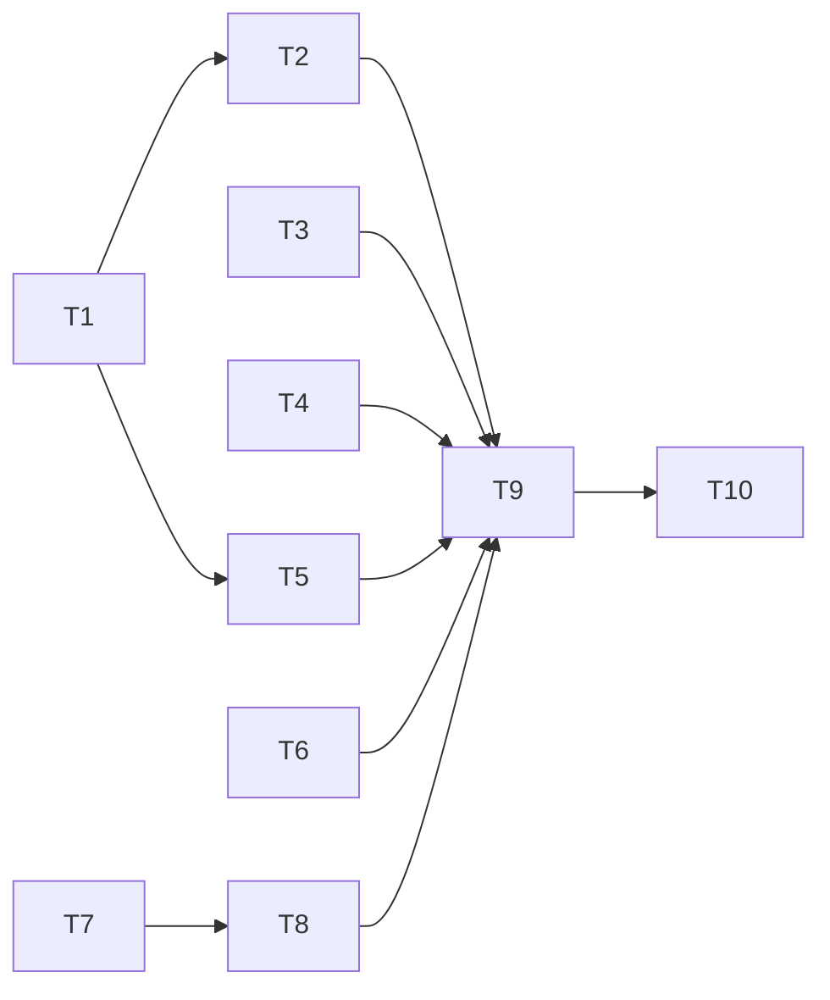

# Rust hot paths: message adoption, the prefix-chain memo, 3 binding fixes, the mask listing, and 2 experiments

status: in-progress
commit-mode: orchestrator-commits
language: ruby (Rust cards: T1, T3, T4, T5; T10 prototypes in Rust and lands nothing)
panel: Ruby (Linus Torvalds, Jeremy Evans, Sandi Metz, Aaron Patterson); Rust (Raph Levien, Andrew Gallant) for T1, T3, T4, T5, T10

## Intent

At 10,000 turns a chat turn costs about 168 ms before the model is called, and 73% of that goes to recomputing
the prompt-cache prefix chain from scratch. `planning/rust-performance-research-2026-10.md` measured the fixes.
This plan lands the measured ones:

- Message Hashes adopted in canonical key order (render 37 to 15 ms).
- A prefix-chain memo the Agent owns (122 to 6.5 ms per model call).
- Fuzzy matching on pre-segmented candidates (56 to 16 ms per keystroke at 50,000 paths).
- An ast-grep pattern cache (about 25 ms per `ast_search` over 500 files).
- A `Timeline#consumed` walk for the mailbox (4.6 to 1.65 ms per model call).

It also takes `wiring_spec.rb` off the real checkout, which is about 100 s of the suite wall. And it gives
`Confine::MaskList` a listing that realpaths each directory once in place of every name 3 times, and reads
each name's basename once per classify: a first refresh of this checkout goes from 1,163 ms to about 331 ms.

The plan ends with 2 experiments that stop for a ruling and change no default: a YJIT trial, and a comparison
of the ways to release the GVL around pure Rust work. Roadmap: the "Rust hot paths" line in
`ROADMAP.md` `## Status`.

## Grounding

2026-10-20, main at `1e3f3ae9`. 3 read-only Explore passes and 4 spikes checked the files below. Line numbers
are from that SHA.

Evidence named by a bare file name (`spike-*.diff`, `bench-*/`, `*-findings.md`) is in
`/home/tara/dev/lain/planning/rust-performance-research-2026-10/`, beside the report
`/home/tara/dev/lain/planning/rust-performance-research-2026-10.md`. Both are untracked in the main checkout, so
a worktree reads them by these absolute paths.

- **Render and send path.**
  - `Context#render` (`lib/lain/context.rb:123-133`) is the only `Request.new` on the chat path. The Agent
    calls it from `render_request` (`lib/lain/agent.rb:864`), which advances `@rendered_prefix`
    (`agent.rb:61-71`, `:870`).
  - `Request#prefix_digests` (`lib/lain/request.rb:129`, walking in `rolled_entries` at `:176-200`) runs in `Telemetry::RequestSent.from`
    (`lib/lain/telemetry/request_sent.rb:58`), which `Middleware::JournalRequests#call`
    (`middleware/journal_requests.rb:28`) and `Provider::Journaled#complete` (`provider/journaled.rb:76`)
    call.
  - Nothing between render and journaling copies the Request. `Middleware::ResolveAttachments` wraps it in a
    delegator that forwards `prefix_digests` to the same inner object (`resolve_attachments.rb:61`).
  - `Request#with` re-runs `initialize`, so it makes a new object.
  - Every Agent runs on Async fibers on 1 thread, each subagent with its own Agent; no 2 threads call
    `prefix_digests` on one Agent's Request.
- **Canonical.** `Canonical.normalize` (`lib/lain/canonical.rb:34-104`) short-circuits Arrays recorded in the
  `PRODUCED` WeakMap and rebuilds every Hash.
  - `MessageBuilder::message` (`ext/lain/src/lib.rs:2445-2462`) inserts `role` before `content` and does not
    adopt the Hash. `MessageBuilder::tree` (`:2464-2480`) adopts content Arrays.
  - Sorted order is `content` before `role`, so the Rust change matches what `normalize` produces.
- **Stored formats.** `RequestSent` journals `prefix_digests` and `prefix_chain_version` (`request_sent.rb:47,58-59`).
  - Readers: `bench/rewrites.rb:61-99` (refuses any version but 2), `friction/cache_waste.rb:264`,
    `friction/report.rb` and `bench/plan_sweep/driver.rb:157,194`.
  - `bench/session/request_replay.rb:28` rebuilds a Request and checks its `digest`.
- **Bindings.**
  - Fuzzy: `fuzzy.rs:114-246`, built once per sigil at `frontend/completion/sources.rb:43` and matched per
    keystroke at `completion.rb:121`.
  - AstGrep: `astgrep.rs:97` builds the pattern on every call, `:626` is the binding, and it is driven per
    file by `tools/ast_search.rb:112,194-208` inside `Tool::Offload`. `tool/offload.rb:27` starts a new
    thread per call, so a thread-local cache lives for 1 tool call.
  - `Context::Mailbox::Live#unconsumed` (`context/mailbox/live.rb:99-102`) runs `timeline.to_a` once a note
    has been posted. It is wired at `cli/wiring.rb:630` and `tools/subagent.rb:1742` and reached through
    `agent.rb:663`.
  - `dag.rs`'s module doc (lines 1-23, and `walk` at `:312-317`) keeps `walk` private, and every named walk
    returns `Result<_, DanglingDigest>`.
- **Mask listing.**
  - `wiring.rb:348` calls `prime_masks`, then `toolset_build.rb:299`, then `confine/sandbox.rb:61-62` (only
    when bwrap and strace were found), then `Thread.new { refresh }` at `confine/mask_list.rb:39`.
  - `refresh` (`:62`) runs `git ls-files -z -co`, then `Sensitivity::Policy#mask_paths` (`policy.rb:496`).
    `judge` (`:390`) classifies each name as written, from the cwd and landed (`lib/lain/landing.rb:30`,
    a realpath).
  - Only `landed` catches a symlink to a denied file or a `.env`: `policy_spec.rb:656,664,685,747,762-781`
    and `seams/symlink_boundary_spec.rb`.
- **wiring_spec.**
  - `spec/lain/cli/wiring_spec.rb` (5,451 lines) defaults `let(:wiring)` (`:380`) with no `project:`, so
    `Wiring.new` falls back to `Project::Resolver.default_project` (`wiring.rb:256`), the checkout.
  - `let(:backend_root) { Dir.pwd }` is at `:352`, and `throwaway_project` already exists at `:382`.
  - No example needs the real checkout's files, git or `.lain/`.
  - The file is not in `bin/runtime-census`'s `CEILINGS`, which is why its growth from 23 s to 130 s went
    unflagged.

Docs and code disagree in 1 place: the research report counted 3,800 listed files, but `git ls-files -co`
without the pruned directories lists 77,278 here. The pruning in `mask_list.rb:74` is what keeps the
listing small, and the spike measured the pruned listing.

How runtime premises were probed rather than read:
- The weak-map identity and Request shareability: `bench-send/share.rb`.
- The memo chain equal on 30 turns: `bench-send/verify_chain.rb`.
- The symlinked-directory listing: a scratch repo with a linked directory and a linked file, where
  `git ls-files -co` printed each as 1 leaf.
- Offload's thread-per-call: read in `tool/offload.rb:27` and confirmed by the bindings spike's Q7 ticker.

## Compatibility

| Surface | Verdict | Evidence |
|---|---|---|
| Journaled `prefix_digests` and `prefix_chain_version` (stored data) | must keep: byte for byte | `request_sent.rb:47,58-59`; readers in `bench/rewrites.rb`, `friction/*`; T2 keeps `PREFIX_CHAIN_VERSION` at 2 and every chain equal |
| `Request#digest` (stored, replayed) | must keep | `bench/session/request_replay.rb:28`; T1 keeps the bytes |
| Key order of a `Timeline#messages` Hash | free to break | no consumer serializes them outside `Canonical` (grep of `lib/` for `.keys`, `.inspect`, `to_json` on messages; no cassette or golden file pins the order) |
| `Request#prefix_digests` and `Telemetry::RequestSent.from` (gain an optional `chain:` and `prefix_chain:` keyword) | free to break; additive | internal; every existing caller passes nothing and gets today's chain |
| `Lain::Ext::Fuzzy`, `Lain::Ext::AstGrep` Ruby API | must keep: unchanged | callers in `frontend/completion*`, `structural/matcher.rb:67`, `tools/test_pattern.rb:64` |
| `Lain::Ext::Timeline#consumed` | new, additive | |
| Mask verdicts (what is masked, at which label) | must keep: identical | the secret boundary; `policy_spec.rb`, `seams/symlink_boundary_spec.rb` |
| YJIT, GVL | no change; both cards report only | |

The gem is unpublished, and no outside consumer exists (memory `harness-vs-own-dev`). No trade reports were needed.

## Spike findings

| Question | Result | Evidence |
|---|---|---|
| Where does the time go in a render and a chat turn at 10,000 turns? | `Canonical.normalize` rebuilding 10,000 message Hashes (75% of render); `prefix_digests` at 116 to 136 ms per model call | `/home/tara/dev/lain/planning/render-profiling-2026-10.md` |
| Does adoption keep digests? | Yes, every arm's Request digest equal to base | `/home/tara/dev/lain/planning/rust-performance-research-2026-10/spike-send-findings.md` |
| Where should the prefix-chain memo live? | Owned by the Agent (arm a3): 6.1 to 6.6 ms against 118 to 123 ms; Request stays shareable. A Request ivar (arm a) breaks shareability; a Rust memo (arm b) is slower at 15 to 16 ms and grows without bound. The spike attached the memo through a weak map keyed by the Request; the panel replaced that with an env entry beside the request, which costs the same, because a hit is checked per message | same, Q1; `spike-send-1a3.diff` |
| Is adoption alone a regression? | `prefix_digests` 118 to 135 ms alone, but render drops 22 ms, so a turn is net faster (about 159 to 150 ms); T1 can land before T2 | same, Q1 and Q3 |
| Unprotected FFI in `MessageBuilder`? | 23.7 to 23.1 ms median, inside noise | same, Q2 |
| Fuzzy pre-segmentation | 56.1 to 16.4 ms at 50,000 paths; `new` 44 ms slower; 8.7 MB more Rust heap; still shareable | `spike-bindings-findings.md` Q6, `spike-bindings-6.diff` |
| ast-grep pattern cache | 553 to 528 ms over 500 files; pattern build 17 ms to 0.7 ms | Q5, `spike-bindings-5.diff` |
| `Timeline#consumed` | 4.6 to 1.65 ms at 10,000 turns; the spike swallows a dangling digest where `to_a` raises (fixed in T5's criteria) | Q2, `spike-bindings-2.diff` |
| Commit, blob put, Turn reader cache | 11 us per commit; 0.025 ms per MB; a Turn cache never hits | Q1, Q3, Q4 |
| GVL stall | main-thread tick of 20 ms during an offloaded ast_search, 120 ms during a 50,000-path fuzzy, against 1 ms idle | Q7 |
| Can the GVL be released without new hand-written unsafe? | Only through `lucchetto` 0.4.0 (2023-10-10, `rb-sys ^0`, no unblocking function, low use). magnus 0.9.1 has no wrapper (issues #129 and #91 open). typst-rb writes about 30 lines over rb-sys with `catch_unwind` and no unblocking function | web, 2026-10-20: docs.rs/crate/lucchetto/latest, github.com/actsasflinn/typst-rb/pull/11, github.com/matsadler/magnus/issues |
| Does `git ls-files -co` list a symlinked directory as 1 leaf? | Yes: `linkdir` and `notes.txt` printed as leaves, nothing beneath `linkdir` | scratch repo under `~/tmp/lain/gitlink-check` |
| MaskList: per-name work, and where a bounded memo pays | `classify` is pure string work (no file read). A first refresh of 3,152 names did 9,456 classifies and 9,457 realpaths. Landing a non-link leaf through its directory's realpath: 1,163 to 425 ms, 451 realpaths. A per-instance memo: no gain, since a refresh only classifies new names. A process-wide memo keyed by the rule set's value: 46 to 50 ms warm, 284 bytes an entry; `wiring_spec.rb` 116.8 s to 46.4 s (A) and 12.2 s (memo). Basename once per classify: 397 to 331 ms. Verdicts identical over the listing and a symlink fixture a broken arm fails. The process-wide memo is dropped: production builds 1 MaskList per run, so it never hits there (user ruling 2026-10-20) | `/home/tara/dev/lain/planning/rust-performance-research-2026-10/spike-masklist-findings.md` |

Every spike worktree is removed.

## Shared files

- `bin/runtime-census`: the `spec/lain/cli/wiring_spec.rb` ceiling, set at close-out to 2 times its measured
  time, rounded up. It has no ceiling today, which is how its growth from 23 s to 130 s went unflagged.
- `ext/lain/mutants-baseline.txt`: T1, T3, T4 and T5 each hand back their file's new caught, missed,
  timeout and unviable counts; the main session applies them.
- `ROADMAP.md`: the Status line, edited by the main session at close-out.

## Rejected options

- Unprotected FFI in `MessageBuilder`: about 1 ms for new unsafe code.
- The Rust-side prefix memo: slower than the Ruby one, never shrinks, and copies the chain's byte definition into Rust.
- A memo held as a Request ivar: breaks `Ractor.shareable?(request)`, pinned at `request_spec.rb:15-17,333-337`.
- FxHash for the store maps, a streamed payload digest, presence-first blob puts, a `Turn#content` cache: each under 0.03 ms where it applies.
- A Merkle `Request#digest`: changes every recorded session's digest.
- Caching each message's JSON fragment: 1.8 ms for a second 4.4 MB copy.
- Moving `ast_search` out of process to `lain-core` so no GVL is held: `lain-core` is kept only as a wire seed (memory `simplification-rulings-2026-10-17`), and per-file RPC would cost more than the stall.
- A process-wide LRU of classification verdicts: it never hits in production, where 1 MaskList per run classifies only new names, and it puts global mutable state on the secret boundary (user ruling 2026-10-20).
- A weak map from Request to its chain: hidden coupling by object identity; the env entry beside the request carries it instead (panel, 2026-10-20).
- Stubbing `Project::Resolver.default_project` across `wiring_spec.rb`: it would break the examples that test `default_project` itself (`:3995-4070`).

## Open decisions

- **YJIT by default.** Decided by the user after T9 reports. No card depends on it.
- **The GVL route.** Decided by the user after T10 reports. No card depends on it.

## Dependency graph



## Tasks

### T1: Adopt each message Hash in canonical key order          [risk: high]

**Depends on:** none
**Files:** `ext/lain/src/lib.rs`, `lib/lain/canonical.rb`, `spec/lain/canonical_spec.rb`, `spec/lain/rust/timeline_spec.rb`
**Reuse:** `MessageBuilder::tree`'s adoption of Arrays (`lib.rs:2464-2480`); `Canonical.produced` (`canonical.rb:~100-104`); `spike-send-c1.diff`
**Shared-file wiring:** `ext/lain/mutants-baseline.txt`: the `lib.rs` row, if its counts move
**Reachable from:** `Agent#render_request` -> `Context#render` -> `PrefixedTimeline#messages` -> `Ext::Timeline#messages` -> `MessageBuilder::message`

`MessageBuilder::message` inserts `content` before `role`, freezes the Hash, and pushes it onto `adoptable`
with the content Arrays. `Canonical.normalize` returns an adopted Hash as is, through `produced`, exactly as it
does for an Array. The adoption is correct only while Rust writes the keys in sorted order, so the key-order
criterion below is the guard against a silent digest change.

Specs outside Files that read `Timeline#messages` (`compaction/strategy/elide_tool_observations_spec.rb`, `summarize_conversation_spec.rb`, `rust/binding_coverage_spec.rb`, `rust/timeline_messages_reentry_spec.rb`) stay green: Hash equality ignores key order, and the values are unchanged.

**Acceptance criteria**

```gherkin
Scenario: a message the extension built is a normalize hit
  Given a Timeline with 1 committed user turn
  When its messages are normalized
  Then the same message Hash object comes back

Scenario: the extension writes message keys in canonical order
  Given a Timeline with a user turn and an assistant turn carrying a tool_use block
  When each message from Timeline#messages is compared with Canonical.normalize of an equal unfrozen Hash
  Then the keys are equal in order
  And Canonical.dump of each is byte for byte equal

Scenario: a Ruby Hash that only looks canonical is still rebuilt
  Given a frozen Hash with keys "role" then "content" built in Ruby
  When it is normalized
  Then a new Hash with keys "content" then "role" comes back

Scenario: a rendered request's digest is unchanged
  Given a 30-turn Timeline rendered through Context#render
  When its Request#digest is computed
  Then it equals the digest the plain-Ruby construction of the same messages gives
```
Spec file: `spec/lain/rust/timeline_spec.rb` (the first 2 and the last); `spec/lain/canonical_spec.rb` (the third)

**Stop and report if:**
- Any spec under `spec/` compares a message Hash from `Timeline#messages` by `inspect`, `to_s`, `JSON.generate` without `Canonical`, or `keys` order (grep first); each one found is listed in the hand-back.
- `spec/conformance_corpus_spec.rb` or any `ext/lain/corpus/*.ndjson` vector changes.
- `spec/lain/rust/timeline_messages_reentry_spec.rb` goes red: the new `adoptable` push must not hold Rust state across the `adopt` funcall.

### T2: Memoize the prefix chain on the Agent          [risk: high]

**Depends on:** T1
**Files:** `lib/lain/request.rb`, `lib/lain/request/prefix_chain.rb` (new), `lib/lain/agent.rb`, `lib/lain/middleware/journal_requests.rb`, `lib/lain/telemetry/request_sent.rb`, `spec/lain/request/prefix_chain_spec.rb` (new), `spec/lain/request_spec.rb`, `spec/lain/agent_spec.rb`, `spec/lain/middleware/journal_requests_spec.rb`
**Reuse:** the `PrefixChain` class and the `marked_block` guard in `/home/tara/dev/lain/planning/rust-performance-research-2026-10/spike-send-1a3.diff` (its weak map and `attach` are not taken); the `stands_on:` env entry the Agent already passes through `ModelCaller#call` (`agent.rb:819`, `agent/model_caller.rb:33-37`)
**Shared-file wiring:** none
**Reachable from:** `exe/lain` `chat` -> `CLI::ChatLaunch` -> `CLI::Wiring#wire_agent` (`wiring.rb:288`) -> `Agent.new` (`:618-624`), which builds `@prefix_chain`; each turn `Agent#call_model` passes it as `model_caller.call(request, on_stream_started:, stands_on:, prefix_chain: @prefix_chain)` -> `Middleware::JournalRequests#call` (built at `chronicle.rb:213`, stacked at `wiring.rb:705`) -> `Telemetry::RequestSent.from(request, prefix_chain:)` -> `Request#prefix_digests(chain:)`

The memo is the Agent's own ivar, beside `@rendered_prefix` and outside it: a Data value does not own a
mutable memo. It travels as an env entry beside the request, the way `stands_on:` does, so no global table
and no Request identity is involved. A copied or rebuilt Request still hits, because a hit is checked per
message: the same message object and the same previous state. Every other caller of `prefix_digests` and
`RequestSent.from` passes nothing and gets `PrefixChain::NONE`, which computes the chain as today.
`marked_block` checks `content.any?` before `each_index.select`. `PREFIX_CHAIN_VERSION` stays 2.

**Interface**

```ruby
class Request
  # One state per message position from the last walk; a hit needs the same
  # message object and the same previous state.
  class PrefixChain
    NONE # computes every state

    def state(index, message, previous) { compute } # -> String
  end

  def prefix_digests(chain: PrefixChain::NONE) # -> Array, byte-identical to today's
end

Telemetry::RequestSent.from(request, requester: nil, prefix_chain: Request::PrefixChain::NONE)
```

Specs outside Files that call `prefix_digests` or `RequestSent.from` stay green: `workspace_spec.rb`,
`provider/journaled_spec.rb`, `middleware/resolve_attachments_spec.rb`, `context/recall_spec.rb`,
`tools/subagent_spec.rb`, `tools/subagent/stagger_spec.rb`, `plan/seam_policy_spec.rb`,
`friction/cache_waste_spec.rb` and the seams. Each passes no chain, so it gets `NONE`. `spec/lain/rust/timeline_spec.rb:342,355`
use `RenderedPrefix`, which this card leaves alone.

**Acceptance criteria**

```gherkin
Scenario: the chain an Agent journals equals the chain with no memo
  Given an Agent over Provider::Mock built through the real wiring stack with a journal, run for 30 turns
  When each journaled request_sent record's prefix_digests is compared with Request#prefix_digests of a
    fresh Request built from the same payload
  Then all 30 are equal

Scenario: a later turn digests only its new messages
  Given that Agent after 10 turns
  When turn 11 is journaled
  Then Canonical.digest runs at most 4 more times than the number of messages turn 11 added

Scenario: a second walk over the same prefix reuses every state
  Given a chain that walked 10 messages
  When the same 10 message objects are walked again with the same seed
  Then Canonical.digest is called 0 times

Scenario: a changed message is recomputed
  Given a chain that walked 10 messages
  When message 5 is replaced by an equal but distinct object
  Then states 5 to 9 are recomputed and equal the memo-less chain

Scenario: a Request stays deeply frozen and shareable
  Given a Request the Agent rendered
  Then it is deeply frozen and Ractor.shareable?

Scenario: a caller with no chain computes the whole chain
  Given a Request built by Request.new outside an Agent
  Then prefix_digests equals today's chain, with N+1 digest calls
```
Spec file: `spec/lain/agent_spec.rb` (the first 2, through the real construction); `spec/lain/request/prefix_chain_spec.rb` (the 3rd and 4th); `spec/lain/request_spec.rb` (the 5th and 6th; the existing count at `:242-256` stays as it is); `spec/lain/middleware/journal_requests_spec.rb` (the env entry reaches `RequestSent.from`)

**Stop and report if:**
- `spec/lain/request_spec.rb:222-240` (the version and the pinned chain values) needs any change.
- The second criterion fails because a configured model middleware outside `JournalRequests` (`wiring.rb:705`) drops the env entry: name it.
- Holding the chain on the Agent keeps message objects of a rewound branch alive past the next walk: measure with `ObjectSpace.memsize_of` in the spec and report.

### T3: Segment fuzzy candidates once, when the matcher is built          [risk: medium]

**Depends on:** none
**Files:** `ext/lain/src/fuzzy.rs`, `spec/lain/rust/fuzzy_spec.rb`
**Reuse:** `spike-bindings-6.diff`; `segment_into` (`fuzzy.rs:246`) unchanged
**Shared-file wiring:** `ext/lain/mutants-baseline.txt`: the `fuzzy.rs` row
**Reachable from:** `Frontend::TTY` (`frontend/tty.rb:121`) and `Frontend::InputPane` (`input_pane.rb:109`) build `Completion::Sources`, which builds `Ext::Fuzzy.new` per sigil (`completion/sources.rb:43`); `Completion#...` matches per keystroke (`completion.rb:121`)

`Candidates` keeps a `Box<[char]>` per item, segmented at `new`, beside `items`. `rank_with` reads it instead
of segmenting per call. The audit comment (`fuzzy.rs:~110`) and the `Fuzzy` doc (`~320`) name the new field.

`refusal_reentry_spec.rb`, `text_arguments_reentry_spec.rb`, `review/hunk_spec.rb` and `frontend/completion_spec.rb` stay green: the Ruby API and the argument checks are unchanged.

**Acceptance criteria**

```gherkin
Scenario: ranking, positions and limits are unchanged
  Given the candidates and queries of fuzzy.rs's existing tests and fuzzy_spec.rb
  Then every result equals the result before the change

Scenario: a combining-mark candidate keeps grapheme positions
  Given a candidate "cafe" with a combining acute on the e
  When it is matched by "fe"
  Then the positions index graphemes

Scenario: a match does no segmentation
  Given a Candidates of 1,000 items
  When it is matched twice
  Then segment_into ran 1,000 times in total, all of them during new

Scenario: the matcher stays shareable
  Then a built Ext::Fuzzy is deeply frozen and Ractor.shareable?
```
Spec file: `ext/lain/src/fuzzy.rs` `mod tests` (the first 3); `spec/lain/rust/fuzzy_spec.rb` (the last, and the existing grapheme test at `:161-171`)

**Stop and report if:**
- The const assert at `fuzzy.rs:128-134` (Send + Sync) has to be loosened.
- `Fuzzy.new` over 50,000 paths takes more than 100 ms (the spike measured 50 to 53 ms).

### T4: Cache compiled ast-grep patterns per thread          [risk: medium]

**Depends on:** none
**Files:** `ext/lain/src/astgrep.rs`, `spec/lain/rust/astgrep_spec.rb`
**Reuse:** treesitter's `QueryCache` (`treesitter.rs:132-196`): the 2-level map keyed by `&str`, capacity 64, admit-only, `try_with` and `try_borrow_mut` with an uncached fallback, and its 4 tests (`:357-430`)
**Shared-file wiring:** `ext/lain/mutants-baseline.txt`: the `astgrep.rs` row
**Reachable from:** `Tools::AstSearch#call` -> `Tool::Offload.call` -> `Structural::Matcher#match` (`structural/matcher.rb:67`) -> `Ext::AstGrep.search` -> `build_pattern`

A `PatternCache` holds `Rc<Pattern>` by language, then pattern text. Only a pattern that built is stored, so a
bad pattern raises `BadPattern` on every call. `Offload` starts a thread per call (`tool/offload.rb:27`), so a
hit lasts 1 tool call: the doc says so.

**Interface**

```rust
struct PatternCache {
    built: HashMap<SupportLang, HashMap<String, Rc<Pattern>>>,
    len: usize,
    cap: usize,
}
impl PatternCache {
    fn get_or_build(&mut self, lang: SupportLang, pattern: &str) -> Result<Rc<Pattern>, SearchError>;
}
```

`refusal_reentry_spec.rb`, `text_arguments_reentry_spec.rb`, `rust/treesitter_spec.rb` and `structural/matcher_spec.rb` stay green: the binding's arguments, results and refusals are unchanged.

**Acceptance criteria**

```gherkin
Scenario: a second build of the same pattern is the same object
  When the same pattern is built twice in 1 language
  Then both are the same Rc

Scenario: the same text in another language is a separate entry
  Then building it in Ruby and in Rust gives 2 entries

Scenario: failures are not stored and the cap holds
  Given a cache of capacity 64
  When 65 valid patterns and 1 bad pattern are built
  Then the first 64 are kept, the 65th is built uncached, and the bad one raised and took no slot

Scenario: a cached search agrees with a fresh one
  When a search runs with a cached pattern and again with a fresh build
  Then the matches are equal

Scenario: a malformed pattern is still an error result to the model
  Given an ast_search call with a malformed pattern, made twice
  Then both calls return the error Result
```
Spec file: `ext/lain/src/astgrep.rs` tests (the first 4); `spec/lain/tools/ast_search_spec.rb:86` (the last, existing, stays green)

**Stop and report if:**
- `Pattern` is not `'static` or cannot sit behind an `Rc` across calls for the same source text.
- `spec/lain/structural/matcher_spec.rb` depends on a pattern being rebuilt per call.

### T5: Answer which digests the chain consumed in 1 walk          [risk: medium]

**Depends on:** T1
**Files:** `ext/lain/src/dag.rs`, `ext/lain/src/lib.rs`, `lib/lain/context/mailbox/live.rb`, `spec/lain/rust/timeline_spec.rb`, `spec/lain/rust/binding_coverage_spec.rb`, `spec/lain/context/mailbox/live_spec.rb`
**Reuse:** `dag::length` and `dag::includes` (`dag.rs:414-430`); `read_causal_parents` (`lib.rs:1119`); `missing_object` after the guard drops, as `ancestor_digests` (`lib.rs:~2181`) does; `spike-bindings-2.diff`
**Shared-file wiring:** `ext/lain/mutants-baseline.txt`: the `dag.rs` and `lib.rs` rows (0 missed allowed)
**Reachable from:** `CLI::Wiring` builds `Context::Mailbox::Live` (`cli/wiring.rb:630`) and `Tools::Subagent` builds one per child (`tools/subagent.rb:1742`); `Agent` calls `@mailbox.capture(@timeline)` each turn (`agent.rb:663`) -> `unconsumed`

The binding is justified by docs/rust-bindings.md's test 2 through the early exit: once every wanted digest
is found the walk stops, and nothing is wrapped. `dag::consumed` is a named function next to `length`, and
`walk` stays private.

**Interface**

```rust
/// The wanted digests some turn on the chain names as a causal parent.
pub fn consumed(map: &StoreMap, head: Option<&Digest>, wanted: &[Digest])
    -> Result<Vec<Digest>, DanglingDigest>;
```

```ruby
# Lain::Ext::Timeline
def consumed(digests) # -> Array<String>, frozen; raises Store::MissingObject on a dangling chain
```

`agent_spec.rb`, `status_feed_spec.rb`, `frontend/stdin_pump_spec.rb`, `frontend/intake_spec.rb`, `cli/repl_spec.rb`, `cli/human_notes_spec.rb`, `context/mailbox_spec.rb` and `agent/tool_runner_spec.rb` stay green: `unconsumed` returns the same notes in the same order.

**Acceptance criteria**

```gherkin
Scenario: consumed agrees with the full walk
  Given a 200-turn chain where turns name 3 of 5 note digests as causal parents
  When consumed is asked for all 5
  Then it returns the 3, equal to the set to_a.flat_map(&:causal_parents) gives

Scenario: a dangling chain raises as the other walks do
  Given a chain whose middle turn is missing from the store
  When consumed is called
  Then Lain::Ext::Store::MissingObject is raised

Scenario: duplicate wanted digests still stop the walk early
  Given a wanted list naming the same found digest twice
  Then the walk stops at the turn that names it

Scenario: the mailbox keeps folding a note until a turn names it
  Given a live mailbox with a posted note and an Agent that runs 2 turns
  Then the note is in the first render and not after a turn names it
```
Spec file: `spec/lain/rust/timeline_spec.rb` (the first 2); `ext/lain/src/dag.rs` tests (the 3rd); `spec/lain/context/mailbox/live_spec.rb` (the 4th, and the existing `:21`, `:46`, `:104-125`)

**Stop and report if:**
- `binding_coverage_spec.rb`'s enumeration needs any change beyond 1 new `consumed:` entry.
- `spec/lain/rust/*_reentry_spec.rb` shows Rust heap growth with a dropped fiber inside `consumed`.

### T6: Root wiring_spec's wirings at a throwaway project          [risk: low]

**Depends on:** none
**Files:** `spec/lain/cli/wiring_spec.rb`
**Reuse:** `throwaway_project` (`wiring_spec.rb:382`); the groups that already pass it (`:510`, `:532`, `:614`, `:747`, `:1329` and others)
**Shared-file wiring:** none
**Reachable from:** the spec suite (`rake pspec`, the commit hook)

`let(:wiring)` (`:380`) and `let(:backend_root)` (`:352`) take a per-example tmpdir project. Every inline
`described_class.new(options: ...)` without a `project:` goes through 1 helper that adds one. The examples that
test `Project::Resolver.default_project` (`:3995-4070`) keep their own chdir. `:2658`, `:2692` and `:2711` read
`wiring.project.cwd` in place of `Dir.pwd`. The file's wall time is measured at close-out, not by this card,
because a timing taken while other cards run suites reads the contention.

**Acceptance criteria**

```gherkin
Scenario: no wiring in the file lists the real checkout
  Given wiring_spec.rb run alone with Confine::MaskList#refresh instrumented to record its root
  Then no recorded root is the checkout

Scenario: the example count is unchanged
  Then LAIN_SLOW=1 rspec --dry-run counts the same examples in wiring_spec.rb as before
```
Spec file: `spec/lain/cli/wiring_spec.rb`; the count goes in the hand-back

**Stop and report if:**
- An example fails only because it is no longer at the checkout: name it, it was depending on the real repo.
- Any of `repl_spec.rb`, `seams/over_window_request_spec.rb`, `seams/stranded_prompt_fold_spec.rb`, `seams/skill_spawn_inbox_spec.rb` or `spec/support/chat_launch_probe.rb` spends more than 10% of its time in `MaskList#refresh` (1 stackprof run each): report the numbers, do not fix them here.

### T7: Land a listed name through its directory's realpath          [risk: high]

**Depends on:** none
**Files:** `lib/lain/sensitivity/policy.rb`, `lib/lain/sensitivity.rb`, `spec/lain/sensitivity/policy_spec.rb`, `spec/lain/confine/mask_list_spec.rb`
**Reuse:** `spike-masklist-A.diff` (`Policy::Listed`, `listed_judge`, `listed_landed`, the `Sensitivity#cwd` reader); `Landing.of`'s home and root respelling (`lib/lain/landing.rb:30-36,96`); the symlink fixture the spike built (`spike-masklist-findings.md` section 3)
**Shared-file wiring:** none
**Reachable from:** `CLI::Wiring#wire_agent` (`cli/wiring.rb:348`) -> `ToolsetBuild#prime_masks` (`toolset_build.rb:299`) -> `Confine::Sandbox#prime` -> `Confine::MaskList#prime` -> `#refresh` (`mask_list.rb:62`) -> `Sensitivity::Policy#mask_paths` (`policy.rb:496`)

Only `mask_paths` changes; `judge` on the gate path is untouched, because there a single named path has no
listing to amortize over. Within 1 `mask_paths` call:
- Each directory is realpath'd once.
- A leaf that `File.lstat` says is not a symlink lands at `realpath(dir)/basename`, respelled under home and
  root exactly as `Landing.of` respells.
- A link, or anything `lstat` or `realpath` refuses, goes through the old `landed`. That keeps MALFORMED and
  the eventual walk for dangling and unreadable names.
- `from_cwd` is skipped when the classifier's cwd equals the call's cwd and the name is relative and does not
  start with `~`.

The gain rests on a measured fact: `git ls-files -co` lists a symlinked directory as 1 leaf and nothing under
it. A stale index entry beneath a directory that has since become a link is the one exception, and the
per-directory realpath resolves it, because the leaf's directory is the link.

**Acceptance criteria**

```gherkin
Scenario: every symlink escape is still masked
  Given a project whose listing names a link to ~/.ssh/id_rsa (relative and absolute), a link to .env,
    a linked directory with a stale tracked name beneath it, a dangling link into .aws/credentials,
    a link to /etc/shadow, a link to a directory of tokens.txt, and a home that is itself a link
  When mask_paths judges the listing, with the root spelled through the linked home and again at its real path
  Then every mask and every verdict equals what judge gives each name one at a time

Scenario: a plain listing does 1 realpath per directory
  Given a listing of 300 plain files in 20 directories
  When mask_paths judges it
  Then File.realpath runs at most 21 times and every verdict equals judge's

Scenario: a refresh masks what judge masks, name by name
  Given a tmpdir git repo holding the fixture's shapes plus 200 plain files, some tracked and some untracked
  When MaskList refreshes
  Then its masks equal the masks built by calling Policy#judge on each listed name
```
Spec file: `spec/lain/sensitivity/policy_spec.rb` (the first 2); `spec/lain/confine/mask_list_spec.rb` (the last). `Policy#judge` is unchanged by this card, which is what makes it the oracle.

**Stop and report if:**
- Any example in `policy_spec.rb:656-781` or `spec/lain/seams/symlink_boundary_spec.rb` needs a change.
- A broken version of the shortcut (the symlink fallback removed) still passes the first criterion: the fixture is not discriminating.
- `Sensitivity`'s deep-freeze spec (`spec/lain/sensitivity_spec.rb`, "is deeply frozen") fails over the new `cwd` reader.

### T8: Read a path's basename and segments once per classify          [risk: medium]

**Depends on:** T7
**Files:** `lib/lain/sensitivity.rb`, `spec/lain/sensitivity_spec.rb`
**Reuse:** `spike-masklist-D.diff`; `Rule#matches?` and `NameRule#matches?` in `sensitivity.rb`
**Shared-file wiring:** none
**Reachable from:** `Sensitivity#classify`, called by every `Policy#judge`: the gate on each tool call, and `mask_paths` on each refresh (the chain in T7)

`Rule#matches?` recomputes `File.basename` and `String#split` for each of about 73 rules, which was 32% of
classify's profile. They are computed once per classify and passed to each rule. The spike measured a cold
listing at 397 ms going to 331 ms on top of T7.

**Acceptance criteria**

```gherkin
Scenario: verdicts are unchanged over every rule
  Given every path the existing sensitivity_spec.rb classifies
  Then each verdict equals the verdict before the change

Scenario: each rule receives the precomputed name
  When 1 path is classified against the full rule table
  Then every Rule#matches? call for it receives the same basename and segments objects
```
Spec file: `spec/lain/sensitivity_spec.rb`

**Stop and report if:**
- A rule reads the path in a shape other than basename, segments or the whole string (a custom matcher): list it.

### T9: Measure the app under YJIT          [risk: low]

**Depends on:** T2, T3, T4, T5, T6, T8 (every landing card, so it measures the finished tree on a quiet box)
**Files:** `planning/yjit-trial-2026-10.md` (new)
**Reuse:** `/home/tara/dev/lain/planning/rust-performance-research-2026-10/bench-send/` (`setup.rb`, `q3.rb`); `bin/runtime-census`
**Shared-file wiring:** none
**Reachable from:** deferred: a measurement only; the default stays off until the user rules (Open decisions)

Measure on a quiet box, under `nice -n 10 flock /home/tara/tmp/lain/bench.lock`, interleaved, at least 3 runs
an arm. With and without `RUBYOPT=--yjit`, measure:
- the full chat turn at 1,000 and 10,000 turns (`bench-send/q3.rb`)
- the peak RSS of a 10,000-turn bench process (`/usr/bin/time -v`, maximum resident set size), and the largest
  worker's peak RSS in a `rake pspec` run
- the `rake pspec` wall, with the example count
- boot time of `exe/lain --help`

Record the YJIT stats line (`RubyVM::YJIT.runtime_stats` code size, `inline_code_size`).

**Acceptance criteria**

```gherkin
Scenario: the report answers the ruling's question
  When planning/yjit-trial-2026-10.md is read
  Then it gives each measure for both arms with the run count and load average
  And it names any spec that fails only under YJIT, with its output
  And it recommends on or off, with the memory cost per process
```
Spec file: none (a report); every number is reproducible from the commands written in it

**Stop and report if:**
- A suite run under YJIT has a failure: record it by name and rerun that file alone once, then stop. The flaky-test procedure owns it.
- Another test process is on the box during a measurement.

### T10: Compare the ways to release the GVL around ast-grep          [risk: medium]

**Depends on:** T9 (after every landing card and the YJIT trial, so its ticker runs on a quiet box)
**Files:** `planning/gvl-release-research-2026-10.md` (new)
**Reuse:** `/home/tara/dev/lain/planning/rust-performance-research-2026-10/bench-bindings/q7.rb` (the main-thread ticker); `spike-bindings-findings.md` Q7
**Shared-file wiring:** none
**Reachable from:** deferred: research only; the route is the user's ruling (Open decisions)

In a throwaway spike worktree, prototype releasing the GVL around `Ext::AstGrep.search`'s pure part, 3 ways:

1. `lucchetto`, the 1 crate that hides the unsafe. Check that it builds against `rb-sys 0.9.130` and magnus 0.9.1.
2. A small wrapper of our own over `rb_sys::rb_thread_call_without_gvl`: inputs copied first, `catch_unwind`
   inside, and an unblocking function that sets a cancel flag the search checks between files or nodes.
3. Ruby 3.4's `rb_nogvl` with `RB_NOGVL_OFFLOAD_SAFE`, which lets the Async fiber scheduler move the call
   off the reactor; check what Ruby 4.0.6 and `async` do with it.

For each, measure:
- the main-thread tick during an offloaded 500-file search
- the per-call cost
- how long `Tool::Offload`'s cancel waits
- lines of `unsafe` the repo would own
- what `ext/lain/CLAUDE.md`'s fiber rule and its no-hand-rolled-unsafe rule say about it

Land nothing.

**Acceptance criteria**

```gherkin
Scenario: the report answers the ruling's question
  When planning/gvl-release-research-2026-10.md is read
  Then it gives the 4 measures for each route, with commands
  And it says which route needs no unsafe in the repo and what that route gives up
  And it recommends 1 route or none
```
Spec file: none (a report)

**Stop and report if:**
- `lucchetto` does not build against the locked `rb-sys`: record the error and continue with the other 2.
- A prototype crashes the VM: record the backtrace; that route is out.

## Integration checks

After the last card lands, on a quiet box (`pgrep -cf 'mise/installs/ruby/[0-9.]*/bin/parallel_rspec'` and
`pgrep -cf '[p]re-commit (hook-impl|run)'` both 0):

- `bundle exec rake pspec` green. Record the example count against the base count from
  `LAIN_SLOW=1 bundle exec rspec --dry-run` at `1e3f3ae9`, with the arithmetic for the specs this plan added.
- `cargo test && cargo clippy --all-targets -- -D warnings && cargo fmt -- --check && cargo deny check`.
- `bundle exec rake rust:mutants` against `ext/lain/mutants-baseline.txt`, 0 missed.
- `bin/zeitwerk-census --check`, `bin/comment-census --check-tickets`, `bin/comment-census --check-load-order`,
  `bin/spec-census --check`, `bin/runtime-census --record` (3 times) then `--check`.
- The chat-turn bench at 10,000 turns, 3 interleaved runs against `1e3f3ae9`, with the table in the Execution log.
  Expected: about 168 ms to about 27 ms.
  1. Baseline tree: `git worktree add --detach tmp/worktrees/bench-base 1e3f3ae9`, then `bundle exec rake compile` in it.
  2. Copy `/home/tara/dev/lain/planning/rust-performance-research-2026-10/bench-send/` to `bench/` in both trees (untracked). In main's copy, change `q3.rb` to hold 1
     `Lain::Request::PrefixChain.new` across turns and pass it as `RequestSent.from(req, prefix_chain: chain)`, the
     way the Agent does; the base copy stays as it is.
  3. In each tree, alternating: `ARM=<base|main> N=10000 nice -n 10 flock /home/tara/tmp/lain/bench.lock bundle exec ruby bench/q3.rb`.
  4. The `request digests` line must match between the trees. Remove the worktree after.
- `bundle exec rspec spec/lain/cli/wiring_spec.rb` alone, timed; then set its `bin/runtime-census` ceiling (Shared files).
  Expected under 20 s (6.0 to 6.2 s measured without `.git`, 109 s with it).
- `bundle exec rspec spec/lain/seams/symlink_boundary_spec.rb spec/lain/sensitivity/policy_spec.rb`, read for the symlink rows.
- `pre-commit run --all-files`.
- **Manual, human:**
  - A `lain chat` on a local model past 50 turns.
  - Tab completion of `@` paths in a large repo, typed fast.
  - An `ast_search` over `lib/` while a reply streams.

## Execution log

- 2026-10-20 20:02 start. Base `main` at `be96631d` (the plan commit on top of the grounding SHA `1e3f3ae9`;
  the only diff is ROADMAP.md and this plan, so the Grounding holds). `git worktree list`: `/home/tara/dev/lain be96631d [main]`
  only. Branches at start: `flake/review`, `main`, `spike/combined`, `spike/combined2`.
- Hook (`.pre-commit-config.yaml`), as commands an agent can run on its own paths:
  `bundle exec rubocop <paths>`; `bundle exec yard-lint --staged` (main session only, needs the index);
  `cargo fmt -- --check`, `cargo clippy --all-targets -- -D warnings`, `cargo test` (any Rust change);
  `bin/lint-gherkin-docs <plan>` (plan docs); trailing whitespace and end-of-file fixers; commit-msg lint
  (subject 72 chars, no trailing period, no dashes, no trailers). `ruby-checks` is `bundle exec rake compile check`,
  that is the full `pspec` plus rubocop, about 1 to 2 min, plus cargo test and clippy when Rust is staged.
- The suite cannot run beside other tests (shared `TMPDIR`, contention flakes): landings go on a quiet box.
  Each worktree gets its own `TMPDIR=$HOME/tmp/lain/<card>`.
- Paths needing user approval: none known.
