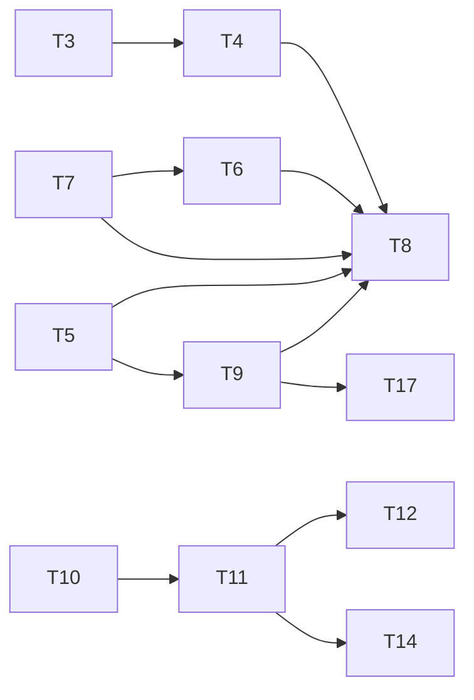

# Simplify 15: delete what nothing reaches, and stop reading files that no longer exist

status: in-progress
commit-mode: orchestrator-commits
language: ruby (2 Rust cards: T5, T9; T17 touches 1 Rust registration)
panel: Ruby (Linus Torvalds, Jeremy Evans, Sandi Metz, Richard Schneeman, Aaron Patterson); Rust cards add Raph Levien and Andrew Gallant

## Intent

A whole-codebase simplification survey on 2026-10-17 found 3 subsystems with no production caller and a
family of readers that tolerate session files nobody will load again. This plan deletes the first and
hardens the second, under 4 rulings the human gave the same day: nothing in lain is production facing,
so no back-compat is owed; `crates/lain-core` survives only as the msgpack-RPC wire seed for the phone
relay and the code-mode handle store, not as an exec or grep daemon; every file under
`~/.local/state/lain` is QA residue and will be purged, so a file written before this plan's format
stamp need not load; and the bench writes its sessions through the one live writer.

Delivers: the unreached half of the vendored HTTP provider gone (about 1,490 lib lines); lain-core cut
to `rpc.rs`, `main.rs` and `Core::Client`, with 1 real-binary seam kept so the Ruby-to-Rust wire stays
pinned (about 3,400 Rust and 440 Ruby lines); `Project::Dotfiles`, the spec-only landing desk, the
Rust tracing scaffold and 3 spec-only names gone; 1 session writer and 1 header shape, stamped with a
format the loader refuses when absent; and 7 runtime tolerances turned into hard requirements. About
6,000 lib and Rust lines and 4,000 spec lines, with no change to what a `lain chat` does.

Roadmap: `ROADMAP.md` item 63.

## Grounding

Grounded 2026-10-17 against `main` at `06ebfeb8` and re-checked the same evening at `e28ca0e0` after the
panel review (5 commits landed in between: bash-confinement T24, T25 and T27, qa-round-25 T59, and 1
refactor). `main`'s index holds bash-confinement T28's staged edits (`approval/judged.rb`,
`approval/judge/facts.rb`, `shell/executable.rb` and their specs); none of them is this plan's. Every
"no caller" claim below was made by grep over `lib/`, `exe/`, `bin/`, `Rakefile` and `spec/`, with
comment-only hits excluded by reading them, and re-verified by the panel; the Explore reports with the
commands are in the session scratchpad. Zeitwerk eager-loads `lib/` (`lib/lain.rb:123`), so a dangling
constant fails at boot, not lazily: a deleted file whose name survives anywhere in `lib/` reddens the
whole suite, which is the probe each card runs. A name that survives only inside a method body (the
`Liveness::Writer::UNRECORDED` case the panel caught at `cli/watch.rb:52`) does not fail at boot, which
is why every deletion here was grepped, not trusted.

Files checked, by cluster:

- Vendored HTTP: every file under `lib/lain/provider/http/` (28 files), `lib/lain/provider/anthropic/transport.rb`,
  `lib/lain/provider/ollama/transport.rb`, `lib/lain/embedder/ollama.rb`, `lib/lain/provider/journaled.rb`,
  the 12 spec files under `spec/lain/provider/http/`, `spec/lain/provider/anthropic_spec.rb`,
  `spec/error_taxonomy_discipline_spec.rb`, `lib/lain/provider/http/VENDOR.md`, `docs/porting-providers.md`,
  `docs/providers/anthropic.md`.
- lain-core: all 7 files under `crates/lain-core/`, `lib/lain/core/**`, `lib/lain/exec/core.rb`,
  `lib/lain/tools/grep.rb`, `lib/lain/cli/exec_backend.rb`, `spec/lain/core/**`, `spec/lain/exec/core_spec.rb`,
  `spec/lain/tools/grep_spec.rb`, `spec/support/tags.rb`, `spec/support/vsock_*.rb`, `Rakefile`, `.rubocop.yml`,
  `bin/spec-census`, `deny.toml`, `.github/workflows/*.yml`.
- Session format: `lib/lain/session_record.rb`, `session_record/{scribe,replay,salvage}.rb`,
  `lib/lain/bench/session.rb`, `bench/session/{loader,anchor,chain_fold,message_replay}.rb`,
  `bench/{rewrites,variance,variance_fixtures}.rb`, `bench/cli/run_recorder.rb`, `cli/{resume,compaction_profile,run_profile,backend,chat_launch,watch}.rb`,
  `cli/resume/selector.rb`, `liveness.rb`, `telemetry/{compaction,request_sent}.rb`, `status_feed/{spawn_lifecycle,reading}.rb`,
  `tools/subagent/lineage.rb`, `epic/stage.rb`, `approval/signoff_queue.rb`, `provider/response_wal/reader.rb`,
  `plan/calibration.rb`, `friction/cache_waste.rb`, `isolation/services/builder.rb`, `bin/regenerate-session-fixtures`,
  every file under `spec/fixtures/sessions/`, `spec/fixtures/friction/`, `spec/fixtures/grader/`.
- Small deletions: `lib/lain/project/dotfiles.rb`, `lib/lain/isolation/{landing_queue,candidate_desk}.rb`,
  `ext/lain/src/lib.rs`, `ext/lain/src/prompt.rs`, `ext/lain/Cargo.toml`, `lib/lain/journal.rb`,
  `lib/lain/journal/unwritten.rb`, `lib/lain/promise.rb`, `lib/lain/tools/subagent/actor.rb`,
  `lib/lain/cli/env_defaults.rb`, `lib/lain/agent.rb`, `lain.gemspec`, `Gemfile`, `Gemfile.lock`.

Where the survey and the code disagreed, the code won, and 6 items left the plan for it:

| Survey said | Code says | Outcome |
|---|---|---|
| `Event#parent` is a spec-only alias | 22 non-comment `.parent` sites in `lib/` (`session_record.rb:105`, `timeline.rb:102`, `cli/command/pin.rb:155`, ...) and `Store` probes it | kept |
| `WorkerHandoff::Null#surrender` is a spec-only alias | the default handoff of every `Arm` and of `Leases`; `arm.rb:157`, `leases.rb:238`, `supervisor.rb:286` call it | kept |
| the config `keys` table accepts 1 key with 1 value | `approval_cycle` is read at `frontend/input_pane.rb:111` and `cli/wiring.rb:415` and accepts any registered key name | kept |
| `Liveness::Writer::UNRECORDED` goes once every header names a writer | it is the Null Object `cli/watch.rb:52` starts from and `from_header` answers for a garbled header | kept |
| the duplicate DAG order routes in `lib.rs` can lose 1 side | the law groups bind the `Ext::Timeline` side; simplify-13 wires the `Ext::Dag` side at the store flip | left to simplify-13 |
| `Bench::Speculative`, `Arm::Ladder`, `Oracle::PruneScoring` are dead | simplify-08 T5 and T8 own all 3, and `live_arms_spec.rb:35` asserts altitude heights through `Ladder#rungs` | left to simplify-08 |

Runtime premises probed rather than read: that `Async::Promise` exists in the installed async 2.46.0
and answers `resolve`, `wait`, `resolved?`, and that its `value` returns nil without blocking where
`Async::Variable#value` blocked (read in the gem source under the mise install, `promise.rb:78`); that
VCR matches cassettes on method and URI only (`spec/support/vcr_configuration.rb:233`), so T7's
description change cannot miss a cassette; that `compact_schedule` is written only when compaction is on
(`cli/backend.rb:617-619`, a ternary), so a `--no-compact` session has no key and the reader defaults
are live, not legacy, until T12 changes the writer; that a one-shot's completion already carries a
`lifecycle` mark (`tools/subagent/lineage.rb:107-108`), so a mark-less completion is legacy; that
`Scribe#catch_up` folds a finished timeline with no live journal (`scribe.rb:195-204`); that
`Selector#call` runs before `Loader` on every resume route (`cli/chat_launch.rb:408` then `:381`) and
has no notice channel on a successful pick (`selector.rb:132-150`).

**Coordination with plans in flight**, by card state at `e28ca0e0`:

- bash-confinement: T24, T25, T27 landed; T28 staged on `main`; T29 to T32 open. T31 edits
  `spec/lain/cli/wiring/toolset_build_spec.rb` (T7's third scenario waits for it). T32 edits
  `ARCHITECTURE.md` (T8 and T9 wait for it). T30 adds `lib/lain/tripwire*` and edits `cli/wiring.rb`;
  no file of this plan.
- qa-round-25-fixes: T3, T9, T12 and T59 landed. Open cards that share a file with this plan: T52
  (`cli/chat_launch.rb`; T10 therefore puts its exact-name check in `Selector`, not `ChatLaunch`), T53
  (`session_record.rb`, `session_record/scribe.rb`, `cli/chronicle.rb`, `spec/lain/session_record_spec.rb`;
  T10 waits for it), T56 (`lib/lain/exec/docker.rb`; T6's 2 comment edits there wait for it), T57
  (`spec/lain/bench/cli_spec.rb`; T11 waits for it).
- simplify-08 (bench reachability) and simplify-13 (Rust port) own the items in the table above and
  nothing this plan edits.

Every such wait is a stop condition on the card, checked against the other plan's Execution log.

## Compatibility

| Surface | Verdict | Evidence |
|---|---|---|
| `lain` gem public API | free to break | version `0.1.0`, never tagged or pushed (`git tag` holds 1 backup tag); `allowed_push_host` is set but no release exists; no consumer under `~/dev` requires `lain` |
| `Lain::Provider::HTTP::*` vendored model (`Message`, `Content`, `Chunk`, `StreamAccumulator`, `Provider#complete`, the Anthropic `Chat`/`Tools`/`Streaming` mixins, `Provider.register`) | free to break | 0 callers in `lib/` or `exe/`; `VENDOR.md:130` says `complete` is not the path lain runs; only `spec/lain/provider/http/` and 2 fixture strings name them |
| lain-core RPC methods `exec` and `grep`, `AF_VSOCK` listener, `Exec::Core`, `Core::Child`, `Core::Transport::Vsock`, the `:vsock` spec tier | free to break | every caller is under `spec/` (`:core` and `:vsock` tiers, excluded by default); `cli/exec_backend.rb:42` says Core is deliberately not selectable; bash-confinement T25 built production bash on `Exec::Sandboxed` and left `ExecBackend` alone; the only forward reference is bash-confinement Open decisions 1 and 5, which the human ruled are not a reason to keep the exec arm |
| lain-core wire (`rpc.rs` codec and envelope, `Core::Client`, `Transport`) and the Ruby-to-Rust msgpack contract | must keep | the human's ruling: seed for the phone relay (ROADMAP:721-781, `planning/remote-surface-research-2026-08.md` section 6.2) and M5 code-mode handles (`planning/first-class-concepts.md:57-87`). The contract is pinned by 1 `:core` example over the real binary (T6), so the `:core` tier and `rake core:build` stay, trimmed |
| `Tools::Grep` model-facing description (the backreference and lookaround ban) | free to break | VCR matches on method and URI, so `spec/fixtures/vcr_cassettes/ollama_run_tool_loop.yml`'s copy of the text is inert; T7 adds a regex timeout in place of the ban |
| Session and journal files on disk (`~/.local/state/lain/**`) | free to break | the human ruled all of it QA residue to purge; no project outside this repo is driven by lain today |
| Committed session fixtures (`spec/fixtures/sessions/variance/*.ndjson`) | free to break, regenerate | `bin/regenerate-session-fixtures` rebuilds them byte-identically (`variance_fixture_spec.rb`); T10 and T11 each regenerate |
| `spec/fixtures/friction/*.ndjson`, `spec/fixtures/grader/**/*.ndjson` | untouched | hand-built; no spec reads them through `Loader#header` (`Lineages.from` short-circuits on files with no completions; the grader reads through `Journal.records`), so the format stamp does not reach them |
| `spec/fixtures/sessions/rewrites_v1/` frozen corpus | free to break | its README says never regenerate; it exists only to pin the format-1 chain reading that T12 removes, so it goes with that reading |
| `.lain/services.rb` `redis` verb | free to break | a raising tombstone with an upgrade message; the DSL is read only from projects lain drives, none of which exist outside QA fixtures |
| `Lain::Config` `keys` table | must keep | live readers at `frontend/input_pane.rb:111` and `cli/wiring.rb:415` |
| `Liveness::Writer::UNRECORDED` | must keep | `cli/watch.rb:52` starts from it; `from_header` answers it for a garbled header |
| Gem dependency list (`lain.gemspec`) | must keep honest | the gemspec's own rule (declare what `lib/` requires); `activesupport` (46 requires) and `concurrent-ruby` (3 `Concurrent::Map`) arrive only transitively today |

No must-keep surface blocks a large simplification, so no trade report was needed.

## Spike findings

None. Every card's premise is a grep over the tree or a read of installed gem source. The 1 build
question (whether `tokio-util`'s codec feature keeps `io-util` compiled in after T5 trims features) is
settled by `cargo build` inside T5, whose card says `io-util` stays regardless because `rpc.rs`'s
`send_raw` and `tests/lifecycle.rs` use `AsyncWriteExt`.

## Shared files

Only the main session edits these. Cards hand back 1-line diffs.

- `CLAUDE.md`: line 48's excluded-tier count is recounted against `spec/support/*.rb`'s
  `filter_run_excluding` calls after T6 (only `:vsock` goes; `:core` stays); line 52's `rake core:build`
  command stays, reworded to "the 1 real-binary wire seam"; lines 200 to 203, which point at
  `lib/lain/provider/http/providers/anthropic.rb` as the file that "names the eager-load guarantee in
  writing", are repointed at `lib/lain.rb`'s loader section after T4 inlines the mixins that were the
  reason.
- `ROADMAP.md`: item 63 (this plan); a dated note under item 18 after T6; the "Landlock confinement in
  `crates/lain-core` remain deferred" clause at 1446 struck as superseded by `crates/lain-fence`; lines
  105 and 173 ("Rust `tracing` spans merge into the same stream") given a dated strike after T9.
- `planning/README.md`: a row in the simplification series table.
- `lain.gemspec`: `add_dependency "activesupport", "~> 8.0"` and `add_dependency "concurrent-ruby", "~> 1.3"`
  after T16 confirms the versions in `Gemfile.lock`; the `msgpack` comment at line 82 reworded from "the
  lain-core exec" to "the lain-core wire".
- `Gemfile`: the `simplecov` line and its 4-line comment go (0 references anywhere).
- `.rubocop.yml`: line 421's `RSpec/AnyInstance` exclude for `vsock_spec.rb` and the comment above it;
  the comment at line 483 naming `grep_parity_spec`.
- `bin/spec-census`: the `spec/lain/core/child_spec.rb:103` entry at line 529.
- `bin/runtime-census`: `EXAMPLE_FLOOR` (21,000) is re-measured after the last card, in its own commit,
  only if the dry-run count falls under it.
- `Cargo.lock`: regenerated by T5, then by T9; the 2 cards are ordered for this reason.

## Rejected options

- Delete `crates/lain-core` whole: the human ruled the wire layer is the relay seed.
- Delete the `:core` tier with `Core::Child`: then nothing would drive `Core::Client` against the real
  `rpc.rs`, and the Ruby-to-Rust msgpack contract, the reason the seed is kept, would be unpinned. 1
  example over the real binary stays, spawned by a spec-side helper rather than by a lib class.
- Keep `Core::Child` as that spawner: it hard-codes lain-core's binary path, argv shape and a 2 second
  connect budget, and a relay would start differently; a 40-line spec helper does the job without a
  production class nothing constructs.
- Keep `exec.rs` behind the parked microVM bench knob (ROADMAP:449): KVM is off in this BIOS, no card
  builds the guest, and `Exec::Sandboxed` is the route that landed.
- Delete `Core::Transport::Vsock` but keep `tokio-vsock` for later: a dependency with no code is a
  compile cost and a `cargo deny` surface for nothing.
- A dispatch seam passed to `serve`, mirroring `Accept`, instead of a `#[cfg(test)]` sleep arm in
  `rpc.rs` (T5): the cleaner shape, and the one the relay and handle store would want when they add
  methods. Not taken here because the property under test (the spawn per request in `read_requests`)
  is the same code in both builds, and the seam belongs to whichever of those two consumers arrives
  first.
- Keep the vendored request/response model as a porting template (`VENDOR.md`'s framing): Bedrock is
  out of scope and no fourth provider is planned; the leak-site table in `docs/porting-providers.md` is
  kept as prose, the code it describes is not.
- Keep `Provider.register` and the slug registry: `registered_providers` is read only by its spec;
  Ollama already registers its options directly (`ollama/transport.rb:282`).
- Keep `Bench::Session.write` and teach the Scribe an anchored mode instead: that keeps 2 header shapes
  and the `Anchor` branch that reconciles them; the human chose 1 writer.
- Version-stamp each record type instead of the header: 25 checks instead of 1; the header is the one
  record every consumer passes through (`Loader#header`).
- Turn the omit-when-empty wire conventions (`arms`, `causal_parents`, `requester` meaning agent,
  `read_refused.requester`, an unset `compact_strategy` meaning the control arm) into required keys:
  these are live writer conventions, not legacy tolerances, and changing them changes every digest the
  suite pins.
- Require a `slot_fills` record in `Loader`: no chat writes one (`bench/cli.rb:381` is the only
  writer) and `Loader#slot_fills` has no `lib/` caller; whether that reader goes is a bench-reachability
  question for simplify-08, not a format cut.
- Make `SpawnLifecycle` raise on a mark-less completion: its contract is never raising
  (`spawn_lifecycle.rb:20-25`) because its readers ride `JournalTee`; T13 reports through
  `#unrecognized` instead.
- Put the "a park in an issue-scoped stage must name its issue" refusal in `Approval::SignoffQueue`:
  only `Epic::Stage#issue_scoped?` knows the scope; T13 refuses at the park caller in `Epic::Stage`.
- Delete `Event#parent`, `WorkerHandoff::Null#surrender`, the config `keys` table,
  `Liveness::Writer::UNRECORDED`, the `Ext::Timeline` order methods, `Bench::Speculative`,
  `Arm::Ladder`, `Oracle::PruneScoring`: see Grounding.
- Replace `rpds` with `HashMap` in `ext/lain`: simplify-13's store flip decides whether structural
  sharing earns its place; not this plan's call.
- Fold `benchmark-ips` removal in with `simplecov`: the human wants the Rust port's memory claim
  measured, and that gem is the measuring instrument.

## Open decisions

None. The 4 rulings this plan rests on are recorded in Intent, and every wait on a plan in flight is a
stop condition on the card that waits.

## Dependency graph



T1, T2, T13, T15 and T16 depend on nothing. T5 and T6 may run at the same time (Rust and Ruby, no
shared file); T9 waits for T5 only because both regenerate `Cargo.lock`; T8 waits for every card that
edits a doc it edits.

Wave 1: T1, T2, T3, T5, T7, T10, T13, T15, T16
Wave 2: T4 (after T3), T6 (after T7), T9 (after T5), T11 (after T10)
Wave 3: T8 (after T4, T5, T6, T7, T9), T12 (after T11), T14 (after T11), T17 (after T9)

**Before T10 lands, the human runs the purge** named in Integration checks. T10's stop condition
checks for it.

## Interfaces

The session header gains a format stamp, written by the one writer and checked in the one loader. It
starts at 1 (the chain version `prefix_chain_version` is a different counter and already reads 2):

```ruby
module Lain
  module SessionRecord
    FORMAT = 1   # bumped when a header or record key is removed, renamed or changes meaning;
                 # an added key does not bump it (qa-round-25 T53 adds one and stays at 1)

    def self.header(writer:, ...) = { "type" => HEADER_TYPE, "format" => FORMAT, ... }  # writer: required after T11
  end

  module Bench
    class Session
      class Loader
        # raises Corrupt, "session file predates format 1 (no format key)" unless header["format"] == FORMAT
        def header
      end
    end
  end
end
```

`Tools::Grep` loses its daemon seam and gains a regex timeout where the dialect ban used to be:

```ruby
module Lain
  module Tools
    class Grep < Tool
      REGEX_TIMEOUT = 1.0   # seconds; a Regexp::TimeoutError becomes a tool error, never a hung daemon-less tool
      def initialize(walk_limit: Tool::Bounds::WalkLimit::DEFAULT, include: [])
    end
  end
end
```

lain-core's dispatch keeps `ping` and gains a test-only slow method so the out-of-order completion
contract stays provable:

```rust
// crates/lain-core/src/rpc.rs
match method {
    "ping" => ok_response(self.msgid, ping_result()),
    #[cfg(test)]
    "sleep" => { tokio::time::sleep(sleep_duration(&self.params)).await; ok_response(self.msgid, Value::Nil) }
    other => error_response(self.msgid, RpcError::UnknownMethod(other.to_owned())),
}
#[cfg(test)] fn sleep_duration(params: &[Value]) -> Duration
```

`Lain::Promise` sits on `Async::Promise`, keeping its public names:

```ruby
module Lain
  class Promise
    def initialize(variable = Async::Promise.new)
    def resolve(value)   # raises AlreadyResolved on a second call, as today
    def resolved? = @variable.resolved?
    def await = @variable.wait   # NOT @variable.value: Async::Promise#value returns nil without parking
  end
end
```

## Tasks

### [x] T1: Delete Project::Dotfiles          [risk: low]

**Depends on:** none
**Files:** delete `lib/lain/project/dotfiles.rb`, `spec/lain/project/dotfiles_spec.rb`; modify
`planning/project-root-and-secret-boundary.md` (the "Where the pieces live" row at line 436)
**Reuse:** nothing; this is removal
**Shared-file wiring:** none
**Reachable from:** deliberately removed from production; the constant has had no caller in `lib/` or
`exe/` since it landed on 2026-08-07 (`b2b28508`), and the 2 commits dated 2026-10-17 that touched it
(`a4f5da45`, `63c307e6`) were repo-wide mechanical refactors

**Acceptance criteria**

```gherkin
Scenario: the tree boots without the class
  Given lib/lain/project/dotfiles.rb is deleted
  When bundle exec rspec spec/zeitwerk_spec.rb spec/lain_spec.rb runs
  Then every example passes and no file under lib/ names Lain::Project::Dotfiles

Scenario: the HOME-trust path is unchanged
  Given a repository named dotfiles.git under a temporary HOME
  When Project::Resolver resolves a path inside it
  Then the root it answers is the same as before the deletion
```
Spec file: `spec/lain/project/resolver_spec.rb` (the existing examples at lines 360 and 380 are the
pin; no new spec)

**Stop and report if:**
- `grep -rn Dotfiles lib exe` returns a non-comment hit, or `spec/support/slow_files.rb` or
  `spec/lain/review/deletability_spec.rb` names `dotfiles_spec.rb` (neither does at grounding)

### [x] T2: Delete the spec-only landing desk and resolver          [risk: medium]

**Depends on:** none
**Files:** modify `lib/lain/isolation/landing_queue.rb` (delete `ParentDesk` at lines 288 to about
390 and `Resolver::Spawned` at 401; make `desk:` required and drop the `desk: nil` default, the
`journal:`/`strategy:` constructor arguments it alone used, and the `given` guard at 170 to 180),
`lib/lain/isolation/candidate_desk.rb` (own the `STANDS` constant that `stand` at line 104 reads
through `LandingQueue::ParentDesk::STANDS`); modify `spec/lain/isolation/landing_queue_spec.rb` (the
`Spawned` context at 74, the `ParentDesk` build at 286, and every `LandingQueue.new` without a `desk:`
at 12, 185, 215, 227, 244, 276, 416), `spec/lain/isolation/candidate_desk_spec.rb` (the `Spawned`
context at 345), `spec/lain/isolation/verifier_spec.rb:73`, `spec/lain/forge/local_landing_spec.rb:35,298`
**Reuse:** `LandingQueue.candidate` (`landing_queue.rb:116`) is the one production constructor and
already injects a `CandidateDesk`
**Shared-file wiring:** none
**Reachable from:** `CLI::EpicLand` (`cli/epic_land.rb:159`), `CLI::EpicDriver::Factory`
(`epic_driver/factory.rb:219`) and `MergeCoordinator::Drain` (`merge_coordinator/drain.rb:52`), all
through `LandingQueue.candidate`

**Acceptance criteria**

```gherkin
Scenario: a queue cannot be built without a desk
  Given no desk is passed
  When LandingQueue.new is called
  Then it raises ArgumentError naming desk

Scenario: an epic lands through the candidate desk exactly as before
  Given a seeded repository with 2 worker refs queued
  When lain epic land drains the queue through LandingQueue.candidate
  Then the base branch moves only on a green candidate and 2 Telemetry::Handback records are journalled
```
Spec file: `spec/lain/isolation/landing_queue_spec.rb`, `spec/lain/cli/epic_land_spec.rb` (existing
examples pin the second scenario)

**Stop and report if:**
- `spec/lain/review/deletability_spec.rb` carries a row for `ParentDesk` (it does not at grounding), or
  `grep -rn "desk: nil\|ParentDesk" lib` finds a site outside `landing_queue.rb`

### [x] T3: Delete the vendored request and response model          [risk: medium]

**Depends on:** none
**Files:** delete `lib/lain/provider/http/{message,content,chunk,tool_call,tokens,thinking,invalid_role_error,stream_accumulator}.rb`,
`lib/lain/provider/http/stream_accumulator/{think_tag_scanner,tool_call_accumulator}.rb`,
`lib/lain/provider/http/providers/anthropic/tools.rb`, `lib/lain/provider/http/providers/anthropic/chat.rb`,
`lib/lain/provider/http/providers/anthropic/chat/{message_formatting,thinking_payload,response_parsing}.rb`,
`spec/lain/provider/http/stream_accumulator_spec.rb`, `spec/lain/provider/http/error_handling_spec.rb`,
`spec/lain/provider/http/providers/anthropic_spec.rb` (it pins the 3-file mixin list and the private
methods this card deletes, so it goes here, not in T4); modify
`lib/lain/provider/http/providers/anthropic.rb` (`completion_url` moves here from `chat.rb:33` as a
private method, with its 1-line reason), `lib/lain/provider/http/provider.rb` (delete `complete` 94 to
103, `format_messages` 121 to 123, `render_payload_for` 157 to 161, `maybe_normalize_temperature` 172
to 174, `sync_response` 176 to 181, the `deep_merge` require at 3, and the header prose at 12 to 36
that describes `complete`), `lib/lain/provider/http/streaming.rb` (delete `stream_response` 54 to 64,
`handle_stream` 66 to 70, `accumulating_handler` 81 to 86, and the header paragraphs at 18 to 26 and
39 to 43), `lib/lain/provider/http/providers/anthropic/streaming.rb` (delete `build_chunk` and the 11
`extract_*` and `chunk_*` helpers at 43 to 105; keep `stream_url` and `parse_streaming_error`; fix the
false "not a Lain dependency yet" comment at 14), `lib/lain/provider/http/connection.rb` (delete
`Connection.basic` 48 to 62), `spec/lain/provider/http/streaming_spec.rb` (delete the examples at 77
and 88 and the helpers `complete_streaming` and `deliver_fragments`; rewrite the examples at 95, 109
and 114 to drive `Provider::Anthropic::Transport#stream` through a stubbed Faraday adapter; delete the
redundant truncation examples at 129 and 137, which `spec/lain/provider/anthropic_spec.rb:406-420`
already cover), `spec/lain/provider/anthropic_spec.rb:399` (the comment names the deleted
`stream_response`), `spec/error_taxonomy_discipline_spec.rb` (delete the `InvalidRoleError` tolerance
at 54 to 55)
**Reuse:** `Provider::Anthropic::Transport#stream` and `#sync_post` (`provider/anthropic/transport.rb`)
are the live entry points the 3 rewritten examples drive; `spec/lain/provider/anthropic_spec.rb` shows
the Faraday stub pattern
**Shared-file wiring:** none
**Reachable from:** `CLI::Backend` builds `Provider::Anthropic` over `Anthropic::Transport`, which
inherits `HTTP::Providers::Anthropic < HTTP::Provider`; the kept methods are the ones it calls
(`connection`, `completion_url`, `stream_url`, `post_stream`, `build_on_data_handler`, the
`ErrorHandling` chain, `headers`, `api_base`, `slug`, `name`, `configured?`, `parse_error`)

**Acceptance criteria**

```gherkin
Scenario: a 401 from Anthropic still surfaces as UnauthorizedError
  Given a Faraday adapter stubbed to answer 401 with an Anthropic error body
  When Provider::Anthropic::Transport#sync_post posts a request
  Then it raises Lain::Provider::HTTP::UnauthorizedError

Scenario: an error event split across 2 SSE chunks is still 1 OverloadedError
  Given a stream whose "error" event arrives in 2 data fragments
  When Transport#stream consumes it
  Then exactly 1 OverloadedError is raised and no partial text is yielded

Scenario: a bare JSON error body on a 200 is still an error
  Given a 200 whose body is {"type":"error",...} with no SSE framing
  When Transport#stream consumes it
  Then the mapped HTTP::Error is raised

Scenario: the live chat path is byte-identical
  Given the recorded cassettes for a tool-use turn
  When spec/lain/provider/anthropic_recorded_spec.rb runs
  Then every example passes unchanged
```
Spec file: `spec/lain/provider/http/streaming_spec.rb`, `spec/lain/provider/anthropic_recorded_spec.rb`

**Stop and report if:**
- any non-comment reference to a deleted constant remains outside `lib/lain/provider/http/` (the
  grounding grep found only `anthropic/stream_assembler.rb:12`, `anthropic/transport.rb:14` and
  `ollama/transport.rb:9`, all comments, which T4 rewrites)
- `Ollama::Transport` or `Embedder::Ollama::Transport` calls a method this card deletes (grounding:
  they use `connection`, `assign_on_data`, `FaradayHandlers.build` and `HTTP::Error` only)

### [x] T4: Fold the Anthropic HTTP mixins into their class and drop the slug registry          [risk: medium]

**Depends on:** T3
**Files:** modify `lib/lain/provider/http/providers/anthropic.rb` (inline `stream_url` and
`parse_streaming_error` beside `completion_url`; call `Configuration.register_provider_options`
directly as `ollama/transport.rb:282` does; rewrite the header at 12 to 33 that explains the mixin
cycle and the eager-load guarantee, since neither exists once the mixins are gone); delete
`lib/lain/provider/http/providers/anthropic/streaming.rb`, `lib/lain/provider/http/provider/registry.rb`;
modify `lib/lain/provider/http/provider.rb` (drop `extend Registry`), `spec/lain/provider/http/provider_spec.rb`
(delete the `.register` and `registered_providers` examples at 30 to 62 and 88 to 135),
`lib/lain/provider/http/VENDOR.md` (rewrite: the taken list at 28 to 33, the `complete` description at
36 to 47 and 121 to 131, the structure tree at 56 to 100, the stale "still does not" list at 140 to
144), `docs/porting-providers.md` (keep the wire-protocol survey and leak-site table; delete the
sections that port `StreamAccumulator`, `build_chunk`, `#complete` and `error_handling_spec.rb` at 29
to 30, 46 to 49, 66 to 81, 91 to 101), `docs/providers/anthropic.md:75-77`, `README.md:645` (the "SSE
accumulator" phrase), `lib/lain/provider/anthropic/transport.rb:11-16`, `lib/lain/provider/anthropic/stream_assembler.rb:12` (and `spec/lain/provider/anthropic/stream_assembler_spec.rb:4`, added by the T3 review),
`lib/lain/provider/ollama/transport.rb:9` (comments)
**Reuse:** `Ollama::Transport.configuration_options` and its direct `register_provider_options` call
are the shape to copy
**Shared-file wiring:** `CLAUDE.md:200-203` repointed from this file to `lib/lain.rb` as the place
the eager-load guarantee is written (this card removes the last thing in `anthropic.rb` that depended
on it)
**Reachable from:** `Provider::Anthropic::Transport < HTTP::Providers::Anthropic`, built by
`CLI::Backend` for `--provider anthropic`

**Acceptance criteria**

```gherkin
Scenario: Anthropic's configuration options are registered without a registry
  Given a fresh Configuration
  When Providers::Anthropic is loaded
  Then anthropic_api_key and anthropic_api_base are configuration options and Provider does not respond to register

Scenario: the recorded Anthropic specs still pass
  When spec/lain/provider/anthropic_spec.rb and anthropic_recorded_spec.rb run
  Then every example passes

Scenario: the directory under providers/ is gone
  When find lib/lain/provider/http/providers -type d runs
  Then only providers/ itself is listed
```
Spec file: `spec/lain/provider/http/configuration_spec.rb`, `spec/lain/provider/anthropic_spec.rb`

**Stop and report if:**
- `spec/lain/zeitwerk_census_spec.rb:76-108`'s fixture strings turn out to be read as real paths
  (grounding: synthetic), or `spec/lain/provider/http/provider_spec.rb` has an example outside 30 to
  62 and 88 to 135 that reaches `Registry`

### [x] T5: Cut lain-core's daemon to the wire          [risk: high]

**Depends on:** none
**Files:** delete `crates/lain-core/src/exec.rs`, `crates/lain-core/src/grep.rs`,
`crates/lain-core/tests/vsock_lifecycle.rs`, `crates/lain-core/tests/vsock_listen.rs`; modify
`crates/lain-core/src/rpc.rs` (dispatch at 276 to 290 keeps `ping` and gains a `#[cfg(test)]` `sleep`
arm with a `#[cfg(test)]` `sleep_duration` helper; delete `run_exec`, `exec_result`, `run_grep`,
`grep_result`, `match_result`, the `use crate::{exec, grep}` at 39 and the `exec_params`/`exec_map`
helpers at 590 to 615; rewrite the 5 tests that exec at 649, 662, 721, 777 and 798 over `ping` and
`sleep`; reword the `Accept` doc at 128 to 140), `crates/lain-core/src/main.rs` (delete the vsock
import at 20, `VSOCK_SCHEME`, `VMADDR_PORT_ANY`, `enum Bind` and `Bind::parse` at 34 to 96, the parse
match at 108 to 121, `serve_vsock`, `publish_port`, `port_path` at 144 to 203 and the
`Accept for VsockListener` impl at 213 to 228; `main` passes the argv path straight to `serve_unix`;
reword the exec-flavoured doc at 1 to 5 and 25 to 32), `crates/lain-core/tests/lifecycle.rs` (rewrite
the SIGTERM test at 64 over `ping`, keeping `tokio::process::Command` for the child; salvage
`a_bare_path_still_binds_a_unix_socket` from `vsock_listen.rs:236`), `crates/lain-core/Cargo.toml`
(drop `tokio-vsock`, `nix`, `ignore`, `grep-regex`, `grep-searcher`; move tokio's `process` feature to
a `[dev-dependencies]` `tokio` entry, since only `tests/lifecycle.rs` spawns a process; keep
`io-util`; rewrite the comment block above `tokio`)
**Reuse:** `ping_result` (`rpc.rs:327`), the test-only TCP `Accept` impl at 428 to 468 (it stays, as
the proof that `Accept` is a seam), `start_server` in the test support module
**Shared-file wiring:** `Cargo.lock` regenerates; nothing else
**Reachable from:** deferred, by ruling: lain-core has no production door today and is kept as the
wire seed for the relay and the handle store (Compatibility). Its contract is pinned by `cargo test`
here and by the 1 real-binary `:core` example T6 keeps.

**Acceptance criteria**

```gherkin
Scenario: the daemon answers ping on the argv socket
  Given lain-core started with a Unix socket path
  When a client sends [0, 1, "ping", []]
  Then it receives [1, 1, nil, {version, pid}]

Scenario: completions still arrive out of order, matched by msgid
  Given 2 in-flight requests, the first a test-only sleep of 300ms and the second a ping
  When both responses arrive
  Then the ping's response arrives first and each carries its own msgid

Scenario: an unknown method is refused, not executed
  When a client sends [0, 1, "exec", [...]]
  Then it receives an error response naming the method and the daemon stays up

Scenario: SIGTERM shuts the daemon down cleanly
  Given a daemon answering ping
  When it receives SIGTERM
  Then it exits 0
```
Spec file: `crates/lain-core/src/rpc.rs` (`mod tests`), `crates/lain-core/tests/lifecycle.rs`

**Interface**

```rust
// rpc.rs dispatch, see Interfaces: "ping", #[cfg(test)] "sleep", else RpcError::UnknownMethod
// main.rs: fn main() -> serve_unix(argv[1], argv[2])  // socket path, tracing path
```

**Stop and report if:**
- `cargo build -p lain-core` fails because `time` or `sync` was only transitively enabled: add the
  feature back by name and say so in the hand-back; do not re-add `process` outside `[dev-dependencies]`
- `cargo clippy --all-targets -- -D warnings` flags `sleep_duration` as dead in the bin build: it is
  missing its `#[cfg(test)]`
- `cargo deny check` reports a license or ban entry that only the removed crates satisfied (grounding:
  `deny.toml` has none; `nix` stays in the lock through `crates/lain-fence`)
- `crates/lain-fence` fails to build (it shares the workspace lock; it must not be touched)

### [x] T6: Remove the Ruby daemon lifecycle, the vsock transport and Exec::Core          [risk: medium]

**Depends on:** T7
**Files:** (added by the T5 review: the `{Exec::Core}` comment at `lib/lain/tools/bash.rb:21`) delete `lib/lain/exec/core.rb`, `lib/lain/core/transport/vsock.rb`, `lib/lain/core/child.rb`,
`spec/lain/exec/core_spec.rb`, `spec/lain/core/transport/vsock_spec.rb`, `spec/lain/core/child_spec.rb`,
`spec/support/vsock_availability.rb`, `spec/support/vsock_daemon.rb`; create `spec/support/core_daemon.rb`
(a spec-side spawner: `Process.spawn` of the built binary at `Paths::Shipped.cargo_target/debug/lain-core`
with a socket and a tracing path under the spec tmpdir, connect with retry, TERM and reap on `ensure`;
about 40 lines, the Unix half of the deleted `vsock_daemon.rb`); modify `spec/lain/core/client_spec.rb`
(drop the file-level `:core` tag; rewrite the 7 keepable examples at 58, 76, 101, 114, 147, 160, 168
over `Transport::Mock` with delayed replies for the msgid demux; delete the 2 Child-specific examples at
90 and 133; add 1 example tagged `:core` that drives `Core::Client` over a `UNIXSocket` from
`spec/support/core_daemon.rb` through handshake, `ping` and an unknown-method refusal; drop the
`exec_params` and `Child::BINARY` helpers), `spec/lain/core/transport_spec.rb` (the contract at 70 to
94 iterates `Mock` only; delete the `:core` "incumbent transport" block at 194 to 205),
`spec/support/tags.rb` (delete the `:vsock` block at 227 to 252; trim the `:core` block at 205 to 225
so its skip message names the 1 wire seam and the binary path without `Core::Child::BINARY`),
`spec/lain/paths/shipped_spec.rb` (delete the daemon-binary describe at 86 to 98; reword 49 to 51),
`Rakefile` (reword the `core:build` task's `desc` at 79 to 90: it builds the wire seam's binary, not
an exec daemon), `lib/lain/core.rb` (keep `Core::Died`; reword the header to wire-only),
`lib/lain/core/transport.rb` and `lib/lain/core/transport/mock.rb` and `lib/lain/core/client.rb`
(comments naming `Child` at transport 6, 9, 18, 27; mock 19, 25; client 56, 60, 139, 226),
`lib/lain/cli/exec_backend.rb` (delete the paragraph at 42 to 48), `lib/lain/exec.rb:5,26,69`,
`lib/lain/worker_env.rb:61`, `lib/lain/shell/out.rb:78`, `lib/lain/shell/pipeline.rb:436`,
`lib/lain/paths.rb:171`, `lib/lain/paths/shipped.rb:23`, `lib/lain/declarative/types.rb:61`
(comments), `spec/lain/exec/docker_spec.rb:9,16,461,663`, `spec/lain/worker_env_spec.rb:63`,
`spec/provider_construction_discipline_spec.rb:251,752` (comments). `lib/lain/exec/docker.rb:30,278`
(2 comments) is edited here only after qa-round-25 T56 lands; see the stop condition.
**Reuse:** `Core::Transport::Mock` (`lib/lain/core/transport/mock.rb`) is the peer every unit example
drives; the Unix connect-with-retry loop in the deleted `vsock_daemon.rb` is the shape for
`core_daemon.rb`
**Shared-file wiring:** `.rubocop.yml`: delete line 421 and fix the comment at 411 to 415 and 483;
`bin/spec-census`: delete line 529; `CLAUDE.md`: recount line 48's tiers (only `:vsock` goes) and
reword line 52; `lain.gemspec:82` comment
**Reachable from:** `Core::Client.start(transport:)` has no production caller today (ruling: wire
seed). The real-binary `:core` example is what pins the Ruby-to-Rust contract the seed exists for.
`Core::Died` is raised by `Client` and stays with it.

**Acceptance criteria**

```gherkin
Scenario: the client demultiplexes out-of-order replies without a daemon
  Given a Core::Client over a Transport::Mock whose peer answers msgid 2 before msgid 1
  When both calls are awaited
  Then each promise resolves with its own reply

Scenario: a peer that closes mid-call raises Core::Died
  Given a Mock peer that closes after the handshake
  When a call is in flight
  Then the call's promise fails with Core::Died

Scenario: the real binary still speaks the client's wire
  Given the lain-core binary built by rake core:build and spawned by spec/support/core_daemon.rb
  When Core::Client.start handshakes, calls ping, then calls exec
  Then the handshake agrees on PROTOCOL_VERSION, ping answers version and pid, and exec is Refused naming the method

Scenario: nothing left in the tree names the daemon's exec arm
  When grep -rn "Exec::Core\|Core::Child\|Transport::Vsock\|CoreSearch" lib exe spec runs
  Then it returns no hit
```
Spec file: `spec/lain/core/client_spec.rb` (unit examples and the 1 `:core` example),
`spec/lain/core/transport_spec.rb`

**Stop and report if:**
- qa-round-25 T56 has not landed: leave `lib/lain/exec/docker.rb`'s 2 comments to a follow-up line in
  this card's hand-back rather than editing a file that card owns
- `Paths::Shipped.cargo_target` loses its last caller (grounding: `confine/bwrap.rb:17` keeps it)
- a spec outside the Files list carries `:vsock` (grounding grep: none)
- `spec/support/slow_files.rb` names a deleted file (grounding: it does not)

### [x] T7: Give Tools::Grep 1 search engine          [risk: low]

**Depends on:** none
**Files:** modify `lib/lain/tools/grep.rb` (delete `CoreSearch` at 254 to 295, the `client:` keyword
and ternary at 312 to 317, the `Core::Client::Refused`/`Core::Died`/`Stopped` rescues at 357 to 362
and `pattern_refusal` at 366 to 373; rewrite the "two search paths" header at 12 to 43 and the
comments at 231 and 335 to 338; drop the backreference and lookaround ban from `description` at 319 to
331; build the regex at 226 with `timeout: REGEX_TIMEOUT` and map `Regexp::TimeoutError` to a tool
error beside the `RegexpError` rescue at 355), `spec/lain/tools/grep_spec.rb` (delete the "with a core
client wired" block at 304 to 432; rename the example at 276 to 285; rewrite the dialect example at 288
to 293 to state the Ruby engine's dialect; drop the comments at 273 to 275 and 297 to 301; add the
timeout example), `spec/lain/cli/wiring/toolset_build_spec.rb` (1 example: the chat's toolset answers
a lookaround grep); delete `spec/lain/core/grep_parity_spec.rb`
**Reuse:** `Grep::RubySearch` is the one engine; `Tool::Bounds::WalkLimit::DEFAULT` (`grep.rb:312`)
stays the walk default; `Regexp.new(pattern, flags, timeout:)` is Ruby 3.2+, which the gemspec
already requires
**Shared-file wiring:** none
**Reachable from:** `CLI::Wiring` (`cli/wiring.rb:157`, `Grep.new(**walking)`), `CLI::Improve`
(`improve.rb:278`), `CLI::EpicSubmit` (`epic_submit.rb:827`); none passes `client:` today

**Acceptance criteria**

```gherkin
Scenario: a lookaround pattern is accepted and matches
  Given a file containing "foobar" and "foobaz"
  When grep runs with pattern "foo(?=bar)"
  Then exactly 1 match is reported and the tool result is not an error

Scenario: a pattern that backtracks past the timeout is a tool error, not a hang
  Given a file with 40 "a" characters on one line
  When grep runs with pattern "(a+)+\1$b" (amended by T7: Onigmo memoizes "(a+)+$b" on 4.0.6 and it never times out; the backreference defeats the memo)
  Then the tool returns an error result naming the timeout within 2 seconds and the process is still responsive

Scenario: the description no longer forbids what the engine accepts
  When the tool's JSON schema is rendered
  Then its description does not contain "Backreferences" or "lookaround"

Scenario: the chat's own toolset answers a lookaround grep
  Given the toolset CLI::Wiring::ToolsetBuild builds for a chat over a seeded project
  When its grep tool runs "foo(?=bar)" against the project
  Then it reports the match and no engine argument was needed to build it
```
Spec file: `spec/lain/tools/grep_spec.rb`, `spec/lain/cli/wiring/toolset_build_spec.rb`

**Stop and report if:**
- bash-confinement T31 has not landed (it edits `spec/lain/cli/wiring/toolset_build_spec.rb`): land
  the `grep_spec.rb` half and hold the 1 `toolset_build_spec.rb` example until it has
- a spec outside `grep_spec.rb` asserts the description text (grounding: the only other copy is in a
  VCR cassette body, which VCR does not match on)
- `Regexp.new` with `timeout:` is unavailable on the interpreter the suite runs (grounding: 4.0.6)

### [x] T8: Describe lain-core as the wire seed          [risk: low]

**Depends on:** T4, T5, T6, T7, T9
**Files:** modify `ARCHITECTURE.md` (40 to 43, 57, 89, 119 to 121, 2010 to 2017: no exec daemon, no
bench arm, no `Core::Child`; the `:core` tier is the 1 wire seam; drop the tracing arrow at 56 and the
`from_raw_fd` sentence at 1978), `README.md` (reword the `rake core:build` row at 59, the tracing
sentence at 590 and the crate row at 591), `docs/toolchain-traps.md` (delete the vsock
harness item at 362 to 367), `docs/concurrency.md:153`, `ext/lain/CLAUDE.md:49-50` (re-point the
`main.rs` line reference at the `forbid(unsafe_code)` line), `docs/GLOSSARY.md:604-608` (keep; verify
it reads true)
**Reuse:** `planning/remote-surface-research-2026-08.md` section 6.2 for the one-paragraph statement
of what the seed is for
**Shared-file wiring:** `ROADMAP.md`: a dated note under item 18 after line 1122 ("the vsock listener,
`Transport::Vsock`, the `exec` and `grep` RPCs, `Exec::Core` and `Core::Child` were removed on
<date>; the wire stays as the relay seed, pinned by 1 `:core` example"); strike the "Landlock
confinement in `crates/lain-core` remain deferred" clause at 1446 as superseded by `crates/lain-fence`
**Reachable from:** not applicable, documentation

**Acceptance criteria**

```gherkin
Scenario: no doc names a removed thing as live
  When grep -rn "exec daemon\|Core::Child\|Transport::Vsock\|:vsock" ARCHITECTURE.md README.md docs CLAUDE.md ext/lain/CLAUDE.md runs
  Then every remaining hit is inside a dated historical note

Scenario: the placement rule still names the crate
  When ARCHITECTURE.md's placement-rule section is read
  Then it says async, I/O-bound and isolation-relevant work lives out of process in crates/lain-core, and says what the crate serves today
```
Spec file: none (documentation); `spec/lain/comment_census_spec.rb` and `bin/comment-census --check-tickets`
must stay green on the edited files

**Stop and report if:**
- bash-confinement T32 has not landed (it edits `ARCHITECTURE.md`): wait
- `docs/GLOSSARY.md:604-608` describes behaviour T5 removed (grounding: it describes the kept demux)

### [x] T9: Remove the Rust tracing scaffold and the shared journal descriptor          [risk: medium]

**Depends on:** T5
**Files:** modify `ext/lain/src/lib.rs` (delete `build_env_filter` 56 to 66, `dup_writer` 73 to 93,
`SharedWriter` 363 to 402, `init_tracing` 405 to 456, `hello` 459 to 463, the registrations at 1866
and 1869, the tests at 2225 to 2258 and 2428 to 2483, the `EnvFilter` import at 37, the names in the
ffi `use super::{...}` at 342, the module doc at 7 to 8, and the 2 doc comments at 135 and 268 that
cite `build_env_filter` as the exemplar shape), `ext/lain/Cargo.toml` (drop `tracing`,
`tracing-subscriber`, `libc`), `lib/lain/journal.rb` (delete `share_fd` and `fileno` at 241 to 251,
the now-dead private `descriptor` at 315 to 319, and the comment at 141 that justifies them),
`lib/lain/journal/unwritten.rb` (delete `shared!` at 23 and the `@shared` read at 36), `lib/lain.rb`
(comments at 9, 12, 88); delete `spec/lain/seams/journal_tracing_seam_spec.rb`; modify
`spec/lain_spec.rb` (delete `.hello` at 129 to 133), `spec/lain/journal_spec.rb` (delete the
`#share_fd` and `#fileno` examples at 535 to 565 and 748 to 757), `ext/lain/CLAUDE.md` (sections at
51, 73 to 75, 96 to 105; the stale `lib.rs:242` references at 7 and 26), `docs/commands.md:295`, `planning/specs/rust-findings-resolution.md:60` (a dated note that `Lain.hello`
is gone). `ARCHITECTURE.md:56,1978` and `README.md:590` are edited by T8, which waits for this card.
**Reuse:** nothing; removal. `deny.toml`'s `nu-ansi-term` ban stays, because `crates/lain-core` still
uses `tracing-subscriber`
**Shared-file wiring:** `Cargo.lock` regenerates; `ROADMAP.md:105,173` get a dated strike
**Reachable from:** deliberately removed: `Ext.init_tracing` has no caller in `lib/` or `exe/`, and
`Lain.hello` is the only span emitter, called by 1 spec

**Acceptance criteria**

```gherkin
Scenario: the extension loads without a tracing subscriber
  When bundle exec rake compile then bundle exec rspec spec/lain/rust runs
  Then every example passes and Lain::Ext does not respond to init_tracing

Scenario: the journal still writes whole records under its monitor
  Given a Journal opened on a session file
  When 2 threads append records at once
  Then the file holds 2 complete NDJSON lines and no interleaving

Scenario: no other ext module used tracing
  When grep -rn "tracing::\|instrument\]" ext/lain/src runs
  Then it returns no hit
```
Spec file: `spec/lain/journal_spec.rb`, `spec/lain/rust/*_spec.rb`

**Stop and report if:**
- `git status` in any worktree under `tmp/worktrees/` shows `lib/lain/journal.rb` modified: another
  card is in it (bash-confinement T33 landed in `e36a67d0`; nothing open names the file at grounding)
- `cargo deny check bans` changes verdict on `nu-ansi-term` (it should not; lain-core keeps the dep)

### T10: Stamp the session header with a format and refuse older files          [risk: medium]

**Depends on:** none
**Files:** modify `lib/lain/session_record.rb` (a `FORMAT` constant and a `"format"` key in `header`
at 61 to 71; its rule in a 2-line comment: a removed, renamed or re-meant key bumps it, an added key
does not), `lib/lain/bench/session/loader.rb` (`header` at 202 to 206 raises `Corrupt` unless
`header["format"] == FORMAT`), `lib/lain/cli/resume/selector.rb` (`unloadable_reason` at 91 gains a
"predates format N" reason so the bare `--resume` pick skips the file and the no-sessions refusal names
it; `chosen` at 113 applies the same check on the exact-name route, so the refusal comes before
`ChatLaunch#recorded_header` builds a backend from the old header), `lib/lain/bench/session.rb`
(`header_record` writes the key; T11 deletes this method, so the change here is 1 line); run
`bin/regenerate-session-fixtures` so `spec/fixtures/sessions/variance/{one,two,three}.ndjson` carry the
key; modify `spec/lain/session_record_spec.rb`, `spec/lain/bench/session/loader_spec.rb`,
`spec/lain/cli/resume/selector_spec.rb`, and the 4 specs that load the variance fixtures through the
Loader and would otherwise refuse: `spec/lain/telemetry_spec.rb:134-150`, `spec/lain/bench/variance_fixture_spec.rb`,
`spec/lain/seams/prelude_invariant_spec.rb:20`, `spec/lain/bench/cli_spec.rb:120`
**Reuse:** `Bench::Session::Corrupt` and its rescues at `cli/resume.rb:176,202` and `bench/cli.rb:~580`;
`SessionRecord.header` is already the one header builder the Scribe uses; `Selector` already reads the
header for `headerless?`
**Shared-file wiring:** none
**Reachable from:** `CLI::Wiring` (`cli/wiring.rb:353`) calls `Chronicle#start` (`cli/chronicle.rb:288-292`),
which builds `SessionRecord::Scribe`, whose `initialize` (`scribe.rb:166`) calls `SessionRecord.header`;
on the read side `exe/lain:1252` builds `CLI::ChatLaunch`, whose `resumed_path` (`chat_launch.rb:408`)
runs `Resume#locate` and `Selector`, then `resume_at` (`:381`) reaches `Resume#load_recording`
(`resume.rb:217-219`) and `Loader#header`

**Acceptance criteria**

```gherkin
Scenario: a new session file carries the format
  Given a chat started through CLI::Chronicle
  When its first line is read
  Then the header has "format" => 1

Scenario: an exactly named file without the key is refused before a backend is built
  Given a session file whose header lacks "format" and names a provider whose key is unset
  When lain chat --resume names it
  Then the door refuses naming format 1, not the provider, and the process exits non-zero without a backtrace

Scenario: the bare resume skips an unstamped file
  Given a sessions directory holding 1 stamped and 1 unstamped file
  When lain chat --resume runs with no argument
  Then it resumes the stamped file

Scenario: when nothing is pickable the refusal says why
  Given a sessions directory holding only an unstamped file
  When lain chat --resume runs with no argument
  Then the no-sessions refusal names the file as predating format 1
```
Spec file: `spec/lain/session_record_spec.rb`, `spec/lain/bench/session/loader_spec.rb`,
`spec/lain/cli/resume/selector_spec.rb`, `spec/lain/cli/resume_spec.rb`

**Interface**

```ruby
Lain::SessionRecord::FORMAT  # => 1
Lain::Bench::Session::Loader#header  # raises Corrupt unless header["format"] == FORMAT
```

**Stop and report if:**
- qa-round-25 T53 has not landed (it edits `session_record.rb`, `scribe.rb`, `chronicle.rb` and
  `session_record_spec.rb`): wait, and when it has, confirm its added header key did not bump `FORMAT`
- `~/.local/state/lain/sessions` holds a file whose header has no `format` key: the human owes the
  purge named in Integration checks, and landing this first would make every such file refuse
- a spec outside the 4 named loads a variance fixture through `Loader` (grounding grep: those 4 and
  `chain_fold_spec.rb:68`, which reads records directly)

### T11: Write every bench session through the Scribe          [risk: high]

**Depends on:** T10
**Files:** modify `lib/lain/bench/cli/run_recorder.rb` (`write` at 130 to 160 opens a
`SessionRecord::Scribe` with `compaction: { "compact_schedule" => "turn" }` and the run's profile,
calls `catch_up(timeline)` and `close(reason: :exit)`), `lib/lain/bench/variance_fixtures.rb:120`
(same), `lib/lain/bench/session.rb` (delete `.write`, `header_record`, `optional_fields`, `turn_record`
at about 240 to 343 and the open-versus-anchored header comment at 37 to 46; keep `HEADER_TYPE`,
`TURN_TYPE`, `RequiredKeys`, `Recording`, `.load`), `lib/lain/session_record.rb` (`header` loses its
`head:` parameter and the `"head"` key, since no writer anchors a header any more, and its `writer:`
keyword becomes required), `lib/lain/bench/session/anchor.rb` (delete the "offline recorder's
always-anchored shape" branch; a head comes from `session_closed` only), `lib/lain/bench/session/loader.rb`
(a recording with no `session_closed` is open), `spec/lain/bench/session_spec.rb` (rewrite over the
Scribe; delete the truncation block at 301 to 304), `spec/lain/bench/session/loader_spec.rb` (31, 280,
775), `spec/lain/bench/variance_fixture_spec.rb`, `spec/lain/bench/cli/run_recorder_spec.rb`,
`spec/lain/bench/variance_spec.rb:79`, `spec/lain/cli/improve_spec.rb:25,326`, `spec/lain/bench/cli_spec.rb`,
`spec/lain/session_record_spec.rb:84,417`; regenerate `spec/fixtures/sessions/variance/{one,two,three}.ndjson`
with `bin/regenerate-session-fixtures`
**Reuse:** `SessionRecord::Scribe#catch_up` (`scribe.rb:195`, folds a finished timeline with no live
journal) and `#close(reason:, head:)` (`:271`); `Telemetry::SessionClosed::REASONS`
**Shared-file wiring:** none
**Reachable from:** `Bench::CLI#record` (`bench/cli.rb`) builds `RunRecorder`, which is the one
production writer of a bench session; `lain bench variance` reads the result through `Loader`

**Acceptance criteria**

```gherkin
Scenario: bench record writes the live header shape
  Given a scripted Provider::Mock task file
  When lain bench record runs 1 run
  Then the file's first line is an open header (format 1, writer named, compact_schedule "turn", no head key) and its last is session_closed with the head

Scenario: variance reads the regenerated fixtures
  When lain bench variance spec/fixtures/sessions/variance runs
  Then it reports the same determinism table as before this card, to the byte

Scenario: regeneration is byte-identical
  When bin/regenerate-session-fixtures runs twice
  Then the second run changes no file

Scenario: a resume of a bench-written file works
  Given a file written by bench record
  When lain chat --resume names it
  Then the timeline loads at the closed head

Scenario: watch knows the writer of a bench file
  Given a file written by bench record
  When lain watch tails it
  Then the writer's liveness is read from the header, never unrecorded
```
Spec file: `spec/lain/bench/cli/run_recorder_spec.rb`, `spec/lain/bench/variance_fixture_spec.rb`,
`spec/lain/bench/cli_spec.rb`, `spec/lain/cli/resume_spec.rb`, `spec/lain/cli/watch_spec.rb`

**Stop and report if:**
- qa-round-25 T57 has not landed (it edits `spec/lain/bench/cli_spec.rb`): wait
- `spec/lain/session_record_spec.rb:918-935` (byte identity of a turn line against `variance/one.ndjson`)
  changes its expected bytes for any reason other than the header: a turn line must not change
- a spec loads `spec/fixtures/friction/*.ndjson` or `spec/fixtures/grader/**/*.ndjson` through
  `Loader#header` (grounding: none does; if one appears, stamp those fixtures by hand in this card)
- `Anchor` has a reader of the header's `"head"` other than the branch this card deletes

### T12: Require the chain and header fields the bench readers tolerate          [risk: medium]

**Depends on:** T11
**Files:** modify `lib/lain/cli/backend.rb` (`compaction_header` at 617 to 619 always writes
`compact_schedule`; `compaction_schedule` already answers "turn" under `--no-compact`),
`lib/lain/telemetry/request_sent.rb` (76: `prefix_chain_version` required whenever `prefix_digests`
is present; keep `agent?` at 64, a live wire convention), `lib/lain/bench/rewrites.rb` (17 to 30, 60
to 64, 92 to 96: 1 chain format, no nil-version leg), `lib/lain/friction/cache_waste.rb` (131 to 141,
265, 419 to 420: the same pairs), `lib/lain/bench/session/loader.rb` (233: `header.fetch("extra")`;
81: `compact_schedule` required), `lib/lain/bench/session/chain_fold.rb` (155: `meta` required; keep
`causal_parents` at 168, a live omit-when-empty convention), `lib/lain/bench/variance.rb` (170: drop
the schedule default; keep the strategy default at 162, a live convention),
`lib/lain/cli/compaction_profile.rb` (34 to 40: no schedule default), `lib/lain/plan/calibration.rb`
(96: `record.fetch("size")`; delete `unclassed_count` and `unclassed_line`); delete
`spec/fixtures/sessions/rewrites_v1/` (3 files and its README); modify `spec/lain/bench/rewrites_spec.rb`
(154 to 161, 230 to 260), `spec/lain/friction/cache_waste_spec.rb:26,268,271`,
`spec/lain/friction/report_spec.rb:136,168,201`, `spec/lain/request_spec.rb:298-299`,
`spec/lain/bench/variance_spec.rb:292-304`, `spec/lain/cli/resume_spec.rb:1031`,
`spec/lain/cli/backend_spec.rb`, `spec/lain/plan/calibration_spec.rb:12-16`, `spec/lain/bench/session/loader_spec.rb`
**Reuse:** `Bench::Session::Corrupt`; `ChainFold.required(record, index, key)` is the existing
hard-requirement helper for a turn record
**Shared-file wiring:** none
**Reachable from:** `CLI::Backend#compaction_header` feeds `Chronicle#start` on every chat; `Loader`
is built by `CLI::Resume`, `Supervisor::Restart`, `Bench::Session::Lineages` and `Bench::CLI`;
`Rewrites` by `Friction::CacheWaste` on the `lain friction` path

**Acceptance criteria**

```gherkin
Scenario: a --no-compact chat still writes its schedule
  Given lain chat --no-compact
  When its header is read
  Then compact_schedule is "turn"

Scenario: a chain without a version is refused
  Given a request_sent record with prefix_digests and no prefix_chain_version
  When Bench::Rewrites.from_journal folds it
  Then it raises naming the missing version

Scenario: a header without compact_schedule is corrupt
  Given a stamped header missing compact_schedule
  When Loader builds the recording
  Then it raises Corrupt naming the key

Scenario: friction and resume still read a freshly written session
  Given a session written by a chat under this plan
  When lain friction and lain chat --resume read it
  Then both succeed with the same output as before this card
```
Spec file: `spec/lain/cli/backend_spec.rb`, `spec/lain/bench/rewrites_spec.rb`,
`spec/lain/bench/session/loader_spec.rb`, `spec/lain/friction/cache_waste_spec.rb`,
`spec/lain/cli/resume_spec.rb`

**Stop and report if:**
- a header writer other than `CLI::Backend#compaction_header` and T11's `RunRecorder` exists
  (grounding: `Chronicle#start` takes the header from `backend.compaction_header`; `bin/demo-supervision:88`
  builds a Scribe directly and must pass the schedule too)
- `spec/lain/bench/variance_spec.rb:42-44` pins a nil strategy as the control arm: that stays green,
  because the strategy default is kept

### [x] T13: Read the lifecycle mark as the only terminal signal, and scope every gate park          [risk: medium]

**Depends on:** none
**Files:** modify `lib/lain/status_feed/spawn_lifecycle.rb` (`terminal?` at 92 drops `|| @result`;
a completion with a `result` and no mark is reported through `#unrecognized`, never raised, per the
class contract at 20 to 25; rewrite the comment at 13 to 18 and 70 to 80), `lib/lain/status_feed/reading.rb`
(182 to 193: `@state.fetch` for `inbox_count`, `derivation_refusal_streak`, `window_guessed`, since
`state.json` is purged with the rest), `lib/lain/epic/stage.rb` (delete `unscoped` and `legacy_note` at
144 to 156; the park caller in an issue-scoped stage refuses a park with no `issue_id` before it
reaches the queue), `spec/lain/status_feed/spawn_lifecycle_spec.rb:43-53,118-126`,
`spec/lain/status_feed/reading_spec.rb:114,138-142,246-247`, `spec/lain/epic/stage_spec.rb`,
`spec/lain/approval/signoff_queue_spec.rb:482-506` (the legacy-note examples move to `stage_spec`)
**Reuse:** `StatusFeed::SpawnLifecycle::MARKS` and `#unrecognized`; `Epic::Stage#issue_scoped?` is the
one place that knows a stage's scope; `Tools::Subagent::Lineage#message` (`lineage.rb:107-108`)
already writes the mark on every completion, so no writer changes
**Shared-file wiring:** none
**Reachable from:** `StatusFeed` is built by `CLI::Wiring` for every cockpit and rides `JournalTee`;
`Epic::Stage` by `CLI::EpicDriver::Factory`; `SignoffQueue` by the epic gate, unchanged

**Acceptance criteria**

```gherkin
Scenario: a one-shot completion is terminal by its mark
  Given a one-shot subagent that finishes
  When its completion message is journalled and the StatusFeed folds it
  Then the feed shows the lifecycle as stopped, from the mark alone

Scenario: a completion without a mark is unrecognized, and the feed keeps painting
  Given a completion body with "result" and no "lifecycle"
  When SpawnLifecycle reads it inside a JournalTee
  Then it is reported as unrecognized, nothing is raised, and the next record is painted

Scenario: a park in an issue-scoped stage must name its issue
  Given an issue-scoped stage
  When the stage is asked to park a decision with no issue_id
  Then it refuses before the queue sees it and no issue's gate is held

Scenario: an epic-wide stage still parks without an issue
  Given an epic-wide stage
  When it parks a decision with no issue_id
  Then SignoffQueue holds it for the whole epic as before
```
Spec file: `spec/lain/status_feed/spawn_lifecycle_spec.rb`, `spec/lain/status_feed/reading_spec.rb`,
`spec/lain/epic/stage_spec.rb`, `spec/lain/approval/signoff_queue_spec.rb`

**Stop and report if:**
- `lineages.rb:174` or another reader depends on `terminal?` answering true for a mark-less result
  (grounding: `finished?` is what `lineages.rb` reads, and it stays)
- `status_feed/reading.rb`'s `state.json` writer omits any of the 3 keys on first write: fix the
  writer in this card, not the reader

### T14: Require the WAL wire and the compaction strategy          [risk: low]

**Depends on:** T11
**Files:** modify `lib/lain/provider/response_wal/reader.rb` (72: `json.fetch("wire")`; delete
`inferred_wire` at 79 to 85; keep `tolerant:` corruption mode), `lib/lain/provider/response_wal.rb:95`
(comment), `lib/lain/telemetry/compaction.rb` (117: `collapse_strategy` required; `model:` keeps its
3-valued nil), `spec/lain/provider/response_wal_spec.rb`, `spec/lain/telemetry/compaction_spec.rb:106-112`
**Reuse:** `Compaction::Scheduler` already passes `EAGER_CONTROL_ARM` on every write (`scheduler.rb:192`)
**Shared-file wiring:** none
**Reachable from:** `ResponseWal::Reader` through `CLI::Resume::Salvager` (`salvager.rb:79`);
`Telemetry::Compaction` through `Compaction::Scheduler`

**Acceptance criteria**

```gherkin
Scenario: a WAL header without a wire is corrupt
  Given a response WAL whose header lacks "wire"
  When the salvager reads it
  Then it reports the frame unsalvageable, naming the missing key, and does not guess from the bytes

Scenario: a compaction record always names its collapse strategy
  When the scheduler journals a compaction
  Then the record's collapse_strategy is a string and Telemetry::Compaction refuses nil
```
Spec file: `spec/lain/provider/response_wal_spec.rb`, `spec/lain/telemetry/compaction_spec.rb`

**Stop and report if:**
- a `Telemetry::Compaction` constructor outside `Compaction::Scheduler` passes no `collapse_strategy`
  (grounding grep: none in `lib/`)

### [x] T15: Delete the Redis tombstone from the services DSL          [risk: low]

**Depends on:** none
**Files:** modify `lib/lain/isolation/services/builder.rb` (delete `REDIS_REPLACEMENT` at 31 to 32
with its comment from 24, and `redis` at about 50 to 70), `spec/lain/isolation/services_spec.rb:76-95`
**Reuse:** the builder's `method_missing` already answers an unknown verb with "unknown service"
**Shared-file wiring:** none
**Reachable from:** `Isolation::Services::Builder` is driven by `Config` when a project's
`.lain/services.rb` is read

**Acceptance criteria**

```gherkin
Scenario: redis is an unknown service like any other
  Given a .lain/services.rb that calls redis
  When the services table is built
  Then the refusal names an unknown service and no upgrade message
```
Spec file: `spec/lain/isolation/services_spec.rb`

**Stop and report if:**
- `docs/commands.md` or `README.md` documents the `redis` upgrade message (grounding: no hit)

### [x] T16: Replace Async::Variable with Async::Promise          [risk: low]

**Depends on:** none
**Files:** modify `lib/lain/promise.rb` (23, 30 to 43: `await` becomes `@variable.wait`, never
`.value`), `lib/lain/tools/subagent/actor.rb` (73, 108, 181, 186), `spec/lain/cli/command/undo_spec.rb:588-589`,
`spec/lain/seams/tool_cancellation_spec.rb:38-39,342,355,363,397`, and comment-only lines at
`lib/lain/tools/subagent/actor.rb:101,177`, `lib/lain/frontend/approval_policy.rb:213` (1 comment
line; the file is qa-round-25's, touch nothing else), `lib/lain/frontend/neovim/question_view.rb:61`,
`spec/lain/promise_spec.rb:6,8`
**Reuse:** `Async::Promise` in async 2.46.0 (`resolve`, `wait`, `resolved?`), read in the gem source
at grounding; `spec/lain/review/handover_spec.rb:1491` (a cross-thread resolve) is an existing pin
**Shared-file wiring:** `lain.gemspec`: no version change (`~> 2.34` already covers 2.46); this card
reports the `activesupport` and `concurrent-ruby` versions in `Gemfile.lock` for the main session's
`add_dependency` lines
**Reachable from:** `Lain::Promise` is built by `Approval::Queue`, `Oracle`, and every parked ask (27
`.await` callers in `lib/`, for example `approval/queue.rb:274`, `tools/ask_human.rb:894`,
`oracle/eager.rb:76`); `Subagent::Actor` by `Tools::Subagent`

**Acceptance criteria**

```gherkin
Scenario: a promise resolves once
  Given a Lain::Promise
  When resolve is called twice
  Then the second call raises AlreadyResolved and await returns the first value

Scenario: await parks until resolved
  Given an unresolved Lain::Promise and a fiber that calls await
  When another fiber resolves it 50ms later
  Then the first fiber was parked for the wait and returns the value, not nil

Scenario: an actor's readiness gate still parks and releases
  Given a Subagent::Actor awaiting readiness
  When the child signals ready
  Then the waiting fiber resumes exactly once

Scenario: no deprecation warning under -W
  When bundle exec ruby -W -e 'require "lain"; Lain::Promise.new' runs
  Then stderr does not mention Async::Variable
```
Spec file: `spec/lain/promise_spec.rb`, `spec/lain/tools/subagent/actor_spec.rb`,
`spec/lain/seams/tool_cancellation_spec.rb`, `spec/lain/review/handover_spec.rb`

**Stop and report if:**
- `Async::Promise#resolve` on an already-resolved promise does not raise, so `Lain::Promise`'s
  `AlreadyResolved` guard at `promise.rb:30` is the only protection: keep the guard and say so
- any caller used `Lain::Promise#value` rather than `#await` (grounding: none; the public name is `await`)

### [x] T17: Remove the 3 spec-only names          [risk: low]

**Depends on:** T9
**Files:** modify `lib/lain/cli/env_defaults.rb` (delete `RETIRED` at 46 to 49), `lib/lain/agent.rb`
(delete the `BudgetExceeded` alias at 35), `ext/lain/src/prompt.rs` (delete `variables` at 1506 to
1507 and its registration at 1617; `Format::variables` stays for the Rust tests at 1003 and 1160),
`spec/lain/cli_spec.rb:1144-1151`, `spec/lain/cli/pane_command_spec.rb:254`,
`spec/lain/cli/env_defaults_spec.rb:81,86`, `spec/lain/agent_spec.rb` (7 sites: 659, 711, 881, 888,
926, 939, 1038 rename to `Budget::Exceeded`), `spec/lain/agent_turn_middleware_spec.rb:74`,
`spec/support/shared_examples/provider_parity.rb:269`, `spec/lain/frontend/prompt_composer_spec.rb:914,984`,
`spec/lain/rust/prompt_spec.rb:32,94`
**Reuse:** `Agent::Budget::Exceeded` is what every lib rescue already names (`agent.rb:782`,
`consolidation.rb:135`, `arm/driver.rb:236`, `cli/goal_driver.rb:326`)
**Shared-file wiring:** none
**Reachable from:** deliberately removed; none of the 3 names has a caller in `lib/` or `exe/`

**Acceptance criteria**

```gherkin
Scenario: the budget refusal still reaches the CLI by its real name
  Given an agent whose budget is 1 turn
  When it tries a second turn
  Then Agent::Budget::Exceeded propagates and exe/lain renders it as before

Scenario: the LAIN_ name census needs no retired list
  When spec/lain/cli/pane_command_spec.rb's "accounts for every LAIN_ name" example runs
  Then it passes with the known set built from EnvDefaults::READ alone

Scenario: the prompt template cross-check uses the TOML directly
  When spec/lain/frontend/prompt_composer_spec.rb:984 runs
  Then it compares the shipped template's variables without calling Prompt#variables
```
Spec file: `spec/lain/agent_spec.rb`, `spec/lain/cli/pane_command_spec.rb`,
`spec/lain/frontend/prompt_composer_spec.rb`

**Stop and report if:**
- `git status` in any worktree shows `lib/lain/agent.rb` or `spec/lain/cli/pane_command_spec.rb`
  modified: another card is in it (qa-round-25 T3, T9 and T12 have landed; nothing open names them
  at grounding)
- `cargo test -p lain` has a test that calls the binding rather than `Format::variables` (grounding:
  1003 and 1160 call the function)

## Integration checks

Manual pass the human owes, **before T10 lands**: stop any running `lain` process, then
`rm -rf ~/.local/state/lain` (sessions, workspace, gc, status, epics, worktrees, memory, trust, history;
the human ruled all of it QA residue on 2026-10-17). The orchestrator records the time in the Execution
log.

After the last card, on a quiet box (`pgrep -cf 'mise/installs/ruby/[0-9.]*/bin/parallel_rspec'`
reads 0, and `pgrep -cf '[p]re-commit (hook-impl|run)'` reads 0):

- `bundle exec rake pspec`: 0 failures; record the example count against the 23,223 of the
  merge-coordinator close-out, and expect a drop of roughly 250 to 350 examples. Check the count, not
  only the failure count.
- `bundle exec rake core:build && bundle exec rspec --tag core`: the 1 wire-seam example passes
  against the real binary.
- `bundle exec rubocop`: clean, after the `.rubocop.yml` edits.
- `cargo test && cargo clippy --all-targets -- -D warnings && cargo deny check`: clean across all 3
  workspace members.
- `bundle exec rake compile`: the extension builds without `tracing`.
- `bin/zeitwerk-census --check`: 0 in every tier.
- `bin/comment-census --check-tickets --check-load-order`: clean on the edited files.
- `bin/spec-census --check`: `lib_reach` will fall below 53; lower its ceiling in its own commit.
  `sole_raise_error` is at 188 against a ceiling of 184 before this plan and is not this plan's.
- `bin/runtime-census --record` 3 times, then `--check`: if the dry-run count is under
  `EXAMPLE_FLOOR` (21,000), lower the floor in its own commit, saying why.
- `pre-commit run --all-files`: clean.
- Manual smoke, after the purge: `lain chat` for 2 turns, `lain chat --resume` picks it up;
  `lain chat --no-compact` for 1 turn and its header shows `compact_schedule` "turn"; `lain bench record`
  on `spec/fixtures/arms/tasks.yml` with `--provider ollama` against a local model writes an open header
  and a `session_closed`; `lain bench variance` over the result exits 0; `lain watch` on that file
  names its writer.

## Execution log

### Run 1 (2026-10-17, run by the session executing qa-round-25-fixes)

- Base: `main` at `534169a7` (this plan's commit), cut from HEAD. Worktrees `tmp/worktrees/s15-T<id>` on `card/s15-T<id>`, TMPDIR `~/tmp/lain/s15-T<id>`. Landed through the round-25 run's `~/tmp/lain/r25/window.sh` and `land.sh` (taught deletions and the `s15-` prefix), under its LANDING lock; agents gate rspec, `rake compile` and cargo on `wait-lock.sh`.
- Hook: same as qa-round-25 Run 1 (rubocop plus `rake pspec` on staged Ruby; cargo fmt, clippy, test and deny on staged Rust; yard-lint).
- 20:07 The human ran the purge (`rm -rf ~/.local/state/lain`). An empty `sessions/90e709ee23c9/` reappeared at 20:07:37 during a landing suite: some e2e spec writes under the real state dir (round 26 test-isolation note); no file without a format key, so T10's stop condition is not hit by it.
- T1, T2, T3, T5, T13, T15, T16 started from `534169a7`.
- Cross-plan holds (main session): T7 after bash-confinement T31; T6 after T7, its docker.rb comments after qa-round-25 T56; T9 after T5 and bash-confinement T32, and after T4 (both edit README.md); T8 after T4, T5, T6, T7, T9 and bash-confinement T32; T10 after qa-round-25 T53 and T57; T17 after T9.
- User ruling 2026-10-17: agents research and evaluate issues; only UX or design forks, or problems we cannot settle, go to the human.
- T1 implemented (dotfiles.rb and its spec deleted; 1 row out of planning/project-root-and-secret-boundary.md); light review started.
- T15 implemented (REDIS_REPLACEMENT gone; 5 redis examples become 1 unknown-service example); light review started, asked to check compose scheme: coverage.
- T3 implemented (vendored model, Anthropic chat and mixins, stream_accumulator deleted; streaming_spec rewritten onto Transport); standard review started. Open: CLAUDE.md eager-load sentence may need repointing with T3, not after T4.
- T16 implemented (Lain::Promise and Subagent::Actor on Async::Promise; AlreadyResolved guard kept, since resolve ignores a repeat; Actor#run's resolved? guard dropped beyond the card); standard review started. Shared diff for lain.gemspec is pending: activesupport ~> 8.0, concurrent-ruby ~> 1.3.
- T1 light review APPROVE. T1 landed `4049857f`.
- T1's hook skipped the Ruby checks (only deletions staged); pspec run on main after landing to cover it.
- T15 light review APPROVE-WITH-FIXES, mechanical: restore scheme: coverage through the DSL (forwarding and the tcp default) without redis; un-nest the refusal expect. Same implementer, no second review.
- T2 implemented (ParentDesk and Resolver::Spawned deleted, desk: required, STANDS moved to CandidateDesk); standard review started, with the dropped examples to check.
- pspec on main at `4049857f` (after T1): 24974 examples, 0 failures, 13 pending.
- T15 fixes applied (scheme forwarding and tcp default pinned, each shown red by mutation). T15 landed `083762ac`.
- T3 standard review APPROVE-WITH-FIXES, all mechanical: the CLAUDE.md eager-load sentence is repointed at lib/lain.rb WITH T3 (lib/lain.rb:72-78 already states it), so T4 drops that repoint; providers/anthropic.rb header names its eager-load dependency; 1 redundant truncation example; 2 stale comments. T4 must be re-grounded against the T3 tree (header now 9-17) and gains spec/lain/provider/anthropic/stream_assembler_spec.rb:4.
- T13 stopped: fleet_windows_spec pins a mark-less result as terminal, and @state.fetch breaks partial feed fixtures in 4 other specs. Ruling: scope widens to those fixtures (1 shared spec helper building a complete feed state; wiring_spec and switchboard_spec limited to their fixture lines and 3-way merged with confinement T29 and T30), plus wiring ensure_parkable! into gate/policy.rb Deferred#decide and gate/adjudicator.rb settle.
- T3 fix round done. Landing hook RED on yard-lint only (DuplicateNamespaceComment, Lain documented in http/provider.rb:11 and http/streaming.rb:40); the suite passed. Not landed: main restored and the fix returned to the implementer. CLAUDE.md:203 repoint is staged in the T3 worktree.
- T5 implemented (lain-core answers ping only; exec.rs, grep.rs and vsock tests deleted; Cargo.lock regenerated). 26 :core-tier Ruby examples now fail on exec and grep; they are T6's. High review started.
- TC1 (toolchain, outside the plan): the user's rustup update brought a clippy lint at ext/lain/src/event.rs:70 that the workspace-wide clippy hook would fail on for any Rust commit. Started from `083762ac` in tmp/worktrees/s15-TC1; it lands before T5.
- T3 yard fix done (header blocks moved onto Provider and Streaming). T3 landed `af9c0413`, with CLAUDE.md:203 repointed at lib/lain.rb in the same commit; T4 drops that repoint from its Shared-file wiring. T4 is now ready.
- T4 started from `af9c0413`, re-grounded on T3's tree.
- T16 standard review APPROVE-WITH-FIXES: async raised to ~> 2.35, >= 2.35.1 (Promise#wait spurious-wakeup fix), applied by the main session in the worktree with activesupport and concurrent-ruby; -W example checks exit status; stale comments; a Mutex around Promise#resolve's check-then-act (substantive, so a short second review follows); unused variable param dropped.
- T2 standard review APPROVE-WITH-FIXES. Ruling: also delete CandidateDesk's Spawned-only surface (continue, repo_root, replayed, @scratch; all unexercised by mutation) and inline Resolver::Standing, dropping the resolver: seam; header and YARD rewrites; spec tidy-ups. Second review follows.
- TC1 landed `5dad1f87` (Role: TryFrom<&str> to FromStr; hook clippy, test and fmt green). T5 is unblocked on clippy.
- T16 fix round done (Mutex around resolve with a race spec; gemspec and Gemfile.lock updated); second review started.
- T13 done with widened scope (4848 examples green over 77 files; PublishedFeedState helper; ensure_parkable! wired into the deferral paths); standard review started.
- T2 fix round done, beyond the ruling: the queue hands its probe verdict to desk.merge, which no longer re-probes. Second review started.
- T4 implemented (mixins folded into providers/anthropic.rb; streaming.rb and provider/registry.rb deleted; kept 4 live api_base examples the card's range would have cut). Stale comments in http/streaming.rb and error_body.rb added to scope before review.
- T4 stale comments fixed; standard review started.
- T16 second review APPROVE-WITH-FIXES: the race spec is sound and bounded, and the Mutex cannot deadlock with fiber waits; the new actor example must observe the parking (2 mutants survived); reflow 2 comments. Same implementer; lands after.
- T16 landed `66f872f1` (gemspec and Gemfile.lock shared lines carried in the card's commit).
- T5 high review APPROVE-WITH-FIXES: test that the shipped binary refuses sleep; reword the Cargo.toml isolation-boundary comment (no card owned it); io-util moves to dev-dependencies (plan amended: production builds without it); the sleep delay pinned; lifecycle test renamed. Note for T6 and the relay: main.rs never unlinks its socket on shutdown, and an argv of vsock:5252 now binds a relative socket. The 23 grep_parity failures are T7's; tools/bash.rb:21 added to T6.
- T2 second review APPROVE-WITH-FIXES: the re-probe drop is safe because the inputs are immutable SHAs on one thread (not the drain lock), but a stale verdict lands a wrong tree in silence, so Probed carries its tip and merge guards tip and verdict. Same implementer, no third review.
- T4 standard review APPROVE-WITH-FIXES, all mechanical: 6 stale comments and docs, the porting-providers leak table marked as history, VENDOR.md history restored, 1 redundant example.
- T2 stale-verdict guard in (Probed carries tip; merge refuses another tip or verdict). T2 landed `5d2dac7c`.
- T4 landed `ca5c6da9`. T5 landed `fe4566eb` (hook clippy and cargo test green). T9 is ready, but waits on bash-confinement T32 for ARCHITECTURE.md.
- Correction to the hold list: T9's Files do not include ARCHITECTURE.md (T8 edits it), so T9 waits only on T5. T9 started from `fe4566eb`.
- T13 standard review APPROVE-WITH-FIXES. Ruling: refuse an issue-scoped park with no issue in the adjudicator's admit, before any spend (settle refused after 2 spawns and a journaled gate_evidence, breaking #call's contract). Plus: a rubocop line length that would fail the hook, 3 more {} fixtures in wiring_spec, an unmarked completion pinned through the real StatusFeed, stale docs, and :unmarked as a Symbol. Short second review follows.
- T9 implemented (tracing scaffold, SharedWriter, hello, share_fd and fileno gone; 395 examples, cargo test, clippy, fmt and deny green); ROADMAP strikes handed back; standard review started.
- T9 standard review APPROVE-WITH-FIXES, all mechanical: 1 Rust doc citation, 12 Ruby comments and spec names still citing the tracing span (outside the card's list; no in-flight overlap, so added to T9), deny.toml wording, sharper respond_to specs, reflows. ROADMAP:105 strike in the file's ~~ ~~ convention, applied by the main session at landing. Round 26 / later card: epic_queue.rb:229 and session_journals.rb:177 special-case a foreign valid-JSON line whose only named producer is gone; re-examine.
- T13 fix round done (refusal in admit before any spend, shown red against settle; 11 items; 4848 examples green); short second review started.
- T9 landed `781f7420` (ROADMAP:105,173 strikes carried in the card's commit; hook clippy, cargo test and ruby checks green). T17 is now ready.
- T13 second review APPROVE (2 optional wording NITs, round 26). T13 landed `b7f24351`.
- T17 started from `b7f24351`.
- T17 implemented (RETIRED, BudgetExceeded alias and Prompt#variables gone; Format::variables and collect_variables cfg(test)-gated as now dead); light review started, asked whether to delete them instead.
- T17 light review APPROVE-WITH-FIXES: delete Format::variables and collect_variables and their tests instead of cfg(test) gating (the card's 'stays for Rust tests' was wrong once the binding went). The main session verifies; no second review.
- T17 dead chain deleted (verified: no collect_variables or fn variables left). T17 landed `fa0bf6b9`.
- T7 started from `06375702` (bash-confinement T31 landed).
- T7 implemented (CoreSearch gone, one Ruby engine, a regex timeout is a tool error; grep_parity_spec deleted; bounds.rb comment fixed). Card amended: the timeout pattern is (a+)+\1$b, since Onigmo memoizes (a+)+$b. Main session put the .rubocop.yml:483 comment edit in the T7 worktree; ROADMAP:1120 goes with T6's dated note (vsock and grep_parity together). Light review started.
- T7 fixes applied (the timeout spec pins the rescue order, red with them swapped). T7 landed `f1284b73`. T6 is ready; its docker.rb comments wait on qa-round-25 T56, so they become a follow-up line per its stop condition.
- T6 started from `f1284b73`.
- Note for T8: also name crates/lain-fence in ARCHITECTURE.md's topology diagram and the lain-core placement section (found by bash-confinement T32).
- T6 implemented (Exec::Core, Core::Child, Transport::Vsock and the vsock tier deleted; client_spec keeps 1 real-binary :core seam; docker.rb comments held for qa-round-25 T56). Standard review started, including a recount of the CLAUDE.md:48 tier count.
- T6 standard review APPROVE-WITH-FIXES: Exec::Unenforced is dead and goes; Timeout doc; CoreDaemon cleans up on a failed connect; CLAUDE.md:48 stays Eight with the 8 tags named; ROADMAP gets a dated note rather than an edit; 3 docker.rb references held for the follow-up. Implementer authorized to edit the shared files in its worktree; the main session verifies.
- Notes for T8 from the T6 review: docs/toolchain-traps.md:366-367 moves the VsockAvailability flake to the retired list (spec deleted with the vsock tier, 2026-10-17); ARCHITECTURE.md:2011-2016 drops Core::Child and exec.rs (the daemon answers only ping; Core::Client owns the wire over an injected Core::Transport).
- T6 shared edits verified by the main session (10 filter_run_excluding calls, 8 excluded by default). T6 landed `6c25ea68`. 4 docker.rb comment edits are held until qa-round-25 T56 lands; the text is in ~/tmp/lain/r25/.handback-s15-T6.md. T8 is ready (all its waits have landed).
- T8 started from `6c25ea68`.
- T8 implemented (ARCHITECTURE, README, toolchain-traps, concurrency: lain-core as the ping-only wire seed, lain-fence in both diagrams, the vsock flake retired); light review started.
- T8 light review APPROVE-WITH-FIXES; the main session removed the stale dup'd-fd edge and named the bwrap and strace hop in the topology diagram. T8 landed `5f85b6ea`. Left: T10 to T14 (behind qa-round-25 T53) and the held docker.rb follow-up (behind T56).
- T10 started from `9d63c261` (qa-round-25 T53 and T57 landed; purge done 20:07; ~/.local/state/lain/sessions holds only empty dirs that spec runs created, no ndjson).
