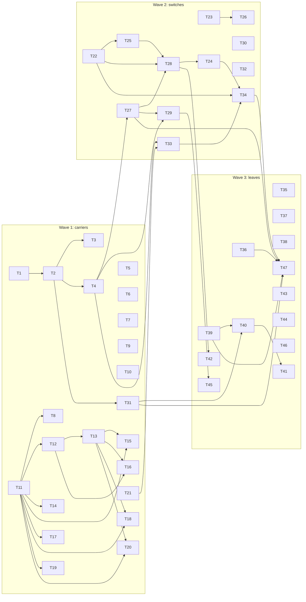

# Simplify 16: the 10 October patterns, in 3 waves

status: in-progress
commit-mode: orchestrator-commits
language: ruby (T46 is rust)
panel: Ruby (Linus Torvalds, Jeremy Evans, Sandi Metz, Richard Schneeman, Aaron Patterson); T46 adds Andrew Gallant

## Intent

The 107 commits of `planning/specs/october-adoption.md` pushed each new fact, flag, record field, arm and bench sweep through the existing objects by hand, and `planning/simplification-impact-research-2026-10.md` measured the result as 10 repeated shapes. This plan fixes them with the mechanisms the tree already has, in 3 waves that each land on the one before: the carriers (gate facts, profiles, records, the digest string), then the switches (bench scaffolding, arm values, Null objects, Backend binding), then the leaves (one provenance shape, graders, the small helpers, verified deletions). The 2 pinned invariants are journal bytes, held by a golden line per record, and `Ractor.shareable?`, held by the sweep spec. No gem or crate is added.

Roadmap: `ROADMAP.md` near-term item 69, this plan. The user chose all 3 waves in 1 plan and every telemetry record over the research's wave-1-only recommendation, on 2026-10-27.

## Grounding

2026-10-27, at `88bec85b` on `main`. 9 Explore passes read the production paths on that SHA: the gate-input carrier, the 12 profile objects, the 81 telemetry records, the digest copies and the confine capability matrix, bench scaffolding, arm values and old session headers, Null and bind-later objects, provenance fields, graders and the helper clusters. Every card cites file:line from those reads; a line number is a pointer, not a promise, and the implementer re-reads before editing.

The panel review's 6 probes (scripts in the session scratchpad, named in the review) corrected 5 premises before the cards were cut: `Hold#bind` is rebound per lane by the live compaction sweep, `run_interrupted` omits `head` in 11 of 733 stored records, ActiveModel's `:string` casts `false` to "f" and nil to nil where `-x.to_s` wrote "false" and "", interning a 1 MB String costs about 3,600x a `dup.freeze`, and `Ladder#consult` rescues a nil rung into a fault rather than raising. Each is carried by the card it touches.

Facts that changed the plan against the research report:

- **`file_facts` has 1 home already.** `Sensitivity::Policy#file_facts` (`sensitivity/policy.rb:342,364`) is what the guard reads (`cli/tool_guard.rb:619,726`, `cli/switchboard.rb:490`). The 2 copies that drift are `GuardTestLayout::Run#file_facts` (`middleware/guard_test_layout.rb:52`) and `BoardBuild::Classifiers`, which has no facts at all (`cli/wiring/board_build.rb:381,535`). So `ToolGuard::Inputs` gains no `file_facts` member; the fix is that the board hands the Policy's facts to those 2.
- **`fresh` stays off `Inputs`.** 3 Nulls answer it with opposite safe defaults: `Confine::Profiles::Unread#any_under?` is true (no port is granted), `Shell::Executable::Resolver::NeverFresh#fresh?` is false (nothing counts as written), and `Fresh.unknown` is degraded-true. The per-lease `Fresh` (`tool_guard.rb:227`) and the lineage `Fresh` (`cli/wiring/observers.rb:90`) are different objects with different lifetimes. One member cannot carry both.
- **The profiles restate less than the research counted.** `RunProfile::HEADER_FIELDS`, `from_header`, `to_options` and `to_header` already derive from `FIELDS` (`cli/run_profile.rb:42,64,108,112`); `CompactionProfile` derives from `FLAGS` (`cli/compaction_profile.rb:16,48,72,78`); `MismatchNotices::LABELS` derives from `HEADER_FIELDS` (`cli/resume/mismatch_notices.rb:26`). What is left by hand: `FIELDS` and `UNRECORDED` (run_profile.rb:22,115), `UNSET` (compaction_profile.rb:106), `Arms::OFF` and `UNSET` (cli/arms.rb:107,112), `Request#cache_payload` beside `cache_payload_of` (request.rb:58-67), `Provenance#initialize`'s 7-field hash (session_record/provenance.rb:148-151), `Recording#initialize` restating 23 members (bench/session.rb:268-279), and 5 `{}` section defaults repeated by `SessionRecord.header`, `Scribe` and `Chronicle#start` (session_record.rb:82, scribe.rb:156, cli/chronicle.rb:300).
- **`chat_flags_spec` scans with Prism, not a regex** (`spec/lain/cli/chat_flags_spec.rb:96-119`): any `options[x]` whose key is not a Symbol literal is a "dynamic read" and the file must be in `DYNAMIC` (:73). `from_options` and `CompactionProfile.typed` keep their literal reads.
- **81 telemetry files are Journalable, 12 already use `settle!`, 2 have no hand `initialize`** (`escalation.rb` builds its own hash; `stamped.rb` wraps). 67 convert. 43 non-telemetry Journalable files exist and are out of scope here. `Carrier::Copy#frozen_copy` returns an already-frozen String unchanged before `string_copy` runs (`declarative/carrier.rb:166-168`); interning is restored per field by a declared type (T11), not by the copier, because the copier also sees `AssistantText#text` and `ToolOutput#bytes`.
- **No spec pins a record's bytes.** `spec/journalable_surface_spec.rb` checks `type` first, unique types and shareability with dummy values; `spec/lain/session_record_spec.rb:1050` is the one byte-identity precedent (a committed fixture line re-journaled). The only key-order rule a reader depends on is `ts` then `type` (`cli/session_journals.rb:82-100`).
- **The "silent egress-guard drop" finding was wrong.** Every `Backend.new` outside Wiring calls `bind_env` (5 sites: `cli/consolidate.rb:85`, `cli/epic_submit.rb:519`, `cli/improve.rb:181`, `bench/oracle_calibration/source.rb:56`, `exe/lain:1296`), and an unbound guard fails closed: `EgressLiterals#egress` raises `NotBound` (`cli/backend/egress_literals.rb:47`), `PriceTierGuard::Hold#decide` answers `:refuse` (`provider/http/price_tier_guard.rb:71`), `EgressHold#ask` raises `NOT_READY` (`cli/backend/egress_hold.rb:72`). The duplication is real; the hole is not. `LateCounter` is bound in the expression that builds its provider (`cli/backend.rb:798`) and is not a board binder.
- **A nested `Provenance` value would change bytes readers depend on.** `prompt_digest` and `input_digest` are read flat by the replay bench (`bench/approval_replay/recorded_judge.rb:43`, `join.rb:59`) and sit in committed fixtures (`spec/fixtures/sessions/approval_replay/{auto,ask}.ndjson`); `scale` is read flat (`bench/judge_scale/source.rb:52`); `written_by` is a flat row key in on-disk memory stores (`memory/project_store.rb:256,327`). `grader_digest`, `criteria_digest`, `arm` on a grade and `refuter` have no lib reader and no fixture. A `SessionRecord::Provenance` already exists for the session run. Pattern 4 shrinks to 1 card.
- **Old headers record arm values as lower-case strings of the symbol names** and 377 of 400 sampled QA headers have no `arms` key at all (read as `OFF`). Never seen: `workspace`, `stop`, any `judge_denials`, `static`. `Arms.from_header` reads both through `pick` (`cli/arms.rb:73`), so arm predicates change no reader.
- **The confine capability matrix is irregular**: probed flags (`reap`, `private_net`), grant lists (`ports`, `unix_dirs`) and seccomp-only rules (`memfd`, `sockets`) cross different files for different reasons. No single table fits; rejected below.
- **`run_clock.rb:36-40` says in writing that there is no `WALL` clock constant on purpose** (3 wall-time flavours exist). The default-clock cluster is rejected on that ground.
- **`number_to_delimited`'s 3 sites already call ActiveSupport directly.** No change.
- **`.rubocop.yml` has no `Naming/MethodParameterName` or `Lint/UnusedMethodArgument` entry**, and 51 inline `rubocop:disable` lines exist under `lib/`. The 2 grader ones go by changing the signatures (T37, T39), so no ruling is needed.

Docs that disagree with the code, code wins: `ARCHITECTURE.md:1406-1418` (RunProfile has 8 members, 7 flags, `HEADER_FIELDS` excludes 3), `ARCHITECTURE.md:1027-1033` (Arms has 6 arms, `confine` includes `workspace` and defaults to it), `lib/lain/cli/compaction_profile.rb:9-10` ("four knobs", 9 members), `lib/lain/landing.rb` module doc ("nowhere in Sensitivity" while `sensitivity/policy.rb:298,646,655` call `Landing`), `cli/tool_guard.rb:103-123` and `cli/switchboard.rb:148-153` (the `Inputs` docs omit 7 members). T5, T6, T27, T4 and T44 fix each beside the code they describe.

## Compatibility

| Surface | Verdict | Evidence |
|---|---|---|
| Stored session journals (`.ndjson`) | must keep, byte for byte per record | 2,610 QA files under `~/tmp/lain-qa-*` are the replay and sweep corpus; `Journal::Line.link` hashes exact line bytes (`journal/line.rb:16`). Each converted record gets a golden-line example captured from the pre-change code (T14 to T20). `ts` then `type` stay first (`cli/session_journals.rb:82`). |
| Session header | must keep readable, free to extend | `Bench::Session::Loader` reads named keys (`bench/session/loader.rb:259-281`); T9 keeps the merge order so bytes stay identical. |
| `Request#digest` and `cache_payload` key order | must keep | Addresses stored `request_sent` records; pinned by `spec/lain/request_spec.rb:357` (T7). |
| Flat journal keys `prompt_digest`, `input_digest`, `scale`, `written_by` | must keep | Readers above; committed fixtures `spec/fixtures/sessions/approval_replay/*.ndjson`; on-disk memory stores. T35 keeps `input_digest` flat. |
| `grader_digest` values | free to break | No lib reader, no fixture (`spec/fixtures/grader/` holds turn digests only). T37 keeps the identity keys anyway. |
| Bench report and refusal text | must keep where a spec pins it | `spec/lain/bench/cli_spec.rb` (127 text pins), `live_spec.rb:142,157,167`, `memory_sweep_spec.rb:104`, `labels_spec.rb:60`. T22 to T24 keep every pinned string, including both `DOLLAR_HALT` wordings. |
| `exe/lain` help text | must keep 2 substrings | `spec/lain/cli_spec.rb:423-426` pins "default workspace" and "a call you approve yourself still runs traced and unconfined"; the rest is free (T28). |
| `lain-fence` flags and argv | untouched | T46 edits Rust tests only. |
| Ruby APIs (`ToolGuard::Inputs`, `Secrets::Source`, `Backend#bind_egress`, `Stops::None` readers, `LeaseHarness.seal`, grader constructors) | free to break | Gem unpublished: the only tag is `backup/main-pre-msg-rewrite-tag`, `lain.gemspec` never pushed, every crate `publish = false`; `~/dev/lain-*` are worktrees of this repo; memory `harness-vs-own-dev` says no back-compat is owed. |
| Project and user config DSL | must keep | Users' `.lain/config.rb` files exist on this box; no card changes a verb. |

No must-keep surface blocks a large simplification, so no trade was put to the user. The one surface that shaped a card is the flat-key set, which turned the research's `Provenance` value into T35.

## Spike findings

| Question | Result | Evidence |
|---|---|---|
| Does `Carrier::Copy` interning every String (a String branch ahead of the shareable check, `-string` in place of `dup.freeze`) break any of the 16 current `settle!` users or the sweep specs? | No on correctness, so the mechanism is safe; the plan still does not take it, because the panel's probe measured `-s` at 2x a `dup.freeze` for 64 bytes and about 3,600x for 1 MB, and the copier sees whole tool outputs. T11 interns by declared type instead. 356 examples, 0 failures across `declarative_spec`, `declarative/*`, the 12 telemetry users' specs, `forge/gh_spec`, `epic/submission_spec`, `context/cache_breakpoints_spec`, `memory/item_spec`, `prompt/slot_journal_spec`, `value_object_shareability_spec` and `journalable_surface_spec`. A `MemoryRoot` built from 2 equal mutable Strings now shares 1 `root` (`equal?` true) and stays `Ractor.shareable?`. | spike worktree `tmp/worktrees/spike-copy-intern`, since removed; the 2-line diff to `lib/lain/declarative/carrier.rb` is recorded in Rejected options |
| Does converting a record from a hand `initialize` to `settle!` keep `to_journal` bytes identical and the record shareable? | Yes on bytes and shareability (6 `ApprovalPending` shapes); interning is lost unless the field is declared `:lain_interned`, which is why T11 precedes every record card. | research spike, 2026-10-27, `planning/simplification-impact-research-2026-10.md`, Spike findings |
| Can `RunProfile::FIELDS` derive from `members` without failing `chat_flags_spec`? | `FIELDS` and `UNRECORDED` may derive; `from_options` must keep its literal `options[:provider]` reads (2 of 62 examples fail otherwise). | same research spike, `chat_flags_spec.rb:186,202` |

A worktree needs the compiled extension copied in before its specs load (`cp lib/lain/lain.so tmp/worktrees/<name>/lib/lain/`); `rake compile` is the alternative. Logged as friction.

## Shared files

Only the main session edits these; a card hands back a 1-line diff where it needs one.

- `ARCHITECTURE.md`, `docs/GLOSSARY.md`, `ROADMAP.md`
- `lib/lain.rb`, `.rubocop.yml` (`lib/lain/telemetry.rb` is edited by T13, then by T16 after it)
- `Gemfile`, `lain.gemspec`, `crates/*/Cargo.toml`
- `spec/spec_helper.rb`, `spec/support/**` (T1 adds a new spec file under `spec/lain/`, not under support; T4 hands back 1-line diffs for `spec/support/tool_registry.rb:66` and `spec/support/nulls/no_switchboard.rb:24`)
- `exe/lain` is NOT shared: T28, T24 and T34 edit it in that order.

## Rejected options

- `fresh` as an `Inputs` member, or 1 `Fresh` Null: the 2 ducks have opposite safe defaults and 2 lifetimes (Grounding).
- `file_facts` as an `Inputs` member: `Policy#file_facts` is the home already; a second reader would be the drift this plan removes.
- A nested `Provenance` Data on `GradeRecord`, `Verdict`, `Judged::Read`, `Memory::Item` and `Recording`: 4 flat keys have readers and committed fixtures; `Journalable#to_journal` flattens `to_h`, so a nested Data needs a custom serializer per record. T35 keeps the 1 real duplication fix.
- A `Bench::Source` class over the 3 recorded-or-live pairs: they have 3 shapes (a module of functions, a lambda factory, a flags object with `Sending`). The shared rule is the timestamped path (T22) and the priced preflight (T24); the rest is not duplication.
- 1 `tally` helper for the 6 duplicate-name checks: the 1-line `tally.select { _2 > 1 }` is the idiom; the 3 different error classes and messages are the content.
- 1 dollar formatter: `Live.dollars` prints a Float to 4 places; `CompactionSweep#dollars` prints a `Money`-like figure to 6 places or "unpriced". Different types, different reports.
- A confine capability table across Probe, Profile, Bwrap and the fence: irregular matrix (Grounding). A 2-row table inside `probe.rb` would replace `reaps?` and `private_net?` only; not worth a card.
- Interning inside `Carrier::Copy`: correct (spike) but it hashes every String the copier sees, tool outputs included; a declared `:lain_interned` type interns the identifier fields only.
- `RunClock::WALL`: `run_clock.rb:36-40` rejects it in writing.
- A `Writer::Unknown` Null for `Memory::Index#written_by`: the value is a Hash row read from disk and the one nil-check is in the one reader (`tools/memory_read.rb:91`).
- Giving every grader an `identity` so `Journaling` drops its `respond_to?` guard: that turns nil `grader_digest` into a digest for 7 graders, a bytes change with no reader; "nothing is invented for it" stays (`grader/journaling.rb:47`).
- `Backend.new` binding the environment's secrets by default and `attach` upgrading to the board: a chat path that forgot `attach` would scan the environment only, silently. The fail-closed `NotBound` stays; T34 removes the duplication with a named constructor instead.
- Unifying the 3 quantile definitions by force: `hot_paths.rb` interpolates, `Distribution#median` is exact over Integer and BigDecimal, `landing_metrics.rb` is nearest-rank. T40 unifies the 2 Float ones under a stop condition.
- `delegate_missing_to` for the delegate lists in `provider/journaled.rb:83` and `resolve_attachments.rb:60`: forwards through `method_missing`, the `StringInquirer` failure. Out of this plan; a drift spec is the research's answer and belongs with the provider cluster below.
- Literal, dry-struct, enumerable-statistics, distribution, wilson_interval, memo_wise, naught, rstest, procfs, webrick: rejected in the research report, each on size, maintenance or fit.

## Open decisions

- **Deferred mechanism clusters**, each a plan of its own after this one lands: confine accretion (`confine/profile.rb` 673 lines, 3 ways to find git dirs, `Profile.landing` read 4x), the gateway client and server split (`oracle/secret_read.rb:285-345` against `gateway/server.rb`, and the webrick or `lain-core` question), compaction plumbing (`placement:` threaded 4 hops, `HeldCut.on` rebuilt 3x per render), sensitivity and history literals (`history_literals.rb` 320 lines, 5 jobs), the journal chain (`@chained` derivable from `@tip`), provider and pricing (`price_book.rb` 20 rows repeating cache 0/0, `ollama.rb` 5 hand rescue pairs beside `asked`), and the tripwire ledger (`Crossing` built then patched by `with`). None of this plan's cards depends on them.
- **The 43 non-telemetry Journalable records** (epic, review, supervisor, subagent) follow the T14 recipe later; none is on this plan's critical path.

## Dependency graph



Cards with no edge start at once. The waves are ordering, not gates: a wave-2 card starts when its own `Depends on` has landed.

## Tasks

### Wave 1: carriers

The record recipe every card in T14 to T20 follows, from the exemplar `lib/lain/telemetry/memory_root.rb`:

1. Before touching the record, add 1 golden-line example to its mirror spec: build the record with every field set to a representative non-default value, and `expect(JSON.generate(record.to_journal)).to eq(<the literal the current code prints>)`. Run it green on the unchanged code and keep it. Add a second golden line for each `to_journal` override case (a field omitted, a nested term), and a third with every optional field nil, which is the shape the stored corpus holds most often.
2. Declare a `Carriers::<Record> < Declarative::Carrier` naming every keyword `initialize` accepts, with its default. A field the old code interned (`-x.to_s`) is `attribute :x, :lain_interned` (T11; never `:string`, whose cast writes "f" for false and nil for nil where `-x.to_s` wrote "false" and ""); an optional interned field declares `default: nil` (an omitted attribute with no default is never cast, so it stays nil where the hand code wrote ""); one it only froze is `attribute :x` untyped (`Copy` deep-copies Arrays and Hashes); a `fixed_point` field is `attribute :x, :lain_fixed_point` (T12). Move each `check!` validation onto the same carrier. Delete the hand `Carrier` that `check!` used, if one existed.
3. `def initialize(**attrs) = super(**Carriers::<Record>.settle!(**attrs))`. Keep an explicit keyword list only where a required keyword has no validation to catch its absence (the `MemoryRoot` reason).
4. A `to_journal` that dropped fields equal to their defaults becomes `def to_journal = omitting_defaults(super, :a, :b)` (T13). A `to_journal` that nests another record stays as written.
5. Drop the `Data.define` then `class X` reopen when the block can hold the body; keep it when the class holds a constant (a constant inside a `Data.define` block scopes to the enclosing module, `CLAUDE.md` Known traps).
6. Run the mirror spec, `spec/journalable_surface_spec.rb` and `spec/value_object_shareability_spec.rb`. A record without a mirror spec gets one, holding the golden line, a validation example and a shareability example.

### T1: Pin which Landing calls pass file facts          [risk: low]

**Depends on:** none
**Files:** `spec/lain/landing_calls_spec.rb` (new)
**Reuse:** the Prism visitor shape in `spec/lain/cli/chat_flags_spec.rb:96-133` (`Scanner < Prism::Visitor`, `SOURCES` glob, `DYNAMIC` allowlist with a reason per entry)
**Shared-file wiring:** none
**Reachable from:** the spec runs under `rake pspec`; it is a ratchet, not production code

**Acceptance criteria**

```gherkin
Scenario: every Landing.of, Landing.eventual and Landing.redirect call in lib/ names facts
  Given the Prism scan of lib/lain/**/*.rb for calls on the Landing constant
  When a call to of, eventual or redirect has no facts: keyword
  Then the spec fails unless the file is in the allowlist, naming its reason

Scenario: the allowlist holds exactly the known omitters
  Given the allowlist starts as path_gate.rb, frontend/approval_policy.rb, cli/wiring/board_build.rb, session.rb and confine/profile.rb
  When a listed file no longer omits facts
  Then the spec fails until its entry is removed, so the list can only shrink
```
Spec file: `spec/lain/landing_calls_spec.rb`

**Interface**

```ruby
LIVE_BY_DESIGN = {
  "lib/lain/confine/profile.rb" => "bounded? sizes a live sandbox build; the disk it reads is the one it confines",
  "lib/lain/session.rb" => "the checkout scope is built from the live project; the replay bench runs UNSCOPED"
}.freeze
NOT_YET = { "lib/lain/approval/parked/path_gate.rb" => "T3", ... }   # removed by T2 and T3
```

**Stop and report if:**
- `Landing.under?` or `Landing.respelled` take a `facts:` keyword at `88bec85b` (they are lexical at `landing.rb:110,121`; the scan must skip them).
- The scan finds a call on a constant also named `Landing` outside `lib/lain/landing.rb` (`cli/epic_driver/factory.rb:173`, `Forge::Landing`); the visitor must resolve the receiver to `::Lain::Landing` or `Landing` inside `module Lain`.

### T2: Hand the Policy's file facts to the test-layout run and the classifiers          [risk: medium]

**Depends on:** T1
**Files:** `lib/lain/cli/wiring/board_build.rb`, `lib/lain/bench/approval_replay/stack.rb`, `spec/lain/cli/wiring/board_build_spec.rb`, `spec/lain/bench/approval_replay_spec.rb`, `spec/lain/landing_calls_spec.rb` (remove the board_build entry)
**Reuse:** `Sensitivity::Policy#file_facts` (`sensitivity/policy.rb:364`); `FileFacts::Recorded` (`file_facts/recorded.rb`); `GuardTestLayout::Run.new(..., file_facts:)` (`middleware/guard_test_layout.rb:52`)
**Shared-file wiring:** none
**Reachable from:** `CLI::Wiring#switchboard` -> `BoardBuild.for` (`cli/wiring.rb:929`, `board_build.rb:66-86`), which builds `layout_run` (:191) and `Classifiers` (:488) with `sensitivity` in scope (:77)

**Acceptance criteria**

```gherkin
Scenario: a board over recorded facts never asks the live disk
  Given a Sensitivity::Policy whose file_facts is a FileFacts::Recorded over a root that does not exist on disk
  When BoardBuild.for builds the board and its ladder classifies a write under that root
  Then the write lands inside the root, and a FileFacts::Live spy on Landing sees no call

Scenario: the test-layout run reads the policy's facts
  Given the same policy
  When BoardBuild.for builds the layout run
  Then run.file_facts is the policy's file_facts

Scenario: the replay bench sets facts once
  Given ApprovalReplay::Stack builds its policy over Recorded facts
  When it builds the test-layout run and the classifiers
  Then both read the facts from the policy, and stack.rb holds no second @facts hand-off
```
Spec file: `spec/lain/cli/wiring/board_build_spec.rb`, `spec/lain/bench/approval_replay_spec.rb`

**Interface**

```ruby
# lib/lain/cli/wiring/board_build.rb
Classifiers.new(home:, cwd:, rules:, root:, also_rooted:, confinement:, resolver:, worker_env:, facts: sensitivity.file_facts)
class Classifiers::Confinement
  def initialize(root:, cwd:, landing:, facts: FileFacts::LIVE)   # :381 and :535 pass facts:
# Classifiers#confinement (:531) resolves the real root through facts.realpath, not File.realpath;
# FileFacts::Recorded#realpath exists, and under it the rescue-to-@nowhere branch is never taken
```

**Stop and report if:**
- `FileFacts::Recorded#realpath` answers a path outside its `places` with a raise rather than the lexical path; then scenario 1 needs the recorded places to include the confinement root, and the card says so.
- `stack.rb:166` builds `Classifiers` before the policy exists.

### T3: Resolve approval display paths with the queue's facts          [risk: low]

**Depends on:** T2
**Files:** `lib/lain/approval/parked/path_gate.rb`, `lib/lain/approval/parked/queue.rb`, `lib/lain/frontend/approval_policy.rb`, `spec/lain/approval/parked/path_gate_spec.rb`, `spec/lain/approval/parked/queue_spec.rb`, `spec/lain/frontend/approval_policy_spec.rb`, `spec/lain/landing_calls_spec.rb` (remove 2 entries)
**Reuse:** `Parked::Queue#file_facts` (`queue.rb:542`) and its `Landing.of(..., facts:)` at :609; `Queue::Pending` (:197)
**Shared-file wiring:** none
**Reachable from:** `CLI::Wiring` builds `PathGate.new(@switchboard.sensitivity)` (`cli/wiring.rb:212`); the frontend's `ApprovalPolicy#landing` (`frontend/approval_policy.rb:304`) reads a `Pending` the queue parked

**Acceptance criteria**

```gherkin
Scenario: the path gate shows a landing under recorded facts
  Given a PathGate over a policy whose file_facts is Recorded
  When shown(path) redirects the path
  Then Landing.redirect receives those facts

Scenario: the frontend never resolves a path itself
  Given a Pending parked by a queue over Recorded facts
  When the approval frontend renders the pending write's landing
  Then the landing it shows is the one the queue computed under Recorded facts, with no live stat (a FileFacts::Live spy sees no call), and lib/lain/frontend/approval_policy.rb holds no Landing call
```
Spec file: `spec/lain/approval/parked/path_gate_spec.rb`, `spec/lain/approval/parked/queue_spec.rb`, `spec/lain/frontend/approval_policy_spec.rb`

**Interface**

```ruby
Queue::Pending#landing   # String, the redirected path under the queue's facts, computed at park time
```

**Stop and report if:**
- `Pending` is built anywhere other than `Queue#park` (grep `Pending.new` in lib/), because the landing is computed there.
- `PathGate::Absent` (`path_gate.rb:17`) is asked to show a path; it has no policy and must stay a Null that shows the path unchanged.

### T4: Carry secrets as one Source on the gate inputs          [risk: medium]

**Depends on:** T2
**Files:** `lib/lain/cli/tool_guard.rb`, `lib/lain/cli/switchboard.rb`, `lib/lain/cli/wiring/board_build.rb`, `lib/lain/cli/backend.rb` (:418 only), `lib/lain/cli/backend/egress_literals.rb`, `lib/lain/middleware/redact_secret_reads.rb`, `lib/lain/sensitivity/display.rb`, `lib/lain/sensitivity/secrets/source.rb`, `spec/lain/cli/tool_guard_spec.rb`, `spec/lain/cli/switchboard_spec.rb`, `spec/lain/cli/wiring/board_build_spec.rb`, `spec/lain/cli/backend/egress_literals_spec.rb`, `spec/lain/middleware/redact_secret_reads_spec.rb`, `spec/lain/sensitivity/display_spec.rb`, `spec/lain/sensitivity/secrets/source_spec.rb`, `spec/lain/tools/bash_spec.rb:13`, `spec/lain/effect/handler_spec.rb:124`, `spec/lain/seams/tools_agent_spec.rb:96` (each builds `Display.new(child_env:)`)
**Reuse:** `Secrets::Source = Data.define(:child_env, :history)` with `to_a` and `egress` (`sensitivity/secrets/source.rb:13`); `EgressLiterals#bind_board` already builds one from the inputs (`egress_literals.rb:32`)
**Shared-file wiring:** `spec/support/tool_registry.rb:66` and `spec/support/nulls/no_switchboard.rb:24` build `Inputs` with no `child_env`; they stay green because `Inputs#initialize` defaults `secrets:`, so the diff is none unless they name `child_env:` (1 line each if so). The `Inputs` doc (`tool_guard.rb:103-123`) and `guard_inputs` doc (`switchboard.rb:148-153`) are rewritten here to list every member.
**Reachable from:** `BoardBuild.for` (`board_build.rb:78`) is the one site with both values in scope and builds `Secrets::Source.new(child_env:, history:)`, then passes `secrets:` into `Switchboard.for` -> `Switchboard#initialize` -> `Inputs.new` (`switchboard.rb:262-266`)

**Acceptance criteria**

```gherkin
Scenario: the inputs carry one secrets source
  Given a board built by BoardBuild.for over a project with a primed history
  When the guard inputs are read
  Then inputs.secrets is a Secrets::Source whose history is that primed history and whose child_env is the exec backend's

Scenario: the readers take the source, not the pair
  Given RedactSecretReads and Sensitivity::Display built by the board
  When each scans for secrets
  Then each asks the one Source it was given, through Source#for(context), and the secrets found for a call equal today's (redact_secret_reads_spec and display_spec green)

Scenario: a board with no project reads none
  Given ToolGuard.detached
  When its inputs are read
  Then inputs.secrets is Secrets::Source::DEFAULT, whose history is HistoryLiterals::Null
```
Spec file: `spec/lain/cli/tool_guard_spec.rb`, `spec/lain/cli/switchboard_spec.rb`, `spec/lain/middleware/redact_secret_reads_spec.rb`, `spec/lain/sensitivity/display_spec.rb`

**Interface**

```ruby
class Secrets::Source   # a reopen: a constant inside the Data.define block would land in Secrets (Known traps)
  DEFAULT = new(child_env: Exec::ChildEnv::DEFAULT, history: HistoryLiterals::Null)
  def for(context) = Secrets.for(child_env:, context:, history:)   # to_a stays as for(nil)
end
ToolGuard::Inputs = Data.define(..., :secrets, :denied_tools, :stops, :mode)   # child_env and history removed
ToolGuard::Inputs#initialize(..., secrets: Secrets::Source::DEFAULT, ...)
Switchboard.for(..., secrets: Secrets::Source::DEFAULT, denied_tools:, stops:)
RedactSecretReads.new(..., secrets:, file_facts: LIVE)
Sensitivity::Display.new(secrets:)
# cli/backend.rb:418 calls egress_literals.bind(board.guard_inputs.secrets); bind_board is deleted (no forwarders, memory inline-shared-helpers)
```

**Stop and report if:**
- `switchboard.rb:157` builds `Display` from `child_env` for a reason other than secrets (read the `live_display` method first).
- `exec_backend.child_env` (`cli/exec_backend.rb:107`) is read from `Inputs` anywhere; the survey found only `egress_literals.rb:32`, `switchboard.rb:157` and `tool_guard.rb:726`.

### T5: Derive RunProfile's field lists and settle its values          [risk: low]

**Depends on:** none
**Files:** `lib/lain/cli/run_profile.rb`, `spec/lain/cli/run_profile_spec.rb`
**Reuse:** `Declarative` (`lib/lain/declarative.rb:99-140`); the `members`-derived `FIELDS` precedent at `bench/session.rb:188`
**Shared-file wiring:** `ARCHITECTURE.md:1406-1418`: replace "six" members and "five flags" with the derived list, and say `HEADER_FIELDS` excludes `model`, `keep_alive` and `effort`
**Reachable from:** `CLI::Backend#initialize` default `profile: RunProfile.from_options(options)` (`cli/backend.rb:203`) and `RunProfile.from_header` in `bench/session/loader.rb`

**Acceptance criteria**

```gherkin
Scenario: the field list is the member list without typed
  Given RunProfile's members
  Then FIELDS equals members minus :typed and UNRECORDED is a profile with every FIELD nil

Scenario: an unknown typed name is refused by name
  When RunProfile.new is given typed: [:colour]
  Then it raises ArgumentError naming colour (run_profile_spec.rb:24 keeps passing)

Scenario: the option reads stay literal
  When spec/lain/cli/chat_flags_spec.rb runs
  Then it still finds :provider and :model and run_profile.rb is not in DYNAMIC
```
Spec file: `spec/lain/cli/run_profile_spec.rb`, `spec/lain/cli/chat_flags_spec.rb` (unchanged, must stay green)

**Interface**

```ruby
FIELDS = (members - %i[typed]).freeze
UNRECORDED = new(**FIELDS.to_h { [_1, nil] })
def initialize(**attrs) = super(**self.class.settle!(**attrs))   # declare lists the 8, typed default [], the subset validation; keep_alive and num_* untyped
```

**Stop and report if:**
- A spec compares `keep_alive` by class after `from_header` reads a String; untyped keeps what arrives, as today.
- `startup_notices_spec`, `chat_launch_spec`, `resume_spec` or `consolidation_spec` compare a profile by `equal?` or rely on `&.dup` producing a fresh String.

### T6: Derive CompactionProfile's UNSET and settle its values          [risk: low]

**Depends on:** none
**Files:** `lib/lain/cli/compaction_profile.rb`, `spec/lain/cli/compaction_profile_spec.rb`
**Reuse:** `FLAGS` (`compaction_profile.rb:16-18`) as the one member table; `SCHEDULES` and `TRIGGERS` (:19-21) as inclusion lists
**Shared-file wiring:** none; the "four knobs" YARD at :9-10 is corrected in this file
**Reachable from:** `CLI::Backend#initialize` default `compaction: CompactionProfile.typed(options)` (`cli/backend.rb:203`); `from_header` in the resume path

**Acceptance criteria**

```gherkin
Scenario: UNSET derives from the flag table
  Then CompactionProfile::UNSET has every FLAGS key nil

Scenario: an unknown trigger is refused where it is built
  When from_header reads a trigger outside TRIGGERS
  Then the same error class is raised and compaction_profile_spec.rb:73's regex still matches (Declarative prefixes the attribute name, so the text is not byte-equal)

Scenario: the literal option reads stay
  Then chat_flags_spec still finds every :compact_* key and compaction_profile.rb is not in DYNAMIC
```
Spec file: `spec/lain/cli/compaction_profile_spec.rb`

**Interface**

```ruby
UNSET = new(**FLAGS.keys.to_h { [_1, nil] })
declare(raising: <the class refuse_trigger! raises>) { attribute ...; validates :trigger, inclusion: { in: TRIGGERS, allow_nil: true } }
```

**Stop and report if:**
- `resume/mismatch_notices_spec` or `seams/handoff_spec` pin the trigger refusal's exact text rather than a regex.

### T7: Build the request's cache payload from one key list          [risk: medium]

**Depends on:** none
**Files:** `lib/lain/request.rb`, `spec/lain/request_spec.rb`
**Reuse:** `cache_payload_of` (`request.rb:58-63`) stays the one builder
**Shared-file wiring:** none
**Reachable from:** `Request#initialize` computes `@digest` from `cache_payload_of(**identity)` (`request.rb:43`); every provider round trip

**Acceptance criteria**

```gherkin
Scenario: the payload keys are listed once
  Given a Request with no effort
  Then cache_payload.keys equals %w[max_tokens messages model reasoning system tools] (request_spec.rb:357 unchanged)

Scenario: effort is prepended only when set
  Given a Request with effort "high"
  Then cache_payload.keys.first is "effort" and the digest of an effort-less request is unchanged against the committed value in request_spec

Scenario: cache_payload and the digest agree
  Then Canonical.digest(request.cache_payload) equals request.digest for both shapes
```
Spec file: `spec/lain/request_spec.rb`

**Interface**

```ruby
def cache_payload = self.class.cache_payload_of(**to_h.except(:stream, :extra))   # no second list; cache_payload_of keeps the hand order
```

**Stop and report if:**
- Any digest literal in `spec/lain/request_spec.rb`, `telemetry/request_sent_spec.rb` or `provider/journaled_spec.rb` changes; the key order must be byte-identical.

### T8: Derive SessionRecord::Provenance's string fields from its members          [risk: low]

**Depends on:** T11
**Files:** `lib/lain/session_record/provenance.rb`, `spec/lain/session_record/provenance_spec.rb`
**Reuse:** `Declarative#settle!` with interning from T11; `UNRECORDED` (`provenance.rb:25`)
**Shared-file wiring:** none
**Reachable from:** `CLI::Wiring::Header` calls `Provenance.launched` (`cli/wiring/header.rb:21`); `bench/cli/run_recorder.rb:159`

**Acceptance criteria**

```gherkin
Scenario: a nil field records as unrecorded
  When Provenance.new is given effort: nil
  Then effort is "unrecorded" and to_header is byte-identical to the current output (provenance_spec.rb:243-264 unchanged)

Scenario: the 7 string fields are the members without weights
  Then no method in provenance.rb lists harness, tool_surface, effort, policy, cwd, root, home by name except the Data.define, and a header built from Provenance.launched equals today's (chronicle_spec:334, bench/session_spec:405 unchanged)
```
Spec file: `spec/lain/session_record/provenance_spec.rb`

**Interface**

```ruby
STRINGS = (members - %i[weights]).freeze
def initialize(weights: nil, **strings) = super(**self.class.settle!(**STRINGS.to_h { [_1, strings[_1] || UNRECORDED] }), weights:)   # weights stays outside settle!
```

**Stop and report if:**
- `Provenance.current` or `launched` passes a keyword the interface does not list.

### T9: Pass the header's sections as one value          [risk: medium]

**Depends on:** none
**Files:** `lib/lain/session_record.rb`, `lib/lain/session_record/sections.rb` (new), `lib/lain/session_record/scribe.rb`, `lib/lain/cli/chronicle.rb`, `lib/lain/cli/wiring/header.rb`, `spec/lain/session_record_spec.rb`, `spec/lain/session_record/sections_spec.rb` (new), `spec/lain/session_record/scribe_spec.rb`, `spec/lain/cli/chronicle_spec.rb`, `spec/lain/cli/wiring/header_spec.rb`
**Reuse:** the 5 `to_header` objects already in `Chronicle#start`'s defaults (`cli/chronicle.rb:300-308`); `SessionRecord.header`'s merge order (`session_record.rb:82-93`)
**Shared-file wiring:** none
**Reachable from:** `CLI::Wiring::Header` (`cli/wiring/header.rb:17-23`) -> `Chronicle#start` -> `Scribe.new` -> `SessionRecord.header`

**Acceptance criteria**

```gherkin
Scenario: the header bytes do not move
  Given the context, toolset and sections a chat launch builds today
  When SessionRecord.header is written through Scribe
  Then the line equals the one the current 10-keyword call writes, key for key

Scenario: a section defaults once
  Given Sections.none
  Then profile, compaction, arms, middleware and provenance each render as today's {} default, and scribe.rb, chronicle.rb and session_record.rb carry no `profile: {}` default

Scenario: the chronicle still accepts objects
  When Chronicle#start is given RunProfile, CompactionProfile, Arms, Config::Middleware and Provenance values
  Then Sections.of(...) calls to_header on each once
```
Spec file: `spec/lain/session_record/sections_spec.rb`, `spec/lain/session_record_spec.rb`, `spec/lain/cli/chronicle_spec.rb`

**Interface**

```ruby
SessionRecord::Sections = Data.define(:profile, :compaction, :arms, :middleware, :provenance)
Sections.none                       # every member {}
Sections.of(profile:, compaction:, arms:, middleware:, provenance:)   # calls to_header on each
SessionRecord.header(context:, toolset:, writer:, workspace: Workspace.empty, resumed_from: nil, sections: Sections.none)
Scribe.new(journal:, context:, toolset:, workspace:, resumed_from:, written:, message_journal:, live:, writer:, sections:)
Chronicle#start(context:, toolset:, workspace:, resumed:, sections:)
```

**Stop and report if:**
- `SessionRecord.scheduled(compaction)` (`session_record.rb:108-113`) reads the compaction section before the merge in a way the value cannot reproduce.
- `Chronicle::Null#start(**)` (`cli/chronicle.rb:32`) is called with positional sections anywhere.

### T10: Let Recording name only the members it coerces          [risk: low]

**Depends on:** none
**Files:** `lib/lain/bench/session.rb`, `spec/lain/bench/session_spec.rb`
**Reuse:** `Loader#recording` (`bench/session/loader.rb:77-87`), the one constructor call
**Shared-file wiring:** none
**Reachable from:** `Bench::Session.load` -> `Loader#recording`

**Acceptance criteria**

```gherkin
Scenario: the constructor restates no member it does not touch
  Given Recording's 23 members
  Then initialize names only context_class, baseline, messages, compaction, schedule, opaque, arms, provenance, served_models, host, started_at and the 4 defaulted members, and passes the rest through **attrs

Scenario: a loaded recording is unchanged
  Given spec/fixtures/sessions/variance/one.ndjson
  When Bench::Session.load reads it
  Then every member equals what it equals today (session_spec.rb:373-409 unchanged)
```
Spec file: `spec/lain/bench/session_spec.rb`

**Interface**

```ruby
def initialize(context_class:, baseline:, messages:, host:, arms: {}, compact: nil, opaque: nil, recorded_cuts: RecordedCuts::NONE, **rest)
  super(context_class: -context_class.to_s, ..., **rest)
```

**Stop and report if:**
- A member the survey listed as passed through (`timeline`, `memory`, `recorded_cuts`) is coerced today at `session.rb:273-279`; read the `super` call before cutting.

### T11: Add an interning type to Declarative          [risk: low]

**Depends on:** none
**Files:** `lib/lain/declarative/types.rb`, `lib/lain/declarative.rb` (the register line beside `:lain_canonical`, `declarative.rb:171`), `spec/lain/declarative/types_spec.rb`
**Reuse:** the `Canonicalized` type (`types.rb:134`) as the shape; the hand `-x.to_s` at 40 record sites as the semantics
**Shared-file wiring:** none
**Reachable from:** every record card's `attribute :x, :lain_interned` (T14 to T20) and T8

**Acceptance criteria**

```gherkin
Scenario: every value interns as its string
  When a Symbol, an Integer, false and a mutable String are cast
  Then each becomes -value.to_s, frozen, and 2 casts of equal input are equal?

Scenario: nil interns as the empty string, as -nil.to_s did
  When nil is cast
  Then "" comes back, so a record whose old code wrote "" for a missing tool_use_id still does

Scenario: the copier leaves it alone
  When a record settles an interned field
  Then Copy sees an already-shareable String and does not dup it
```
Spec file: `spec/lain/declarative/types_spec.rb`

**Interface**

```ruby
class Declarative::Types::Interned < ActiveModel::Type::Value
  def type = :lain_interned
  def cast(value) = -value.to_s     # cast, not cast_value: Value#cast skips nil before cast_value
```

**Stop and report if:**
- A record's old code used `x&.then { -_1.to_s }` (nil stays nil, `approval_pending.rb:69`); that field is untyped plus a nil default, not `:lain_interned`, and the card converting it says so.

### T12: Add a fixed-point money type to Declarative          [risk: low]

**Depends on:** T11 (same 2 files)
**Files:** `lib/lain/declarative/types.rb`, `lib/lain/declarative.rb` (the register line beside `:lain_canonical`, `declarative.rb:171`), `spec/lain/declarative/types_spec.rb`
**Reuse:** `Telemetry.fixed_point` (`lib/lain/telemetry.rb:68`) is the semantics: nil stays nil, else `BigDecimal(value.to_s).to_s("F")`; the `Canonicalized` type (`types.rb:134`) is the shape
**Shared-file wiring:** none
**Reachable from:** T16's 4 records declare `attribute :x, :lain_fixed_point`

**Acceptance criteria**

```gherkin
Scenario: a figure casts to its fixed-point string
  When a BigDecimal, an Integer and a Float are cast
  Then each becomes the same String Telemetry.fixed_point returns today, frozen

Scenario: absence survives
  When nil is cast
  Then nil comes back

Scenario: text that is not a number is refused loudly
  When "abc" is cast
  Then the cast raises rather than returning "0.0"
```
Spec file: `spec/lain/declarative/types_spec.rb`

**Interface**

```ruby
class Declarative::Types::FixedPoint < ActiveModel::Type::Value
  def type = :lain_fixed_point
  def cast(value)
```

**Stop and report if:**
- `BigDecimal(value.to_s)` raises on a Float that prints in exponent form; `Telemetry.fixed_point` has the same edge today, so match it and report rather than widen.

### T13: Omit journal fields equal to their declared defaults          [risk: low]

**Depends on:** T12 (shares `lib/lain/declarative.rb`)
**Files:** `lib/lain/telemetry.rb`, `lib/lain/declarative.rb`, `spec/lain/telemetry_spec.rb`, `spec/lain/declarative_spec.rb`
**Reuse:** the carrier's declaration holds the defaults (`declared_carrier.new.attributes`); `Journalable#to_journal` (`telemetry.rb:26-29`)
**Shared-file wiring:** none; this card edits `lib/lain/telemetry.rb` itself, and T16 edits it after
**Reachable from:** T15, T18 and T20 records call it from their `to_journal`

**Acceptance criteria**

```gherkin
Scenario: a named field at its default is dropped
  Given a record declaring notes default [] and kind default "tool"
  When to_journal calls omitting_defaults(super, :notes, :kind) on a record built with the defaults
  Then neither key is present and "type" is still first

Scenario: a named field off its default stays
  When the record was built with kind "command"
  Then "kind" => "command" is present

Scenario: an unnamed field is never dropped
  Given a field at its default that the call did not name
  Then it is present
```
Spec file: `spec/lain/telemetry_spec.rb`, `spec/lain/declarative_spec.rb`

**Interface**

```ruby
Declarative::ClassMethods#declared_defaults   # Hash{Symbol=>Object}, memoised, from the carrier's declaration
Journalable#omitting_defaults(journal, *fields)   # journal minus fields whose value == declared default
```

**Stop and report if:**
- A lambda default (`tool_cancelled.rb`) yields a fresh Array per call; `declared_defaults` compares by `==`, which is right for `[]`, and the spec proves it.

### T14: Settle the 18 plain-freeze telemetry records          [risk: low]

**Depends on:** T11
**Files:** `lib/lain/telemetry/{admission_narrowed,assistant_text,capability_degraded,child_turn,files_written,judge_ruled,observer_failed,policy_switch,model_switch,questions_consumed,test_layout_absent,test_layout_deferred,provider_retry,round_bounded,run_arms,salvaged,sandbox,exec_record}.rb` and their mirror specs under `spec/lain/telemetry/` (new for `assistant_text`, `child_turn`, `round_bounded`, `salvaged`, `exec_record`; `model_switch` and `policy_switch` keep their existing specs at `spec/lain/context/model_switch_spec.rb` and `spec/lain/approval/parked/policy_switch_spec.rb` and gain a mirror)
**Reuse:** the recipe above; `memory_root.rb` as the exemplar
**Shared-file wiring:** none
**Reachable from:** each record's production emitter, found by grep of `Telemetry::<Record>.new` in lib/ before converting (a record with no lib emitter is reported, not converted)

**Acceptance criteria**

```gherkin
Scenario: each record journals byte for byte
  Given the golden line captured from the unchanged code for each of the 18
  When the converted record is built with the same values
  Then JSON.generate(to_journal) equals the golden line

Scenario: each record is shareable and validated
  When a record is built from mutable input
  Then Ractor.shareable? is true, and a missing required field raises the declared error naming it
```
Spec file: the 9 mirror specs

**Stop and report if:**
- A record's hand `initialize` does more than freeze or intern (a JSON round trip, a nested record); report it rather than fold the behaviour into a cast.
- `assistant_text.rb` or `exec_record.rb` carries a String the size of a tool output; it stays untyped (dup.freeze), never `:lain_interned`.

### T15: Settle the interning telemetry records          [risk: low]

**Depends on:** T11, T13
**Files:** `lib/lain/telemetry/{exec_image,file_written,fixture_tampered,egress_refused,judge_breaker_tripped,exec_resolution,tripwire,tripwire_stop,message,session_closed,run_interrupted}.rb` and mirror specs (new for `egress_refused`, `judge_breaker_tripped`, `tripwire`)
**Reuse:** the recipe; `run_interrupted.rb`'s `.compact` becomes `omitting_defaults` naming EVERY field that can arrive nil, `head` included: 11 of 733 stored `run_interrupted` records omit `head` (`{"type":"run_interrupted","reason":"transport"}`), so `head` is declared with a nil default and named in the omit list
**Shared-file wiring:** none
**Reachable from:** each record's production emitter, grepped before converting

**Acceptance criteria**

```gherkin
Scenario: interned fields still share bytes
  Given 2 equal records
  Then each field the old code interned is equal? across the 2

Scenario: egress_refused's 2 records and run_interrupted's omitted nils journal byte for byte
  Given golden lines for each shape, including run_interrupted with head nil
  Then the converted records match them, and the head-less line carries no "head" key
```
Spec file: the 11 mirror specs

**Stop and report if:**
- `tripwire_stop.rb`'s outcome field is compared as a bare string elsewhere (`tripwire/ledger.rb:86` uses `OBSERVE_ONLY`); declaring an inclusion there changes behaviour and belongs to the deferred tripwire cluster, so keep it untyped and say so.
- `message.rb` takes 7 explicit keywords with `pinned`; if a keyword is positional anywhere in lib/, keep the explicit list.

### T16: Settle the money-bearing telemetry records          [risk: low]

**Depends on:** T12, T13
**Files:** `lib/lain/telemetry/{budget_overshoot,price_tier_crossed,compaction,seam_decision}.rb`, `lib/lain/telemetry.rb:68` (`Telemetry.fixed_point` delegates to the type's cast for its last caller, `provider/http/price_tier_guard.rb:105`), mirror specs (`seam_decision` keeps `spec/lain/plan/seam_decision_spec.rb` and gains a mirror)
**Reuse:** `:lain_fixed_point` (T12)
**Shared-file wiring:** none
**Reachable from:** `Budget` and `PriceTierGuard` emitters, grepped before converting

**Acceptance criteria**

```gherkin
Scenario: money journals as the same fixed-point string
  Given a BudgetOvershoot with a BigDecimal figure
  Then its golden line matches, and the figure is the "F" string the old code wrote

Scenario: a decision outside the set is refused
  When PriceTierCrossed is built with decision :maybe
  Then the declared error names decision (today :maybe passes unchecked at price_tier_crossed.rb:16)
```
Spec file: the 4 mirror specs

**Stop and report if:**
- A caller rescues `ArgumentError` from `Telemetry.fixed_point`: the declared type raises `Declarative::Types::CoercionError` (a `Lain::Error`), so that rescue no longer catches it; list each such site. A non-finite figure (`NaN`, `Infinity`) casts to its name, as `Telemetry.fixed_point` does today; report whether any emitter can produce one rather than refusing it here.
- `BudgetOvershoot.check!` (`budget_overshoot.rb`) carries control flow that `Ceilings#check_dollars!` (`budget/ceilings.rb:22`) already owns; report the overlap, do not move it here.

### T17: Settle the carrier-checked telemetry records, first 12          [risk: low]

**Depends on:** T11
**Files:** `lib/lain/telemetry/{child_progress,claim_demoted,closure_record,command_redacted,compaction_cut,context_derived,dropped,memory_loaded,mode_switch,oracle_answer,oracle_failed,provider_wait}.rb` and mirror specs (new for `closure_record`, `context_derived`, `memory_loaded`, `mode_switch`, `oracle_answer`)
**Reuse:** each file's existing `Carriers::X` keeps its validations and gains the attribute defaults; `check!` plus hand freeze becomes `settle!`
**Shared-file wiring:** none
**Reachable from:** each record's production emitter, grepped before converting

**Acceptance criteria**

```gherkin
Scenario: validations are unchanged
  Given each record's existing refusal examples
  Then they pass against the same messages

Scenario: bytes and sharing are unchanged
  Given golden lines for the 12
  Then the converted records match them and are shareable
```
Spec file: the 12 mirror specs

**Stop and report if:**
- `compaction_cut.rb`'s members are read by name in `bench/session.rb:188` (`RecordedCuts::FIELDS = CompactionCut.members`); the member order must not change.

### T18: Settle the carrier-checked telemetry records, second 13          [risk: medium]

**Depends on:** T11, T13
**Files:** `lib/lain/telemetry/{read_refused,read_released,recording_failed,request_sent,request_resent,search_redacted,source_masked,test_layout_refused,tests_ran,tool_output,truncated_stream,verdict,window_pressure}.rb` and mirror specs
**Reuse:** `read_refused` and `request_sent` drop `requester` when nil through `omitting_defaults`; `RequestResent < RequestSent` journals under its own type
**Shared-file wiring:** none
**Reachable from:** `Provider::Journaled` emits `RequestSent` on every round trip (`provider/journaled.rb`); the rest grepped before converting

**Acceptance criteria**

```gherkin
Scenario: request_sent bytes do not move
  Given a RequestSent built through .from with a normalized: request, and a RequestResent
  Then each golden line matches (the request rows of bin/hot-path-bench time a fixed payload and do not see this record, so the pin is the golden line alone)

Scenario: the subclass still journals its own type
  Then RequestResent.new(...).to_journal["type"] is "request_resent"
```
Spec file: the 13 mirror specs

**Stop and report if:**
- `RequestSent.from` normalises the request before `initialize`; `settle!`'s `Copy` deep-copies a normalised body on every request where the old code froze in place. Time 1,000 `RequestSent.from` calls on a 64 KB request before and after; over 2x, keep `check!` plus the hand freeze for this one record and report.

### T19: Settle the telemetry records that use Freezable::Fields          [risk: low]

**Depends on:** T11
**Files:** `lib/lain/telemetry/{grade_record,isolation_lease,landing_batch,turn_usage,worktree_reap,malformed_response}.rb`, mirror specs, and `lib/lain/freezable.rb` only if `pinned`, `pinned_each` or `boolean!` lose their last caller (then delete them with the examples that name them; no mirror spec exists at 88bec85b, so this card adds `spec/lain/freezable_spec.rb` for what stays)
**Reuse:** `Copy` deep-copies what `pinned_each` iterated; a `boolean!` field becomes `attribute :x, :boolean`
**Shared-file wiring:** none
**Reachable from:** grader journaling (`grader/journaling.rb:131`) for `GradeRecord`; the rest grepped

**Acceptance criteria**

```gherkin
Scenario: turn_usage omits spawn as before
  Given golden lines with and without spawn
  Then both match through omitting_defaults

Scenario: Freezable::Fields keeps only what still has a caller
  When grep -rn "pinned\|boolean!" lib/ runs after the card
  Then every remaining helper has a lib caller, or it is gone with its spec
```
Spec file: the 6 mirror specs, `spec/lain/freezable_spec.rb` (new)

**Stop and report if:**
- `Freezable::Fields` has callers outside telemetry (grep before deleting); then it stays whole.

### T20: Settle approval_pending, handback and shell_arm          [risk: medium]

**Depends on:** T11, T13
**Files:** `lib/lain/telemetry/{approval_pending,handback,shell_arm}.rb`, `spec/lain/telemetry/{approval_pending,handback,shell_arm}_spec.rb`
**Reuse:** the research spike's `ApprovalPending` conversion; `omitting_defaults(super, :notes, :kind, :input_digest)`; `handback.rb`'s JSON round trip (`stringified`) and `shell_arm.rb`'s `interned_term` returning `NO_TERM` stay as a step before `settle!`
**Shared-file wiring:** none
**Reachable from:** `Parked::Queue#park` emits `ApprovalPending` (`approval/parked/queue.rb`); `Handback` from the merge coordinator; `ShellArm` from the shell verdict path

**Acceptance criteria**

```gherkin
Scenario: approval_pending interns and omits as before
  Given 2 equal records
  Then tool, requester and tool_use_id are equal? across them (approval_pending_spec.rb:23-28 unchanged), and the 3 omit cases match their golden lines

Scenario: shell_arm's term identities hold
  Then programs.first equal?(-"cat") and an empty term equal?(NO_TERM) (shell_arm_spec.rb:122,213,284 unchanged), and the nested term journals byte for byte

Scenario: handback's checks survive the round trip
  Given a Handback with checks
  Then the golden line matches, and a nil checks is omitted
```
Spec file: the 3 mirror specs

**Stop and report if:**
- `handback.rb`'s `stringified` is a JSON round trip for a reason its comment states (read it first); if `Copy`'s deep copy cannot reproduce it, the round trip stays as a pre-step and the card says why.

### T21: Give Canonical the raw-bytes digest and use it          [risk: low]

**Depends on:** none
**Files:** `lib/lain/canonical.rb`, `lib/lain/journal/line.rb`, `lib/lain/provider/http/price_tier_guard.rb`, `lib/lain/provider/http/egress_guard.rb`, `lib/lain/sensitivity/regions.rb`, `lib/lain/content_addressed/blob.rb`, `lib/lain/memory/staleness.rb`, `spec/lain/canonical_spec.rb`
**Reuse:** `Canonical.digest` (`canonical.rb:67-69`) becomes `digest_bytes(dump(value))`
**Shared-file wiring:** none
**Reachable from:** every `Canonical.digest` call; `Journal::Line.link` (`journal/line.rb:16`) on every chained write

**Acceptance criteria**

```gherkin
Scenario: the bytes digest is the algorithm-prefixed blake3 of the bytes
  When Canonical.digest_bytes("abc".b) is called
  Then it equals "blake3:" + Ext.blake3_hex("abc".b), frozen and interned

Scenario: no site spells the prefix by hand
  When grep -rn 'DIGEST_ALGORITHM}:' lib/ runs
  Then only canonical.rb matches, and line_spec:50, staleness_spec:15, blob_spec:14, regions_spec:1120 and egress_guard_spec:224 pass unchanged

Scenario: a chained journal verifies as before
  Given spec/fixtures/sessions/variance/one.ndjson re-chained through Journal::Line.link
  Then every link equals the one the current code computes (journal_spec green), and bin/hot-path-bench --check holds the journal rows
```
Spec file: `spec/lain/canonical_spec.rb`; the 6 callers' specs stay green

**Interface**

```ruby
def self.digest_bytes(bytes) = -"#{DIGEST_ALGORITHM}:#{Lain::Ext.blake3_hex(bytes)}"
def self.digest(value) = digest_bytes(dump(value))
```

**Stop and report if:**
- `journal/line.rb:16` relies on its result NOT being frozen (it is the one un-frozen copy today); check `Line.splice!` before interning it.
- `review/keying.rb:72` and `review/hunk.rb:99` use their own schemes; they are out of scope and stay.

### Wave 2: switches

### T22: Name the timestamped bench journal path once          [risk: low]

**Depends on:** none
**Files:** `lib/lain/bench/journals.rb` (new), `lib/lain/bench/cli/compaction_sweep_flags.rb`, `lib/lain/bench/oracle_calibration/source.rb`, `lib/lain/bench/judge_scale/source.rb`, `spec/lain/bench/journals_spec.rb` (new), `spec/lain/bench/cli_spec.rb`, `spec/lain/bench/oracle_calibration_spec.rb`, `spec/lain/bench/judge_scale_spec.rb`
**Reuse:** the 3 copies (`compaction_sweep_flags.rb:121-124`, `oracle_calibration/source.rb:38-39`, `judge_scale/source.rb:68-69`) differ only in prefix, extension and `state` access
**Shared-file wiring:** none
**Reachable from:** `Bench::CLI#compaction_sweep_report` (`bench/cli.rb:212`), `#oracle_calibration_report`, `#judge_scale_report` when no `--journal` is given

**Acceptance criteria**

```gherkin
Scenario: a default journal lands under the state home with the stamp and pid
  Given a state whose state_home is /s
  When Bench::Journals.stamped(state, "oracle-calibration", ext: ".ndjson") is asked at 2026-10-27T10:11:12Z in process 42
  Then it is "/s/bench/oracle-calibration-20261027T101112-42.ndjson"

Scenario: the judge-scale default is a directory
  When stamped(state, "judge-scale") is asked with no ext
  Then the path has no extension, as judge_scale/source.rb:69 builds today

Scenario: no sweep spells strftime
  When grep -rn strftime lib/lain/bench runs
  Then only journals.rb and hot_paths.rb:389 (a different format) match
```
Spec file: `spec/lain/bench/journals_spec.rb`

**Interface**

```ruby
module Lain::Bench::Journals
  def self.stamped(state, prefix, ext: "", clock: Time, pid: Process.pid) -> String
```

**Stop and report if:**
- A bench spec pins the stamp format with a literal that includes seconds precision other than `%Y%m%dT%H%M%S`.

### T23: Load bench fixtures through one missing-or-malformed gate          [risk: low]

**Depends on:** none
**Files:** `lib/lain/bench/fixture.rb` (new), `lib/lain/bench/{arm_tasks,disclosure_sweep,sweep,altitude,arm_sweep}.rb`, `lib/lain/bench/altitude/suite.rb`, `lib/lain/bench/decider_sweep/fixture.rb`, `lib/lain/bench/plan_sweep/fixture.rb`, `lib/lain/bench/arm_sweep/recordings.rb`, `lib/lain/bench/memory_sweep/fixture.rb`, `spec/lain/bench/fixture_spec.rb` (new), and each caller's spec where it names a removed error class
**Reuse:** the 6 `existing!` copies (`arm_tasks.rb:202`, `disclosure_sweep.rb:156`, `plan_sweep/fixture.rb:144`, `decider_sweep/fixture.rb:75`, `arm_sweep/recordings.rb:137`, `altitude/suite.rb:156`) and `Sweep#existing!` (`sweep.rb:328`); `MemorySweep::Fixture::Invalid` (`memory_sweep/fixture.rb:16`) as the 1-class shape
**Shared-file wiring:** none
**Reachable from:** every bench report facade that takes a fixture path (`bench/cli.rb`)

**Acceptance criteria**

```gherkin
Scenario: a missing fixture is refused with the same message shape
  Given a path with no file
  When Bench::Fixture.yaml(path, kind: "arm-task fixture") is called
  Then Bench::Fixture::Missing is raised with "no arm-task fixture at <path>", and it is a Lain::Error so exe/lain's Boundary renders it as today

Scenario: malformed YAML is refused as malformed
  Given a file that is not YAML
  Then Bench::Fixture::Malformed is raised naming the path and Psych's reason

Scenario: the 5 missing-file classes are gone
  When grep -rn "MissingFixture\|MissingCorpus\|does not exist" lib/lain/bench runs
  Then nothing matches, and every pinned refusal regex in spec/lain/bench/cli_spec.rb still passes
```
Spec file: `spec/lain/bench/fixture_spec.rb`; the callers' specs stay green or are updated to the new class

**Interface**

```ruby
module Lain::Bench::Fixture
  class Missing < Error; end
  class Malformed < Error; end
  def self.yaml(path, kind:) -> Hash   # raises Missing or Malformed
  def self.existing!(path, kind:) -> path
```

**Stop and report if:**
- A spec outside `spec/lain/bench/` rescues `ArmTasks::MissingFixture` or `Sweep::MissingCorpus` by class (grep spec/ first).
- The per-sweep `MalformedTask`, `MalformedCase`, `MalformedRecording` classes carry structure checks (`tasks:` present, ids unique); those stay per sweep, and this card replaces only the file-level gate.

### T24: Share the priced preflight between the compaction and memory sweeps          [risk: medium]

**Depends on:** T28
**Files:** `lib/lain/bench/priced_run.rb` (new), `lib/lain/bench/compaction_sweep/live.rb`, `lib/lain/bench/memory_sweep.rb`, `exe/lain`, `spec/lain/bench/priced_run_spec.rb` (new), `spec/lain/bench/compaction_sweep/live_spec.rb`, `spec/lain/bench/memory_sweep_spec.rb`, `spec/lain/bench/compaction_sweep_command_spec.rb`, `spec/lain/bench/memory_sweep_command_spec.rb`
**Reuse:** `Live::Preflight`, `Counted`, `Prompt`, `dollars`, `CEILING`, `DECLINED` (`live.rb:24-116`); `Live#projection` (:165-170) against `MemorySweep#preflight` (:157-164); `MemorySweep#ceilings` (:143-152)
**Shared-file wiring:** none
**Reachable from:** `exe/lain` `LiveSweep.options` (:1012-1026) and `memory_sweep` (:1202-1215) build the `Prompt`; `Bench::CLI#compaction_sweep_report` and `#memory_sweep_report`

**Acceptance criteria**

```gherkin
Scenario: both sweeps price, confirm and cap through one object
  Given counted requests from either sweep
  When PricedRun.new(counted:, price_book:, model:, confirm:, unit: "lane").ceilings is asked
  Then it raises Declined with DECLINED unless confirm answers true, and returns per-key Budget ceilings at projected cost times CEILING

Scenario: the halt wording stays per unit
  Then live_spec.rb:157 still finds "not run: an earlier lane passed its dollar ceiling" and memory_sweep_spec.rb:104 still finds "an earlier question passed its dollar ceiling"

Scenario: exe/lain builds the prompt once
  When grep -n "Live::Prompt.new" exe/lain runs
  Then 1 site matches, used by both sweeps

Scenario: the memory sweep halts without a mutable flag
  Given a question whose attempt exceeds the dollar ceiling
  Then later questions report the halt, derived from the earlier Stop entries rather than an @halt ivar
```
Spec file: `spec/lain/bench/priced_run_spec.rb`, both sweeps' specs

**Interface**

```ruby
class Lain::Bench::PricedRun
  DOLLAR_HALT = "not run: an earlier %s passed its dollar ceiling"   # unit is lane or question
  def initialize(counted:, price_book:, model:, confirm:, unit:, key: ->(counted) { [counted.arm, counted.journal] })
  def preflight -> Preflight             # memoised, Ractor.make_shareable
  def ceilings -> Hash{key => Budget::Ceilings}
  def halt_for(stop) -> String | nil     # DOLLAR_HALT % unit
```

**Stop and report if:**
- `Live::Backstop` (`live.rb:272`) needs the allowance per lane from `Preflight#allowance`; it stays in `Live`, and `PricedRun` must expose the preflight it computed.
- `MemorySweep#counted` overloads `Counted#journal` with the question text (`memory_sweep.rb:168-181`); if `PricedRun` keys ceilings by `[arm, journal]`, the memory sweep's key is `[arm, question]` and the card must say so in the interface.

### T25: Make the compaction sweep's summarizer an object          [risk: low]

**Depends on:** T22
**Files:** `lib/lain/bench/compaction_sweep.rb`, `lib/lain/bench/compaction_sweep/summarizer.rb` (new), `lib/lain/bench/cli/compaction_sweep_flags.rb`, `spec/lain/bench/compaction_sweep_spec.rb`, `spec/lain/bench/compaction_sweep/summarizer_spec.rb` (new), `spec/lain/bench/cli_spec.rb`
**Reuse:** `Oracle::Recorded.from_journal`, `Oracle::Recorded::Journaling`, `RecordedTier` (`compaction_sweep.rb:405-427`); `Recap.for` (`compaction/recap.rb:75-81`) as the arm-object precedent
**Shared-file wiring:** none
**Reachable from:** `CompactionSweepFlags` picks `recorded` or `local` from `--summarizer` (`compaction_sweep_flags.rb:82-89,155`) and passes it to `CompactionSweep.new(summarizer:)`

**Acceptance criteria**

```gherkin
Scenario: the recorded summarizer answers from the journal
  Given Summarizer::Recorded
  When Policy.eager and Policy.tier are built
  Then they read Oracle::Recorded from the journal, misses are quiet, and the header names "recorded"

Scenario: a local summarizer answers from its factory
  Given Summarizer::Local.new(factory)
  Then tier calls the factory, misses are loud, and the header names "local"

Scenario: no caller compares the summarizer to :recorded
  When grep -n ":recorded" lib/lain/bench/compaction_sweep.rb runs
  Then nothing matches
```
Spec file: `spec/lain/bench/compaction_sweep/summarizer_spec.rb`, `spec/lain/bench/compaction_sweep_spec.rb`

**Interface**

```ruby
module Summarizer
  Recorded: tier(definition, journal), oracle(definition, journal, answers_to:), loud? false, name "recorded"
  Local.new(factory): tier(...) = factory.call(definition), loud? true, name "local"
```

**Stop and report if:**
- `Misses` (`compaction_sweep.rb:463`) is private and built from `loud:`; if the header text "recorded"/"local" is pinned in `compaction_sweep_spec` with another word, keep that word.

### T26: Pick the altitude grader from a table          [risk: low]

**Depends on:** T23 (shares `lib/lain/bench/altitude.rb`)
**Files:** `lib/lain/bench/altitude.rb`, `spec/lain/bench/altitude_spec.rb`
**Reuse:** `grading_for` (`altitude.rb:240-246`), `three_arm_for` (:248), `mutation_reinsertion_for` (:252); `THREE_ARM` and `MUTATION_REINSERTION` constants
**Shared-file wiring:** none
**Reachable from:** `Altitude#grade` (`altitude.rb:223`)

**Acceptance criteria**

```gherkin
Scenario: each grader name maps to its builder
  Given a task naming three_arm, mutation_reinsertion, or neither
  When grading_for(task) is asked
  Then the same grader the if-chain builds today is built, through GRADERS.fetch(task.grader, DEFAULT_GRADER)

Scenario: an unknown grader name is refused by name
  When a task names a grader not in the table
  Then Altitude::MalformedTask names it, rather than falling through to the lease harness
```
Spec file: `spec/lain/bench/altitude_spec.rb`

**Interface**

```ruby
GRADERS = { THREE_ARM => :three_arm_for, MUTATION_REINSERTION => :mutation_reinsertion_for }.freeze
DEFAULT_GRADER = :lease_harness_for
def grading_for(task) = public_send(GRADERS.fetch(task.grader) { named_grader!(task) }, task)   # raises MalformedTask for an unknown name
```

**Stop and report if:**
- A fixture under `spec/fixtures/` or `planning/qa/` names a grader that the if-chain silently treated as the default; then the refusal scenario changes behaviour and the card reports the names before landing.

### T27: Give Arms predicates and derive its OFF and UNSET          [risk: medium]

**Depends on:** T4
**Files:** `lib/lain/cli/arms.rb`, `lib/lain/cli/wiring/observers.rb`, `lib/lain/cli/wiring/toolset_build.rb`, `lib/lain/cli/wiring/board_build.rb`, `lib/lain/cli/switchboard.rb`, `lib/lain/bench/cli.rb`, `lib/lain/bench/harness/confinement.rb`, `spec/lain/cli/arms_spec.rb`, `spec/lain/bench/harness/confinement_spec.rb`
**Reuse:** `SETS` (`arms.rb:31-32`) as the one table; `Approval::DenialBreaker` (`approval/denial_breaker.rb:27-56`) as the judge-denials value object that already answers `maps_deny?`
**Shared-file wiring:** `ARCHITECTURE.md:1027-1033`: the arms table lists all 6 arms with `confine` values `off, classes, reader, workspace` and default `workspace`
**Reachable from:** `Arms.from(options)` in `CLI::ChatLaunch`; readers at `observers.rb:55,80,85`, `toolset_build.rb:367,388`, `board_build.rb:76`, `switchboard.rb:423,425`, `bench/cli.rb:645-655`

**Acceptance criteria**

```gherkin
Scenario: predicates answer the questions the callers ask
  Given Arms::DEFAULT
  Then workspace? is true, sandboxed? is true, classes? is true, tripwire_stops? is false, tripwire_off? is false, judge_facts? is false, judge_requests? is false

Scenario: a nil arm answers as off
  Given Arms::UNSET (every arm nil)
  Then no predicate raises; workspace?, sandboxed?, classes?, tripwire_stops?, judge_facts? and judge_requests? are false and tripwire_off? is true (today board_build.rb:76 and switchboard.rb:423 read nil as "not off"; only chat_launch.rb:427 builds over UNSET and it never reaches a board, so the rule is stated here and pinned)

Scenario: OFF and UNSET derive from SETS
  Then OFF is new(**SETS.transform_values { :off }) and no constant lists the 6 arm names by hand except SETS and DEFAULT

Scenario: no caller compares an arm value inline
  When grep -rn "arms\.\(confine\|tripwire\|judge_facts\) [!=]= :" lib/ runs
  Then nothing matches, and the bench harness takes the arm value rather than a workspace: boolean

Scenario: old headers still read
  Given a header with "arms" => {"confine" => "reader", "tripwire" => "observe"} and a header with no arms key
  Then from_header answers as today (arms_spec.rb:124-137 unchanged)
```
Spec file: `spec/lain/cli/arms_spec.rb`; the 6 callers' specs stay green

**Interface**

```ruby
class Arms   # predicates defined BEFORE the OFF/DEFAULT/UNSET constants (they are frozen instances)
  def sandboxed? = SANDBOXED.include?(confine)
  def workspace? = confine == :workspace
  def classes? = !confine.nil? && confine != :off
  def tripwire_stops? = tripwire == :stop
  def tripwire_off? = tripwire.nil? || tripwire == :off
  def judge_facts? = !judge_facts.nil? && judge_facts != :off
  def judge_requests? = judge_facts == :request
  OFF = new(**SETS.transform_values { :off })
  UNSET = new(**SETS.transform_values { nil })
```

**Stop and report if:**
- `Harness::Confinement` (`bench/harness/confinement.rb:78`) refuses injected instrumentation in a way that needs the boolean; read it before replacing `workspace:`.
- `resume/mismatch_notices_spec.rb` string notices change by a character.

### T28: Derive the arm help text from Arms and DenialBreaker          [risk: low]

**Depends on:** T27, T22, T25 (the last 2 share `spec/lain/bench/cli_spec.rb`)
**Files:** `exe/lain`, `lib/lain/bench/cli.rb`, `spec/lain/cli_spec.rb`, `spec/lain/bench/cli_spec.rb`
**Reuse:** `Arms::DEFAULT` for every "default X" phrase (`exe/lain:802-824`); `DenialBreaker::IN_A_ROW` and `PER_SESSION` (`denial_breaker.rb:19-20`) for the "3 in a row or 20 in a session" text at :813; `Arms::JUDGE_DENIALS` for the approval-replay banner at :1145-1146
**Shared-file wiring:** none
**Reachable from:** `lain chat --help`, `lain bench approval-replay --help`, `lain bench arms --help`

**Acceptance criteria**

```gherkin
Scenario: the defaults in help come from Arms::DEFAULT
  When Arms::DEFAULT.tripwire is read as :observe
  Then --tripwire's description says "default observe" by interpolation, and no ARM_ constant holds a literal default

Scenario: the breaker thresholds are stated once
  When DenialBreaker::IN_A_ROW is 3
  Then --judge-denials' description interpolates it, and the pinned substrings in cli_spec.rb:423-426 still appear

Scenario: the bench confine list derives from Arms
  Then Bench::CLI::CONFINES equals (Arms::CONFINE - [:classes]).map(&:to_s), with the reason comment at bench/cli.rb:46 kept
```
Spec file: `spec/lain/cli_spec.rb`, `spec/lain/bench/cli_spec.rb`

**Stop and report if:**
- `exe/lain` reads `ARM_*` before `lain` is required (it uses `Lain::CLI::Arms::CONFINE` at :802 already, so it is not).

### T29: Stop identity-comparing Stops::None          [risk: medium]

**Depends on:** T4, T27
**Files:** `lib/lain/tripwire/stops.rb`, `lib/lain/tripwire/ledger.rb`, `lib/lain/cli/tool_guard.rb`, `lib/lain/cli/wiring/observers.rb`, `spec/lain/tripwire/stops_spec.rb`, `spec/lain/tripwire/hit_spec.rb:81,90,101,109` (calls `stopped?`; rewritten to `standing`), `spec/lain/tripwire/ledger_spec.rb`, `spec/lain/cli/tool_guard_spec.rb`, `spec/lain/cli/wiring/observers_spec.rb`, `spec/lain/middleware/tripwire_stop_spec.rb`
**Reuse:** `Stops::None.standing` is `FREE` (`stops.rb:32`), so a `TripwireStop` over it passes every call; `Stopping::Off` (`ledger.rb:56`)
**Shared-file wiring:** none
**Reachable from:** `ToolGuard#stopping` (`tool_guard.rb:610-616`) on every board; `Observers.register` (`observers.rb:80-84`); `Ledger.new(stops:)` (`ledger.rb:98`)

**Acceptance criteria**

```gherkin
Scenario: a board whose stops stop no one still builds the same guards
  Given a Switchboard with default stops
  When its guards are listed
  Then a TripwireStop layer is present and every call passes it unchanged (tool_guard_spec.rb:2073 is rewritten to this)

Scenario: nil never stands in for the Null
  Given Observers.register with tripwire :observe
  Then the ledger and the board both receive Stops::None, the ledger journals no crossing for a seeded signal (as Stopping::Off does today), and ledger.rb holds no `stops ?` test

Scenario: the Null answers only what is asked
  Then Stops::None and Stops define standing, first_tripped and stopping; stopped?, paused? and tripped_at are gone with their examples (no lib caller at 88bec85b)
```
Spec file: `spec/lain/tripwire/stops_spec.rb`, `spec/lain/cli/tool_guard_spec.rb`, `spec/lain/tripwire/ledger_spec.rb`

**Interface**

```ruby
Stops#stopping(ledger) -> Stopping          # the real class
Stops::None.stopping(_ledger) = Stopping::Off
```

**Stop and report if:**
- `git log -S "equal?(Tripwire::Stops::None)"` shows the branch was added for a measured cost (the hot-path bench does not time the guarded stack, so the panel found no bench that would see the extra layer); then `None` answering `layers` as an empty Array is the fallback, and the card says which it chose.
- `Stopping.new` (`ledger.rb:98`) needs more than the ledger from `stops`.

### T30: Make Ladder::ABSTAIN the only abstain          [risk: low]

**Depends on:** none
**Files:** `lib/lain/approval/ladder.rb`, `lib/lain/approval/escalation.rb`, `spec/lain/approval/ladder_spec.rb`, `spec/lain/approval/escalation_spec.rb`
**Reuse:** `Ladder::ABSTAIN` (`ladder.rb:20`); the `case` at :152 and `escalation.rb:350`
**Shared-file wiring:** none
**Reachable from:** every rung answer on the approval ladder

**Acceptance criteria**

```gherkin
Scenario: a rung that answers nil is recorded as a fault, not an abstain
  When a rung returns nil and the next rung allows
  Then Ladder#consult (ladder.rb:141-147) records 1 fault naming the rung, the call is still allowed, and the escalation journal line equals a golden line captured for that shape

Scenario: ABSTAIN still falls through
  When a rung returns Ladder::ABSTAIN
  Then the next rung is asked, faults stay 0, and the ":8 (or nil)" doc line is gone
```
Spec file: `spec/lain/approval/ladder_spec.rb`, `spec/lain/approval/escalation_spec.rb`

**Interface**

```ruby
# ladder.rb:152: `when ABSTAIN then nil` (nil removed from the when); a nil answer falls to the rescue in consult as a Fault
```

**Stop and report if:**
- `grep -rn "nil$" lib/lain/approval/*rung*` or a read of each rung's `call` finds a production rung that returns nil on purpose; the panel's probe found only `escalation.rb:350` mapping `abstain?` to ABSTAIN, and a rung that did would now journal `fault: true`.

### T31: Replace the replay bench's nil labels and nil tripwire with Nulls          [risk: low]

**Depends on:** T2 (shares `spec/lain/bench/approval_replay_spec.rb`)
**Files:** `lib/lain/bench/approval_replay.rb`, `lib/lain/bench/approval_replay/approver.rb`, `lib/lain/bench/approval_replay/tripwire.rb`, `lib/lain/bench/labels.rb`, `spec/lain/bench/approval_replay_spec.rb`, `spec/lain/bench/approval_replay/tripwire_spec.rb`, `spec/lain/bench/labels_spec.rb`
**Reuse:** `Labels::NONE` (`labels.rb:63`), already used by `arm/driver.rb:240` and `bench/cli.rb:334`
**Shared-file wiring:** none
**Reachable from:** `Bench::CLI#approval_replay_report` -> `ApprovalReplay.new(labels:, tripwire:)`

**Acceptance criteria**

```gherkin
Scenario: no labels means Labels::NONE
  Given ApprovalReplay built with no labels file
  Then @labels is Labels::NONE, Approver.for labels every call as unlabelled through NONE, and the score table is omitted because NONE.labelled? is false

Scenario: no tripwire rules means an empty rule set
  Then @tripwire is [] and the tripwire report is omitted because it is empty, with approval_replay.rb:213-214 holding no nil test

Scenario: the report bytes are unchanged
  Given spec/fixtures/sessions/approval_replay/ask.ndjson replayed with and without labels
  Then the report equals today's (approval_replay_spec stays green)
```
Spec file: `spec/lain/bench/approval_replay_spec.rb`, `spec/lain/bench/labels_spec.rb`

**Interface**

```ruby
Labels#labelled? -> Boolean      # NONE answers false
```

**Stop and report if:**
- `Score.new(...).table` with `NONE` renders a 0-row table rather than nothing; then the omission question belongs to `Score`, not the report.

### T32: Ask the compaction fallback one question          [risk: low]

**Depends on:** none
**Files:** `lib/lain/compaction/source.rb`, `lib/lain/compaction/source/fallback.rb`, `spec/lain/compaction/source_spec.rb`
**Reuse:** `Fallback#early?` already starts with `early_armed? &&` (`fallback.rb:82-84`)
**Shared-file wiring:** none
**Reachable from:** `Compaction::Source#early_handoff` (`source.rb:731-743`)

**Acceptance criteria**

```gherkin
Scenario: the source asks early? only
  When the early handoff is withheld
  Then source.rb:734 reports through early?, and early_armed? has no caller outside fallback.rb or is deleted with its None mirror
```
Spec file: `spec/lain/compaction/source_spec.rb`

**Stop and report if:**
- `early_armed?` and `early?` differ in a case the reporting line depends on (armed but not yet early); then the names stay and the card reports the distinction.

### T33: Attach the board to the backend in one call          [risk: high]

**Depends on:** T4, T21
**Files:** `lib/lain/cli/backend.rb`, `lib/lain/cli/wiring.rb`, `lib/lain/cli/backend/egress_hold.rb`, `spec/lain/cli/backend_spec.rb`, `spec/lain/cli/wiring_spec.rb`, `spec/lain/cli/backend/egress_hold_spec.rb`, `spec/lain/bench/compaction_sweep/live_spec.rb` (must stay green, unedited)
**Reuse:** `Backend#bind_egress` (`backend.rb:417-420`) binds 2 of the 3; `EgressLiterals#bind`'s `Rebound` check is the shape `Hold#bind` lacks (`price_tier_guard.rb:48-52`)
**Shared-file wiring:** none
**Reachable from:** `Wiring#build_agent` (`wiring.rb:580`) right after the board is built; `backing` (:657) no longer binds

**Acceptance criteria**

```gherkin
Scenario: one call binds the 3 board-dependent guards
  Given a Backend and a built board
  When backend.attach(board, channel) is called
  Then the egress literals read the board's secrets, the egress hold asks the board's approvals, and the price-tier hold asks them on the channel (wiring_spec.rb:1710-1714 and :1764-1815 unchanged)

Scenario: attaching twice to a different board is refused
  When attach is called again with another board
  Then Backend::Rebound is raised by attach itself; Hold#bind stays rebindable, because CompactionSweep::Live#backstop (live.rb:202) rebinds the backend's one hold to a new Backstop per lane

Scenario: no request is sent between board and attach
  Given the wiring sequence
  Then attach runs at build_agent before backing, and a request before attach is refused as today (NotBound, :refuse, NOT_READY)

Scenario: the egress hold has no private sentinel
  Then EgressHold holds a bound state object rather than UNBOUND, and egress_hold_spec.rb:61,68,87 pass with the same messages
```
Spec file: `spec/lain/cli/backend_spec.rb`, `spec/lain/cli/wiring_spec.rb`, `spec/lain/cli/backend/egress_hold_spec.rb`

**Interface**

```ruby
Backend#attach(board, channel)      # replaces bind_egress and the price_tier_hold.bind tap; raises Rebound when already attached to another board
PriceTierGuard::Hold#bind           # unchanged: the live sweep rebinds it per lane
```

**Stop and report if:**
- `spec/lain/bench/compaction_sweep/live_spec.rb` (23 examples) shows any `Rebound`; the panel's probe showed 5 failures when the hold refused a rebind, so the hold must not.
- `secret_oracle.rb:76-78` asks `egress_hold.for(ORACLE)`; it must keep working with an attached or unattached backend.
- `wiring_spec.rb` (the suite's slowest file, 109 s) needs more than the examples named above changed; report the count before rewriting.

### T34: Name the headless backend constructor          [risk: medium]

**Depends on:** T33, T22, T24
**Files:** `lib/lain/cli/backend.rb`, `lib/lain/cli/consolidate.rb`, `lib/lain/cli/epic_submit.rb`, `lib/lain/cli/improve.rb`, `lib/lain/bench/oracle_calibration/source.rb`, `exe/lain`, `spec/lain/cli/backend_spec.rb`, `spec/lain/cli/improve_spec.rb`, `spec/lain/cli/consolidate_spec.rb`
**Reuse:** the 5 `bind_env` taps (Grounding); `improve.rb:181`'s private `bind_egress`
**Shared-file wiring:** none
**Reachable from:** `lain consolidate`, `lain epic submit`, `lain improve`, `lain bench oracle-calibration --live`, and `exe/lain`'s `model_backend` (:1293)

**Acceptance criteria**

```gherkin
Scenario: a headless backend scans the environment's secrets
  When Backend.headless(options, profile:, root:) is built
  Then its egress literals are bound to Secrets::Source::DEFAULT and a request passes the guard

Scenario: the taps are gone
  When grep -rn "bind_env" lib/ exe/ runs
  Then only egress_literals.rb and backend.rb match

Scenario: a chat backend is still fail-closed before attach
  Then Backend.new followed by a request raises NotBound (egress_literals_spec.rb:14 unchanged)
```
Spec file: `spec/lain/cli/backend_spec.rb`

**Interface**

```ruby
def self.headless(options, **kwargs) = new(options, **kwargs).tap { _1.egress_literals.bind_env }
```

**Stop and report if:**
- `exe/lain:1293` passes user options that may set `--supervise-egress`; `EgressHold#for` returns `Unsupervised` only when the scope is off, so a headless backend under `all` refuses every request with NOT_READY today and must keep doing so.

### Wave 3: leaves

### T35: Carry the escalation's input digest as a member          [risk: medium]

**Depends on:** none
**Files:** `lib/lain/telemetry/escalation.rb`, `spec/lain/telemetry/escalation_spec.rb`, `spec/lain/seams/approved_input_spec.rb`
**Reuse:** `ApprovalPending`'s `input_digest` member and omit rule (`approval_pending.rb:41,73-77`); `Effect.input_digest` (`effect.rb:55`)
**Shared-file wiring:** none
**Reachable from:** `Escalation.write` (`escalation.rb:24-28`) on every ruled call; read flat by `bench/approval_replay/join.rb:59`

**Acceptance criteria**

```gherkin
Scenario: the escalation record names its digest as a field
  Given an effect with a digestible input
  When the escalation is journaled
  Then "input_digest" is the flat key at the same position as today's extra-merge, byte for byte against a golden line, and Effect.input_digest is called once

Scenario: the replay fixtures still join
  Given spec/fixtures/sessions/approval_replay/auto.ndjson
  Then join.rb matches every escalation to its pending as today (approval_replay_spec green)
```
Spec file: `spec/lain/telemetry/escalation_spec.rb`

**Interface**

```ruby
Escalation = Data.define(:tool, :tool_use_id, :requester, :rule, :ruling, :input_digest)   # default nil, omitted when nil
```

**Stop and report if:**
- The key order of today's record puts `input_digest` after the ruling's keys (merge order at `escalation.rb:28`: record, extra, ruling); a member would put it before. Capture the golden line first; if the position differs, keep the `extra` route and report.

### T36: Share the sealed-tree harness between ThreeArm and MutationReinsertion          [risk: low]

**Depends on:** none
**Files:** `lib/lain/grader/sealed.rb` (new), `lib/lain/grader/three_arm.rb`, `lib/lain/grader/mutation_reinsertion.rb`, `lib/lain/grader/lease_harness.rb`, `spec/lain/grader/sealed_spec.rb` (new), `spec/lain/grader/three_arm_spec.rb`, `spec/lain/grader/mutation_reinsertion_spec.rb`, `spec/lain/grader/lease_harness_spec.rb`
**Reuse:** the identical 4 constructor lines (`three_arm.rb:26-30`, `mutation_reinsertion.rb:36-40`) and the shared identity keys (`three_arm.rb:37-41`, `mutation_reinsertion.rb:47-52`); `LeaseHarness#initialize` already derives `@sealed` from `pristine:` (`lease_harness.rb:134`)
**Shared-file wiring:** none
**Reachable from:** `Bench::Altitude` builds both (`altitude.rb:248,252`)

**Acceptance criteria**

```gherkin
Scenario: identities are unchanged
  Given a ThreeArm and a MutationReinsertion over the same base
  Then each identity equals the hash the current code builds (three_arm_spec.rb:230-259, mutation_reinsertion_spec.rb:319-336 unchanged)

Scenario: the seal is computed once
  Given a base tree
  Then LeaseHarness.manifest runs once per grader construction (spy on it), and identity["sealed"] equals Canonical.digest of that manifest

Scenario: LeaseHarness.seal is gone
  When grep -rn "LeaseHarness.seal\b" lib/ spec/ runs
  Then nothing matches; lease_harness_spec.rb:224-238,360 compute Canonical.digest(manifest) inline

Scenario: no inline rubocop disable remains in the graders' Runs
  Then mutation_reinsertion.rb:79 takes (worker_env, **) and the disable line is gone
```
Spec file: `spec/lain/grader/sealed_spec.rb`, the 3 existing grader specs

**Interface**

```ruby
class Grader::Sealed
  def initialize(lease:, level:, base:, harness: TestHarness.public_method(:new), runs:)
  def grade(_trajectory = nil) = @sealed.grade
  def identity = { "class" => self.class.name, "level" => @level.name.to_s, "sealed" => @sealed.sealed, **extra_identity }.freeze
```

**Stop and report if:**
- `ThreeArm#identity`'s "base" digest hashes every file under base on every call (`three_arm.rb:45-52`); this card keeps that cost as is and reports it, since changing it changes stored `grader_digest` values.

### T37: Derive the rubric scale names from the instances          [risk: low]

**Depends on:** none
**Files:** `lib/lain/grader/rubric/scale.rb`, `spec/lain/grader/rubric/scale_spec.rb`
**Reuse:** `INSTANCES` (`scale.rb:122-123`)
**Shared-file wiring:** none
**Reachable from:** `Scale.fetch` (`scale.rb:23-27`); `bench/judge_scale.rb:11,51,54`

**Acceptance criteria**

```gherkin
Scenario: NAMES is INSTANCES.keys
  Then Scale::NAMES equals %i[unit binary three deduction] (scale_spec.rb:7 unchanged) and is defined after INSTANCES as its keys
```
Spec file: `spec/lain/grader/rubric/scale_spec.rb`

**Stop and report if:**
- `NAMES` is read at class-body time by a file that loads before `scale.rb` finishes (`bin/zeitwerk-census` says).

### T38: Coerce hit ids in one place for Ndcg and Recall          [risk: low]

**Depends on:** none
**Files:** `lib/lain/grader/hits.rb` (new), `lib/lain/grader/ndcg.rb`, `lib/lain/grader/recall.rb`, `spec/lain/grader/hits_spec.rb` (new), `spec/lain/grader/ndcg_spec.rb`, `spec/lain/grader/recall_spec.rb`
**Reuse:** `id_of` (`ndcg.rb:41`, `recall.rb:82-84`, identical); the constructor coercions at `ndcg.rb:11` and `recall.rb:59`
**Shared-file wiring:** none
**Reachable from:** `Ndcg#grade` and `Recall#grade` from the retrieval bench

**Acceptance criteria**

```gherkin
Scenario: a hit with an id and a bare hit coerce the same way in both graders
  Then Grader::Hits.id_of answers both, interned, and ndcg.rb and recall.rb hold no id_of of their own

Scenario: the depth parameter needs no cop exception
  Then grade takes depth: (10 in Ndcg, nil in Recall) and the Naming/MethodParameterName disable lines are gone
```
Spec file: `spec/lain/grader/hits_spec.rb`, the 2 grader specs

**Interface**

```ruby
Grader::Hits.id_of(hit) -> String     # -(hit.respond_to?(:id) ? hit.id : hit).to_s
Ndcg#grade(hits, depth: 10); Recall#grade(hits, depth: nil)
```

**Stop and report if:**
- A caller passes `k:` by keyword (grep `k:` in lib/ and spec/ for the 2 graders); then the rename touches it too.

### T39: Make Compare::Stats the home of mean, quantile and the memoised t          [risk: low]

**Depends on:** none
**Files:** `lib/lain/compare/stats.rb`, `lib/lain/compare.rb`, `lib/lain/compare/paired.rb`, `lib/lain/bench/hot_paths.rb`, `lib/lain/bench/landing_metrics.rb`, `spec/lain/compare/stats_spec.rb`, `spec/lain/compare_spec.rb`, `spec/lain/bench/hot_paths_spec.rb`, `spec/lain/bench/landing_metrics_spec.rb`
**Reuse:** `Stats.quantile(confidence, degrees)` (`stats.rb:67-73`, private, a t-quantile); `HotPaths::Stats.quantile` (`hot_paths.rb:150-155`, linear); `Distribution#median` (`compare.rb:147`, exact); `mean` at `stats.rb:21`, `paired.rb:20`
**Shared-file wiring:** none
**Reachable from:** every `ci95` cell (`compare/arm_fold.rb:91`, `arm/driver.rb:427`), `wilson` (`score.rb:101`, `tripwire.rb:98`), the hot-path and landing reports

**Acceptance criteria**

```gherkin
Scenario: the t quantile is computed once per (confidence, degrees)
  Given 100 intervals at 0.95 with 9 degrees
  Then t_cdf's bisection runs once, and the interval values are unchanged (stats_spec)

Scenario: one linear quantile serves the Float reports
  Then Stats.percentile(samples, fraction) answers what HotPaths::Stats.quantile answered, hot_paths.rb delegates to it, and Distribution#median keeps its exact Integer and BigDecimal arithmetic

Scenario: mean is public and used
  Then Stats.mean(values) is called by mean_interval and Paired#mean_difference
```
Spec file: `spec/lain/compare/stats_spec.rb`

**Interface**

```ruby
Stats.mean(values) -> Float
Stats.percentile(samples, fraction) -> Numeric   # linear interpolation; the t-quantile is renamed t_quantile and memoised
```

**Stop and report if:**
- `landing_metrics_spec` pins nearest-rank values that linear interpolation changes; then `landing_metrics.rb` keeps its own and the card says so.
- A memo Hash on the module is not `Ractor.shareable?` and the sweep spec enumerates `Compare::Stats`; use a frozen table for df <= 30 plus a Mutex-guarded cache above it, or report.

### T40: Format the Wilson percent cell once          [risk: low]

**Depends on:** T39, T31
**Files:** `lib/lain/compare/stats.rb`, `lib/lain/bench/approval_replay/score.rb`, `lib/lain/bench/approval_replay/tripwire.rb`, `spec/lain/compare/stats_spec.rb`, `spec/lain/bench/approval_replay/score_spec.rb`, `spec/lain/bench/approval_replay/tripwire_spec.rb`
**Reuse:** `Stats::Interval` (`stats.rb:11`); `score.rb:98-142` and `tripwire.rb:98,145-148`
**Shared-file wiring:** none
**Reachable from:** the approval replay report's score and tripwire tables

**Acceptance criteria**

```gherkin
Scenario: both tables round the same way
  Given k of n with a Wilson interval
  When Interval#percents is asked
  Then it answers the rate, low and high as whole percents, and score.rb and tripwire.rb build their cell text from it with their own wording

Scenario: the report text is unchanged
  Then score_spec and tripwire_spec pass with no expectation edited
```
Spec file: `spec/lain/compare/stats_spec.rb`

**Interface**

```ruby
Stats::Interval#percents -> [low, high]   # whole percents; Stats.rate_percent(k, n) -> Integer
```

**Stop and report if:**
- `score.rb:136-140` rounds `low` to 1 decimal in one place and whole in another; the card keeps both only if a spec pins each.

### T41: Pluralize with ActiveSupport at the hand-rolled sites          [risk: low]

**Depends on:** T40
**Files:** `lib/lain/bench/approval_replay/report.rb`, `lib/lain/bench/approval_replay/rerouting.rb`, `lib/lain/bench/approval_replay/tripwire.rb`, `lib/lain/attachment/reference.rb`, `lib/lain/tools/subagent.rb`, `lib/lain/middleware.rb`, and each one's spec
**Reuse:** `String#pluralize(count)`, already used at `approval/parked/queue.rb:142` and `cli/epic_queue.rb:256`
**Shared-file wiring:** none
**Reachable from:** the approval replay report; attachment, subagent and middleware messages

**Acceptance criteria**

```gherkin
Scenario: counts read the same
  Given 1 and 2 sessions
  Then the report says "1 session" and "2 sessions" as today, through "session".pluralize(n)

Scenario: no hand-rolled "s" unless remains at the listed sites
  When grep -n '"s" unless' on the 6 files runs
  Then nothing matches
```
Spec file: the 6 files' specs

**Stop and report if:**
- A noun at one of the sites pluralizes irregularly under ActiveSupport (for example "status"); keep the hand form there and say so.

### T42: Split comma lists through one leaf          [risk: low]

**Depends on:** T28 (shares `lib/lain/bench/cli.rb`)
**Files:** `lib/lain/listed.rb` (new), `lib/lain/bench/cli/compaction_sweep_flags.rb`, `lib/lain/tools/improvement_write.rb`, `lib/lain/exec/child_env.rb`, `lib/lain/cli/epic.rb`, `lib/lain/bench/cli.rb`, `spec/lain/listed_spec.rb` (new), and each caller's spec
**Reuse:** the leaf convention of `lib/lain/utf8.rb` and `lib/lain/blankness.rb` (`module_function`, called directly, no forwarders)
**Shared-file wiring:** none
**Reachable from:** `--summarizers`, `--planted`, `LAIN_ENV_PASS`, `lain epic` ids, `--scales`

**Acceptance criteria**

```gherkin
Scenario: a comma list splits, strips and drops empties
  When Listed.comma("a, b,,c ") is called
  Then it answers ["a", "b", "c"], frozen

Scenario: the 2 sites that kept empties now drop them
  Given "--scales unit,,binary"
  Then bench/cli.rb:155 sees 2 scales rather than 3, and cli/epic.rb:489 sees no empty id
```
Spec file: `spec/lain/listed_spec.rb`

**Interface**

```ruby
module Lain::Listed; module_function; def comma(raw) = raw.to_s.split(",").map(&:strip).compact_blank.freeze
```

**Stop and report if:**
- `spec/lain/cli/epic_spec.rb` or `spec/lain/bench/cli_spec.rb` pins an empty id or scale as an error case; then that site keeps its own split and the card says why.

### T43: Parse a tolerant ISO8601 stamp through one leaf          [risk: low]

**Depends on:** none
**Files:** `lib/lain/stamp.rb` (new), `lib/lain/ledger/index.rb`, `lib/lain/friction/break_cause.rb`, `lib/lain/status_feed/reading.rb`, `spec/lain/stamp_spec.rb` (new), `spec/lain/ledger/index_spec.rb`, `spec/lain/friction/break_cause_spec.rb`, `spec/lain/status_feed/reading_spec.rb`
**Reuse:** `Ledger::Index::Entry.stamped` (`ledger/index.rb:29-33`) is the semantics and the comment at :28 is the reason; `break_cause.rb:64-68`; `reading.rb:233-237`
**Shared-file wiring:** none
**Reachable from:** every ledger read of a `ts`, cache-waste reports, the status feed's cache deadline

**Acceptance criteria**

```gherkin
Scenario: a torn stamp prices as unstamped
  When Stamp.iso8601("2026-10-2") is called
  Then nil comes back, and a non-String answers nil too

Scenario: a good stamp is a frozen Time
  When Stamp.iso8601("2026-10-27T10:11:12Z") is called
  Then a frozen Time comes back, and the 3 callers use it
```
Spec file: `spec/lain/stamp_spec.rb`

**Interface**

```ruby
module Lain::Stamp; module_function; def iso8601(value) -> Time (frozen) | nil   # rescues ArgumentError and TypeError
```

**Stop and report if:**
- `Ledger::Index::Entry.stamped` has callers outside the index (`bench/session/loader.rb:273` uses it); keep it as a 1-line delegate there or move the callers, and say which.

### T44: Clean a path lexically through Landing          [risk: low]

**Depends on:** none
**Files:** `lib/lain/landing.rb`, `lib/lain/file_facts/recorded.rb`, `lib/lain/sensitivity.rb`, `spec/lain/landing_spec.rb`, `spec/lain/file_facts/recorded_spec.rb`, `spec/lain/sensitivity_spec.rb`
**Reuse:** `Sensitivity#lexical` (`sensitivity.rb:1150`) and its comment at :1147 on why not `File.expand_path`; `landing.rb:83`, `recorded.rb:92`, `sensitivity.rb:774,1144`
**Shared-file wiring:** none; the `Landing` module doc ("nowhere in Sensitivity") is corrected here to name `Sensitivity::Policy` as a caller
**Reachable from:** every Landing resolution and every sensitivity classification

**Acceptance criteria**

```gherkin
Scenario: cleanpath is spelled once
  When grep -rn "cleanpath" lib/ runs
  Then landing.rb and shell/executable/resolver.rb:181 (cleanpath(true), a different call) are the only matches

Scenario: behaviour is unchanged
  Then landing_spec, recorded_spec and sensitivity_spec pass with no expectation edited
```
Spec file: `spec/lain/landing_spec.rb`

**Interface**

```ruby
Landing.lexical(path) -> String    # Pathname.new(path).cleanpath.to_s
```

**Stop and report if:**
- `sensitivity.rb:1144` dups and freezes the result for a reason stated beside it; keep the freeze if so.

### T45: Call Escalation.requester_of directly          [risk: low]

**Depends on:** T29
**Files:** `lib/lain/middleware/tripwire_stop.rb`, `lib/lain/middleware/sensitivity.rb`, `lib/lain/middleware/remembered_denials.rb`, their 3 specs
**Reuse:** `Telemetry::Escalation.requester_of(context, given)` (`telemetry/escalation.rb:37-39`); memory `inline-shared-helpers` (no per-class forwarders)
**Shared-file wiring:** none
**Reachable from:** the 3 middlewares on every tool call

**Acceptance criteria**

```gherkin
Scenario: no forwarder remains
  When grep -rn "def requester_of" lib/lain/middleware runs
  Then nothing matches, and the 3 middlewares' specs pass unchanged
```
Spec file: the 3 middleware specs

**Stop and report if:**
- A spec stubs `requester_of` on the middleware (grep `requester_of` in spec/); then the stub moves to `Escalation`.

### T46: Share the fence integration-test helpers          [risk: low]

**Depends on:** none
**Files:** `crates/lain-fence/tests/common/mod.rs` (new), `crates/lain-fence/tests/{fence,memfd,private_net,reap,sockets}.rs`
**Reuse:** `FENCE` (5 copies), `text` (4), `skipped` (3), `cannot_run` (memfd.rs:86 and sockets.rs:163 identical; private_net.rs:53 adds a bwrap check), `refused_with` (3), `status` (2)
**Shared-file wiring:** none
**Reachable from:** `cargo test -p lain-fence`

**Acceptance criteria**

```gherkin
Scenario: every test binary builds and passes with the shared module
  When cargo test -p lain-fence and cargo clippy --all-targets -- -D warnings run
  Then both pass, each test file starts with mod common;, and no helper body is defined twice

Scenario: GRANTS stays per file
  Then each file keeps its own GRANTS array (they differ) and private_net keeps its bwrap check on top of common::cannot_run
```
Spec file: the 5 test files (Rust)

**Stop and report if:**
- `#![deny(missing_docs)]` reaches integration tests (it should not; it is a crate attribute on `src/`); if clippy wants docs on `common`, add them rather than allow.

### T47: Delete the members the review found unreached          [risk: low]

**Depends on:** T36, T27, T31, T34, T39
**Files:** `lib/lain/bench/speculative.rb` (`Selection#k`, `best_of_k?`), `lib/lain/bench/harness/confinement.rb` (`classify`), `lib/lain/bench/hot_paths.rb` (`Bash#profile_for`), `lib/lain/arm/driver.rb` (`LATE_ROUNDS`, the stray `private_constant :Outcomes`), `lib/lain/bench/approval_replay.rb` (`Failed`), `lib/lain/bench/approval_replay/call.rb` (`recorded`), `lib/lain/confine/trace.rb` (`Connects.fold`'s `dropped:`), `lib/lain/tripwire.rb` (the "Nothing refuses one yet" docstring), `lib/lain/bench/labels.rb` (`by` if unread), and each one's spec
**Reuse:** `planning/specs/simplify-03-verified-deletions.md` for the method: grep lib/, exe/, bin/ and spec/ for each name before deleting; `bin/spec-census` for the spec-only list
**Shared-file wiring:** none
**Reachable from:** not applicable; the card removes code

**Acceptance criteria**

```gherkin
Scenario: each deletion is verified
  Given each name above
  When grep -rn <name> lib/ exe/ bin/ runs after the deletion
  Then nothing matches, and the examples that named it alone are gone with it

Scenario: the census does not grow
  Then bin/spec-census --check passes at or under its ceilings
```
Spec file: the owning specs

**Stop and report if:**
- A name has a caller under `spec/` in another subject's spec (memory `spec-census-is-not-a-delete-list`): keep it and list it in the report.
- `Call#recorded` or `Selection#k` is read by a fixture-driven report (`planning/qa/`); keep it.

## Integration checks

After the last card lands, in this order:

1. `bundle exec rake pspec` green at the full count (compare the example count to the run before T1, plus the new examples; a lower count is a dead worker).
2. `bundle exec rubocop` clean; `pre-commit run --all-files` clean.
3. `cargo test && cargo clippy --all-targets -- -D warnings` (T46).
4. `bin/hot-path-bench --record` 3 times at a load under 2, then `--check`: the journal rows hold their ceilings after T21 (the only card a bench row sees; the request rows time a fixed payload and the bash rows time `Exec::Sandboxed` alone).
5. `bin/zeitwerk-census --check`: the new leaves (`bench/journals.rb`, `bench/fixture.rb`, `bench/priced_run.rb`, `compaction_sweep/summarizer.rb`, `session_record/sections.rb`, `grader/sealed.rb`, `grader/hits.rb`, `listed.rb`, `stamp.rb`) resolve in every order.
6. `bin/comment-census --check-tickets --check-load-order` and `bin/spec-census --check` at or under their ceilings.
7. `grep -rn require_relative lib/` prints nothing.
8. Manual pass the user owes: replay 1 stored QA session through `lain bench approval-replay` and 1 through `lain bench compaction-sweep` (offline) before and after the plan, and diff the 2 reports; a byte difference outside timestamps is a finding.
9. `bin/comment-census` on the 67 converted records: the recipe deletes comments that explained hand freezing; what remains must still say why a field is declared the way it is.

## Execution log

Run 1, started 2026-10-27 21:45. Base `main` at `ccf8f0f7` (the plan commit; code unchanged since the grounding SHA `88bec85b`, so the Grounding holds).

`git worktree list` at start: the main checkout plus 82 worktrees left from earlier plans under `tmp/worktrees/` (`card/T4` to `card/T89`, `BD`, `EXT`, `FLK`, `HARNESS`, `TIM`, several with uncommitted files). Their names collide with this plan's card ids, so this run names its worktrees and branches `s16-T<id>` and leaves the old ones alone. Branches besides those: `flake/review`, `spike/combined`, `spike/combined2`.

Commit checks (`.pre-commit-config.yaml`), as an agent can run them on its own paths:
- whitespace, end-of-file, merge-conflict, yaml, shebang hooks: any staged file
- `bundle exec rubocop <paths>` (the hook runs it whole-repo, cached) and the full suite (`rake compile check`, parallel rspec): any Ruby or Rust file
- `bundle exec yard-lint <paths>`: staged Ruby files
- `cargo fmt -- --check`, `cargo clippy --all-targets -- -D warnings`, `cargo test`: any Rust file
- `bin/lint-gherkin-docs <plan>`: staged plan docs; `bin/lint-commit-msg`: subject 72 chars max, no period, no dashes, no trailers
- A Ruby commit takes about 2 to 3 minutes (the suite is about 74s at 12 workers plus rubocop and compile). The suite cannot run beside other tests: `rake pspec` takes the suite lock, and every landing needs a quiet box.
- Paths that need user approval: none configured in the repo.

- T1 started (worktree `tmp/worktrees/s16-T1`, cut at `ccf8f0f7`)
- T11 started (worktree `tmp/worktrees/s16-T11`, cut at `ccf8f0f7`)
- T21 started (worktree `tmp/worktrees/s16-T21`, cut at `ccf8f0f7`)
- T5 started (worktree `tmp/worktrees/s16-T5`, cut at `ccf8f0f7`)
- T6 started (worktree `tmp/worktrees/s16-T6`, cut at `ccf8f0f7`)
- T7 started (worktree `tmp/worktrees/s16-T7`, cut at `ccf8f0f7`)
- T9 started (worktree `tmp/worktrees/s16-T9`, cut at `ccf8f0f7`)
- T22 started (worktree `tmp/worktrees/s16-T22`, cut at `ccf8f0f7`)
- T30 started (worktree `tmp/worktrees/s16-T30`, cut at `ccf8f0f7`)
- T46 started (worktree `tmp/worktrees/s16-T46`, cut at `ccf8f0f7`)
- T9 plan-gap: Files widened to `cli/wiring.rb`, `bench/cli/run_recorder.rb` and every spec passing section keywords; no legacy keywords kept
- T10 started (worktree `tmp/worktrees/s16-T10`, cut at `ccf8f0f7`)
- T35 started (worktree `tmp/worktrees/s16-T35`, cut at `ccf8f0f7`)
- T37 started (worktree `tmp/worktrees/s16-T37`, cut at `ccf8f0f7`)
- T38 started (worktree `tmp/worktrees/s16-T38`, cut at `ccf8f0f7`)
- T35 closed without change by its stop condition: on `Approval::Judged#handed_down` (`judged.rb:443-449`) caller extras precede `input_digest` today, and a member would move it ahead of them; the `extra` route stays
- T11 landed `14847044` (first hook run red: 4 load-induced flakes with a reviewer running beside it; green alone, green on base and card pspec)
- T7 landed `c3c92019`
- T6 landed `40ea002d`
- T21 landed `34e13db2`
- T1 landed `4bcfd2e9`
- T5 landed `4025b51b`
- T30 landed `05b1cdab`
- T37 landed `0b203781`
- T38 landed `78cf3d5d`
- T22 landed `2837bfa2`
- T10 landed `4f884ff0`
- T46 landed `d50dca12`
- T2 started (worktree `tmp/worktrees/s16-T2`, cut at `d50dca12`)
- T12 started (worktree `tmp/worktrees/s16-T12`, cut at `d50dca12`)
- T8 started (worktree `tmp/worktrees/s16-T8`, cut at `d50dca12`)
- T14 started (worktree `tmp/worktrees/s16-T14`, cut at `d50dca12`)
- T17 started (worktree `tmp/worktrees/s16-T17`, cut at `d50dca12`)
- T19 started (worktree `tmp/worktrees/s16-T19`, cut at `d50dca12`)
- T23 started (worktree `tmp/worktrees/s16-T23`, cut at `d50dca12`)
- T32 started (worktree `tmp/worktrees/s16-T32`, cut at `d50dca12`)
- T36 started (worktree `tmp/worktrees/s16-T36`, cut at `d50dca12`)
- T39 started (worktree `tmp/worktrees/s16-T39`, cut at `d50dca12`)
- T43 started (worktree `tmp/worktrees/s16-T43`, cut at `d50dca12`)
- T44 started (worktree `tmp/worktrees/s16-T44`, cut at `d50dca12`)
- T32 closed without change by its stop condition: `source.rb:734` reports a withheld early handoff whenever the fallback is armed and the window is not authoritative, and `early?` also needs usage past the early share and a clean break, so `early_armed?` (configured) and `early?` (due now) stay distinct
- T14 note: 13 of 18 records converted; `child_turn`, `files_written`, `observer_failed`, `questions_consumed` and `round_bounded` skipped by the card's stop condition (each converts its input: to_sym, Canonical.normalize, Integer(), per-element to_s)
- T23 plan-gap: Files widened to `bench/fault_corpus.rb` (a rescue naming a removed class) and the `@raise` docs in `bench/cli.rb`
- T12 landed `54adb159`
- T8 landed `7562413c`
- T9 landed `c3f57392`
- T14 landed `bda49f05`
- T17 landed `0a3d0f7d`
- T19 landed `99430f8e`
- T2 landed `a410ac37`
- T36 landed `65d345f7`
- T39 landed `538e0e54`
- T43 landed `5e002904`
- T44 landed `5bba92ec`
- T23 landed `b9e0a02d`
