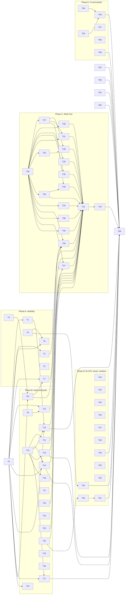

# Spec suite speed and flakes: land the measured fixes

status: done
commit-mode: orchestrator-commits
language: ruby (T44 is Rust)
panel: Ruby (Linus Torvalds, Jeremy Evans, Sandi Metz, Richard Schneeman, Aaron Patterson); T44 adds the Rust roster

## Intent

Land the changes the 2026-10-01 research measured, in a form that meets the repo's rules, and fix the
load flakes that the faster suite exposed. On the research branch the dev-box `rake pspec` wall fell
from 112s to 54s (median of 10 interleaved runs) and runs with a failure fell from 3 in 10 on `main`
to 1 in 10. The research is `planning/spec-suite-solutions-research-2026-10.md`; the measurements are
in `planning/spec-suite-profiling-research-2026-09.md`.

The plan has 6 phases. A makes the suite reliable first, so every later number can be trusted. B
replaces fixed waits and shares pre-booted children. C finishes moving from `Mixlib::ShellOut`,
which forks the worker, to `Lain::Shell::Out`, which uses vfork, and then deletes the gem. D is
library CPU, cheaper child boots and isolation from the user's box. E is CI configuration and a
ratchet. F records the new baseline.

**The research branches are references, never merge sources.** `spike/combined` and
`spike/combined2` hold 1 commit per idea. A reviewer found rubocop offenses, inline disables, class
instance variables, `break` in loops, 4 lib changes with no spec, and a receiver type check in them.
Every card rewrites its idea test-first to the repo's rules; the `Reuse` field names the commit to
read.

Roadmap line: `ROADMAP.md` Status, "Spec suite speed and flakes" (added with this plan).

## Grounding

Verified 2026-10-02 at `d374aac8` by 5 parallel read-only explorations (one per phase) against `main`
and the 2 research branches, plus the bisection logs in `tmp/profiling-2026-09-30/bisect/`. mempalace
was unreachable for the whole session, so prior decisions came from the repo, the research reports
and git history.

Files checked, by phase:
- A: `spec/lain/frontend/input_pane_spec.rb`, `lib/lain/frontend/input_pane.rb`, `lib/lain/cli/signals.rb`,
  `spec/lain/supervisor_spec.rb`, `lib/lain/supervisor.rb`, `spec/lain/cli/conductor_spec.rb`,
  `spec/lain/cli/signals_spec.rb`, `spec/lain/frontend/tty_spec.rb`, `spec/lain/frontend/neovim/runtime/62_approval_spec.rb`,
  `spec/support/headless_editor.rb`, `spec/lain/frontend/neovim/runtime/51_thread_spec.rb`,
  `lib/lain/frontend/approval_policy.rb`, `lib/lain/approval/queue.rb`, `lib/lain/frontend/intake.rb`,
  `lib/lain/frontend/tty.rb`, `docs/toolchain-traps.md`.
- B: `lib/lain/provider/http/streaming/faraday_handlers.rb`, `lib/lain/provider/http/connection/middleware_stack.rb`,
  `lib/lain/frontend/neovim.rb`, the seam specs named in T10 to T25.
- C: `lib/lain/shell/out.rb`, every `Mixlib::ShellOut` site in `lib/` (18 defaults, 2 direct, 6 rescues)
  and `spec/` (81 `.new` lines), `lain.gemspec:82-85`, `Gemfile.lock`.
- D: `lib/lain/status_feed/fleet.rb`, `ext/lain/src/treesitter.rs`, `lib/lain/canonical.rb`,
  `lib/lain/compaction/derivation.rb`, `lib/lain/compaction/source/derived.rb`, `lib/lain/cli/command/ruby.rb`,
  `lib/lain/tools/web_fetch/readable.rb`, `lib/lain/exec.rb:80`, `lib/lain/grader/test_harness.rb:20`.
- E: `.github/workflows/main.yml`, `.github/actions/spec-binaries/action.yml`, `Rakefile:28-31,76,105`,
  `.pre-commit-config.yaml`, `bin/spec-census`.

**Where docs and code disagreed, and which won:**
- The research report puts `Signals#uninstall` at `signals.rb:99-104` and the unjoined kill at
  `input_pane_spec.rb:65`. Code: `guarding` is at `:99`, `uninstall` at `:90`, the kill at `:66`. Code won.
- The research report says the `62_approval_spec:208` timeout is "in `Repl#run`". It is the spec's own
  `Timeout.timeout(30)` at `:226`; `repl.rb:89` is only where the main thread was parked. Code won.
- `docs/toolchain-traps.md`'s 2026-09-29 InputPane entry blames the pane thread for the truncation. The
  cause is that thread restoring RSpec's SIGINT handler late, because `after` never joins it. T1 fixes
  it and the ledger entry is rewritten.
- `lib/lain/compaction/derivation.rb:41-50` says there is no `#extend` because an incremental extension
  "would have to hold the last derived head". The same doc's `:58-67` says a held cut's chain DOES
  extend as the source does. T47 resolves the contradiction per the user's ruling below.
- `lain.gemspec:82-84` says mixlib-shellout serves `live_stdout` for the bash tool. The bash tool uses
  `Exec::Local`; nothing in `lib/` uses `live_stdout`. T42 deletes the dependency.
- `ARCHITECTURE.md:56` lists `Canonical` beside the "pure, synchronous" Rust extension; `Canonical` is Ruby.
- `ARCHITECTURE.md:644`, `lib/lain/tool.rb:112` and `lib/lain/tool/input.rb:230` say Tier 2 runs
  "through `Mixlib::ShellOut`". T42 rewrites them.

## Compatibility

`lain` is version 0.1.0 (`lib/lain/version.rb`), not on rubygems (`gem list -r '^lain$'` is empty), no
git release tags, and the repo's own rule is that lain's development needs no backward compatibility.
Both Cargo crates set `publish = false`.

| Surface | Verdict | Evidence |
|---|---|---|
| `Lain::Shell::Out` constructor and methods | free to break (changes are additive) | internal class; callers all in `lib/` and `spec/` |
| `shell_out_factory:` defaults and `Mixlib::ShellOut::CommandTimeout` rescues | free to break | internal; 18 defaults, 6 rescues, all in `lib/` |
| `mixlib-shellout` runtime dependency | free to break | gem unpublished; no `bin/` or `exe/` require; `Gemfile` has no direct line |
| `Ext::TreeSitter.query` FFI signature | must keep, unchanged | called from `shell/parse.rb:152`, `survey/chunker/*.rb`, `tools/file_symbols.rb:125`; T44 only caches inside it |
| `Canonical` output bytes and digests | must keep, unchanged | digests are stored in session files and the `Store`; T46's 5 specs assert identical output |
| Compaction derived chain and journal `edge` records | must keep, unchanged | stored in session files; T47's specs assert a byte-identical `head_digest` and the same object count |
| Session file and journal formats | must keep, untouched | no card writes a record shape |
| `lain up` behaviour | must keep | T37 changes only how tmux processes are spawned |
| `rake` default task locally | must keep | T54 changes only what CI runs |
| Spec-only env vars | free to break | `LAIN_NO_CHILD_BOOT` is added (T49); the research switches are not landed |

No must-keep surface blocks a simplification.

**User decisions recorded 2026-10-02:**
- 1 plan, phased.
- The nvim shim: the spec helper skips PATH entries named `shims` (T52).
- Include the long-session changes: the `Canonical` fast path (T46) and compaction `Resume` (T47).
  Ruling for T47: a derived chain may be extended when the held seam and the prefix digests match the
  full derivation's; the class doc is rewritten to say so.
- Investigate and fix the 2 lib races that reproduce on `main` (T6, T7).

## Spike findings

From the research (2026-10-01), not repeated here:

| Question | Result | Evidence |
|---|---|---|
| Does `Process.spawn` with options stay on vfork in Ruby 4.0.6? | yes, for every option; not under setuid | `process.c` read, strace; `pass5/findings/shellout.md` |
| Does `Shell::Out` remove the fork cost in the isolation and forge specs? | forks 2,900+ to under 20; 8 isolation files 63s to 31s; 12 forge and review files 77s to 36s | `pass5/findings/round2/isolation-git.md`, `forge-undo.md` |
| Can the floor file shrink without losing what it proves? | 98s to about 30s, 31 examples, 5 negative windows kept | `pass5/findings/floor-guards.md`, A/B |
| Why did a worker stop early and report success? | an unjoined thread restores RSpec's SIGINT handler late | model reproduction; 3 of 12 seeds failed on the old spec, 0 of 12 fixed |
| Are the combined branch's flakes new? | no: every one fails on `main` under suite load; replay of the failing worker's 73 files with 12 seeds never failed | `tmp/profiling-2026-09-30/bisect/` |
| Why can `supervisor_spec:665`'s single yield come too early? | the failing task's Console warning gives up the fiber; 0 or 1 extra yields pass, 2 fail | `pass5/findings/round3/flake-fixes.md` section 2 |
| What does a child Ruby boot cost and what cuts it? | 1.19s CPU with `bundler/setup`; 0.85s with static load paths and a pre-sized heap | `pass5/findings/round3/child-env.md`; pass 6 A/B: 36 worker-seconds |
| Is the nvim shim real cost? | 135ms per editor boot against 4 to 5ms; 54 worker-seconds and 9s of wall in the A/B | `pass5/findings/round2/nvim-band.md`, `pass6/ab_toggles.summary.txt` |
| Do tmux control mode, the CPU governor or a boot diet beyond 2 lazy requires pay? | no | `round3/tmux-control.md`, `boot-diet.md`, research report |

No new spikes for this plan. The research worktrees are removed; `spike/combined` and `spike/combined2`
remain as read-only references.

## Shared files

Only the main session edits these. Cards hand back 1-line diffs or short paragraphs.
- `CLAUDE.md`
- `docs/toolchain-traps.md` (the flake ledger)
- `docs/spec-suite-performance.md`
- `ARCHITECTURE.md`
- `.rubocop.yml`
- `lain.gemspec`, `Gemfile`, `Gemfile.lock`
- `ROADMAP.md`
- `ext/lain/CLAUDE.md`

## Rejected options

- **Port the research branches by cherry-pick.** They break the repo's rules (see Intent). Cards rewrite.
- **`Frontend::Neovim` `teardown_grace:` keyword.** A lib API added only so a spec can shorten a wait;
  `stub_const` in `neovim_request_spec` gives the same 4.7s with no lib change (T9).
- **`spec/support/prompt_mixlib_reap.rb`.** It patches a private Mixlib method suite-wide. Phase C
  removes every Mixlib timeout path it worked around.
- **Injectable `TICK` constants in `lib/`.** Measured: sleep calls 76 to 770, file wall unchanged; the
  polls overlap the real wait.
- **The research switches** (`LAIN_CHILD_BOOT` parts, `LAIN_SPEC_TMUX_ISOLATE`, `LAIN_SPEC_GIT_ISOLATE`,
  `LAIN_SPEC_NVIM_SHIM`). They existed to time each idea. Only a child-boot kill switch stays (T49).
- **Bootsnap in spec children.** About 29 worker-seconds more, but a cold cache in CI is slower than
  none, and it spreads the bootsnap stale-bytecode trap into every child. Needs a cold-cache CI
  measurement first.
- **`malloc_trim(0)` at each file boundary.** 10 to 17% less worker RSS, about 0 speed once forks are
  vforks, and it adds Fiddle to the bundle.
- **A fork server (zygote) for child Rubies.** The pre-booted pool (T13) covers the measured cases with
  exec, which keeps the boot under test.
- **tmux control mode or `\;` chains in `Up::Tmux`.** About 40ms per `lain up`, and a second duplex seam.
- **Queue runners, 2 worker pools, a preloaded parent per file.** Packing by runtime is already at its
  lower bound.
- **Rugged or gix in process; fast-import fixtures; caching `HEAD` reads.** Semantics diverge from git,
  fixtures are already built once, and `HEAD` moves inside an operation.
- **Caching `lain.so` in CI, sccache, a committed runtime-log snapshot, sharding CI.** Stale-binary risk;
  not worth it; a cache restore is fresher; sharding waits until T56 is measured.
- **Lazy children** (an `eager_load` no-op in spec children, 1.3s to 0.49s per boot). It stops a child
  proving that the whole tree boots, and the pool (T13) and child boot (T49) cover the measured cost.
- **Forking a threaded worker for every PTY child.** Only T15's chat child and T19's repl children fork,
  each with a fall-back to the pool if a child hangs on an inherited lock.
- **The other 17 in-worker self-signal sites.** The grounding audit found only `input_pane_spec` (T1)
  and `conductor_spec:480,587` (T3) with a thread that can outlive its example; `signals_spec`,
  `supervisor_spec:414`, `repl_spec:1646`, `shutdown_spec:627` and `critique_over_held_review_spec:405`
  signal from the main thread with their handlers restored in `ensure`.
- **A tmux `-f` in `Up::Tmux#argv`.** Production must load the user's tmux config; isolation is a spec
  PATH wrapper (T51).

## Open decisions

- **Bootsnap in spec children** (rejected above until a cold-cache CI run). No card depends on it.
- **The lost Ctrl-C within about 30ms of `you>` drawing** (`pass5/findings/floor-guards.md`). It may be
  a real intake bug. Out of scope; T14 keeps the 0.3s readiness sleep in that example and the ledger
  names it.
- **CI sharding** after T56's caches are measured.
- **The 7 to 10s of startup** outside the workers' own clocks (rake, Bundler, 12 workers loading
  `lain` and their spec files). Measured in the research; no design yet. A follow-up plan.
- **CI's `yard-lint --staged`** checks nothing in CI because nothing is staged (`.pre-commit-config.yaml`).
  A CI-policy question for the user, not speed.
- **A `--tag '~seam'` inner loop** (simulated 75.5s against 102.9s on `main`): a developer-workflow
  choice, not a gate. Out of scope.

## Dependency graph



T60 depends on every other card (T0 to T62); the graph shows the edges that order work.

## Tasks

Conventions for every card:
- **Tests first.** Show the failing run, then the passing run. Spec-only cards that change a wait show
  the old wait's weakness instead (a loop under load, a mutation, or an injected delay), as the card says.
- **Load proof** for any card that changes a wait: `bin/suite-load` (T0) runs the card's spec files
  on the card's worktree and on the base tree, alternating, while full suites run in a separate load
  worktree. It must show 0 failures on the card's tree in the stated rounds. It needs the box to
  itself: the main session schedules load proofs one at a time, between landing windows. Budget:
  about 10 cards at 20 to 30 rounds, about 15 to 25 minutes each.
- **Line numbers** in cards are at `d374aac8`. A later card on the same file uses the named method or
  example, which survive earlier cards' edits.
- **Process-wide memos in `spec/support`** use a private constant `Concurrent::Map` (the shape of
  `isolation/parent_lock.rb:45`), never a class instance variable and never an inline disable.
- **Wait classes.** Every wait added is named in a comment as an event (a positive signal), a quiet
  window (no change for a named beat), or a shortened grace, and the card's report lists them.
- **Rules.** `bundle exec rubocop` clean on touched files; no inline `rubocop:disable`; no class
  instance variables for shared state; no `next`, `break` or `redo`; example counts reported before and
  after per touched file.
- **Commits.** In a worktree, `git commit --no-verify` only (the hook runs the whole suite), or leave
  changes uncommitted. Never `git stash`. The main session lands cards.
- **TMPDIR** must stay short (Unix socket paths over 108 bytes break `input_socket_spec`): `$HOME/tmp/lain/<card>`.

### Phase 0: tools

### T0: bin/suite-load proves a spec change under real suite load          [risk: medium] [x]

**Depends on:** none
**Files:** `bin/suite-load` (new), `bin/suite-redrate` (new), `spec/lain/suite_load_spec.rb` (new)
**Reuse:** `tmp/profiling-2026-09-30/bisect/suiteload.sh` and `redrate.sh` (setsid load group, random order per round, `bin/box-state --guard`); `tmp/profiling-2026-09-30/pass2/ab_runner.rb` (padding and seed)
**Shared-file wiring:** `docs/spec-suite-performance.md` tools table: 2 rows
**Reachable from:** run by hand and by `/execute-plan`'s main session

**Interface**

```
bin/suite-load --card <tree> --base <tree> --load <tree> --rounds N <spec files...>
    # alternates card and base in random order per round while full pspec runs loop in <load>;
    # prints per-tree pass/fail counts and each failure's location and seed; kills the load group on exit
bin/suite-redrate --card <tree> --base <tree> --rounds N
    # full rake pspec on card and base, interleaved and padded; runs with a failure, failures by name, median wall
```

**Acceptance criteria**

```gherkin
Scenario: a failing example on the card tree is counted and named
  Given a card tree whose spec fails in 1 of 3 runs
  When suite-load runs 6 rounds with a stub load command
  Then it reports the card tree's failures with location and seed, and the base tree's separately

Scenario: the load group is gone after an interrupt
  Given suite-load running with its load loop
  When it receives INT
  Then no process from the load group remains

Scenario: it refuses a busy box
  Given bin/box-state --guard exits 1
  Then suite-load waits and reports why, and starts no run
```
Spec file: `spec/lain/suite_load_spec.rb` (stubbed commands, never a real suite)

**Stop and report if:**
- The load tree cannot be a separate worktree because a spec writes to the main checkout.

### Phase A: reliability

### T1: Make input_pane_spec deterministic under load          [risk: medium] [x]

**Depends on:** T0
**Files:** `spec/lain/frontend/input_pane_spec.rb`
**Reuse:** `spike/combined` `a9e49675` (the input_pane_spec hunk only, not input_pane_socket), `spike/combined2` `b2533138` (the "nothing is published" group); `StdinPump::Typeahead#finished` (`lib/lain/frontend/stdin_pump.rb:476`)
**Shared-file wiring:** `docs/toolchain-traps.md`: retire by name "Lain::Frontend::InputPane a signal the human sends the pane goes to the chat rather than interrupting the pane" and "... a pane with no chat to talk to says what it is waiting for without claiming the screen, and leaves when told to"; add the rule "a trap restored late by an unjoined thread truncates a run that still reports 0 failures" beside the `SystemExit` entry.
**Reachable from:** spec-only; `InputPane#run` is built by `exe/lain input` through `Frontend::InputPane`

**Acceptance criteria**

```gherkin
Scenario: a killed pane thread cannot restore RSpec's handler after its example
  Given CLI::Signals#uninstall is delayed by 0.15s on non-main threads
  When input_pane_spec runs under 12 seeds
  Then every run reports 30 examples and 0 failures

Scenario: the INT and TERM examples call the installed trap, not the kernel
  Given the pane has installed its handlers
  When the example delivers INT or TERM
  Then the pane's own handler runs, and a handler that is not a Proc fails the example by name

Scenario: "nothing is published" waits for the pane to go idle
  Given the chat publishes generation 3 and then says "unpublished"
  When the example types a partial line
  Then it acts only after a later frame proves "unpublished" took effect, and the Reline stub answers only after the partial is typed back
```
Spec file: `spec/lain/frontend/input_pane_spec.rb` (load proof: bin/suite-load, 30 rounds, 0 failures)

**Stop and report if:**
- `deliver` cannot read back a Proc for INT or TERM on Ruby 4.0.6.
- The group still fails under bin/suite-load after the event waits: the race is in `lib/lain/frontend/input_pane.rb#received`, not the spec.

### T2: supervisor_spec waits for the rows to leave          [risk: low] [x]

**Depends on:** T0
**Files:** `spec/lain/supervisor_spec.rb`
**Reuse:** `spike/combined2` `b2533138` (`rows_gone`); `lib/lain/supervisor.rb:248-254` (`untrack_when_ended`)
**Shared-file wiring:** `docs/toolchain-traps.md`: add by name "Lain::Supervisor tracking a one-shot task drops the row when the task is stopped, and when it fails", fixed, with the mechanism.
**Reachable from:** spec-only

**Acceptance criteria**

```gherkin
Scenario: a failing task that yields twice before it ends still leaves the registry
  Given a scratch example whose failing task yields 2 extra times before raising
  When the example waits with rows_gone
  Then the registry is empty, where the old single yield fails

Scenario: the rows examples hold under load
  Given bin/suite-load runs supervisor_spec 20 rounds
  Then "drops the row from live once the task ends by itself" and "drops the row when the task is stopped, and when it fails" never fail, and a registry that never empties fails within 5s
```
Spec file: `spec/lain/supervisor_spec.rb`

**Stop and report if:**
- The 2-extra-yields example passes with a single `task.yield` on Ruby 4.0.6 and async 2.46 (the mechanism is wrong).

### T3: conductor_spec joins its signalling threads          [risk: low] [x]

**Depends on:** none
**Files:** `spec/lain/cli/conductor_spec.rb`
**Reuse:** the `killer` threads at `:480` and `:587` on `main`
**Shared-file wiring:** none
**Reachable from:** spec-only

**Acceptance criteria**

```gherkin
Scenario: a failed read cannot leave a thread that sends TERM later
  Given read_prompt raises inside the example
  When the example ends
  Then the killer thread is joined or killed in an ensure, and no TERM reaches a later example
```
Spec file: `spec/lain/cli/conductor_spec.rb`

**Stop and report if:**
- Joining the thread changes what `:480` or `:587` assert.

### T4: tty_spec reads a submitted line only once it is written          [risk: low] [x]

**Depends on:** none
**Files:** `spec/lain/frontend/tty_spec.rb` (the `submitted` helper, `:1476-1481` on `main`)
**Reuse:** `spike/combined2` `b2533138`
**Shared-file wiring:** none (the ledger's "loses and repeats nothing typed" entry stays: it failed once after this fix)
**Reachable from:** spec-only

**Acceptance criteria**

```gherkin
Scenario: an append-created file is not read empty
  Given the child creates the lines file before writing to it
  When submitted reads the first line
  Then it waits on File.size? and returns the written line, never nil
```
Spec file: `spec/lain/frontend/tty_spec.rb`

**Stop and report if:**
- Any of the 4 callers (`:1495`, `:1533`, `:1549`, `:1567` on `main`) asserts on an empty file.

### T5: HeadlessEditor.connect retries a socket that is not yet listening          [risk: low] [x]

**Depends on:** none
**Files:** `spec/support/headless_editor.rb`, `spec/support_headless_editor_spec.rb`, `spec/lain/frontend/neovim/runtime/51_thread_spec.rb`
**Reuse:** `spike/combined2` `b2533138` (`connect`, `attach_or_wait`); `WAIT` and `Session::POLL` (`headless_editor.rb:32,44`)
**Shared-file wiring:** `docs/toolchain-traps.md`: retire by name "Lain::Frontend::Neovim lain://timeline reflects a turn commit does not touch lain://timeline for an event that names no turn"; add "51_thread_spec restores a live diff with the folds the human was reading" as seen and fixed.
**Reachable from:** spec-only; `HeadlessEditor.start` is the support entry every headless spec uses

**Interface**

```ruby
HeadlessEditor.connect(socket_path, within: WAIT) # retries ECONNREFUSED every Session::POLL until within, then raises it
```

**Acceptance criteria**

```gherkin
Scenario: a socket file that exists before nvim listens is retried, not failed
  Given a stand-in server that binds, waits 50ms, then listens
  When HeadlessEditor.connect attaches to it
  Then it connects within WAIT, and a socket that never listens fails at WAIT with ECONNREFUSED named

Scenario: 51_thread_spec survives an editor that is not yet listening
  Given the 2 examples that attached with Neovim.attach_unix directly
  When their editor's socket exists before it listens
  Then they attach once it listens, as every other headless spec does
```
Spec file: `spec/support_headless_editor_spec.rb`, `spec/lain/frontend/neovim/runtime/51_thread_spec.rb`

**Stop and report if:**
- `Neovim.attach_unix` raises something other than `Errno::ECONNREFUSED` for the not-yet-listening case.

### T6: 62_approval_spec never waits blind          [risk: medium] [x]

**Depends on:** T5, T0
**Files:** `spec/lain/frontend/neovim/runtime/62_approval_spec.rb`
**Reuse:** `spike/combined2` `b2533138` (buffer guards at `:138`, `:332`); the `presser` thread at `:219-224`
**Shared-file wiring:** `docs/toolchain-traps.md`: retire by name "carries the wrapped command unwrapped, with the rendered lines unchanged" and "resolves one unwrapped call per answerable row, in queue order, for two parked approvals" after 3 solo runs pass; add or retire "the repl's own wiring puts a parked approval in front of the human renders it in lain://approval and answers it with y" per the finding.
**Reachable from:** spec-only

**Acceptance criteria**

```gherkin
Scenario: helper polls before the approval buffer exists
  Given the lain://approval buffer has not been created yet
  When approval_state or approval_calls is polled
  Then it answers nil and the poll continues, never "Invalid buffer id: -1"

Scenario: a presser thread that dies fails the example with its own error
  Given the presser raises before pressing y
  When the repl example runs
  Then the example fails at once with the presser's exception, not after a 30s Timeout

Scenario: the repl-wiring example under load
  Given bin/suite-load runs 62_approval_spec for 30 rounds
  Then it reports 0 failures, or a failure that names its cause
```
Spec file: `spec/lain/frontend/neovim/runtime/62_approval_spec.rb`

**Stop and report if:**
- With the presser's errors surfaced, the hang remains and names a cause in `lib/` (for example the `y` map firing before the view binds the pending): report the cause and the evidence; the fix becomes its own card.

### T7: The approval window's closing note always prints          [risk: high] [x]

**Depends on:** T21, T0
**Files:** `lib/lain/frontend/tty.rb` (`close_prompt` `:221-225`, `close_row` `:937`, the writer lock `:1049`), `lib/lain/frontend/approval_policy.rb` (`:79-81`, `:140-155`), `lib/lain/frontend/intake.rb` (`:259-270`), `spec/lain/frontend/approval_policy_spec.rb`, `spec/lain/frontend/tty_spec.rb`
**Reuse:** the failure text in `tmp/profiling-2026-09-30/bisect/redrate/211821-main.txt`. Hypothesis (unverified): the queue's timeout denies the pending (`approval/queue.rb:391-395`); a sibling fiber stops the reader (`approval_policy.rb:149-152`); the reader's `ensure` calls `close_prompt` (`intake.rb:268-269`), which writes the note under the writer lock (`tty.rb:1049`) inside `rescue StandardError; nil` (`tty.rb:223`). A second stop from `read_until_decided`'s own `ensure`, or an error under a contended lock, drops the note silently. The observed screen order is `[y/N]`, `SETTLED`, no note, `you>`.
**Shared-file wiring:** `docs/toolchain-traps.md`: retire "a prompt the approval window decides ends its line with who decided it and how, and a y typed afterwards decides nothing" once the seam example passes 30 rounds under bin/suite-load.
**Reachable from:** the plain chat: `CLI::Wiring` builds the TTY through `tty_factory` (`wiring.rb:256`) and `Intake.new(screen: tty, ...)` (`wiring.rb:290`); approval surfaces at `repl/approval_surfaces.rb:54` and `switchboard.rb:464`

**Acceptance criteria**

```gherkin
Scenario: a window that times out writes its note even when the writer is contended
  Given an approval prompt whose queue times out while another fiber holds the writer lock
  When the stop climbs through the reader's ensure
  Then the screen shows "decided by timeout: denied" on the prompt's line

Scenario: an error while closing the row is not swallowed silently
  Given close_row raises inside close_prompt
  When the prompt closes
  Then the error reaches the channel as a diagnostic, and the prompt still closes
```
Spec file: `spec/lain/frontend/approval_policy_spec.rb`, `spec/lain/frontend/tty_spec.rb`; seam proof: `spec/lain/seams/plain_chat_prompt_guards_spec.rb` "ends its line with who decided it and how" 30 rounds under bin/suite-load

**Stop and report if:**
- No deterministic reproduction exists after injecting contention in `@writer.writing` and a second stop: report what was tried, and leave the ledger entry.
- The fix changes the order of `SETTLED` and the closing note that `plain_chat_prompt_guards_spec` asserts.

### Phase B: waits and pre-booted children

### T8: The stall monitor wakes when the stream stops          [risk: medium] [x]

**Depends on:** none
**Files:** `lib/lain/provider/http/streaming/faraday_handlers.rb` (`stop` `:343-351`, `start_monitor` `:359-365`, `sweep` `:368`), `spec/lain/provider/http/stall_protection_spec.rb`
**Reuse:** `spike/combined` `3b9d24b9` (the faraday_handlers and stall_protection_spec hunks)
**Shared-file wiring:** none
**Reachable from:** `exe/lain chat` -> `CLI::ChatLaunch` -> `Wiring#backing` -> `Backend#provider` (`backend.rb:260`) -> `HTTP::Provider#initialize` builds `Connection.new` (`provider.rb:68`) -> `MiddlewareStack#build` adds `StallProtection` (`middleware_stack.rb:118`) when `stream_stall_timeout` is set (default 30, `configuration.rb:110`) -> `StallClock.watching` (`:31`)

**Interface**

```ruby
# StallClock: the monitor waits on a ConditionVariable between sweeps
def stop            # signals the condition under the mutex, then joins the monitor
def start_monitor   # the loop waits @stopped.wait(@mutex, poll_interval) in place of sleep(poll_interval) (:363)
```

**Acceptance criteria**

```gherkin
Scenario: a healthy stream returns without waiting out the poll
  Given a stall clock with a 100s grace, so the monitor polls every 1.0s
  And the monitor thread is asleep
  When the stream ends and the clock stops
  Then stop returns in under 0.5s

Scenario: a streamed reply through the production stack returns without the poll
  Given a provider built with the default configuration (stall timeout 30) against a local streaming server
  When a healthy stream completes
  Then the request returns within 0.5s of the last byte

Scenario: a stalled stream is still detected
  Given a stream that sends nothing past its grace
  When the monitor sweeps
  Then StalledStreamError is raised as before
```
Spec file: `spec/lain/provider/http/stall_protection_spec.rb` (34 to 35 examples)

The test that waits for the monitor to sleep bounds its `Thread.pass` loop, and the comment at `stall_protection_spec.rb:447-453` ("asleep in `sleep(poll_interval)`") is rewritten.

**Stop and report if:**
- `faraday_handlers.rb` loses its `ThreadSafety/NewThread` exclusion in `.rubocop.yml` or needs a new one.

### T9: neovim_request_spec stubs the teardown grace          [risk: low] [x]

**Depends on:** none
**Files:** `spec/lain/frontend/neovim_request_spec.rb` (`:366`)
**Reuse:** `TEARDOWN_GRACE` (`lib/lain/frontend/neovim.rb:62`)
**Shared-file wiring:** none
**Reachable from:** spec-only

**Acceptance criteria**

```gherkin
Scenario: the teardown example does not wait out 5s
  Given TEARDOWN_GRACE is stubbed to 0.2
  When the example's editor ignores teardown
  Then the join gives up after the grace and the example still fails if the join is unbounded
```
Spec file: `spec/lain/frontend/neovim_request_spec.rb` (9 examples)

**Stop and report if:**
- The example reads the grace from somewhere other than the constant.

### T10: child_worktree_approval_spec reads "parked" from the queue          [risk: low] [x]

**Depends on:** none
**Files:** `spec/lain/seams/child_worktree_approval_spec.rb` (`outcome` `:97-100`, `:257`)
**Reuse:** `spike/combined` `3b9d24b9`; `spike/combined2` `6d38ace5` (`:257` 1s to 0.3s)
**Shared-file wiring:** none
**Reachable from:** spec-only

**Acceptance criteria**

```gherkin
Scenario: a parked call is seen when its approval is queued
  Given a call that parks on the approval board
  When outcome races the call against board.approvals.dequeue
  Then it answers :parked as soon as the pending is queued

Scenario: a call that neither finishes nor parks fails
  Given a call that hangs without queuing an approval
  When outcome runs
  Then it raises Async::TimeoutError instead of reading as parked
```
Spec file: `spec/lain/seams/child_worktree_approval_spec.rb` (20 examples)

**Stop and report if:**
- Consuming the pending with `dequeue` changes the 3-in-sequence example's assertion.

### T11: recorded_run_spec replays once per file          [risk: low] [x]

**Depends on:** T13
**Files:** `spec/lain/seams/recorded_run_spec.rb` (`subject(:run)` `:336`, header `:322-330`)
**Reuse:** `once` from T13's `spec/support/once_per_file.rb`; `spike/combined` `5eefd032`
**Shared-file wiring:** none
**Reachable from:** spec-only

**Acceptance criteria**

```gherkin
Scenario: 9 examples read 1 replay
  Given the file's 9 examples each read a facet of the recorded run
  When the file runs
  Then the cassette is driven once, and the header says each example reads the same replay
```
Spec file: `spec/lain/seams/recorded_run_spec.rb` (9 examples)

**Stop and report if:**
- An example mutates the shared `Run`.

### T12: Shorter graces in 8 specs, each still discriminating          [risk: low] [x]

**Depends on:** T8, T0
**Files:** `spec/lain/seams/hangup_spec.rb` (`:48`), `spec/lain/exec/docker_spec.rb` (`~:906`), `spec/lain/cli/repl/approval_surfaces_spec.rb` (`:58`), `spec/lain/approval/gate_spec.rb` (`:312`), `spec/lain/exec/core_spec.rb`, `spec/lain/shell/pipeline_spec.rb` (`:426`), `spec/lain/provider/http/stall_protection_spec.rb` (`:166`, `:180`), `spec/lain/cli/epic_submit_spec.rb` (`:997`)
**Reuse:** `spike/combined` `101c3b12`, `b6295c04`; `spike/combined2` `029b01f5`, `6d38ace5`
**Shared-file wiring:** none
**Reachable from:** spec-only

**Acceptance criteria**

```gherkin
Scenario: each shortened grace still separates pass from fail
  Given each changed example and a mutant that removes the behaviour it pins
  When the example runs against the mutant
  Then it fails, and against the real code it passes 20 times under bin/suite-load
```
Spec file: the 8 files listed

**Stop and report if:**
- `hangup_spec` at a 0.5s grace fails under bin/suite-load: keep 5s and report.

### T13: A shared pool of pre-booted children for PTY seam specs          [risk: medium] [x]

**Depends on:** none
**Files:** `spec/support/warm_pool.rb`, `spec/support/warm_cockpit.rb`, `spec/support/once_per_file.rb`, `spec/support_warm_pool_spec.rb` (all new)
**Reuse:** `spike/combined2` `934d2b6b` (these 4 files)
**Shared-file wiring:** `docs/toolchain-traps.md`: add "a parked warm child that loses its worker exits on its own (PPID check)"
**Reachable from:** spec support, loaded by the `spec/support/**` glob in `spec/spec_helper.rb:48`

**Interface**

```ruby
module WarmPool
  module Group
    def warm_pool(name, expected:, &boot) # before(:context) builds, after(:context) drains
  end
  class Pool
    def take(key)     # hands over a booted, parked child; boots the next only while more are expected
    def drain         # kills every spare
  end
end

# spec/support/once_per_file.rb
def once(key) = ... # memoises the block for the current top-level example group, cleared after(:context)
```

**Acceptance criteria**

```gherkin
Scenario: a child is booted before it is needed and released on demand
  Given a pool expecting 3 children
  When the first example takes one
  Then it was already booted, the next one is booting, and after the third no spare is booted

Scenario: a parked child whose worker died exits
  Given a parked child polling its go file
  When its parent process exits
  Then the child exits within 1s
```
Spec file: `spec/support_warm_pool_spec.rb` (10 examples plus the PPID example)

**Stop and report if:**
- The pool needs state outside the example group instance.

### T14: plain_chat_prompt_guards_spec on the pool, with event waits          [risk: medium] [x]

**Depends on:** T13, T0
**Files:** `spec/lain/seams/plain_chat_prompt_guards_spec.rb`
**Reuse:** `spike/combined2` `934d2b6b` (this file); `pass5/findings/floor-guards.md` for each wait's signal
**Shared-file wiring:** `docs/toolchain-traps.md`: rewrite the plain_chat entries at `:366-372` and `:444-460` for the new waits; keep "ends its line with who decided it and how" until T7.
**Reachable from:** spec-only

**Acceptance criteria**

```gherkin
Scenario: the floor file keeps its 31 examples and drops its fixed sleeps
  Given the file on the pool
  When it runs
  Then 31 examples pass, at most 8 fixed sleeps remain (5 named negative windows of 0.3s, 1 Ctrl-C readiness, 2 scenario timings), and boots on the critical path are 2

Scenario: a verdict that never arrives fails rather than passes vacuously
  Given a mutant that never prints the [tty deny] verdict
  When the canary example types n
  Then the example fails
```
Spec file: `spec/lain/seams/plain_chat_prompt_guards_spec.rb` (load proof: 20 rounds under bin/suite-load)

**Stop and report if:**
- Renaming `denied_by_the_next_n` to an `expect_` helper does not clear `RSpec/NoExpectationExample`.

### T15: input_pane_socket_spec on the pool          [risk: high] [x]

**Depends on:** T13, T1, T0
**Files:** `spec/lain/seams/input_pane_socket_spec.rb`
**Reuse:** `spike/combined2` `934d2b6b` (pane pool, pane before `bound`); `spike/combined` `a9e49675` (chat forked from the worker)
**Shared-file wiring:** none
**Reachable from:** spec-only

**Acceptance criteria**

```gherkin
Scenario: panes are pre-booted and the chat child is forked with its descriptors closed
  Given the file on the pane pool
  When an example opens a cockpit
  Then the pane was booted ahead, the forked chat child closes every inherited descriptor except its own stdio and socket, and 13 examples pass

Scenario: a forked chat child exits without running the worker's at_exit hooks
  Given the chat child finishes
  When it exits
  Then it uses exit! with its status kept, and the worker's at_exit hooks did not run in it
```
Spec file: `spec/lain/seams/input_pane_socket_spec.rb` (load proof: 20 rounds under bin/suite-load)

**Stop and report if:**
- The forked child hangs on a lock copied from another worker thread (watchdog, Timeout, logger): fall back to a pooled exec child (T13) and report.
- Closing inherited descriptors in the forked child breaks an assertion: report which descriptor the child needed.

### T16: 4 small PTY seam specs on the pool          [risk: low] [x]

**Depends on:** T13
**Files:** `spec/lain/seams/stop_ask_spec.rb`, `spec/lain/seams/typed_during_ask_spec.rb`, `spec/lain/seams/terminal_gone_spec.rb`, `spec/lain/seams/crash_mid_tool_spec.rb`
**Reuse:** `spike/combined2` `934d2b6b` (these 4 files)
**Shared-file wiring:** none
**Reachable from:** spec-only

**Acceptance criteria**

```gherkin
Scenario: each file boots its children off the critical path
  Given each file on the pool with its expected counts
  When it runs
  Then its examples pass (3, 4, 3, 5) and boots on the critical path are 1 per file
```
Spec file: the 4 files

**Stop and report if:**
- A hand-counted `expected:` disagrees with the examples that take a child.

### T17: stdin_pump_spec on the pool, with an armed marker          [risk: medium] [x]

**Depends on:** T13, T0
**Files:** `spec/lain/frontend/stdin_pump_spec.rb`
**Reuse:** `spike/combined` `da28b299` (`armed`, `await_file`); `spike/combined2` `934d2b6b` (pool)
**Shared-file wiring:** none
**Reachable from:** spec-only

**Acceptance criteria**

```gherkin
Scenario: the race example starts typing when the child is armed
  Given the child writes an armed marker before reading
  When the example waits on the marker
  Then it types without a fixed sleep, and the quiet window it keeps names its beat

Scenario: the file under load
  Given bin/suite-load runs the file for 20 rounds
  Then 40 examples pass every round
```
Spec file: `spec/lain/frontend/stdin_pump_spec.rb`

**Stop and report if:**
- A 0.15s quiet window fails under bin/suite-load: lengthen it and report the beat that held.

### T18: cli_spec boots the checkout once per file          [risk: low] [x]

**Depends on:** T13
**Files:** `spec/lain/cli_spec.rb`
**Reuse:** `spike/combined2` `934d2b6b` (`once(:checkout_boot)`)
**Shared-file wiring:** none
**Reachable from:** spec-only

**Acceptance criteria**

```gherkin
Scenario: examples that read the same boot share it
  Given the examples that read the checkout's boot output
  When the file runs
  Then the boot runs once and all 80 examples pass
```
Spec file: `spec/lain/cli_spec.rb`

**Stop and report if:**
- An example asserts on a fresh boot's side effects.

### T19: repl_spec forks its PTY children without an inline disable          [risk: high] [x]

**Depends on:** none
**Files:** `spec/lain/cli/repl_spec.rb` (`ReplGoalTerminal`)
**Reuse:** `spike/combined` `a2105e91`
**Shared-file wiring:** none
**Reachable from:** spec-only

**Acceptance criteria**

```gherkin
Scenario: a dumb-terminal child takes Reline's dumb path
  Given a child forked with TERM=dumb
  When it reads a line
  Then Reline::IOGate is the dumb gate, and an example fails if the reset is removed

Scenario: the child closes inherited descriptors and is evaluated without Kernel#eval
  Given the forked child
  When it starts
  Then it uses TOPLEVEL_BINDING.eval or loads a file, and closes descriptors it does not own
```
Spec file: `spec/lain/cli/repl_spec.rb` (62 examples)

**Stop and report if:**
- The forked child hangs on a lock copied from another worker thread (watchdog, Timeout, logger): fall back to a pooled exec child (T13) and report.
- `RSpec/RemoveConst` fires on the Reline reset and no `.rubocop.yml` scope fits: report rather than disable inline.

### T20: up_spec waits for the tmux layout to settle          [risk: low] [x]

**Depends on:** none
**Files:** `spec/lain/cli/up_spec.rb` (`:500`, `:575`, `:593`, `:597`)
**Reuse:** `spike/combined` `2e056f20` (`laid_out`, rewritten without `break`)
**Shared-file wiring:** none
**Reachable from:** spec-only

**Acceptance criteria**

```gherkin
Scenario: the height example still fails when the layout hook is off
  Given a mutant with the layout hook unset
  When "never falls under" runs
  Then it fails, and with the hook it passes after the client height matches and the layout is unchanged for 0.25s
```
Spec file: `spec/lain/cli/up_spec.rb` (165 examples)

**Stop and report if:**
- The settle helper cannot be written without `break` or `next` inside the cop limits.

### T21: tty_spec settles on a stronger signal          [risk: low] [x]

**Depends on:** T4, T0
**Files:** `spec/lain/frontend/tty_spec.rb` (`settled`, `~:1470-1580`)
**Reuse:** `spike/combined` `473d28c1`
**Shared-file wiring:** none
**Reachable from:** spec-only

**Acceptance criteria**

```gherkin
Scenario: a late draw is not missed
  Given a draw delayed 50ms after the last keystroke
  When settled returns
  Then the delayed draw is on the screen, so the beat is longer than 30ms or the wait is on a marker

Scenario: a shows that times out dumps the screen before the watchdog fires
  Given a shows wait that never matches
  When its deadline (under the 30s watchdog) passes
  Then the failure message carries the screen, so the residual "loses and repeats nothing typed" flake names its cause

Scenario: the note group under load
  Given bin/suite-load runs the "a note rendered while a prompt is drawn" group 20 rounds
  Then it reports 0 failures
```
Spec file: `spec/lain/frontend/tty_spec.rb`

**Stop and report if:**
- No beat under the old fixed sleeps passes the delayed-draw example.

### T22: qa_sandbox_pane_resolution_spec drops its quiet window          [risk: low] [x]

**Depends on:** none
**Files:** `spec/lain/seams/qa_sandbox_pane_resolution_spec.rb` (`:283`, `:306`)
**Reuse:** `spike/combined` `0e9c1848`
**Shared-file wiring:** none
**Reachable from:** spec-only

**Acceptance criteria**

```gherkin
Scenario: drive.sh with no quiet window still resolves the pinned panes
  Given nothing writes the journal during the drive
  When drive.sh runs with a quiet window of 0
  Then the 6 examples pass
```
Spec file: `spec/lain/seams/qa_sandbox_pane_resolution_spec.rb`

**Stop and report if:**
- An example depends on the journal settling.

### T61: qa_sandbox_pane_resolution_spec leaves no editor behind          [risk: low] [x]

**Depends on:** T22
**Files:** `spec/lain/seams/qa_sandbox_pane_resolution_spec.rb` (teardown `:42-47`)
**Reuse:** the research's leaked `nvim --embed -u NONE -n` processes (ppid 1, ignored TERM, needed KILL)
**Shared-file wiring:** `docs/toolchain-traps.md`: the leaked-editor entry says the teardown now kills the embed servers.
**Reachable from:** spec-only

**Acceptance criteria**

```gherkin
Scenario: an embed server that ignores TERM is killed with the pane
  Given the 2 panes started nvim -u NONE -n, and an embed server that ignores TERM
  When the example's teardown runs
  Then no nvim process from the example's panes remains 2s later
```
Spec file: `spec/lain/seams/qa_sandbox_pane_resolution_spec.rb` (6 examples)

**Stop and report if:**
- The embed server's pid cannot be found from the pane (no process group or parent link).

### T23: approval_view_spec awaits the clock only when it reads the verdict          [risk: low] [x]

**Depends on:** none
**Files:** `spec/lain/frontend/neovim/approval_view_spec.rb` (`:85-105` and 16 call sites)
**Reuse:** `spike/combined` `c690c398`; `spike/combined2` `6d38ace5`, `7345f7cd`
**Shared-file wiring:** none
**Reachable from:** spec-only

**Acceptance criteria**

```gherkin
Scenario: an example that never reads verdicts does not wait for the fail-closed clock
  Given gated(await: false) by default
  When an example asserts only on the rendered view
  Then it returns without awaiting, and examples that read verdicts still await
```
Spec file: `spec/lain/frontend/neovim/approval_view_spec.rb` (66 examples)

**Stop and report if:**
- An `await: false` example reads `verdicts`.

### T24: human_replies_spec scales its windows with stubbed ticks          [risk: low] [x]

**Depends on:** T0
**Files:** `spec/lain/cli/human_replies_spec.rb`
**Reuse:** `spike/combined` `315f0a91` (windows rescaled to 0.1s, about 6 ticks)
**Shared-file wiring:** none
**Reachable from:** spec-only

**Acceptance criteria**

```gherkin
Scenario: each negative window still covers several ticks
  Given the 4 TICK constants stubbed and windows scaled with them
  When suiteload runs the file 30 rounds
  Then 144 examples pass every round
```
Spec file: `spec/lain/cli/human_replies_spec.rb`

**Stop and report if:**
- A window shorter than 3 ticks is needed.

### T25: exec/local_spec runs the grown-pipe example once          [risk: low] [x]

**Depends on:** none
**Files:** `spec/lain/exec/local_spec.rb` (`:117`, deadlines)
**Reuse:** `spike/combined2` `029b01f5`
**Shared-file wiring:** none
**Reachable from:** spec-only

**Acceptance criteria**

```gherkin
Scenario: 1 run still catches a dropped take_queued
  Given a mutant without take_queued
  When the grown-pipe example runs once
  Then it fails, and the deadline examples pass at 0.5s
```
Spec file: `spec/lain/exec/local_spec.rb` (25 examples)

**Stop and report if:**
- The mutant passes in 1 run.

### Phase C: Shell::Out everywhere

### T26: Shell::Out runs in a directory with input on stdin          [risk: high] [x]

**Depends on:** none
**Files:** `lib/lain/shell/out.rb`, `spec/lain/shell/out_spec.rb`
**Reuse:** `spike/combined` `2170c75f` (`cwd:` only; `error!` moves to spec support in T27, since no `lib/` caller needs it); the `Pipes` class and `pump` loop in `out.rb`. Rewrite `out_spec.rb:208-210` ("refuses a mixlib keyword" uses `cwd:`) to use an option Out still refuses, and the class doc at `out.rb:22-26`.
**Shared-file wiring:** none
**Reachable from:** every `shell_out_factory: Shell::Out.public_method(:new)` default, e.g. `Isolation::Checkout#initialize` (`isolation/checkout.rb:21`)

**Interface**

```ruby
class Lain::Shell::Out
  def initialize(*argv, environment: {}, cwd: nil, input: nil, timeout: DEFAULT_TIMEOUT, clock: RunClock::MONOTONIC)
  # input: written to the child's stdin in the same IO.select loop that drains stdout and stderr
end
```

**Acceptance criteria**

```gherkin
Scenario: a command runs in the given directory
  Given cwd: a temporary directory
  When pwd runs
  Then stdout is that directory

Scenario: large input does not deadlock
  Given 200KB of input
  When cat runs
  Then stdout is the same 200KB, written and read in the same select loop

Scenario: a child that exits without reading its input
  Given input and a child that exits at once
  When the command runs
  Then EPIPE is swallowed and the exit status is reported

Scenario: spawn never forks the worker
  Given a Process._fork hook that counts calls
  When commands run with cwd: and input:
  Then the hook counts 0
```
Spec file: `spec/lain/shell/out_spec.rb`

**Stop and report if:**
- `input:` needs a thread to avoid deadlock.
- Any option forces `fork` on Ruby 4.0.6.

### T27: SeedRepo builds derived templates without forking          [risk: low] [x]

**Depends on:** T26
**Files:** `spec/support/seed_repo.rb`, `spec/support_seed_repo_spec.rb`
**Reuse:** `spike/combined` `2170c75f`, `01c46c62` (`SeedRepo.with_layout`); `spike/combined2` `2eff2c60` (`SeedRepo.derived`)
**Shared-file wiring:** none
**Reachable from:** spec support

**Interface**

```ruby
module SeedRepo
  def self.git(dir, *args, input: nil)  # Shell::Out under the scrubbed env; raises on a nonzero exit
  def self.with_layout(name) { |dir| }  # a seed that already contains the named layout, copied per call
  def self.derived(key) { |dir| }       # build once per process (private constant Concurrent::Map), copy per call
end
```

**Acceptance criteria**

```gherkin
Scenario: a derived template is built once per process and copied per example
  Given SeedRepo.derived(key) called twice in one process
  When both copies are read
  Then git ran once for the template, and each copy is independent

Scenario: a failing git command in a fixture fails loudly
  Given SeedRepo.git with a command that exits 1
  When it runs
  Then it raises naming the argv, the status and both streams, and no fork happens (Process._fork hook counts 0)
```
Spec file: `spec/support_seed_repo_spec.rb`

**Stop and report if:**
- A template copy shares state (refs, index) with another copy.

### T28: LocalBranch spawns through Shell::Out with 2 git calls          [risk: medium] [x]

**Depends on:** T26
**Files:** `lib/lain/review/source/local_branch.rb`, `spec/lain/review/source/local_branch_spec.rb`
**Reuse:** `spike/combined` `2170c75f` (default), `48b10a2f` (merge-base on `BASE^{commit}`)
**Shared-file wiring:** none
**Reachable from:** `Review::Source::Repository#source` (`source.rb:511`) builds `LocalBranch` with the default factory; `CLI::Review` (`cli/review.rb:230`) passes its own, which T33 flips

**Acceptance criteria**

```gherkin
Scenario: a valid branch costs 2 git calls
  Given a repository with a base and a head
  When LocalBranch is constructed
  Then it runs 2 git processes and finds the merge base

Scenario: an unknown base and a base with no merge base keep their messages
  Given an unresolvable base, and then an unrelated base
  When LocalBranch is constructed
  Then each raises UnknownRef with the same message as before
```
Spec file: `spec/lain/review/source/local_branch_spec.rb`

**Stop and report if:**
- `rev-parse` with `--end-of-options` behaves differently on the installed git.

### T29: GithubPr spawns through Shell::Out          [risk: medium] [x]

**Depends on:** T26
**Files:** `lib/lain/review/source/github_pr.rb` (default `:253`, rescues `:157`, `:181`), `spec/lain/review/source/github_pr_spec.rb`
**Reuse:** `spike/combined2` `2eff2c60`; `spike/combined` `48b10a2f` (the "without head" template)
**Shared-file wiring:** none
**Reachable from:** `CLI::Review` (`cli/review.rb:223`) is the only builder and passes its own factory, so the default flip reaches production when T33 flips `cli/review.rb:77`; this card's criteria cover the factory it is given

**Acceptance criteria**

```gherkin
Scenario: a gh call that times out is reported as before
  Given a factory whose command raises Shell::Out::Timeout
  When GithubPr fetches
  Then the same error the Mixlib timeout produced is raised

Scenario: the spec's repos come from a template
  Given the "without head" local repo
  When an example needs one
  Then it is copied from a per-process template, with no init or fetch per example
```
Spec file: `spec/lain/review/source/github_pr_spec.rb` (145 to 146 examples)

**Stop and report if:**
- An example asserts the Mixlib timeout class by name.

### T30: The shadow git scope spawns through Shell::Out          [risk: medium] [x]

**Depends on:** T26
**Files:** `lib/lain/workspace/snapshot/scope/shadow_git.rb` (`:115`), `lib/lain/workspace/snapshot/scope/shadow_git/repository.rb` (`:44`, rescue `:155`), `spec/lain/workspace/snapshot/scope/shadow_git_spec.rb`, `spec/lain/workspace/snapshot/scope/shadow_git/repository_spec.rb`
**Reuse:** `spike/combined2` `2eff2c60`
**Shared-file wiring:** none
**Reachable from:** `Workspace::Snapshot` builds the shadow git scope

**Acceptance criteria**

```gherkin
Scenario: a hung git in the shadow repository times out with the same error
  Given a factory whose command raises Shell::Out::Timeout
  When the repository runs a command
  Then the same Lain error as before is raised, and its message no longer names Mixlib
```
Spec file: both spec files (repository_spec 10 to 11 examples)

**Stop and report if:**
- `core.excludesFile` from the user's global config is no longer read (it is read on purpose).

### T31: Forge spawns through Shell::Out          [risk: medium] [x]

**Depends on:** T26, T27
**Files:** `lib/lain/forge/promotion.rb` (`:182`), `lib/lain/forge/gh.rb` (`:231`, `:330`, rescue `:333`), `lib/lain/forge/reconcile/world.rb` (`:15`), `spec/lain/forge/promotion_spec.rb`, `spec/lain/forge/gh_spec.rb`, `spec/lain/forge/gh_parity_spec.rb`, `spec/lain/forge/local_landing_spec.rb`
**Reuse:** `spike/combined2` `2eff2c60`
**Shared-file wiring:** none
**Reachable from:** `exe/lain` epic commands build `Forge::Promotion` and `Forge::Gh`

**Acceptance criteria**

```gherkin
Scenario: gh receives its input on stdin
  Given a gh call with input, cwd and a timeout
  When it runs through Shell::Out
  Then gh reads the input, runs in cwd, and a timeout raises the same Lain error as before

Scenario: forge specs build repos from derived templates
  Given promotion_spec and local_landing_spec
  When an example needs a repo
  Then it comes from SeedRepo.derived
```
Spec file: the 4 spec files

**Stop and report if:**
- `gh` output differs because stdin is a pipe instead of the Mixlib default.

### T32: Isolation spawns through Shell::Out          [risk: medium] [x]

**Depends on:** T26
**Files:** `lib/lain/isolation/compose.rb` (`:177`), `lib/lain/isolation/db_index.rb` (`:80`), `lib/lain/cli/isolation_backend.rb` (`:121`), `lib/lain/isolation/working_branch.rb` (`:350`), `lib/lain/isolation/spike.rb` (`:135`), `spec/lain/isolation/compose_spec.rb`, `spec/lain/isolation/db_index_spec.rb`, `spec/lain/cli/isolation_backend_spec.rb`, `spec/lain/isolation/working_branch_spec.rb`, `spec/lain/isolation/spike_spec.rb`
**Reuse:** T26's `input:`
**Shared-file wiring:** none
**Reachable from:** `CLI::IsolationBackend` builds the isolation objects

**Acceptance criteria**

```gherkin
Scenario: a working branch commit passes its message on stdin
  Given working_branch's git call with input and the scrubbed environment
  When it runs through Shell::Out
  Then git receives the input and the branch is written as before

Scenario: the 5 spec files' own git helpers make no forks
  Given each spec file's git helpers and real-factory wrappers
  When the file runs
  Then they use Shell::Out, and example counts are unchanged
```
Spec file: the 5 spec files

**Stop and report if:**
- A lib site needs an option Shell::Out lacks.

### T33: Review CLI spawns through Shell::Out          [risk: medium] [x]

**Depends on:** T26
**Files:** `lib/lain/cli/review.rb` (`:77`), `lib/lain/cli/command/review.rb` (`:166`), `lib/lain/cli/command/review_submit.rb` (`:59`), `lib/lain/cli/epic.rb` (`:134`), `spec/lain/cli/review_spec.rb`, `spec/lain/cli/command/review_spec.rb`, `spec/lain/cli/command/review_submit_spec.rb`, `spec/lain/cli/epic_spec.rb`
**Reuse:** none on the branches (not done in research)
**Shared-file wiring:** none
**Reachable from:** `exe/lain review` and `exe/lain epic`

**Acceptance criteria**

```gherkin
Scenario: lain review runs its git through Shell::Out
  Given the production default factory
  When a review command runs git
  Then no fork happens, and the command's output is unchanged
```
Spec file: the 4 spec files

**Stop and report if:**
- A double is `instance_double(Mixlib::ShellOut)` with a method Shell::Out lacks.

### T34: The test harness spawns through Shell::Out          [risk: low] [x]

**Depends on:** T26
**Files:** `lib/lain/grader/test_harness.rb` (`:58`, `:100`, rescue `:120`), `spec/lain/grader/test_harness_spec.rb`
**Reuse:** none
**Shared-file wiring:** none
**Reachable from:** `Grader::TestHarness` is built by the epic driver's grading

**Acceptance criteria**

```gherkin
Scenario: a hung child is killed without a 3s sleep
  Given a graded command that never exits
  When its timeout passes
  Then it is killed and reported within a second of the timeout
```
Spec file: `spec/lain/grader/test_harness_spec.rb` (14 examples)

**Stop and report if:**
- The scrubbed environment (`test_harness.rb:20`) is not applied by Shell::Out.

### T35: The TTY spawns through Shell::Out          [risk: low] [x]

**Depends on:** T26, T7, T21
**Files:** `lib/lain/frontend/tty.rb` (`:845`, `:865`), `spec/lain/frontend/tty_spec.rb` (doubles `:1271`, `:1297`, fake `:1375`)
**Reuse:** none
**Shared-file wiring:** none
**Reachable from:** `CLI::Wiring` builds the TTY (`wiring.rb:256`), whose default `tmux: TmuxMessage.new` (`tty.rb:111`) reaches `tty.rb:845`

**Acceptance criteria**

```gherkin
Scenario: a tmux query that times out is handled as before
  Given a factory whose command raises Shell::Out::Timeout
  When the TTY queries tmux
  Then it falls back as it does today
```
Spec file: `spec/lain/frontend/tty_spec.rb`

**Stop and report if:**
- `tty.rb:865`'s `rescue StandardError` hides a behaviour change.

### T36: tmux_surface spawns through Shell::Out          [risk: low] [x]

**Depends on:** T26
**Files:** `lib/lain/cli/tmux_surface.rb` (`:75`), `spec/lain/cli/tmux_surface_spec.rb`
**Reuse:** none
**Shared-file wiring:** none
**Reachable from:** `cli/command/surface.rb:130` and `cli/fleet_windows.rb:269` build `CLI::TmuxSurface`

**Acceptance criteria**

```gherkin
Scenario: the surface's tmux calls run through Shell::Out
  Given the default factory
  When the surface sends a tmux command
  Then no fork happens and the command's effect is unchanged
```
Spec file: `spec/lain/cli/tmux_surface_spec.rb`

**Stop and report if:**
- A command relies on Mixlib's handling of a nil environment value.

### T37: lain up spawns through Shell::Out, with no type check          [risk: medium] [x]

**Depends on:** T26, T20
**Files:** `lib/lain/cli/up.rb` (`:470-480`, `:977`), `spec/lain/cli/up_spec.rb` (`:235`, `:261`, `:280`, `:326`, `:1072`, `:2262`)
**Reuse:** `spike/combined` `a10c083e` (tmux default only; NOT `preflight_factory`)
**Shared-file wiring:** none
**Reachable from:** `exe/lain up` calls `Lain::CLI::Up.from_options` (`exe/lain:1264`)

**Acceptance criteria**

```gherkin
Scenario: the chat preflight runs through the same factory as tmux
  Given Up built with the default factory
  When the preflight runs the chat
  Then it passes environment:, cwd: and timeout: to Shell::Out, and a timeout raises the same ChatRefused message
```
Spec file: `spec/lain/cli/up_spec.rb` (165 examples)

Do not port `Up.preflight_factory` from the branch; `up.rb:978` already passes the factory through.

**Stop and report if:**
- The preflight needs `live_stdout` or another Mixlib-only option.

### T38: Isolation specs' git helpers use Shell::Out          [risk: low] [x]

**Depends on:** T27, T32
**Files:** `spec/lain/isolation/worktree_handback_spec.rb`, `spec/lain/isolation/worker_handoff_spec.rb`, `spec/lain/isolation/landing_queue_spec.rb`, `spec/lain/isolation/gc_spec.rb`, `spec/lain/isolation/self_sync_spec.rb`, `spec/lain/isolation/worktree_spec.rb`, `spec/lain/isolation/checkout_spec.rb`, `spec/lain/agent/snapshot_slot_spec.rb`
**Reuse:** `spike/combined2` `a735ced1`
**Shared-file wiring:** none
**Reachable from:** spec-only

**Acceptance criteria**

```gherkin
Scenario: the isolation specs make no forks
  Given each file
  When it runs with a Process._fork hook counting calls
  Then the worker forks fewer than 20 times, and example counts are unchanged
```
Spec file: the 8 files

**Stop and report if:**
- A `real =` wrapper asserts on Mixlib's object.

### T39: Epic-driver specs build from a seeded layout          [risk: low] [x]

**Depends on:** T27, T33
**Files:** `spec/lain/cli/epic_driver/factory_spec.rb`, `spec/lain/cli/epic_driver/issue_actor_spec.rb`, `spec/lain/cli/epic_driver/issue_tests_spec.rb`
**Reuse:** `spike/combined` `01c46c62` (Shell::Out helpers, `Run::POLL` stub, `SeedRepo.with_layout`)
**Shared-file wiring:** none
**Reachable from:** spec-only

**Acceptance criteria**

```gherkin
Scenario: a cancelled git call in a helper no longer sleeps 3s
  Given issue_actor_spec's stopped-mid-git example
  When the supervisor stops the fiber
  Then the example ends within 1s, and git calls across the 3 files fall by at least 200
```
Spec file: the 3 files (47, 21, 13 examples)

**Stop and report if:**
- `Run::POLL` is read before the stub applies.

### T40: wiring_spec builds against a throwaway project          [risk: low] [x]

**Depends on:** T26
**Files:** `spec/lain/cli/wiring_spec.rb`
**Reuse:** `spike/combined` `23f3840d`
**Shared-file wiring:** none
**Reachable from:** spec-only

**Acceptance criteria**

```gherkin
Scenario: no example snapshots the real checkout
  Given the 5 let(:wiring) sites pass a throwaway project
  When the file runs
  Then git add --all runs 0 times against the repository root, and 173 examples pass
```
Spec file: `spec/lain/cli/wiring_spec.rb`

**Stop and report if:**
- An example asserts on the real checkout's contents.

### T41: The remaining spec Mixlib sites use Shell::Out          [risk: low] [x]

**Depends on:** T2, T10, T11, T14, T15, T16, T22, T28, T29, T30, T31, T33, T34, T35, T36, T37, T38, T39, T40, T12
**Files:** every spec file still matching `Mixlib::ShellOut` after the cards above, except `spec/lain/shell/out_spec.rb` and `spec/spikes/async_shellout_*` (T42); at grounding: `spec/lain/supervisor_spec.rb`, `spec/lain/qa/changeset_spec.rb`, `spec/lain/seams/*`, `spec/lain/seams/history_rewrite_spec.rb`, `spec/lain/review/handover_spec.rb`, `spec/lain/seams/hangup_spec.rb` (`require "mixlib/shellout"` at `:5`), `spec/lain/shell/pipeline_spec.rb` (`:105`, `:430`), `spec/lain/review/critique_spec.rb`, `spec/journal_routing_discipline_spec.rb`, `spec/lain/frontend/neovim/changeset_diff_spec.rb`, `spec/lain/cli/command/qa_spec.rb`
**Reuse:** T27's `SeedRepo.git`
**Shared-file wiring:** none
**Reachable from:** spec-only

**Acceptance criteria**

```gherkin
Scenario: no spec outside out_spec and the spikes names Mixlib
  Given the spec tree
  When grep -rni "mixlib" spec runs
  Then it matches only out_spec and spec/spikes, and every touched file keeps its example count
```
Spec file: the files listed

**Stop and report if:**
- The comments at `supervisor_spec.rb:802`, `:1144` and `supervisor.rb:324` say Mixlib "blocks the whole reactor". The panel's probe found a sibling fiber ticks during both Mixlib and Shell::Out (`scratchpad/probe_shell_out_reactor.rb`): rewrite them to the real reason the guard holds; report if no reason survives.

### T42: Remove mixlib-shellout          [risk: medium] [x]

**Depends on:** T41
**Files:** every `lib/` file that mentions Mixlib after T41 (at grounding 30: `cli/command/review.rb`, `cli/command/review_submit.rb`, `cli/epic.rb`, `cli/isolation_backend.rb`, `cli/review.rb`, `cli/tmux_surface.rb`, `cli/up.rb`, `forge/gh.rb`, `forge/promotion.rb`, `forge/reconcile/world.rb`, `frontend/stdin_pump.rb`, `frontend/tty.rb`, `grader/test_harness.rb`, `isolation/compose.rb`, `isolation/db_index.rb`, `isolation/spike.rb`, `isolation/working_branch.rb`, `isolation/worktree/handback.rb`, `isolation/worktree.rb`, `project/dotfiles.rb`, `review/source/github_pr.rb`, `review/source/local_branch.rb`, `shell/out.rb`, `sink.rb`, `supervisor.rb`, `tool/input.rb`, `tool.rb`, `worker_env.rb`, `workspace/snapshot/scope/shadow_git.rb`, `workspace/snapshot/scope/shadow_git/repository.rb`, all under `lib/lain/`), `spec/lain/shell/out_spec.rb` (the 5 oracle examples using `both` at `:41`, `:58`, `:75`, `:200` and Mixlib at `:118`, rewritten as direct expectations of byte identity, nil-env deletion and nil signalled status), `spec/spikes/async_shellout_*` (ported to Shell::Out: they pin that a shell-out does not stall the reactor), `docs/concurrency.md` (`:63-201`, annotated as history), `spec/mixlib_free_lib_spec.rb` (new guard)
**Reuse:** `spec/output_discipline_spec.rb` as the shape of a lib-scanning guard
**Shared-file wiring:** `lain.gemspec`: delete the `mixlib-shellout` line and its comment (`:82-85`); `Gemfile.lock`: `bundle lock` drops `mixlib-shellout` and `chef-utils`; `ARCHITECTURE.md:644`: "Tier 2 is an argv Array through `Lain::Shell::Out`"; `docs/spec-suite-performance.md`: the "Process creation" table's fork column becomes history.
**Reachable from:** n/a (a removal); the guard spec runs in the suite. The main session applies the `lain.gemspec` and `Gemfile.lock` wiring in T42's worktree before review, so the card's criteria run without the gem.

**Acceptance criteria**

```gherkin
Scenario: lib names no Mixlib
  Given the lib tree
  When the guard spec scans it
  Then no file mentions Mixlib in code or comments, and a planted mention fails the guard

Scenario: the suite runs without the gem
  Given mixlib-shellout removed from the bundle
  When rake pspec runs
  Then the example count equals the count before removal (the oracle and spike examples are rewritten, not deleted)
```
Spec file: `spec/mixlib_free_lib_spec.rb`

**Stop and report if:**
- Another gem in the lock depends on mixlib-shellout.

### Phase D: lib CPU, child boots, isolation

### T43: Fleet#tree rebuilds in linear time          [risk: medium] [x]

**Depends on:** none
**Files:** `lib/lain/status_feed/fleet.rb` (`:162-176`, `Member` `:213-251`), `spec/lain/status_feed/fleet_spec.rb`
**Reuse:** `spike/combined` `db407a9a` (fleet hunk)
**Shared-file wiring:** none
**Reachable from:** `StatusFeed#initialize` builds `Fleet.new(clock:)` (`status_feed.rb:234`)

**Acceptance criteria**

```gherkin
Scenario: a member's row is republished after it changes
  Given a member whose row was published
  When it progresses, and later ends
  Then the next tree shows the new row each time

Scenario: a pruned parent's child becomes a root at every depth
  Given a nested fleet whose parent ended
  When the tree is built
  Then the child is a root, identical to the old algorithm's tree

Scenario: a large fleet rebuilds in time proportional to its size
  Given 500 spawned members and a counting owner lookup
  When the tree is built
  Then owner is looked up at most twice per member
```
Spec file: `spec/lain/status_feed/fleet_spec.rb`

**Stop and report if:**
- `Member` has a mutator other than `ended` and `progressed`.

### T44: TreeSitter caches compiled queries          [risk: high] [x]

**Depends on:** none
**Files:** `ext/lain/src/treesitter.rs` (`:81`, FFI `:262`)
**Reuse:** `spike/combined` `db407a9a` (treesitter hunk)
**Shared-file wiring:** `ext/lain/CLAUDE.md`: update the `cargo test` count; the module header names the cache
**Reachable from:** `Ext::TreeSitter.query`, called by `Shell::Parse` (`shell/parse.rb:152`) on every shell-command classification

**Interface**

```rust
struct QueryCache { compiled: HashMap<(SupportLang, String), Rc<Query>>, cap: usize }
impl QueryCache { fn get_or_compile(&mut self, lang: SupportLang, source: &str) -> Result<Rc<Query>, QueryError>; }
thread_local! { static QUERIES: RefCell<QueryCache> = RefCell::new(QueryCache::new(64)); }
// reached through try_with / try_borrow_mut, the shape ext/lain/CLAUDE.md:175-210 prescribes (exemplar fuzzy.rs:254,287)
```

**Acceptance criteria**

```gherkin
Scenario: a second compile of the same query is the same object
  Given a QueryCache the test constructs
  When the same query is compiled twice
  Then Rc::ptr_eq holds, independent of any other test's cache

Scenario: failures and capture-less queries are not stored, and the cap holds
  Given a bad query, a query with no captures, and 65 distinct queries
  When each is compiled
  Then none of the first 2 is stored, the 65th is compiled but not kept, and cached output equals fresh output
```
Spec file: Rust unit tests in `ext/lain/src/treesitter.rs`; parity in `spec/lain/rust/treesitter_spec.rb`

**Stop and report if:**
- A hit cannot be looked up without allocating a `String`: report the cost against the 3.8ms compile it saves.
- `cargo clippy --all-targets -- -D warnings` objects to the global and no idiomatic form passes.

### T45: Lib-scanning specs share parses          [risk: low] [x]

**Depends on:** none
**Files:** `spec/support/parsed_source.rb` (new), `spec/lain/project/root_defaults_spec.rb`, `spec/lain/run_clock_spec.rb`, `spec/approval_consumer_discipline_spec.rb`, `spec/output_discipline_spec.rb`, `spec/refusal_width_discipline_spec.rb`, `spec/reply_surface_discipline_spec.rb`, `spec/provider_construction_discipline_spec.rb`, `spec/lain/project_dir_spec.rb`, `spec/lain/review/bounds_spec.rb`
**Reuse:** `spike/combined` `db407a9a` (parsed_source and the 9 call sites)
**Shared-file wiring:** none
**Reachable from:** spec support

**Acceptance criteria**

```gherkin
Scenario: root_defaults_spec parses each source once
  Given the file's 66 examples
  When it runs
  Then Ripper.sexp runs at most 1,000 times, down from 5,895

Scenario: the memo does not outlive its file
  Given a file that parses all of lib through the memo
  When the file ends
  Then the memo is cleared (after(:context)), so a worker does not keep about 94MB for its life

Scenario: a shared parse cannot be corrupted by a caller
  Given a cached tree
  When a caller tries to mutate it
  Then it raises FrozenError, or the support file documents why the tree is shared unfrozen
```
Spec file: the 9 spec files

**Stop and report if:**
- Freezing the trees deeply costs more than the memo saves.

### T46: Canonical returns already-canonical Arrays as they are          [risk: high] [x]

**Depends on:** none
**Files:** `lib/lain/canonical.rb` (`:40-56`), `spec/lain/canonical_spec.rb`
**Reuse:** `spike/combined` `db407a9a` (canonical hunk and its 5 examples)
**Shared-file wiring:** `ARCHITECTURE.md:56`: `Canonical` is Ruby, with a process-wide set of Arrays it has returned
**Reachable from:** `Canonical.normalize` is called by every `Event` and `Context#render`

**Acceptance criteria**

```gherkin
Scenario: re-normalizing canonical data allocates nothing
  Given an Array Canonical returned
  When it is normalized again
  Then the same object comes back and no objects are allocated

Scenario: data that only looks canonical is rebuilt
  Given a frozen Array holding a Symbol-keyed Hash, an unsorted frozen Hash, and a dup of a canonical Array
  When each is normalized
  Then the output equals the full normalization's bytes

Scenario: normalizing off the main Ractor still works
  Given a non-main Ractor
  When it normalizes a value
  Then it gets the full normalization, without touching the produced set
```
Spec file: `spec/lain/canonical_spec.rb` (23 to 28 examples)

**Stop and report if:**
- A spec that runs `Canonical` in a non-main Ractor goes green for a different reason (`review/hunk_spec:264` already raises on blake3).

### T47: Compaction resumes a held derived chain          [risk: high] [x]

**Depends on:** none
**Files:** `lib/lain/compaction/derivation.rb` (`derive` `:154-163`, `refuse_invalid` `:230`, class doc `:41-67`), `lib/lain/compaction/source/derived.rb` (`:153-157`, `:215`, `:235`), `lib/lain/compaction/held_cut.rb` (`:354-358`), `spec/lain/compaction/derivation_spec.rb` (incl. `:436-440`), `spec/lain/compaction/source/derived_spec.rb`
**Reuse:** `spike/combined` `db407a9a` (`Derivation::Resume`, the 2 examples near `derivation_spec:542`)
**Shared-file wiring:** none
**Reachable from:** `Compaction::Source` builds `Derived.new` (`source.rb:420`), which calls `Derivation#derive` (`derived.rb:215`)

**Interface**

```ruby
Lain::Compaction::Derivation::Resume = Data.define(:head, :size, :seam, :derived) do
  def covers?(timeline, cut) # true only when the held seam and the prefix digest at size-1 match
end
def derive(source, into: source.store, walk: nil, cut: UNCUT, resume: nil) # block as today
```

**Acceptance criteria**

```gherkin
Scenario: a resumed chain is the full derivation's chain
  Given a held cut and a previous derived chain
  When the source grows and derive resumes
  Then the head digest equals a full derivation's, and the store gains one object per new turn

Scenario: a resume that does not match is not used
  Given a different seam, a held range ending beyond the old prefix, a different digest at size-1, a plan with live ranges, or a resumed chain in a store other than into
  When covers? is asked
  Then it is false and the full derivation runs

Scenario: only the holding policy remembers a resume
  Given Derived under the HOLDING policy and under another policy
  When 2 asks run
  Then only HOLDING passes a resume to derive
```
Spec file: `spec/lain/compaction/derivation_spec.rb`, `spec/lain/compaction/source/derived_spec.rb`

The 3 places that assert a derivation holds no derived head (`held_cut.rb:354-358`, `source/derived.rb:153-157`, `derivation_spec.rb:436-440`) are reworded to the ruling.

**Stop and report if:**
- Any journal record or store object differs from the full derivation's for the same input.
- The class doc cannot be rewritten to state the ruling without contradicting the non-functor characterization example.

### T48: irb and nokogiri load where they are used          [risk: low] [x]

**Depends on:** none
**Files:** `lib/lain/cli/command/ruby.rb` (`:3`), `lib/lain/tools/web_fetch/readable.rb` (`:3`), `spec/lain/cli/command/ruby_spec.rb`, `spec/lain/tools/web_fetch/readable_spec.rb`
**Reuse:** `spike/combined2` `b29fba25` (fold the 3 readable boots into 1)
**Shared-file wiring:** `CLAUDE.md` "Requires": "A require inside a method is allowed for a heavy, rarely used gem, with a spec on `$LOADED_FEATURES`."
**Reachable from:** `require "lain"` (every boot); `Console#open` and `Readable.parse` load them

**Acceptance criteria**

```gherkin
Scenario: a fresh boot does not load irb or nokogiri
  Given a child that requires lain
  When it checks $LOADED_FEATURES
  Then neither irb nor nokogiri is loaded, and each loads on its first use
```
Spec file: `spec/lain/cli/command/ruby_spec.rb`, `spec/lain/tools/web_fetch/readable_spec.rb`; `bin/zeitwerk-census` reports 0

**Stop and report if:**
- A class body references `IRB` or `Nokogiri`.

### T49: Spec children boot with static load paths and a sized heap          [risk: medium] [x]

**Depends on:** none
**Files:** `spec/support/child_boot.rb` (new), `spec/support_child_boot_spec.rb` (new)
**Reuse:** `spike/combined2` `b46ad53b`, `b2533138` (child_boot_spec hardening); `pass5/findings/round3/child-env.md`
**Shared-file wiring:** `docs/spec-suite-performance.md`: a "Child boots" paragraph with the measured 1.19s to 0.85s and `LAIN_NO_CHILD_BOOT=1`
**Reachable from:** spec support; reaches every child through the inherited `RUBYOPT`

**Interface**

```ruby
module ChildBoot
  # at load: sizes the GC heap for children (RUBY_GC_HEAP_{0..4}_INIT_SLOTS, malloc limits) and,
  # when the worker runs under bundler/setup, swaps RUBYOPT's -rbundler/setup for -r<generated load-path file>
  # and deletes BUNDLER_SETUP; LAIN_NO_CHILD_BOOT=1 leaves the environment alone
  def self.install(env: ENV)
end
```

Out of reach: `exe/lain` requires `bundler/setup` itself when `../Gemfile` exists (`exe/lain:28-31`), so `exe/lain` children (input panes, `cli_spec` boots) get the heap sizing only. `Exec::FRAMEWORK_ENV` scrubs `RUBYOPT` but not `RUBY_GC_*`, so graded children inherit the sizing, which is harmless.

**Acceptance criteria**

```gherkin
Scenario: a spec child boots without bundler/setup
  Given the worker under bundler
  When a spec spawns ruby -e 'require "lain"' with the inherited environment
  Then the child loads lain from a generated load-path file keyed on the lock, the Gemfile, RUBY_DESCRIPTION, Gem.dir and the checkout root, and BUNDLER_SETUP is unset

Scenario: the heap sizing reaches the child
  Given the child prints RUBY_GC_HEAP_0_INIT_SLOTS and GC.count
  Then the setting is present and GC ran at most 8 times

Scenario: graded and bash-tool children keep their own bundle
  Given a child spawned through Lain::Exec::FRAMEWORK_ENV
  Then RUBYOPT does not carry the generated file

Scenario: the kill switch
  Given LAIN_NO_CHILD_BOOT=1
  Then children boot through bundler/setup as before
```
Spec file: `spec/support_child_boot_spec.rb`

**Stop and report if:**
- Stubbing `Kernel#gem` is needed: report which child calls `gem`, since the stub hides version conflicts.

### T50: Spec git reads a spec-owned global config          [risk: low] [x]

**Depends on:** none
**Files:** `spec/support/isolated_git_config.rb` (new), `spec/support_isolated_git_config_spec.rb` (new)
**Reuse:** `spike/combined2` `b72daac4` (without the switch)
**Shared-file wiring:** `CLAUDE.md` Toolchain: "Spec git reads a spec-owned global config (`spec/support/isolated_git_config.rb`); a lib site that reads the user's config on purpose sets its own in its spec."
**Reachable from:** spec support

**Acceptance criteria**

```gherkin
Scenario: a user's rerere and maintenance settings do not reach fixtures
  Given a hostile global config with rerere.enabled and maintenance.auto
  When a fixture repository commits
  Then neither setting applies, and git maintenance does not start
```
Spec file: `spec/support_isolated_git_config_spec.rb`

**Stop and report if:**
- `dotfiles_spec` or `shadow_git_spec` loses its own `GIT_CONFIG_GLOBAL`.

### T51: Spec tmux servers load no user config          [risk: low] [x]

**Depends on:** T61
**Files:** `spec/support/isolated_tmux.rb` (new), `spec/support_isolated_tmux_spec.rb` (new), `spec/lain/seams/qa_sandbox_pane_resolution_spec.rb` (drop its own `-f /dev/null`)
**Reuse:** `pass5/findings/frontend-audit/isolated_tmux.rb`; `spike/combined2` `1168ab30` (without the switch)
**Shared-file wiring:** `CLAUDE.md` Known traps, the PATH trap: "spec PATH now starts with a `tmux` wrapper that adds `-f /dev/null`."
**Reachable from:** spec support; covers `Up::Tmux#argv` (`up.rb:239`), `tmux_surface.rb:276`, `tty.rb:865`, and raw spec calls through PATH

**Interface**

```sh
# a tmux on the spec PATH, ahead of the real one: exec <real tmux> -f /dev/null "$@"
```

**Acceptance criteria**

```gherkin
Scenario: a spec tmux server starts with no plugins
  Given the user's tmux config loads plugins
  When a spec starts a tmux server
  Then no plugin script runs, and a spec that passes its own -f still gets it
```
Spec file: `spec/support_isolated_tmux_spec.rb`

**Stop and report if:**
- A production code path resolves tmux by absolute path, bypassing PATH.

### T52: Headless editors skip mise shims          [risk: low] [x]

**Depends on:** T5
**Files:** `spec/support/headless_editor.rb` (`binary`, `FLAGS`), `spec/support_headless_editor_spec.rb`
**Reuse:** `spike/combined2` `39378906`, `e719a0b5` (without the switch)
**Shared-file wiring:** `docs/spec-suite-performance.md`: the nvim shim note moves from box configuration to the helper.
**Reachable from:** spec support

**Acceptance criteria**

```gherkin
Scenario: an nvim behind a shims directory is skipped
  Given PATH with a shims directory before a real nvim
  When HeadlessEditor.binary resolves
  Then it returns the real nvim, and with no real nvim it returns "nvim"
```
Spec file: `spec/support_headless_editor_spec.rb`

**Stop and report if:**
- The resolved nvim's version differs from the mise-pinned one.

### T53: 4 scanning specs do less work          [risk: low] [x]

**Depends on:** none
**Files:** `spec/lain/test_layout/guard_spec.rb`, `spec/lain/provider/http/streaming_spec.rb`, `spec/lain/review/deletability_spec.rb` (`:594`), `spec/error_taxonomy_discipline_spec.rb`
**Reuse:** `spike/combined2` `029b01f5`
**Shared-file wiring:** none
**Reachable from:** spec-only

**Acceptance criteria**

```gherkin
Scenario: each scan still catches what it guards
  Given a mutant that plants the forbidden shape each spec scans for
  When the spec runs
  Then it fails, and on the real tree it passes with its example count unchanged
```
Spec file: the 4 files

**Stop and report if:**
- `git ls-files` in deletability_spec misses an untracked file the spec must see.

### Phase E: CI and ratchet

### T54: CI build job runs the suite only, with bounds          [risk: medium] [x]

**Depends on:** none
**Files:** `.github/workflows/main.yml`
**Reuse:** `pass5/findings/ci.md` items 1, 4 (draft YAML)
**Shared-file wiring:** none
**Reachable from:** GitHub Actions on push and pull request

**Acceptance criteria**

```gherkin
Scenario: rubocop runs in the lint job, not after the suite
  Given a push
  When CI runs
  Then the build job runs rake compile pspec, the lint job runs rubocop, and both jobs have timeout-minutes

Scenario: a superseded PR push is cancelled, a main push is not
  Given 2 pushes to the same PR, then 2 pushes to main
  Then the first PR run is cancelled and both main runs complete
```
Spec file: none (CI config); verification is the Integration checks' CI run

**Stop and report if:**
- Branch protection does not require the lint job (the user must add it).

### T55: pspec tolerates a partial runtime log          [risk: low] [x]

**Depends on:** none
**Files:** `Rakefile` (`:28-31`)
**Reuse:** parallel_tests 5.8.0 `--allowed-missing`
**Shared-file wiring:** none
**Reachable from:** `rake pspec`, locally and in CI

**Acceptance criteria**

```gherkin
Scenario: a log missing most files still packs
  Given a runtime log that names 10% of the spec files
  When rake pspec starts
  Then it runs with --allowed-missing 100 and does not raise RuntimeLogTooSmallError
```
Spec file: none (Rakefile); verified by running `rake pspec` with a truncated log

**Stop and report if:**
- parallel_tests falls back to file-size packing for the missing files in a way that changes worker counts.

### T56: CI caches the compiled extension and the runtime log          [risk: medium] [x]

**Depends on:** T54, T55
**Files:** `.github/workflows/main.yml`
**Reuse:** `pass5/findings/ci.md` items 2, 3 (draft YAML: `cargo-cache: false`, `actions/cache/restore` and a main-only `actions/cache/save` with `if: always()`; runtime log restore by prefix, save on green main)
**Shared-file wiring:** none
**Reachable from:** GitHub Actions

**Acceptance criteria**

```gherkin
Scenario: a second run compiles only the lain crate
  Given a run on main that saved the cache
  When the next run restores it
  Then the compile step compiles only lain, under 25s

Scenario: CI packs by runtime
  Given a saved runtime log
  When a PR run starts
  Then pspec runs with --group-by runtime from the restored log
```
Spec file: none; verification is the Integration checks' CI runs

**Stop and report if:**
- `setup-ruby-and-rust@v1`'s inputs differ from `ci.md`'s reading.

### T57: CI stops reinstalling tmux          [risk: low] [x]

**Depends on:** none
**Files:** `.github/actions/spec-binaries/action.yml`
**Reuse:** `ci.md` item 6
**Shared-file wiring:** none
**Reachable from:** the build job's spec-binaries step

**Acceptance criteria**

```gherkin
Scenario: the runner's own tmux is used
  Given the ubuntu-latest image
  When spec-binaries runs
  Then no apt-get runs, and the assert step still checks nvim, tmux and jq
```
Spec file: none; verification in the CI run

**Stop and report if:**
- The image's tmux is older than the version the specs need.

### T58: A dispatchable CI workflow measures worker counts          [risk: low] [x]

**Depends on:** none
**Files:** `.github/workflows/spec-workers-bench.yml` (new)
**Reuse:** `ci.md` item 4
**Shared-file wiring:** none
**Reachable from:** `workflow_dispatch` only

**Acceptance criteria**

```gherkin
Scenario: each worker count reports its wall and example count
  Given the workflow dispatched
  When it runs 4, 6, 8 and 12 workers 3 times each
  Then each run records wall, CPU, max RSS and an example count that must equal the suite's
```
Spec file: none

**Stop and report if:**
- The matrix exceeds the repository's concurrent job limit.

### T59: bin/runtime-census guards against re-growth          [risk: medium] [x]

**Depends on:** none
**Files:** `bin/runtime-census` (new), `spec/lain/runtime_census_spec.rb` (new)
**Reuse:** `bin/spec-census` (`MODES`, `Census` struct, in-script `CEILINGS`); `pass5/findings/runner-arch.md` section 6; `pass5/findings/runner_arch_sim.rb` (packing simulation)
**Shared-file wiring:** `CLAUDE.md`: a `bin/runtime-census` paragraph beside `bin/spec-census`; `docs/spec-suite-performance.md` tools table row
**Reachable from:** run by hand and optionally in CI after pspec

**Interface**

```
bin/runtime-census --record   # copies tmp/parallel_runtime_rspec.log into tmp/runtime-census/<time>.log, keeps the last 3
bin/runtime-census            # worklist from the newest log: slowest files, sum, simulated wall at 12 and 4 workers
bin/runtime-census --check    # exit 1 when a named file is over its ceiling in 2 of the 3 recorded logs,
                              # or when `rspec --dry-run` counts fewer examples than the floor
```

Sources: per-file seconds from the recorded runtime logs (`path:seconds`); the example floor from `LAIN_SLOW=1 rspec --dry-run` (T62's tag must not shrink it), which counts examples that exist, not examples that ran (the truncation guard is T1, not this tool). Ceilings live in the script as a frozen Hash, like `bin/spec-census`'s `CEILINGS`.

**Acceptance criteria**

```gherkin
Scenario: a file over its ceiling in 2 of 3 logs fails the check
  Given 3 fixture runtime logs where a named file exceeds its ceiling twice
  When --check runs
  Then it exits 1 naming the file, and with 1 of 3 it exits 0

Scenario: an example count under the floor fails
  Given a dry-run count below the floor
  When --check runs
  Then it exits 1 naming both numbers
```
Spec file: `spec/lain/runtime_census_spec.rb` (fixture logs, never a real run)

**Stop and report if:**
- `rspec --dry-run` over the whole suite takes more than 30s.

### T62: A `:slow` tag a bare local `rspec` skips, and `rake pspec` always runs          [risk: medium] [x]

Added 2026-10-02 at the user's request, mid-run.

**Depends on:** none
**Files:** `spec/support/slow_files.rb` (new), `spec/support/tags.rb` (the gate, beside `LAIN_SEAM`), `spec/support_slow_files_spec.rb` (new), `Rakefile` (`pspec` sets `LAIN_SLOW=1` for its workers)
**Reuse:** `tmp/parallel_runtime_rspec.log` (per-file seconds); the `:seam` and `:nvim` gates in `spec/support/tags.rb`; `config.define_derived_metadata(file_path: ...)`, so no spec file is edited
**Shared-file wiring:** `CLAUDE.md` Toolchain block: a bare `rspec` skips `:slow` files (`LAIN_SLOW=1` runs them); `rake pspec`, the commit hook and CI always run them. `CLAUDE.md` Testing: one line naming the tag beside `:seam`. `docs/spec-suite-performance.md`: the threshold and how to regenerate the list.
**Reachable from:** every `rspec` run through `spec/spec_helper.rb`; the hook's `rake compile check` and CI's `rake compile pspec` reach it through `pspec`

The list is the spec files at or above 5s in the runtime log at landing time (110 files, 76% of file-seconds on 2026-10-02), kept in `spec/support/slow_files.rb` as a frozen list of paths with the threshold and the date it was measured. T60 regenerates it after the plan's speedups.

**Acceptance criteria**

```gherkin
Scenario: a bare local rspec skips the slow files and says so
  Given LAIN_SLOW is unset and no file is named on the command line
  When bundle exec rspec runs
  Then examples in the listed files are excluded, and one line names how many files were skipped and how to run them

Scenario: rake pspec runs every example
  Given the pspec task
  When it starts its workers
  Then LAIN_SLOW=1 reaches them, and the example count equals a run with the tag ignored

Scenario: a slow file named on the command line still runs
  Given a listed file passed to rspec by path
  When it runs without LAIN_SLOW
  Then its examples run, because naming a file is asking for it

Scenario: the list cannot rot silently
  Given a listed path that no longer exists
  When the suite loads
  Then it fails naming the path
```
Spec file: `spec/support_slow_files_spec.rb`

**Stop and report if:**
- Excluding the tag changes the example count `rake pspec` reports.
- An explicit file argument cannot be told apart from the default pattern inside RSpec's configuration.

### T63: 62_approval_spec's second gated call is announced under load          [risk: medium] [x]

Added 2026-10-02 by the user's ruling after a landing went red on it.

**Depends on:** T6
**Files:** `spec/lain/frontend/neovim/runtime/62_approval_spec.rb`; any `lib/` file the cause is found in, with its spec
**Reuse:** T6's `thread_raising_into_owner`; the failure in the T18 landing log (the presser's 20s `wait_until_editor` in `approve_in_editor` timed out with `lain://approval` open)
**Shared-file wiring:** `docs/toolchain-traps.md`: record the example by name as seen and fixed, with the mechanism.
**Reachable from:** spec-only unless the cause is in `lib/`

**Acceptance criteria**

```gherkin
Scenario: the second gated call is announced and answered under load
  Given the repl's own wiring with 2 gated calls, the first answered in the editor
  When the example runs under bin/suite-load for 30 rounds
  Then "announces the second gated call too, once the editor answered the first, and asks y/N about neither" never fails, and a cause that is late or missing fails by name
```
Spec file: `spec/lain/frontend/neovim/runtime/62_approval_spec.rb`

**Stop and report if:**
- The second approval never reaches `lain://approval` in a reproduction: the cause is in `lib/`; report the mechanism before fixing it.

### T64: SlowFiles.named does not read a tag value as a path          [risk: low] [x]

Added 2026-10-02: T45's review found `bundle exec rspec --tag '~seam'`, the inner loop CLAUDE.md documents, errors outside examples since T62, because `SlowFiles.named` expands every non-flag argument as a path and `~seam` expands as a home directory.

**Depends on:** T62
**Files:** `spec/support/slow_files.rb`, `spec/support_slow_files_spec.rb`
**Shared-file wiring:** none
**Reachable from:** every `rspec` run through `spec/support/tags.rb`

**Acceptance criteria**

```gherkin
Scenario: an option's value is not taken for a named file
  Given rspec --tag '~seam', --tag slow, -e "a name", --pattern 'x', and a path:line
  When SlowFiles.named reads the arguments
  Then only real spec paths are named, nothing raises, and a bare --tag '~seam' run starts its examples
```
Spec file: `spec/support_slow_files_spec.rb`

### T65: The line editor binds Reline's default keys          [risk: medium] [x]

Added 2026-10-02: T19's review found and confirmed in a real PTY that `lib/lain/frontend/line_editor.rb:207` (`config.read unless config.loaded?`) runs before Reline's own lazy read, which is the only caller of `IOGate.set_default_key_bindings`, so a real chat on the ANSI gate never binds the up arrow (history) or bracketed paste.

**Depends on:** T19
**Files:** `lib/lain/frontend/line_editor.rb`, its spec
**Shared-file wiring:** none
**Reachable from:** the plain chat's prompt, `Frontend::LineEditor`

**Acceptance criteria**

```gherkin
Scenario: the up arrow recalls history and a paste arrives whole in a real chat
  Given a chat line editor over a real PTY on the ANSI gate, with history
  When the human presses the up arrow, and separately pastes text in bracketed-paste mode
  Then the previous line is recalled, and the pasted text arrives as one insertion
```
Spec file: the line editor's spec (a PTY example; the reviewer's probe is tmp/worktrees/T19/tmp/probes/t19_review_preread_arrow.rb)

### Phase F: baseline

### T60: Record the new baseline          [risk: low] [x]

**Depends on:** every card T0 to T62
**Files:** `tmp/profiling-2026-09-30/pass7/` (data, gitignored)
**Reuse:** `bin/suite-redrate` (T0); `tmp/profiling-2026-09-30/pass2/ab_runner.rb`
**Shared-file wiring:** `CLAUDE.md:33` (wall, example count, date), `spec/support/slow_files.rb` (regenerate T62's list), `CLAUDE.md:64-67` (the wall is the larger of the slowest file and total work / workers; the worker count), `docs/spec-suite-performance.md` (worker table, "The wall is the larger of two terms", floor table), `docs/toolchain-traps.md` (ledger summary), `ROADMAP.md` Status line marked done
**Reachable from:** n/a (measurement)

**Acceptance criteria**

```gherkin
Scenario: the baseline is measured on a quiet box
  Given bin/box-state --guard passes
  When main is A/B'd against the pre-plan base at 12, 14 and 16 workers, 5 interleaved rounds each
  Then the doc diffs carry the medians, intervals, example count, and runs with a failure out of 10
```
Spec file: none (measurement)

**Stop and report if:**
- Runs with a failure exceed 1 in 10 at the chosen worker count.

## Integration checks

After T60:
1. `bin/box-state --guard`, then `bundle exec rake pspec` 3 times: every run reports the expected example count (21,508 plus each card's added examples, minus T42's deleted oracle and spike examples).
2. `bin/suite-redrate --rounds 10` against the pre-plan base: the plan's tree fails in at most 1 of 10 runs.
3. `bundle exec rubocop`, `cargo test`, `cargo clippy --all-targets -- -D warnings`, `pre-commit run --all-files`.
4. `bin/comment-census --check-tickets`, `bin/zeitwerk-census --check`, `bin/runtime-census --check` pass. `bin/spec-census --check` already fails on `main` (`assertions: 198 > 184`); it must not rise above 198.
5. `grep -rni mixlib lib spec` matches nothing.
6. **The user owes a CI pass:** push a branch twice (lift the main-only save condition for the test). Run 2 shows a cargo cache hit and a compile under 25s; the build log shows the full example count; the lint job runs rubocop; a second push to a PR cancels the first; dispatch `spec-workers-bench` once and record the result.
7. **The user owes a manual pass:** `lain up` in a real terminal builds the cockpit as before (tmux and nvim panes, status bar); `lain review` and an epic run complete.

## Execution log

Prerequisite before T1: commit the uncommitted `bin/box-state` fix in the main checkout on its own
("bin/box-state: count a starting mempalace unit as busy").

- 2026-10-02 start. Base `main` at `d374aac8`; prerequisite landed as `374f01ec`. `git worktree list`:
  only `/home/tara/dev/lain` on `main`. Branches: `flake/review`, `main`, `spike/combined`, `spike/combined2`.
- Commit checks (`.pre-commit-config.yaml`): shebang and executable checks, merge-conflict, yaml,
  end-of-file, trailing whitespace, shellcheck; cargo fmt, clippy, test, deny on Rust; on Ruby or Rust,
  `bundle exec rake compile check` (rubocop and `rake pspec` in parallel, about 2 minutes);
  `yard-lint --staged` on Ruby; `bin/lint-gherkin-docs` on plan docs; price freshness; commit-msg lint.
  A docs or shell commit takes about 1s. The suite cannot run beside another suite (shared `TMPDIR`,
  contention flakes), so Ruby cards land in windows with no agent running a suite or a load proof.
- Grounding re-check: HEAD differs from the grounding SHA only by `bin/box-state`; no card is affected.
- T0, T26, T13, T5, T3, T4, T9 started (wave 1, worktrees at `4f5eeb09`).
- T54, T55, T57, T58 started (CI cards, no suite runs).
- T57 landed `e351e405`. T58 landed `38ac8947`.
- T54 landed `0370247e` (main session applied the draft and the review's `!cancelled()` fix, per the user's approval).
- T55 landed `38b707d8`; its hook run used a runtime log cut to 90 of 902 lines and passed (no RuntimeLogTooSmallError). From here the main session runs `rake compile check` itself with output kept, so the example count is read, then commits with `SKIP=ruby-checks`: the hook hides a passing run's output.
- T3 landed `900aebae` (suite 21,509 examples, 0 failures).
- User ruling 2026-10-02 on flakes: a red in an example the ledger already names, in a file a card here fixes, lands once it passes alone; any other red follows the full flaky procedure, since no new flake may land.
- T4 landed `2a0baa4c`. Suite 21,510 examples, 2 failures: the 2 ledger-named 62_approval examples ("carries the wrapped command unwrapped..." and "resolves one unwrapped call per answerable row..."), T6's scope; the file passed alone 8 of 8. Review agents were running probes during the suite.
- T9 landed `4d5ad58b` (suite 21,510 examples, 0 failures).
- T5 landed `ae48fe6e`. Suite 21,513 examples, 2 failures, both green alone: input_pane_spec "a pane with no chat to talk to..." (ledger, T1) and supervisor_spec "drops the row when the task is stopped, and when it fails" (not in the ledger, but red on main in the bisect logs and in the research report; T2 fixes it).
- T0 landed `5024f2f2` (suite 21,533 examples, 0 failures). Its second review's count fix was verified by the main session with the reviewer's probe instead of a third review.
- T13 landed `9fb52204` (suite 21,546 examples, 0 failures). Gap: WarmCockpit pair, terminal and pane have no example; the first card using them (T14 to T17) must exercise them.
- T26 landed `81b89b90`. Suite 21,554 examples, 1 failure: the ledger-named 62_approval "carries the wrapped command unwrapped..." (T6), green alone. The card's 200KB input became 1MB (200KB fit in the pipe buffers and could not show the deadlock); with no input, stdin stays on /dev/null (main-session ruling).
- Checkpoint after wave 1: landed T0, T3, T4, T5, T9, T13, T26, T54, T55, T57, T58. No agent in flight; `git worktree list` shows only the main checkout. T62 added at the user's request (a `:slow` tag). Next: T1, T2, T6, T8, T27, T28, T29, T62. Load proofs (T1, T2, T6 and later) run in the main session between landing windows.
- T1, T2, T6, T8, T27, T28, T29, T62 started (wave 2, worktrees at `9365f178`).
- Ruling 2026-10-02 (T29 review): a lib site flipped to Shell::Out whose production caller still injects a Mixlib factory rescues both timeout classes until T42 removes Mixlib, so every commit keeps `lain review` and the other CLIs correct.
- Follow-ups noted by T29's review: once T27 lands, `github_pr_spec`'s WITHOUT_HEAD moves onto SeedRepo.derived (T41 or T42 sweep); T42 drops the Mixlib rescue arms. T5's review: spec/plugin/nvim_plugin_spec.rb:102 still calls Neovim.attach_unix directly.
- T8 landed `be30ad16`. Suite 21,556 examples, 2 failures: the 2 ledger-named 62_approval examples (T6), green alone.
- T28 landed `9355aad3` (suite 21,558 examples, 0 failures).
- T29 landed `af5b01c4` (suite 21,561 examples, 0 failures).
- T27 landed `c6ce75b0` (suite 21,568 examples, 0 failures). API changed in review: `SeedRepo.derived(key, into:) { |template_dir| }` and `with_layout(layout, into:)` copy into a caller-owned directory (T31, T38, T39 use this shape).
- T62 landed `b910b660` (suite 21,579 examples, 0 failures; a bare rspec runs 18,748). The first landing attempt was backed out: slow_files.rb tripped thread_view_spec's deletability scan, now a listed consumer. The list holds 62 files, not the card's 110.
- Load proofs: trees `tmp/worktrees/proof-base` (at `9365f178`, the wave 2 cards' base) and `tmp/worktrees/proof-load` (main). T6 started, 30 rounds.
- T6 load proof: card 30 of 30 green (12 examples per run), base 24 of 30 (6 failures across the 3 named examples). T6 landed `0fee6ff8`. Suite 21,583 examples, 1 failure: the ledger-named plain_chat "ends its line with who decided it and how" (T7), green alone.
- T2 load proof: card 20 of 20 (70 examples), base 20 of 20; the scratch 2-yields example is the red. T2 landed `1bbc76bd` (suite 21,584 examples, 0 failures).
- T1 load proof: card 30 of 30, base 27 of 30. T1 landed `e589221d` (suite 21,584 examples, 0 failures). The "pane with no chat..." entry stays live: base failed it once, but no run reproduced its cause. The load loop's pspec runs failed in every proof (4 of 4, 1 of 1, 2 of 2); to look at before trusting a load proof's pressure as representative.
- The load tree's suite run alone at `e589221d`: 21,584 examples, 0 failures, so its failures inside the proofs are contention, which is what a proof applies.
- Checkpoint after wave 2: landed T1, T2, T6, T8, T27, T28, T29, T62. Next wave 3: T14, T20, T21, T30, T31, T32, T33, T46.
- T14, T20, T21, T30, T31, T32, T33, T46 started (wave 3, worktrees at `a7fd397d`).
- Landing order: T31 before T33 (T33 hands Forge::Gh a Shell::Out factory; T31 adds the Shell::Out::Timeout rescue there).
- T32: the card's "example counts are unchanged" reads as baseline plus 1 runner example per file.
- T31 scope: spec/lain/forge/reconcile/world_spec.rb and lib/lain/cli/epic_finish.rb added by the main session in review. T21: each wait now raises with the screen at its own deadline; only an example whose earlier waits succeed slowly can still reach the 30s watchdog, accepted.
- T30 landed `b4d43ea9` (suite 21,586 examples, 0 failures).
- T31 landed `7b3689da` (suite 21,589 examples, 0 failures).
- T33 landed `6fe3eaa1`. Suite 21,593 examples, 1 failure: the ledger-named plain_chat "ends its line..." (T7), green alone. Its first run exposed a bug in T62's spec (a 1-example dry run read as 0), fixed alone in `27ea841b`.
- T32 landed `59786c5b` (suite 21,598 examples, 0 failures).
- T20 landed `a724e7fb` (suite 21,598 examples, 0 failures).
- T14 review: plain_chat "ends its line with who decided it and how" (:551) fails on base 3 of 48 under 6 to 8 concurrent copies: [y/N] drawn, then SETTLED with no decision line. Evidence for T7, in the T14 worktree's tmp/probes (copy kept in the scratchpad).
- T21 load proof: card 20 of 20 (115 examples), base 18 of 20. T21 landed `472cad2f` (suite 21,600 examples, 0 failures).
- T7, T12, T34, T36, T37, T38, T39, T40 started (wave 4, worktrees at `472cad2f`), during T14's load proof; agents add load, which only makes the proof harsher on the card.
- T37: the card said a preflight timeout raises ChatRefused; the code and ChatPreflight's own doc degrade it to a warning, which the review upheld.
- Follow-up from T38's review: SeedRepo.git takes no env:, so self_sync_spec keeps an inline git that raises GitFailed; give SeedRepo.git an env: keyword in the T41 sweep.
- T7: found the lib race (the closing note stopped twice more while waiting on the writer lock; defer_cancel defers 1 stop). The seam example still fails under load in a new shape: the fixture's raw SETTLED write ends the prompt's row first, so the note lands 1 row lower; that needs a change in plain_chat_prompt_guards_spec after T14 lands.
- T14 load proof: card 19 of 20, base 20 of 20; the card's 1 failure is "ends its line with who decided it and how" (seed 52658), the lib race T7 fixes, outside T14's scope; accepted under the flake ruling. T14 landed `3026d21f` (suite 21,600 examples, 0 failures).
- T46 landed `399067e7` (suite 21,604 examples, 0 failures). ARCHITECTURE.md: Canonical is Ruby; the ext box names BLAKE3 and the Rust canonical encoder the DAG uses.
- T37 landed `e794dbc4` (suite 21,606 examples, 0 failures).
- T38 landed `8e37e769` (suite 21,606 examples, 0 failures).
- T39 landed `17578a78` (suite 21,606 examples, 0 failures).
- T36 landed `fca1c8c6` (suite 21,607 examples, 0 failures).
- T40 landed `617e5d55` (suite 21,607 examples, 0 failures).
- T34 landed `a06229ff` (suite 21,608 examples, 0 failures).
- T10, T11, T15, T16 started (wave 5, worktrees at `a06229ff`), during T12's load proof.
- T16: the card's "boots on the critical path are 1 per file" reads as 1 per pool or key (terminal_gone and typed_during_ask have 2); accepted by the main session. T16's scope took in spec/support/warm_pool.rb: an over-taken key now raises.
- T10 landed `1cf1bf57` (suite 21,610 examples, 0 failures).
- T11 landed `594c567c` (suite 21,610 examples, 0 failures).
- T16 landed `380aff10` (suite 21,611 examples, 0 failures).
- From T7's proof on, proofs run with SUITE_LOAD_GUARD=true while implementers work: card and base alternate under the same extra load, so the comparison holds; the start guard otherwise waits for every agent's single rspec to end.
- T17, T18, T19, T22, T23, T24 started (wave 6, worktrees at `380aff10`).
- T24: the card's "4 TICK constants" is 2 in practice (Arrivals and QueueSurface are never built in human_replies_spec); a pre-existing vacuous negative window ("leaves an open set untouched") is fixed inside T24 by ruling.
- User ruling 2026-10-02: a landing (T18) went red on a flake not in the ledger, 62_approval "announces the second gated call too..." (20s presser timeout under load, green alone). Fix it first, hold landings: T63 added.
- T7 load proof: card 29 of 30, base 28 of 30. The target "ends its line with who decided it and how" failed 0 times on the card and 2 on base; the card's 1 failure is the ledger-named "Ctrl-C at human> offers stop..." (seed 11440), outside T7's scope. T7 approved to land, after T63.
- T43, T47, T48, T50 started (wave 7, worktrees at `604561d4`).
- T47: covers?(timeline, cut) became covers?(plan, into) (the card's signature cannot see live ranges or the store); held_cut.rb is under compaction/source/; derived_spec.rb was created.
- T12 load proof: 7 files card 20 of 20 except docker_spec's container-diff contamination (base too); after scoping the diff to its own containers, docker_spec card 20 of 20, base 18 of 20. T12 cleared to land.
- T63: the cause is a lib race in ApprovalView#prime (drain thread) against the watch fiber's sweeps; a late prime blanked a parked call's row. Fixed under one Monitor; 160 of 160 under a 4-core load against 6 of 160 failing before.
- T19, T25, T49, T53 started (wave 8, worktrees at `604561d4`).
- T15 load proof: card 20 of 20 (16 examples), base 20 of 20. Cleared to land.
- T53: deletability_spec's lookup was 15s only in the main checkout, because the old glob walked tmp/worktrees; 0.03s after.
- T63 load proof: card 30 of 30, base 30 of 30 (the race needed the reviewer's 4-core stress to show: 6 of 160 before, 0 after). T63 landed `7d4bba77` (suite 21,614 examples, 0 failures). Landings resume.
- T7 landed `30ea9ed7` (suite 21,629 examples, 0 failures). Scope grew in review to channel.rb, channel/drop_oldest.rb and decorators.rb (Channel#offer, a rendered PromptUnclosed) and the seam spec.
- T12's landing suite went red once on github_pr_spec: `git maintenance` deleted `.git/objects/maintenance.lock` inside the shared template mid-copy (the user's maintenance.auto reaching a fixture). T50 removes that cause, so T50 lands first.
- T50 landed `5dbf86a1`. Suite 21,632 examples, 3 failures, each green alone: 2 ledger-named (HeadlessEditor.start's TERM example, tty "loses and repeats nothing typed") and deletability_spec's map lookup timing out at 30s under load 24 (the tmp/worktrees glob T53 removes).
- T53 landed `ab301f16` (suite 21,632 examples, 0 failures).
- T12 landed `3fb9b636` (suite 21,632 examples, 0 failures).
- T15 landed `e5e94877` (suite 21,635 examples, 0 failures).
- T18 landed `eb76c719`. Suite 21,635 examples, 1 failure: ledger-named plain_chat "Ctrl-C at human> offers stop...", green alone.
- T22 landed `df0b8604` (suite 21,635 examples, 0 failures).
- T23 landed `466f17a7`. Suite 21,635 examples, 1 failure: ledger-named HeadlessEditor.start TERM example, green alone.
- T25 landed `2f3645ea` (suite 21,635 examples, 0 failures).
- T43 landed `819bad89` (suite 21,639 examples, 0 failures).
- T47 landed `2afded7d` (suite 21,652 examples, 0 failures).
- T48 landed `8346b9f8` (suite 21,655 examples, 0 failures).
- T49's first landing was backed out: 8 failures, children that exec bundle or rake could not resolve gems once Gem::Specification.all was restricted to the lock. Returned to its implementer. T19's review found the forked child's ensure could still run the worker's at_exit hooks; T15 (landed) has the same defect, fixed through a shared spec/support module in T19.
- T35, T61, T45, T52 started (wave 9, worktrees at `8346b9f8`).
- T49 landed `1e27be51` (suite 21,669 examples, 0 failures).
- T35 landed `2a9e0bf5`. Suite 21,670 examples, 1 failure: ledger-named HeadlessEditor.start TERM example, green alone.
- T52 landed `afbb9dbd` (suite 21,673 examples, 0 failures).
- T41, T44, T56, T59 started (wave 10, worktrees at `afbb9dbd`).
- T24 load proof: card 30 of 30, base 30 of 30. T24 landed `5c3ee40e` (suite 21,673 examples, 0 failures).
- T61 landed `2889eabf` (suite 21,674 examples, 0 failures).
- User ruling 2026-10-02: T45 gets a third fix round after a second REQUEST-CHANGES (the memo cleared only at the run's end); the main session verifies it with the reviewer's probe instead of a third review.
- T56 landed `c84261c7` (CI only; verified on CI by the user's owed pass).
- T17's proof and T64's landing were stopped at load 115-132 (3-suite proof, a landing suite and 7 agents together); both rerun once agents settle.
- T64 landed `1db92ab7` (suite 21,677 examples, 0 failures).
- T45 landed `866563e4` (suite 21,688 examples, 0 failures).
- T44 landed `9a120743` (suite 21,689 examples, 0 failures; cargo fmt, clippy and test 235 by the commit hook).
- T65 added: a production bug T19's review confirmed (Reline's default key bindings never load in a real chat). T59's landing run went red with 138 load-induced failures (it ran beside T17's proof at load 118); it reruns alone after the proof.
- T51, T65 started (worktrees at `9a120743`).
- T59 landed `6b04288c` (suite 21,715 examples, 0 failures). Ceilings seeded at 2x from today's post-speedup log; T60 re-seeds.
- T41 landed `8babfa26` (suite 21,717 examples, 0 failures). 3 Mixlib examples remain for T42 to delete with lib's rescue arms.
- T42 started (worktree at `8babfa26`).
- T19 landed `43a3339a`. Suite 21,722 examples, 1 failure: up_spec "names no shell variable, and no filter program" asserts the HUD job omits "jq" and the random tmpdir name was ...i63pjq; green alone, fixed in the next commit.
- `09b249fe`: up_spec's no-jq check matches /jq/ (a random tmpdir suffix contained jq).
- T65 ruling: the gate's default sequences that start with a byte lain binds alone (C-x) are removed after load, keeping completion instant; the C-x C-x exchange-mark default is the cost.
- T17 load proof: card 20 of 20, base failed rounds. T17 landed `43647a78` (suite 21,722 examples, 0 failures).
- T51 landed `8cfa912f` (suite 21,724 examples, 0 failures).
- T65: after the second review's C-x finding and the ruling, the main session verified the fix with the reviewer's probe (C-x at 0ms, C-x C-x twice) instead of a third review.
- T65 landed `07ecf1cd` (suite 21,730 examples, 0 failures).
- T42 landed `bbd57cf7` (suite 21,730 examples, 0 failures). Every card but T60 has landed.
- T60: baseline at `tmp/profiling-2026-09-30/pass7/`: main 57.7s / 53.7s / 53.1s at 12 / 14 / 16 workers against the pre-plan tree's 116.2s / 101.4s / 103.5s; runs with a failure 0 of 15 against 9 of 15. 12 stays the default. The slow list is regenerated (29 files). T59's ceilings stay at their post-speedup seed until 3 quiet logs are recorded.
- T60 landed `c457618a` (suite 21,730 examples, 0 failures).
- Close-out: `bin/spec-census --check` read 201, 3 above the 198 limit. The 3 were `not_to raise_error` assertions added by this plan in the headless editor, slow files and warm pool support specs; `151114cc` makes each check a value, back to 198. `pspec` ran 3 times at 21,730 examples with 0 failures (about 56s each). `rubocop`, `cargo test` (296 passed), `cargo clippy`, `pre-commit run --all-files`, `comment-census --check-tickets`, `zeitwerk-census --check` and `runtime-census --check` (3 logs recorded) all pass. `grep -rli mixlib lib spec` matches only `spec/mixlib_free_lib_spec.rb`. Proof worktrees removed; worktrees and branches match the start. Owed: Integration checks 6 and 7 (the CI cache pass and the manual pass).
