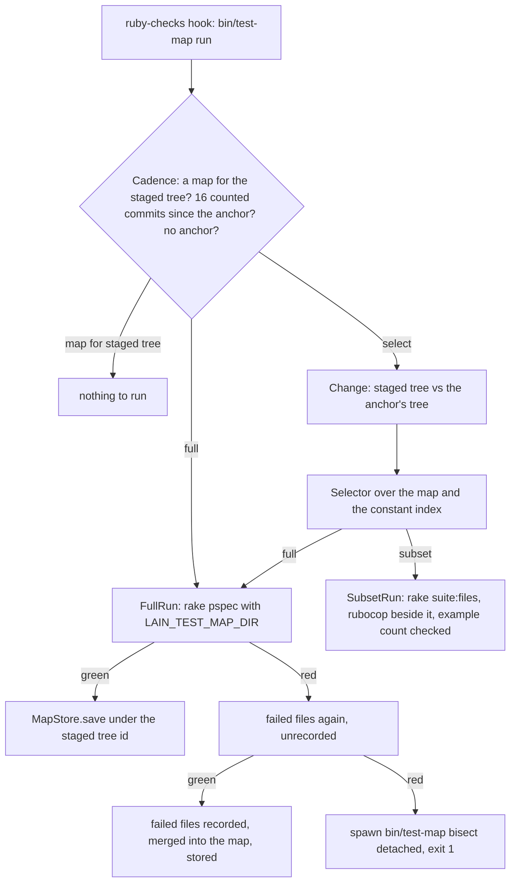
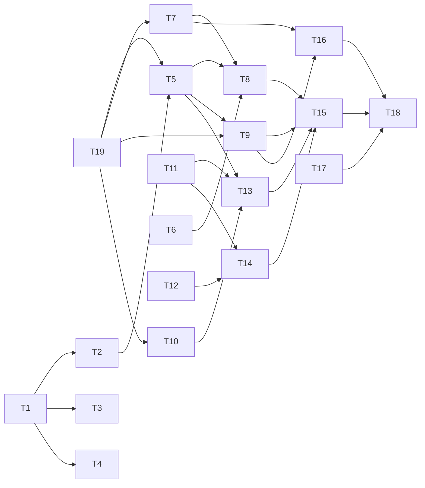

# Test selection: run what a change can reach, the full suite every 16th commit

status: abandoned
commit-mode: orchestrator-commits
language: ruby
panel: Linus Torvalds, Jeremy Evans, Sandi Metz, Richard Schneeman, Aaron Patterson

## Intent

Every commit that touches Ruby or Rust runs the full suite today: about 2 minutes at 12 workers, more while another session's suite holds the lock. This plan makes a commit run only the spec files its change can reach, and makes every 16th commit that changes more than documentation run the full suite, which also records the map the selection reads. When a full run is red, its failed files run once more; if they are red again the commit is blocked and a bisect starts in the background over the commits since the last green full run. CI keeps running the full suite on every push.

## Grounding

Checked on 2026-11-10 at `2410db2e` by 3 Explore agents, 1 spike, 2 Ruby panel rounds with 11 probes, and direct reads. Files checked: `Rakefile`, `.pre-commit-config.yaml`, `.github/workflows/main.yml`, `spec/spec_helper.rb`, `spec/bootsnap_setup.rb`, `spec/support/tags.rb`, `spec/support/slow_files.rb`, `spec/support/suite_profile/*.rb`, `spec/support/parsed_source.rb`, `bin/suite-profile`, `bin/verify`, `bin/comment-census`, `bin/runtime-census`, `lib/lain/isolation/suite_lock.rb`, `lib/lain/file_lock.rb`, `lib/lain/isolation/gc.rb`, `lib/lain/isolation/worker_checks.rb`, `lib/lain/isolation/worktree.rb`, `lib/lain/prompt/slots.rb`, `lib/lain.rb`, `ext/lain/src/lib.rs`, `lain.gemspec`, pre-commit 4.7.0's `pre_commit/git.py`.

What the code does today:

- `ruby-checks` runs `bundle exec rake compile check` on any staged `.rb` or `.rs` file outside `apps/` and `crates/lain-core/`. `rake check` is `multitask check: %i[pspec rubocop]`. `pspec` runs `parallel_rspec spec` with `LAIN_SLOW=1` and a RuntimeLogger writing `tmp/parallel_runtime_rspec.log`, inside `Isolation::SuiteLock`.
- Nothing selects specs by change for lain's own suite. `Isolation::WorkerChecks` selects mirrored specs for worker leases in user projects (Rejected options).
- `lib/lain.rb` ends in `loader.eager_load`, and `spec/spec_helper.rb` requires `bootsnap_setup` then `lain` before any spec file loads, so every class body runs at boot. lib has 1,175 `.rb` files; 163 to 342 keep most of their behavior outside method bodies. 301 lib methods in 125 files run during boot (for example `Tool::Input.field`, `Sensitivity::Rule.named`); some also run later.
- lib also holds product data: 41 `.md` prompt templates and skills, 27 `.lua`, 2 `.erb`, and `.scm`, `.yml`, `.toml`, `.json` files. `lib/lain/prompt/slots.rb:64`, `:72` and `:80` read templates through memoised class readers.
- 41 spec files read lib source or docs as data. On 2026-11-10 a Markdown-only commit (`2410db2e`) broke `spec/suite_profile_spec.rb`, which reads `CLAUDE.md`, and only the next full run caught it.
- `lain.gemspec` ships every tracked file except `bin/`, `spec/` and a few dotfiles. `spec/lain/comment_census_spec.rb` loads its subject with `load`; `spec/suite_profile_spec.rb` does the same for `bin/suite-profile`.

Probed, not read (2026-11-10):

- Coverage started before `bootsnap_setup` covers 1,175 of 1,175 lib files; bootsnap skips its iseq cache while coverage runs.
- After a clear, line coverage records no hit for an endless def (lib has 5,466 in 834 files), a constant read, a `Data.define` member or an `attr_reader`. Method coverage (`methods: true`) records endless defs with their spans. A memoised builder counts only for its first caller in a worker.
- A prepend on `File`, `Dir` and `Pathname` reads catches `File.read`, `Pathname#read`, `#binread`, `#readlines` and Open3. It misses `IO.read`, `File.new(...).read`, `Kernel#open`, `Kernel#system`, backticks, `exec` in a fork, `Prism.parse_file` and `RubyVM::InstructionSequence.compile_file`. `Pathname#glob` reaches `Dir.glob` with a separate `base:`. A prepended recorder touching non-shareable state raises `Ractor::IsolationError` in a non-main Ractor.
- Inside a shared example defined in a support file, `caller_locations` holds no `*_spec.rb` frame. The repo has 29 shared-example files and 176 uses.
- RSpec loads every spec file before running any group, so coverage taken at group boundaries cannot attribute load-time work.
- Under `git commit -a` and `git commit <path>` the hook sees `GIT_INDEX_FILE=.git/index.lock` or `.git/next-index-<pid>.lock`; with it scrubbed, `git diff --cached` is empty and `git write-tree` fails.
- pre-commit passes the hook only staged files filtered by `--diff-filter=ACMRTUXB` (`pre_commit/git.py:140`): a commit that only deletes files matches no file filter.
- `git bisect start HEAD <good>` marks HEAD bad untested.
- Prism 4.0.6 parses an endless def as a `DefNode` with a 1-line span. A Prism walk of all 1,175 lib files finds 37,204 constant references in 0.57s.
- `git rev-list --count <base>..HEAD -- . ':(exclude)*.md'` counts a commit changing both `.md` and `.rb`, and skips a Markdown-only one.
- `load "spec/support/slow_files.rb"` works without RSpec; `SlowFiles::PATHS` holds 39 paths (its header says 29; the code wins).
- 42 spec files reference `RbConfig.ruby`, most to run plain Ruby (`spec/suite_profile_spec.rb:262` runs `ruby -e`). `spec/seam_report_spec.rb:26` runs a child `bundle exec rspec` with the real `spec_helper`.
- `git rev-parse --git-common-dir` prints a relative `.git` in the main checkout; `--path-format=absolute` makes it absolute.
- `RSpec::Core::Configuration#load_file_handling_errors(:load, file)` exists in rspec-core 3.13.6 and is called once per spec file with an absolute path; at example time `rerun_file_path` is `./spec/...` and names the including spec file inside a shared example or a support-file macro. `RSpec.current_example` is nil in `before(:context)`.
- A load error in 1 file under `parallel_rspec -n 2` exits 1 and prints 0 `rspec ./` lines, hiding a real failure in another file.
- `spec/lain/comment_census_spec.rb:250` runs `bin/comment-census --check-tickets` as a plain Ruby child, which reads all of lib; a parent-side `IO` prepend sees none of those reads.
- 1 `Coverage.result(stop: false, clear: true)` with lain booted in lines and methods mode (1,895 files) takes about 50 ms.
- `File.fnmatch("lib/**/*.rb", "lib/x.rb")` is false without `File::FNM_PATHNAME`.
- `lib/lain.rb:107` re-raises the `LoadError` when `lib/lain/lain.so` is missing, so anything that requires lain fails before `rake compile` in a fresh worktree.
- `spec/lain/middleware/redact_secret_reads_spec.rb:1211` reads the repo's real `Cargo.lock` as text.

mempalace was searched for prior decisions on test selection; the query did not return within 3 minutes and was abandoned.

The Ruby panel reviewed 3 drafts. Round 1 (7 blockers) moved coverage to method mode, added the constant index, narrowed the subprocess flag to children that run lain, read the staged tree unscrubbed, stepped HEAD before bisecting, widened the read prepends, and made reads additive. Round 2 (2 blockers) added the boot record and made non-Ruby files under `lib/` full runs; it also replaced the ref and post-commit hook with maps stored by tree. Round 3 (3 blockers) refused a red run with no parsed failures, made build inputs full runs, and added tree-reader specs for children that run repo scripts.

## Compatibility

| Surface | Verdict | Evidence |
|---|---|---|
| `rake pspec`, `rake check`, `rake default` | must keep | CI `build` job (`main.yml:106`), `bin/verify` (the merge verifier's command), `spec/rakefile_spec.rb`, CLAUDE.md. Behavior unchanged; T12 extracts pspec's command builder without changing what it runs. |
| `tmp/parallel_runtime_rspec.log` | must keep | full runs pack by it, `bin/runtime-census --record` reads it, CI caches it. A subset run never writes it. |
| `ruby-checks` and `cargo-test` hook entries and filters | free to break | internal; CI's lint job skips `ruby-checks` and runs `cargo-test` through pre-commit, which keeps working |
| `<git common dir>/lain/test-map/` | new | inside `.git`, never tracked, shared by every worktree |
| `spec/spec_helper.rb` preload line | free to break | inert unless `LAIN_TEST_MAP_DIR` is set |
| `lain.gemspec` file list | free to break | `tools/` added to the reject list, so the gem ships nothing new |
| comment census scope (`tools/` added) | free to break | `spec/lain/comment_census_spec.rb` reads the scope back from CLAUDE.md, so both change together in T17 |
| CI workflow | unchanged | the user ruled CI keeps the full suite on every push |

No must-keep surface blocks a simplification.

## Spike findings

| Question | Result | Evidence |
|---|---|---|
| Can each spec file's own lib lines be isolated under eager loading and bootsnap? | Yes, with `Coverage.result(stop: false, clear: true)` after boot and at each file's boundaries: `canonical_spec.rb` gives 31 lines, all in `lib/lain/canonical.rb`. Line mode misses endless defs, constants, `Data` members and `attr_reader`; method mode sees endless defs. 301 methods run only at boot and need their own record. | spike `tmp/q1_boot.rb`; panel probes `probe_coverage.rb`, `probe_endless.rb`, `probe_methods_mode.rb`, `boot_called_methods.rb` |
| What does recording cost? | 59 spec files, 2,077 examples, serial: 46.1s plain, 52.8s with line coverage and snapshots (1.14x), 51.7s adding reads and the Ext prepend (1.12x), 68.2s with `TracePoint(:c_call)` instead (1.48x). Method mode is unmeasured: T2's stop condition. | spike |
| Can prepends record data reads and Ext calls? | Reads: yes for `File`, `Dir`, `Pathname`; T3 widens to `IO`, `File.new`, `Kernel#open`, `Prism.parse_file`, `ISeq.compile_file`. Ext: 114 magnus methods across 34 modules wrapped, all 26 `spec/lain/rust/*` files green, `binding_coverage_spec.rb` unaffected. | spike; panel `probe_prepends.rb`, `probe_parse_file.rb`, `glob_base.rb` |
| Does coverage see a non-main Ractor? | No, and a prepended recorder raises there unless it returns early outside the main Ractor. | spike; panel `probe_prepends.rb` |
| What does a constant-reference index cost? | 0.57s for all of lib (37,204 references). | panel `constant_index_cost.rb` |

## Shared files

Only the main session edits these; cards hand back 1-line diffs.

- `spec/spec_helper.rb`: the preload line, as the first `require_relative`, above `require_relative "bootsnap_setup"` (line 5).
- `.pre-commit-config.yaml`: the `ruby-checks` and `cargo-test` entries, filters and positions.
- `lain.gemspec`: `tools/` in the reject list.
- `CLAUDE.md`: the suite block and the comment-census scope line.
- `bin/test-map`: created by the main session before T10, T15 and T16 start, a dispatcher that requires each subcommand's class only in its own branch:

  ```ruby
  #!/usr/bin/env ruby
  # frozen_string_literal: true
  case ARGV.shift
  when "run" then require_relative "../tools/test_map/run"; exit TestMap::Run.for(ARGV).call
  when "bisect" then require_relative "../tools/test_map/bisect"; exit TestMap::Bisect.for(ARGV).call
  when "cargo" then require_relative "../tools/test_map/crates"; exit TestMap::Crates.for(ARGV).call
  else warn "usage: bin/test-map run [--full] | bisect <args> | cargo"; exit 2
  end
  ```

Files under `tools/test_map/` require each other with `require_relative` (CLAUDE.md's ban covers `lib/` only). Nothing that `bin/test-map run` or `bin/test-map cargo` loads may `require "lain"`: in a fresh worktree `lain.so` does not exist until `rake compile` runs, and `lib/lain.rb:107` re-raises the `LoadError`. They scrub git's context through `TestMap::Git` (T19). Their specs, under `spec/tools/test_map/`, load the subject with `require_relative "../../../tools/test_map/<name>"`, as `spec/lain/comment_census_spec.rb` loads its own. Every spec that drives a real `git commit` in a temp repository scrubs `GIT_DIR` and `GIT_INDEX_FILE` first (CLAUDE.md's trap), since it runs inside lain's own hook.

## Rejected options

- **Mirrored paths only, as `Isolation::WorkerChecks` does.** 163 lib files have no mirrored spec, and a mirror never selects a dependent: `Dag::Factory` is used by 35 lib files.
- **`rspec-tracer` (2.0.0.rc.1, 2026-07-13).** Coverage-based, but blind to data reads and to calls into the Rust extension, with no cadence or bisect. Not spiked; the read gap alone lets a proven regression through.
- **`crystalball`.** Last released 2019-07-11.
- **`simplecov`.** In the Gemfile, required nowhere; it reports totals, and the map needs a snapshot per spec file.
- **`TracePoint(:c_call)` for Ext calls.** 1.48x against 1.12x for the prepend, same findings.
- **A `refs/lain/full-green` ref moved by a post-commit hook.** A shared ref against per-checkout maps made a worktree's first commit run full and move the ref under main; it needed a 1-time hook install, a pending file and a compare-and-swap; the land-from-worktree flow fast-forwards, which runs no post-commit hook. Maps are stored by tree id in the git common dir instead, and the anchor is the nearest first-parent ancestor of HEAD whose tree has a map.
- **Recording on every commit.** About 12% on every run and a map that churns per commit.
- **Diffing each commit against its parent and remapping line numbers.** Diffing the staged tree against the anchor's tree is exact, and re-runs the specs of every change since the anchor.
- **Bisecting inside the hook.** Up to 4 compile-and-run steps inside pre-commit's stash, a landing gate and an agent's 10-minute tool timeout; a killed hook leaves unstaged edits only in `~/.cache/pre-commit/patch*`.
- **A `:file` change always running the full suite.** Common enough that most commits would run full; the constant-reference index (T6) selects the dependents' specs instead.
- **Selecting by reader for data files under `lib/`.** Their readers are memoised, so only each worker's first caller records the read. Any non-Ruby file under `lib/` runs the full suite.
- **Running subprocess specs per commit.** The user ruled that specs whose child runs lain run only in full runs.

## Open decisions

None.

## Design



The anchor is the nearest first-parent ancestor of `HEAD`, within 200 commits, whose tree has a stored map. A path is **documentation** when it is Markdown outside `lib/`, `exe/`, `ext/` and `spec/`, or anything under `planning/`, `references/` or `docs/`; a commit counts toward the 16 when it changes any path that is not documentation. A **build input** is `Gemfile`, `Gemfile.lock`, `.ruby-version`, `.tool-versions`, `Cargo.toml`, `Cargo.lock` at any depth, `rust-toolchain`, `rust-toolchain.toml`, `build.rs` at any depth, `Rakefile`, `lain.gemspec` and `.rspec`.

## Dependency graph



## Tasks

### T19: Scrub git's context without loading lain          [risk: low]

**Depends on:** none
**Files:** `tools/test_map/git.rb` (new), `spec/tools/test_map/git_spec.rb` (new)
**Reuse:** `Isolation::Worktree::GIT_CONTEXT_SCRUB` (`lib/lain/isolation/worktree.rb:74`), whose keys this copies
**Shared-file wiring:** none
**Reachable from:** `MapStore` (T5), `Change` (T7), `Cadence` (T9), `Bisect` (T10) and `Crates` (T16) run git through it

`TestMap::Git.run(*args, repo:, scrub: true)` runs git in `repo` with the hook's `GIT_DIR`, `GIT_INDEX_FILE` and `GIT_WORK_TREE` removed (`scrub: false` keeps them, for `Change.staged_tree`), and returns stdout, raising with stderr on a non-zero exit. It never requires lain, so the hook works before `lain.so` is built.

**Acceptance criteria**

```gherkin
Scenario: the hook's index does not leak into git
  Given GIT_INDEX_FILE points at another repository's index
  When TestMap::Git.run lists files in a temp repository
  Then the paths come from the temp repository's own index

Scenario: the scrubbed keys match lain's own list
  Given lain loaded in the spec process
  When TestMap::Git's keys are compared with Isolation::Worktree::GIT_CONTEXT_SCRUB's
  Then they are equal

Scenario: loading the helper does not load lain
  Given a fresh Ruby with no lain on the load path
  When it requires tools/test_map/git.rb
  Then it succeeds
```
Spec file: `spec/tools/test_map/git_spec.rb`

**Interface**

```ruby
module TestMap
  module Git
    SCRUB = %w[GIT_DIR GIT_INDEX_FILE GIT_WORK_TREE].freeze
    def self.run(*args, repo:, scrub: true) = ...    # String stdout
  end
end
```

**Stop and report if:**
- `Isolation::Worktree::GIT_CONTEXT_SCRUB` holds keys beyond these 3 (copy them all, and say so).

### T1: Name the spec file a moment belongs to          [risk: high]

**Depends on:** none
**Files:** `spec/test_map_preload.rb` (new), `spec/support/test_map/attribution.rb` (new), `spec/tools/test_map/attribution_spec.rb` (new), `spec/fixtures/test_map/` (new: fixture spec files named `*_example.rb`, never `*_spec.rb`, so `parallel_rspec spec` never runs them)
**Reuse:** `spec/support/suite_profile/gc_per_file.rb` (inert-unless-env support file)
**Shared-file wiring:** `spec/spec_helper.rb`: `require_relative "test_map_preload"` above `require_relative "bootsnap_setup"`
**Reachable from:** `spec/spec_helper.rb`'s preload line and its support glob (`spec/spec_helper.rb:48`), in every rspec process `rake pspec` starts with `LAIN_TEST_MAP_DIR` set by `TestMap::FullRun` (T13)

The preload reads `LAIN_TEST_MAP_DIR`, expands it to an absolute path, deletes it from `ENV` so child processes never record (`spec/seam_report_spec.rb:26` runs a child rspec), and runs `Coverage.start(lines: true, methods: true)`. Unset, it does nothing. `Attribution.current` returns the spec file being worked on, process-wide (not thread-local, so a thread a lib call starts is attributed too). While RSpec loads a spec file, it is that file: a prepend on RSpec's per-file load (`RSpec::Core::Configuration#load_file_handling_errors`) sets and clears it. While a top-level example group runs (a prepend on `RSpec::Core::ExampleGroup.run` for top-level groups, which covers `before(:context)`, `after(:context)` and every example), it is that group's file; inside a shared example or a support-file macro the group is still the including spec file's. Otherwise nil. Every path is normalised to the repo-relative form without `./`, so the load-time absolute path and the run-time `./spec/...` path give 1 string; a `require` through the load prepend is not a file load. It yields a boundary only when the current file changes (a coverage snapshot costs about 50 ms, so 1 per file, not 1 per example), so T2 can snapshot coverage there.

**Acceptance criteria**

```gherkin
Scenario: an example inside a shared example is attributed to the spec file that includes it
  Given fixture example a_example.rb that includes a shared example defined in a fixture support file
  When it runs in a child rspec with LAIN_TEST_MAP_DIR set and the shared example reads Attribution.current
  Then the value read is the path of a_example.rb

Scenario: work done while a file loads belongs to that file, not the next
  Given 2 fixture examples, each calling Attribution.current at file load time
  When rspec loads both in a child process with LAIN_TEST_MAP_DIR set
  Then each file read its own path

Scenario: work in before(:context) is attributed to its spec file
  Given a fixture example whose before(:context) reads Attribution.current
  When it runs in a child rspec with LAIN_TEST_MAP_DIR set
  Then the value read is the fixture example's path

Scenario: load time and run time name a file by the same string
  Given a fixture example that reads Attribution.current at load time and inside an example
  When it runs recorded
  Then both values are the same repo-relative path

Scenario: a thread started during an example is attributed to that example's file
  Given a fixture example that reads Attribution.current from a new Thread inside an example
  When it runs recorded
  Then the thread read the example's file

Scenario: children never record
  Given a recorded fixture example that spawns a child Ruby printing ENV["LAIN_TEST_MAP_DIR"]
  When it runs recorded
  Then the child printed nothing

Scenario: without the variable nothing is started
  Given LAIN_TEST_MAP_DIR is unset in a child rspec
  When the fixture examples run
  Then Coverage is not running and Attribution.current is nil
```
Spec file: `spec/tools/test_map/attribution_spec.rb`

**Interface**

```ruby
module TestMap
  module Attribution
    def self.current = ...                       # repo-relative spec path, or nil
    def self.on_boundary(&block) = ...           # T2 registers its snapshot here; yields (leaving_file, entering_file) only when they differ
  end
end
```

**Stop and report if:**
- `RSpec::Core::ExampleGroup.run` cannot be prepended for top-level groups only (the round-3 probe confirmed `load_file_handling_errors`; the group prepend is unprobed).
- `spec/zeitwerk_spec.rb` or `spec/lain_spec.rb` fails with the preload present but inert.

### T2: Record each spec file's lib lines and methods          [risk: high]

**Depends on:** T1
**Files:** `spec/support/test_map/recorder.rb` (new), `spec/tools/test_map/recorder_spec.rb` (new), fixtures under `spec/fixtures/test_map/coverage/` (new)
**Reuse:** `Attribution` (T1); `gc_per_file.rb`'s 1 NDJSON file per worker named `w<TEST_ENV_NUMBER>x<pid>.ndjson`
**Shared-file wiring:** none
**Reachable from:** the support glob (`spec/spec_helper.rb:48`), inert unless the preload started coverage, in every recorded rspec process (T13)

At the first boundary the recorder takes `Coverage.result(stop: false, clear: true)` and writes it as the worker's **boot record**: the method spans called during boot. At every later boundary it takes the result again, clears, and adds the lines with a hit and the method spans with a call to the file `Attribution` names for the closing interval. It writes 1 NDJSON line per spec file the worker ran (a file with 0 examples after tag filtering still gets a line) to `<dir>/raw/w<TEST_ENV_NUMBER>x<pid>.ndjson`, and 1 boot line.

**Acceptance criteria**

```gherkin
Scenario: a recorded run names the lib lines and methods a spec file ran
  Given a fixture example that calls a block def and an endless def in a fixture lib file
  When it runs recorded
  Then its NDJSON line lists both methods with their line spans and the block def's body lines

Scenario: methods called at boot go to the boot record, not a spec file
  Given a fixture lib file whose class body calls one of its own methods, and a fixture example that calls nothing
  When it runs recorded
  Then the boot line lists that method and the example's line lists no lib file

Scenario: load-time work is attributed to the file being loaded
  Given 2 fixture examples, the 2nd calling a lib method at load time
  When both run recorded in 1 process
  Then the method is listed under the 2nd example's line, and not the 1st's
```
Spec file: `spec/tools/test_map/recorder_spec.rb`

**Interface**

```ruby
# NDJSON lines, per worker:
{ "boot" => { "lib/lain/sensitivity.rb" => [[257, 262]] } }
{ "spec" => "spec/lain/canonical_spec.rb",
  "lines" => { "lib/lain/canonical.rb" => [71, 72] },
  "methods" => { "lib/lain/canonical.rb" => [[70, 74]] },
  "reads" => [], "globs" => [], "ext" => [], "spawns" => [], "lain_child" => false, "tree_reader" => false }   # filled by T3 and T4
```

**Stop and report if:**
- A recorded `rake pspec` takes more than 1.3x the plain wall (method mode is unmeasured).
- A worker's NDJSON lacks a line for a spec file it was handed.

### T3: Record the files each spec file reads as data          [risk: high]

**Depends on:** T1
**Files:** `spec/support/test_map/reads.rb` (new), `spec/tools/test_map/reads_spec.rb` (new), fixtures under `spec/fixtures/test_map/reads/` (new)
**Reuse:** `Attribution` (T1)
**Shared-file wiring:** none
**Reachable from:** the support glob (`spec/spec_helper.rb:48`), inert unless `Attribution` is active, as T2

Prepends recorders on `IO`'s singleton (`read`, `binread`, `readlines`, `foreach`, `open` in a read mode; this covers `File`), `File.new` in a read mode, `Kernel#open`, `Dir` (`glob`, `[]`, `children`, `each_child`, `entries`, `foreach`, which `Pathname#children` uses; a `base:` is joined onto the pattern before recording), `Prism.parse_file` and `RubyVM::InstructionSequence.compile_file`. Each records the repo-relative path, or the repo-relative glob pattern, under `Attribution.current`; paths outside the repo and moments with no spec file are dropped. Each recorder returns at once unless `Ractor.main?`.

**Acceptance criteria**

```gherkin
Scenario: a read inside an example is recorded
  Given a fixture example that reads CLAUDE.md with File.read inside an example
  When it runs recorded
  Then its line lists "CLAUDE.md" under reads

Scenario: a glob at file load time is recorded with its pattern
  Given a fixture example that globs lib/lain/*.rb at file load time
  When it runs recorded
  Then its line lists "lib/lain/*.rb" under globs

Scenario: Pathname#glob is recorded relative to the repo
  Given a fixture example that calls Pathname("lib").glob("lain/epic/*.rb")
  When it runs recorded
  Then its line lists "lib/lain/epic/*.rb" under globs

Scenario: the other read entry points are recorded
  Given a fixture example that calls IO.read on Rakefile, File.new on Gemfile then read, Kernel#open on .rspec, and Prism.parse_file on exe/lain
  When it runs recorded
  Then its line lists all 4 paths under reads

Scenario: a read inside a non-main Ractor neither raises nor records
  Given a fixture example that reads a file inside Ractor.new
  When it runs recorded
  Then the example passes and its line lists no read of that file
```
Spec file: `spec/tools/test_map/reads_spec.rb`

**Stop and report if:**
- `spec/lain/canonical_spec.rb` or `spec/lain/sensitivity/regions_spec.rb` (both use `Ractor.new`) goes red under recording.
- A spec stubbing `File.read` with `allow(File).to receive(:read)` changes behavior under the `IO` prepend.

### T4: Record spawned children and calls into the Rust extension          [risk: medium]

**Depends on:** T1
**Files:** `spec/support/test_map/spawns.rb` (new), `spec/support/test_map/ext_calls.rb` (new), `spec/tools/test_map/spawns_spec.rb` (new), `spec/tools/test_map/ext_calls_spec.rb` (new), fixtures under `spec/fixtures/test_map/spawns/` (new)
**Reuse:** `Attribution` (T1); the spike's prepend over every class and module under `Lain::Ext`
**Shared-file wiring:** none
**Reachable from:** the support glob (`spec/spec_helper.rb:48`), inert unless `Attribution` is active, as T2

`spawns.rb` prepends on `Process.spawn`, `Kernel#spawn`, `Kernel#system`, `Kernel#exec`, `` Kernel#` ``, `IO.popen` and `PTY.spawn`. It records argv elements under the repo's `target/` as `spawns`, and sets `lain_child` when the child runs lain: the program is `exe/lain` or an installed `lain`, or a Ruby whose argv holds `-rlain`, `-Ilib` together with `lain`, or `exe/lain`. A plain `ruby -e` does not count. It sets `tree_reader` when the child runs a script of this repository (an argv element under `bin/` or `tools/`, run directly or by a Ruby): that child reads the tree where the parent's prepends cannot see it, as `spec/lain/comment_census_spec.rb:250` does with `bin/comment-census`. `ext_calls.rb` prepends a recording module on every class and module under `Lain::Ext`, for instance and singleton methods, and records the constant's name. Both return at once unless `Ractor.main?`.

**Acceptance criteria**

```gherkin
Scenario: a child that runs lain marks the spec file
  Given a fixture example that runs exe/lain --version with system
  When it runs recorded
  Then its line has lain_child true

Scenario: a plain Ruby child does not
  Given a fixture example that runs RbConfig.ruby with -e and a one-line script, as spec/suite_profile_spec.rb does
  When it runs recorded
  Then its line has lain_child false

Scenario: a child running a repo script marks the spec as a tree reader
  Given a fixture example that runs RbConfig.ruby with bin/comment-census --check-tickets, as spec/lain/comment_census_spec.rb does
  When it runs recorded
  Then its line has tree_reader true and lain_child false

Scenario: a spawn of the fence binary is recorded
  Given a fixture example that spawns target/release/lain-fence --status
  When it runs recorded
  Then its line lists "target/release/lain-fence" under spawns

Scenario: a call into the extension is recorded by constant
  Given a fixture example that calls Lain::Ext.blake3_hex and a method of Lain::Ext::Prompt
  When it runs recorded
  Then its line lists "Lain::Ext" and "Lain::Ext::Prompt" under ext
```
Spec files: `spec/tools/test_map/spawns_spec.rb`, `spec/tools/test_map/ext_calls_spec.rb`

**Stop and report if:**
- Any `spec/lain/rust/*_spec.rb`, `spec/lain/rust/binding_coverage_spec.rb` included, goes red under recording.

### T5: Build and store the map          [risk: medium]

**Depends on:** T2, T19
**Files:** `tools/test_map/map.rb` (new), `tools/test_map/map_store.rb` (new), `spec/tools/test_map/map_spec.rb` (new), `spec/tools/test_map/map_store_spec.rb` (new)
**Reuse:** the NDJSON shape from T2
**Shared-file wiring:** `lain.gemspec`: add `tools/` to the `start_with?` reject list
**Reachable from:** `TestMap::FullRun` (T13) calls `Map.build`, `Map#merge` and `MapStore#save`; `TestMap::Run.for` (T15) loads the anchor's map through `MapStore#for_tree` and passes it to `Selector` (T8); `Cadence` (T9) receives the `MapStore`

`Map.build(raw_dir, expected:, tree:)` merges the worker files into 1 entry per spec file (a file split across workers is unioned) and unions the boot records. It raises `Incomplete` naming the missing files when a file in `expected` has no line; `expected` is every `spec/**/*_spec.rb` outside `spec/fixtures/`. `Map#merge(other)` replaces the entries `other` holds (for re-recorded failed files). `MapStore` keeps maps at `<git common dir>/lain/test-map/<tree>.json`, from `git rev-parse --path-format=absolute --git-common-dir` run through `TestMap::Git`. It writes through a uniquely named temp file and a rename, keeps the newest 8 but never evicts the map of any `git worktree list` HEAD's anchor, tolerates a file vanishing while it prunes, and answers `for_tree(tree)` with a `Map` or nil; a corrupt file is nil.

**Acceptance criteria**

```gherkin
Scenario: entries from 2 workers merge per spec file
  Given 2 NDJSON files that both hold lines for spec/a_spec.rb
  When Map.build runs over them
  Then spec/a_spec.rb's entry holds the union of both

Scenario: a run missing a spec file is refused
  Given raw files that lack spec/c_spec.rb, which exists
  When Map.build runs
  Then it raises Incomplete naming spec/c_spec.rb

Scenario: boot methods are known to the map
  Given a raw boot record listing lib/x.rb's def on lines 10 to 14
  When Map.build runs
  Then boot_method?("lib/x.rb", 10..14) is true

Scenario: a recorded glob matches new files at every depth
  Given a map where spec/d_spec.rb globbed "lib/**/*.rb"
  When specs_reading is asked for lib/x.rb and for lib/lain/a/b.rb
  Then both return spec/d_spec.rb

Scenario: a map saved in one worktree is found from another
  Given a temp repository with a linked worktree
  When a map for tree T is saved from the main checkout
  Then MapStore#for_tree(T) in the worktree returns it

Scenario: pruning keeps the newest 8 and every worktree's anchor
  Given 8 saved maps, the oldest being the anchor of a linked worktree's HEAD
  When a 9th is saved
  Then the anchor's map remains and the oldest other map is gone
```
Spec files: `spec/tools/test_map/map_spec.rb`, `spec/tools/test_map/map_store_spec.rb`

**Interface**

```ruby
module TestMap
  class Map
    class Incomplete < StandardError; end
    def self.build(raw_dir, expected:, tree:) = ...
    def merge(other) = ...                    # a new Map
    def tree = ...
    def specs_running(path, lines) = ...      # line hits or method spans overlapping lines
    def specs_running_file(path) = ...
    def boot_method?(path, span) = ...       # any boot span overlapping span
    def specs_reading(path) = ...             # exact reads, and globs matched with FNM_PATHNAME | FNM_EXTGLOB
    def specs_calling(constants) = ...
    def specs_spawning(binary) = ...
    def lain_child_specs = ...
    def tree_reader_specs = ...
    def covers?(path) = ...
  end

  class MapStore
    KEEP = 8
    def initialize(repo:)
    def save(map) = ...
    def for_tree(tree) = ...                  # Map or nil
  end
end
```

**Stop and report if:**
- A map for the full suite exceeds 50 MB (the spike's 59 files gave 433 KB).

### T6: Index which files reference which constants          [risk: medium]

**Depends on:** none
**Files:** `tools/test_map/constant_index.rb` (new), `spec/tools/test_map/constant_index_spec.rb` (new)
**Reuse:** Prism; Zeitwerk's naming rule from CLAUDE.md (`lib/lain/foo/bar.rb` defines `Lain::Foo::Bar`) and the 4 inflections in `lib/lain.rb` (`cli`, `http`, `qa`, `tty`)
**Shared-file wiring:** none
**Reachable from:** `TestMap::Run.for` (T15) constructs `ConstantIndex.for(root:, old_tree:)` and passes it to `Selector` (T8)

`dependents(path)` returns the lib files and spec files whose source references a constant `path` defines: the constant its path names, plus constants defined inside it with no path of their own (CLAUDE.md counts 296). Definitions are read from both the old tree (the anchor's, through `git show`) and the working tree, so a removed or renamed constant still finds its users. References come from Prism's `ConstantReadNode` and `ConstantPathNode` over `lib/**/*.rb` and `spec/**/*_spec.rb`, matched by full name and by trailing name within the referencing file's lexical namespaces.

**Acceptance criteria**

```gherkin
Scenario: a lib file referencing a constant is its dependent
  Given lib/lain/dag/factory.rb defines Lain::Dag::Factory
  And lib/lain/agent.rb references Dag::Factory inside module Lain
  When dependents of lib/lain/dag/factory.rb is asked
  Then it includes lib/lain/agent.rb

Scenario: a spec file that loops over a constant is its dependent
  Given spec/lain/rust/event_spec.rb references Lain::EventLog::Kinds::KINDS at load time
  When dependents of lib/lain/event_log/kinds.rb is asked
  Then it includes spec/lain/rust/event_spec.rb

Scenario: a constant removed in the new tree still finds its users
  Given an old tree where a fixture lib file defines a constant with no path of its own, and another file references it
  And a new tree that deletes the definition
  When dependents of the first file is asked
  Then it includes the other file
```
Spec file: `spec/tools/test_map/constant_index_spec.rb`

**Interface**

```ruby
module TestMap
  class ConstantIndex
    def self.for(root:, old_tree:) = ...
    def dependents(path) = ...    # Set of repo-relative lib and spec paths
  end
end
```

**Stop and report if:**
- Building the index over `lib/` and `spec/` takes more than 3 seconds (lib alone took 0.57s).

### T7: Read the staged change in the anchor's line numbers          [risk: medium]

**Depends on:** T19
**Files:** `tools/test_map/change.rb` (new), `spec/tools/test_map/change_spec.rb` (new)
**Reuse:** Prism for def spans; `TestMap::Git` (T19)
**Shared-file wiring:** none
**Reachable from:** `TestMap::Run.for` (T15) computes `Change.staged_tree` and passes `Change.between(anchor_tree, staged_tree, repo:)` to `Selector` (T8); `Crates.for` (T16) uses the same pair for its paths

`Change.staged_tree` runs `git write-tree` with the hook's environment unscrubbed, so it sees the index git is committing, including the lock-file indexes of `commit -a` and `commit <path>`. `Change.between(old_tree, new_tree, repo:)` runs `git diff -U0 --no-renames <old_tree> <new_tree>` with git's context variables scrubbed and returns 1 `ChangedFile` per path: path, status (`:added`, `:modified`, `:deleted`), and for a Ruby file its hunks in the old tree's lines. A hunk is `:method` when every old line, or the insertion point of a pure addition, sits inside 1 def body, carrying that def's span; otherwise `:file`.

**Acceptance criteria**

```gherkin
Scenario: a change inside a method is a method hunk with the def's span
  Given an old tree where lib/x.rb has def call on lines 10 to 14
  And a new tree that changes line 12
  When Change.between runs
  Then lib/x.rb has 1 hunk of kind method spanning lines 10 to 14

Scenario: a change to a constant is a file hunk
  Given a new tree that changes a constant on line 3 of lib/x.rb, outside any def
  When Change.between runs
  Then lib/x.rb's hunk is of kind file

Scenario: git commit -a is seen
  Given a temp repository with a modified tracked file and nothing staged
  When git commit -a runs with a pre-commit hook that prints the diff of Change.staged_tree against HEAD
  Then the hook printed the modified file

Scenario: git commit with a path is seen
  Given a temp repository with 2 modified files
  When git commit names only the first, with the same hook
  Then the hook printed only the first file

Scenario: a deletion is a deleted path
  Given a new tree that deletes lib/x.rb
  When Change.between runs
  Then lib/x.rb has status deleted
```
Spec file: `spec/tools/test_map/change_spec.rb`

**Interface**

```ruby
module TestMap
  module Change
    Hunk = Data.define(:kind, :lines)                 # :method or :file; a Range in the old tree
    ChangedFile = Data.define(:path, :status, :hunks)
    def self.staged_tree(repo:) = ...
    def self.between(old_tree, new_tree, repo:) = ... # Array<ChangedFile>
  end
end
```

**Stop and report if:**
- `git write-tree` under `commit <path>` writes a tree that contains the other file's unstaged change.

### T8: Select the spec files a change can reach          [risk: high]

**Depends on:** T5, T6, T7
**Files:** `tools/test_map/selector.rb` (new), `tools/test_map/ext_sources.rb` (new), `spec/tools/test_map/selector_spec.rb` (new), `spec/tools/test_map/ext_sources_spec.rb` (new)
**Reuse:** `Map` (T5), `ConstantIndex` (T6), `Change` (T7), `SlowFiles::PATHS` loaded from `spec/support/slow_files.rb`
**Shared-file wiring:** none
**Reachable from:** `TestMap::Run.for` (T15) constructs `Selector.new(map:, changes:, index:, root:)` when there is an anchor; `Run#call` calls it

Rules 1 to 6 decide each changed path; rule 7 adds to any of them; rule 8 filters the result.

1. `:full` for: every build input (Design), any Ruby file under `spec/` not named `*_spec.rb` (`spec_helper.rb`, `bootsnap_setup.rb`, `worktree_identity.rb`, `test_map_preload.rb`, everything under `spec/support/`), `.rubocop.yml`, `lib/lain.rb`, anything under `exe/`, `ext/lain/src/lib.rs` (it registers most of the extension), any non-Ruby file under `lib/` (prompt templates, Lua, ERB, queries, data: their readers are memoised), anything under `tools/test_map/`, and `bin/test-map`.
2. A changed or added `*_spec.rb` selects itself.
3. A Ruby file the map covers, or any added or deleted Ruby file under `lib/`: a `:method` hunk on a def that is not a boot method selects `specs_running(path, span)`. A `:method` hunk on a boot method, a `:file` hunk, an added file or a deleted file selects `specs_running_file(path)`, its mirrored spec, every spec file in `ConstantIndex#dependents(path)`, and `specs_running_file` of every lib file in it. Whenever rule 3 fires for a file under `lib/`, `spec/zeitwerk_spec.rb` and `spec/lain_spec.rb` are added.
4. `ext/lain/src/**/*.rs` other than `lib.rs` selects `specs_calling(ExtSources.fetch(path))`, every `spec/lain/rust/**/*_spec.rb`, and `spec/conformance_corpus_spec.rb`. A path missing from `ExtSources` is `:full`.
5. `crates/lain-fence/**` selects `specs_spawning("target/release/lain-fence")`; when the map holds no fence spawner, it is `:full`.
6. Any other changed path is `:full` unless it is documentation (Design), under `apps/` or `crates/lain-core/`, or a data file outside `lib/` (not Ruby, not Rust, not a build input) that the map records a reader for. A **Ruby file** is a `.rb` file or a file whose first line is a Ruby shebang (the `bin/` scripts specs `load`).
7. Every changed path also selects `specs_reading(path)`, and every changed path that is not documentation also selects `map.tree_reader_specs`. This rule only adds; it never stands in for rules 1 to 6.
8. Specs in `map.lain_child_specs`, and the files in `SlowFiles::PATHS` under `spec/e2e/`, are removed: they run only in full runs.

`ExtSources` maps each `ext/lain/src/**/*.rs` path other than `lib.rs` to the `Lain::Ext` constants it backs. Shared cores (`dag.rs`, `graph.rs`, `algebra.rs`, `digest.rs`, `event.rs`, `canonical.rs`) map to `Lain::Ext`, `Store`, `Timeline`, `Event` and the `Dag` constants.

**Acceptance criteria**

```gherkin
Scenario: a method change selects the specs that ran that method
  Given a map where spec/a_spec.rb ran the def in lib/x.rb on lines 10 to 14 and spec/b_spec.rb ran only lib/y.rb
  And a method hunk in lib/x.rb spanning lines 10 to 14
  When the selector runs
  Then the selection holds spec/a_spec.rb, spec/zeitwerk_spec.rb and spec/lain_spec.rb, and not spec/b_spec.rb

Scenario: a change inside a boot method reaches the users of what it built
  Given a map whose boot record holds lib/x.rb's def on lines 10 to 14, and spec/b_spec.rb ran lib/y.rb, which references a constant lib/x.rb defines
  And a method hunk in lib/x.rb spanning lines 10 to 14
  When the selector runs
  Then the selection holds spec/b_spec.rb

Scenario: a constant change reaches the specs of the files that use it
  Given lib/y.rb references a constant lib/x.rb defines, and spec/b_spec.rb ran lib/y.rb
  And a file hunk in lib/x.rb
  When the selector runs
  Then the selection holds spec/b_spec.rb

Scenario: a prompt template under lib runs everything
  Given a change to lib/lain/prompt/templates/role/dev.md only
  When the selector runs
  Then the mode is full

Scenario: a CLAUDE.md change selects the spec that reads it, though that spec runs plain Ruby
  Given a map where spec/suite_profile_spec.rb read CLAUDE.md and spawned ruby -e, with lain_child false
  And a change to CLAUDE.md only
  When the selector runs
  Then the selection holds spec/suite_profile_spec.rb with the reason that it read CLAUDE.md

Scenario: a recorded reader does not stand in for a code path's consumers
  Given a map where only spec/git_fixture_scrub_discipline_spec.rb read spec/bootsnap_setup.rb
  And a change to spec/bootsnap_setup.rb
  When the selector runs
  Then the mode is full

Scenario: a spec whose child runs lain never rides a subset
  Given a map where spec/e2e/fork_resume_spec.rb ran lib/x.rb line 12 with lain_child true
  And a method hunk in lib/x.rb covering line 12
  When the selector runs
  Then spec/e2e/fork_resume_spec.rb is not in the selection

Scenario: a lib comment change reaches the spec whose child scans the tree
  Given a map where spec/lain/comment_census_spec.rb has tree_reader true and read no lib file in-process
  And a file hunk in lib/x.rb
  When the selector runs
  Then the selection holds spec/lain/comment_census_spec.rb

Scenario: a Cargo.lock change runs everything though a spec reads it as text
  Given a map where only spec/lain/middleware/redact_secret_reads_spec.rb read Cargo.lock
  And a change to Cargo.lock only
  When the selector runs
  Then the mode is full

Scenario: a fence change with no recorded spawner runs everything
  Given a map with no spec that spawned target/release/lain-fence
  And a change to crates/lain-fence/src/main.rs
  When the selector runs
  Then the mode is full

Scenario: an unmapped Rust source runs everything
  Given a change to ext/lain/src/brand_new.rs
  When the selector runs
  Then the mode is full

Scenario: a planning-only change selects nothing
  Given a change to planning/specs/some-plan.md that no spec read
  When the selector runs
  Then the mode is none

Scenario: every extension source but lib.rs has an ExtSources entry
  Given the files under ext/lain/src
  When ExtSources is checked against them
  Then every .rs path except lib.rs has an entry
```
Spec files: `spec/tools/test_map/selector_spec.rb`, `spec/tools/test_map/ext_sources_spec.rb`

**Interface**

```ruby
module TestMap
  Selection = Data.define(:mode, :specs, :reasons)   # :full, :subset or :none; reasons maps spec to rule
  class Selector
    def initialize(map:, changes:, index:, root:)
    def call = ...                                    # Selection
  end
  module ExtSources
    def self.fetch(path) = ...                        # Array<String>; KeyError when unmapped
    def self.paths = ...
  end
end
```

**Stop and report if:**
- Against the first real map, a method change in `lib/lain/dag/factory.rb` selects more than 900 of the 1,264 spec files (report the number).
- A file in `SlowFiles::PATHS` outside `spec/e2e/` runs `exe/lain`, yet the first real map has it with `lain_child` false.
- The first real map holds no spec that spawned `target/release/lain-fence` (rule 5 would then always be `:full`; report which fence specs skipped).

### T9: Find the anchor and decide whether this commit runs the full suite          [risk: high]

**Depends on:** T5, T19
**Files:** `tools/test_map/cadence.rb` (new), `spec/tools/test_map/cadence_spec.rb` (new)
**Reuse:** `MapStore#for_tree` (T5); `TestMap::Git` (T19)
**Shared-file wiring:** none
**Reachable from:** `TestMap::Run.for` (T15) and `TestMap::Crates.for` (T16) construct `Cadence.new(repo:, store:)`

`Cadence#anchor` walks first-parent ancestors of `HEAD`, newest first, up to 200, and returns the first commit whose tree has a stored map, or nil. `#verdict(staged_tree, staged_paths)` returns `:green` when the store already holds a map for `staged_tree` (a full run passed on it, then a later hook refused the commit or it is being re-made), `:full` when there is no anchor or when the commits in `anchor..HEAD` that change a non-documentation path, plus 1 if any staged path is non-documentation, number 16 or more, and `:select` otherwise. Documentation is as Design defines it; counting reads `git log --name-only` rather than a pathspec, since Markdown under `lib/` counts.

**Acceptance criteria**

```gherkin
Scenario: the 16th counted commit runs the full suite
  Given a temp repository whose commit F has a stored map, then 15 commits each changing a .rb file
  When verdict is asked for a staged .rb change
  Then it is full

Scenario: documentation commits do not count, but Markdown under lib does
  Given a stored map at F, then 10 commits changing .rb files, 10 changing only planning/*.md, and 5 changing only lib/lain/prompt/templates/role/*.md
  When verdict is asked for a staged .rb change
  Then it is full

Scenario: a tree that already passed a full run is green
  Given a stored map for the staged tree itself
  When verdict is asked
  Then it is green

Scenario: no stored map in reach means a full run
  Given a repository with no stored map for any of the last 200 first-parent commits
  When verdict is asked
  Then it is full

Scenario: a worktree branch finds the map main stored
  Given a map stored at F on main, and a linked worktree branched from F with 3 commits
  When anchor is asked in the worktree
  Then it is F
```
Spec file: `spec/tools/test_map/cadence_spec.rb`

**Interface**

```ruby
module TestMap
  class Cadence
    INTERVAL = 16
    REACH = 200
    def initialize(repo:, store:)
    def anchor = ...                                  # commit sha or nil
    def verdict(staged_tree, staged_paths) = ...      # :green, :full or :select
  end
end
```

**Stop and report if:**
- Walking 200 first-parent commits and checking each tree against the store takes more than 1 second.

### T10: Bisect a red full run in the background          [risk: medium]

**Depends on:** T19
**Files:** `tools/test_map/bisect.rb` (new), `spec/tools/test_map/bisect_spec.rb` (new)
**Reuse:** `TestMap::Git` (T19); `Lain::Isolation::SuiteLock.holding` with a `notice:` that prints; `Lain::FileLock` for the per-HEAD lock
**Shared-file wiring:** none
**Reachable from:** `TestMap::FullRun` (T13) spawns `bin/test-map bisect --good <anchor> --head <HEAD> --staged <tree> --specs <failed files>` detached (`Process.spawn(..., pgroup: true)`, environment scrubbed through `TestMap::Git`), output to `<git common dir>/lain/test-map/bisect-<HEAD short sha>.log`; `bin/test-map bisect` calls `Bisect.for(argv).call`

`Bisect#call` takes a lock per HEAD and exits at once when a bisect for that HEAD already runs. It adds a detached worktree at `HEAD` under `tmp/worktrees/bisect-<short sha>`, with `CARGO_TARGET_DIR` set to `tmp/test-map-bisect-target`, shared across steps and bisects. The step is `rake compile`, then `rspec` with `LAIN_SLOW=1` over those of the failed spec files that exist at the step's commit, inside the suite lock. A failed compile exits 125 (skip), and a step with none of the files present exits 0 (good). It first steps a temporary commit of the staged tree on top of `HEAD`: green there, run serially, reports a flake and stops. Then it steps `HEAD`: green there blames the staged change. Otherwise it runs `git bisect start HEAD <good>` and `git bisect run <step>`, reads the first bad commit from `refs/bisect/bad`, and runs `git bisect reset`. It removes the worktree on every exit path. With no `--good` (no anchor), it writes that no bisect is possible and exits. The verdict goes to the log file, and to `notify-send` when present.

**Acceptance criteria**

```gherkin
Scenario: the first bad commit is named
  Given a temp repository whose good commit F is followed by 5 commits, the 3rd making the step fail, and a staged tree that also fails
  When Bisect#call runs with that step
  Then the verdict names the 3rd commit and the scratch worktree is gone

Scenario: a green HEAD blames the staged change
  Given a temp repository whose commits after F all pass the step, and a staged tree that fails it
  When Bisect#call runs
  Then the verdict says the staged change is the first bad change, and no git bisect ran

Scenario: a staged tree that passes serially is a flake
  Given a staged tree that passes the step
  When Bisect#call runs
  Then the verdict reports a flake and no git bisect ran

Scenario: a failed spec file missing at an older commit counts as good there
  Given a failed spec file added in the 4th commit after F, which fails from the 4th commit on
  When Bisect#call runs
  Then the verdict names the 4th commit

Scenario: a second bisect for the same HEAD does not start
  Given a bisect for HEAD holding its lock
  When another Bisect#call runs for the same HEAD
  Then it exits at once and the first one's worktree is untouched
```
Spec file: `spec/tools/test_map/bisect_spec.rb`

**Interface**

```ruby
module TestMap
  class Bisect
    Verdict = Data.define(:kind, :commit, :summary)   # kind :commit, :staged, :flake or :impossible
    def self.for(argv) = ...
    def initialize(repo:, good:, head:, staged:, specs:, step:)
    def call = ...                                     # Integer exit status; writes the verdict
  end
end
```

**Stop and report if:**
- Inside the scratch worktree, `git rev-parse --git-dir` resolves so that the step's specs drive git against the main checkout's admin dir (CLAUDE.md's trap about copies of a linked worktree).

### T11: Check that a subset run reported every example          [risk: low]

**Depends on:** none
**Files:** `tools/test_map/example_count.rb` (new), `spec/tools/test_map/example_count_spec.rb` (new)
**Reuse:** `bin/runtime-census`'s dry-run count (`LAIN_SLOW=1 bundle exec rspec --dry-run`)
**Shared-file wiring:** none
**Reachable from:** `TestMap::SubsetRun` (T14) constructs `ExampleCount.new(files:, env:, commands:)` and checks the run's output against it

`ExampleCount#expected` runs `rspec --dry-run` over the files with the same environment and tags as the run (`LAIN_SLOW=1`). `#verify(output)` reads the total `parallel_rspec` printed and returns a message naming both numbers when it is lower (CLAUDE.md: a dead worker or a `SystemExit` looks like a pass), or nil.

**Acceptance criteria**

```gherkin
Scenario: a short count fails
  Given files whose dry run counts 40 examples
  When the run's output reports 31 examples, 0 failures
  Then verify returns a message naming 40 and 31

Scenario: a matching count passes
  Given files whose dry run counts 40 examples
  When the run's output reports 40 examples, 0 failures
  Then verify returns nil
```
Spec file: `spec/tools/test_map/example_count_spec.rb`

**Interface**

```ruby
module TestMap
  class ExampleCount
    def initialize(files:, env:, commands:)
    def expected = ...           # Integer
    def verify(output) = ...     # nil, or the failure message
  end
end
```

**Stop and report if:**
- `rspec --dry-run` with `LAIN_SLOW=1` over a set of files counts differently from a real run of the same files that has no failures.

### T12: A rake task that runs a given list of spec files          [risk: low]

**Depends on:** none
**Files:** `Rakefile`, `spec/rakefile_spec.rb`
**Reuse:** `pspec`'s command and `spec_workers` (`Rakefile:27-38`, `:61-75`)
**Shared-file wiring:** none
**Reachable from:** `TestMap::SubsetRun` (T14) runs `bundle exec rake suite:files FILES=<paths>`

Extracts the `parallel_rspec` command builder that `pspec` uses into 1 method, so `pspec` keeps its exact command. Adds `suite:files`, which runs that builder over the files in `FILES` (newline or space separated), packed by the existing runtime log when present, with `LAIN_SLOW=1`, inside `Isolation::SuiteLock`, and without the RuntimeLogger formatter, so a subset never rewrites `tmp/parallel_runtime_rspec.log`.

**Acceptance criteria**

```gherkin
Scenario: pspec runs the same command as before
  Given the Rakefile after this card
  When pspec's command is built
  Then it equals the command at 2410db2e

Scenario: suite:files runs only its files and leaves the runtime log alone
  Given FILES naming 2 spec files
  When suite:files builds its command
  Then the command names exactly those 2 files, sets LAIN_SLOW=1, holds the suite lock, and has no RuntimeLogger formatter
```
Spec file: `spec/rakefile_spec.rb`

**Stop and report if:**
- `spec/rakefile_spec.rb`'s existing pins on `pspec` need to change.

### T13: Run the full suite, store the map, and handle a red run          [risk: high]

**Depends on:** T5, T10, T11
**Files:** `tools/test_map/full_run.rb` (new), `spec/tools/test_map/full_run_spec.rb` (new)
**Reuse:** `rake compile` and `rake pspec` as commands, with no copy of their argv; `Map.build`, `Map#merge`, `MapStore#save` (T5); `Process.spawn` with `pgroup: true` for the bisect
**Shared-file wiring:** none
**Reachable from:** `TestMap::Run#call` (T15) calls `FullRun#call` when the cadence or the selection says full

Runs `rake compile`, then `rake pspec` with `LAIN_TEST_MAP_DIR` set to a fresh absolute directory. Green: checks the run's example total against `ExampleCount` over every spec file (T11; a `SystemExit` truncates a run that still exits 0), then builds the map, saves it under the staged tree, and exits 0. A short count or `Incomplete`: exits 1, naming the missing examples or files, with no map. Red with no failed file parsed from the output, or with "errors occurred outside of examples" (a load error or a killed worker hides the real failures): no map, no re-run; exits 1, and spawns the bisect over every spec file. Red otherwise: reads the failed files from the output and runs them alone with `rake suite:files`, unrecorded. Green again: runs them once more recorded, merges their entries into the map, saves it, and exits 0 noting the first red; if that recorded run is red, it reports a recorder defect loudly and exits 1. Red again: spawns the detached bisect (T10) and exits 1, naming the log.

**Acceptance criteria**

```gherkin
Scenario: a green full run stores the map
  Given a command runner whose rake pspec exits 0
  When FullRun#call executes
  Then rake pspec ran with LAIN_TEST_MAP_DIR set to an absolute path, a map was saved for the staged tree, and the status is 0

Scenario: an incomplete recording fails the commit
  Given a green rake pspec whose raw files lack a spec file
  When FullRun#call executes
  Then no map was saved and the status is 1, naming the file

Scenario: a red then green run stores a map with the failed files re-recorded
  Given a rake pspec that fails spec/a_spec.rb, and a suite:files that passes it unrecorded and recorded
  When FullRun#call executes
  Then a map was saved holding a re-recorded entry for spec/a_spec.rb, and the status is 0

Scenario: green unrecorded but red recorded is a recorder defect
  Given a rake pspec that fails spec/a_spec.rb, a suite:files that passes it unrecorded and fails it recorded
  When FullRun#call executes
  Then the output names a recorder defect and the status is 1

Scenario: a red run with no parsed failures never passes
  Given a rake pspec that exits 1 and prints no rspec ./ lines
  When FullRun#call executes
  Then no map was saved, no re-run ran, and the status is 1

Scenario: a green run with a short example count stores nothing
  Given a rake pspec that exits 0 reporting fewer examples than the dry run counts
  When FullRun#call executes
  Then no map was saved and the status is 1, naming both counts

Scenario: red twice starts the bisect
  Given a rake pspec that fails spec/a_spec.rb, and a suite:files that fails it again
  When FullRun#call executes
  Then a detached bisect was spawned with the anchor, HEAD, the staged tree and spec/a_spec.rb, and the status is 1
```
Spec file: `spec/tools/test_map/full_run_spec.rb`

**Interface**

```ruby
module TestMap
  class FullRun
    def initialize(store:, staged_tree:, anchor:, head:, commands:, spawner:, count:, out:, err:)
    def call = ...        # Integer exit status
  end
end
```

**Stop and report if:**
- Failed spec files cannot be read reliably from `rake pspec`'s output (the `rspec ./spec/...` lines parallel_tests prints).

### T14: Run a selected subset          [risk: medium]

**Depends on:** T11, T12
**Files:** `tools/test_map/subset_run.rb` (new), `spec/tools/test_map/subset_run_spec.rb` (new)
**Reuse:** `rake suite:files` (T12); `ExampleCount` (T11)
**Shared-file wiring:** none
**Reachable from:** `TestMap::Run#call` (T15) calls `SubsetRun#call` for a `:subset` or `:none` selection

Prints each selected file with its reason. For a non-empty selection, runs `rake compile`, then `rake suite:files` over the files and checks the count. Exits 1 when either fails.

**Acceptance criteria**

```gherkin
Scenario: a selected subset runs only those files
  Given a selection of spec/a_spec.rb and spec/b_spec.rb
  When SubsetRun#call executes with a recording command runner
  Then the runner got 1 suite:files command naming exactly those 2 files

Scenario: nothing selected does no work
  Given a selection of mode none
  When SubsetRun#call executes
  Then the runner got no command and the status is 0

Scenario: a short example count fails the run
  Given a selection whose dry run counts 40 examples and whose run reports 31
  When SubsetRun#call executes
  Then the status is 1, naming both counts
```
Spec file: `spec/tools/test_map/subset_run_spec.rb`

**Interface**

```ruby
module TestMap
  class SubsetRun
    def initialize(selection:, commands:, count:, out:, err:)
    def call = ...        # Integer exit status
  end
end
```

**Stop and report if:**
- `rake suite:files` with a single file packs it onto 1 worker without error.

### T15: Choose the run from the hook          [risk: high]

**Depends on:** T8, T9, T13, T14
**Files:** `tools/test_map/run.rb` (new), `spec/tools/test_map/run_spec.rb` (new)
**Reuse:** every object above
**Shared-file wiring:** `.pre-commit-config.yaml`: `ruby-checks` becomes `entry: bundle exec bin/test-map run`, with no `types_or`, no `exclude`, `always_run: true` (a delete-only commit matches no file filter) and `pass_filenames: false`, and moves to after `yard-lint`, `gherkin-docs` and `lint-price-freshness`, so the cheap checks refuse a commit before a full run stores a map for it
**Reachable from:** the `ruby-checks` pre-commit hook -> `bin/test-map run` -> `TestMap::Run.for(argv)`, the 1 production construction site -> `Run#call`

`Run.for` builds `MapStore`, `Cadence`, the staged tree, the staged paths (`Change.between(HEAD^{tree}, staged_tree)`), and the command runner, and refuses `--full` when tracked files differ from the index (`git diff --quiet` fails), since outside a hook nothing stashes them. `Run#call` asks `Cadence#verdict`, or takes `--full`. `:green` exits 0. `:full` runs `FullRun`. `:select` loads the anchor's map; a missing map is `:full`. Otherwise it builds `Change`, `ConstantIndex` and `Selector` through the selector factory, and runs `FullRun` for a `:full` selection and `SubsetRun` otherwise. Beside whichever run it chooses, it runs `bundle exec rubocop` concurrently when any staged path is Ruby or `.rubocop.yml`, or the run is full, as `multitask check` does today; it exits 1 when either fails.

**Acceptance criteria**

```gherkin
Scenario: a select verdict with a subset selection runs the subset
  Given a cadence that says select and a selector factory returning a subset
  When Run#call executes
  Then SubsetRun ran and FullRun did not

Scenario: a full selection takes the full path
  Given a cadence that says select and a selector factory returning mode full
  When Run#call executes
  Then FullRun ran

Scenario: rubocop runs beside a full run
  Given a cadence that says full and a staged Ruby file
  When Run#call executes with a recording command runner
  Then FullRun ran and 1 rubocop command started before FullRun finished

Scenario: a green verdict runs nothing
  Given a cadence that says green
  When Run#call executes
  Then neither run ran, no selector was built, and the status is 0

Scenario: --full refuses a dirty working tree outside a hook
  Given a temp repository with an unstaged change to a tracked file
  When bin/test-map run --full is executed there
  Then it exits 2 naming the file

Scenario: the production hook reaches the runner, deletions included
  Given the repository's .pre-commit-config.yaml
  When its ruby-checks hook is read
  Then the entry runs bin/test-map run with always_run true, and Run.for returns a Run in this repository
```
Spec file: `spec/tools/test_map/run_spec.rb`

**Interface**

```ruby
module TestMap
  class Run
    def self.for(argv) = ...
    def initialize(cadence:, store:, staged:, selector_factory:, full_run:, subset_run:, rubocop:, out:, err:)
    def call = ...        # Integer exit status
  end
end
```

**Stop and report if:**
- A subset run waiting on the suite lock prints nothing for more than 5 seconds (the `notice:` is not wired).

### T16: Test only the Rust crates a change can reach          [risk: low]

**Depends on:** T7, T9
**Files:** `tools/test_map/crates.rb` (new), `spec/tools/test_map/crates_spec.rb` (new)
**Reuse:** `cargo metadata --format-version 1` for path dependencies; `Cadence` (T9); `Change.staged_tree` (T7); `TestMap::Git` (T19)
**Shared-file wiring:** `.pre-commit-config.yaml`: `cargo-test`'s entry becomes `bundle exec bin/test-map cargo`, with `always_run: true` and `pass_filenames: false`, no `types` filter
**Reachable from:** the `cargo-test` pre-commit hook -> `bin/test-map cargo` -> `TestMap::Crates.for` -> `Crates#call`

Maps the staged paths (from `Change.between(HEAD^{tree}, staged_tree)`) under `ext/lain/` and `crates/` to workspace members (4: `lain` in `ext/lain`, `lain-core`, `lain-fence`, `lain-wire`; `lain-core` depends on `lain-wire`), adds each member's reverse path dependents, and runs `cargo test -p` for each. Checked in this order: a commit whose cadence verdict is full, or a staged root `Cargo.toml` or `Cargo.lock`, tests the whole workspace; then no Rust path staged exits 0 without running cargo. So CI's lint job, which runs this hook with nothing staged and no stored map, still tests the workspace.

**Acceptance criteria**

```gherkin
Scenario: a lain-wire change tests lain-wire and lain-core
  Given a staged change to crates/lain-wire/src/lib.rs
  When Crates#call runs with a recording command runner
  Then cargo test ran for -p lain-wire and -p lain-core only

Scenario: a lock file change tests the workspace
  Given a staged change to Cargo.lock
  When Crates#call runs
  Then cargo test ran once with no -p

Scenario: no anchor and nothing staged tests the workspace, as in CI
  Given a repository with no stored map and nothing staged
  When Crates#call runs
  Then cargo test ran once with no -p

Scenario: no Rust staged runs nothing
  Given a staged change to README.md only
  When Crates#call runs
  Then cargo did not run and the status is 0
```
Spec file: `spec/tools/test_map/crates_spec.rb`

**Interface**

```ruby
module TestMap
  class Crates
    def self.for(_argv) = ...
    def initialize(staged_paths:, full:, commands:)
    def call = ...     # Integer exit status
  end
end
```

**Stop and report if:**
- `cargo metadata` lists `apps/lain-remote` as a member (it is excluded and must stay out).

### T17: Bring tools/ under the comment census          [risk: low]

**Depends on:** none
**Files:** `bin/comment-census`, `spec/lain/comment_census_spec.rb`
**Reuse:** the census's scope list and the spec that reads the scope back from CLAUDE.md
**Shared-file wiring:** `CLAUDE.md`, the census scope bullet: "**Scope**, and exactly what the checker scans: `lib/`, `spec/`, `tools/`, `lib/lain/frontend/neovim/runtime/*.lua`."
**Reachable from:** `bin/comment-census --check-tickets` and `--check-load-order`, run by hand and by `spec/lain/comment_census_spec.rb`

**Acceptance criteria**

```gherkin
Scenario: a ticket reference under tools is reported
  Given a file under tools/ with a comment citing T15
  When bin/comment-census --check-tickets runs over the repository
  Then it reports that file

Scenario: the scope CLAUDE.md names is the scope the checker opens
  Given CLAUDE.md's census scope bullet after this card
  When spec/lain/comment_census_spec.rb compares it with the files --check-tickets opens
  Then both include tools/
```
Spec file: `spec/lain/comment_census_spec.rb`

**Stop and report if:**
- `spec/lain/comment_census_spec.rb`'s scope check reads a different CLAUDE.md line from the one named above.

### T18: Document selection, the cadence and the bisect          [risk: low]

**Depends on:** T15, T16, T17
**Files:** `docs/spec-suite-performance.md`
**Reuse:** the measured numbers in Spike findings
**Shared-file wiring:** `CLAUDE.md`, the suite block under Toolchain: "A commit's hook runs `bin/test-map run`: the specs its change can reach, and the full suite on every 16th commit that changes more than documentation, which also stores the map in `.git/lain/test-map/`. `rake pspec` is still the full suite; `bin/test-map run --full` forces one. `pre-commit run --all-files` now runs the selection for every change since the anchor, and the full suite only when the cadence says so."
**Reachable from:** deferred: documentation, no code path

A section in `docs/spec-suite-performance.md`: what the map records; what it cannot see (a child that runs lain, a non-main Ractor, a builder split from a memoising reader, which only its first caller records (11 such readers in 7 files), a forked child, a constant derived at boot from another file's constant and read 2 files away, since the constant index is 1 hop), and that the full run covers those; the 8 rules and what counts as documentation; the anchor and the cadence; the re-run of failed files, the recorder-defect report and the background bisect with its log path and verdict kinds; forcing a full run; and that `pre-commit run --all-files` no longer means the full suite.

**Acceptance criteria**

```gherkin
Scenario: the doc names what selection cannot see
  Given docs/spec-suite-performance.md after this card
  When a reader looks for the selection section
  Then it lists children that run lain, non-main Ractors, memoised builders, forked children and 2-hop derived constants as blind spots, and says the full run covers them
```
Spec file: none (documentation; checked by the integration checks)

**Stop and report if:**
- A number in the section is not from Spike findings or a measurement the card made.

## Integration checks

After the last card lands, on a quiet box (`pgrep -cf 'mise/installs/ruby/[0-9.]*/bin/parallel_rspec'` and `pgrep -cf '[p]re[-_]commit (hook-impl|run)'` both read 0):

1. `bundle exec rake pspec` green with the same example count as before the plan (34,101 at `2410db2e`) plus the plan's new specs.
2. `bin/test-map run --full` on a clean tree stores a map for HEAD's tree, within 1.3x the plain `rake pspec` wall.
3. In a scratch worktree, each of these staged alone:
   - a 1-line change inside an endless def in `lib/lain/canonical.rb` selects `spec/lain/canonical_spec.rb`, and not `spec/lain/cli/up_spec.rb`;
   - a change inside `Sensitivity::Rule.named` selects specs of files that reference what `lib/lain/sensitivity.rb` defines;
   - a change to a constant in `lib/lain/dag/factory.rb` selects specs of files that reference `Dag::Factory`;
   - a change to `CLAUDE.md` selects `spec/suite_profile_spec.rb`;
   - a change to `lib/lain/prompt/templates/role/dev.md` runs the full suite;
   - a change to `ext/lain/src/prompt.rs` selects `spec/lain/rust/prompt_spec.rb` and the specs that called `Lain::Ext::Prompt`;
   - a change to `planning/README.md` selects nothing and compiles nothing;
   - deleting a lib file in a commit of its own runs the hook and selects its dependents' specs;
   - the same `lib/lain/canonical.rb` change committed with `git commit -a` selects the same specs.
4. 16 throwaway commits in a scratch worktree: the 16th runs the full suite and stores a map; a 17th selects again from that new anchor; a commit refused by `lint-commit-msg` after a green full run, then re-made, runs nothing the 2nd time.
5. A deliberately broken commit among them: the failed files are red twice, the hook exits 1, and the bisect log names that commit.
6. `bin/runtime-census --record` accepts the runtime log after a subset run (the subset did not truncate it).
7. `pre-commit run --all-files` and `bundle exec rubocop` clean; `bin/comment-census --check-tickets` clean.

## Execution log

- 14:53 Run start. Base main at ac06bf1f. Code unchanged since grounding sha 2410db2e (only planning/ moved). Nothing staged; no user work unstaged; 85 stale worktrees from earlier plans left alone. Worktree prefix: tmp/worktrees/tsel-T<id>, branch card/tsel-T<id>.
- Hooks: ruby-checks = rake compile check (~121s pspec + rubocop) on staged .rb/.rs outside apps/, crates/lain-core/; yard-lint --staged on ruby; gherkin-docs on planning/specs/*.md; cargo fmt/clippy/test on .rs; lint-commit-msg at commit-msg. Agent checks per path: bundle exec rubocop <paths>; bundle exec yard-lint <path>; bin/lint-commit-msg <msgfile>. Suite cannot share the box. Example count: hook log summary line, cross-check tmp/parallel_runtime_rspec.log. User approval: none beyond auto mode.
- Build outputs for fresh worktree: lib/lain/lain.so, target/release/lain-fence, tmp/parallel_runtime_rspec.log. Without lain.so nothing loads.
- Ratchets: spec/git_fixture_scrub_discipline_spec.rb spec/repo_as_fixture_spec.rb spec/fixture_discipline_spec.rb spec/error_taxonomy_discipline_spec.rb spec/declarative_inclusion_discipline_spec.rb spec/value_object_shareability_spec.rb spec/zeitwerk_spec.rb spec/lain_spec.rb spec/output_discipline_spec.rb spec/lain/comment_census_spec.rb spec/rakefile_spec.rb spec/seam_report_spec.rb spec/suite_profile_spec.rb
- Test-runner pattern for wait-quiet: 'mise/installs/ruby/[0-9.]*/bin/(parallel_rspec|rspec)|[p]re[-_]commit (hook-impl|run)|cargo (test|build|clippy)'
- 14:53 T19 T1 T6 T11 T12 cut at ac06bf1f
- 14:54 T1 started (opus, ruby-implementer; may add spec_helper preload line in its worktree)
- 14:54 T19 started (sonnet)
- 14:54 T6 started (sonnet; git reader injectable until T19 lands)
- 14:54 T11 started (sonnet)
- 14:54 T12 started (sonnet)
- Held: T17 (ready, waiting on memory headroom). Agent ids in agents.txt.
- 14:56 T19 handed back (stop condition cleared: copied all 17 keys per the card); review low started
- 14:56 T12 handed back; review low started
- 14:56 T17 started (sonnet)
- 14:56 T11 handed back (stop condition exercised: 182 = 182); review low started
- 14:57 T6 handed back; stop condition (3s) cleared on evidence: 2.52s standalone at load 2, 3.2s once inside rspec under load. Pending: switch its git reader to TestMap::Git after T19 lands.
- 14:57 T11 review APPROVE-WITH-FIXES (mechanical: pin >= with an over-count spec, extract total_in); same implementer applying
- 15:00 T19 landed 2fb62d23 (hook log /home/tara/tmp/lain/claude-1000/-home-tara-dev-lain/ce3ab0b8-f809-43b7-a04d-62afaf9ad894/scratchpad/hook-T19-145731.log)
- 15:01 T19 cleaned up; tsel-T6 fast-forwarded to 2fb62d23
- 15:01 T12 review APPROVE (1 nit on shell quoting of FILES, left)
- 15:01 T17 handed back; review queued until T12 landing ends
- 15:01 T11 fixes verified by main session (diff under 20 lines); queued to land after T12
- 15:04 T12 landed 22265d9e (hook log /home/tara/tmp/lain/claude-1000/-home-tara-dev-lain/ce3ab0b8-f809-43b7-a04d-62afaf9ad894/scratchpad/hook-T12-150127.log)
- 15:04 T12 cleaned up; T7 T10 cut at 22265d9e
- 15:05 T7 started (sonnet)
- 15:05 T10 started (sonnet)
- 15:05 T11 landing started
- 15:05 T6 fix round done (uses TestMap::Git); review medium queued until T11 landing ends
- 15:05 T1 handed back; review high (opus) queued until T11 landing ends
- 15:08 T11 landed f393a032 (hook log /home/tara/tmp/lain/claude-1000/-home-tara-dev-lain/ce3ab0b8-f809-43b7-a04d-62afaf9ad894/scratchpad/hook-T11-150536.log)
- 15:08 T11 landed f393a032; cleaned up
- 15:08 reviews started: T1 high (opus), T6 medium, T17 low
- 15:09 T7 handed back; review medium started
- 15:09 T17 review APPROVE-WITH-FIXES (mechanical: delete the empty-tools example, which cannot fail)
- 15:11 T6 review REQUEST-CHANGES: missing require (green only beside git_spec), rescue swallows bad tree, dead paths, 3 missed definition shapes, 5 surviving mutants, 1 WHAT comment. Fix round sent; second review follows.
- 15:11 T10 handed back; review medium started
- 15:13 T17 landed 4d500463 (hook log /home/tara/tmp/lain/claude-1000/-home-tara-dev-lain/ce3ab0b8-f809-43b7-a04d-62afaf9ad894/scratchpad/hook-T17-151114.log)
- 15:14 T17 landed 4d500463; cleaned up
- 15:14 T7 review APPROVE-WITH-FIXES with 1 substantive item (quoted paths crash). Scope change: T7 may edit landed tools/test_map/git.rb + git_spec.rb to return UTF-8 (C locale crash). Second review follows.
- 15:15 T6 fix round done (18 examples alone); second review by same reviewer started
- 15:16 T7 fix round done (15 examples); second review by same reviewer started
- 15:17 T10 review REQUEST-CHANGES: require lain in step makes a detached bisect blame the wrong commit. Ruling: bisect.rb loads no lain; flock SuiteLock's path directly, pinned by a spec. 8 items sent; second review follows.
- 15:18 T6 second review APPROVE; landing
- 15:18 T7 second review APPROVE-WITH-FIXES (1 mechanical: pin the literal pathspec); main session verifies
- 15:26 T6 landed a75ab704 (hook log /home/tara/tmp/lain/claude-1000/-home-tara-dev-lain/ce3ab0b8-f809-43b7-a04d-62afaf9ad894/scratchpad/hook-T6-152328.log)
- 15:27 T1 review REQUEST-CHANGES: nested group run wipes attribution (blocker), boundaries untested, before(:suite) gap, last interval never closed. Ruling: a :suite sentinel interval that T2 folds into the boot record; after(:suite) yields (last, nil). Scope add: attribution_spec in slow_files.rb. T2 brief must say: fold :suite into boot, flush on the nil boundary.
- 15:30 T7 landed e51939dc (hook log /home/tara/tmp/lain/claude-1000/-home-tara-dev-lain/ce3ab0b8-f809-43b7-a04d-62afaf9ad894/scratchpad/hook-T7-152731.log)
- 15:30 T6 landed a75ab704; T7 landed e51939dc; both cleaned up
- 15:30 T14 cut at e51939dc
- 15:31 T14 started (sonnet). Checkpoint: landed T19 T12 T11 T17 T6 T7; in flight T1 (fix round), T10 (fix round), T14.
- 15:31 T10 fix round done (14 examples, no lain); second review started
- 15:32 T14 handed back; review medium started
- 15:33 T1 fix round done (12 examples, drive 0 mismatches); second review started
- 15:33 T10 second review APPROVE-WITH-FIXES (mechanical: 125-at-staged spec, drop dead env); main session verifies
- 15:33 T14 review APPROVE-WITH-FIXES (substantive: stream output through a new duck method; rescue DryRunFailed). Fix round sent; second review follows.
- 15:34 T10 last fixes verified; landing
- 15:37 T10 landed af493bbc (hook log /home/tara/tmp/lain/claude-1000/-home-tara-dev-lain/ce3ab0b8-f809-43b7-a04d-62afaf9ad894/scratchpad/hook-T10-153508.log)
- 15:38 T10 landed af493bbc; cleaned up. T14 fix round done (stream duck added); second review started
- 15:39 T14 second review APPROVE-WITH-FIXES with 1 substantive item (double output on failure); third fix round, then third review. T15 brief must carry: the real runner implements capture and stream (tee to out), with a spec for the tee.
- 15:39 T14 third fix round done; third review (narrow) started
- 15:40 T1 second review APPROVE-WITH-FIXES (mechanical: pin before/after(:suite) ordering, drop duplicate comment). Drive: 146 examples, 0 mismatches.
- 15:40 T14 third review APPROVE; landing
- 15:45 T14 landed b2af1c82 (hook log /home/tara/tmp/lain/claude-1000/-home-tara-dev-lain/ce3ab0b8-f809-43b7-a04d-62afaf9ad894/scratchpad/hook-T14-154225.log)
- 15:45 T14 landed b2af1c82; cleaned up
- 15:52 T1 last fixes done (14 examples); landing
- 15:52 Ruling: T3 and T4 stack on T2 once it reaches review, because both write through T2's recorder (plan names no interface).
- 15:54 T1 landed c09a1264 (hook log /home/tara/tmp/lain/claude-1000/-home-tara-dev-lain/ce3ab0b8-f809-43b7-a04d-62afaf9ad894/scratchpad/hook-T1-155216.log)
- 15:55 T1 landed c09a1264; cleaned up; T2 cut
- 15:55 T2 started (opus). Checkpoint: landed T19 T12 T11 T17 T6 T7 T10 T14 T1 (9 of 19); in flight T2; next T3 T4 stacked on T2, then T5.
- 16:21 T2 handed back; stop condition (1.3x) fired on a 60-file serial proxy (1.32x). Main session measured full rake pspec in the T2 worktree: plain 111s/112s, recorded 178s/177s = 1.59x (12 raw files, 1,272 spec lines, 8.8 MB). workspace_profile_spec.rb:61 red in plain worktree runs too (worktree artifact). T2 sent to attribute the cost by mode before any ruling.
- 16:37 main moved outside this plan: f0f4ccec and 2d47036c (cargo approval, docs) from another session; no plan files touched.
- 16:37 T3 started (opus), stacked on a T2 snapshot fef4e77e
- 16:37 T4 started (sonnet), stacked on a T2 snapshot 872c92f2
- 16:37 T5 started (sonnet), cut from main at 2d47036c; builds from T2's card NDJSON shape, not its code
- 16:43 another session's final-bench.sh holds tmp/gate.lock exclusive; T2 T3 T4 T5 runs queue behind it
- 16:47 T5 handed back (14 examples); review medium started
- 16:48 T4 handed back (6 examples; rust specs 1.21x recorded); review medium started
- 16:50 T5 review APPROVE-WITH-FIXES (substantive small: skip prune when git fails; vanished-file race). Fix round sent; second review follows. Map size estimate under 10 MB.
- 16:52 T5 fix round done (18 examples); second review started
- 16:52 T8 T9 T13 started (opus), stacked on a T5 snapshot (0baf4f7f, 638b3496)
- 16:54 T5 second review APPROVE; landing ahead of T2 (no code reference to T2)
- 17:00 T5 landing refused at the staged-list check: the other session's close-out (6b7ebf95) had re-staged user work (.gitmodules, references/repos/cliffcompaction, references/repos/pi); the failure path's git reset unstaged it. Kept unstaged for this run. RE-STAGE AT CLOSE-OUT: git add .gitmodules references/repos/cliffcompaction references/repos/pi. land.sh now refuses when anything is pre-staged.
- 17:01 T9 handed back (9 examples; 200-tree walk 0.02s); review high queued behind the T5 landing
- 17:04 T5 landed 1c72b8f8 (hook log /home/tara/tmp/lain/claude-1000/-home-tara-dev-lain/ce3ab0b8-f809-43b7-a04d-62afaf9ad894/scratchpad/hook-T5-170211.log)
- 17:05 T5 landed 1c72b8f8 (retry). T16 started (sonnet), stacked on a T9 snapshot. T9 review high started.
- 17:06 T13 handed back (12 examples; adds repo: keyword); sent back to close its 2 named gaps before review
- 17:07 T8 handed back (14 examples); sent back to close 2 named gaps (deleted spec selected, e2e filter untested) before review
- 17:08 T13 gaps closed (14 examples). T16 handed back (9 examples); main session wrote bin/test-map into its worktree; .pre-commit cargo-test wiring deferred to T15. Reviews started: T16 low, T13 high.
- 17:09 T8 gaps closed (14+2 examples); review high started
- 17:09 T4 review REQUEST-CHANGES: split -I lib misses lain_child (blocker, real specs), loose lain match, dead exec wrappers, 6 surviving mutants, fence fixture ENOENT, duplicated helper, Ext lock cost. Fix round sent; second review follows.
- 17:10 T3 handed back (5 examples; 5,319 examples green recorded); review high started
- 17:11 T16 review APPROVE-WITH-FIXES (unpinned guards, toolchain files, empty repo). Fix round sent; second review follows. T15 note: replace Crates::Commands with the shared runner and stream cargo test.
- 17:11 T9 high review APPROVE-WITH-FIXES (renames uncounted, mixed commit unpinned, anchor walk duplicated with MapStore, map parsed for a presence check). Scope change: T9 adds tools/test_map/anchor.rb and edits landed map_store.rb + spec. Second review follows. T15 note: no-commit repo should be :full.
- 17:13 T16 fix round done (14 examples); second review started
- 17:14 T16 second review APPROVE (1 nit left); waits for T9 to land, since crates.rb requires cadence.rb. Its land list must include bin/test-map.
- 17:15 T13 high review REQUEST-CHANGES: Map.build given the record dir, not its raw/ (every real run Incomplete; spec double shared the wrong layout); ANSI count miss; 5 surviving mutants. Fix round sent; second review follows.
- 17:16 T4 fix round done (39 examples; rust specs 1.20x recorded); second review started
- 17:19 T8 high review REQUEST-CHANGES: binary first line crashes the selector (37 tracked files), lain_child filter untestable, rule 1 clauses unpinned, :full has no reason; and a landed T6 defect (namespace openings counted as definitions, so dependents of most lib files are about 1,430). Rulings: T6 defect goes to a new fix card T6b off main; rule 3 unchanged (uncovered lib .rb runs full, because boot-time registration is invisible to the constant index). T8 fix round sent.
- 17:20 T6b started (sonnet), cut from main at 12b14cb3 (main moved: 907fdf1a, 12b14cb3 from other sessions)
- 17:21 T13 fix round done (21 examples; 28 mutants killed; real runner 8 scenarios green); second review started
- 17:22 T3 high review REQUEST-CHANGES: YAML.load_file unrecorded under bootsnap (blocker), ~ expansion changes exceptions, sockets recorded, dotfiles lost, 8 surviving mutants. Ruling: boot and before(:suite) reads stay unrecorded, documented as a blind spot in T18 (the one real case reads Ruby under spec/, which is full anyway). Fix round sent. T18 blind-spot list adds: boot/suite reads, IO.copy_stream, Dir.new/open iteration, Prism.lex_file.
- 17:25 T6b first pass (200 dependents for dag/factory.rb) excluded sibling no-path constants; sent back: exclude only strict enclosing namespaces of the path constant
- 17:26 T8 fix round done (32+2 examples; 4,364 paths clean); second review started
- 17:27 T6b revised (enclosing namespaces only; dag/factory.rb 200 dependents); review medium started
- 17:27 T13 second review APPROVE-WITH-FIXES (mechanical: pin the re-run dry run's argv and env, outside-only example). Ruling: pspec child keeps the hook's GIT_INDEX_FILE as today.
- 17:30 T9 fix round done (cadence 17, anchor 5, map_store 10; 28 mutants killed); second review started. T15 notes: corrupt anchor map (for_tree nil) means full; no-commit repo means full.
- 17:30 T8 second review APPROVE-WITH-FIXES (mechanical: pin rules 4-6 branches, split the catch-all full reason); main session verifies
- 17:31 T13 last fixes done (21 examples; uniq mutant accepted as near-equivalent); landing
- 17:32 T6b review APPROVE-WITH-FIXES (mechanical: 2 pins, drop the growth ceiling). Box load reached 26 during reviews.
- 17:32 Box overloaded (load 32, 2 GB free): another session's commit hook running a full suite outside our gate, plus T2's 12-worker measurements and reviewers. Killing T2's run by pid was denied by the permission classifier; asked T2 to stop and report. Plan: re-measure the deciding T2 cases under the exclusive gate.
- 17:33 T6b fixes done (25 examples); lands after T13
- 17:34 T2 cost breakdown (277 files, load 2.5-4): plain 62.6s; lines 1.07x; methods 1.11x; both 1.19x; both+snapshots 1.35x; methods+snapshots 1.18x; full recorder 1.32x. Snapshots ~215 ms each under 12 workers (all ~2,560 covered files rebuilt). Ruling: methods only, empty lines key, keep load-time attribution; main session measures the full recorded pspec under the exclusive gate. T2 may edit landed spec/test_map_preload.rb (Coverage.start).
- 17:49 T2 methods-only measured under the exclusive gate: plain 113s/112s, recorded 165s/163s = 1.46x (map 5.0 MB). Still over 1.3x; snapshot cost dominates. Asked the user.
- 17:56 User ruling: unwind this plan's work. All agents stopped. Stopping the queued T13 landing killed its hook mid-run; the user's unstaged edits were restored at once from ~/.cache/pre-commit/patch1794350973-2221292, and T13's half-staged files removed.
- 17:56 Saved: branch test-selection (main at 6cb68057 with all 10 landed commits, plus the landed hand-backs under planning/handbacks/), and test-selection-T2, -T3, -T4, -T6b, -T8, -T9, -T13, -T16 (each unlanded card's worktree snapshot plus its hand-back; stacked cards include their parent).
- 17:56 Unwound: 2b019ac3 reverts the 10 code commits in 1 commit; hook green.
- State at unwind: landed T19 T12 T11 T17 T6 T7 T10 T14 T1 T5; approved unlanded T6b T13 T16; in review or fixes T3 T4 T8 T9; T2 blocked on cost (1.46x methods-only under the gate); T15 T18 not started.
