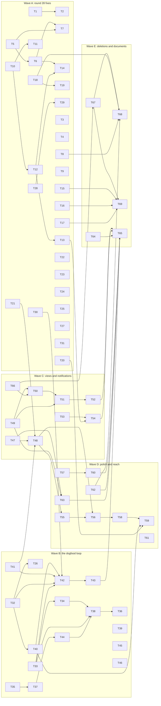

# UX first: lain develops lain, the round 28 fixes, and the first daily-driver features

status: in-progress
commit-mode: orchestrator-commits
language: ruby
panel: Ruby (Linus Torvalds, Jeremy Evans, Sandi Metz, Richard Schneeman, Aaron Patterson)

## Intent

3 asks from the user on 2026-10-28, in 1 plan:

1. Carry out the recommendation of [`planning/ux-first-research-2026-10.md`](../ux-first-research-2026-10.md)
   and [`planning/pi-features-research-2026-10.md`](../pi-features-research-2026-10.md) in all 3 waves: make
   lain able to run its own development loop (a config and verify command for this repo, conventions
   slots, thicker `create-plan` and `execute-plan` skills, a `handoff` skill, a `send_message` tool, a
   `TODOS.md` drain that runs single chores headless and lands them through `lain land`, a macOS build
   gate); then the views (`lain://tree` with labels, `lain://todos`, `lain export`, `/share`, a
   terminal and morning-feed notifier); then the polish (TTY markdown, a working indicator, tool-call
   lines, glyphs, a `theme` table, macOS runtime fixes).
2. Fix every finding in [`planning/qa-findings-round28-2026-10-28.md`](../qa-findings-round28-2026-10-28.md)
   rated MEDIUM or higher that bears on daily agentic work, plus the LOW to LOW-MED items whose fix
   removes a workaround from a day's use. The ones left out are listed under Coverage with a reason.
3. Stop keeping old session files readable. Sessions on disk are disposable (ruling 2026-10-28), so
   reader code that exists only for an older record shape goes, with its specs.

The user ruled 9 questions while this plan was written:

| question | ruling |
|---|---|
| plan scope | all 3 research waves plus the QA fixes in 1 document |
| committing `.lain/` | stays ignored for now; this repo's config lives in a tracked `dogfood/lain/` tree that `bin/dogfood-setup` links to `.lain`, and a linked worktree inherits the main checkout's `.lain/` (T32) |
| who approves a headless drain's gated calls | `--approval auto`: the judge rules, what it cannot settle fails the item |
| the chore file's name | `TODOS.md` by default, overridable per project with `todos file:` in `config.rb`; `TODO.md` is renamed `IDEAS.md` |
| k28-4 | an automatic allow on the string arm grants the parsed stages' resolved programs to the `workspace` sandbox, the way `bin/workspace-run` does; the remark that bundler binstubs would sidestep `bundle exec` is noted under Rejected options |
| x28-1 | the summarizer follows the chat's provider by default, the header names the tier, and a host-wide residency lock keeps a local model resident while a request for it is in flight: a request for a different local model on the same endpoint waits or, for an eager summary, is skipped, so nothing swaps the GPU model under a chat mid-request |
| j28-2 | a trust grant covers 1 project root; a lease that inherits the main checkout's `.lain/` is the same project |
| b28-2 | a review row counts as read only when a human opened its diff in this round |
| older session files | not owed; delete the fallbacks and their specs |

Round 28's defects cluster around 4 missing ideas, and the dogfood work adds a fifth:

| missing idea | findings | cards |
|---|---|---|
| a record a reader rebuilds must carry every field the writer hashed | i28-4, h28-4, x28-1 (header), l28-8 | T1, T2, T16, T18, T8 |
| what an allow grants, the sandbox must be told | k28-4, k28-1, k28-2, m28-1 | T5, T6, T7, T9, T30 |
| a decision the human made has to reach every object that acts on it | g28-3, g28-1, g28-4, b28-2, h28-3 | T10, T12, T13, T11, T25, T15 |
| a run's end, a crash and a lapse are 3 different events | j28-4, b28-6, b28-1, i28-5 | T3, T4, T21, T20, T29 |
| this repo is a lain project like any other | research A and B | T32 to T46 |

## Coverage

| finding | card | finding | card | finding | card |
|---|---|---|---|---|---|
| **i28-4 HIGH** | T1, T2 | k28-4 MED-HIGH (ruled) | T5 | g28-3 MED-HIGH | T10 |
| b28-1 (with f28-3) | T20 | k28-1 | T6, T7 | l28-8 | T8 |
| j28-4 | T3, T4 | j28-2 (ruled) | T26 | h28-3 | T15 |
| h28-4 | T16 | c28-2 | T22 | c28-3 | T23 |
| c28-4 | T24 | g28-1 | T12, T13 | g28-2 (with c28-6) | T14 |
| b28-2 (ruled) | T25 | x28-1 (ruled) | T18, T19 | g28-4 | T11 |
| m28-1 | T30 | k28-2 | T9 | i28-1 | T28 |
| i28-5, b28-7 | T29 | k28-3 | T27 | h28-2 | T17 |
| b28-6 (ruled: a lapse rings no bell) | T21 | i28-3 | T31 | scenario corrections owed | T65 |

Left out, with the reason:

| finding | why not here |
|---|---|
| a28-1, a28-4, l28-2 to l28-6, l28-9, c28-5 | bench and report wording; the bench grounds this plan and is not its subject. A later bench round |
| a28-2, a28-3, b28-3, b28-4, b28-5, d28-2, d28-3, d28-4, f28-2, f28-4, g28-5, g28-6 (j28-3), h28-5, h28-6, h28-7, i28-2 | LOW cosmetic or docs nits with no workaround cost in a day's use |
| d28-1 | a model copying lain's withheld-call marker; the ollama decoder, not a daily-driver surface |
| e28-1, e28-3, f28-1 | confinement and tripwire edge cases with no dogfood caller; next confinement round |
| h28-1 | `lain review` printing raw file names; a 1-line `Utf8.legible` fix the next review round takes |
| j28-5 | a `model` middleware not seeing the summarizer's calls is by design: the middleware is the agent's, the summarizer is a tier |

## Grounding

2026-10-28, `955cf59b` on `main`, ahead of `origin/main` (fetch refused; no worktree cut). 7 read-only
surveys covered the files below; a probe settled 1 premise (Spike findings). Line numbers are the surveys'
re-read lines, and the QA report's drifted in about 1 of 6 citations; where this plan cites a line it is the
re-read one.

- Config, trust, skills, roles, commands: `lib/lain/project_dir.rb`, `lib/lain/config.rb`,
  `lib/lain/config/{builder,isolation,keys,middleware}.rb`, `lib/lain/project/trust.rb`, `lib/lain/cli/trust.rb`,
  `lib/lain/skill/{catalog,library,renderer,invocation,role_spawn}.rb`, `lib/lain/prompt/{slots,skill_slots}.rb`,
  `lib/lain/role/catalog.rb`, `lib/lain/tools/subagent.rb`, `lib/lain/tools/subagent/actor.rb`,
  `lib/lain/tools/{session_usage,run_skill}.rb`, `lib/lain/cli/wiring/toolset_build.rb`,
  `lib/lain/cli/command/{registry,surface,quit,approve,rewind}.rb`, `.gitignore:19-22`.
- Headless chat, land, leases, records: `exe/lain`, `lib/lain/cli/{chat_launch,land,switchboard,conductor,repl}.rb`,
  `lib/lain/cli/repl/{ask,outcome}.rb`, `lib/lain/approval/judged.rb`, `lib/lain/shell/named.rb`,
  `lib/lain/isolation/{worktree,lease_lock,landing_queue,verifier,suite_lock,scratch}.rb`,
  `lib/lain/isolation/merge_coordinator/{drain,spool,spawner,batch,candidate_desk}.rb`,
  `lib/lain/isolation/worktree/{handback,release,registry}.rb`, `lib/lain/telemetry/{capability_degraded,session_closed,run_interrupted}.rb`,
  `lib/lain/telemetry.rb`, `lib/lain/journal.rb`, `lib/lain/session_record/replay.rb`, `lib/lain/bench/session/loader.rb`.
- nvim: `lib/lain/frontend/neovim.rb`, `lib/lain/frontend/neovim/{surfaces,buffers,status_view,epic_doc_view,rpc_thread,review_view,changeset_diff,command_inbox}.rb`,
  `lib/lain/frontend/neovim/runtime/{00_constants,01_dispatch,05_records,20_buffers,45_views,60_question,63_epic_doc,65_review,75_timeline,99_attach}.lua`,
  `lib/lain/cli/{chronicle,live_views,journal_tee,human_replies}.rb`, `lib/lain/session.rb`, `lib/lain/telemetry/{todo_snapshot,session_pin}.rb`,
  `lib/lain/cli/command/{pin,unpin,fork,btw}.rb`, `lib/lain/cli/resume/chain_walk.rb`, `ext/lain/src/lib.rs:2799-2893`, `plugin/nvim/lua/lain/init.lua`.
- TTY: `lib/lain/frontend/{tty,theme,wrap,decorators,intake,line_editor,input_pane}.rb`, `lib/lain/frontend/decorators/*.rb`,
  `lib/lain/frontend/input_pane/uncooked.rb`, `lib/lain/renderable.rb`, `lib/lain/agent/tool_delivery.rb`, `lib/lain/cli/repl/approval_surfaces.rb`,
  `lib/lain/cli/conductor.rb:495-503`, `lib/lain/cli/human_notes.rb`.
- Sandbox and secrets: `lib/lain/tools/bash.rb`, `lib/lain/confine/{sandbox,profiles,profile,request,mask_list,probe,bwrap,trace}.rb`,
  `lib/lain/exec/sandboxed.rb`, `lib/lain/shell/{verdict,programs,stages}.rb`, `lib/lain/shell/executable/{run_files,resolver}.rb`,
  `lib/lain/approval/{remembered,escalation}.rb`, `lib/lain/arm/driver.rb`, `lib/lain/tripwire/hit.rb`, `bin/workspace-run`,
  `lib/lain/sensitivity.rb`, `lib/lain/sensitivity/{history_literals,ledger,regions,entropy,policy}.rb`, `lib/lain/sensitivity/secrets/egress.rb`,
  `lib/lain/provider/http/egress_guard.rb`, `lib/lain/cli/backend/egress_literals.rb`, `lib/lain/cli/wiring/board_build.rb`, `lib/lain/cli/tool_guard.rb`,
  `lib/lain/middleware/{redact_secret_reads,refuse_secret_writes}.rb`.
- Memory, epic, compaction, summarizer: `lib/lain/bench/session/memory_replay.rb`, `lib/lain/memory/{item,writes,project_store,journal_memory_root}.rb`,
  `lib/lain/tools/memory_write.rb`, `lib/lain/telemetry/memory_loaded.rb`, `lib/lain/middleware.rb`, `lib/lain/agent/{tool_runner,model_caller,stop_reason}.rb`,
  `lib/lain/forge/local_landing.rb`, `lib/lain/epic/gate/policy.rb`, `lib/lain/epic/{gate,signoff_queue,submission}.rb`, `lib/lain/cli/{epic_queue,epic_submit}.rb`,
  `lib/lain/telemetry/tests_ran.rb`, `lib/lain/cli/backend.rb`, `lib/lain/cli/backend/{summarizer,span_summarizer,startup_notices,ollama_tier}.rb`,
  `lib/lain/cli/wiring/header.rb`, `lib/lain/session_record/sections.rb`, `lib/lain/provider/admission.rb`, `lib/lain/oracle/eager.rb`,
  `lib/lain/tool/round_budget.rb`, `lib/lain/compaction/{need,source,tool_messages}.rb`, `lib/lain/agent.rb:795-829`,
  `lib/lain/tools/subagent/lineage.rb`, `lib/lain/cli/watch.rb`.
- macOS and export: `Rakefile`, `Cargo.toml`, `ext/lain/Cargo.toml`, `crates/lain-core/Cargo.toml`, `crates/lain-fence/Cargo.toml`,
  `crates/lain-fence/src/{reap,netns,seccomp}.rs`, `lib/lain/confine/probe.rb`, `lib/lain/shell/pipeline.rb:143-204`, `lib/lain/liveness.rb`,
  `lib/lain/paths.rb`, `lib/lain/cli/{session_file,sessions,friction}.rb`, `lib/lain/session_record.rb`, `lib/lain/forge/gh.rb`,
  `lib/lain/telemetry/source_masked.rb`, `spec/support/tags.rb`.
- Elsewhere: `~/dev/junk-drawer/morning-feed/{exe/notify-feed,lib/morning_feed/notify_feed_cli.rb,lib/morning_feed/notify.rb}`,
  `~/.claude/skills/{create-plan,execute-plan,handoff,research}/SKILL.md` and their `references/`.

Where docs and code disagreed, the code won and the doc gets a line in T65 or the card that touches it:

- `.gitignore:19-22` says `/.lain/` is ignored for the HUD state; `lib/lain/project_dir.rb:6-17` says that state moved
  to `$XDG_STATE_HOME` and calls `.lain/` a project artifact. The user kept the ignore for now; T33 explains why in
  `docs/dogfood.md`.
- `README.md:603-604` says `.lain/skills/*.md` and `.lain/slots/skill/*.md`; the code reads
  `.lain/skills/<name>/skill.md` and `.lain/slots/skill/<skill>/<hole>.md`. T34 fixes the README lines.
- `docs/commands.md:1131` says 8 config verbs; `Builder::VERBS` has 9 (`env` is missing from the doc). T40 adds the
  10th and fixes the count.
- `docs/commands.md:740-750` lists only `diff`, `show` and `log` as git reads held to the whole checkout; `named.rb:657-664`
  holds every subcommand but 5, `commit` and `add` included. T30 changes the code and the doc together.
- `lib/lain/skill/catalog.rb:23-25` says the shipped skill tree is "empty today"; it holds 9 skills. T35 fixes the comment.
- `lib/lain/frontend/neovim/rpc_thread.rb` says "thirteen rails"; there are 16. T49 fixes the comment.
- `lib/lain/cli/backend.rb:73-77` says the summarizer tier "is journalled"; nothing in the header carries it, only a
  `request_sent` after the first summary. T18 makes the comment true.
- `research` says `lain://tree` needs children from the DAG; `ext/lain` exposes ancestors and set algebra only. T51
  builds the parent-to-children map from the heads the view has seen.
- `research` says `Telemetry::TodoSnapshot` may reach the nvim surfaces; `chronicle.rb:300-313` routes it to the
  session journal, never the tee, and `chronicle_spec.rb:634-646` pins that. T49 reads the list from the `Session`.

## Compatibility

| Surface | Verdict | Evidence |
|---|---|---|
| session file records: new `ask_settled` (T47), `turn_labeled` (T50), `gate_parked` (T16), a `summarizer` header section (T18), `session_closed reason crashed` (T4), `run_interrupted reason middleware` (T3), `lineage ended` body gains `message` (T29) | free to break; new readers need not accept old files | ruling 2026-10-28 (memory `old-sessions-disposable`); `SessionRecord::Replay` and `Bench::Session::Loader` ignore unknown types (`replay.rb:135-140, 273-278`, `loader.rb:61, 208`) |
| older session shapes the readers still accept | free to break, and this plan deletes them | T66 onward, from the inventory under Spike findings |
| `.lain/config.rb` DSL: project verb `todos` (T40), user verb `theme` (T59) | additive | `Builder::VERBS`, `USER_VERBS` (`builder.rb:26, 40`); an unknown verb is refused by name, so no old file breaks |
| trust marks under `$XDG_STATE_HOME/lain/trust/<digest>` (T26) | free to break; every existing mark is re-asked once | ruling j28-2; `project/trust.rb:159-166` |
| the summarizer's default provider (T18) | behaviour change, ruled | x28-1 ruling; `--summarizer-provider ollama` keeps today's default |
| `Confine::Request` and the `bash.rb:341` rule that parsed stages never reach the confinement (T5) | free to break; internal | ruling k28-4; only `spec/lain/tools/bash_spec.rb:1272-1345, 1498-1515` and `spec/lain/confine/*` pin it |
| `Telemetry::Sandbox` copies in a bench run journal gain `exec_record` siblings (T8) | free to break | `spec/lain/arm/driver_spec.rb:953-990` is the only reader |
| `lain land wait` exit codes, `lain land enqueue` output line | must keep | T42 parses `queued <id> for <branch> at position N` (`land.rb:77`) and the exit table (`land.rb:93-100`); nothing changes them |
| `TODO.md` | free to rename | 6 ROADMAP mentions; no code reads it |
| `lain.gemspec` | unpublished | `spec.metadata` has no push host; no consumer under `~/dev` outside this repo |
| `exe/lain` subcommands `todos`, `export`; commands `/share`, `/label`, `/release` | additive | `Command::Registry#register` refuses a duplicate name (`registry.rb:23-30`) |
| nvim runtime `BUFFERS` list and `plugin/nvim` layout (T49, T51) | additive; an unknown name renders as an orphan buffer | `00_constants.lua:15-17, 27`; `plugin/nvim/lua/lain/config.lua:24-27` lists only 4 by default |

Trade reports: 1. Keeping older session files readable would cost T66 onward nothing to delete and keep about 20
fallback branches and their examples. The user ruled on 2026-10-28 that the files are disposable, so the deletions
stay in.

## Spike findings

| Question | Result | Evidence |
|---|---|---|
| Does `NOFLSH` keep bytes written in the same write as a Ctrl-C, with `ISIG` still raising SIGINT? | Yes. Without it the read returned `""`; with it `"hello"`, and the SIGINT handler ran both times | `noflsh_probe.rb` in this session's scratchpad: a forked child made the pty its controlling terminal (`TIOCSCTTY`), cleared `ICANON` and `ECHO` through `TCGETS`/`TCSETS` as `Uncooked#owned` does, with and without `NOFLSH` (`0o200`); the parent wrote `"hello\x03"` in 1 write. Linux 7.1.8, ruby 4.0.6 |
| Does an eager summary block the agent when its model is busy or deferred? | No. `Oracle::Eager#fire` runs each summary on its own task; `Compaction::Source` reads `SummarySnapshot` and treats an absent summary as a miss, falling back to the elided record. On the critical path are only `--compact-strategy summarizing` spans, the handoff oracle and the secret oracle | `lib/lain/oracle/eager.rb:7-30`, `lib/lain/cli/backend/span_summarizer.rb:17-21`, `lib/lain/compaction/summary_snapshot.rb:162-167` (read) |
| Which older session shapes do readers still accept, and which have no current writer? | 6 pure reader fallbacks (todo `head`, arms `round_dedup`, the bench recorder's `head`, the "predates format 2" message split, absent `provenance`, unrecorded run profile) and 1 that needs the epic writers moved first (the cwd-keyed session directory). `causal_parents`, `slot_fills`, `compact_keep`, spawn `role`, headerless epic journals and the `.btw` stem are live shapes | inventory survey 2026-10-28, cited per card in T66 to T69 |
| Do `ext/lain` and `lain-core` have Linux-only dependencies? | No. Only `lain-fence` does (`landlock`, `seccompiler`, `nix::sys::prctl`, `/proc` reads). `rake compile` defines `:compile` twice and the second action builds the fence unconditionally | `Cargo.toml:6`, `ext/lain/Cargo.toml`, `crates/lain-core/Cargo.toml`, `crates/lain-fence/Cargo.toml:16-29`, `crates/lain-fence/src/reap.rs:12`, `Rakefile:118-128` (read, plus `cargo tree -p lain-fence -e normal --depth 1`) |
| Can `lain chat` run inside a lease it did not cut? | Yes: `--root <lease> --cwd <lease>`; the resolver treats a linked worktree's `.git` pointer file as a root. No flag cuts the lease; the chat's own session is never isolated | `exe/lain:195-202, 1493-1500`, `lib/lain/project/resolver.rb:60-66`, `lib/lain/cli/wiring.rb:321-325` (read) |

No spike worktree was cut; the probe ran as a standalone script against the kernel, not the repo.

## Shared files

Only the main session edits these. A card hands back a 1-line (or 1-entry) diff.

- `exe/lain` (T43 `todos`, T53 `export`: a `desc` plus `subcommand`/method pair near :1362 and :1534; the
  `HELP_MAPPINGS` row)
- `spec/lain/cli_spec.rb` stray-switch table (:693-703) for each new subcommand
- `lib/lain/config/builder.rb` (`VERBS`, `USER_VERBS`, the `Built` members: T40 `todos`, T59 `theme`)
- `lib/lain/frontend/decorators.rb` (`Decorators.for` clauses: T48, T55, T57, T60)
- `lib/lain/frontend/theme.rb` `DEFAULT_TOKENS` rows (T55, T57 and T60 hand back their tokens); T58 and T59 edit the
  file themselves, in sequence, as their Files say
- `lib/lain/cli/command/surface.rb` `builtins` (T13 `/release`, T54 `/share`), `history_commands` (T50 `/label`) and
  `place` (T69)
- `lib/lain/frontend/neovim/buffers.rb` `initial`/`updates` hashes and `initialize`, and
  `lib/lain/frontend/neovim/runtime/00_constants.lua` (`BUFFERS`, `READONLY_FILETYPES`): T49, T51
- `spec/support/tool_registry.rb` (T39)
- `docs/commands.md` (every card that adds a command or verb hands back its section; T65 reconciles)
- `ROADMAP.md`, `CLAUDE.md` (T64 only; both carry the user's uncommitted edits, so the main session edits
  and stages them by explicit path)
- `.rubocop.yml`, `spec/spec_helper.rb`, `spec/support/slow_files.rb` (T42), `lain.gemspec`, `Gemfile`, `Gemfile.lock`

`lib/lain/telemetry/run_interrupted.rb` and `session_closed.rb` each have 1 card (T3, T4) and are not shared;
`spec/lain/agent/stop_reason_spec.rb:102` checks every `REASONS` answer, so each card runs that spec.

## Rejected options

- **Bundler binstubs (`bin/rspec`) instead of fixing the string arm.** A binstub runs through
  `#!/usr/bin/env ruby`, so the fence still has to be told about mise's ruby, which is the k28-4 grant; and
  `bin/` here is lain's dev-script directory. T5 fixes the general case. Binstubs stay a per-project
  convenience the user may add by hand.
- **Committing `.lain/config.rb` now.** The user kept the ignore; `dogfood/lain/` plus `bin/dogfood-setup`
  (T33) gives the same bytes to every clone and lets the decision wait.
- **A hook bus or `Lain.hook`.** Rejected in `planning/specs/config-middleware.md`; T47's `ask_settled` is
  1 record, which the notifier and the drain both read.
- **A `command` config verb.** No caller: `/label`, `/release` and `/share` are built-ins, and a project skill
  already answers to `/name` through `SkillDispatch`. YAGNI until a project wants a command a skill cannot be.
- **A `tool` config verb, MCP, packages, `/reload`, keybinding files, virtual models.** No caller, and 3 of them
  cut against standing decisions (one config read per launch; MCP out of scope).
- **Routing `write_todos` through the Journal tee so `lain://todos` sees `TodoSnapshot` events.** The tee is
  for cuts only (`chronicle.rb:300-313`, pinned by `chronicle_spec.rb:634-646`); the view reads the list from
  the `Session` it already holds and redraws on `TurnUsage`, as the workspace view does (T49).
- **Children in the Rust DAG for `lain://tree`.** A parent-to-children index in `Ext::Store` would be a new
  binding for a view that only needs the heads it has seen; T51 folds them in Ruby. If the tree later needs
  every head in the Store, that is a `docs/rust-bindings.md` question.
- **Pi's abandoned-branch summary on tree navigation.** Open decision; nothing here depends on it.
- **A `:linux` spec tag.** The 30 skips are capability-based (bwrap, fence, user namespaces, `/proc`), which is
  the right gate; a Mac run of the rest is an integration check, not a tag.
- **Seatbelt confinement for macOS.** Cannot be driven from this box; see Open decisions.
- **A `❯` prompt marker.** The literal `you> ` is matched by 6 frontend specs and by the input socket's
  protocol tests (`spec/lain/cli/input_socket_spec.rb`), and the prompt kind is already carried as a kind, not a
  string. Recolouring the marker is the `prompt` token's job (T59); changing its text buys little for the ripple.
- **Vendoring pi's HTML viewer.** T53 renders from `Journal.records` with 1 ERB template; the viewer's
  interactivity has no caller.
- **`auto-dev add-repo ~/dev/lain --branch-only` as the drain.** Works tonight and dogfoods nothing; T42 is the
  first script that exercises `--non-interactive` and `lain land` together.
- **Epic as the `TODOS.md` consumer.** Every issue needs a slug and Gherkin criteria behind gates; a one-line
  chore is below that tier. A multi-step item is a human's call (Open decisions).
- **Making every verdict-abstained command take `traced`.** Weakest confinement for every judge allow; ruled out.
- **Adding mise's install dir and `~/.cargo/bin` as blanket exec dirs.** Grants every installed tool, not the
  ones the command named; ruled out in favour of T5.
- **`Lain::Todos` as the chore model's namespace.** `Lain::Config::Todos` and `Lain::CLI::Todos` would shadow it
  inside their own namespaces (CLAUDE.md, Known traps), so the queue, item, runner and brief live under
  `Lain::Chores`; the file, the verb and the command keep the user's word, `todos`.
- **`--no-verify` on the drain's commits.** A judged commit runs the hooks the checkout has, as a human's does;
  the suite then runs twice, in the hook and in the verify checkout, and a nightly drain can afford it. T30
  keeps `--no-verify` out of the judgeable class.
- **Turning the entropy arm off for whole lockfiles.** A `resolved` URL in `package-lock.json` can carry
  `user:token@`, which only the entropy arm catches; T14 exempts checksum-shaped values instead.

## Open decisions

No card below depends on one of these.

- **Seatbelt confinement on macOS.** A `:seatbelt` probe layer and a deny-first `sandbox-exec` profile (project
  root read-write, toolchain read-only, `~/.ssh` and `~/.aws` denied) is the shape Cursor shipped. It needs a
  spike on the MacBook before it can be a card; this box cannot run `sandbox-exec`. Until then a Mac run is
  unconfined with a journaled `CapabilityDegraded`, which `Confine::Sandbox` already does.
- **Multi-step `TODOS.md` items.** T42 runs every untagged item as 1 headless chat and `[research]` items through
  the `research` skill. Whether a `[epic]` tag should run `lain epic add` and stop is for after the first week
  of drains.
- **Pi's branch summary when leaving a tree node.** `lain://tree` picks a node and rewinds (T51). Appending a
  `Summarizer` summary of the abandoned branch at the new head is a later card once the tree has been used.
- **`send_message` for one-shot children.** T39 reaches only actors (the `issue_orchestrator` role). The chat's
  implementer children are one-shot; giving them a mailbox is a `Tools::Subagent` design change with no card.
- **A chat's own lease from the CLI.** T42 cuts the lease itself and passes `--root`/`--cwd`. Whether `lain chat
  --lease` should exist is open; the runner is its only caller today.
- **Where `IDEAS.md` items go when they are ready.** T45 renames the file; a later pass may move ripe ideas into
  `TODOS.md` by hand.
- **Confinement of the verify step.** `Isolation::Verifier::Command` spawns `bin/verify` in the verify checkout
  with the env scrubbed and no sandbox (`verifier/command.rb:63-73`). A nightly drain therefore runs the model's
  committed specs with the user's privileges, where the chat that wrote them ran under the workspace sandbox and
  the judge. This plan keeps the verify as `lain land` runs it today, so the drain adds no privilege an
  interactive `/execute-plan` landing does not already use, and `docs/dogfood.md` says so (T43). Running the
  verify under the workspace profile is a card for after T5 has shown `bundle exec rspec` runs under it; parking
  drain entries for a human before the verify is the alternative. The user rules.
- **Where a lease's sessions file.** A chat with `--root <lease>` journals under the lease path's hash
  (`chronicle.rb:205`). T42 reads the file back from there. Filing a linked worktree's sessions under the main
  root, so `lain sessions` lists them, is a follow-up to T69 once the drain has run.

## Dependency graph



Cards with no incoming edge start in wave A's first batch whatever their group; the groups are reading order,
not gates. An edge between 2 cards that share no behaviour (T66 to T50, T8 to T68, T20 to T59) orders a shared
spec file; the later card re-reads it.

## Tasks

### Wave A: the round 28 fixes

### T1: Rebuild replayed memory items with their sources and author          [risk: high]

**Depends on:** none
**Files:** `lib/lain/bench/session/memory_replay.rb`, `spec/lain/bench/session/memory_replay_spec.rb`
**Reuse:** `Memory::Item.from_canon` (`lib/lain/memory/item.rb:46`) already reads `canon.fetch("sources", {})`;
`Telemetry::MemoryLoaded.of` writes `items: loaded.items.map(&:payload)`, so every journaled item carries
`sources` and a non-chat `author` (`lib/lain/telemetry/memory_loaded.rb:34`)
**Shared-file wiring:** none
**Reachable from:** `CLI::Resume#replay` -> `SessionRecord::Replay#memory` -> `Bench::Session::MemoryReplay#seeded`
(`lib/lain/cli/resume.rb:268`, `lib/lain/session_record/replay.rb:94`); `Bench::Session::Loader:377`

**Acceptance criteria**

```gherkin
Scenario: a sourced clerk item replays to the recorded version
  Given a session file whose memory_loaded record holds an item with sources and author clerk
  When the session is resumed through CLI::Resume
  Then no Corrupt is raised and the rebuilt view's version equals the record's version

Scenario: the rebuilt item is the written item
  Given a memory_loaded record whose item payload names sources {"lib/a.rb" => "blake3:..."}
  When MemoryReplay rebuilds it
  Then the item's sources, author and digest equal the payload's
```
Spec file: `spec/lain/bench/session/memory_replay_spec.rb`, `spec/lain/cli/resume_spec.rb`

**Stop and report if:**
- `Memory::Item#payload` (`item.rb:67-72`) omits any field other than a chat author and empty sources, since
  `item_from` has to pass exactly the hashed set
- `spec/lain/seams/project_memory_spec.rb:132-235` resumes a consolidated project and still refuses after
  the fix: the in-session half (T2) is then the live cause and the 2 cards merge

### T2: Replay an in-session memory write with the digests it recorded          [risk: high]

**Depends on:** T1
**Files:** `lib/lain/memory/writes.rb`, `lib/lain/tools/memory_write.rb`, `spec/lain/memory/writes_spec.rb`,
`spec/lain/tools/memory_write_spec.rb`
**Reuse:** `Memory::Staleness#record` computes the source digests at write time (`lib/lain/memory/staleness.rb:40`);
`Tool::Result` text is journaled with the tool_result block, so the written item's canon can ride it
**Shared-file wiring:** none
**Reachable from:** `CLI::Wiring` builds `Tools::MemoryWrite` (`lib/lain/cli/wiring.rb:154`); `Consolidation:196`;
replay through `Memory::Writes#item_for` (`writes.rb:62-65`)

**Acceptance criteria**

```gherkin
Scenario: a sourced write survives the next turn's replay check
  Given a chat that wrote a memory item with sources and then took another turn
  When the recorded writes are replayed by MemoryReplay#agree!
  Then the replayed item digest equals the written item digest

Scenario: the tool result names what the replay needs
  Given memory_write is called with id, description, body and 2 source paths
  When it returns
  Then its result text carries the item's canon, sources digests and author, and the journal holds the same
```
Spec file: `spec/lain/memory/writes_spec.rb`, `spec/lain/tools/memory_write_spec.rb`

**Interface**

```ruby
# lib/lain/memory/writes.rb
def item_for(call, result) # => Memory::Item, rebuilt from the result's recorded canon rather than the input
```

**Stop and report if:**
- the tool result's byte ceiling (`Tool::Bounds::CEILINGS`) cuts the canon on a long body: the digests then need
  their own `Telemetry` record instead, and the card grows by a file
- `spec/lain/memory/writes_spec.rb` has an example asserting that replay ignores the result text

### T3: Refuse the ask when a middleware member raises          [risk: medium]

**Depends on:** none
**Files:** `lib/lain/middleware.rb`, `lib/lain/agent/stop_reason.rb`, `lib/lain/telemetry/run_interrupted.rb`,
`spec/lain/middleware_spec.rb`, `spec/lain/agent/stop_reason_spec.rb`, `spec/lain/cli/repl_middleware_spec.rb`,
`spec/lain/telemetry/run_interrupted_spec.rb`
**Reuse:** `Repl::Ask#settle` already turns any `Lain::Error` into a rendered refusal and a `run_interrupted`
record (`lib/lain/cli/repl/ask.rb:62-66, 105, 117-125`); `Config::Middleware#members` names each member
(`lib/lain/config/middleware.rb:116`)
**Shared-file wiring:** `lib/lain/telemetry/run_interrupted.rb:52` `REASONS` gains `middleware`
**Reachable from:** `Agent#run` -> `ToolRunner#dispatch` (`tool_runner.rb:460`) and `ModelCaller#call`
(`model_caller.rb:39`) -> `Middleware::Stack#call` (`middleware.rb:128-135`)

**Acceptance criteria**

```gherkin
Scenario: a raising tool middleware ends the ask, not the chat
  Given a .lain/config.rb whose tool middleware raises RuntimeError on call
  When a one-shot chat runs a tool
  Then the frontend prints a refusal naming the member and the chat reaches the next you> prompt
  And the journal holds run_interrupted with reason middleware

Scenario: the member is named
  Given a Stack of 2 members where the second raises
  When call runs
  Then Middleware::MemberFailed is raised and its message names the second member's class
```
Spec file: `spec/lain/middleware_spec.rb`, `spec/lain/cli/repl_middleware_spec.rb`

**Interface**

```ruby
# lib/lain/middleware.rb
class MemberFailed < Lain::Error; attr_reader :member; end # raised from the rescue, so Exception#cause is the original
```

**Stop and report if:**
- `spec/lain/agent/stop_reason_spec.rb:102` lists the reasons exhaustively in a way that a new one must also
  appear in `spec/lain/telemetry/run_interrupted_spec.rb`; add it there in the same commit
- a `Lain::Error` raised by a member is already caught today and the wrapping would double-wrap it: wrap only
  non-`Lain::Error` StandardErrors

### T4: Close a crashed session as crashed          [risk: medium]

**Depends on:** none
**Files:** `lib/lain/cli/chat_launch.rb`, `lib/lain/telemetry/session_closed.rb`, `spec/lain/cli/chat_launch_spec.rb`,
`spec/lain/telemetry/session_closed_spec.rb`
**Reuse:** `ChatLaunch#call`'s `ensure` (`chat_launch.rb:121-127`); `Conductor#close(reason:)` (`conductor.rb:286-293`)
**Shared-file wiring:** `lib/lain/telemetry/session_closed.rb:39` `REASONS` gains `crashed`
**Reachable from:** `exe/lain:1525-1531` `chat` -> `ChatLaunch#call`

**Acceptance criteria**

```gherkin
Scenario: an escaped exception is recorded as a crash
  Given a chat whose run raises a non-Lain error past the REPL
  When the process unwinds
  Then the session file ends with session_closed reason crashed naming the error class
  And the exception still escapes to exe/lain with exit 1

Scenario: a normal quit is still exit
  Given a chat that quits at you>
  When it closes
  Then session_closed carries reason exit

Scenario: a signal is not a crash
  Given a chat ended by Interrupt or another SignalException
  When it closes
  Then session_closed carries the reason it carries today, never crashed
```
Spec file: `spec/lain/cli/chat_launch_spec.rb` (the `:249` ensure-on-raise example is the seam)

**Stop and report if:**
- `Resume::Salvager` or `lain sessions` treats an unknown close reason as "open" and would list a crashed session
  as live; both must read `crashed` as closed

### T5: Grant the parsed stages' programs under the workspace sandbox          [risk: high]

**Depends on:** none
**Files:** `lib/lain/tools/bash.rb`, `lib/lain/confine/request.rb`, `lib/lain/confine/profiles.rb`,
`spec/lain/tools/bash_spec.rb`, `spec/lain/confine/request_spec.rb`, `spec/lain/confine/profiles_spec.rb`,
`spec/lain/seams/workspace_profile_spec.rb`
**Reuse:** `Bash#perform` already parses the command into stages for the journal (`Parsed`, `bash.rb:486-511`,
over `Shell::Stages.of`); `Resolver::Bound` resolves a stage's program and run files
(`lib/lain/shell/executable/resolver.rb:49-77`); `Profiles#grantable?` is the one filter every granted program
passes (`GRANTED_CLASSES`, a realpath, not under `SYSTEM_EXEC`; `profiles.rb:157-158, 216-223`) and `BuildGrant`'s
freshness check sits behind it; `bin/workspace-run:100-111` is the term-arm reference that grants `exec_files`
and `install_bins`
**Shared-file wiring:** none
**Reachable from:** `ToolsetBuild#build` -> `Tools::Bash` with the `Confine::Sandbox` built at
`lib/lain/cli/wiring/toolset_build.rb:383-389` -> `Bash#confinement_for` (`bash.rb:358-363`) ->
`Sandbox#wrap` -> `Profiles#for` (`profiles.rb:106-118`)

**Acceptance criteria**

```gherkin
Scenario: a judge allow runs a bundler command under workspace
  Given a project with a Gemfile and bwrap, landlock and lain-fence on the box
  And the judge allows "bundle exec ruby -e 'puts 42'"
  When the call runs
  Then it exits 0 printing 42 under the workspace profile
  And the sandbox record names the granted programs

Scenario: a remembered rule runs every time
  Given .lain/config.rb approves bash command "ruby hello.rb" with an allow rule
  When the same command runs 3 times in a chat
  Then each run exits 0 under the workspace profile

Scenario: a grant is a grant, not proof
  Given a command whose parsed stage names a program that resolves outside the toolchain and project
  When the request is built
  Then the program is not granted and the journal's exec_resolution names the stage as unresolved
```
Spec file: `spec/lain/tools/bash_spec.rb`, `spec/lain/confine/profiles_spec.rb`, `spec/lain/seams/workspace_profile_spec.rb`

**Interface**

```ruby
# lib/lain/confine/request.rb
Request = Data.define(:ruling, :executables, :argv, :cwd, :root, :tool_use_id, :grants)
def initialize(ruling:, executables:, cwd:, root:, tool_use_id:, argv: [], grants: []) # grants Ractor.make_shareable'd like executables
# grants: Array<Shell::Executable>, the parsed stages' resolved programs on the string arm; [] on the term arm.
# Profiles#exec_files and #install_bins read executables + grants through the same grantable? filter; a program
# the project could have planted is refused on both arms alike
```

**Stop and report if:**
- `bash_spec.rb:1316-1324` or `:1498-1515` pins that the string arm hands the confinement nothing: these change
  with the ruling and the comment at `bash.rb:341-343` is rewritten to "handed as grants, never as proof"
- a granted path lies under a mask (`MaskList#classify` says sensitive): the grant must be dropped and the
  refusal worded, because the k28-1 reader path is the sibling T6
- `bin/workspace-run:104-106` builds a `Request` by keyword and the new default does not cover it: the script is
  a caller, keep it working in the same commit

### T6: Make related directories readable inside the sandbox, masked          [risk: high]

**Depends on:** T5 (shares `confine/profiles.rb`)
**Files:** `lib/lain/sensitivity.rb`, `lib/lain/sensitivity/policy.rb`, `lib/lain/confine/mask_list.rb`,
`lib/lain/confine/profiles.rb`, `lib/lain/confine/profile.rb`, `spec/lain/sensitivity_spec.rb`,
`spec/lain/sensitivity/policy_spec.rb`, `spec/lain/confine/mask_list_spec.rb`, `spec/lain/confine/profiles_spec.rb`,
`spec/lain/confine/profile_spec.rb`, `spec/lain/seams/related_read_spec.rb`
**Reuse:** `Rules#related` and `relating_directories!` validate the list (`sensitivity.rb:739-783`); `MaskList`
is already "the object that answers for the session's policy" (`sandbox.rb:41-42`) and lists masks under the
project with `git ls-files`; `Profile.reader`'s read list (`profile.rb:219-223`) with the project first
**Shared-file wiring:** none
**Reachable from:** `ToolsetBuild:384` `MaskList.new(root:, policy: -> { @switchboard.call.sensitivity })` ->
`Sandbox#wrap` -> `Profiles.new(masks:, classifier: masks, ...)` -> `Profile.reader`

**Acceptance criteria**

```gherkin
Scenario: a related sibling repository is readable by an allowed command
  Given sensitivity related names a sibling directory holding src/m1.rs and a .git
  When an allowed "cat <sibling>/src/m1.rs" and "git -C <sibling> log" run under the reader profile
  Then both exit 0 with their output

Scenario: a related directory's secrets stay masked
  Given the sibling holds a .env with KEY=value
  When "cat <sibling>/.env" runs under the reader profile
  Then the output shows the masked placeholder and no value byte

Scenario: the project stays first
  Given a related directory is configured
  When Profile.reader is built
  Then read_dirs begins with the project root and the related directory follows the git dir
```
Spec file: `spec/lain/confine/profile_spec.rb`, `spec/lain/confine/mask_list_spec.rb`, `spec/lain/seams/related_read_spec.rb`

**Interface**

```ruby
# lib/lain/sensitivity/policy.rb
def related_directories # => Array<String>, absolute, expanded; [] on the Null policy
```

**Stop and report if:**
- `profile_spec.rb:17` pins the exact `read_dirs` list by equality: extend the example, keep the "project first"
  invariant that `bwrap.rb:110` and `profile.rb:273, 391` read
- `MaskList` lists masks with `git ls-files` under 1 root and a related directory is not a repository: the mask
  listing then needs the walker `lib/lain/file_walk.rb` for that root, which is a second responsibility; stop and
  propose the split

### T7: Name the sandbox when a confined command is denied a read          [risk: low]

**Depends on:** T5, T6
**Files:** `lib/lain/exec/sandboxed.rb`, `spec/lain/exec/sandboxed_spec.rb`
**Reuse:** `Exec::Sandboxed#worded` phrases exec refusals from the trace (`sandboxed.rb:180-195`); the profile
knows its read list
**Shared-file wiring:** none
**Reachable from:** `Sandbox#wrap` -> `Exec::Sandboxed` (`sandbox.rb:63`)

**Acceptance criteria**

```gherkin
Scenario: a Permission denied under a confining profile names the sandbox
  Given a command under the reader profile exits non-zero with "Permission denied" on stderr for a path outside its read list
  When the result is worded for the model
  Then it ends with a line naming the profile, saying reads are limited to the project and related directories, and pointing at read_file for a masked read

Scenario: an ordinary failure is left alone
  Given a command exits 1 with a test failure on stderr
  When the result is worded
  Then no sandbox line is added
```
Spec file: `spec/lain/exec/sandboxed_spec.rb`

**Stop and report if:**
- the stderr is masked before `worded` sees it (`Tools::Bash` masks output) so the text match cannot run on the
  raw bytes: then the detection has to be the exit status plus a path outside the read list named in argv

### T8: Copy the exec record into the bench run journal          [risk: low]

**Depends on:** none
**Files:** `lib/lain/arm/driver.rb`, `spec/lain/arm/driver_spec.rb`, `spec/lain/bench/cli_spec.rb`
**Reuse:** `SandboxCopy#<<` and `CopyingSeam` (`driver.rb:104-126`); `Telemetry::Stamped::Sink`
**Shared-file wiring:** none
**Reachable from:** `Arm::Driver#run_copy` (`driver.rb:323`)

**Acceptance criteria**

```gherkin
Scenario: a refused exec is visible in the run journal
  Given a --confine workspace arm whose command execs a program the fence refuses
  When the arm finishes
  Then the run journal holds a stamped exec_record whose refusals name the program
  And the sandbox record beside it still reads profile workspace
```
Spec file: `spec/lain/arm/driver_spec.rb` (`:953-990` changes from "only Sandbox" to "Sandbox and ExecRecord")

**Stop and report if:**
- `spec/lain/bench/cli_spec.rb:884-913` counts the copied records and would break on the second kind; update
  it in the same commit

### T9: Resolve a `git -C <dir>` stage          [risk: medium]

**Depends on:** none
**Files:** `lib/lain/shell/executable/run_files.rb`, `spec/lain/shell/executable/run_files_spec.rb`,
`spec/lain/shell/stages_spec.rb`
**Reuse:** `Shell::Stages#resolved` already moves the cwd to the `-C` directory before resolving
(`stages.rb:57-67`); `Named#git_directory` reads `-C` (`named.rb:540`)
**Shared-file wiring:** none
**Reachable from:** `Bash#recorded` -> `Parsed#journal` -> `Shell::Stages.of` -> `Resolver::Bound#unwrap` ->
`RunFiles#of` (`resolver.rb:75-77`, `run_files.rb:185-186`)

**Acceptance criteria**

```gherkin
Scenario: a -C stage resolves its program and run files
  Given a repository at dir and the command "git -C dir log --oneline"
  When the stage is resolved
  Then the executable's realpath is git's and its run files are dir's build files
  And the tripwire ledger raises no unresolved_exec for the traced git

Scenario: the other redirect options still abstain
  Given the command "git --git-dir=elsewhere log"
  When the stage is resolved
  Then it is unresolved, as today
```
Spec file: `spec/lain/shell/executable/run_files_spec.rb` (`:395-399` reverses for `-C` only)

**Stop and report if:**
- `Stages` passes argv still carrying `-C dir` so `RunFiles` sees the option twice: strip it in 1 place only,
  and say which in the handback

### T10: Let a release reach the egress guard          [risk: high]

**Depends on:** none
**Files:** `lib/lain/sensitivity/ledger.rb`, `lib/lain/sensitivity/secrets/egress.rb`,
`lib/lain/sensitivity/secrets/source.rb`, `lib/lain/cli/backend/egress_literals.rb`, `lib/lain/provider/http/egress_guard.rb`,
`lib/lain/middleware/redact_secret_reads.rb`, `spec/lain/sensitivity/ledger_spec.rb`,
`spec/lain/sensitivity/secrets_spec.rb`, `spec/lain/cli/backend/egress_literals_spec.rb`,
`spec/lain/provider/http/egress_guard_spec.rb`, `spec/lain/middleware/redact_secret_reads_spec.rb`,
`spec/lain/seams/egress_spec.rb`
**Reuse:** the `Ledger` is the one run-shared object both the middleware and the command surface hold
(`switchboard.rb:261`, `tool_guard.rb:719-722`), and it stores region digests, never bytes (`ledger.rb:100-122`,
`released?(path, digest)`); a region carries its `digest` beside its `bytes` (`regions.rb:406`) and the digest function
is the region's own, not `Canonical.digest` (`regions.rb:26`); `Egress.of` is a frozen `Data` rebuilt per request
(`egress.rb:36-44`); `Backend#attach` binds the guard to the board's `Source` (`backend.rb:431`, `egress_literals.rb:51-59`)
**Shared-file wiring:** none
**Reachable from:** `Backend#attach` -> `EgressLiterals#bind(board.guard_inputs.secrets)` -> `EgressGuard#known`
(`egress_guard.rb:114`) -> `Secrets::Source#egress`

**Acceptance criteria**

```gherkin
Scenario: an approved release lets the next request through
  Given .env with KEY=secret exists at launch and the chat is --approval ask
  When the human answers y at the path gate and y at the release for read_file .env
  Then the next request is sent and the journal holds read_released then request_sent with no egress_refused

Scenario: an unreleased secret is still refused
  Given the same .env and the human declines the release
  When the model echoes the value into its next request
  Then egress_refused is journaled and the request is not sent

Scenario: a release is per region
  Given .env holds 2 secrets and only the first is released
  When a request carries the second
  Then it is refused

Scenario: the ledger never holds a secret's bytes
  Given a release of 2 regions
  When the ledger is inspected
  Then it holds their digests and no byte of either value
```
Spec file: `spec/lain/seams/egress_spec.rb`, `spec/lain/cli/backend/egress_literals_spec.rb`, `spec/lain/sensitivity/ledger_spec.rb`

**Interface**

```ruby
# lib/lain/sensitivity/ledger.rb
def released_digests # => Set<String>, every released region's digest over every path, frozen copy
# lib/lain/sensitivity/secrets/egress.rb
def self.of(env:, history:, released: Set.new) # a literal whose region digest is in released moves from refused to flagged
```

**Stop and report if:**
- `EgressLiterals#bind` compares sources with `==` and a `Source` carrying a mutable ledger breaks that: pass the
  ledger beside the source rather than inside it
- `egress_guard_spec.rb:274-433` pins `refused` and `flagged` as pure functions of env and history: add
  `released:` as a third input, never a mutable read inside `Egress`
- the guard's literals (`HistoryLiterals`) carry no region digest: digest each with the region's own function
  (`regions.rb:26`) at compare time; never give the ledger the bytes

### T11: Land `/rewind N` on a settled turn          [risk: low]

**Depends on:** T10 (shares `egress_guard_spec.rb`)
**Files:** `lib/lain/cli/command/rewind.rb`, `lib/lain/provider/http/egress_guard.rb`,
`spec/lain/cli/command/rewind_spec.rb`, `spec/lain/provider/http/egress_guard_spec.rb`
**Reuse:** `Rewind#settled_target!` already names the nearest valid targets (`rewind.rb:170-187`); the guard's
hint is `IN_TURN` computed from request positions (`egress_guard.rb:41-43, 129-133`)
**Shared-file wiring:** none
**Reachable from:** `Command::Surface#history_commands` -> `Rewind`; `EgressLiterals#entries` -> `EgressGuard#refusal`

**Acceptance criteria**

```gherkin
Scenario: a count landing on a tool_use turn rounds to the settled turn before it
  Given a timeline whose Nth turn back is an assistant tool_use turn
  When the human types /rewind N
  Then the head moves to the nearest settled turn before it and the reply says which turn and why

Scenario: the egress hint is a count the command accepts
  Given a request refused for carrying a known secret that entered at a tool result
  When the refusal is rendered
  Then its /rewind hint names a count that lands on a settled turn, or names /rewind with no count and the turn's digest prefix
```
Spec file: `spec/lain/cli/command/rewind_spec.rb`, `spec/lain/provider/http/egress_guard_spec.rb` (`:89-109` pins the hint text)

**Stop and report if:**
- `settled_target!` is also what refuses `/rewind <digest>` on a tool_use turn: rounding must apply to the count
  form only, so a digest the human typed is still refused by name

### T12: Keep the decline memory on the ledger and say what cannot be released          [risk: medium]

**Depends on:** T10
**Files:** `lib/lain/sensitivity/ledger.rb`, `lib/lain/middleware/redact_secret_reads.rb`,
`spec/lain/sensitivity/ledger_spec.rb`, `spec/lain/middleware/redact_secret_reads_spec.rb`
**Reuse:** the 3 per-instance Sets (`redact_secret_reads.rb:221-227`), `declined?`, `remembered`, `lapsed?`,
`settle`, `mask` (`:407-480`); the `Ledger` is already shared by the parent and every child stack
**Shared-file wiring:** none
**Reachable from:** `ToolGuard:598` builds `RedactSecretReads` with `ledger: inputs.ledger`

**Acceptance criteria**

```gherkin
Scenario: a child's decline is the run's decline
  Given the parent declined the release of .env region 1
  When a child stack reads the same file
  Then the read is masked without a new prompt, because the ledger holds the decline

Scenario: the trailer tells the truth about a related directory
  Given a read under a sensitivity related directory is masked
  When the trailer is rendered
  Then it says the regions are masked because the file lies under a related directory and are never released
  And it does not say "Tell the user which file you need unmasked"

Scenario: a lapse is recorded as a lapse
  Given a release prompt times out
  When the trailer is rendered
  Then it names the lapse and says a human may still release it
```
Spec file: `spec/lain/middleware/redact_secret_reads_spec.rb` (`:818-834, 855-907` change wording), `spec/lain/sensitivity/ledger_spec.rb`

**Interface**

```ruby
# lib/lain/sensitivity/ledger.rb
def decline(path, regions); def lapse(path, regions); def declined?(path, region); def lapsed?(path, region)
def forget(path) # => Integer, how many declines and lapses were cleared (T13's caller)
# every reader and writer runs under 1 Monitor, as Journal's writes do: the ledger is shared by parallel child stacks
```

**Stop and report if:**
- `Ledger` is a frozen `Data` or `Ractor.shareable?` is asserted on it: it already mutates under `release`
  (`ledger.rb:100-106`), so confirm the shape before adding Sets

### T13: Add `/release PATH` to undo a decline or lapse          [risk: medium]

**Depends on:** T12
**Files:** `lib/lain/cli/command/release.rb` (new), `spec/lain/cli/command/release_spec.rb` (new),
`spec/lain/cli/command/surface_spec.rb`
**Reuse:** `Command::Approve` and `Command::Rewind` as the command shape; `Surface` already holds `ledger:`
(`surface.rb:58, 187-188`)
**Shared-file wiring:** `lib/lain/cli/command/surface.rb` `builtins` gains `Release.new(ledger:, sensitivity:)`; `docs/commands.md`
"Session commands" gains a `/release` heading
**Reachable from:** `Command::Surface#builtins` -> `Registry#register` -> `Repl#dispatch`

**Acceptance criteria**

```gherkin
Scenario: a declined file asks again
  Given the human declined the release of config/master.key
  When they type /release config/master.key and ask the model to read it again
  Then the read parks on the release prompt once more

Scenario: a path with nothing to forget says so
  Given no decline or lapse is recorded for README.md
  When the human types /release README.md
  Then the reply says nothing was declined for it and journals nothing

Scenario: a related directory cannot be released
  Given the path lies under a related directory
  When the human types /release on it
  Then the reply says related directories are masked and never released
```
Spec file: `spec/lain/cli/command/release_spec.rb`

**Interface**

```ruby
# lib/lain/cli/command/release.rb
class Release
  def initialize(ledger:, sensitivity:); def name = "release"; def usage; def call(args, env)
end
```

**Stop and report if:**
- `Command::Env` lacks a reader the command needs and adding one changes `command/env.rb:6-14`'s non-nil
  contract for every other command: inject through `Surface#initialize` instead

### T14: Exempt checksum-shaped values in lockfiles from the entropy arm          [risk: high]

**Depends on:** T6, T12
**Files:** `lib/lain/sensitivity.rb`, `lib/lain/sensitivity/policy.rb`, `lib/lain/sensitivity/regions.rb`,
`lib/lain/middleware/redact_secret_reads.rb`, `spec/lain/sensitivity_spec.rb`, `spec/lain/sensitivity/policy_spec.rb`,
`spec/lain/sensitivity/regions_spec.rb`, `spec/lain/middleware/redact_secret_reads_spec.rb`
**Reuse:** the `Rule` table with `named` constructors and reasons (`sensitivity.rb:225-300, 799-926`);
`Regions#qualifies?`'s 2 arms (`regions.rb:291-295`); `ORDINARY_VALUE` from round 27 (`regions.rb:60`);
`RedactSecretReads::Scan` (`redact_secret_reads.rb:575-583`)
**Shared-file wiring:** none
**Reachable from:** `ToolGuard:598` -> `RedactSecretReads#adjudicate` -> `Scan` -> `Regions.detect`;
`Sensitivity::Policy#classify`

**Acceptance criteria**

```gherkin
Scenario: a lockfile reads without a prompt
  Given Gemfile.lock with 110 checksum lines and no name-hinted value
  When the model reads 30 of its lines under --approval ask
  Then the result is delivered whole with no release prompt and no source_masked record

Scenario: a secret under a hint in a lockfile is still masked
  Given yarn.lock carries a line "token: AKIA..." beside its integrity hashes
  When it is read
  Then the token is masked and parks on a release, the hashes are not

Scenario: a credential in a lockfile URL is still masked
  Given package-lock.json whose resolved URL carries user:t0k3n@registry.example
  When it is read
  Then the credential is masked and parks on a release, and the integrity hashes beside it are not

Scenario: the category is the policy's, not the middleware's
  Given a path named Cargo.lock, package-lock.json, yarn.lock, pnpm-lock.yaml, poetry.lock, Pipfile.lock, composer.lock or go.sum
  When the policy classifies it
  Then its reason is checksums and its level is ordinary

Scenario: the exemption is a shape, not a file
  Given a 64-hex value in a file the policy does not call checksums
  When it is read
  Then the entropy arm still masks it
```
Spec file: `spec/lain/sensitivity_spec.rb` (`:629, 745` already pin `Gemfile.lock` as ordinary), `spec/lain/sensitivity/regions_spec.rb`,
`spec/lain/middleware/redact_secret_reads_spec.rb`

**Interface**

```ruby
# lib/lain/sensitivity/regions.rb
def self.detect(content, checksums: false) # checksums: true exempts a value in checksum shape from the entropy arm only:
                                           # sha256-/sha512- base64, 40 or 64 hex, go.sum's h1:; the name-hint arm is untouched
# lib/lain/sensitivity/policy.rb
def checksums?(path) # => true for a path the CHECKSUMS rule names
```

**Stop and report if:**
- `grep` and `ast_search` rows (`searched`, `:483-491`) go through a different detector call so the category
  would apply to `read_file` only: both must agree, or the finding is half fixed
- a nameless 40-hex or 64-hex token pasted into one of the 8 named files is exempt with the checksums: name the
  trade in the handback; it is those files only, and a hint-named value is still caught

### T15: Tell a parked implementation gate from a denial in `land`          [risk: medium]

**Depends on:** none
**Files:** `lib/lain/forge/local_landing.rb`, `spec/lain/forge/local_landing_spec.rb`, `spec/lain/cli/epic_land_spec.rb`
**Reuse:** `SignoffQueue::DEFERRED_POLICY` (`lib/lain/epic/signoff_queue.rb:57`) is the one word for a park;
`Approvals.from` (`local_landing.rb:350-359`), `offerable`, `missing_approval`, `unanchored` (`:232-268`)
**Shared-file wiring:** none
**Reachable from:** `CLI::EpicLand:166` and `EpicDriver::Factory:160, 225` -> `LocalLanding::Approvals.from`

**Acceptance criteria**

```gherkin
Scenario: a parked gate waits rather than denies
  Given the newest implementation gate_decision for the issue is approved false with policy deferred
  When lain epic land runs
  Then it exits 1 saying the commit waits for sign-off and names lain epic queue
  And it does not say "no worker commit is anchored" or "re-run the issue"

Scenario: a real denial still denies
  Given the newest implementation gate_decision is approved false with policy signoff
  When lain epic land runs
  Then it reports the denial as today

Scenario: a later approval lands it
  Given a parked gate followed by lain epic approve
  When lain epic land runs
  Then the commit lands
```
Spec file: `spec/lain/forge/local_landing_spec.rb` (`:407, 415, 429` pin the wording that changes for the parked case)

**Interface**

```ruby
# lib/lain/forge/local_landing.rb
class Approvals
  def parked?(issue_id, sha); def denied?(issue_id, sha); def approved?(issue_id, sha)
end
```

**Stop and report if:**
- `SignoffQueue#apply` and `Approvals.from` read the record through different accessors so one can see a park
  the other cannot: share 1 predicate on `Epic::GateDecision`

### T16: Journal a deferred gate's question and show its test result          [risk: medium]

**Depends on:** none
**Files:** `lib/lain/epic/gate/policy.rb`, `lib/lain/telemetry/gate_parked.rb` (new), `lib/lain/cli/epic_queue.rb`,
`spec/lain/epic/gate/policy_spec.rb`, `spec/lain/telemetry/gate_parked_spec.rb` (new), `spec/lain/cli/epic_queue_spec.rb`
**Reuse:** `Policy::Deferred#decide` parks with `question: artifact.gate_question` (`policy.rb:173-181`);
`Telemetry::TestsRan` carries `issue_id, sha, ran, passed, failed, errors` (`lib/lain/telemetry/tests_ran.rb`);
`EpicQueue::Row#to_s` (`epic_queue.rb:299-306`); `Telemetry::CapabilityDegraded` as the record shape
**Shared-file wiring:** none
**Reachable from:** `Epic::Gate::Policy::Deferred#decide` on an epic with `gate :implementation, :deferred`;
`exe/lain` `epic queue` -> `CLI::EpicQueue#row_for`

**Acceptance criteria**

```gherkin
Scenario: the queue shows the question and the tests
  Given an implementation gate deferred for a commit whose tests_ran reads 1 error
  When lain epic queue runs
  Then the row's question line holds the gate question and a tests line reads "tests: 1 error"
  And neither line reads "<not recoverable from the journal>"

Scenario: the park is journaled
  Given a deferred gate decides
  When the journal is read
  Then it holds gate_parked with the artifact digest, issue id, stage, sha and question beside the gate_decision
```
Spec file: `spec/lain/cli/epic_queue_spec.rb`, `spec/lain/epic/gate/policy_spec.rb`

**Interface**

```ruby
# lib/lain/telemetry/gate_parked.rb
GateParked = Data.define(:artifact_digest, :epic_slug, :issue_id, :stage, :sha, :question) # include Journalable
```

**Stop and report if:**
- `spec/journalable_surface_spec.rb` cannot build the record with `GenericBuild` because of a validation: give
  every field a plain String or nil
- `SignoffQueue::Item` carries no sha and the join to `tests_ran` has no key: the record then carries the sha
  from the submission (`Submission.implementation`, `submission.rb:250-264`)

### T17: Accept an abbreviated commit for `--digest`          [risk: low]

**Depends on:** none
**Files:** `lib/lain/cli/epic_submit.rb`, `spec/lain/cli/epic_submit_spec.rb`
**Reuse:** `commit?` and `commit!` (`epic_submit.rb:262-272`); `git rev-parse --verify --quiet <abbrev>^{commit}`
**Shared-file wiring:** none
**Reachable from:** `exe/lain` `epic submit` -> `CLI::EpicSubmit#commit!`

**Acceptance criteria**

```gherkin
Scenario: a 7-hex prefix that names 1 commit is accepted
  Given a repository where 8b6b677 is a unique commit prefix
  When lain epic submit --digest 8b6b677 runs
  Then it proceeds with the full sha

Scenario: an ambiguous or missing prefix is refused by name
  Given a prefix matching 2 commits
  When the command runs
  Then it refuses saying the prefix is ambiguous
```
Spec file: `spec/lain/cli/epic_submit_spec.rb`

**Stop and report if:**
- the digest is also used as a journal key before the expansion: expand first, journal the full sha

### T18: Follow the chat's provider for summaries and name the tier in the header          [risk: medium]

**Depends on:** none
**Files:** `lib/lain/cli/backend.rb`, `lib/lain/cli/backend/startup_notices.rb`, `lib/lain/cli/wiring/header.rb`,
`lib/lain/session_record/sections.rb`, `lib/lain/cli/resume/mismatch_notices.rb`, `spec/lain/cli/backend_spec.rb`,
`spec/lain/cli/backend/startup_notices_spec.rb`, `spec/lain/session_record/sections_spec.rb`,
`spec/lain/cli/resume/mismatch_notices_spec.rb`, `spec/lain/seams/free_summarizer_spec.rb`
**Reuse:** `summarizer_name` and `tier_default_model` (`backend.rb:831-835`); `Sections.of` and `Header#fields`
(`sections.rb:24`, `header.rb:17-26`); `RunProfile` as the section shape
**Shared-file wiring:** none
**Reachable from:** `ChatLaunch#constructed` -> `Backend::Summarizer#tier` (`summarizer.rb:49-54`);
`Chronicle#start(sections:)` (`chronicle.rb:294`)

**Acceptance criteria**

```gherkin
Scenario: an Anthropic chat summarizes on Anthropic
  Given lain chat --provider anthropic with no --summarizer-provider
  When a summary fires
  Then its request_sent names the chat's provider and model

Scenario: the local option stays
  Given --summarizer-provider ollama on a cloud chat
  When a summary fires
  Then it goes to ollama's default model, as today

Scenario: the header says which tier summarizes
  Given any chat
  When the session header is written
  Then it holds a summarizer section with provider and model, and the startup line names them when they differ from the chat's
```
Spec file: `spec/lain/cli/backend_spec.rb` (`:112-117, 157-159, 254-303` change their default), `spec/lain/session_record/sections_spec.rb`

**Stop and report if:**
- the residency rationale at `backend.rb:313-327` cites a measured 84.0 s versus 7.5 s for a local chat: a local
  chat still inherits its own model, so the comment is rewritten rather than deleted, and the measurement kept
- `MismatchNotices` treats an unknown header section as a mismatch on resume: the new section is optional there

### T19: Hold a residency lock on a local model while a request is in flight          [risk: high]

**Depends on:** T18
**Files:** `lib/lain/provider/residency.rb` (new), `lib/lain/provider/ollama.rb`, `lib/lain/oracle/eager.rb`,
`lib/lain/cli/backend.rb`, `spec/lain/provider/residency_spec.rb` (new), `spec/lain/provider/ollama_spec.rb`,
`spec/lain/oracle/eager_spec.rb`
**Reuse:** `Isolation::SuiteLock.for` and `Lain::FileLock` (`hold`, `try`, `holder`, 1 flock mode per instance, the lock line
`pid=... command=...`, `lib/lain/file_lock.rb:27-134`) under `$XDG_STATE_HOME/lain/locks`; `File#flock` converts a held
`LOCK_EX` to `LOCK_SH` on the same descriptor without releasing; `Provider::Admission` for the in-process seam it wraps
(`admission.rb`) and its sleep-poll rule; `Oracle::Eager`'s miss semantics
**Shared-file wiring:** none
**Reachable from:** `Backend#provider` for `--provider ollama` and `Backend::Summarizer#tier` for a local summarizer
-> `Provider::Ollama#complete` wrapped by `Residency`

**Acceptance criteria**

```gherkin
Scenario: a chat's local model is not swapped under it
  Given a local chat on model A holds the endpoint while a request streams
  When a second process asks the same endpoint for model B
  Then the second request waits until no request for A is in flight, and its journal holds residency_waited naming A

Scenario: the same model shares the endpoint
  Given a request for model A is in flight
  When another request for model A arrives, from this or another process
  Then it runs at once, holding the endpoint beside the first

Scenario: a swap waits for every holder
  Given 2 requests for model A are in flight
  When a request for model B arrives and the first A request ends
  Then B still waits for the second, and runs when both have released

Scenario: an eager summary gives way
  Given an eager summary would need model B while model A is held
  When it fires
  Then it does not wait; the summary is a miss and compaction elides without it

Scenario: a critical-path summary waits with a bound
  Given a --compact-strategy summarizing span needs model B while A is held
  When it fires
  Then it waits up to the configured bound, then proceeds, and the wait is journaled
```
Spec file: `spec/lain/provider/residency_spec.rb` (2 processes through `fork`, as `file_lock_spec.rb` does), `spec/lain/oracle/eager_spec.rb`

**Interface**

```ruby
# lib/lain/provider/residency.rb
class Residency
  def self.for(endpoint:, paths:) # => Residency over <locks>/residency-<endpoint hash>.{meta,lock,resident}
  def holding(model:, deadline:, journal:) # yields with the endpoint held for model; :skipped when the deadline passes
  # Protocol, per request:
  #   1. take .meta with FileLock (LOCK_EX, brief) and read .resident
  #   2. .resident names model or is empty: flock(.lock, LOCK_SH), write model to .resident if empty, release .meta, yield
  #   3. .resident names another model: flock(.lock, LOCK_EX | LOCK_NB); on success write model to .resident, convert the
  #      same descriptor to LOCK_SH, release .meta, yield; on failure release .meta, journal residency_waited once, and
  #      sleep-poll from step 1 until the deadline (0 means :skipped at once)
  #   4. release .lock after the yield; a dead holder's flock is released by the kernel, so there is no stale state
end
```

**Stop and report if:**
- `FileLock#hold` blocks the reactor thread: `Admission`'s comment (`admission.rb:38-52`) says `ConditionVariable#wait`
  froze the reactor once; the wait must be a `Kernel#sleep` poll like `Admission`'s, or a `try` loop
- `File#flock` cannot convert `LOCK_EX` to `LOCK_SH` on this kernel without a window in which a second swapper takes
  `LOCK_EX`: the probe is 2 forked processes; if the window exists, hold `.meta` across the conversion and say so
- 2 chats on the same model in 1 process share the endpoint only if the second `flock` is on a fresh descriptor:
  open `.lock` per request, never per Residency

### T20: Keep the keys when a Ctrl-C arrives in the same write          [risk: medium]

**Depends on:** none
**Files:** `lib/lain/frontend/input_pane/uncooked.rb`, `lib/lain/frontend/line_editor.rb`,
`spec/lain/frontend/input_pane/uncooked_spec.rb`, `spec/lain/frontend/input_pane_spec.rb`, `spec/lain/frontend/line_editor_spec.rb`
**Reuse:** `Uncooked#owned` sets the lflag word through `TCGETS`/`TCSETS` (`uncooked.rb:14-18, 75-81`);
`InputPane#signal` already discards a non-empty draft on `:sigint` (`input_pane.rb:154-160`); the probe under
Spike findings
**Shared-file wiring:** none
**Reachable from:** `InputPane.open` -> `Uncooked` (`input_pane.rb:104-110`); `LineEditor#beneath` (`line_editor.rb:209`)

**Acceptance criteria**

```gherkin
Scenario: keys and a Ctrl-C in 1 write clear the draft and keep the chat
  Given a cockpit at an idle you> prompt
  When the terminal delivers "hello" and Ctrl-C in 1 write
  Then the draft "hello" is discarded, the chat stays at you>, and no session_closed is journaled

Scenario: a lone Ctrl-C at an idle you> still ends the chat
  Given a cockpit at an idle you> prompt with an empty draft
  When Ctrl-C arrives alone
  Then the chat ends as today

Scenario: the pane's termios word carries NOFLSH
  Given the input pane owns a tty
  When Uncooked#owned runs
  Then ICANON and ECHO are clear, ISIG is set and NOFLSH is set, and reclaimed restores the original word
```
Spec file: `spec/lain/frontend/input_pane/uncooked_spec.rb`, `spec/lain/frontend/input_pane_spec.rb` (`:1263, 1355-1373`),
`spec/lain/seams/plain_chat_prompt_guards_spec.rb` (`:908-917` stays green: a lone Ctrl-C is unchanged)

**Stop and report if:**
- the plain-chat path (`LineEditor#beneath`, `IO#raw(intr: true)`) cannot set `NOFLSH` through `IO#raw`: use the
  same `TCGETS`/`TCSETS` write there, or report that the fix covers the pane only and the plain chat keeps b28-1
- `line_editor_spec.rb:1412-1414` says the case "cannot be driven": with `NOFLSH` it can; replace that note with the example

### T21: Ring no bell on a lapse          [risk: low]

**Depends on:** none
**Files:** `lib/lain/cli/repl/approval_surfaces.rb`, `lib/lain/cli/wiring.rb`, `spec/lain/cli/repl/approval_surfaces_spec.rb`,
`spec/lain/frontend/tty_spec.rb`
**Reuse:** `Arrivals.new(notice:)` (`approval_surfaces.rb:90`); `Arrivals#lapse` (`:166-171`); `TTY#render_warning`
and `#render_summons` (`tty.rb:369-372`)
**Shared-file wiring:** none
**Reachable from:** `ApprovalSurfaces#arrivals` (`approval_surfaces.rb:90`); `Wiring#open_terminal:376` `told`

**Acceptance criteria**

```gherkin
Scenario: a lapse prints and does not ring
  Given the notify layer is up and a parked call was announced with 1 bell
  When the call lapses unanswered
  Then the lapse line is printed as a warning and the output holds exactly 1 "\a"

Scenario: a new summons still rings
  Given the same layer
  When a second call parks
  Then a second "\a" is written
```
Spec file: `spec/lain/cli/repl/approval_surfaces_spec.rb`, `spec/lain/frontend/tty_spec.rb` (`:1701` counts 1 bell per arrival)

**Interface**

```ruby
# lib/lain/cli/repl/approval_surfaces.rb
class Arrivals
  def initialize(notice:, lapsed: notice) # lapsed receives the lapse line; Wiring passes tty.method(:render_warning)
end
```

**Stop and report if:**
- `Wiring#told` (`wiring.rb:190`) is the same callable for both and a second keyword on `Arrivals` is the only
  seam: pass `lapsed: tty.method(:render_warning)` and keep `notice:` as is

### T22: Fire compaction when the round budget starves reads          [risk: medium]

**Depends on:** none
**Files:** `lib/lain/compaction/need.rb`, `lib/lain/tool/round_budget.rb`, `spec/lain/compaction/need_spec.rb`,
`spec/lain/tool/round_budget_spec.rb`, `spec/lain/seams/compaction_window_spec.rb`
**Reuse:** `ApproachingWindow#fired?` (`need.rb:104-121`) and its `signals`; `RoundBudget.window`
(`round_budget.rb:48-52`) with `Oracle::Handoff::BYTES_PER_TOKEN`
**Shared-file wiring:** none
**Reachable from:** `Agent` -> `Compaction::Source#need` -> `Need::ApproachingWindow`

**Acceptance criteria**

```gherkin
Scenario: a starved round budget is a compaction signal
  Given a 32,768-token window at 26,211 used, so the round budget delivers under 4 KB
  When the need is judged before the next request
  Then it fires with signals including read_starved, and compaction runs before the 90% ratio

Scenario: a roomy budget does not fire early
  Given the same window at 12,000 used
  When the need is judged
  Then read_starved is absent and the ratio rule decides alone
```
Spec file: `spec/lain/compaction/need_spec.rb`, `spec/lain/seams/compaction_window_spec.rb`

**Interface**

```ruby
# lib/lain/tool/round_budget.rb
STARVED_BELOW = 8_192 # bytes a round must be able to deliver before compaction is asked to make room
def self.starved?(left_tokens) # => true when window(left_tokens) < STARVED_BELOW
```

**Stop and report if:**
- `Need` is Ractor-shareable and asserted so: the new signal is a Symbol in a frozen Array, nothing else
- the handoff oracle's `BYTES_PER_TOKEN` is read by `RoundBudget` only through `Oracle::Handoff`: do not duplicate
  the constant

### T23: Re-ask the handoff when compaction did not shrink the request          [risk: medium]

**Depends on:** none
**Files:** `lib/lain/agent.rb`, `lib/lain/compaction/source.rb`, `spec/lain/agent_spec.rb`, `spec/lain/compaction/source_spec.rb`,
`spec/lain/seams/over_window_request_spec.rb`
**Reuse:** `room_after(spent, refusal)` (`agent.rb:816-819`) and `attempt`'s `spent:`; `Source#handoff`'s
`return false if droppable?` (`source.rb:428-438`) and `would_not_shrink` (`:657-658`)
**Shared-file wiring:** none
**Reachable from:** `Agent#ask` -> `attempt` -> `retry_refused` -> `room_after`

**Acceptance criteria**

```gherkin
Scenario: a compaction that shrank nothing hands off instead of refusing
  Given a request refused as over the window, a first retry that compacted and rendered identical bytes
  When the retry is refused again
  Then the agent asks the handoff, the handoff answers, and no run_interrupted over_window is journaled

Scenario: a compaction that did shrink is retried once, as today
  Given the first retry removed 20 KB
  When it is refused again
  Then the refusal stands and over_window is journaled
```
Spec file: `spec/lain/seams/over_window_request_spec.rb` (the repro at `~/tmp/lain-qa-2026-10-28-c/records/c28-3-repro.ndjson` is the shape), `spec/lain/agent_spec.rb`

**Stop and report if:**
- `Source#handoff` declines on `kept >= refusal.window_tokens` (`:435-438`) for a reason the shrink rule cannot
  change: then the finding is a handoff-sizing one and the card reports instead of forcing a handoff

### T24: Keep the prose beside an elided tool call          [risk: medium]

**Depends on:** none
**Files:** `lib/lain/compaction/tool_messages.rb`, `spec/lain/compaction/tool_messages_spec.rb`
**Reuse:** `ToolMessages.tool?` (`tool_messages.rb:22-28`) and the elision marker it writes
**Shared-file wiring:** none
**Reachable from:** `Compaction::Strategy` elide paths -> `ToolMessages`

**Acceptance criteria**

```gherkin
Scenario: an answer with an attached todo_write keeps its text
  Given an assistant message holding an 800-character text block and a todo_write tool_use block
  When the message is elided
  Then the text block stays and only the tool_use block is replaced by the elision marker

Scenario: a pure tool message elides whole
  Given an assistant message holding only tool_use blocks
  When it is elided
  Then it is replaced by the marker as today
```
Spec file: `spec/lain/compaction/tool_messages_spec.rb`

**Stop and report if:**
- the tool_result that pairs with the elided tool_use must also be elided in the same pass and the block-level
  cut breaks that pairing: cite the pairing rule and keep it

### T25: Count a review row as read when a human opened it          [risk: medium]

**Depends on:** none
**Files:** `lib/lain/frontend/neovim/changeset_diff.rb`, `lib/lain/frontend/neovim/review_view.rb`,
`spec/lain/frontend/neovim/changeset_diff_spec.rb`, `spec/lain/frontend/neovim/review_view_spec.rb`
**Reuse:** `ChangesetDiff#posted` and `#registered` are the only Ruby moments a diff pair is accepted
(`changeset_diff.rb:136-141`); `ChangesetDiff.reviewing(changeset)` resets per round (`:84-88`);
`ReviewView#file_row` builds `read:` and `unmarkable` refuses `read == false` (`review_view.rb:378-393`)
**Shared-file wiring:** none
**Reachable from:** `Frontend::Neovim` -> `Surfaces` -> `ChangesetDiff`; `CommandInbox` `review_mark` -> `ReviewView#resolve_marks`

**Acceptance criteria**

```gherkin
Scenario: x refuses an unopened changeset row
  Given a changeset review whose file rows all have parsed hunks and none was opened
  When x is pressed on a row
  Then the refusal rail says nothing has read it and the row stays unmarked

Scenario: opening the diff makes the row markable
  Given the same review
  When <CR> opens the row's diff and x is pressed on it
  Then the row is marked reviewed and the sidebar redraws its state marker

Scenario: a new round forgets what was opened
  Given a row opened in round 1
  When round 2 starts
  Then x on the same row refuses until it is opened again
```
Spec file: `spec/lain/frontend/neovim/review_view_spec.rb` (`:200, 301-312`), `spec/lain/frontend/neovim/changeset_diff_spec.rb`

**Interface**

```ruby
# lib/lain/frontend/neovim/changeset_diff.rb
def opened?(path) # => true once posted accepted a diff for path in this round
```

**Stop and report if:**
- `review_view_spec.rb:301-312` pins that rendering must not call `hunks`: the `read` flag now comes from
  `opened?`, so that example stays and `chunked?` leaves the row

### T26: Key trust on the project root and its bytes          [risk: medium]

**Depends on:** T32
**Files:** `lib/lain/project/trust.rb`, `lib/lain/cli/trust.rb`, `spec/lain/project/trust_spec.rb`, `spec/lain/cli/trust_spec.rb`
**Reuse:** `Trust#digest` (`trust.rb:159-166`) and `Record` (`:59-97`); the main-root lookup T32 adds; the prompt
text at `cli/trust.rb:19-22`
**Shared-file wiring:** `docs/commands.md:340` and `README.md:615` say the grant is content-keyed; both say
"this project" after this card
**Reachable from:** `Config.built` -> `judged` -> `trust.require!` (`config.rb:141-150`); `exe/lain:1538-1548` `trust`

**Acceptance criteria**

```gherkin
Scenario: identical bytes in another repository are not trusted
  Given repo A trusted with .lain/config.rb that loads extra/x.rb
  When repo B with byte-identical .lain/config.rb and its own extra/x.rb launches
  Then it is refused as untrusted and told to run lain trust on B

Scenario: a lease of the same project is trusted
  Given repo A trusted
  When a linked worktree of A that inherits A's .lain launches
  Then it is trusted without a new grant

Scenario: an old mark is re-asked once
  Given a mark written under the content-only key
  When the project launches
  Then it is refused once with the lain trust instruction, and trusted after
```
Spec file: `spec/lain/project/trust_spec.rb`, `spec/lain/cli/trust_spec.rb`

**Interface**

```ruby
# lib/lain/project/trust.rb
def digest # SHA256 over "root:" + realpath(main root) + the length-prefixed file stream, as today
```

**Stop and report if:**
- `spec/lain/project/root_defaults_spec.rb` builds a project at a path that `realpath` cannot resolve in the spec
  tmpdir (a symlinked `TMPDIR`): resolve once and compare resolved to resolved

### T27: Tick an option that carries a comment          [risk: low]

**Depends on:** none
**Files:** `lib/lain/frontend/neovim/runtime/60_question.lua`, `spec/lain/frontend/neovim/runtime/60_question_spec.rb`,
`spec/lain/question/document_spec.rb`
**Reuse:** `option_block` and `tick_targets` (`60_question.lua:306-342`); `Question::Document::Draft#line` classes an
indented line as prose (`lib/lain/question/document.rb:73-78, 326-333`)
**Shared-file wiring:** none
**Reachable from:** the `x` expr map in `60_question.lua:421-433`

**Acceptance criteria**

```gherkin
Scenario: x ticks option 1 of 3 when it carries a comment
  Given a question buffer with 3 options and an indented comment under the first
  When x is pressed on the first option
  Then the option is ticked and no character is deleted

Scenario: an option-shaped line in the body is still not tickable
  Given a question whose body holds a line starting with "- " above the blank line that precedes the options
  When x is pressed on it
  Then x deletes as before
```
Spec file: `spec/lain/frontend/neovim/runtime/60_question_spec.rb` (`:nvim`), `spec/lain/question/document_spec.rb` (`scan`)

**Stop and report if:**
- `document_spec.rb:326-350` mirrors the lua's block rule in Ruby and the 2 would disagree after the change:
  change both in this card

### T28: Name a researcher's scratch files to its parent          [risk: low]

**Depends on:** none
**Files:** `lib/lain/isolation/scratch.rb`, `lib/lain/tools/subagent.rb`, `spec/lain/isolation/scratch_spec.rb`, `spec/lain/tools/subagent_spec.rb`
**Reuse:** `Scratch#release` returns `""` (`scratch.rb:70-73`); `Spike#release` returns "retained at <path>"
(`spike.rb:113-120`); `Kept#scratched` acquires and never releases (`subagent.rb:1079-1085`)
**Shared-file wiring:** none
**Reachable from:** `ToolsetBuild#research_subagent` (`toolset_build.rb:513-517`) -> `Tools::Subagent` with `Kept`

**Acceptance criteria**

```gherkin
Scenario: the parent learns what the child wrote
  Given a researcher child writes research.md and notes/a.md under its scratch directory
  When the child completes
  Then the subagent result text ends with a "files written" list naming both paths, absolute

Scenario: nothing written says so
  Given a child that wrote nothing
  When it completes
  Then the result text carries no files line
```
Spec file: `spec/lain/tools/subagent_spec.rb`, `spec/lain/isolation/scratch_spec.rb`

**Interface**

```ruby
# lib/lain/isolation/scratch.rb
def release(lease) # => String naming the files under the lease's directory, absolute, 1 per line; "" when none
```

**Stop and report if:**
- `Kept`'s docstring says nothing releases a lease on purpose because the directory is "the only copy of its
  work": a listing is not a release of the directory; keep the directory and say so in the handback

### T29: Carry a failed child's reason to its record and to `lain watch`          [risk: low]

**Depends on:** T28
**Files:** `lib/lain/tools/subagent/lineage.rb`, `lib/lain/tools/subagent.rb`, `lib/lain/cli/watch.rb`,
`spec/lain/tools/subagent/lineage_spec.rb`, `spec/lain/tools/subagent_spec.rb`, `spec/lain/cli/watch_spec.rb`
**Reuse:** `Lineage#ended` body (`lineage.rb:122-127`); `OneShot#recording`'s rescue (`:254-261`); `Subagent#asked`
re-raising `Budget::Exceeded` with the partial answer (`subagent.rb:400-404`); `Watch::View#text_for` and
`decorated` (`watch.rb:274-284`)
**Shared-file wiring:** none
**Reachable from:** `Tools::Subagent#perform` -> `Lineage::OneShot#recording`; `exe/lain:1564-1566` `watch`

**Acceptance criteria**

```gherkin
Scenario: a budget stop names what was spent and what was answered
  Given a child stopped by Budget::Exceeded with a partial answer
  When its completion is journaled
  Then the record's error names the class, its message names the ceiling, and the partial answer is kept as text

Scenario: lain watch renders the reason
  Given that record
  When lain watch renders the lineage
  Then the line reads "(failed: <message>)" rather than "(failed)"
```
Spec file: `spec/lain/tools/subagent/lineage_spec.rb`, `spec/lain/cli/watch_spec.rb`

**Stop and report if:**
- `StatusFeed::Fleet` or `FleetWindows#close_mark` reads the body by exact keys and would choke on `message`:
  they read `lifecycle` only (`fleet_windows.rb:513`); confirm, do not change them

### T30: Make checkout-local git writes judgeable unattended          [risk: high]

**Depends on:** none
**Files:** `lib/lain/shell/named.rb`, `lib/lain/approval/judged.rb`, `spec/lain/shell/named_spec.rb`,
`spec/lain/approval/judged_spec.rb`, `spec/lain/cli/switchboard_spec.rb`
**Reuse:** `GIT_TREE_FREE` and `git_tree?` (`named.rb:397-403, 657-664`), `implied_paths` (`:967-972`);
`Judged#unlooked` and `GIT_STORE`, `reached_store?`, `store_entry?` (`judged.rb:39, 321-348`); `Reach::ENTRIES`
**Shared-file wiring:** `docs/commands.md:740-750` lists which git reads are held to the whole checkout; it gains the
checkout-local write class and what stays out of it
**Reachable from:** `Switchboard` `auto` ladder -> `Approval::Judged#call` (`switchboard.rb:551-553`);
`Tools::Bash` -> `Shell::Named`

**Acceptance criteria**

```gherkin
Scenario: a headless worker commits inside its lease
  Given lain chat --non-interactive --approval auto inside a worktree lease
  When the model runs "git add lib/x.rb spec/lain/x_spec.rb" then "git commit -m msg"
  Then the judge weighs both as checkout-local writes and, allowing them, the commit lands on the lease's HEAD
  And neither is refused as reading the object store
  And the commit runs the hooks the checkout has, as a human's commit does

Scenario: a write to the shared store stays unjudgeable
  Given "git stash clear", "git tag -d v1", "git branch -D feature", "git switch -c topic" or "git push"
  When the ladder runs unattended
  Then each is refused as today, because refs/stash, refs/tags and refs/heads are shared with the main checkout

Scenario: a git that points elsewhere is not checkout-local
  Given "git -C ../other commit -m x", "git --git-dir=/x/.git add .", "git --work-tree=/y commit" or "GIT_DIR=/z git commit"
  When classified
  Then none is in the class and the ladder refuses it unattended

Scenario: a git command that runs code is still unjudgeable
  Given "git -c core.fsmonitor=cmd status", "git -c alias.x=!sh x" or "git commit --no-verify -m x"
  When the ladder runs unattended
  Then it is refused as today

Scenario: a whole-tree read is still held to the checkout
  Given "git diff" with no path
  When classified
  Then it implies the checkout root as today
```
Spec file: `spec/lain/shell/named_spec.rb`, `spec/lain/approval/judged_spec.rb`

**Interface**

```ruby
# lib/lain/shell/named.rb
GIT_CHECKOUT_WRITES = %w[add commit restore reset rm mv].freeze
GIT_CHECKOUT_DETACH = %w[switch checkout].freeze # in the class only with --detach, or checkout with -- <path>
def git_checkout_write? # a subcommand above; no -C, --git-dir, --work-tree, --namespace, -c, --exec-path, --no-verify or
                        # alias, and no GIT_* assignment before the program; implies the named paths and the .git dir,
                        # never the whole tree and never the shared store
```

**Stop and report if:**
- `Reach.below` cannot be told to skip `.git` without also skipping it for `rm -rf .git`: the skip is for the
  git program on this list only, by `program.git?` plus the subcommand
- the lain-sized lease still trips `TOO_MANY` (2000 entries) for `git commit -a`: then `-a` and a bare `git add .`
  stay unjudgeable, the card says so, and the implement skill (T38) tells the model to name its paths
- `git reset --hard` is in the class and discards the lease's uncommitted work: it is checkout-local, so it stays;
  the implement skill (T38) tells the model never to run it, and the handback says so

### T31: Refuse a redaction placeholder as a memory fact          [risk: low]

**Depends on:** none
**Files:** `lib/lain/middleware/refuse_secret_writes.rb`, `spec/lain/middleware/refuse_secret_writes_spec.rb`
**Reuse:** `Sensitivity::Regions::PLACEHOLDER_SHAPE` (`regions.rb:44`); the existing `MASKED_REWRITE` refusal text
(`refuse_secret_writes.rb:72-74, 107-127`)
**Shared-file wiring:** none
**Reachable from:** `ToolGuard:597` builds `RefuseSecretWrites` for `memory_write` and `improvement_write`

**Acceptance criteria**

```gherkin
Scenario: a body carrying a placeholder is refused whatever its id
  Given memory_write with body "API_KEY=<redacted:1>" under a fresh id
  When the middleware runs
  Then the write is refused saying a placeholder is not a fact and naming the masked source if the session knows it

Scenario: the literal angle-bracket text in prose is not a placeholder
  Given a body containing "<redacted>" with no ordinal
  When the middleware runs
  Then the write proceeds
```
Spec file: `spec/lain/middleware/refuse_secret_writes_spec.rb`

**Stop and report if:**
- the consolidation clerk writes placeholders on purpose for a masked read it summarised: `spec/lain/consolidation_spec.rb`
  would show it; then the clerk needs the refusal reason in its prompt rather than an exemption

### Wave B: the dogfood loop

### T32: Let a linked worktree inherit the main checkout's `.lain/`          [risk: medium]

**Depends on:** none
**Files:** `lib/lain/project_dir.rb`, `spec/lain/project_dir_spec.rb`, `spec/lain/config_spec.rb`
**Reuse:** a linked worktree's `.git` is a pointer file, `gitdir: <main>/.git/worktrees/<name>`, and `<gitdir>/commondir`
names the shared git dir relative to it (`../..` for a worktree of an ordinary clone), whose parent is the main worktree;
`ProjectDir#dir` is the one place `.lain` is composed, and `spec/lain/project_dir_spec.rb` fails any other spelling;
`Project::Resolver` already reads the pointer file to accept a lease as a root
**Shared-file wiring:** none
**Reachable from:** `Config.load(root:)` -> `ProjectDir.new(root:).config` (`config.rb:35, 124-130`); `Skill::Catalog.load`,
`Slots.load`, `Summarizer::Catalog` through the same `ProjectDir`

**Acceptance criteria**

```gherkin
Scenario: a lease reads the main checkout's config
  Given a repository whose main worktree has .lain/config.rb and a linked worktree cut from a sha that has none
  When Config.load runs with the lease as root
  Then it returns the main worktree's isolation, approval and sensitivity tables, and no subprocess ran

Scenario: a lease with its own config wins
  Given a linked worktree that carries a committed .lain/config.rb
  When Config.load runs with the lease as root
  Then the lease's file is read, not the main worktree's

Scenario: a bare .lain in a lease does not shadow
  Given a linked worktree where "mkdir .lain" ran and no config.rb exists there
  When Config.load runs with the lease as root
  Then the main worktree's tables are read

Scenario: a plain directory is unchanged
  Given a root that is not a git worktree, or a .git pointer whose commondir does not resolve
  When ProjectDir resolves .lain
  Then it is <root>/.lain as today, and nothing raises
```
Spec file: `spec/lain/project_dir_spec.rb`, `spec/lain/config_spec.rb`

**Interface**

```ruby
# lib/lain/project_dir.rb
def dir # <root>/.lain when it holds config.rb or root is no linked worktree; otherwise the main worktree's .lain,
        # found through the .git pointer file and its commondir, with no subprocess and no Isolation dependency
```

**Stop and report if:**
- `ProjectDir`'s docstring rule "resolution creates nothing and reads no filesystem" is pinned by a spec that
  stubs `File`: reading the `.git` pointer file is a read, so the rule becomes "creates nothing", and the spec
  changes with it
- the slots or skills loaders compose `<root>/.lain` through a path other than `ProjectDir#dir`: the spec that
  forbids it (`project_dir_spec.rb`) is the stop, and the card fixes the stray spelling first
- `commondir` is absolute, or names a git dir outside the repository (a worktree added from another clone): resolve
  it as git does, relative to the gitdir, and fall back to `<root>/.lain` when the result has none

### T33: Add the dogfood config tree, `bin/verify` and `bin/dogfood-setup`          [risk: low]

**Depends on:** none
**Files:** `dogfood/lain/config.rb` (new), `bin/verify` (new), `bin/dogfood-setup` (new), `docs/dogfood.md` (new),
`spec/lain/dogfood_config_spec.rb` (new)
**Reuse:** `Config::Builder.evaluate` to load the file in a spec; `Isolation::Verifier::Command` runs the argv in the
verify checkout with a per-candidate `TMPDIR` under it and `LAIN_SUITE_LOCK_HELD=1` (`verifier/command.rb:63-73`);
`Exec::ChildEnv::KEEP` already keeps `TMPDIR`, `PATH`, `MISE_*` and every `LAIN_*` name (`exec/child_env.rb:28-30`),
so nothing goes through `env pass`; the toolchain lines from `CLAUDE.md` (mise ruby 4.0.6, `LD_LIBRARY_PATH`);
`bin/with-ruby` as the script shape
**Shared-file wiring:** none
**Reachable from:** `bin/dogfood-setup` symlinks `.lain -> dogfood/lain` at the repo root and prints the `lain trust`
command; `Drain.for` then reads it as the main root's config (`drain.rb:39`)

**Acceptance criteria**

```gherkin
Scenario: the config loads and names the verifier
  Given dogfood/lain/config.rb
  When Config::Builder evaluates it
  Then isolation verify is ["bin/verify"], verify_timeout is at least 900, env pass is empty, and approval allows bash "bin/verify"

Scenario: bin/verify runs the suite under the toolchain
  Given a verify checkout
  When bin/verify runs
  Then it evaluates the mise ruby 4.0.6 environment, exports LD_LIBRARY_PATH, leaves TMPDIR as the caller set it, runs bundle exec rake compile then bundle exec rake pspec, and exits with the suite's status

Scenario: setup links and explains
  Given a checkout with no .lain
  When bin/dogfood-setup runs
  Then .lain is a symlink to dogfood/lain, the script prints the lain trust command, and docs/dogfood.md says why .lain stays ignored
```
Spec file: `spec/lain/dogfood_config_spec.rb` (evaluates the file; does not run the suite)

**Stop and report if:**
- `Exec::ChildEnv::SCRUB` deletes `LD_LIBRARY_PATH` before `bin/verify` starts (round 26 ruling): expected, which is
  why the script exports it itself; stop only if the export does not reach the suite's Ruby
- `.gitignore`'s `/.lain/` does not cover a symlink named `.lain` and `git status` shows it: add `/.lain` to
  `.git/info/exclude` from the setup script, never to `.gitignore` (the user's decision stands)
- `rake compile` in the verify checkout needs an env name `KEEP` drops (clang or cargo found through something other
  than `PATH`, `CARGO_HOME`, `RUSTUP_HOME`): name it in the handback; do not widen `KEEP` from this card

### T34: Write the conventions slots for create-plan and execute-plan          [risk: low]

**Depends on:** T33
**Files:** `dogfood/lain/slots/skill/create-plan/conventions.md` (new), `dogfood/lain/slots/skill/execute-plan/conventions.md` (new),
`README.md`, `spec/lain/dogfood_config_spec.rb`
**Reuse:** `SkillSlots#source` reads `.lain/slots/skill/<skill>/<hole>.md` over the shipped fallback (`skill_slots.rb:22, 46-54`);
`CLAUDE.md`'s Toolchain, Committing, Testing and Known traps sections are the content
**Shared-file wiring:** none
**Reachable from:** `Skill::Library.load` -> `Slots.load(dir: ProjectDir#slots)` -> `SkillSlots.read` for every
`/create-plan` and `/execute-plan` invocation in this repo

**Acceptance criteria**

```gherkin
Scenario: the execute-plan scaffold carries this repo's traps
  Given the dogfood tree is linked as .lain
  When the execute-plan skill renders
  Then its conventions hole holds the leaf-first commit rule, the lib-and-spec-in-one-commit rule, the pre-commit stash trap, the suite lock, LAIN_SPEC_WORKERS, the comment rules and the Ruby panel roster

Scenario: the README names the real paths
  Given README.md
  When it describes project skills and slots
  Then it says .lain/skills/<name>/skill.md and .lain/slots/skill/<skill>/<hole>.md
```
Spec file: `spec/lain/dogfood_config_spec.rb` (renders both skills over the dogfood slots and asserts the phrases)

**Stop and report if:**
- a slot file over 4,096 tokens pushes the scaffold past the shipped skill's own byte ceiling in `run_skill`
  (`run_skill.rb:137`): trim to the rules the skill text defers to, and leave the evidence in `CLAUDE.md`

### T35: Thicken the shipped create-plan skill          [risk: low]

**Depends on:** none
**Files:** `lib/lain/prompt/templates/skill/create-plan/skill.md`, `lib/lain/skill/catalog.rb`, `spec/lain/skill/shipped_skills_spec.rb`
**Reuse:** `~/.claude/skills/create-plan/SKILL.md` and `references/{lint,task-card,plan-template}.md` as the source
text; the shipped skill's existing conventions hole and its 85 lines
**Shared-file wiring:** none
**Reachable from:** `Skill::Catalog.load(shipped_dir:)` -> `/create-plan` in any project

**Acceptance criteria**

```gherkin
Scenario: the skill carries the phases a plan needs
  Given the shipped create-plan skill renders with an empty conventions hole
  When its text is read
  Then it has a backwards-compatibility phase, a lint checklist before the panel, a spike step, a commit step, and the task-card fields including risk, Reachable from and Stop and report if

Scenario: the catalog comment is true
  Given lib/lain/skill/catalog.rb
  When its header is read
  Then it does not say the shipped tree is empty
```
Spec file: `spec/lain/skill/shipped_skills_spec.rb`

**Stop and report if:**
- the rendered skill exceeds `run_skill`'s byte ceiling: move the task-card and lint text into 2 sibling shipped
  skills pulled in with `includes:`, which the catalog supports (`catalog.rb:35`)

### T36: Thicken the shipped execute-plan skill and land through `lain land`          [risk: low]

**Depends on:** T38
**Files:** `lib/lain/prompt/templates/skill/execute-plan/skill.md`, `spec/lain/skill/shipped_skills_spec.rb`
**Reuse:** `~/.claude/skills/execute-plan/SKILL.md` and `references/{git-protocol,briefs}.md`; the shipped skill's
TDD red-first, hand-back file, QA phase and model-by-skill text; `lain land enqueue HEAD --id <card>` and
`lain land wait <id>` (`docs/commands.md:447-470`)
**Shared-file wiring:** none
**Reachable from:** `Skill::Catalog.load(shipped_dir:)` -> `/execute-plan`

**Acceptance criteria**

```gherkin
Scenario: the orchestrator lands a card through the coordinator
  Given the shipped execute-plan skill renders
  When its landing phase is read
  Then it tells the orchestrator to bind an implementer with @dev/implement, to enqueue the lease's HEAD with lain land enqueue --id <card>, to wait on it, and never to git commit on main from bash

Scenario: the skill has an execution log and a resume step
  Given the skill text
  When read
  Then it names the plan's Execution log, 1 line per event, and says a fresh session resumes from it
  And it carries the quiet-box rule and what to do with an idle child
```
Spec file: `spec/lain/skill/shipped_skills_spec.rb`

**Stop and report if:**
- `lain land enqueue` needs a trusted `.lain/config.rb` at the main root (`land.rb:140`) and the skill's project
  has none: the skill says verification is skipped in that case, as `wait` already prints

### T37: Ship a handoff skill          [risk: low]

**Depends on:** T35 (shares `shipped_skills_spec.rb`)
**Files:** `lib/lain/prompt/templates/skill/handoff/skill.md` (new), `spec/lain/skill/shipped_skills_spec.rb`
**Reuse:** `~/.claude/skills/handoff/SKILL.md`'s 7-section file; the `write_file` tool; `git check-ignore tmp/`
**Shared-file wiring:** none
**Reachable from:** `Skill::Catalog.load(shipped_dir:)` -> `/handoff`

**Acceptance criteria**

```gherkin
Scenario: the skill writes a handoff a fresh session can read
  Given /handoff "finish T3" in a chat with a running plan
  When the skill renders
  Then it instructs the model to refuse if children are running, to write tmp/handoff-<date>-<slug>.md with Goal, Decisions, Current state, Next steps, Files that matter and Open questions, to put the argument first under Next steps, and to print the resume prompt
```
Spec file: `spec/lain/skill/shipped_skills_spec.rb`

**Stop and report if:**
- the `dev` role lacks `write_file` for the skill's writer: it has it (`role/catalog.rb:22`); the stop is a role
  change elsewhere in this plan

### T38: Ship an implement skill, with a careful variant in the dogfood tree          [risk: low]

**Depends on:** T33, T34, T44 (the last 2 share spec files)
**Files:** `lib/lain/prompt/templates/skill/implement/skill.md` (new), `dogfood/lain/skills/implement-careful/skill.md` (new),
`spec/lain/skill/shipped_skills_spec.rb`, `spec/lain/dogfood_config_spec.rb`
**Reuse:** `~/.claude/skills/execute-plan/references/briefs.md` (the implementer brief); `model:` front matter is
honoured for `@role/skill` spawns (`skill_dispatch.rb:162-174`); `Catalog` lets a project skill shadow a shipped name
**Shared-file wiring:** none
**Reachable from:** `@dev/implement <card>` through `SkillDispatch#report_role_bound` -> `Skill::RoleSpawn`

**Acceptance criteria**

```gherkin
Scenario: an implementer is briefed red first
  Given @dev/implement renders with a card's text
  When read
  Then it tells the implementer to write the failing spec first and show the red run, to commit lib and spec together, to name the paths it stages, to write the handback file, and never to run the suite while another run holds the lock
  And it says a commit runs the checkout's hooks and the suite's wall, never to pass --no-verify, and never to run git reset --hard or git stash

Scenario: the careful variant names a model
  Given the dogfood tree holds skills/implement-careful/skill.md with model: set
  When the catalog loads with the dogfood tree as .lain
  Then implement-careful is listed with that model and implement has none
```
Spec file: `spec/lain/skill/shipped_skills_spec.rb`, `spec/lain/dogfood_config_spec.rb`

**Stop and report if:**
- `Skill::Catalog::KEYS` lacks a key the brief needs (there is no `role:`): bind the role at the call, `@dev/implement`,
  and do not add a key

### T39: Add a `send_message` tool over the actor mailbox          [risk: medium]

**Depends on:** none
**Files:** `lib/lain/tools/send_message.rb` (new), `lib/lain/cli/wiring/toolset_build.rb`, `lib/lain/role/catalog.rb`,
`spec/lain/tools/send_message_spec.rb` (new), `spec/lain/cli/wiring/toolset_build_spec.rb`, `spec/lain/role/catalog_spec.rb`
**Reuse:** `Actor#tell(text)` (`actor.rb:122-129`) and `Actor#address`; `Supervisor#live` as the registry of running
actors; `Tools::SessionUsage` as the tool shape; `Tool::Input` for `address` and `text`
**Shared-file wiring:** `spec/support/tool_registry.rb` gains a `send_message` entry
**Reachable from:** `ToolsetBuild#epic_subagent` (`toolset_build.rb:318-328`) adds the tool beside `subagent` for the
`issue_orchestrator` role, whose `only:` gains `send_message` (`role/catalog.rb:118-119`)

**Acceptance criteria**

```gherkin
Scenario: the orchestrator nudges a running actor
  Given an issue_orchestrator with a launched actor at address A
  When it calls send_message with address A and text "also update the docs"
  Then the actor's mailbox receives the note and the tool result says delivered

Scenario: a stopped or unknown address is refused by name
  Given no live actor at address B
  When send_message is called with B
  Then the result is an error naming B and the live addresses

Scenario: the chat floor does not hold it
  Given a plain chat toolset
  When built
  Then send_message is absent, and the dev role's only list is unchanged
```
Spec file: `spec/lain/tools/send_message_spec.rb`, `spec/lain/cli/wiring/toolset_build_spec.rb`

**Interface**

```ruby
# lib/lain/tools/send_message.rb
class SendMessage < Tool
  class Input < Tool::Input; field :address, :string, required: true; field :text, :string, required: true; end
  def initialize(live:) # live: #each over running actors, answering #address and #tell
  def name = "send_message"; def parallel_safe? = false
end
```

**Stop and report if:**
- `spec/lain/tools/parallel_commutation_spec.rb` requires every registered tool to be parallel-safe or listed as
  not: list it as not, since 2 tells to 1 actor are ordered

### T40: Model the chore file: `Chores::Queue` and the `todos` config verb          [risk: medium]

**Depends on:** T32 (shares `config_spec.rb`)
**Files:** `lib/lain/chores.rb` (new), `lib/lain/chores/queue.rb` (new), `lib/lain/chores/item.rb` (new), `lib/lain/config/todos.rb` (new),
`lib/lain/config.rb`, `spec/lain/chores/queue_spec.rb` (new), `spec/lain/chores/item_spec.rb` (new), `spec/lain/config/todos_spec.rb` (new),
`spec/lain/config_spec.rb`
**Reuse:** `Config::Keys` as the table shape (`config/keys.rb`); `Isolation::LeaseLock::Held#reason` format
`pid=<pid> start=<token> host=<host>` and `Liveness` for a stale claim (`lease_lock.rb:19-35, 136-144`); `Lain::FileLock`
(`file_lock.rb:27-134`) for the claim; `Canonical.digest` for the item id
**Shared-file wiring:** `lib/lain/config/builder.rb` `VERBS` gains `todos`, a `todos(**table)` method modelled on `keys`,
and `Built` a `todos` member; `docs/commands.md` configuration section gains the verb and says 10 verbs
**Reachable from:** `Config.load(root:)` -> `Config#todos`; `Chores::Queue.at(project.root, file: config.todos.file, lock:)` from T42

**Acceptance criteria**

```gherkin
Scenario: the queue reads and rewrites the file in place
  Given TODOS.md holding "- [ ] fix the thing", "- [ ] [research] compare x and y" and "- [x] done already"
  When the queue is loaded
  Then it has 2 open items, the second tagged research, and the done item is kept verbatim on write

Scenario: a claim is crash-safe
  Given an open item
  When it is claimed
  Then its line reads "- [~] fix the thing  <!-- lain pid=N start=T host=H since=ISO -->" and a reload sees it as claimed and live
  And when the pid is gone the reload sees it as abandoned and requeues it on the next claim

Scenario: 2 drains cannot claim 1 item
  Given 2 processes claiming the same open item at once
  When both run
  Then exactly 1 holds the claim, the other is told the item is taken, and the file holds every line it held before, each at most once

Scenario: an item's id is stable
  Given an item's text
  When the file is reloaded or the item is claimed
  Then its id is the same 12 hex characters, and 2 items with different text have different ids

Scenario: the file name is the project's choice
  Given .lain/config.rb with todos file: "CHORES.md"
  When Config loads
  Then config.todos.file is "CHORES.md", and the default without the verb is "TODOS.md"

Scenario: the chore file never reaches the model's listings
  Given TODOS.md is in .git/info/exclude
  When the list_files tool walks the root
  Then the file is absent, as any ignored file is
```
Spec file: `spec/lain/chores/queue_spec.rb` (the race through 2 forked processes, as `file_lock_spec.rb` does), `spec/lain/chores/item_spec.rb`,
`spec/lain/config/todos_spec.rb`

**Interface**

```ruby
# lib/lain/chores/queue.rb
class Queue
  def self.at(root, file: "TODOS.md", liveness: Liveness::Probe.new, lock: FileLock.new(<locks>/chores-<project hash>.lock))
  def open # => Array<Item>, unclaimed or abandoned, in file order
  def claim(item) # under the lock: re-reads the file, refuses an item claimed meanwhile, writes by atomic rename; => Item
  def finish(item, outcome:, note:) # under the lock; [x] or [!] with the note (session path, landed sha or failure)
end
# lib/lain/chores/item.rb
Item = Data.define(:id, :text, :tag, :state, :claim) # id: the first 12 hex of Canonical.digest(text); names the lease and the land anchor
# lib/lain/config/todos.rb
Todos = Data.define(:file) # default "TODOS.md"; a bare file name, no directory
```

**Stop and report if:**
- `spec/lain/project_dir_spec.rb` or another guard forbids a lib file from composing a project-root path: the chore
  file is a root file, not a `.lain` artifact; cite the guard if it fires
- `Liveness.of(pid, started_at:)` answers `:unknown` on this box for a pid in another namespace: an unknown claim
  is treated as live, not abandoned, and the card says so
- a human's editor rewrites the file while a claim is held: the claim re-reads under the lock, so the human's lines
  win and the claim is applied to the new bytes; if the item's line is gone the claim is refused and says so

### T41: Write a feed record through `notify-feed`          [risk: low]

**Depends on:** none
**Files:** `lib/lain/notices.rb` (new), `lib/lain/notices/feed.rb` (new), `lib/lain/notices/null.rb` (new),
`spec/lain/notices_spec.rb` (new), `spec/lain/notices/feed_spec.rb` (new)
**Reuse:** `Shell::Out.new(program, *args, timeout:).run_command` as `TmuxMessage#display` uses it (`tty.rb:965-1017`);
the `notify-feed <source> <title> [body]` contract (`~/dev/junk-drawer/morning-feed/lib/morning_feed/notify_feed_cli.rb`),
body on stdin when omitted; `Sink::Null` as the Null shape
**Shared-file wiring:** none
**Reachable from:** T42's runner and T48's notifier construct `Notices::Feed.new(program:)` with the program found
on `PATH` or named by the user config, falling back to `Notices::Null` when absent

**Acceptance criteria**

```gherkin
Scenario: a note becomes a feed record
  Given notify-feed is on PATH
  When Feed#call("lain", "T3 landed", "sha abc123") runs
  Then notify-feed is spawned with source lain, title "T3 landed" and the body on stdin, with a 2-second timeout

Scenario: an absent program is a Null
  Given notify-feed is not on PATH and no program is configured
  When Notices.for(env:) is built
  Then it is Notices::Null and call returns nil without spawning

Scenario: a failing subprocess never raises into the caller
  Given notify-feed exits 1
  When call runs
  Then it returns nil, journals nothing, and writes 1 line naming the status to the notes sink
```
Spec file: `spec/lain/notices/feed_spec.rb` (with a stub program on a temp PATH), `spec/lain/notices_spec.rb`

**Interface**

```ruby
# lib/lain/notices/feed.rb
class Feed
  def initialize(program:, shell_out: Shell::Out, notes: Sink::Null) ; def call(source, title, body = "")
end
module Notices; def self.for(env: ENV, program: nil) = ...; end
```

**Stop and report if:**
- `spec/output_discipline_spec.rb` flags the new file for writing to a stream: it writes only to the subprocess's stdin,
  which is not `$stdout`; cite the spec line if it still fires

### T42: Run 1 chore through a lease, a headless chat and `lain land`          [risk: high]

**Depends on:** T40, T41, T30, T32, T33
**Files:** `lib/lain/chores/runner.rb` (new), `lib/lain/chores/brief.rb` (new), `lib/lain/chores/outcome.rb` (new),
`lib/lain/cli/land.rb`, `spec/lain/chores/runner_spec.rb` (new), `spec/lain/chores/brief_spec.rb` (new),
`spec/lain/cli/land_spec.rb`, `spec/e2e/todos_drain_spec.rb` (new, tagged e2e)
**Reuse:** `CLI::IsolationBackend.resolve("worktree", root:, paths:, journal:).acquire(id)` cuts a detached checkout at
`project_hash(id)`, locked under this pid, and `Lease#origin.base` is the sha it was cut from (`isolation_backend.rb:85, 131-141`,
`worktree.rb:166-176`, `lease.rb:51`); `Lease#release(discard:)` removes a clean checkout and retains one holding uncommitted
or untracked work (`worktree.rb:36-41`); `exe/lain chat --root <lease> --cwd <lease> --non-interactive --approval auto
--max-cost N --confirm-price-tier refuse --prompt <brief>` exits through `Repl::Outcome`, 0 completed and 1 unfinished
(`exe/lain:1525-1529`, `chat_launch.rb:286`, `outcome.rb:29-34`); `CLI::Land.new(cwd:, sink:)#enqueue` anchors the cwd
checkout's commit and the spool mints the entry id (`land.rb:68-78`, `spool.rb:181`), `#wait(id, timeout:)` answers 0, 1, 2, 3
or 130 (`land.rb:93-100`) and raises `Lain::Error` for an id the spool never minted; `Paths#filing_dir(root:)` is where the
chat files its session, keyed by the lease path (`paths.rb:308`, `chronicle.rb:205`); `Notices::Feed` (T41)
**Shared-file wiring:** `spec/support/slow_files.rb` gains `spec/e2e/todos_drain_spec.rb`
**Reachable from:** `CLI::Todos#drain` (T43) -> `Chores::Runner.new(queue:, backend:, lain: exe path, land:, notices:, paths:, max_cost:)`

**Acceptance criteria**

```gherkin
Scenario: an item lands
  Given an open item "add a spec for Foo#bar" and a repository whose main root holds the trusted dogfood config
  When the runner takes it
  Then it claims the line, cuts a lease named by the item's id, runs lain chat headless inside it with the brief, finds the lease's HEAD ahead of its base, enqueues that HEAD from inside the lease under the item's id, waits, marks the line [x] with the landed sha and the session path, releases the lease, and writes a feed note titled with the item

Scenario: a chat that made no commit fails the item without an enqueue
  Given the headless chat exits 0 and the lease's HEAD equals Lease#origin.base
  When the runner finishes the item
  Then the line reads [!] no commit with the session path, nothing is enqueued, the clean lease is removed, and the feed note says failed

Scenario: a refused or torn run fails the item and keeps the evidence
  Given the headless chat exits 1
  When the runner finishes the item
  Then the line reads [!] with the session path, nothing is enqueued, release retains the lease only when it holds uncommitted work, and the feed note says failed

Scenario: every wait answer has an outcome
  Given wait answers 1, 2 or 3, or raises Lain::Error
  When the runner reads it
  Then the line reads [!] not landed, [!] wait timed out, [!] no drainer, or [!] with the error's message, and the lease is retained for a human
  And 130 stops the drain, leaving the item claimed for the next drain to requeue

Scenario: a hung chat is killed
  Given a chat that outlives chat_timeout
  When the runner notices
  Then the child's process group gets TERM, then KILL after 10 seconds, the line reads [!] timed out with the session path, and the lease is released

Scenario: a research item runs the research skill
  Given an item tagged [research]
  When the brief is built
  Then the prompt is "/research <item text>" and the item is finished when the chat exits 0, with no land and no verify

Scenario: the chore file never travels
  Given the item is claimed
  When the lease is inspected
  Then it holds no TODOS.md, and the main checkout's git status --porcelain --untracked-files=no is unchanged
```
Spec file: `spec/lain/chores/runner_spec.rb` (spawner, backend and land doubled), `spec/lain/cli/land_spec.rb`,
`spec/e2e/todos_drain_spec.rb` (this checkout's real `exe/lain` against the e2e ollama stand-in for 1 trivial item,
following the `spec/e2e/` cassette rules)

**Interface**

```ruby
# lib/lain/chores/runner.rb
class Runner
  include Enumerable
  def initialize(queue:, backend:, lain:, land:, notices:, paths:, max_cost:, chat_timeout: 3600, wait_timeout: 1800,
                 spawner: Process.method(:spawn)) # land: a factory, lease path -> CLI::Land; spawner is called with pgroup: true
  def each # yields 1 Outcome per item taken until the queue has no open item; T43 calls take(max_items)
end
# lib/lain/chores/outcome.rb
Outcome = Data.define(:item, :status, :session, :sha, :note) # status: :landed | :failed | :researched; session: the newest
                                                             # file under filing_dir(root: lease) after the chat exits
# lib/lain/chores/brief.rb
def self.for(item) # => String, the --prompt text; "/research <text>" for a research tag
# lib/lain/cli/land.rb
def queued(ref = "HEAD", branch: nil, id: nil) # => the spool entry, whose #id wait takes; enqueue formats its line from it
```

**Stop and report if:**
- `filing_dir(root: lease)` holds more than 1 session after the chat (a retried item reuses its lease path): take the
  newest, name the keying question in the handback; it is in Open decisions
- the verifier's `bin/verify` from T33 needs `lib/lain/lain.so` in the verify checkout and `verify_keep` lacks it:
  add `lib/lain/lain.so` to `verify_keep` in the dogfood config and say so
- `lain chat --non-interactive` refuses to start without a controlling terminal when spawned with `pgroup: true`:
  cite the check in the Repl; the chat must run detached from the drain's terminal

### T43: Add `lain todos` with drain, status and add, and document the schedule          [risk: medium]

**Depends on:** T42
**Files:** `lib/lain/cli/todos.rb` (new), `spec/lain/cli/todos_spec.rb` (new), `docs/dogfood.md`
**Reuse:** `CLI::Worktrees` and `CLI::Land` as the Thor-delegate shape (`worktrees.rb:36-53`, `land.rb:41-58`);
`Project::Resolver.default_project`; `Chores::Runner#each` (T42); the systemd user timer and launchd plist shapes in
`~/dev/junk-drawer/auto-dev/lib/auto_dev/{systemd_unit,launchd_plist}.rb` as text to copy into the docs
**Shared-file wiring:** `exe/lain` gains `class Todos < Thor` with `include Boundary`, `desc`s for `drain`, `status`, `add`,
and `subcommand "todos", Todos`; `spec/lain/cli_spec.rb` stray-switch table gains `"todos status" => %w[todos status --nope]`;
`docs/commands.md` gains a `lain todos` section
**Reachable from:** `exe/lain` -> `LainCLI::Todos` -> `Lain::CLI::Todos`, which writes `::Lain::Chores` root-qualified because
`Lain::CLI::Todos` would shadow a `Lain::Todos`

**Acceptance criteria**

```gherkin
Scenario: drain runs items until the queue is empty or the cap is hit
  Given 3 open items and --max-items 2
  When lain todos drain runs
  Then it takes 2 outcomes from the runner in file order, prints each on 1 line, and exits 0 when every outcome is landed or researched, 1 otherwise

Scenario: an interrupted drain exits 130
  Given a drain whose runner raises Interrupt mid-item
  When it unwinds
  Then the exit status is 130 and the item stays claimed for the next drain to requeue

Scenario: status reads the file
  Given a chore file with open, claimed and finished items
  When lain todos status runs
  Then it prints the counts and each claimed line with its pid, host and whether the pid is live

Scenario: add appends a line
  Given "lain todos add 'tidy the README'"
  When it runs
  Then the file ends with "- [ ] tidy the README" and nothing else changed

Scenario: the docs say how to schedule it and what runs unattended
  Given docs/dogfood.md
  When read
  Then it carries a systemd --user timer unit and a launchd plist that run lain todos drain nightly, the .git/info/exclude line for the chore file, and a plain statement that bin/verify runs the model's commit unconfined in the verify checkout, as every lain land landing does
```
Spec file: `spec/lain/cli/todos_spec.rb`

**Interface**

```ruby
# lib/lain/cli/todos.rb
class Todos
  def initialize(project:, paths:, sink:, runner:) # runner: a Chores::Runner, or a factory the spec doubles
  def drain(max_items: nil) # => 0 when every outcome is landed or researched, 1 otherwise, 130 on Interrupt
  def status # => String
  def add(text) # => String, the line written
end
```

**Stop and report if:**
- Thor's `check_unknown_options!` through `Boundary` rejects `--max-items` on the subcommand class: declare it
  with `method_option` on the class, as `land wait --timeout` does (`exe/lain:689-700`)

### T44: Ship a research skill that runs headless          [risk: low]

**Depends on:** T37 (shares `shipped_skills_spec.rb`)
**Files:** `lib/lain/prompt/templates/skill/research/skill.md` (new), `spec/lain/skill/shipped_skills_spec.rb`
**Reuse:** `~/.claude/skills/research/SKILL.md` and `references/report-template.md`; the shipped `research-epic`
skill as the house shape, minus its interview (`skill/research-epic/skill.md`); `web_search`, `web_fetch`,
`write_file` on the `researcher` role
**Shared-file wiring:** none
**Reachable from:** `/research <topic>` in a chat; T42's brief for `[research]` items

**Acceptance criteria**

```gherkin
Scenario: the skill needs no human
  Given /research "compare x and y" in a --non-interactive chat
  When the skill renders
  Then it asks no question, compares at least 3 options including do nothing and an existing library, and writes planning/<slug>-research-<YYYY-MM>.md with the report template's sections

Scenario: it is distinct from research-epic
  Given the catalog
  When listed
  Then research and research-epic both appear with different descriptions
```
Spec file: `spec/lain/skill/shipped_skills_spec.rb`

**Stop and report if:**
- the `dev` role, which a plain chat runs as, lacks `web_search`: the skill is bound `@researcher/research`, and the
  brief in T42 uses that form

### T45: Rename `TODO.md` to `IDEAS.md`          [risk: low]

**Depends on:** none
**Files:** `TODO.md` -> `IDEAS.md` (git mv), `planning/README.md`
**Reuse:** `git mv`; `grep -rn "TODO.md" --include=*.md .` for the mentions
**Shared-file wiring:** `ROADMAP.md`: the 6 mentions of `TODO.md` read `IDEAS.md` (main session, by explicit path)
**Reachable from:** none needed; a documents card

**Acceptance criteria**

```gherkin
Scenario: the ideas list has one name
  Given the rename landed
  When the repository is grepped for TODO.md outside git history and the QA findings
  Then there are 0 hits, and IDEAS.md holds the former file's content unchanged
```
Spec file: none (no code); the check is the grep in the handback

**Stop and report if:**
- a spec or script reads `TODO.md` by name: `grep -rn "TODO.md" lib spec bin` is expected to print nothing

### T46: Skip the lain-fence build off Linux          [risk: low]

**Depends on:** none
**Files:** `Rakefile`, `spec/rakefile_spec.rb`, `docs/toolchain-traps.md`
**Reuse:** the second `task(:compile)` action (`Rakefile:128`); `RbConfig::CONFIG["host_os"]` as `lib/lain/prompt/environment.rb:40`
reads it; `Confine::Probe#fence_unstartable?` already words an absent fence (`probe.rb:38-40, 127-132`)
**Shared-file wiring:** none
**Reachable from:** `rake compile`, `rake build`, `rake default`

**Acceptance criteria**

```gherkin
Scenario: a Mac builds the extension and skips the fence
  Given RbConfig host_os reads darwin
  When rake compile runs
  Then the magnus extension builds, no cargo build of lain-fence is attempted, and a line says the fence is Linux-only and the sandbox will run degraded

Scenario: Linux is unchanged
  Given host_os reads linux
  When rake compile runs
  Then cargo build -p lain-fence --release runs after the extension, as today
```
Spec file: `spec/rakefile_spec.rb` (loads the Rakefile with a stubbed host_os and inspects the compile task's actions)

**Stop and report if:**
- `Rakefile:171`'s `default` depends on `compile` and `pspec` and the spec suite on a Mac is not this card's
  concern: the card gates the build only; `docs/toolchain-traps.md` gains the "rake compile on macOS" entry naming
  `setsid` and `FIONREAD` (T61) as the next 2 blockers

### Wave C: views and notifications

### T47: Journal `ask_settled` when a human prompt's run completes          [risk: low]

**Depends on:** none
**Files:** `lib/lain/telemetry/ask_settled.rb` (new), `lib/lain/cli/repl/ask.rb`, `spec/lain/telemetry/ask_settled_spec.rb` (new),
`spec/lain/cli/repl/ask_spec.rb`
**Reuse:** `Repl::Ask#settle`'s success branch is the one place a settled `Response` arrives (`ask.rb:62-66`);
`Telemetry::CapabilityDegraded` as the record shape; `Journalable`
**Shared-file wiring:** none
**Reachable from:** `Repl#respond` -> `Ask#settle` -> `@chronicle` journal, and the display channel so T48 and T63 see it

**Acceptance criteria**

```gherkin
Scenario: a finished ask is a record
  Given a chat answers a prompt with stop reason end_turn
  When the ask settles
  Then the journal holds ask_settled with the head digest, the stop reason, the turn count and the elapsed seconds, after the last turn record

Scenario: an interrupted ask is not settled
  Given a prompt whose run is refused or stopped
  When it ends
  Then run_interrupted is journaled and ask_settled is not
```
Spec file: `spec/lain/cli/repl/ask_spec.rb`, `spec/lain/telemetry/ask_settled_spec.rb`

**Interface**

```ruby
# lib/lain/telemetry/ask_settled.rb
AskSettled = Data.define(:head, :stop_reason, :turns, :seconds) # include Journalable
```

**Stop and report if:**
- `spec/journal_routing_discipline_spec.rb` forbids an ask-level record on the tee (display) path: then the record
  goes to the journal only and T48 reads the `Response` through `Repl` instead; say which

### T48: Notify the terminal and the feed when a run settles or a human is needed          [risk: medium]

**Depends on:** T47, T41, T21
**Files:** `lib/lain/frontend/tty/notifier.rb` (new), `lib/lain/frontend/tty.rb`, `lib/lain/cli/wiring.rb`,
`lib/lain/frontend/decorators/ask_settled.rb` (new), `spec/lain/frontend/tty/notifier_spec.rb` (new), `spec/lain/frontend/tty_spec.rb`,
`spec/lain/cli/wiring_spec.rb`, `spec/lain/frontend/decorators/ask_settled_spec.rb` (new)
**Reuse:** `Bell.new(output:, raised:, tmux:)` and the `tmux:` `#call(note)` duck (`tty.rb:114-117, 129, 930-947`);
`TmuxMessage#literal` for escaping; `Notices::Feed` (T41); OSC 9 for `TERM_PROGRAM=iTerm.app`, OSC 99 for
`KITTY_WINDOW_ID`, OSC 777 otherwise, wrapped in tmux passthrough (`\ePtmux;\e...\e\\`) when `TMUX` is set
**Shared-file wiring:** `lib/lain/frontend/decorators.rb` gains a clause for `Telemetry::AskSettled`
**Reachable from:** `Wiring#open_terminal` (`wiring.rb:371-375`) builds `Notifier.for(env: ENV, feed: Notices.for(env: ENV))`
and passes it to `TTY.new` as `tmux:`; the keyword's default stays `TmuxMessage.new` for every other caller

**Acceptance criteria**

```gherkin
Scenario: a settled ask rings the terminal and the feed under the notify layer
  Given the notify layer is up, TERM_PROGRAM is iTerm.app and notify-feed is stubbed
  When ask_settled arrives on the display channel
  Then the output holds an OSC 9 sequence carrying the title, and the feed stub was called with source lain and a title naming the project

Scenario: tmux passthrough wraps the sequence
  Given TMUX is set and KITTY_WINDOW_ID is set
  When a summons rings
  Then the OSC 99 sequence is wrapped in the tmux passthrough envelope and tmux display-message still runs

Scenario: the layer down means silence
  Given the notify layer is not up
  When an ask settles
  Then no OSC sequence, no bell and no feed call occur, and the ask_settled line is still drawn as a dim stamped line

Scenario: the wiring builds it
  Given Wiring#open_terminal with ENV naming kitty
  When the terminal opens
  Then the TTY's bell holds a Notifier built from ENV, and a TTY built elsewhere still holds a plain TmuxMessage
```
Spec file: `spec/lain/frontend/tty/notifier_spec.rb`, `spec/lain/frontend/tty_spec.rb` (`:1649-1710` the notify layer),
`spec/lain/cli/wiring_spec.rb`

**Interface**

```ruby
# lib/lain/frontend/tty/notifier.rb
class Notifier
  def self.for(env:, feed:, tmux: TmuxMessage.new) # picks the OSC by env
  def call(note) # writes the OSC to the output, then tmux, then feed; never raises
end
```

**Stop and report if:**
- `spec/output_discipline_spec.rb` allows terminal writes only under `lib/lain/frontend/`: the file is there; the
  feed subprocess is not a terminal write
- the OSC bytes land inside the input pane's redraw and corrupt a line: write them through `Countdown#print_above`
  as other out-of-band lines do (`tty.rb:1184`)

### T49: Show the todo list in `lain://todos`          [risk: low]

**Depends on:** none
**Files:** `lib/lain/frontend/neovim/todo_view.rb` (new), `lib/lain/session.rb`, `lib/lain/frontend/neovim/rpc_thread.rb`,
`spec/lain/frontend/neovim/todo_view_spec.rb` (new), `spec/lain/frontend/neovim/buffers_spec.rb`, `spec/lain/session_spec.rb`,
`spec/lain/frontend/neovim/runtime/99_attach_spec.rb`
**Reuse:** `StatusView` as the exemplar (`status_view.rb`: `initial`, `update(event)`, `NEWLINES`); `Buffers#workspace_update`
re-reads the session on every `TurnUsage` (`buffers.rb:292-302`); `Session#write_todos` holds `@todo_items` (`session.rb:467-472`)
**Shared-file wiring:** `lib/lain/frontend/neovim/buffers.rb` constructs `TodoView.new(session:)` and adds `TodoView::NAME`
to `initial` and `updates`; `00_constants.lua` adds `TODOS = "lain://todos"` to `BUFFERS` and `READONLY_FILETYPES`;
`plugin/nvim/doc/lain.txt:270-276` lists it
**Reachable from:** `Surfaces#post` -> `Buffers#updates` -> `TodoView#update`

**Acceptance criteria**

```gherkin
Scenario: the list appears after a todo_write
  Given an attached nvim and a chat whose model calls todo_write with 3 items
  When the next turn_usage arrives
  Then lain://todos shows 1 line per item with its status glyph, and the pending items first

Scenario: an empty list says so
  Given a session with no todos
  When the view renders
  Then it shows "(no todos)" and nothing else

Scenario: the rails comment is true
  Given rpc_thread.rb
  When its RAILS comment is read
  Then it does not say thirteen
```
Spec file: `spec/lain/frontend/neovim/todo_view_spec.rb`, `spec/lain/frontend/neovim/buffers_spec.rb`

**Interface**

```ruby
# lib/lain/session.rb
def todos # => Array<Hash{"content","status"}>, the current list, frozen
```

**Stop and report if:**
- `Session` already exposes the list under another name (`show_todos` renders; look for a reader first): reuse it
- `spec/lain/frontend/neovim/runtime/99_attach_spec.rb` pins the `BUFFERS` list by equality: extend it

### T50: Label a turn with `/label` and journal it          [risk: low]

**Depends on:** T49, T66 (shares `session_record/replay.rb`)
**Files:** `lib/lain/telemetry/turn_labeled.rb` (new), `lib/lain/session.rb`, `lib/lain/session_record/replay.rb`,
`lib/lain/cli/command/label.rb` (new), `spec/lain/telemetry/turn_labeled_spec.rb` (new), `spec/lain/session_spec.rb`,
`spec/lain/session_record/replay_spec.rb`, `spec/lain/cli/command/label_spec.rb` (new)
**Reuse:** `Session#record_pin` and `Telemetry::SessionPin` (`session.rb:421-424`, `telemetry/session_pin.rb`) as the
record and fold shape; `Replay` folds `session_pin` in file order (`replay.rb:266`); `Command::Pin` for digest-prefix
resolution (`command/pin.rb`)
**Shared-file wiring:** `lib/lain/cli/command/surface.rb` `history_commands` gains `Label`; `docs/commands.md` gains `/label`
**Reachable from:** `Command::Surface` -> `/label [DIGEST] TEXT`; `CLI::Resume` -> `Replay#session` restores labels

**Acceptance criteria**

```gherkin
Scenario: a label is journaled and restored
  Given a chat at head H
  When the human types "/label tried the cache idea"
  Then the journal holds turn_labeled with digest H and the text, and after --resume the session's labels include H

Scenario: a label on a digest prefix
  Given 2 turns with distinct prefixes
  When the human types "/label ab12 before refactor"
  Then the label attaches to the turn ab12 names, and an ambiguous prefix is refused as /pin refuses it

Scenario: an empty label clears
  Given a labeled turn
  When the human types "/label ab12" with no text
  Then turn_labeled is journaled with an empty label and the label is gone
```
Spec file: `spec/lain/cli/command/label_spec.rb`, `spec/lain/session_record/replay_spec.rb`

**Interface**

```ruby
# lib/lain/telemetry/turn_labeled.rb
TurnLabeled = Data.define(:digest, :label) # include Journalable
# lib/lain/session.rb
def record_label(digest, label); def labels # => Hash{digest => label}, frozen
```

**Stop and report if:**
- `Replay` is pinned to fold only a closed list of types with no `else` and a new fold needs a `when`: that is the
  intended change; cite `replay.rb:273-278`

### T51: Draw the session tree in `lain://tree`          [risk: medium]

**Depends on:** T49, T50
**Files:** `lib/lain/frontend/neovim/tree_view.rb` (new), `lib/lain/frontend/neovim/runtime/64_tree.lua` (new),
`lib/lain/cli/human_replies.rb`, `spec/lain/frontend/neovim/tree_view_spec.rb` (new), `spec/lain/frontend/neovim/runtime/64_tree_spec.rb` (new),
`spec/lain/cli/human_replies_spec.rb`
**Reuse:** `TimelineView#update` on `TurnUsage` and `Dag::Factory.timeline(head_digest:, store:).to_a` for the ancestor
chain (`buffers.rb:110-115, 151-171`); the `rewound` Hash event that reaches the surfaces through `LiveLeg`
(`scribe.rb:216-223`); `75_timeline.lua`'s `p` map and `HumanReplies#pin_turn` as the gesture shape
(`75_timeline.lua:90-110`, `human_replies.rb:1066, 1103`); `Command::Rewind`'s digest path; `Session#labels` (T50);
`05_records.lua` for fold markers
**Shared-file wiring:** `buffers.rb` constructs `TreeView.new(store:, session:)` and adds `TreeView::NAME` to both hashes;
`00_constants.lua` adds `TREE = "lain://tree"`; `plugin/nvim/doc/lain.txt` lists it; `runtime_loader.rb` prefix 64 is free
**Reachable from:** `Surfaces#post` -> `Buffers#updates` -> `TreeView#update`; `64_tree.lua` -> `rpcrequest lain_command
"tree_rewind"` and `"tree_label"` -> `HumanReplies#routes`

**Acceptance criteria**

```gherkin
Scenario: a rewind makes a branch
  Given a chat with 4 turns, then /rewind 2, then 2 more turns
  When lain://tree renders
  Then the first 2 turns are the trunk, the abandoned 2 are an indented branch marked abandoned, the new 2 follow the trunk, and the head line is marked

Scenario: labels show on their nodes
  Given a turn labeled "before refactor"
  When the tree renders
  Then that node's line ends with the label

Scenario: picking a node rewinds
  Given the cursor on an abandoned node
  When <CR> is pressed
  Then the chat rewinds to that digest through the same path /rewind takes, and the tree redraws with the new head

Scenario: L labels the node under the cursor
  Given the cursor on a node
  When L is pressed and "idea 2" is typed at the prompt nvim opens
  Then turn_labeled is journaled for that digest and the line updates
```
Spec file: `spec/lain/frontend/neovim/tree_view_spec.rb`, `spec/lain/frontend/neovim/runtime/64_tree_spec.rb` (`:nvim`)

**Interface**

```ruby
# lib/lain/frontend/neovim/tree_view.rb
class TreeView
  NAME = "lain://tree"
  def initialize(store:, session:) ; def initial ; def update(event) # TurnUsage adds a head; a rewound Hash marks the from-branch abandoned
  def digest_at(line)
end
```

**Stop and report if:**
- the `rewound` event reaches `Surfaces#post` as a Hash whose `from` digest is not in the Store the view holds (the
  Store is shared, so it should be): render the node as "(turn not in store)" and continue, as `TimelineView` does
- a line label placed before `role:` breaks `05_records.lua`'s `RECORD_START` or the `lainRole` syntax
  (`20_buffers.lua:128`): labels and markers are suffixes, as `PIN_MARKER` is

### T52: Show forks of this session in the tree          [risk: low]

**Depends on:** T51
**Files:** `lib/lain/frontend/neovim/tree_view.rb`, `lib/lain/cli/sessions/forks.rb` (new), `spec/lain/frontend/neovim/tree_view_spec.rb`,
`spec/lain/cli/sessions/forks_spec.rb` (new)
**Reuse:** `Journal.records(File.foreach(path), type: HEADER_TYPE).first&.dig("resumed_from", "file")` as `ChainWalk`
reads it (`cli/resume/chain_walk.rb:30-60`); `Paths#session_dirs(project)` and `Paths.ndjson_in`
**Shared-file wiring:** none
**Reachable from:** `TreeView#initial` and a `:LainTreeRefresh` command (`64_tree.lua`) -> `Sessions::Forks.of(file, dirs:)`

**Acceptance criteria**

```gherkin
Scenario: a /fork child appears under its fork point
  Given a session S and a second file whose header names resumed_from S at digest D
  When lain://tree renders for S
  Then the node D carries a line "fork: <child file name>" beneath it

Scenario: a fork is found at refresh, not per tick
  Given a child file is created while S runs
  When turn_usage arrives
  Then the tree does not rescan the directory, and :LainTreeRefresh does
```
Spec file: `spec/lain/cli/sessions/forks_spec.rb`, `spec/lain/frontend/neovim/tree_view_spec.rb`

**Interface**

```ruby
# lib/lain/cli/sessions/forks.rb
def self.of(session_file, dirs:) # => Hash{digest => Array<String>} child file names by fork-point digest
```

**Stop and report if:**
- the header does not distinguish a fork from a resume (`resume.rb:73, 174-178`): a resume names the recorded head
  and a fork the fork point, so both render as children; say "fork or resume" in the line rather than guess

### T53: Export a session as HTML or JSONL          [risk: medium]

**Depends on:** none
**Files:** `lib/lain/cli/export.rb` (new), `lib/lain/cli/export/html.rb` (new), `lib/lain/cli/export/jsonl.rb` (new),
`lib/lain/cli/export/template.html.erb` (new), `spec/lain/cli/export_spec.rb` (new), `spec/lain/cli/export/html_spec.rb` (new)
**Reuse:** `CLI::SessionFile.resolve(selector, paths:, project:)` (`session_file.rb:41-53`); `Journal.records(File.foreach(path))`
and `SessionRecord.applied(records)` (`session_record.rb:186`) for the turn chain in file order; `Telemetry::SourceMasked`
joined by `tool_use_id` and `Sensitivity::Regions::PLACEHOLDER_SHAPE` for the footnote (`source_masked.rb:29`, `regions.rb:43-45`);
`CLI::Friction#report` as the "return a String, the frontend prints" shape; `ERB` with `html_escape` from `erb/util`
**Shared-file wiring:** `exe/lain` gains `desc "export SESSION", ...` with `--html`, `--jsonl`, `--out PATH` near :1568;
`spec/lain/cli_spec.rb` stray-switch table gains `"export" => %w[export x --nope]`; `docs/commands.md` gains the command
**Reachable from:** `exe/lain` -> `Lain::CLI::Export.new(selector:, paths:, project:).call(format:, out:)`

**Acceptance criteria**

```gherkin
Scenario: the HTML holds the conversation the model saw
  Given a session with 3 user turns, tool calls, 1 masked read and a compaction cut
  When lain export <name> --html --out s.html runs
  Then s.html holds every turn in chain order with role, text, tool call name and result, the elision marker where the cut was, and a footer saying N regions were masked as <redacted:n> and that nothing was re-scanned
  And when the journal holds read_released records the footer says how many regions were released to the model and appear in clear

Scenario: JSONL is the applied record stream
  Given the same session
  When lain export <name> --jsonl runs to stdout
  Then it prints the header and every applied record, 1 per line, byte-identical to the file's lines in that order

Scenario: a secret never leaves
  Given the session's file holds a placeholder for a masked region
  When exported
  Then the output holds the placeholder and no byte of the value, and the footer counts it
```
Spec file: `spec/lain/cli/export_spec.rb`, `spec/lain/cli/export/html_spec.rb`

**Interface**

```ruby
# lib/lain/cli/export.rb
class Export
  def initialize(selector:, paths:, project:, records: Journal.method(:records))
  def call(format: :html, out: nil) # => String (the document, or the written path's name when out is given)
  def released # => Integer, the read_released regions, for the footer and for /share's refusal
end
# lib/lain/cli/export/html.rb -> Export::Html, lib/lain/cli/export/jsonl.rb -> Export::Jsonl; no new inflection in lib/lain.rb
```

**Stop and report if:**
- a turn's content holds a `redacted_thinking` block or an image block the template has no row for: render a
  "[omitted: <type>]" row and list the types in the handback
- `ERB#result` with `html_escape` is not enough for a `<script>`-shaped tool output: escape every string through
  `ERB::Util.html_escape`; a spec plants `<script>` in a tool result and asserts it is text

### T54: Share an export as a secret gist with `/share`          [risk: medium]

**Depends on:** T53, T13 (shares `surface_spec.rb`)
**Files:** `lib/lain/cli/command/share.rb` (new), `lib/lain/telemetry/session_shared.rb` (new), `spec/lain/cli/command/share_spec.rb` (new),
`spec/lain/telemetry/session_shared_spec.rb` (new), `spec/lain/cli/command/surface_spec.rb`
**Reuse:** `Forge::Gh`'s shell-out pattern (`forge/gh.rb:329`); `gh gist create --public=false --filename <name>.html -`
reading stdin and printing the URL; `CLI::Export` and `Export#released` (T53); `Command::Approve` as the command shape
**Shared-file wiring:** `lib/lain/cli/command/surface.rb` `builtins` gains `Share.new(export:, gh:, journal:)`; `docs/commands.md`
gains `/share`
**Reachable from:** `Command::Surface#builtins` -> `/share [--jsonl]`

**Acceptance criteria**

```gherkin
Scenario: the current session becomes a secret gist
  Given gh is authenticated, the chat has a session file and nothing was released
  When the human types /share
  Then the export is piped to gh gist create --public=false and the reply prints the gist URL and the masked-region count

Scenario: the human is told what leaves the box
  Given /share
  When it runs
  Then before spawning gh, the reply line says the bytes are the model's masked view and names the file, and the journal holds session_shared with the URL

Scenario: a session that released a secret is not shared
  Given the journal holds read_released records
  When the human types /share
  Then the reply says N regions were released to the model and sit in the transcript in clear, names lain export as the local path, and nothing is spawned

Scenario: no gh means a plain refusal
  Given gh is absent from PATH
  When /share runs
  Then the reply says gh is needed and names lain export as the local alternative, and nothing is spawned
```
Spec file: `spec/lain/cli/command/share_spec.rb` (gh stubbed), `spec/lain/telemetry/session_shared_spec.rb`

**Interface**

```ruby
# lib/lain/cli/command/share.rb
class Share
  def initialize(export:, gh: Shell::Out, journal:); def name = "share"; def usage; def call(args, env)
end
# lib/lain/telemetry/session_shared.rb
SessionShared = Data.define(:url, :format, :masked) # include Journalable
```

**Stop and report if:**
- the chat has no session file (`--no-journal`): refuse by name
- `Telemetry::SessionShared` collides with an existing short class name: `spec/journalable_surface_spec.rb:20-36` forbids 2
  records sharing one; pick another and say so

### Wave D: polish and reach

### T55: Render a model reply's markdown in the TTY          [risk: medium]

**Depends on:** T48 (shares `tty.rb`)
**Files:** `lib/lain/frontend/markdown.rb` (new), `lib/lain/frontend/decorators/assistant_text.rb`, `lib/lain/frontend/tty.rb`,
`lib/lain/frontend/wrap.rb`, `spec/lain/frontend/markdown_spec.rb` (new), `spec/lain/frontend/decorators/assistant_text_spec.rb` (new),
`spec/lain/frontend/tty_spec.rb`, `spec/lain/frontend/wrap_spec.rb`
**Reuse:** `Renderable` segments and `paint(theme)` (`lib/lain/renderable.rb:18`); `Wrap`'s fence regex (`wrap.rb:17, 33-41`);
`Ext::Prompt.width`; the 2 reply paths `render_response` (`tty.rb:307-309`) and `Decorators::AssistantText`
**Shared-file wiring:** `lib/lain/frontend/theme.rb` `DEFAULT_TOKENS` gains `heading_md`, `code`, `bullet`, `emphasis`
**Reachable from:** `TTY#render_response` and `TTY#render` -> `Decorators.for(AssistantText)` -> `Markdown.segments(text)`

**Acceptance criteria**

```gherkin
Scenario: inline markdown becomes segments
  Given a reply "Use **bold** and `code` here"
  When it is rendered
  Then bold is painted with emphasis, code with code, the asterisks and backticks are gone, and the plain words are unpainted

Scenario: a fenced block is kept whole
  Given a reply with a ```ruby block over 3 lines
  When it is rendered at width 40
  Then the block's lines are not wrapped, are painted code, and the fence lines are dropped

Scenario: headings and bullets
  Given "## Plan" followed by "- one" and "- two"
  When rendered
  Then the heading is painted heading_md without its hashes and each bullet starts with the bullet glyph painted bullet
```
Spec file: `spec/lain/frontend/markdown_spec.rb`, `spec/lain/frontend/tty_spec.rb`

**Interface**

```ruby
# lib/lain/frontend/markdown.rb
module Markdown; def self.segments(text) # => Renderable; end
```

**Stop and report if:**
- a gem would be smaller: `kramdown` and `redcarpet` render to HTML, not segments, and `tty-markdown` pulls
  `rouge`; the card is about 100 lines of regex over 5 constructs, and anything beyond them is out of scope
- the nvim journal view reuses the raw text and must not get painted segments: it reads the Channel event, not
  the decorator; confirm, do not change it

### T56: Show a working indicator while the model or a tool runs          [risk: medium]

**Depends on:** T48, T55 (shares `tty.rb`)
**Files:** `lib/lain/frontend/tty.rb`, `lib/lain/frontend/tty/indicator.rb` (new), `spec/lain/frontend/tty/indicator_spec.rb` (new),
`spec/lain/frontend/tty_spec.rb`
**Reuse:** `Countdown#print_above` and the `Countdown` ticker (`tty.rb:1184, 1297`); `Telemetry::RequestSent` (start),
`AskSettled` (T47) and `ToolOutput` as the signals; `Theme` token `label`
**Shared-file wiring:** none
**Reachable from:** `TTY#render` on the channel drain thread (`tty.rb:494-513`)

**Acceptance criteria**

```gherkin
Scenario: a line shows while waiting
  Given a request was sent and nothing has arrived for 1 second
  When the output is a tty
  Then a dim line "working… 1s" is drawn below the last output and rewritten in place each second

Scenario: it clears before any other line
  Given the indicator is up
  When a tool output chunk or the reply arrives
  Then the indicator line is erased first and never appears in the scrollback

Scenario: no tty means no indicator
  Given output is a pipe
  When a request is in flight
  Then nothing is drawn
```
Spec file: `spec/lain/frontend/tty/indicator_spec.rb`, `spec/lain/frontend/tty_spec.rb`

**Interface**

```ruby
# lib/lain/frontend/tty/indicator.rb
class Indicator
  def initialize(output:, theme:, clock: Process.method(:clock_gettime), tty: output.tty?)
  def start(label = "working") # arms the ticker; draws nothing before 1 second has passed
  def tick # rewrites the dim line in place with the elapsed seconds
  def clear # erases the line; a no-op when nothing was drawn
end
```

**Stop and report if:**
- `spec/lain/frontend/tty_spec.rb` compares whole output strings in the notify examples and the indicator's
  cursor movements land in them: the indicator is off when the clock is a spec double unless an example turns it on
- the input pane owns the bottom line in the cockpit: draw above it through `print_above`, and stop if that
  method cannot rewrite a line in place

### T57: Print a tool-call line when a tool starts and when it ends          [risk: medium]

**Depends on:** none
**Files:** `lib/lain/telemetry/tool_called.rb` (new), `lib/lain/agent/tool_runner.rb`, `lib/lain/frontend/decorators/tool_called.rb` (new),
`spec/lain/telemetry/tool_called_spec.rb` (new), `spec/lain/agent/tool_runner_spec.rb`, `spec/lain/frontend/decorators/tool_called_spec.rb` (new)
**Reuse:** `ToolDelivery#report_text` and `report_writes` write to `@journal` and `@display` (`tool_delivery.rb:101-117`);
`Decorators::FilesWritten` as the stamped line shape; `Tool::ResultBlock` commit at `tool_runner.rb:437, 453`
**Shared-file wiring:** `lib/lain/frontend/decorators.rb` gains the clause; `lib/lain/frontend/theme.rb` `DEFAULT_TOKENS`
gains `tool_header`
**Reachable from:** `Agent#run` -> `ToolRunner#dispatch` emits `ToolCalled` before the middleware call and
`ToolCalled` with the outcome after the result commits

**Acceptance criteria**

```gherkin
Scenario: a call shows its name and a one-line summary
  Given the model calls edit_file on lib/a.rb
  When the TTY renders the start event
  Then it prints a stamped line "▸ edit_file lib/a.rb" painted tool_header

Scenario: the end names the outcome and the time
  Given the same call finishes ok after 0.4 s
  When the end event renders
  Then the line reads "▸ edit_file lib/a.rb  ok 0.4s", and an error reads "failed" with the first line of the error

Scenario: the summary never carries file bytes
  Given a bash call with a 2 KB command
  When summarised
  Then the line holds the tool name and the first 80 columns of the command, masked as tool output is
```
Spec file: `spec/lain/frontend/decorators/tool_called_spec.rb`, `spec/lain/agent/tool_runner_spec.rb`

**Interface**

```ruby
# lib/lain/telemetry/tool_called.rb
ToolCalled = Data.define(:tool_use_id, :tool, :summary, :phase, :outcome, :seconds) # phase :start | :end; outcome nil at start
```

**Stop and report if:**
- the summary must pass through the same masking as `ToolOutput` and the masker lives below `ToolRunner`: emit the
  summary from `Tools::Bash`'s own masked record instead, and say so
- `spec/journalable_surface_spec.rb` finds the record not `Ractor.shareable?` because `summary` is a mutable String:
  freeze it

### T58: Draw the rule with a box glyph under UTF-8 and honour `NO_COLOR`          [risk: low]

**Depends on:** T56
**Files:** `lib/lain/frontend/tty.rb`, `lib/lain/frontend/theme.rb`, `spec/lain/frontend/tty_spec.rb`, `spec/lain/frontend/theme_spec.rb`
**Reuse:** the rule `"-" * width` (`tty.rb:541-543`); `Theme.for(stream)` (`theme.rb:88-99`); `TTY::Color.disabled?`
from tty-color reads `NO_COLOR`; the `●`/`○` warmth glyphs already emitted on a tty (`status_feed/reading.rb:47-48`)
**Shared-file wiring:** none
**Reachable from:** `TTY#initialize` and `Theme.for` in `Wiring#open_terminal` and `InputPane.open`

**Acceptance criteria**

```gherkin
Scenario: a UTF-8 locale draws a box rule
  Given Encoding.default_external is UTF-8 and the output is a tty
  When a turn's rule is drawn
  Then it is "─" repeated to the width, painted rule

Scenario: a non-UTF-8 locale keeps ASCII
  Given default_external is US-ASCII
  When the rule is drawn
  Then it is "-" repeated, as today

Scenario: NO_COLOR disables colour
  Given NO_COLOR=1 in the environment and a tty
  When the Theme is built
  Then depth is 0 and paint returns the text unchanged
```
Spec file: `spec/lain/frontend/tty_spec.rb`, `spec/lain/frontend/theme_spec.rb`

**Stop and report if:**
- `Wrap` or `Countdown` measure the rule by byte length rather than `Ext::Prompt.width`: the box glyph is 3 bytes
  and 1 column, so a byte count would mis-wrap; cite the site
- `tty_spec.rb` asserts the rule as `"-" * 80` in examples that run with a UTF-8 default_external: those examples
  pin the locale explicitly rather than the glyph

### T59: Add a `theme` table to the user config          [risk: medium]

**Depends on:** T40, T58, T20 (shares `input_pane_spec.rb`)
**Files:** `lib/lain/config/theme.rb` (new), `lib/lain/config.rb`, `lib/lain/frontend/theme.rb`, `lib/lain/cli/wiring.rb`,
`lib/lain/frontend/input_pane.rb`, `spec/lain/config/theme_spec.rb` (new), `spec/lain/config_spec.rb`, `spec/lain/frontend/theme_spec.rb`,
`spec/lain/cli/wiring_spec.rb`, `spec/lain/frontend/input_pane_spec.rb`
**Reuse:** `Config::Keys` as the table shape and `Config.keys(paths:)` as the reader (`config.rb:101`); `Theme.new(tokens:)`
already takes an override and nothing passes it (`theme.rb:95-99`); `InputPane.open` already reads `Config.keys` (`input_pane.rb:111`)
**Shared-file wiring:** `lib/lain/config/builder.rb` `USER_VERBS` gains `theme`, a `theme(**table)` method and a `Built` member
**Reachable from:** `Wiring#open_terminal` (`wiring.rb:371-375`) and `InputPane.open` build the Theme with `Config.theme(paths:).tokens`

**Acceptance criteria**

```gherkin
Scenario: a token is recoloured from the user's file
  Given ~/.config/lain/config.rb with theme response: %w[green], tool_header: %w[magenta bold]
  When a chat and its input pane open
  Then replies paint green, tool lines magenta bold, and every other token keeps its default

Scenario: an unknown token or style is refused by name
  Given theme respnse: %w[green]
  When the config loads
  Then the refusal names respnse, lists the known tokens, and cites the file and line

Scenario: a project file may not declare it
  Given .lain/config.rb with a theme table
  When it loads
  Then it is refused saying theme belongs in the user's config.rb, as keys is
```
Spec file: `spec/lain/config/theme_spec.rb`, `spec/lain/frontend/theme_spec.rb`

**Interface**

```ruby
# lib/lain/config/theme.rb
Theme = Data.define(:tokens) # Hash{Symbol => Array<Symbol>} over Frontend::Theme::DEFAULT_TOKENS' keys; Pastel style names only
```

**Stop and report if:**
- `Theme.new` shells to terminfo on construction and a second construction per pane doubles a subprocess: build
  once per process and pass it, which `InputPane.open` can do through `**terminal`

### T60: Colour an edit_file result as a diff          [risk: low]

**Depends on:** T57
**Files:** `lib/lain/frontend/decorators/edit_diff.rb` (new), `lib/lain/telemetry/edit_applied.rb` (new), `lib/lain/tools/edit_file.rb`,
`spec/lain/frontend/decorators/edit_diff_spec.rb` (new), `spec/lain/telemetry/edit_applied_spec.rb` (new), `spec/lain/tools/edit_file_spec.rb`
**Reuse:** the tool's own old and new strings; `Telemetry::FilesWritten` as the event that already follows an edit;
`Decorators::FilesWritten`
**Shared-file wiring:** `lib/lain/frontend/decorators.rb` gains the clause; `lib/lain/frontend/theme.rb` `DEFAULT_TOKENS`
gains `added` and `removed`
**Reachable from:** `Tools::EditFile#perform` -> display channel -> `Decorators.for`

**Acceptance criteria**

```gherkin
Scenario: an edit shows its removed and added lines
  Given edit_file replaces 2 lines with 3 in lib/a.rb
  When the TTY renders the result
  Then it prints the 2 old lines prefixed "-" painted removed and the 3 new lines prefixed "+" painted added, after the tool line

Scenario: a long edit is cut with a count
  Given an edit of 80 lines
  When rendered
  Then at most 20 lines each way are shown and a footer reads "… N more lines"
```
Spec file: `spec/lain/frontend/decorators/edit_diff_spec.rb`, `spec/lain/telemetry/edit_applied_spec.rb`

**Interface**

```ruby
# lib/lain/telemetry/edit_applied.rb
EditApplied = Data.define(:path, :removed, :added) # include Journalable; Array<String> lines each, cut at
                                                   # EditDiff::LIMIT by the tool, from the masked text only
# lib/lain/frontend/decorators/edit_diff.rb
class EditDiff
  LIMIT = 20
  def initialize(event, theme:); def segments # "-" lines painted removed, "+" lines painted added, then the footer
end
```

**Stop and report if:**
- the old and new strings pass through the secret masker after the tool and the decorator would show unmasked bytes:
  render from the masked result text only; cite `redact_secret_reads.rb`'s file-write path if it applies

### T61: Start commands without `/usr/bin/setsid` and read the queue with the host's ioctl          [risk: medium]

**Depends on:** none
**Files:** `lib/lain/shell/pipeline.rb`, `spec/lain/shell/pipeline_spec.rb`
**Reuse:** `Process.spawn(..., pgroup: true)` gives a process group; `Process.setsid` in a pre-exec is what util-linux
`setsid` does; `SETSID` and `SessionUnavailable` (`pipeline.rb:143-151, 196-204`); `FIONREAD = 0x541B` (`:149-150, 505-506`)
**Shared-file wiring:** none
**Reachable from:** every `Tools::Bash` call -> `Shell::Pipeline.new`

**Acceptance criteria**

```gherkin
Scenario: a box without util-linux still runs a command in its own session
  Given /usr/bin/setsid is absent
  When Pipeline.new runs a command
  Then the command runs in a new session, kill reaches every stage through the group, and no SessionUnavailable is raised

Scenario: Linux keeps the binary
  Given /usr/bin/setsid exists
  When Pipeline.new runs
  Then it is used as today

Scenario: the queue count uses the host's FIONREAD
  Given RbConfig host_os is darwin
  When the pipeline asks how many bytes a pipe holds
  Then it uses 0x4004667f, and 0x541B on linux
```
Spec file: `spec/lain/shell/pipeline_spec.rb`

**Stop and report if:**
- the spawn goes through `Shell::ProcessGroup` or `Exec::Local` in a way that assumes the `setsid` argv prefix:
  cite the site; the prefix becomes optional at 1 place only

### T62: Read a process's start without `/proc`          [risk: low]

**Depends on:** none
**Files:** `lib/lain/liveness.rb`, `spec/lain/liveness_spec.rb`
**Reuse:** `Liveness::Probe#start_of` and `UNKNOWN_START` (`liveness.rb:24, 60-68`); `ps -o lstart= -p <pid>` exists on
macOS and Linux
**Shared-file wiring:** none
**Reachable from:** `LeaseLock::ProcessTable#current`, `Verifier::StaleGroup`, `CLI::Resume`, `CLI::Watch`

**Acceptance criteria**

```gherkin
Scenario: a start token without /proc
  Given proc_root does not exist
  When start_of(pid) runs for a live pid
  Then it returns the ps lstart field for that pid, and the same pid asked twice gives the same token

Scenario: /proc wins where it exists
  Given /proc/<pid>/stat exists
  When start_of runs
  Then the stat field is used and ps is not spawned
```
Spec file: `spec/lain/liveness_spec.rb`

**Stop and report if:**
- a lease lock written on Linux with a `/proc` token is judged on a Mac: the tokens differ in shape, so the verdict
  is `:unknown`, which `LeaseLock::Held#held?` already treats as not dead; say so in the handback

### T63: Echo a settled ask in nvim without a hit-enter prompt          [risk: low]

**Depends on:** T47, T49 (shares `rpc_thread.rb`)
**Files:** `lib/lain/frontend/neovim/runtime/66_notice.lua` (new), `lib/lain/frontend/neovim/rpc_thread.rb`,
`lib/lain/frontend/neovim/surfaces.rb`, `spec/lain/frontend/neovim/runtime/66_notice_spec.rb` (new),
`spec/lain/frontend/neovim/rpc_thread_spec.rb`, `spec/lain/frontend/neovim/surfaces_spec.rb`
**Reuse:** `__lain.review_refused` fits a sentence to the screen width and folds the overflow into `:messages`
(`65_review.lua:175-234`), gated by `spec/refusal_width_discipline_spec.rb`; `RenderQueue::RAILS` row shape (`rpc_thread.rb:129-258`)
**Shared-file wiring:** none
**Reachable from:** `Surfaces#post` on `Telemetry::AskSettled` -> `RpcThread#notice` -> `66_notice.lua`

**Acceptance criteria**

```gherkin
Scenario: a settled ask is echoed, not warned
  Given an attached nvim
  When ask_settled arrives
  Then nvim_echo shows "lain: done in 12s, 3 turns" with the Normal highlight, fitted to the width, and no hit-enter prompt appears

Scenario: the rails table matches the runtime
  Given rpc_thread_spec compares RAILS params to the runtime's declarations
  When the notice rail is added
  Then the comparison passes
```
Spec file: `spec/lain/frontend/neovim/runtime/66_notice_spec.rb` (`:nvim`), `spec/lain/frontend/neovim/rpc_thread_spec.rb` (`:443`)

**Interface**

```ruby
# lib/lain/frontend/neovim/rpc_thread.rb
def notice(text) # a RAILS row calling __lain.notice(text); the lua fits it to the width and echoes with Normal
```

**Stop and report if:**
- `spec/refusal_delivery_discipline_spec.rb` forbids any `nvim_echo` outside `65_review.lua`: extract the fitting
  helper into `01_dispatch.lua` and call it from both

### Wave E: deletions and documents

### T64: Rewrite ROADMAP's Status and CLAUDE.md's first paragraph for the UX-first direction          [risk: low]

**Depends on:** none
**Files:** none (both are shared files edited by the main session)
**Reuse:** the text under "Proposed ROADMAP `## Status` rewrite" in `planning/ux-first-research-2026-10.md`; memory
`ux-first-direction-2026-10-28`
**Shared-file wiring:** `ROADMAP.md` `## Status` gains the organizing-idea paragraph and the U1, U2, U3 bullets naming
this plan's cards; `ROADMAP.md` item 70 names this plan; `CLAUDE.md`'s first paragraph says lain is the agent you
develop with and the bench grounds the choices; the "Two audiences" section says the dev's loop runs inside lain
**Reachable from:** none needed; a documents card

**Acceptance criteria**

```gherkin
Scenario: the 2 documents agree
  Given ROADMAP.md and CLAUDE.md after the edit
  When their first paragraphs are read
  Then both say the agent is the deliverable and the bench grounds it, and neither says the bench is the deliverable

Scenario: the status names the waves
  Given ROADMAP.md Status
  When read
  Then U1, U2 and U3 bullets name the done conditions from the research report and this plan's path
```
Spec file: none (documents); `bin/lint-gherkin-docs` and the whitespace hooks run on commit

**Stop and report if:**
- `ROADMAP.md` or `CLAUDE.md` carry uncommitted user edits at execution time (`git status` shows ` M`): stage the
  files by explicit path and leave every other hunk, as the 2026-10-27 plan did for item 69

### T65: Fold the round 28 scenario corrections and add scenarios for the new surfaces          [risk: low]

**Depends on:** T43, T52, T54, T60, T62, T63, T64 (the last card of each chain that changes a surface a scenario drives;
a wave A card or a deletion may still land after this one)
**Files:** `planning/qa/scenarios/*.md` (the corrections each fork report's section 6 names), `planning/qa/scenarios/todos-drain.md` (new),
`planning/qa/scenarios/session-tree-and-export.md` (new), `planning/qa/scenarios/notifications.md` (new), `planning/qa/README.md`,
`planning/qa/method.md`
**Reuse:** the fork reports at `~/tmp/lain-qa-2026-10-28-coord/records/fork-<letter>-report.md`; the existing scenario
shape (`planning/qa/scenarios/repl-commands.md`); memory `qa-scenarios-track-features`
**Shared-file wiring:** `docs/commands.md`: the main session reconciles every section the earlier cards handed back when this card lands
**Reachable from:** the next `/manual-qa` round reads `planning/qa/README.md`

**Acceptance criteria**

```gherkin
Scenario: every correction owed is folded
  Given the 13 fork reports' section 6 lists
  When the scenario files are read
  Then each wrong prediction they name is corrected in its scenario, and cockpit-surfaces section 4 still says a row is read only when opened

Scenario: the new surfaces have scenarios
  Given planning/qa/README.md
  When read
  Then it lists todos-drain, session-tree-and-export and notifications with the question each answers and its cost
```
Spec file: none (documents); `bin/lint-gherkin-docs` runs on the staged files

**Stop and report if:**
- a fork report names a correction that this plan's cards make true rather than false (for example b28-2): the
  scenario keeps its prediction and cites the card

### T66: Delete the fallbacks for a todo without a head, arms without dedup, and the recorder's head          [risk: low]

**Depends on:** none
**Files:** `lib/lain/session_record/replay.rb`, `lib/lain/cli/arms.rb`, `lib/lain/bench/session/loader.rb`,
`spec/lain/cli/resume_spec.rb`, `spec/lain/cli/arms_spec.rb`, `spec/lain/bench/session/loader_spec.rb`
**Reuse:** `TodoSnapshot` always declares `head` (`telemetry/todo_snapshot.rb:13`); `Arms#to_header` always writes
`round_dedup` (`arms.rb:83-86`); `SessionRecord.header` never writes `head` (`session_record.rb:41-42`)
**Shared-file wiring:** none
**Reachable from:** `CLI::Resume` -> `Replay#placed_todos`; `Arms.from_header`; `Loader#stamped`

**Acceptance criteria**

```gherkin
Scenario: a todo snapshot is placed at the head it names
  Given a session file whose todo_snapshot records all carry head
  When the session is resumed
  Then the todos are placed by head, and Replay has no fold that infers a head from the last turn

Scenario: a header without round_dedup is read as declared
  Given a header with a round_budget and no round_dedup
  When Arms reads it
  Then round_dedup is off, with no inference branch

Scenario: the recorder head check is gone
  Given the Loader
  When its header reading is inspected
  Then there is no unanchored method, and a header carrying head is read like any other
```
Spec file: `spec/lain/cli/resume_spec.rb` (`:874` fixture gains `head`), `spec/lain/cli/arms_spec.rb` (`:79-86` deleted), `spec/lain/bench/session/loader_spec.rb`

**Stop and report if:**
- `Arms#to_header` omits `round_dedup` under some budget: `arms.rb:83-86` says it always writes it; a grep of
  `spec/fixtures/sessions/` for a header lacking it is the check, and a fixture that lacks it is regenerated in T68

### T67: Collapse the "predates format 2" message into "another format"          [risk: low]

**Depends on:** T66 (shares `bench/session/loader.rb`)
**Files:** `lib/lain/cli/resume/selector.rb`, `lib/lain/cli/sessions.rb`, `lib/lain/bench/session/loader.rb`, `lib/lain/session_record.rb`,
`spec/lain/cli/resume/selector_spec.rb`, `spec/lain/cli/sessions_spec.rb`, `spec/lain/bench/session/loader_spec.rb`
**Reuse:** `Selector::OTHER_FORMAT` and `header_reason` (`selector.rb:19-53, 145-152`); `SessionRecord.current_format?`
(`session_record.rb:108`) stays
**Shared-file wiring:** none
**Reachable from:** `lain chat --resume`, `lain sessions`, `Loader#stamped`

**Acceptance criteria**

```gherkin
Scenario: a file without a format key is refused as another format
  Given a session file with no format key
  When lain chat --resume names it
  Then it is refused with the one other-format message naming the current format, and no message says "predates"

Scenario: the listing agrees
  Given lain sessions over the same directory
  When it runs
  Then the row's reason is the same other-format wording
```
Spec file: `spec/lain/cli/resume/selector_spec.rb` (`:152-182` collapse into the `:184-211` group), `spec/lain/cli/sessions_spec.rb` (`:93-110`)

**Stop and report if:**
- `session_record.rb:25-28`'s comment about the state purge is the only record of why `FORMAT` is 2: keep that
  sentence, delete the rest

### T68: Require provenance and a run profile in every header, and refresh the fixtures          [risk: medium]

**Depends on:** T67, T18, T62, T8 (shared files: `loader.rb`; `sections.rb` and `mismatch_notices.rb`; `liveness_spec.rb`; `bench/cli_spec.rb`)
**Files:** `lib/lain/bench/session/loader.rb`, `lib/lain/session_record/provenance.rb`, `lib/lain/cli/run_profile.rb`,
`lib/lain/cli/resume/mismatch_notices.rb`, `lib/lain/cli/resume.rb`, `lib/lain/session_record/sections.rb`, `lib/lain/cli/chronicle.rb`,
`lib/lain/bench/variance_fixtures.rb`, `lib/lain/bench/planted_claims.rb`, `bin/regenerate-session-fixtures`,
`spec/fixtures/sessions/variance/{one,two,three}.ndjson`, `spec/fixtures/compaction/planted/{one,two,three,four,five,six}.ndjson`,
`spec/lain/session_record_spec.rb`, `spec/lain/bench/session_spec.rb`, `spec/lain/bench/cli_spec.rb`, `spec/lain/bench/variance_spec.rb`,
`spec/lain/bench/planted_claims_spec.rb`, `spec/lain/cli/resume_spec.rb`, `spec/lain/cli/resume/mismatch_notices_spec.rb`,
`spec/lain/cli/run_profile_spec.rb`, `spec/lain/liveness_spec.rb`
**Reuse:** the 2 production writers already record provenance and a profile (`cli/wiring/header.rb:19`, `bench/cli/run_recorder.rb:157`);
the 2 fixture generators build `SessionRecord::Scribe` without `sections:` (`bench/variance_fixtures.rb:119`, `bench/planted_claims.rb:116`)
and `bin/regenerate-session-fixtures:17` and `lain bench compaction-sweep --planted` (`compaction_sweep_flags.rb:37`,
`compaction_sweep.rb:300`) read what they write; `Sections.none` (`chronicle.rb:294` default) is the only other path that
omits them; `Provenance::Absent` (`provenance.rb:46-51`); `RunProfile::UNRECORDED` (`run_profile.rb:66-67, 98, 130`) is the
default keyword at `resume.rb:131, 147, 153, 174`; `Liveness::Writer::UNRECORDED` (`liveness.rb:105-132`)
**Shared-file wiring:** none
**Reachable from:** `Chronicle#start(sections:)`; `Loader#recording`; `exe/lain resume` -> `CLI::Resume#call` -> `MismatchNotices`;
`bin/regenerate-session-fixtures` and `lain bench compaction-sweep --planted` -> the 2 generators

**Acceptance criteria**

```gherkin
Scenario: a header always carries both sections
  Given Chronicle#start is called without sections
  When the header is written
  Then it raises naming the missing sections, and the 2 production writers and the 2 fixture generators pass them

Scenario: the readers have no absent branch
  Given the Loader, RunProfile, MismatchNotices and Resume
  When a header lacks provenance or a profile
  Then the Loader refuses it as Corrupt by name, and Provenance::Absent, RunProfile::UNRECORDED and unrecorded_notice no longer exist
  And every CLI::Resume caller passes a profile, with no default

Scenario: the fixtures are current and regenerate
  Given bin/regenerate-session-fixtures and lain bench compaction-sweep --planted
  When they run after the change
  Then the 9 variance and compaction fixtures carry provenance, a run profile and arms, the sweep loads them, and every existing example over them still passes
```
Spec file: `spec/lain/bench/session/loader_spec.rb`, `spec/lain/cli/run_profile_spec.rb`, `spec/lain/cli/resume/mismatch_notices_spec.rb`,
`spec/lain/bench/planted_claims_spec.rb`, `spec/lain/cli/resume_spec.rb`

**Stop and report if:**
- `Liveness::Writer::UNRECORDED` is read by `cli/watch.rb:56` as a placeholder for a live process, not an old file:
  keep the constant, delete only the header branch, and say so
- a fixture is hand-made with digests that a rewritten header would not disturb: the header line is not hashed
  into the chain (`SessionRecord.header`), confirm before editing; if it is, regenerate through the recorder
- the generators' fixture bytes are compared in a spec against committed files byte for byte: regenerate the
  committed files in the same commit, and say which spec pins them

### T69: File every journal under the project root and drop the cwd-keyed leg          [risk: medium]

**Depends on:** T67, T15, T16, T17 (shared files: `sessions_spec.rb`; `epic_land_spec.rb`; `epic_queue.rb`; `epic_submit.rb`)
**Files:** `lib/lain/paths.rb`, `lib/lain/cli/epic.rb`, `lib/lain/cli/epic_finish.rb`, `lib/lain/cli/epic_submit.rb`,
`lib/lain/cli/epic_queue.rb`, `lib/lain/cli/epic_land.rb`, `lib/lain/cli/epic_mount.rb`, `lib/lain/cli/epic_driver/factory.rb`,
`lib/lain/cli/review.rb`, `lib/lain/cli/survey.rb`, `lib/lain/journal.rb`, `lib/lain/cli/session_journals.rb`,
`spec/lain/paths_spec.rb`, `spec/lain/cli/sessions_spec.rb`, `spec/lain/seams/epic_project_keying_seam_spec.rb`,
`spec/lain/cli/epic_spec.rb`, `spec/lain/cli/epic_finish_spec.rb`, `spec/lain/cli/epic_submit_spec.rb`, `spec/lain/cli/epic_queue_spec.rb`,
`spec/lain/cli/epic_land_spec.rb`, `spec/lain/cli/epic_mount_spec.rb`, `spec/lain/cli/epic_driver/factory_spec.rb`,
`spec/lain/cli/review_spec.rb`, `spec/lain/cli/survey_spec.rb`, `spec/lain/cli/session_journals_spec.rb`
**Reuse:** `Paths#filing_dir(root:)` (`paths.rb:308`) is where chats and the drain file (`chronicle.rb:205`, `drain.rb:44`);
`Journal.default_path` keys on `Dir.pwd` (`journal.rb:144`); `Paths#session_dirs` and `Paths::Place` (`paths.rb:29-34, 294-304`);
the 7 `Journal.open(paths:)` callers (`epic_queue.rb:166`, `review.rb:118`, `epic_submit.rb:301`, `epic_finish.rb:136`, `epic.rb:596`,
`survey.rb:155`, `epic_land.rb:127`) and the 9 `Paths::Place.here` sites (`epic_queue.rb:114`, `epic_finish.rb:225`, `epic.rb:673`,
`epic_submit.rb:780`, `epic_mount.rb:206`, `epic_driver/factory.rb:229, 684`, `epic_land.rb:173`, `command/surface.rb:122`)
**Shared-file wiring:** `lib/lain/cli/command/surface.rb:122` `place` hands `session_dirs` the root; `docs/commands.md:304`
says sessions live under the root's directory
**Reachable from:** the 7 `Journal.open(paths:)` callers above; every `session_dirs` reader (`sessions.rb:31`, `resume.rb:196`,
`session_file.rb:42`, `watch.rb:152`, `wiring/observers.rb:93`, `command/surface.rb:133`, `session_journals.rb:189`, `epic_queue.rb:114`);
`lain epic run` through `EpicDriver::Factory`

**Acceptance criteria**

```gherkin
Scenario: an epic command run from a subdirectory files under the root
  Given a project with a subdirectory
  When lain epic status runs from the subdirectory
  Then its journal lands under the root's project hash, where a chat's would

Scenario: 1 directory per project
  Given Paths#session_dirs for a root
  When called
  Then it answers 1 directory, the root's, and Paths::Place is gone from lib/

Scenario: the docs no longer promise the old key
  Given docs/commands.md:304
  When read
  Then it says sessions live under the root's directory and nothing about an earlier version's key
```
Spec file: `spec/lain/paths_spec.rb` (`:578-590, 595-603` change), `spec/lain/seams/epic_project_keying_seam_spec.rb` (`:92-133`),
`spec/lain/cli/sessions_spec.rb` (`:313-340` deleted), `spec/lain/cli/session_journals_spec.rb`

**Stop and report if:**
- `Paths#chain_file`'s sibling scan (`paths.rb:336-348`) is also what finds a chain forked by explicit path from
  another project (`session_file.rb:46-49`): keep the scan, delete only the cwd leg
- `Journal.default_path` or `Paths::Place` has a caller outside those named (`grep -rn "Journal.open(paths\|Paths::Place" lib/`):
  list it in the handback and move it too
- `SessionJournals.of(paths, place, ...)` (`session_journals.rb:185`) is called with a `Project` whose cwd some reader
  relies on: it takes the root alone after this card; cite the reader if one does

## Integration checks

After the last card lands:

1. `bundle exec rake pspec` green at the full example count (compare against the count the first card's run
   printed; a lower count is a dead worker, not a pass), with nothing else running (`cat $XDG_STATE_HOME/lain/locks/suite.lock`
   empty, `pgrep -cf '[p]re-commit (hook-impl|run)'` reads 0).
2. `bundle exec rubocop`, `cargo test`, `cargo clippy --all-targets -- -D warnings`, `pre-commit run --all-files`.
3. `bin/comment-census --check-tickets`, `bin/zeitwerk-census`, `bin/spec-census --check`, `bin/hot-path-bench --check`
   (T5, T19, T47 and T57 touch the bash-call and chat-turn paths).
4. The dogfood loop, by hand: `bin/dogfood-setup`, `lain trust .`, then inside `lain chat --nvim` run `/create-plan`
   for 1 small card and `/execute-plan` on it; the card lands through `lain land` and the suite ran in the verify
   checkout (`lain land status` shows the batch).
5. The drain, by hand: add 1 trivial chore to `TODOS.md` (in `.git/info/exclude`), run `lain todos drain --max-items 1`,
   and check the line reads `[x]` with a sha and a session path, the path exists and `lain export <path> --jsonl`
   prints its records, `lain land status` shows the landed batch, and the feed holds the note (`morning-feed` on this
   box or the feed file under `$XDG_STATE_HOME/morning-feed`). Then add 1 item whose chat makes no commit (a question)
   and check the line reads `[!] no commit` and `git worktree list` shows no retained lease for it.
6. nvim, by hand: a chat with 2 rewinds and a `/fork` shows the branches and the fork in `lain://tree`, `L` labels a
   node, `<CR>` rewinds; `lain://todos` follows a `todo_write`; a settled ask echoes in nvim and, under `/mode notify`,
   in the terminal (iTerm2 or kitty) and the feed.
7. `lain export <name> --html` opens in a browser with the masked-region footer; `/share` on a throwaway session
   prints a gist URL (then delete the gist).
8. On the MacBook: `rake compile` builds the extension and skips the fence (T46); `bundle exec rspec` runs, with the
   bwrap, fence and `/proc` skips counted and no other red (T61, T62); a plain `lain chat` runs a `bash` call
   unconfined with the `CapabilityDegraded` reason in the journal.
9. Round 28 re-checks the user owes to the next `/manual-qa` round: the k28-4 family under `--confine workspace`
   (`bundle exec rspec` in a Ruby project), i28-4 (`lain consolidate` then `--resume`), g28-3 (approve a `.env`
   release and keep chatting), b28-1 (`tmux send-keys 'abc' C-c`), x28-1 (an Anthropic chat's summaries stay on
   Anthropic; 2 local chats on different models do not swap each other mid-request).

## Execution log

(Written by /execute-plan.)

- 2026-10-28 run start. Base `main` at `f35cf34a`. `git worktree list` shows the main checkout plus 82
  worktrees under `tmp/worktrees/` from earlier plans (branches `card/*`, every one merged into `main`).
  Their names collide with this plan's ids, so this run cuts `tmp/worktrees/ux-T<id>` on branch `ux/T<id>`
  and leaves the old ones alone.
- Grounding: `955cf59b..f35cf34a` changes only this plan and `ROADMAP.md`; no card's files moved.
- The user's index holds staged `.gitmodules`, `references/repos/cliffcompaction` and `references/repos/pi`.
  Every landing commits with `git commit -- <card paths>` so those stay staged and out of the card.
- Commit checks (`.pre-commit-config.yaml`): pre-commit-hooks (shebangs, merge conflict, yaml, end of file,
  trailing whitespace), shellcheck on shell files, cargo fmt/clippy/test on Rust, cargo deny on Cargo files,
  `bundle exec rake compile check` (pspec plus rubocop) on any Ruby or Rust, `bundle exec yard-lint --staged`
  on Ruby, `bin/lint-gherkin-docs` on `planning/specs/*.md`, `bin/lint-commit-msg` at commit-msg (subject at
  most 72 chars, no trailing period, blank second line, no em or en dashes, no trailers),
  `bin/lint-price-freshness`. An agent's own-path checks: `bundle exec rubocop <paths>`,
  `bundle exec yard-lint <paths>` is staged-only so the main session runs it, `shellcheck <scripts>`.
- A Ruby commit runs the full suite (about 2 to 3 min with rubocop). The suite takes the suite lock and must
  run alone. Paths needing user approval: `ROADMAP.md` and `CLAUDE.md` (user's uncommitted edits, T64);
  anything under `~/dev/junk-drawer`.
